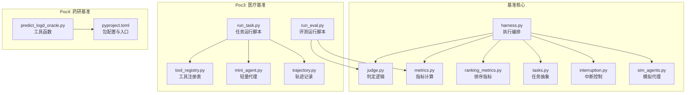
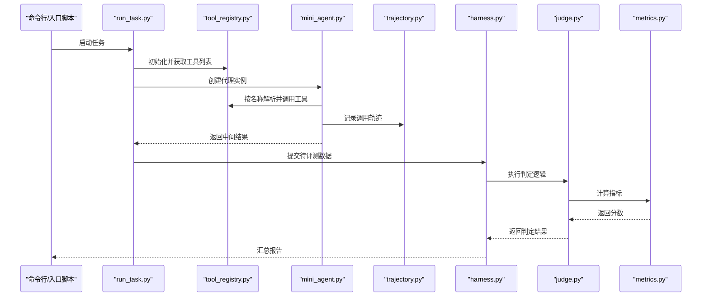
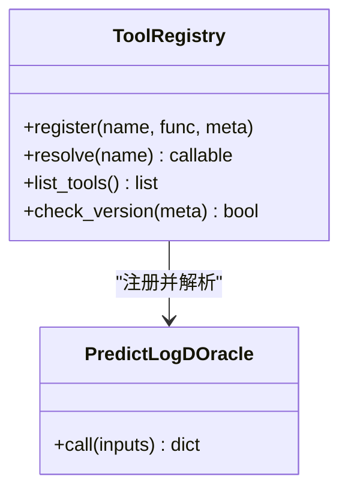
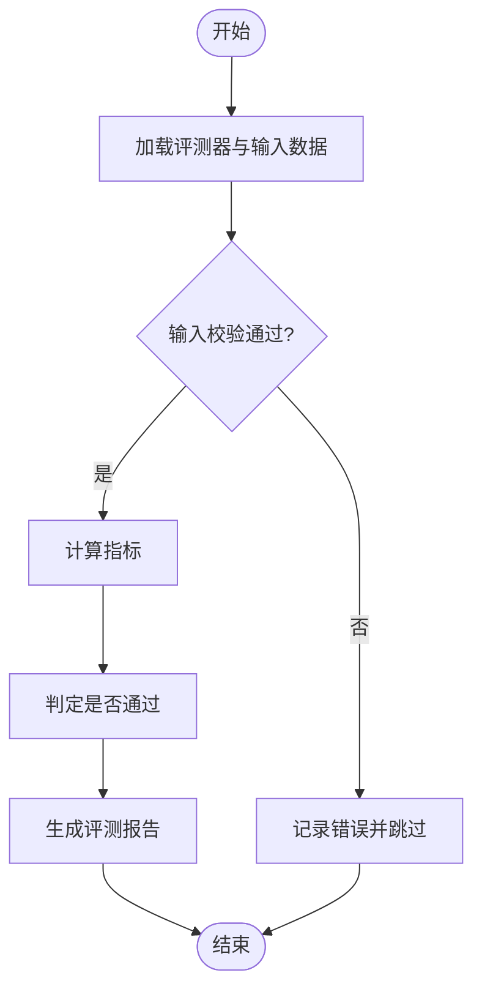
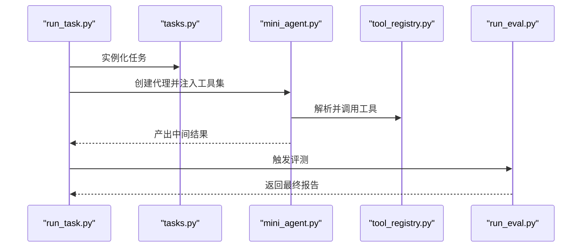
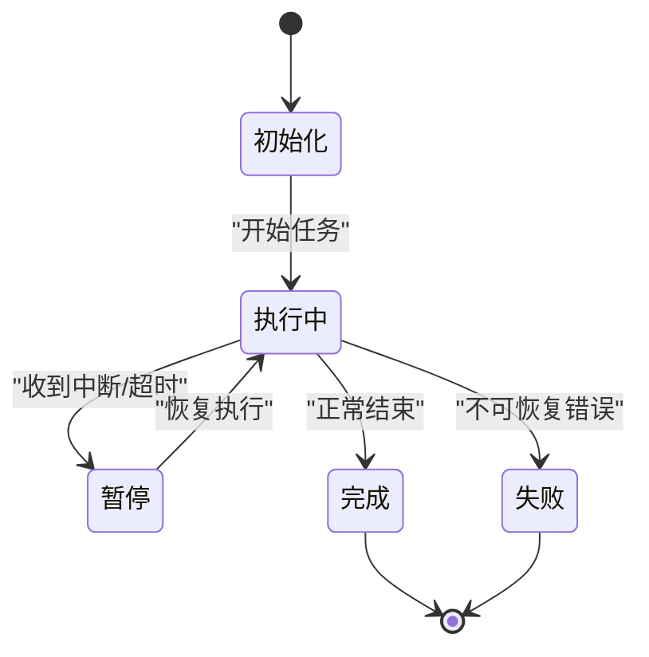
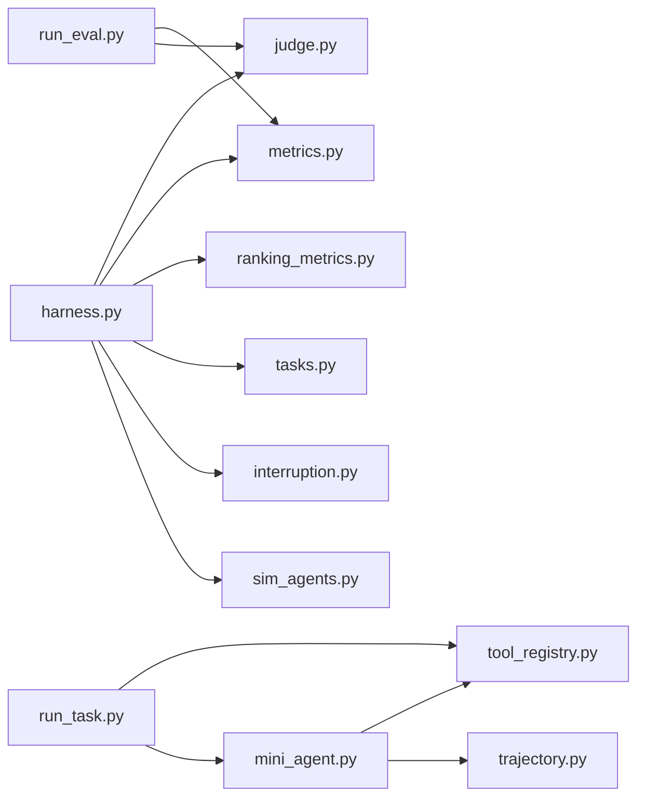

# 插件架构

<cite>
**本文引用的文件**   
- [autonomy_mvp/core/harness.py](file://autonomy_mvp/core/harness.py)
- [autonomy_mvp/core/judge.py](file://autonomy_mvp/core/judge.py)
- [autonomy_mvp/core/metrics.py](file://autonomy_mvp/core/metrics.py)
- [autonomy_mvp/core/ranking_metrics.py](file://autonomy_mvp/core/ranking_metrics.py)
- [autonomy_mvp/core/tasks.py](file://autonomy_mvp/core/tasks.py)
- [autonomy_mvp/core/interruption.py](file://autonomy_mvp/core/interruption.py)
- [autonomy_mvp/core/sim_agents.py](file://autonomy_mvp/core/sim_agents.py)
- [autonomy_mvp/tests/test_core.py](file://autonomy_mvp/tests/test_core.py)
- [task7/poc3_physicianbench/agent/tool_registry.py](file://task7/poc3_physicianbench/agent/tool_registry.py)
- [task7/poc3_physicianbench/agent/mini_agent.py](file://task7/poc3_physicianbench/agent/mini_agent.py)
- [task7/poc3_physicianbench/agent/trajectory.py](file://task7/poc3_physicianbench/agent/trajectory.py)
- [task7/poc3_physicianbench/scripts/run_task.py](file://task7/poc3_physicianbench/scripts/run_task.py)
- [task7/poc3_physicianbench/scripts/run_eval.py](file://task7/poc3_physicianbench/scripts/run_eval.py)
- [task7/poc4_pharmabench/tools/predict_logd_oracle.py](file://task7/poc4_pharmabench/tools/predict_logd_oracle.py)
- [task7/poc4_pharmabench/pyproject.toml](file://task7/poc4_pharmabench/pyproject.toml)
</cite>

## 目录
1. [简介](#简介)
2. [项目结构](#项目结构)
3. [核心组件](#核心组件)
4. [架构总览](#架构总览)
5. [详细组件分析](#详细组件分析)
6. [依赖分析](#依赖分析)
7. [性能考虑](#性能考虑)
8. [故障排查指南](#故障排查指南)
9. [结论](#结论)
10. [附录](#附录)

## 简介
本文件为科学计算基准测试框架的“插件架构”文档，面向工具插件、评估器插件与任务插件的开发与维护。文档围绕以下目标展开：
- 整体设计与注册机制：描述插件发现、注册、生命周期管理与调度策略。
- 开发规范：定义三类插件（工具、评估器、任务）的接口约定、数据交换格式与错误处理。
- 通信协议：明确插件间调用方式、参数与返回值契约、上下文传递与日志追踪。
- 发现与依赖管理：说明插件扫描路径、元数据声明、版本兼容性与冲突解决。
- 开发与调试：提供最小可运行示例、断点与日志定位技巧、性能分析与优化建议。

## 项目结构
仓库采用多子项目组织，与插件架构相关的核心代码集中在 autonomy_mvp 与 task7 下的若干 poc 中。关键目录与职责如下：
- autonomy_mvp/core：基准执行主流程、评测指标、任务抽象与中断控制等核心能力。
- task7/poc3_physicianbench：包含工具注册表、轻量代理、轨迹记录与任务/评测脚本，体现工具与评测插件化雏形。
- task7/poc4_pharmabench：以工具函数形式暴露预测能力，配合 pyproject.toml 进行依赖与入口声明，展示工具插件的打包与发现方式。

图表来源
- [autonomy_mvp/core/harness.py](file://autonomy_mvp/core/harness.py)
- [autonomy_mvp/core/judge.py](file://autonomy_mvp/core/judge.py)
- [autonomy_mvp/core/metrics.py](file://autonomy_mvp/core/metrics.py)
- [autonomy_mvp/core/ranking_metrics.py](file://autonomy_mvp/core/ranking_metrics.py)
- [autonomy_mvp/core/tasks.py](file://autonomy_mvp/core/tasks.py)
- [autonomy_mvp/core/interruption.py](file://autonomy_mvp/core/interruption.py)
- [autonomy_mvp/core/sim_agents.py](file://autonomy_mvp/core/sim_agents.py)
- [task7/poc3_physicianbench/agent/tool_registry.py](file://task7/poc3_physicianbench/agent/tool_registry.py)
- [task7/poc3_physicianbench/agent/mini_agent.py](file://task7/poc3_physicianbench/agent/mini_agent.py)
- [task7/poc3_physicianbench/agent/trajectory.py](file://task7/poc3_physicianbench/agent/trajectory.py)
- [task7/poc3_physicianbench/scripts/run_task.py](file://task7/poc3_physicianbench/scripts/run_task.py)
- [task7/poc3_physicianbench/scripts/run_eval.py](file://task7/poc3_physicianbench/scripts/run_eval.py)
- [task7/poc4_pharmabench/tools/predict_logd_oracle.py](file://task7/poc4_pharmabench/tools/predict_logd_oracle.py)
- [task7/poc4_pharmabench/pyproject.toml](file://task7/poc4_pharmabench/pyproject.toml)

章节来源
- [autonomy_mvp/core/harness.py](file://autonomy_mvp/core/harness.py)
- [autonomy_mvp/core/judge.py](file://autonomy_mvp/core/judge.py)
- [autonomy_mvp/core/metrics.py](file://autonomy_mvp/core/metrics.py)
- [autonomy_mvp/core/ranking_metrics.py](file://autonomy_mvp/core/ranking_metrics.py)
- [autonomy_mvp/core/tasks.py](file://autonomy_mvp/core/tasks.py)
- [autonomy_mvp/core/interruption.py](file://autonomy_mvp/core/interruption.py)
- [autonomy_mvp/core/sim_agents.py](file://autonomy_mvp/core/sim_agents.py)
- [task7/poc3_physicianbench/agent/tool_registry.py](file://task7/poc3_physicianbench/agent/tool_registry.py)
- [task7/poc3_physicianbench/agent/mini_agent.py](file://task7/poc3_physicianbench/agent/mini_agent.py)
- [task7/poc3_physicianbench/agent/trajectory.py](file://task7/poc3_physicianbench/agent/trajectory.py)
- [task7/poc3_physicianbench/scripts/run_task.py](file://task7/poc3_physicianbench/scripts/run_task.py)
- [task7/poc3_physicianbench/scripts/run_eval.py](file://task7/poc3_physicianbench/scripts/run_eval.py)
- [task7/poc4_pharmabench/tools/predict_logd_oracle.py](file://task7/poc4_pharmabench/tools/predict_logd_oracle.py)
- [task7/poc4_pharmabench/pyproject.toml](file://task7/poc4_pharmabench/pyproject.toml)

## 核心组件
- 执行编排（Harness）：负责加载任务、驱动评测、聚合结果、处理中断与异常。
- 判定器（Judge）：封装评分与通过性判断逻辑，供评测器或指标模块复用。
- 指标（Metrics/Ranking Metrics）：实现具体数值型指标与排序类指标的计算。
- 任务抽象（Tasks）：定义任务的数据结构、输入输出契约与执行步骤。
- 中断控制（Interruption）：支持超时、取消与资源清理的生命周期钩子。
- 模拟代理（Sim Agents）：用于在离线场景下模拟智能体行为，便于回归与压力测试。
- 工具注册表（Tool Registry）：集中注册与查找工具函数，提供命名空间与参数校验。
- 轻量代理（Mini Agent）：基于注册表调用工具、维护会话状态与轨迹。
- 轨迹记录（Trajectory）：持久化每一步调用、输入输出与耗时，便于审计与复现。
- 运行脚本（Run Task/Eval）：将任务与评测组合起来，作为插件化的入口点。
- 工具函数与包配置（Tools/Pkg）：以独立模块暴露工具能力，并通过包配置声明入口与依赖。

章节来源
- [autonomy_mvp/core/harness.py](file://autonomy_mvp/core/harness.py)
- [autonomy_mvp/core/judge.py](file://autonomy_mvp/core/judge.py)
- [autonomy_mvp/core/metrics.py](file://autonomy_mvp/core/metrics.py)
- [autonomy_mvp/core/ranking_metrics.py](file://autonomy_mvp/core/ranking_metrics.py)
- [autonomy_mvp/core/tasks.py](file://autonomy_mvp/core/tasks.py)
- [autonomy_mvp/core/interruption.py](file://autonomy_mvp/core/interruption.py)
- [autonomy_mvp/core/sim_agents.py](file://autonomy_mvp/core/sim_agents.py)
- [task7/poc3_physicianbench/agent/tool_registry.py](file://task7/poc3_physicianbench/agent/tool_registry.py)
- [task7/poc3_physicianbench/agent/mini_agent.py](file://task7/poc3_physicianbench/agent/mini_agent.py)
- [task7/poc3_physicianbench/agent/trajectory.py](file://task7/poc3_physicianbench/agent/trajectory.py)
- [task7/poc3_physicianbench/scripts/run_task.py](file://task7/poc3_physicianbench/scripts/run_task.py)
- [task7/poc3_physicianbench/scripts/run_eval.py](file://task7/poc3_physicianbench/scripts/run_eval.py)
- [task7/poc4_pharmabench/tools/predict_logd_oracle.py](file://task7/poc4_pharmabench/tools/predict_logd_oracle.py)
- [task7/poc4_pharmabench/pyproject.toml](file://task7/poc4_pharmabench/pyproject.toml)

## 架构总览
下图展示了从“任务运行脚本”到“工具注册表/轻量代理/轨迹记录”，再到“基准核心（评测与指标）”的整体调用关系。

图表来源
- [task7/poc3_physicianbench/scripts/run_task.py](file://task7/poc3_physicianbench/scripts/run_task.py)
- [task7/poc3_physicianbench/agent/tool_registry.py](file://task7/poc3_physicianbench/agent/tool_registry.py)
- [task7/poc3_physicianbench/agent/mini_agent.py](file://task7/poc3_physicianbench/agent/mini_agent.py)
- [task7/poc3_physicianbench/agent/trajectory.py](file://task7/poc3_physicianbench/agent/trajectory.py)
- [autonomy_mvp/core/harness.py](file://autonomy_mvp/core/harness.py)
- [autonomy_mvp/core/judge.py](file://autonomy_mvp/core/judge.py)
- [autonomy_mvp/core/metrics.py](file://autonomy_mvp/core/metrics.py)

## 详细组件分析

### 工具插件（Tool Plugin）
- 设计要点
  - 以独立模块暴露函数式 API，避免隐式全局状态。
  - 通过工具注册表统一注册，提供名称、参数签名、版本与依赖信息。
  - 输入输出采用结构化数据（如字典/JSON），字段需具备类型与约束说明。
- 注册与发现
  - 注册表维护名称到可调用的映射，并提供按前缀/标签过滤的能力。
  - 可通过包入口或显式导入完成注册；推荐在包初始化时自动注册。
- 错误处理
  - 对非法输入进行快速失败，返回明确的错误码与消息。
  - 对外部依赖失败进行重试与降级策略，保证可观测性（日志/轨迹）。
- 版本兼容
  - 在注册表中声明最小/最大兼容版本，运行时进行兼容性检查。
  - 对破坏性变更采用别名或迁移层，保持向后兼容。

图表来源
- [task7/poc3_physicianbench/agent/tool_registry.py](file://task7/poc3_physicianbench/agent/tool_registry.py)
- [task7/poc4_pharmabench/tools/predict_logd_oracle.py](file://task7/poc4_pharmabench/tools/predict_logd_oracle.py)

章节来源
- [task7/poc3_physicianbench/agent/tool_registry.py](file://task7/poc3_physicianbench/agent/tool_registry.py)
- [task7/poc4_pharmabench/tools/predict_logd_oracle.py](file://task7/poc4_pharmabench/tools/predict_logd_oracle.py)
- [task7/poc4_pharmabench/pyproject.toml](file://task7/poc4_pharmabench/pyproject.toml)

### 评估器插件（Evaluator Plugin）
- 设计要点
  - 以函数或类形式实现，接收标准化输入（样本、模型输出、元数据），返回结构化评分。
  - 与判定器（Judge）解耦，指标计算与通过性判断分离，便于组合与复用。
- 数据交换格式
  - 输入：包含样本标识、原始输入、模型输出、可选上下文。
  - 输出：包含单项指标、聚合得分、诊断信息与时间戳。
- 错误处理
  - 对缺失字段进行严格校验，给出可定位的错误信息。
  - 对不可恢复错误进行记录并跳过，不影响其他样本评测。

图表来源
- [autonomy_mvp/core/judge.py](file://autonomy_mvp/core/judge.py)
- [autonomy_mvp/core/metrics.py](file://autonomy_mvp/core/metrics.py)
- [autonomy_mvp/core/ranking_metrics.py](file://autonomy_mvp/core/ranking_metrics.py)

章节来源
- [autonomy_mvp/core/judge.py](file://autonomy_mvp/core/judge.py)
- [autonomy_mvp/core/metrics.py](file://autonomy_mvp/core/metrics.py)
- [autonomy_mvp/core/ranking_metrics.py](file://autonomy_mvp/core/ranking_metrics.py)

### 任务插件（Task Plugin）
- 设计要点
  - 任务抽象定义数据集加载、预处理、执行步骤与结果收集。
  - 通过运行脚本组装任务与评测器，形成端到端流水线。
- 生命周期管理
  - 初始化阶段：准备环境、加载数据、注册工具。
  - 执行阶段：按步骤调用工具/模型，记录轨迹与中间产物。
  - 收尾阶段：聚合结果、写入报告、释放资源。
- 中断与容错
  - 支持超时、取消信号与资源清理钩子，确保长时间运行的稳定性。

图表来源
- [task7/poc3_physicianbench/scripts/run_task.py](file://task7/poc3_physicianbench/scripts/run_task.py)
- [autonomy_mvp/core/tasks.py](file://autonomy_mvp/core/tasks.py)
- [task7/poc3_physicianbench/agent/mini_agent.py](file://task7/poc3_physicianbench/agent/mini_agent.py)
- [task7/poc3_physicianbench/agent/tool_registry.py](file://task7/poc3_physicianbench/agent/tool_registry.py)
- [task7/poc3_physicianbench/scripts/run_eval.py](file://task7/poc3_physicianbench/scripts/run_eval.py)

章节来源
- [task7/poc3_physicianbench/scripts/run_task.py](file://task7/poc3_physicianbench/scripts/run_task.py)
- [autonomy_mvp/core/tasks.py](file://autonomy_mvp/core/tasks.py)
- [task7/poc3_physicianbench/agent/mini_agent.py](file://task7/poc3_physicianbench/agent/mini_agent.py)
- [task7/poc3_physicianbench/agent/tool_registry.py](file://task7/poc3_physicianbench/agent/tool_registry.py)
- [task7/poc3_physicianbench/scripts/run_eval.py](file://task7/poc3_physicianbench/scripts/run_eval.py)

### 生命周期与中断管理
- 生命周期钩子
  - 初始化：加载配置、建立连接、预热缓存。
  - 执行：分步执行、进度上报、中间快照。
  - 终止：资源回收、持久化、告警上报。
- 中断控制
  - 支持超时与取消信号，确保在异常情况下安全退出。
  - 提供幂等恢复能力，允许从最近检查点继续。

图表来源
- [autonomy_mvp/core/interruption.py](file://autonomy_mvp/core/interruption.py)
- [autonomy_mvp/core/harness.py](file://autonomy_mvp/core/harness.py)

章节来源
- [autonomy_mvp/core/interruption.py](file://autonomy_mvp/core/interruption.py)
- [autonomy_mvp/core/harness.py](file://autonomy_mvp/core/harness.py)

### 通信协议与数据交换格式
- 调用协议
  - 同步函数调用为主，必要时支持异步回调。
  - 参数与返回值使用结构化对象（字典/数据类），禁止裸字符串拼接。
- 上下文传递
  - 通过上下文对象传递会话ID、工作目录、临时路径与日志句柄。
- 错误语义
  - 区分业务错误与系统错误，提供错误码、消息与堆栈摘要。
  - 对网络/IO失败进行重试与退避，记录诊断信息。

章节来源
- [task7/poc3_physicianbench/agent/tool_registry.py](file://task7/poc3_physicianbench/agent/tool_registry.py)
- [task7/poc3_physicianbench/agent/mini_agent.py](file://task7/poc3_physicianbench/agent/mini_agent.py)
- [task7/poc3_physicianbench/agent/trajectory.py](file://task7/poc3_physicianbench/agent/trajectory.py)

### 插件发现、依赖管理与版本兼容
- 发现机制
  - 支持按包名/路径扫描，或在包初始化时主动注册。
  - 提供清单文件（如 JSON/YAML）描述插件元数据，便于静态检查。
- 依赖管理
  - 通过包配置文件声明依赖与入口点，安装后自动可用。
  - 对可选依赖进行懒加载，避免冷启动开销。
- 版本兼容
  - 在元数据中声明兼容范围，运行时进行版本检查与提示。
  - 对破坏性变更提供迁移脚本或兼容层。

章节来源
- [task7/poc4_pharmabench/pyproject.toml](file://task7/poc4_pharmabench/pyproject.toml)
- [task7/poc3_physicianbench/agent/tool_registry.py](file://task7/poc3_physicianbench/agent/tool_registry.py)

## 依赖分析
下图展示核心模块之间的依赖关系，突出评测与指标、任务与工具注册表的耦合边界。

图表来源
- [autonomy_mvp/core/harness.py](file://autonomy_mvp/core/harness.py)
- [autonomy_mvp/core/judge.py](file://autonomy_mvp/core/judge.py)
- [autonomy_mvp/core/metrics.py](file://autonomy_mvp/core/metrics.py)
- [autonomy_mvp/core/ranking_metrics.py](file://autonomy_mvp/core/ranking_metrics.py)
- [autonomy_mvp/core/tasks.py](file://autonomy_mvp/core/tasks.py)
- [autonomy_mvp/core/interruption.py](file://autonomy_mvp/core/interruption.py)
- [autonomy_mvp/core/sim_agents.py](file://autonomy_mvp/core/sim_agents.py)
- [task7/poc3_physicianbench/scripts/run_task.py](file://task7/poc3_physicianbench/scripts/run_task.py)
- [task7/poc3_physicianbench/agent/tool_registry.py](file://task7/poc3_physicianbench/agent/tool_registry.py)
- [task7/poc3_physicianbench/agent/mini_agent.py](file://task7/poc3_physicianbench/agent/mini_agent.py)
- [task7/poc3_physicianbench/agent/trajectory.py](file://task7/poc3_physicianbench/agent/trajectory.py)
- [task7/poc3_physicianbench/scripts/run_eval.py](file://task7/poc3_physicianbench/scripts/run_eval.py)

章节来源
- [autonomy_mvp/core/harness.py](file://autonomy_mvp/core/harness.py)
- [autonomy_mvp/core/judge.py](file://autonomy_mvp/core/judge.py)
- [autonomy_mvp/core/metrics.py](file://autonomy_mvp/core/metrics.py)
- [autonomy_mvp/core/ranking_metrics.py](file://autonomy_mvp/core/ranking_metrics.py)
- [autonomy_mvp/core/tasks.py](file://autonomy_mvp/core/tasks.py)
- [autonomy_mvp/core/interruption.py](file://autonomy_mvp/core/interruption.py)
- [autonomy_mvp/core/sim_agents.py](file://autonomy_mvp/core/sim_agents.py)
- [task7/poc3_physicianbench/scripts/run_task.py](file://task7/poc3_physicianbench/scripts/run_task.py)
- [task7/poc3_physicianbench/agent/tool_registry.py](file://task7/poc3_physicianbench/agent/tool_registry.py)
- [task7/poc3_physicianbench/agent/mini_agent.py](file://task7/poc3_physicianbench/agent/mini_agent.py)
- [task7/poc3_physicianbench/agent/trajectory.py](file://task7/poc3_physicianbench/agent/trajectory.py)
- [task7/poc3_physicianbench/scripts/run_eval.py](file://task7/poc3_physicianbench/scripts/run_eval.py)

## 性能考虑
- 工具侧
  - 避免重复初始化昂贵资源，使用单例或连接池。
  - 对 I/O 密集操作进行批处理与缓存，减少往返次数。
  - 对 CPU 密集操作启用并行与向量化，注意 GIL 影响。
- 评测侧
  - 指标计算尽量无副作用，支持增量更新与并行聚合。
  - 大对象序列化延迟到落盘阶段，内存中保留引用。
- 任务侧
  - 流式读取数据，避免一次性加载全部样本。
  - 使用检查点与断点续跑，降低失败成本。
- 监控与优化
  - 在关键路径埋点耗时与资源占用，结合轨迹记录进行瓶颈定位。
  - 对热点函数进行采样分析，识别优化机会。

[本节为通用指导，不直接分析具体文件]

## 故障排查指南
- 常见问题
  - 工具未找到：检查注册表初始化顺序与包入口是否正确。
  - 参数不匹配：核对工具签名与调用方传参，关注类型与必填字段。
  - 评测失败：查看指标计算中的空值与除零保护，确认输入完整性。
  - 任务中断：检查超时与取消信号处理，确认资源清理钩子已执行。
- 定位技巧
  - 利用轨迹记录回溯每一步调用与中间结果。
  - 在关键分支添加结构化日志，包含请求 ID 与上下文。
  - 使用最小可复现用例隔离问题，逐步缩小范围。
- 恢复策略
  - 对幂等操作启用重试与退避。
  - 对非幂等操作引入事务或补偿逻辑。

章节来源
- [task7/poc3_physicianbench/agent/trajectory.py](file://task7/poc3_physicianbench/agent/trajectory.py)
- [autonomy_mvp/core/interruption.py](file://autonomy_mvp/core/interruption.py)
- [autonomy_mvp/core/harness.py](file://autonomy_mvp/core/harness.py)

## 结论
本插件架构以“工具注册表 + 轻量代理 + 轨迹记录”为核心，结合基准核心的“执行编排、判定与指标”，形成了可扩展、可观测、可恢复的科学计算基准测试体系。通过统一的通信协议与数据结构、严格的错误处理与版本兼容策略，开发者可以高效地扩展工具、评测与任务插件，并在复杂场景中保持稳定与高性能。

[本节为总结性内容，不直接分析具体文件]

## 附录
- 开发清单
  - 工具插件：实现函数式 API，完善元数据与错误语义，编写单元测试。
  - 评估器插件：定义输入输出契约，覆盖边界条件与异常路径。
  - 任务插件：拆分步骤、增加检查点、完善日志与轨迹。
- 最佳实践
  - 小步快跑、持续集成，尽早暴露兼容性问题。
  - 以数据为中心，保持输入输出的稳定与可演进。
  - 重视可观测性，让问题可定位、可复现、可度量。

[本节为补充性内容，不直接分析具体文件]