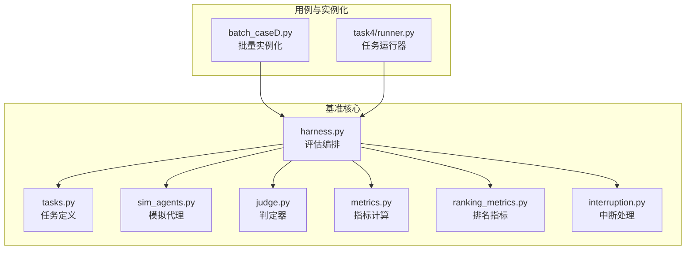
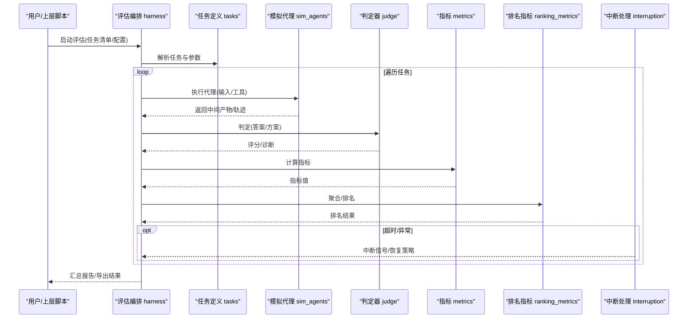
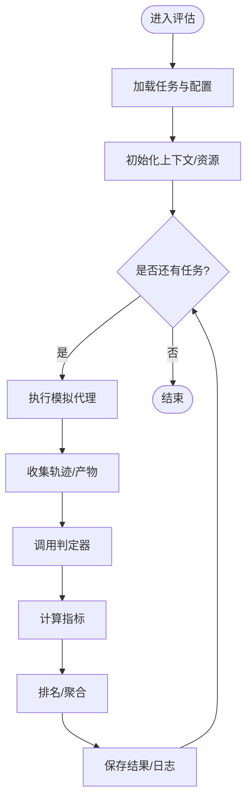
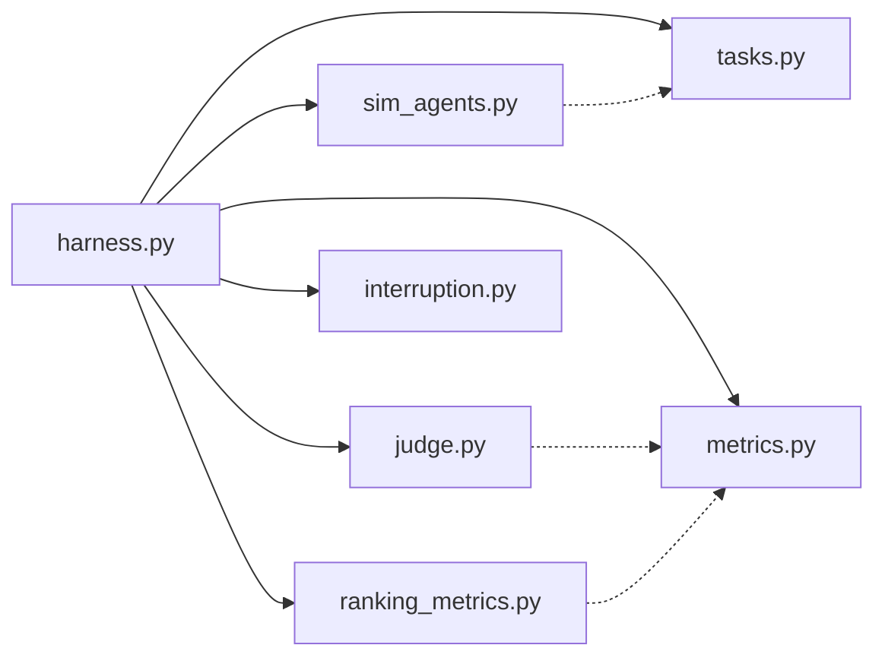

# 核心架构

<cite>
**本文引用的文件**   
- [autonomy_mvp/core/harness.py](file://autonomy_mvp/core/harness.py)
- [autonomy_mvp/core/interruption.py](file://autonomy_mvp/core/interruption.py)
- [autonomy_mvp/core/judge.py](file://autonomy_mvp/core/judge.py)
- [autonomy_mvp/core/metrics.py](file://autonomy_mvp/core/metrics.py)
- [autonomy_mvp/core/ranking_metrics.py](file://autonomy_mvp/core/ranking_metrics.py)
- [autonomy_mvp/core/sim_agents.py](file://autonomy_mvp/core/sim_agents.py)
- [autonomy_mvp/core/tasks.py](file://autonomy_mvp/core/tasks.py)
- [autonomy_mvp/run_validation.py](file://autonomy_mvp/run_validation.py)
- [autonomy_mvp/schema.md](file://autonomy_mvp/schema.md)
- [autonomy_mvp/ACCEPTANCE.md](file://autonomy_mvp/ACCEPTANCE.md)
- [longhorizon/instantiate/batch_caseD.py](file://longhorizon/instantiate/batch_caseD.py)
- [task4/runner.py](file://task4/runner.py)
</cite>

## 目录
1. [简介](#简介)
2. [项目结构](#项目结构)
3. [核心组件](#核心组件)
4. [架构总览](#架构总览)
5. [详细组件分析](#详细组件分析)
6. [依赖关系分析](#依赖关系分析)
7. [性能考量](#性能考量)
8. [故障排查指南](#故障排查指南)
9. [结论](#结论)
10. [附录](#附录)

## 简介
本文件为科学计算基准测试框架的核心架构文档，聚焦评估引擎、模拟代理、任务调度器与中断处理机制的设计原理与实现要点。文档面向不同技术背景的读者，提供从高层架构到代码级关系的可视化说明，并给出插件化扩展点与生命周期管理建议，帮助快速理解系统边界、通信协议与扩展方式。

## 项目结构
仓库采用“多任务、多数据集”的横向组织方式：
- autonomy_mvp：基准测试核心库（评估引擎、指标、判定器、模拟代理、任务定义、中断控制）
- longhorizon：长周期案例实例化与批处理脚本
- taskN：各子任务的运行脚本与结果
- docs：评测规范、模板与样例数据
- 其他：决议、方法论与实验记录

图表来源
- [autonomy_mvp/core/harness.py](file://autonomy_mvp/core/harness.py)
- [autonomy_mvp/core/tasks.py](file://autonomy_mvp/core/tasks.py)
- [autonomy_mvp/core/sim_agents.py](file://autonomy_mvp/core/sim_agents.py)
- [autonomy_mvp/core/judge.py](file://autonomy_mvp/core/judge.py)
- [autonomy_mvp/core/metrics.py](file://autonomy_mvp/core/metrics.py)
- [autonomy_mvp/core/ranking_metrics.py](file://autonomy_mvp/core/ranking_metrics.py)
- [autonomy_mvp/core/interruption.py](file://autonomy_mvp/core/interruption.py)
- [longhorizon/instantiate/batch_caseD.py](file://longhorizon/instantiate/batch_caseD.py)
- [task4/runner.py](file://task4/runner.py)

章节来源
- [autonomy_mvp/schema.md](file://autonomy_mvp/schema.md)
- [autonomy_mvp/ACCEPTANCE.md](file://autonomy_mvp/ACCEPTANCE.md)

## 核心组件
- 评估编排（Harness）：负责加载任务与配置、驱动模拟代理执行、收集中间状态、触发判定与指标计算、输出结果与日志。
- 任务定义（Tasks）：描述任务元数据、输入输出契约、环境约束与可插拔工具集。
- 模拟代理（Sim Agents）：封装被测算法或外部服务调用，提供统一接口供编排层调用。
- 判定器（Judge）：依据任务目标对代理输出进行正确性/质量判定，返回结构化评分与诊断信息。
- 指标与排名（Metrics/Ranking Metrics）：计算单样本与跨样本统计指标，支持排序与汇总。
- 中断处理（Interruption）：提供超时、异常恢复、资源回收与优雅退出能力。

章节来源
- [autonomy_mvp/core/harness.py](file://autonomy_mvp/core/harness.py)
- [autonomy_mvp/core/tasks.py](file://autonomy_mvp/core/tasks.py)
- [autonomy_mvp/core/sim_agents.py](file://autonomy_mvp/core/sim_agents.py)
- [autonomy_mvp/core/judge.py](file://autonomy_mvp/core/judge.py)
- [autonomy_mvp/core/metrics.py](file://autonomy_mvp/core/metrics.py)
- [autonomy_mvp/core/ranking_metrics.py](file://autonomy_mvp/core/ranking_metrics.py)
- [autonomy_mvp/core/interruption.py](file://autonomy_mvp/core/interruption.py)

## 架构总览
整体采用“编排-执行-评估”的分层模式：编排层解耦任务与执行细节；执行层通过模拟代理屏蔽外部差异；评估层以判定器和指标为核心，保证可复现与可扩展。

图表来源
- [autonomy_mvp/core/harness.py](file://autonomy_mvp/core/harness.py)
- [autonomy_mvp/core/tasks.py](file://autonomy_mvp/core/tasks.py)
- [autonomy_mvp/core/sim_agents.py](file://autonomy_mvp/core/sim_agents.py)
- [autonomy_mvp/core/judge.py](file://autonomy_mvp/core/judge.py)
- [autonomy_mvp/core/metrics.py](file://autonomy_mvp/core/metrics.py)
- [autonomy_mvp/core/ranking_metrics.py](file://autonomy_mvp/core/ranking_metrics.py)
- [autonomy_mvp/core/interruption.py](file://autonomy_mvp/core/interruption.py)

## 详细组件分析

### 评估编排（Harness）
职责边界
- 任务生命周期管理：初始化、执行、收尾
- 资源与上下文：工作目录、临时文件、环境变量
- 错误与中断：捕获异常、降级策略、清理
- 结果持久化：结构化输出、日志归档

关键流程
- 加载任务清单与配置
- 按批次/并发度调度执行
- 收集轨迹与中间产物
- 触发判定与指标计算
- 生成汇总报告

图表来源
- [autonomy_mvp/core/harness.py](file://autonomy_mvp/core/harness.py)

章节来源
- [autonomy_mvp/core/harness.py](file://autonomy_mvp/core/harness.py)

### 任务定义（Tasks）
职责边界
- 声明式描述任务：名称、版本、输入输出Schema、工具依赖、约束
- 提供默认参数与校验
- 暴露注册入口以便编排层发现

设计要点
- 使用统一的Schema约束输入输出，便于跨任务复用
- 将工具与环境依赖与任务解耦，提升可移植性

章节来源
- [autonomy_mvp/core/tasks.py](file://autonomy_mvp/core/tasks.py)
- [autonomy_mvp/schema.md](file://autonomy_mvp/schema.md)

### 模拟代理（Sim Agents）
职责边界
- 封装被测算法或服务调用
- 标准化输入输出格式
- 提供重试、限流、缓存等横切能力

扩展点
- 新增代理：实现统一接口，注册至代理工厂
- 组合代理：通过编排多个原子代理完成复杂流程

章节来源
- [autonomy_mvp/core/sim_agents.py](file://autonomy_mvp/core/sim_agents.py)

### 判定器（Judge）
职责边界
- 基于规则/模型/外部验证器对输出进行打分
- 返回结构化评分与诊断信息，便于溯源

设计要点
- 判定逻辑与指标计算分离，避免重复计算
- 支持多策略融合（如规则+模型）

章节来源
- [autonomy_mvp/core/judge.py](file://autonomy_mvp/core/judge.py)

### 指标与排名（Metrics / Ranking Metrics）
职责边界
- 指标：计算单样本/多维指标（准确率、F1、AUC、耗时等）
- 排名：跨样本排序、分组统计、显著性检验

设计要点
- 指标函数幂等、可组合
- 排名策略可配置（加权、阈值过滤）

章节来源
- [autonomy_mvp/core/metrics.py](file://autonomy_mvp/core/metrics.py)
- [autonomy_mvp/core/ranking_metrics.py](file://autonomy_mvp/core/ranking_metrics.py)

### 中断处理（Interruption）
职责边界
- 超时控制、异常恢复、资源回收、优雅退出
- 提供钩子用于监控与告警

设计要点
- 与编排层强耦合，确保在任意阶段均可安全中断
- 支持细粒度控制（任务级/步骤级）

章节来源
- [autonomy_mvp/core/interruption.py](file://autonomy_mvp/core/interruption.py)

### 插件系统与扩展机制
- 插件类型
  - 任务插件：新增任务定义与Schema
  - 代理插件：实现新的模拟代理
  - 判定器插件：新增或替换判定策略
  - 指标插件：自定义指标与排名策略
- 生命周期
  - 注册期：扫描与注册插件
  - 初始化期：按需加载依赖
  - 运行期：动态选择与组合
  - 销毁期：释放资源与清理状态
- 通信协议
  - 统一的数据契约（输入/输出Schema）
  - 事件总线（可选）用于状态上报与回调

章节来源
- [autonomy_mvp/core/tasks.py](file://autonomy_mvp/core/tasks.py)
- [autonomy_mvp/core/sim_agents.py](file://autonomy_mvp/core/sim_agents.py)
- [autonomy_mvp/core/judge.py](file://autonomy_mvp/core/judge.py)
- [autonomy_mvp/core/metrics.py](file://autonomy_mvp/core/metrics.py)
- [autonomy_mvp/core/ranking_metrics.py](file://autonomy_mvp/core/ranking_metrics.py)

### 系统扩展点与自定义开发指南
- 新增任务
  - 在任务定义中声明Schema与默认参数
  - 编写对应代理与判定器
  - 在编排层注册任务清单
- 新增代理
  - 实现标准接口，处理异常与重试
  - 提供单元测试与回归用例
- 新增判定器/指标
  - 保持幂等与可组合
  - 输出结构化结果，便于下游消费
- 集成外部服务
  - 通过代理适配层隔离网络与鉴权
  - 增加熔断与降级策略

章节来源
- [autonomy_mvp/core/tasks.py](file://autonomy_mvp/core/tasks.py)
- [autonomy_mvp/core/sim_agents.py](file://autonomy_mvp/core/sim_agents.py)
- [autonomy_mvp/core/judge.py](file://autonomy_mvp/core/judge.py)
- [autonomy_mvp/core/metrics.py](file://autonomy_mvp/core/metrics.py)
- [autonomy_mvp/core/ranking_metrics.py](file://autonomy_mvp/core/ranking_metrics.py)

## 依赖关系分析
- 内聚与耦合
  - 编排层高内聚于任务生命周期，低耦合于具体代理与判定器
  - 指标与排名模块相互独立，便于替换与扩展
- 外部依赖
  - 任务数据与配置文件
  - 外部工具与服务（通过代理适配）
- 潜在循环依赖
  - 应避免指标模块反向依赖编排层，保持单向依赖链

图表来源
- [autonomy_mvp/core/harness.py](file://autonomy_mvp/core/harness.py)
- [autonomy_mvp/core/tasks.py](file://autonomy_mvp/core/tasks.py)
- [autonomy_mvp/core/sim_agents.py](file://autonomy_mvp/core/sim_agents.py)
- [autonomy_mvp/core/judge.py](file://autonomy_mvp/core/judge.py)
- [autonomy_mvp/core/metrics.py](file://autonomy_mvp/core/metrics.py)
- [autonomy_mvp/core/ranking_metrics.py](file://autonomy_mvp/core/ranking_metrics.py)
- [autonomy_mvp/core/interruption.py](file://autonomy_mvp/core/interruption.py)

章节来源
- [autonomy_mvp/core/harness.py](file://autonomy_mvp/core/harness.py)
- [autonomy_mvp/core/tasks.py](file://autonomy_mvp/core/tasks.py)
- [autonomy_mvp/core/sim_agents.py](file://autonomy_mvp/core/sim_agents.py)
- [autonomy_mvp/core/judge.py](file://autonomy_mvp/core/judge.py)
- [autonomy_mvp/core/metrics.py](file://autonomy_mvp/core/metrics.py)
- [autonomy_mvp/core/ranking_metrics.py](file://autonomy_mvp/core/ranking_metrics.py)
- [autonomy_mvp/core/interruption.py](file://autonomy_mvp/core/interruption.py)

## 性能考量
- 并发与批处理
  - 合理设置并发度，避免资源争用
  - 使用批处理减少I/O与序列化开销
- 缓存与去重
  - 对昂贵的外部调用引入缓存键与失效策略
  - 对相同输入的任务结果进行去重
- 内存与磁盘
  - 流式写入大结果，避免一次性加载
  - 及时清理中间产物，降低磁盘压力
- 监控与可观测性
  - 埋点关键路径耗时与失败率
  - 输出结构化日志，便于定位瓶颈

[本节为通用指导，不直接分析具体文件]

## 故障排查指南
- 常见问题
  - 任务未找到：检查任务清单与注册表
  - 代理执行失败：查看代理日志与重试策略
  - 判定器报错：核对输入Schema与字段映射
  - 指标计算异常：确认数据类型与缺失值处理
  - 中断导致部分完成：检查中断钩子与清理逻辑
- 定位方法
  - 启用详细日志与追踪ID
  - 使用最小可复现实例缩小范围
  - 分阶段断点（执行前/后、判定前后）

章节来源
- [autonomy_mvp/core/interruption.py](file://autonomy_mvp/core/interruption.py)
- [autonomy_mvp/core/judge.py](file://autonomy_mvp/core/judge.py)
- [autonomy_mvp/core/metrics.py](file://autonomy_mvp/core/metrics.py)

## 结论
本框架通过清晰的层次划分与插件化设计，实现了评估引擎、模拟代理、任务调度与中断处理的松耦合协作。统一的Schema与标准化接口提升了可维护性与可扩展性，配合完善的指标与排名体系，可满足多样化科学计算基准测试需求。建议在后续迭代中强化可观测性与自动化测试，进一步提升稳定性与易用性。

[本节为总结性内容，不直接分析具体文件]

## 附录
- 验收与规范
  - 验收标准与测试策略
  - Schema约定与示例
- 运行与实例化
  - 批量实例化与任务运行脚本参考

章节来源
- [autonomy_mvp/ACCEPTANCE.md](file://autonomy_mvp/ACCEPTANCE.md)
- [autonomy_mvp/schema.md](file://autonomy_mvp/schema.md)
- [longhorizon/instantiate/batch_caseD.py](file://longhorizon/instantiate/batch_caseD.py)
- [task4/runner.py](file://task4/runner.py)