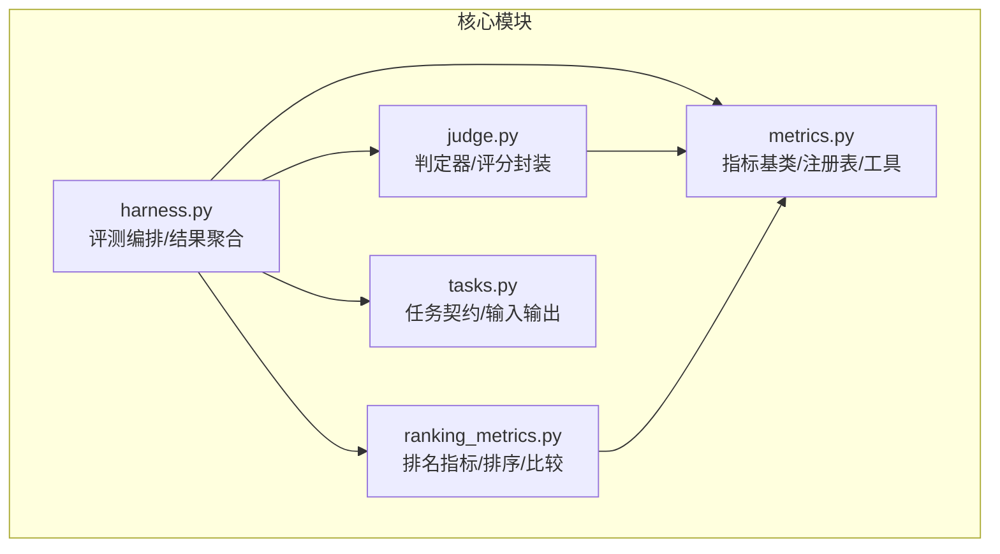
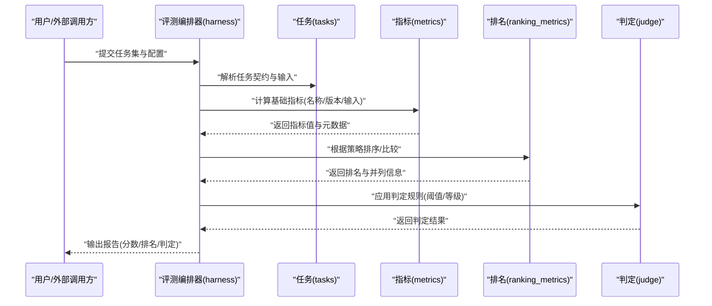
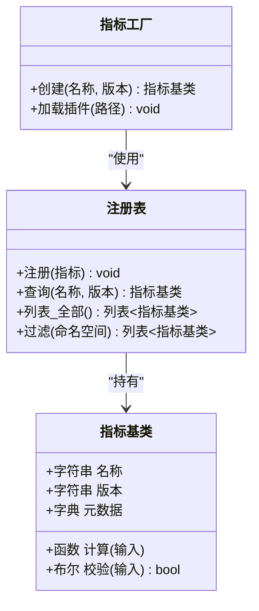
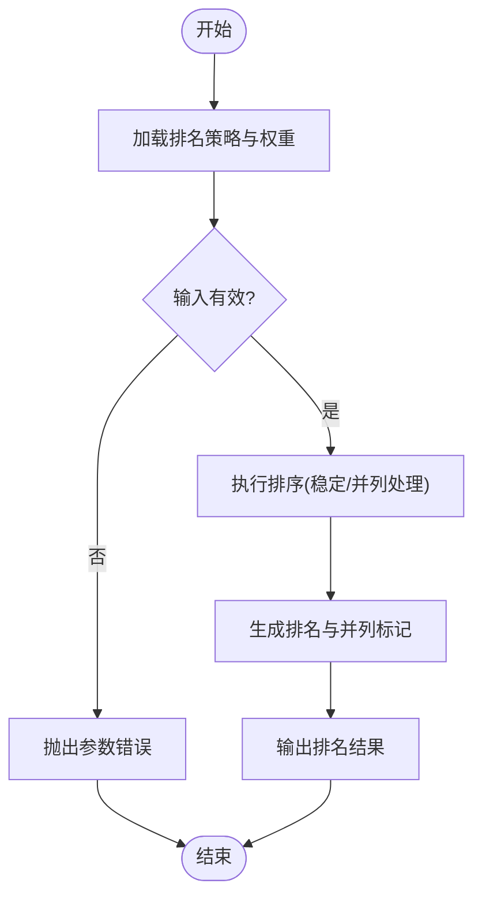
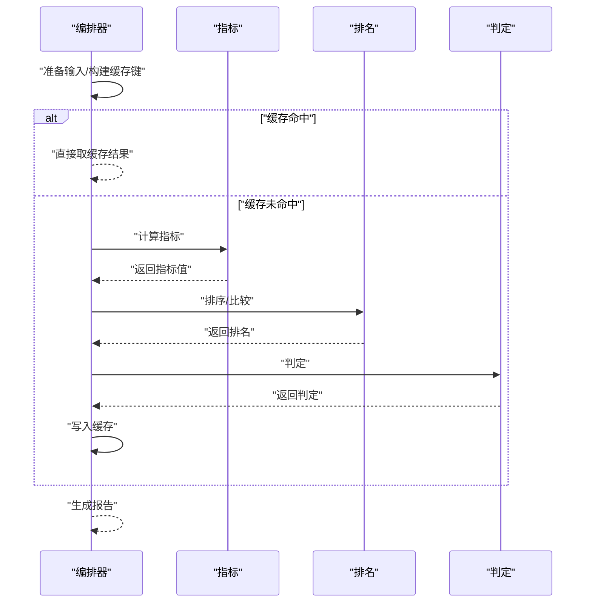
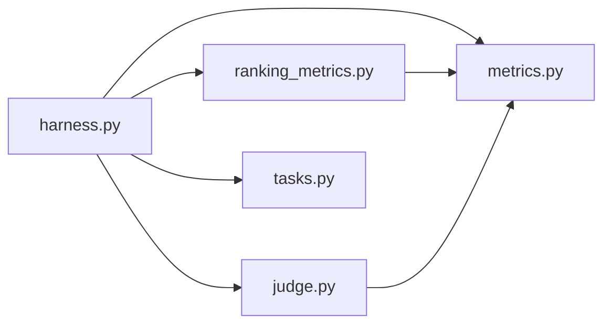

# 指标计算框架

<cite>
**本文引用的文件**   
- [autonomy_mvp/core/metrics.py](file://autonomy_mvp/core/metrics.py)
- [autonomy_mvp/core/ranking_metrics.py](file://autonomy_mvp/core/ranking_metrics.py)
- [autonomy_mvp/core/harness.py](file://autonomy_mvp/core/harness.py)
- [autonomy_mvp/core/judge.py](file://autonomy_mvp/core/judge.py)
- [autonomy_mvp/core/tasks.py](file://autonomy_mvp/core/tasks.py)
- [autonomy_mvp/tests/test_core.py](file://autonomy_mvp/tests/test_core.py)
</cite>

## 目录
1. [简介](#简介)
2. [项目结构](#项目结构)
3. [核心组件](#核心组件)
4. [架构总览](#架构总览)
5. [详细组件分析](#详细组件分析)
6. [依赖关系分析](#依赖关系分析)
7. [性能考虑](#性能考虑)
8. [故障排查指南](#故障排查指南)
9. [结论](#结论)
10. [附录](#附录)

## 简介
本文件面向科学计算基准测试框架的“指标计算框架”，聚焦以下目标：
- 指标系统的设计模式与可扩展性机制
- 基础指标库的实现原理、计算算法与性能优化策略
- 排名指标的计算方法、排序算法与比较逻辑
- 指标注册机制、动态加载与版本管理
- 指标开发的API接口、示例代码与最佳实践指南

该框架以“可插拔”的指标体系为核心，支持在任务执行过程中按需计算并汇总结果，同时提供统一的注册与发现机制，便于扩展新的指标类型与排名规则。

## 项目结构
与指标计算相关的核心代码位于 autonomy_mvp/core 目录下，关键文件包括：
- metrics.py：基础指标定义、注册表与通用计算工具
- ranking_metrics.py：排名指标与排序/比较逻辑
- harness.py：评测编排器，负责调度任务、收集中间结果并调用指标计算
- judge.py：判定器，封装评分与决策逻辑（可与指标协同）
- tasks.py：任务描述与数据契约，为指标提供输入输出规范
- tests/test_core.py：单元测试，覆盖指标注册、计算与排名的基本流程

图表来源
- [autonomy_mvp/core/metrics.py](file://autonomy_mvp/core/metrics.py)
- [autonomy_mvp/core/ranking_metrics.py](file://autonomy_mvp/core/ranking_metrics.py)
- [autonomy_mvp/core/harness.py](file://autonomy_mvp/core/harness.py)
- [autonomy_mvp/core/judge.py](file://autonomy_mvp/core/judge.py)
- [autonomy_mvp/core/tasks.py](file://autonomy_mvp/core/tasks.py)

章节来源
- [autonomy_mvp/core/metrics.py](file://autonomy_mvp/core/metrics.py)
- [autonomy_mvp/core/ranking_metrics.py](file://autonomy_mvp/core/ranking_metrics.py)
- [autonomy_mvp/core/harness.py](file://autonomy_mvp/core/harness.py)
- [autonomy_mvp/core/judge.py](file://autonomy_mvp/core/judge.py)
- [autonomy_mvp/core/tasks.py](file://autonomy_mvp/core/tasks.py)

## 核心组件
- 指标基类与注册表
  - 提供统一指标抽象（名称、版本、输入契约、计算函数、元信息）
  - 维护全局注册表，支持按名称或命名空间发现与加载
  - 提供默认实现与校验钩子（如输入格式、数值范围）
- 排名指标
  - 基于基础指标值进行排序与比较，支持多指标加权、并列处理与稳定性保证
  - 暴露排序策略选择与自定义比较器接口
- 评测编排器
  - 协调任务执行、中间结果收集、指标计算与结果持久化
  - 提供批量计算与缓存策略，减少重复计算开销
- 判定器
  - 将原始分数映射到等级/通过性判断，可与指标组合使用
- 任务契约
  - 明确输入输出字段、单位与取值范围，确保指标计算的健壮性

章节来源
- [autonomy_mvp/core/metrics.py](file://autonomy_mvp/core/metrics.py)
- [autonomy_mvp/core/ranking_metrics.py](file://autonomy_mvp/core/ranking_metrics.py)
- [autonomy_mvp/core/harness.py](file://autonomy_mvp/core/harness.py)
- [autonomy_mvp/core/judge.py](file://autonomy_mvp/core/judge.py)
- [autonomy_mvp/core/tasks.py](file://autonomy_mvp/core/tasks.py)

## 架构总览
下图展示指标计算框架的整体交互：编排器从任务读取输入，调用指标计算得到分数，再经排名指标生成最终排序；判定器对结果做二次决策。

图表来源
- [autonomy_mvp/core/harness.py](file://autonomy_mvp/core/harness.py)
- [autonomy_mvp/core/metrics.py](file://autonomy_mvp/core/metrics.py)
- [autonomy_mvp/core/ranking_metrics.py](file://autonomy_mvp/core/ranking_metrics.py)
- [autonomy_mvp/core/judge.py](file://autonomy_mvp/core/judge.py)
- [autonomy_mvp/core/tasks.py](file://autonomy_mvp/core/tasks.py)

## 详细组件分析

### 指标基类与注册表（metrics.py）
- 设计要点
  - 指标对象包含：唯一标识、版本、输入校验、计算函数、元数据（单位、方向等）
  - 注册表提供：注册、查询、批量获取、按命名空间过滤
  - 版本管理：同一指标可存在多个版本，计算时按版本选择实现
- 计算流程
  - 输入校验 → 版本选择 → 计算函数执行 → 结果标准化与缓存
- 可扩展性
  - 新增指标只需实现标准接口并注册到全局表
  - 支持插件式加载（按约定路径扫描或显式导入）

图表来源
- [autonomy_mvp/core/metrics.py](file://autonomy_mvp/core/metrics.py)

章节来源
- [autonomy_mvp/core/metrics.py](file://autonomy_mvp/core/metrics.py)

### 排名指标与排序比较（ranking_metrics.py）
- 设计要点
  - 支持多种排序策略：单指标排序、多指标加权、分桶/分层排序
  - 比较逻辑：稳定排序、并列处理、缺失值策略
  - 版本兼容：不同版本的排名策略可共存并按配置选择
- 算法特性
  - 时间复杂度：O(n log n) 为主（基于比较排序）
  - 空间复杂度：O(n)（用于索引与辅助数组）
  - 并行优化：分片排序后归并（适合大规模数据集）

图表来源
- [autonomy_mvp/core/ranking_metrics.py](file://autonomy_mvp/core/ranking_metrics.py)

章节来源
- [autonomy_mvp/core/ranking_metrics.py](file://autonomy_mvp/core/ranking_metrics.py)

### 评测编排器（harness.py）
- 职责
  - 解析任务契约，准备输入数据
  - 调度指标计算，聚合中间结果
  - 调用排名与判定模块，生成最终报告
- 性能优化
  - 结果缓存：按输入指纹缓存指标值，避免重复计算
  - 批处理：批量计算以减少函数调用开销
  - 惰性求值：仅在需要时计算特定指标

图表来源
- [autonomy_mvp/core/harness.py](file://autonomy_mvp/core/harness.py)
- [autonomy_mvp/core/metrics.py](file://autonomy_mvp/core/metrics.py)
- [autonomy_mvp/core/ranking_metrics.py](file://autonomy_mvp/core/ranking_metrics.py)
- [autonomy_mvp/core/judge.py](file://autonomy_mvp/core/judge.py)

章节来源
- [autonomy_mvp/core/harness.py](file://autonomy_mvp/core/harness.py)

### 判定器（judge.py）
- 功能
  - 将连续分数映射到离散等级或通过性判断
  - 支持阈值、区间、条件组合等规则
- 与指标协作
  - 接收指标输出的结构化结果，进行二次决策
  - 可结合排名结果进行综合判定

章节来源
- [autonomy_mvp/core/judge.py](file://autonomy_mvp/core/judge.py)

### 任务契约（tasks.py）
- 内容
  - 定义输入字段、数据类型、取值范围与单位
  - 定义输出字段与语义，确保指标一致性
- 作用
  - 作为指标与编排器的契约边界，提升鲁棒性与可测试性

章节来源
- [autonomy_mvp/core/tasks.py](file://autonomy_mvp/core/tasks.py)

## 依赖关系分析
- 耦合度
  - 编排器对指标、排名、判定模块有强依赖，但通过接口解耦
  - 指标与排名之间通过数据结构契约通信，降低直接耦合
- 循环依赖
  - 当前结构无循环依赖；若引入新模块需遵循单向依赖原则
- 外部依赖
  - 指标计算可能依赖科学计算库（如数值运算、统计），应在注册表中声明依赖清单

图表来源
- [autonomy_mvp/core/harness.py](file://autonomy_mvp/core/harness.py)
- [autonomy_mvp/core/metrics.py](file://autonomy_mvp/core/metrics.py)
- [autonomy_mvp/core/ranking_metrics.py](file://autonomy_mvp/core/ranking_metrics.py)
- [autonomy_mvp/core/judge.py](file://autonomy_mvp/core/judge.py)
- [autonomy_mvp/core/tasks.py](file://autonomy_mvp/core/tasks.py)

章节来源
- [autonomy_mvp/core/harness.py](file://autonomy_mvp/core/harness.py)
- [autonomy_mvp/core/metrics.py](file://autonomy_mvp/core/metrics.py)
- [autonomy_mvp/core/ranking_metrics.py](file://autonomy_mvp/core/ranking_metrics.py)
- [autonomy_mvp/core/judge.py](file://autonomy_mvp/core/judge.py)
- [autonomy_mvp/core/tasks.py](file://autonomy_mvp/core/tasks.py)

## 性能考虑
- 缓存策略
  - 基于输入指纹的LRU或TTL缓存，显著减少重复计算
- 批处理与并行
  - 对独立样本进行批处理，利用向量化或并行池提升吞吐
- 惰性计算
  - 仅计算被请求的指标，避免全量计算带来的开销
- 内存管理
  - 大对象及时释放，避免峰值内存过高
- 排序优化
  - 预排序键提取、分片排序与归并，降低整体时间复杂度

[本节为通用指导，不直接分析具体文件]

## 故障排查指南
- 常见问题
  - 指标未注册：检查注册表初始化与插件加载路径
  - 版本冲突：确认请求的版本是否存在且兼容
  - 输入校验失败：核对任务契约与输入字段类型/范围
  - 排序异常：检查缺失值策略与并列处理规则
- 调试建议
  - 启用详细日志，记录输入指纹、缓存命中情况与计算耗时
  - 使用最小复现用例验证指标与排名逻辑
  - 对比不同版本的指标实现差异，定位回归问题

章节来源
- [autonomy_mvp/tests/test_core.py](file://autonomy_mvp/tests/test_core.py)

## 结论
本指标计算框架通过清晰的模块化设计与统一的注册机制，实现了高内聚、低耦合的可扩展指标体系。基础指标库提供稳定的计算能力，排名指标支持灵活的排序与比较策略，编排器则负责端到端的流程控制与性能优化。配合完善的任务契约与判定器，框架能够支撑复杂科学计算场景下的基准评测需求。

[本节为总结性内容，不直接分析具体文件]

## 附录

### 指标开发API与最佳实践
- 开发步骤
  - 定义指标：实现名称、版本、输入校验与计算函数
  - 注册指标：加入全局注册表，必要时声明依赖
  - 编写测试：覆盖正常路径、边界条件与异常分支
  - 文档说明：补充单位、方向、适用场景与注意事项
- 最佳实践
  - 保持幂等：相同输入应产生相同输出
  - 明确版本：向后兼容优先，重大变更升级版本号
  - 性能敏感：避免重复计算，尽量使用向量化操作
  - 可观测性：输出必要的元数据与诊断信息

[本节为概念性指导，不直接分析具体文件]