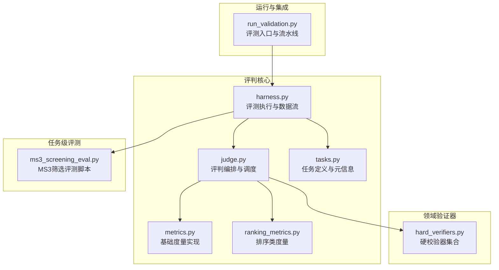
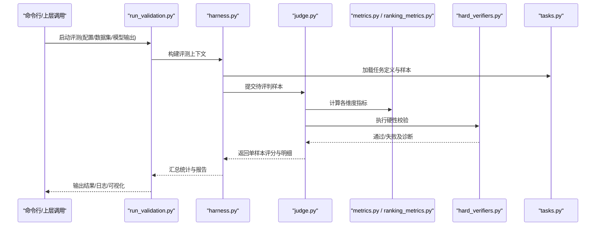
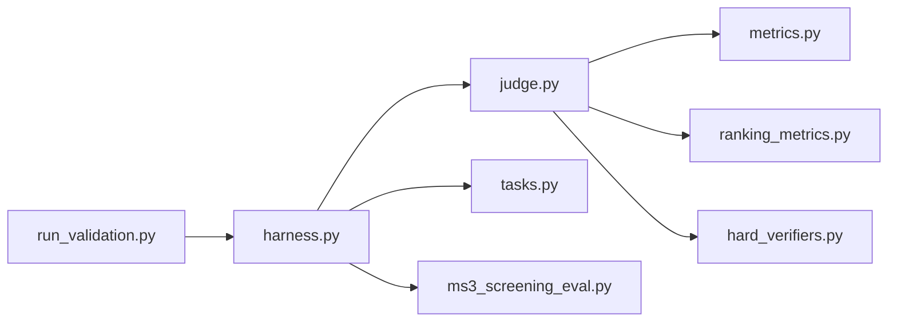

# 智能评判系统

<cite>
**本文引用的文件**   
- [autonomy_mvp/core/judge.py](file://autonomy_mvp/core/judge.py)
- [autonomy_mvp/core/metrics.py](file://autonomy_mvp/core/metrics.py)
- [autonomy_mvp/core/ranking_metrics.py](file://autonomy_mvp/core/ranking_metrics.py)
- [autonomy_mvp/core/harness.py](file://autonomy_mvp/core/harness.py)
- [autonomy_mvp/core/tasks.py](file://autonomy_mvp/core/tasks.py)
- [autonomy_mvp/run_validation.py](file://autonomy_mvp/run_validation.py)
- [longhorizon/verifiers/hard_verifiers.py](file://longhorizon/verifiers/hard_verifiers.py)
- [task3/B_ms3_screening_prototype/ms3_screening_eval.py](file://task3/B_ms3_screening_prototype/ms3_screening_eval.py)
</cite>

## 目录
1. [简介](#简介)
2. [项目结构](#项目结构)
3. [核心组件](#核心组件)
4. [架构总览](#架构总览)
5. [详细组件分析](#详细组件分析)
6. [依赖关系分析](#依赖关系分析)
7. [性能考量](#性能考量)
8. [故障排查指南](#故障排查指南)
9. [结论](#结论)
10. [附录](#附录)

## 简介
本文件面向科学计算基准测试框架的智能评判系统，系统性阐述评判器的设计模式、评分算法与结果验证逻辑；解释多维度评估指标的计算方法、权重分配与综合评分机制；说明自定义评判器的开发接口、注册方法与扩展点；并给出评判规则配置、版本管理与兼容性处理建议，以及集成示例、调试技巧与性能优化策略。

## 项目结构
围绕“评判”相关能力，仓库中关键代码集中在以下位置：
- 评判核心与度量：autonomy_mvp/core 下的 judge、metrics、ranking_metrics、harness、tasks
- 评测运行入口：autonomy_mvp/run_validation.py
- 领域专用验证器：longhorizon/verifiers/hard_verifiers.py
- 任务级评测脚本：task3/B_ms3_screening_prototype/ms3_screening_eval.py

图表来源
- [autonomy_mvp/core/judge.py](file://autonomy_mvp/core/judge.py)
- [autonomy_mvp/core/metrics.py](file://autonomy_mvp/core/metrics.py)
- [autonomy_mvp/core/ranking_metrics.py](file://autonomy_mvp/core/ranking_metrics.py)
- [autonomy_mvp/core/harness.py](file://autonomy_mvp/core/harness.py)
- [autonomy_mvp/core/tasks.py](file://autonomy_mvp/core/tasks.py)
- [autonomy_mvp/run_validation.py](file://autonomy_mvp/run_validation.py)
- [longhorizon/verifiers/hard_verifiers.py](file://longhorizon/verifiers/hard_verifiers.py)
- [task3/B_ms3_screening_prototype/ms3_screening_eval.py](file://task3/B_ms3_screening_prototype/ms3_screening_eval.py)

章节来源
- [autonomy_mvp/core/judge.py](file://autonomy_mvp/core/judge.py)
- [autonomy_mvp/core/metrics.py](file://autonomy_mvp/core/metrics.py)
- [autonomy_mvp/core/ranking_metrics.py](file://autonomy_mvp/core/ranking_metrics.py)
- [autonomy_mvp/core/harness.py](file://autonomy_mvp/core/harness.py)
- [autonomy_mvp/core/tasks.py](file://autonomy_mvp/core/tasks.py)
- [autonomy_mvp/run_validation.py](file://autonomy_mvp/run_validation.py)
- [longhorizon/verifiers/hard_verifiers.py](file://longhorizon/verifiers/hard_verifiers.py)
- [task3/B_ms3_screening_prototype/ms3_screening_eval.py](file://task3/B_ms3_screening_prototype/ms3_screening_eval.py)

## 核心组件
- 评判编排器（judge）：负责加载任务、选择度量、组织评分流程、聚合结果与输出报告。
- 度量库（metrics）：提供通用数值型度量（如误差、相似度、覆盖率等）与标准化/归一化辅助。
- 排序度量（ranking_metrics）：针对排序/检索场景的指标（如命中率、NDCG 等）。
- 评测执行器（harness）：串联任务实例与评判器，管理输入/输出、并行度、重试与错误边界。
- 任务定义（tasks）：声明任务元信息、输入格式、期望输出与可选约束。
- 运行入口（run_validation）：解析配置、构建评测流水线、持久化结果与生成汇总。
- 领域验证器（hard_verifiers）：面向特定任务的强约束校验（如物理一致性、化学合理性等）。
- 任务级评测（ms3_screening_eval）：针对具体子任务的端到端评测脚本，复用核心评判能力。

章节来源
- [autonomy_mvp/core/judge.py](file://autonomy_mvp/core/judge.py)
- [autonomy_mvp/core/metrics.py](file://autonomy_mvp/core/metrics.py)
- [autonomy_mvp/core/ranking_metrics.py](file://autonomy_mvp/core/ranking_metrics.py)
- [autonomy_mvp/core/harness.py](file://autonomy_mvp/core/harness.py)
- [autonomy_mvp/core/tasks.py](file://autonomy_mvp/core/tasks.py)
- [autonomy_mvp/run_validation.py](file://autonomy_mvp/run_validation.py)
- [longhorizon/verifiers/hard_verifiers.py](file://longhorizon/verifiers/hard_verifiers.py)
- [task3/B_ms3_screening_prototype/ms3_screening_eval.py](file://task3/B_ms3_screening_prototype/ms3_screening_eval.py)

## 架构总览
评判系统采用“编排器 + 度量插件 + 验证器 + 执行器”的分层架构。编排器根据任务类型动态装配度量与验证器；执行器负责数据流转、容错与并发；度量与验证器以可插拔方式接入，支持多指标加权融合与版本兼容。

图表来源
- [autonomy_mvp/run_validation.py](file://autonomy_mvp/run_validation.py)
- [autonomy_mvp/core/harness.py](file://autonomy_mvp/core/harness.py)
- [autonomy_mvp/core/judge.py](file://autonomy_mvp/core/judge.py)
- [autonomy_mvp/core/metrics.py](file://autonomy_mvp/core/metrics.py)
- [autonomy_mvp/core/ranking_metrics.py](file://autonomy_mvp/core/ranking_metrics.py)
- [autonomy_mvp/core/tasks.py](file://autonomy_mvp/core/tasks.py)
- [longhorizon/verifiers/hard_verifiers.py](file://longhorizon/verifiers/hard_verifiers.py)

## 详细组件分析

### 评判编排器（judge）
- 职责
  - 解析任务类型与所需度量清单
  - 组装评分管线：预处理 → 指标计算 → 验证器 → 聚合
  - 维护评分上下文（样本ID、时间戳、环境信息、版本标签）
  - 输出结构化评分结果（含明细与元数据）
- 设计要点
  - 策略模式：不同任务类型绑定不同度量/验证器组合
  - 责任链：按顺序执行多个度量与验证器，短路失败时快速返回
  - 可观测性：记录中间态与耗时，便于定位瓶颈
- 扩展点
  - 新增度量：实现统一接口并在注册表中登记
  - 新增验证器：实现断言/阈值检查接口，支持软/硬两种模式
  - 权重策略：支持静态权重与基于任务重要性的动态权重

章节来源
- [autonomy_mvp/core/judge.py](file://autonomy_mvp/core/judge.py)

### 度量库（metrics 与 ranking_metrics）
- 基础度量（metrics）
  - 常见数值指标：绝对误差、相对误差、均方误差、皮尔逊/斯皮尔曼相关系数、覆盖率、F1/AUC 等
  - 归一化与稳健统计：去极值、分位数缩放、缺失值处理
- 排序度量（ranking_metrics）
  - 命中/召回、Top-K 准确率、NDCG、AUPRC 等
  - 对长尾分布与类别不平衡的鲁棒性处理
- 复杂度与稳定性
  - 多数指标为 O(n) 或 O(n log n)，排序类指标注意缓存与增量更新
  - 数值稳定性：对接近零的差值进行保护，避免除零与溢出

章节来源
- [autonomy_mvp/core/metrics.py](file://autonomy_mvp/core/metrics.py)
- [autonomy_mvp/core/ranking_metrics.py](file://autonomy_mvp/core/ranking_metrics.py)

### 评测执行器（harness）
- 职责
  - 读取任务与样本，构造输入/期望输出
  - 驱动评判器批量执行，管理并发与重试
  - 收集异常、超时与资源不足事件，做降级与回退
  - 生成中间产物与最终报告（JSON/CSV/可视化）
- 关键流程
  - 初始化 → 批处理 → 指标计算 → 验证 → 聚合 → 落盘
- 并发与资源
  - 线程/进程池控制、I/O 缓冲、内存水位监控
  - 失败隔离：单个样本失败不影响整体批次

章节来源
- [autonomy_mvp/core/harness.py](file://autonomy_mvp/core/harness.py)

### 任务定义（tasks）
- 职责
  - 描述任务元信息（名称、版本、输入/输出 schema、约束）
  - 指定默认度量集与验证器集
  - 提供样例与基线参考
- 版本与兼容
  - 通过版本号与变更日志管理 schema 演进
  - 兼容层：在旧版本与新版本之间做字段映射与默认值填充

章节来源
- [autonomy_mvp/core/tasks.py](file://autonomy_mvp/core/tasks.py)

### 运行入口（run_validation）
- 职责
  - 解析命令行参数与配置文件
  - 构建评测上下文（数据集路径、模型输出、设备、随机种子）
  - 调度 harness 执行，汇总结果并导出
- 典型用法
  - 指定任务、数据集、模型输出目录、度量权重、是否启用验证器
  - 输出到指定目录，包含原始评分、聚合统计与诊断日志

章节来源
- [autonomy_mvp/run_validation.py](file://autonomy_mvp/run_validation.py)

### 领域验证器（hard_verifiers）
- 职责
  - 对关键属性进行强约束检查（如物理量纲、化学价态、拓扑连通性等）
  - 失败时提供可追溯的诊断信息（触发条件、阈值、受影响样本）
- 使用方式
  - 作为评判管线中的“硬门”，不通过则直接标记失败
  - 可与软度量并存，用于“先验过滤 + 后验打分”的两阶段策略

章节来源
- [longhorizon/verifiers/hard_verifiers.py](file://longhorizon/verifiers/hard_verifiers.py)

### 任务级评测（ms3_screening_eval）
- 职责
  - 针对 MS3 筛选任务的端到端评测：数据准备、特征工程、指标计算与结果对比
  - 复用核心评判能力，封装领域特定的预处理与后处理
- 特点
  - 与核心评判解耦，便于独立迭代与回归测试
  - 提供最小可运行示例，帮助快速上手

章节来源
- [task3/B_ms3_screening_prototype/ms3_screening_eval.py](file://task3/B_ms3_screening_prototype/ms3_screening_eval.py)

## 依赖关系分析
- 模块耦合
  - run_validation 仅依赖 harness 与 tasks，保持入口简洁
  - harness 依赖 judge、metrics、ranking_metrics、tasks 与 hard_verifiers
  - judge 依赖 metrics、ranking_metrics 与 hard_verifiers，形成“编排者只知接口”的低耦合结构
- 外部依赖
  - 数值计算与统计库（如 numpy/pandas/scipy/sklearn 等）由 metrics 与 ranking_metrics 内部引入
  - I/O 与序列化由 harness 统一管理
- 潜在循环依赖
  - 通过分层与接口抽象避免循环引用；若出现，应抽取公共接口至独立模块

图表来源
- [autonomy_mvp/run_validation.py](file://autonomy_mvp/run_validation.py)
- [autonomy_mvp/core/harness.py](file://autonomy_mvp/core/harness.py)
- [autonomy_mvp/core/judge.py](file://autonomy_mvp/core/judge.py)
- [autonomy_mvp/core/metrics.py](file://autonomy_mvp/core/metrics.py)
- [autonomy_mvp/core/ranking_metrics.py](file://autonomy_mvp/core/ranking_metrics.py)
- [autonomy_mvp/core/tasks.py](file://autonomy_mvp/core/tasks.py)
- [longhorizon/verifiers/hard_verifiers.py](file://longhorizon/verifiers/hard_verifiers.py)
- [task3/B_ms3_screening_prototype/ms3_screening_eval.py](file://task3/B_ms3_screening_prototype/ms3_screening_eval.py)

章节来源
- [autonomy_mvp/core/judge.py](file://autonomy_mvp/core/judge.py)
- [autonomy_mvp/core/harness.py](file://autonomy_mvp/core/harness.py)
- [autonomy_mvp/core/metrics.py](file://autonomy_mvp/core/metrics.py)
- [autonomy_mvp/core/ranking_metrics.py](file://autonomy_mvp/core/ranking_metrics.py)
- [autonomy_mvp/core/tasks.py](file://autonomy_mvp/core/tasks.py)
- [autonomy_mvp/run_validation.py](file://autonomy_mvp/run_validation.py)
- [longhorizon/verifiers/hard_verifiers.py](file://longhorizon/verifiers/hard_verifiers.py)
- [task3/B_ms3_screening_prototype/ms3_screening_eval.py](file://task3/B_ms3_screening_prototype/ms3_screening_eval.py)

## 性能考量
- 指标计算
  - 优先向量化操作，避免逐行 Python 循环
  - 对排序类指标使用稳定排序与缓存命中策略
- 并发与 I/O
  - 合理设置并行度，避免 CPU/IO 争用
  - 批量写入与异步落盘，减少磁盘抖动
- 内存与稳定性
  - 大样本分批处理，控制峰值内存
  - 对异常值与缺失值进行前置清洗，降低后续计算开销
- 可观测性
  - 埋点记录关键路径耗时与吞吐，定位热点
  - 采样式日志，避免高吞吐下日志放大

[本节为通用指导，无需源码引用]

## 故障排查指南
- 常见问题
  - 指标 NaN/Inf：检查除零保护、缺失值填充与数值范围
  - 排序指标不稳定：确认排序键一致性与稳定性
  - 验证器误报：核对阈值与单位换算，查看诊断日志
- 定位步骤
  - 开启详细日志，聚焦失败样本 ID
  - 复现最小用例，逐步关闭度量/验证器定位根因
  - 对比基线与历史结果，识别回归点
- 恢复策略
  - 启用重试与降级（跳过失败样本并记录）
  - 切换更稳健的度量实现或放宽阈值（需审计）

章节来源
- [autonomy_mvp/core/judge.py](file://autonomy_mvp/core/judge.py)
- [autonomy_mvp/core/harness.py](file://autonomy_mvp/core/harness.py)
- [longhorizon/verifiers/hard_verifiers.py](file://longhorizon/verifiers/hard_verifiers.py)

## 结论
本评判系统以编排器为核心，结合可插拔度量与验证器，形成可扩展、可观测、可配置的评测体系。通过分层设计与清晰的接口契约，既满足通用科学计算的多样性需求，又保证在复杂任务下的稳定性与可维护性。建议在持续演进中强化版本治理、回归测试与性能基准，确保评判结果的权威性与可比性。

[本节为总结性内容，无需源码引用]

## 附录

### 多维度评估指标与综合评分机制
- 指标分类
  - 准确性：误差类、相关性、分类/排序指标
  - 效率：运行时间、吞吐、资源占用
  - 鲁棒性：噪声/缺失/分布偏移下的表现
  - 可解释性：重要性、一致性、稳定性
- 权重分配
  - 静态权重：依据任务目标固定分配
  - 动态权重：基于任务难度/样本分布自适应调整
- 综合评分
  - 线性加权求和或非线性融合（如几何平均、TOPSIS）
  - 归一化到统一尺度，避免量纲影响
  - 输出分项得分与总分，保留可追溯明细

[本节为概念性说明，无需源码引用]

### 自定义评判器开发与扩展点
- 开发接口
  - 度量接口：输入预测与真实值，输出标量或向量指标
  - 验证器接口：输入样本与结果，返回通过/失败与诊断
- 注册方法
  - 在注册表中登记度量/验证器名称与实现
  - 支持按任务/版本选择默认组合
- 最佳实践
  - 幂等与可重复：相同输入产生相同输出
  - 文档化：输入/输出 schema、单位、阈值、适用边界
  - 单元测试：覆盖正常、边界与异常路径

[本节为概念性说明，无需源码引用]

### 评判规则配置、版本管理与兼容性
- 配置项
  - 任务与数据集路径、度量清单与权重、验证器开关、并发与超时
- 版本管理
  - 任务 schema 版本、度量实现版本、验证器版本
  - 变更日志与迁移脚本
- 兼容性
  - 向后兼容：旧版结果在新版仍可解析
  - 向前兼容：新版在不破坏旧版的前提下渐进升级

[本节为概念性说明，无需源码引用]

### 集成示例与调试技巧
- 集成示例
  - 使用 run_validation 指定任务、数据集与模型输出，一键生成报告
  - 在 harness 中注入自定义度量/验证器，按需替换默认组合
- 调试技巧
  - 单样本调试：锁定样本 ID，打印中间态
  - 指标断点：逐个度量开关，定位问题源
  - 可视化：绘制散点/箱线图/ROC/NDCG 曲线辅助判断

[本节为概念性说明，无需源码引用]