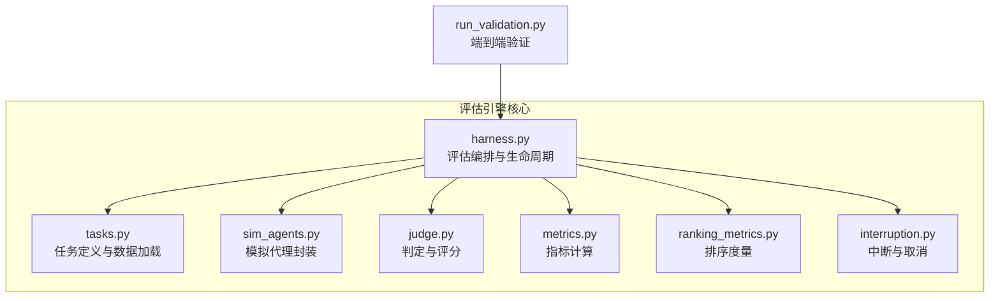
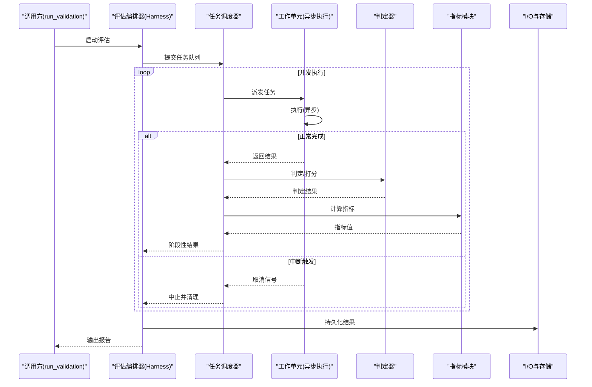
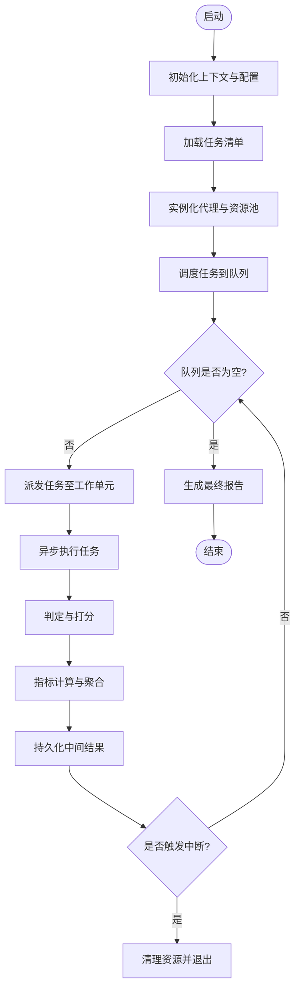
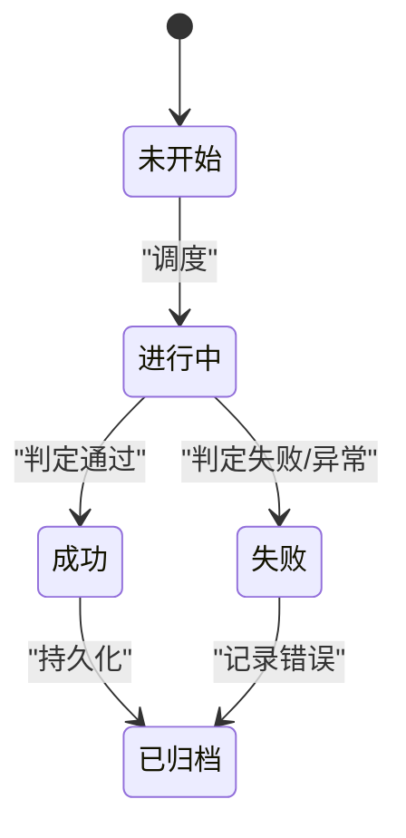
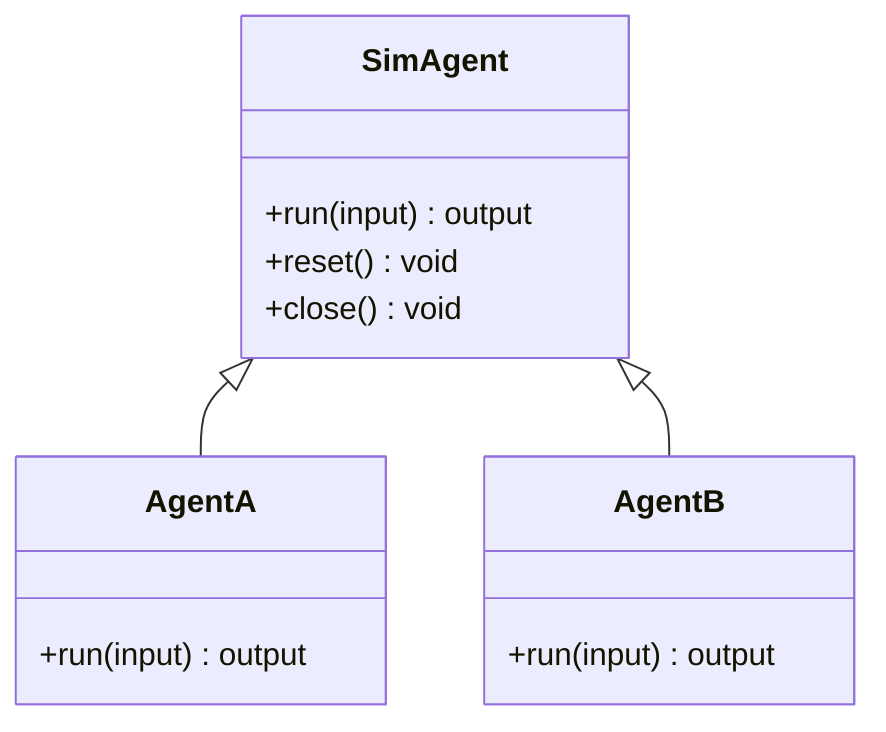
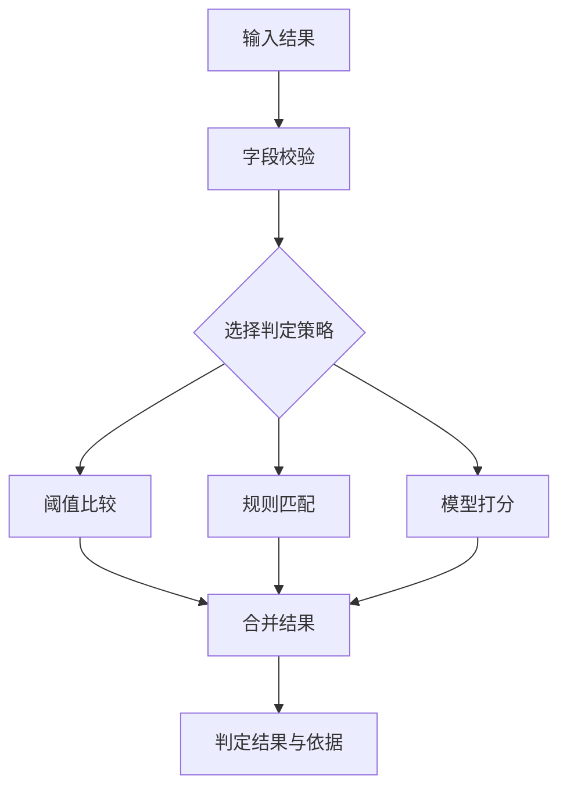
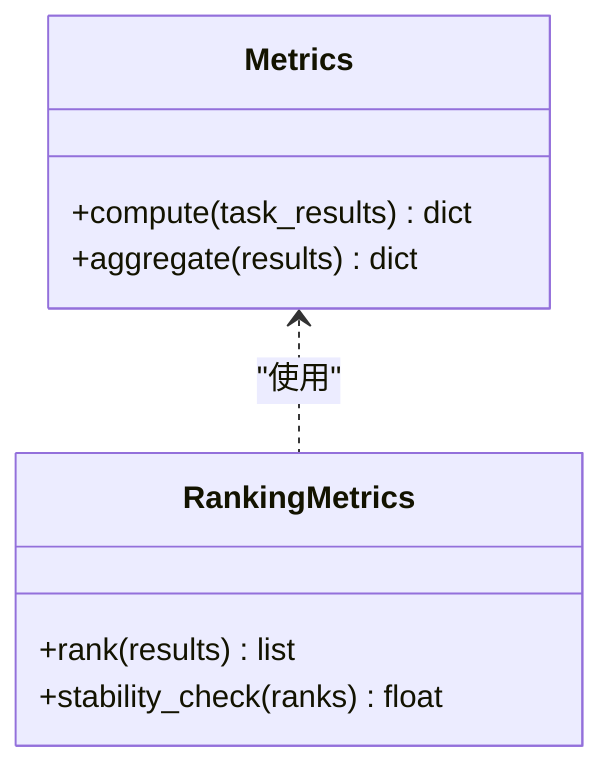
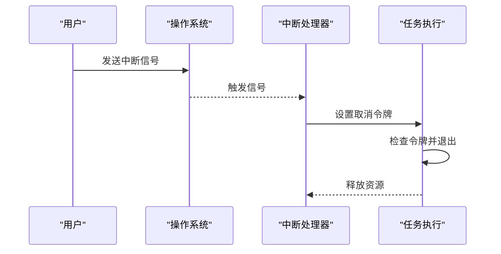
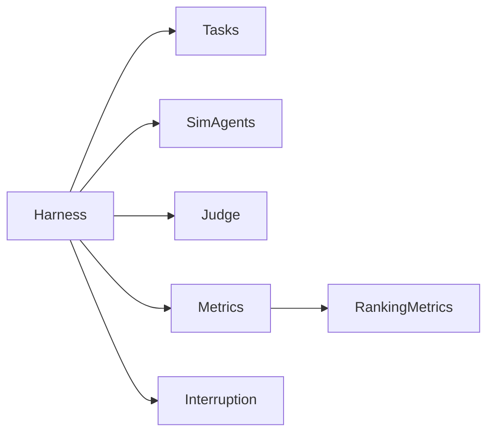

# 评估引擎核心

<cite>
**本文引用的文件**   
- [autonomy_mvp/core/harness.py](file://autonomy_mvp/core/harness.py)
- [autonomy_mvp/core/interruption.py](file://autonomy_mvp/core/interruption.py)
- [autonomy_mvp/core/judge.py](file://autonomy_mvp/core/judge.py)
- [autonomy_mvp/core/metrics.py](file://autonomy_mvp/core/metrics.py)
- [autonomy_mvp/core/ranking_metrics.py](file://autonomy_mvp/core/ranking_metrics.py)
- [autonomy_mvp/core/sim_agents.py](file://autonomy_mvp/core/sim_agents.py)
- [autonomy_mvp/core/tasks.py](file://autonomy_mvp/core/tasks.py)
- [autonomy_mvp/run_validation.py](file://autonomy_mvp/run_validation.py)
- [task1/runner.py](file://task1/runner.py)
- [task5/runner.py](file://task5/runner.py)
</cite>

## 目录
1. [引言](#引言)
2. [项目结构](#项目结构)
3. [核心组件](#核心组件)
4. [架构总览](#架构总览)
5. [详细组件分析](#详细组件分析)
6. [依赖关系分析](#依赖关系分析)
7. [性能考量](#性能考量)
8. [故障排查指南](#故障排查指南)
9. [结论](#结论)
10. [附录](#附录)

## 引言
本文件面向科学计算基准测试框架的“评估引擎核心”，系统性阐述其架构设计、执行流程与状态管理，重点覆盖任务调度器、异步执行模型与并发控制策略；同时说明中断处理机制、错误恢复策略与资源管理方法。文档还包含评估生命周期管理、事件驱动架构与可扩展性设计，并提供配置选项、使用示例与最佳实践，帮助读者快速上手并高效扩展评估能力。

## 项目结构
评估引擎核心位于 autonomy_mvp/core 目录下，围绕“任务-执行-评判-指标”的主线组织：
- harness.py：评估编排与生命周期管理（入口、调度、结果汇总）
- tasks.py：任务定义与数据加载
- sim_agents.py：模拟代理/评测对象封装
- judge.py：判定逻辑与评分规则
- metrics.py / ranking_metrics.py：指标计算与排序度量
- interruption.py：中断信号与取消传播
- run_validation.py：端到端验证脚本（集成 harness）

图表来源
- [autonomy_mvp/core/harness.py](file://autonomy_mvp/core/harness.py)
- [autonomy_mvp/core/tasks.py](file://autonomy_mvp/core/tasks.py)
- [autonomy_mvp/core/sim_agents.py](file://autonomy_mvp/core/sim_agents.py)
- [autonomy_mvp/core/judge.py](file://autonomy_mvp/core/judge.py)
- [autonomy_mvp/core/metrics.py](file://autonomy_mvp/core/metrics.py)
- [autonomy_mvp/core/ranking_metrics.py](file://autonomy_mvp/core/ranking_metrics.py)
- [autonomy_mvp/core/interruption.py](file://autonomy_mvp/core/interruption.py)
- [autonomy_mvp/run_validation.py](file://autonomy_mvp/run_validation.py)

章节来源
- [autonomy_mvp/core/harness.py](file://autonomy_mvp/core/harness.py)
- [autonomy_mvp/core/tasks.py](file://autonomy_mvp/core/tasks.py)
- [autonomy_mvp/core/sim_agents.py](file://autonomy_mvp/core/sim_agents.py)
- [autonomy_mvp/core/judge.py](file://autonomy_mvp/core/judge.py)
- [autonomy_mvp/core/metrics.py](file://autonomy_mvp/core/metrics.py)
- [autonomy_mvp/core/ranking_metrics.py](file://autonomy_mvp/core/ranking_metrics.py)
- [autonomy_mvp/core/interruption.py](file://autonomy_mvp/core/interruption.py)
- [autonomy_mvp/run_validation.py](file://autonomy_mvp/run_validation.py)

## 核心组件
- 评估编排器（Harness）
  - 职责：初始化上下文、加载任务、构建代理、调度执行、收集结果、计算指标、输出报告。
  - 关键流程：启动→准备→执行→收尾→上报。
- 任务系统（Tasks）
  - 职责：定义任务元数据、输入数据格式、期望输出与校验规则。
- 模拟代理（Sim Agents）
  - 职责：封装被测对象或仿真环境，提供统一接口供 Harness 调用。
- 判定器（Judge）
  - 职责：将原始输出映射为可判定的布尔/分数，支持多策略组合。
- 指标与排序（Metrics & Ranking Metrics）
  - 职责：聚合单任务指标、跨任务统计、排序与对比。
- 中断与取消（Interruption）
  - 职责：响应外部中断信号，安全终止长耗时任务，避免资源泄漏。

章节来源
- [autonomy_mvp/core/harness.py](file://autonomy_mvp/core/harness.py)
- [autonomy_mvp/core/tasks.py](file://autonomy_mvp/core/tasks.py)
- [autonomy_mvp/core/sim_agents.py](file://autonomy_mvp/core/sim_agents.py)
- [autonomy_mvp/core/judge.py](file://autonomy_mvp/core/judge.py)
- [autonomy_mvp/core/metrics.py](file://autonomy_mvp/core/metrics.py)
- [autonomy_mvp/core/ranking_metrics.py](file://autonomy_mvp/core/ranking_metrics.py)
- [autonomy_mvp/core/interruption.py](file://autonomy_mvp/core/interruption.py)

## 架构总览
评估引擎采用“事件驱动的流水线+任务调度器”的架构：
- 事件驱动：通过任务完成、指标就绪、中断信号等事件驱动各阶段流转。
- 任务调度器：负责从任务队列中拉取任务，按并发策略分配给工作单元执行。
- 异步执行：基于异步回调/协程实现非阻塞执行，提升吞吐。
- 并发控制：通过限流、互斥与资源池控制并行度，防止过载。
- 中断与恢复：全局中断标志位与局部取消令牌协同，确保优雅退出与部分恢复。

图表来源
- [autonomy_mvp/core/harness.py](file://autonomy_mvp/core/harness.py)
- [autonomy_mvp/core/interruption.py](file://autonomy_mvp/core/interruption.py)
- [autonomy_mvp/core/judge.py](file://autonomy_mvp/core/judge.py)
- [autonomy_mvp/core/metrics.py](file://autonomy_mvp/core/metrics.py)
- [autonomy_mvp/run_validation.py](file://autonomy_mvp/run_validation.py)

## 详细组件分析

### 评估编排器（Harness）
- 生命周期管理
  - 启动阶段：解析配置、初始化日志、创建中断监听器、准备临时目录。
  - 准备阶段：加载任务清单、实例化代理、建立资源池（线程/进程/连接）。
  - 执行阶段：调度任务、监控进度、处理异常、记录事件。
  - 收尾阶段：释放资源、汇总指标、生成报告、清理临时文件。
- 并发控制
  - 通过最大并发数限制工作单元数量，结合队列缓冲与背压机制。
  - 对共享资源加锁或使用独立副本避免竞争。
- 事件驱动
  - 发布“任务开始/结束”“指标就绪”“中断”等事件，订阅者按需处理。
- 错误恢复
  - 捕获可恢复异常并重试（指数退避），不可恢复异常标记失败并继续其他任务。
  - 支持断点续跑：读取上次检查点，跳过已完成任务。

图表来源
- [autonomy_mvp/core/harness.py](file://autonomy_mvp/core/harness.py)
- [autonomy_mvp/core/interruption.py](file://autonomy_mvp/core/interruption.py)

章节来源
- [autonomy_mvp/core/harness.py](file://autonomy_mvp/core/harness.py)

### 任务系统（Tasks）
- 任务定义
  - 描述任务ID、名称、输入数据路径、预期输出格式、校验规则。
- 数据加载
  - 支持JSON/CSV/二进制等格式，提供标准化数据结构。
- 任务状态机
  - 未开始→进行中→成功/失败→已归档，便于追踪与重跑。

图表来源
- [autonomy_mvp/core/tasks.py](file://autonomy_mvp/core/tasks.py)

章节来源
- [autonomy_mvp/core/tasks.py](file://autonomy_mvp/core/tasks.py)

### 模拟代理（Sim Agents）
- 统一接口
  - 提供 run()、reset()、close() 等方法，屏蔽底层差异。
- 资源隔离
  - 每个代理持有独立上下文，避免共享状态污染。
- 可插拔
  - 通过注册表动态加载不同代理实现，便于扩展新评测对象。

图表来源
- [autonomy_mvp/core/sim_agents.py](file://autonomy_mvp/core/sim_agents.py)

章节来源
- [autonomy_mvp/core/sim_agents.py](file://autonomy_mvp/core/sim_agents.py)

### 判定器（Judge）
- 策略模式
  - 支持多种判定策略（阈值、规则、学习模型），可组合使用。
- 可解释性
  - 输出判定依据与置信度，便于审计与调优。
- 容错
  - 对缺失字段或异常值进行默认处理与告警。

图表来源
- [autonomy_mvp/core/judge.py](file://autonomy_mvp/core/judge.py)

章节来源
- [autonomy_mvp/core/judge.py](file://autonomy_mvp/core/judge.py)

### 指标与排序（Metrics & Ranking Metrics）
- 指标计算
  - 单任务指标：准确率、召回率、F1、误差等。
  - 跨任务聚合：均值、方差、分位数、稳健统计量。
- 排序度量
  - 支持排名稳定性、一致性检验与显著性分析。
- 可视化
  - 生成表格与图表，辅助对比不同方案。

图表来源
- [autonomy_mvp/core/metrics.py](file://autonomy_mvp/core/metrics.py)
- [autonomy_mvp/core/ranking_metrics.py](file://autonomy_mvp/core/ranking_metrics.py)

章节来源
- [autonomy_mvp/core/metrics.py](file://autonomy_mvp/core/metrics.py)
- [autonomy_mvp/core/ranking_metrics.py](file://autonomy_mvp/core/ranking_metrics.py)

### 中断与取消（Interruption）
- 全局中断标志
  - 监听系统信号（如 Ctrl+C），设置标志位通知所有工作单元。
- 局部取消令牌
  - 每个任务持有取消令牌，在长耗时操作前检查并提前退出。
- 资源清理
  - 确保文件句柄、网络连接、进程池等资源被正确释放。

图表来源
- [autonomy_mvp/core/interruption.py](file://autonomy_mvp/core/interruption.py)

章节来源
- [autonomy_mvp/core/interruption.py](file://autonomy_mvp/core/interruption.py)

### 端到端验证（run_validation）
- 作用：集成 Harness，加载配置与任务，运行完整评估流程，输出结果与报告。
- 典型用法：命令行参数指定配置文件、任务集、输出目录与并发度。

章节来源
- [autonomy_mvp/run_validation.py](file://autonomy_mvp/run_validation.py)

## 依赖关系分析
- 内聚性
  - Harness 作为编排中心，低耦合地调用 Tasks、Agents、Judge、Metrics。
- 直接依赖
  - Harness → Tasks, SimAgents, Judge, Metrics, Interruption
- 间接依赖
  - Metrics 可能依赖 RankingMetrics；Judge 可能依赖外部模型库。
- 潜在循环
  - 通过接口抽象与事件解耦避免循环依赖。

图表来源
- [autonomy_mvp/core/harness.py](file://autonomy_mvp/core/harness.py)
- [autonomy_mvp/core/metrics.py](file://autonomy_mvp/core/metrics.py)
- [autonomy_mvp/core/ranking_metrics.py](file://autonomy_mvp/core/ranking_metrics.py)

章节来源
- [autonomy_mvp/core/harness.py](file://autonomy_mvp/core/harness.py)
- [autonomy_mvp/core/metrics.py](file://autonomy_mvp/core/metrics.py)
- [autonomy_mvp/core/ranking_metrics.py](file://autonomy_mvp/core/ranking_metrics.py)

## 性能考量
- 并发策略
  - 根据任务类型选择线程/进程/异步协程；CPU密集型用进程，I/O密集型用协程。
- 资源池
  - 复用数据库连接、HTTP客户端、模型实例，减少创建销毁开销。
- 批处理
  - 批量加载数据与计算指标，降低序列化与I/O成本。
- 缓存
  - 对重复计算的结果进行缓存（内存/磁盘），支持失效策略。
- 监控
  - 记录吞吐、延迟、内存与CPU占用，定位瓶颈。

[本节为通用指导，不直接分析具体文件]

## 故障排查指南
- 常见问题
  - 任务卡死：检查中断令牌与超时设置；确认无死锁。
  - 内存溢出：减小并发度或批次大小；启用逐条写入。
  - 指标异常：核对判定策略与数据清洗步骤。
- 诊断手段
  - 开启详细日志；导出中间结果与检查点；复现最小用例。
- 恢复策略
  - 从检查点续跑；隔离失败任务单独调试；回滚配置变更。

章节来源
- [autonomy_mvp/core/interruption.py](file://autonomy_mvp/core/interruption.py)
- [autonomy_mvp/core/harness.py](file://autonomy_mvp/core/harness.py)

## 结论
评估引擎以 Harness 为核心，结合任务系统、模拟代理、判定器与指标模块，构建了高内聚、低耦合、可扩展的科学计算基准测试框架。通过事件驱动与异步执行，配合严格的并发控制与中断处理，实现了稳定高效的评估流水线。建议在生产环境中完善监控与告警，持续优化资源利用与吞吐表现。

[本节为总结性内容，不直接分析具体文件]

## 附录

### 配置选项（示例）
- 并发度：max_workers、batch_size
- 超时：task_timeout、interrupt_delay
- 存储：output_dir、checkpoint_interval
- 指标：metric_set、ranking_method
- 日志：log_level、log_file

[本节为通用配置说明，不直接分析具体文件]

### 使用示例
- 基本运行：通过 run_validation 指定配置文件与任务集，设置输出目录与并发度。
- 自定义任务：在 tasks.py 中新增任务定义，并在 Harness 中注册。
- 扩展代理：在 sim_agents.py 中实现新代理类，并通过注册表加载。

章节来源
- [autonomy_mvp/run_validation.py](file://autonomy_mvp/run_validation.py)
- [autonomy_mvp/core/tasks.py](file://autonomy_mvp/core/tasks.py)
- [autonomy_mvp/core/sim_agents.py](file://autonomy_mvp/core/sim_agents.py)

### 最佳实践
- 明确任务边界与数据契约，避免隐式依赖。
- 使用幂等性与检查点，保证可重入与可恢复。
- 对长耗时操作设置超时与取消令牌。
- 指标计算与判定策略分离，便于独立测试与替换。
- 保持日志结构化，便于自动化分析与回溯。

[本节为通用实践建议，不直接分析具体文件]