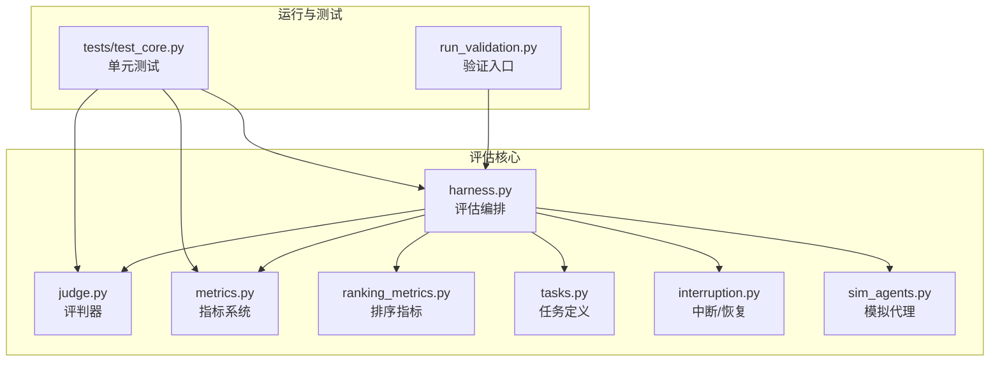
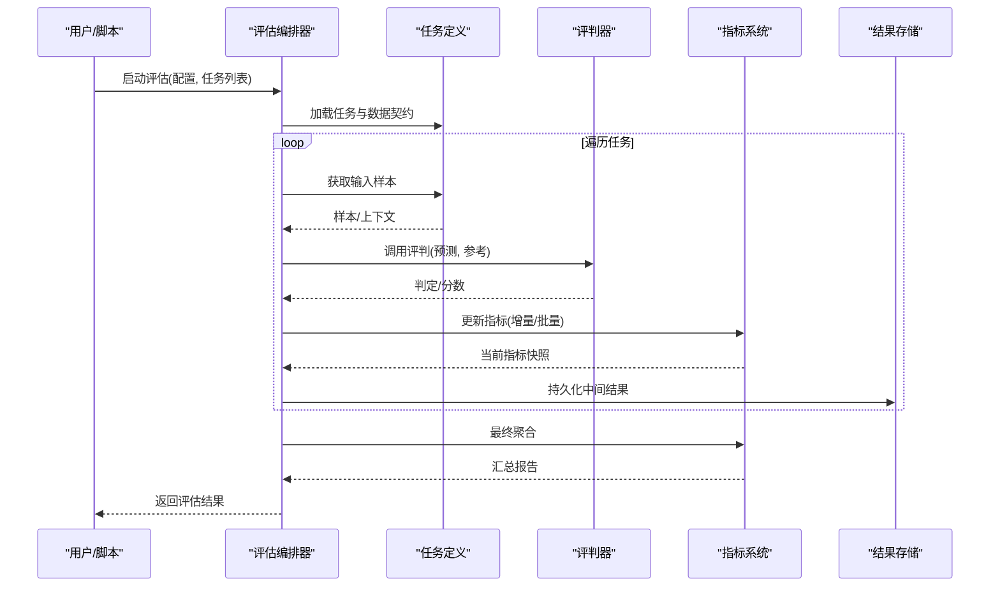
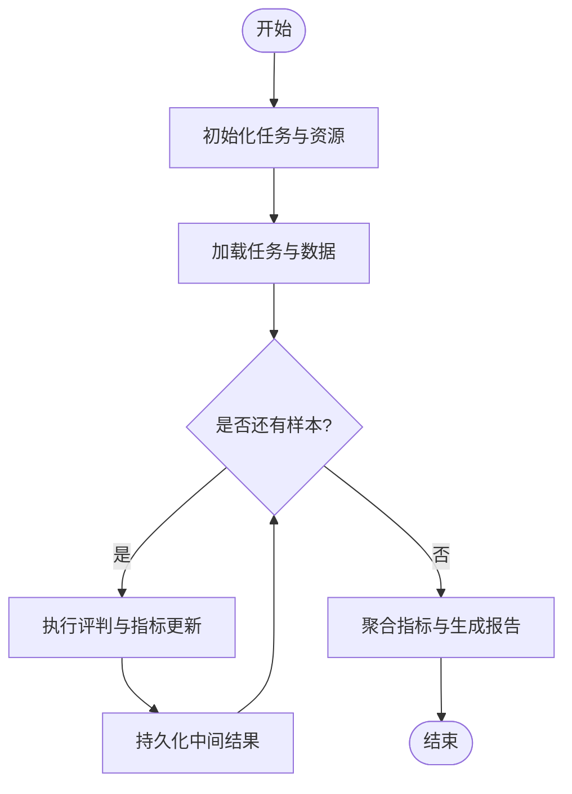
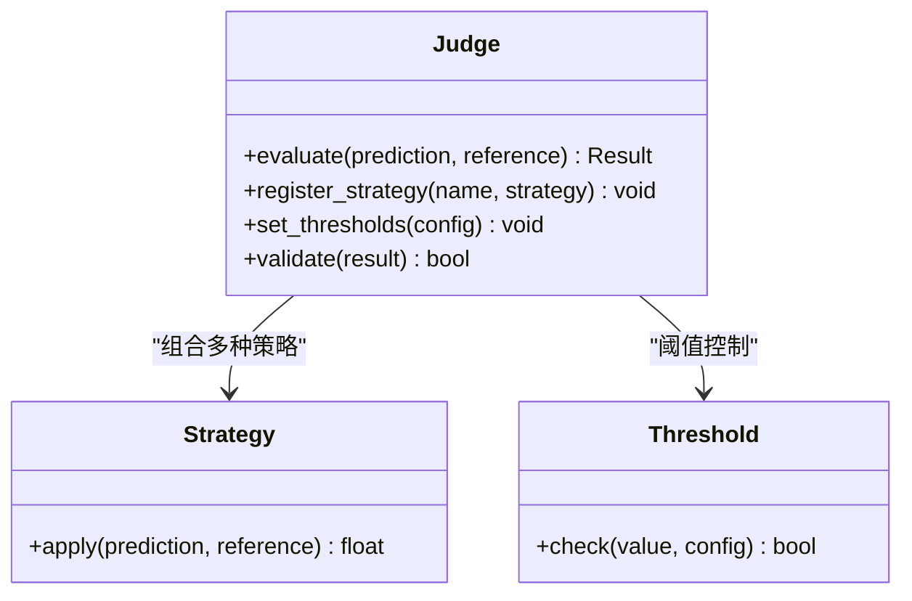
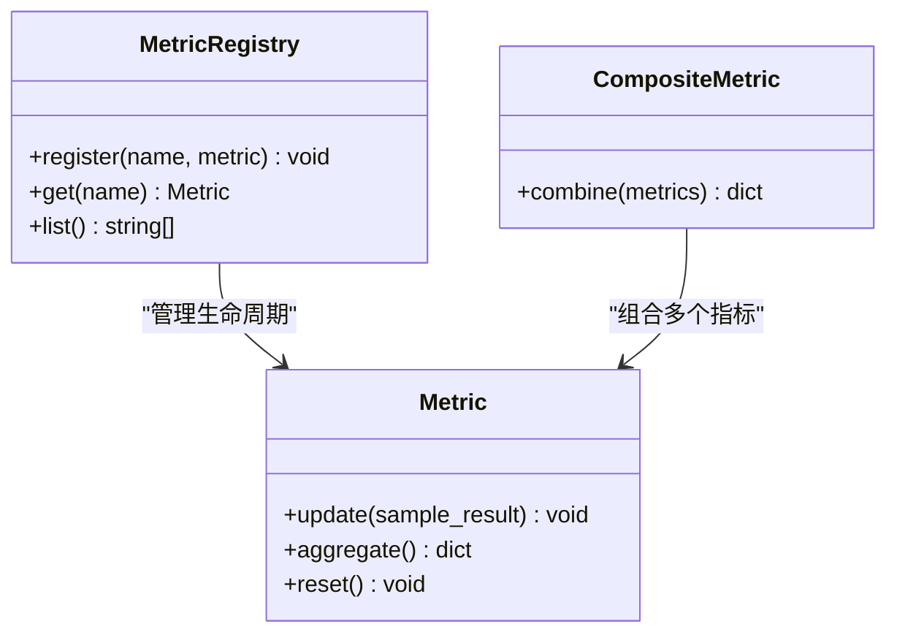
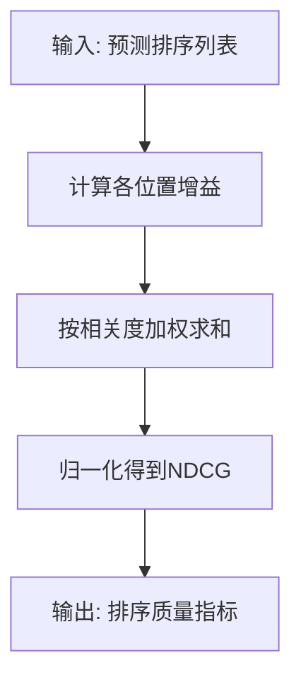
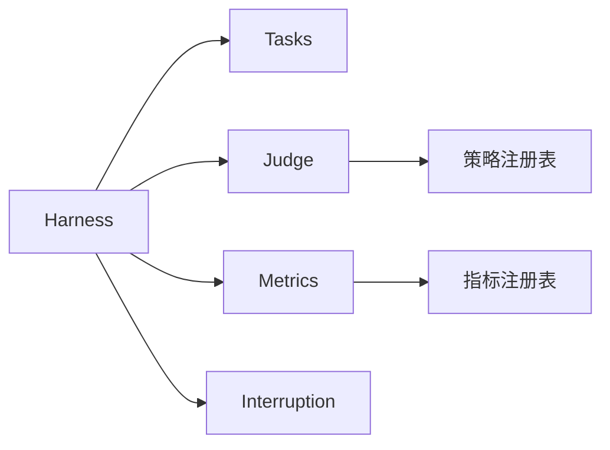

# 评估框架核心

<cite>
**本文引用的文件**   
- [autonomy_mvp/core/harness.py](file://autonomy_mvp/core/harness.py)
- [autonomy_mvp/core/judge.py](file://autonomy_mvp/core/judge.py)
- [autonomy_mvp/core/metrics.py](file://autonomy_mvp/core/metrics.py)
- [autonomy_mvp/core/ranking_metrics.py](file://autonomy_mvp/core/ranking_metrics.py)
- [autonomy_mvp/core/tasks.py](file://autonomy_mvp/core/tasks.py)
- [autonomy_mvp/core/interruption.py](file://autonomy_mvp/core/interruption.py)
- [autonomy_mvp/core/sim_agents.py](file://autonomy_mvp/core/sim_agents.py)
- [autonomy_mvp/tests/test_core.py](file://autonomy_mvp/tests/test_core.py)
- [autonomy_mvp/run_validation.py](file://autonomy_mvp/run_validation.py)
</cite>

## 目录
1. [简介](#简介)
2. [项目结构](#项目结构)
3. [核心组件](#核心组件)
4. [架构总览](#架构总览)
5. [详细组件分析](#详细组件分析)
6. [依赖关系分析](#依赖关系分析)
7. [性能考量](#性能考量)
8. [故障排查指南](#故障排查指南)
9. [结论](#结论)
10. [附录：扩展接口与使用示例](#附录扩展接口与使用示例)

## 简介
本文件面向科学计算基准测试框架的“评估框架核心”，聚焦以下目标：
- 描述评估引擎的架构设计、执行流程与状态管理机制
- 解释评判器的工作原理、评分算法与结果验证逻辑
- 说明指标计算系统的设计模式、可扩展性机制与自定义指标开发方法
- 覆盖评估生命周期管理、错误处理策略与性能优化技术
- 提供评估框架的扩展接口与使用示例，帮助快速集成新任务与新指标

## 项目结构
评估框架的核心位于 autonomy_mvp/core 目录，围绕“任务—执行—评判—指标—汇总”的主线组织。关键文件职责如下：
- harness.py：评估编排与生命周期管理（加载任务、调度执行、收集结果、触发评判与指标计算）
- judge.py：评判器实现（规则/模型驱动的判定、阈值比较、一致性校验等）
- metrics.py：指标计算系统（内置指标、聚合统计、可插拔扩展点）
- ranking_metrics.py：排序类指标（如Top-K命中率、AUC等）
- tasks.py：任务定义与数据契约（输入输出规范、元数据、断言约束）
- interruption.py：中断与恢复（超时、外部中断信号、检查点）
- sim_agents.py：模拟代理（用于离线回放或沙箱环境中的替代执行体）
- tests/test_core.py：单元测试与回归用例
- run_validation.py：端到端验证入口（串联评估流水线）

图表来源
- [autonomy_mvp/core/harness.py](file://autonomy_mvp/core/harness.py)
- [autonomy_mvp/core/judge.py](file://autonomy_mvp/core/judge.py)
- [autonomy_mvp/core/metrics.py](file://autonomy_mvp/core/metrics.py)
- [autonomy_mvp/core/ranking_metrics.py](file://autonomy_mvp/core/ranking_metrics.py)
- [autonomy_mvp/core/tasks.py](file://autonomy_mvp/core/tasks.py)
- [autonomy_mvp/core/interruption.py](file://autonomy_mvp/core/interruption.py)
- [autonomy_mvp/core/sim_agents.py](file://autonomy_mvp/core/sim_agents.py)
- [autonomy_mvp/run_validation.py](file://autonomy_mvp/run_validation.py)
- [autonomy_mvp/tests/test_core.py](file://autonomy_mvp/tests/test_core.py)

章节来源
- [autonomy_mvp/core/harness.py](file://autonomy_mvp/core/harness.py)
- [autonomy_mvp/core/judge.py](file://autonomy_mvp/core/judge.py)
- [autonomy_mvp/core/metrics.py](file://autonomy_mvp/core/metrics.py)
- [autonomy_mvp/core/ranking_metrics.py](file://autonomy_mvp/core/ranking_metrics.py)
- [autonomy_mvp/core/tasks.py](file://autonomy_mvp/core/tasks.py)
- [autonomy_mvp/core/interruption.py](file://autonomy_mvp/core/interruption.py)
- [autonomy_mvp/core/sim_agents.py](file://autonomy_mvp/core/sim_agents.py)
- [autonomy_mvp/run_validation.py](file://autonomy_mvp/run_validation.py)
- [autonomy_mvp/tests/test_core.py](file://autonomy_mvp/tests/test_core.py)

## 核心组件
- 评估编排器（Harness）
  - 负责加载任务清单、初始化上下文、分发执行、捕获异常、记录日志、触发评判与指标计算、汇总与导出结果。
  - 支持并行/串行执行策略、重试与回退、中断恢复与检查点。
- 评判器（Judge）
  - 将模型/规则应用于预测结果，产出布尔或数值型判定；支持多策略组合与权重融合。
  - 内置常见判定（精确匹配、容差比较、集合包含、文本相似度等），并提供注册表以扩展新策略。
- 指标系统（Metrics）
  - 提供原子指标（准确率、F1、MAE、RMSE、AUC等）与复合指标（加权平均、分桶统计）。
  - 通过统一接口注册自定义指标，支持流式增量更新与批量聚合。
- 排序指标（Ranking Metrics）
  - 针对排序场景的指标族（NDCG、MRR、Hit@K等），封装了排序稳定性与鲁棒性处理。
- 任务定义（Tasks）
  - 定义输入/输出Schema、元数据、断言约束、评测协议；为编排器提供可执行的评测单元。
- 中断与恢复（Interruption）
  - 提供超时控制、外部中断信号监听、检查点写入/读取，保障长时任务的可靠性。
- 模拟代理（Sim Agents）
  - 在离线模式下替代真实执行体，便于回归测试与快速迭代。

章节来源
- [autonomy_mvp/core/harness.py](file://autonomy_mvp/core/harness.py)
- [autonomy_mvp/core/judge.py](file://autonomy_mvp/core/judge.py)
- [autonomy_mvp/core/metrics.py](file://autonomy_mvp/core/metrics.py)
- [autonomy_mvp/core/ranking_metrics.py](file://autonomy_mvp/core/ranking_metrics.py)
- [autonomy_mvp/core/tasks.py](file://autonomy_mvp/core/tasks.py)
- [autonomy_mvp/core/interruption.py](file://autonomy_mvp/core/interruption.py)
- [autonomy_mvp/core/sim_agents.py](file://autonomy_mvp/core/sim_agents.py)

## 架构总览
评估框架采用“编排—评判—指标”的分层解耦设计：
- 编排层（Harness）：负责任务调度、资源管理、错误边界与生命周期钩子
- 评判层（Judge）：负责将原始预测映射到可判定的结果空间
- 指标层（Metrics/Ranking）：负责从判定结果中抽取统计量并聚合

图表来源
- [autonomy_mvp/core/harness.py](file://autonomy_mvp/core/harness.py)
- [autonomy_mvp/core/judge.py](file://autonomy_mvp/core/judge.py)
- [autonomy_mvp/core/metrics.py](file://autonomy_mvp/core/metrics.py)
- [autonomy_mvp/core/tasks.py](file://autonomy_mvp/core/tasks.py)

## 详细组件分析

### 评估编排器（Harness）
- 职责
  - 解析配置与任务清单，构建执行图
  - 管理并发度、重试、超时与中断
  - 协调评判与指标计算，维护中间状态
  - 输出结构化结果与审计日志
- 关键流程
  - 初始化：加载任务、校验Schema、准备资源
  - 执行：按批次拉取样本，调用评判器，累积指标
  - 收尾：聚合指标、生成报告、保存检查点
- 状态管理
  - 使用轻量状态机跟踪每个任务的运行态（待执行、执行中、完成、失败、已跳过）
  - 支持断点续跑与增量评估

图表来源
- [autonomy_mvp/core/harness.py](file://autonomy_mvp/core/harness.py)

章节来源
- [autonomy_mvp/core/harness.py](file://autonomy_mvp/core/harness.py)

### 评判器（Judge）
- 工作原理
  - 接收预测与参考答案，应用一组判定策略（精确匹配、容差比较、集合包含、文本相似度、模型打分等）
  - 输出单条样本的判定结果与可选诊断信息
- 评分算法
  - 支持多策略加权融合、阈值自适应、置信度估计
  - 对缺失/无效输入进行稳健处理（默认值、降级策略）
- 结果验证
  - 对判定结果进行一致性校验（例如多次采样的一致性、边界条件覆盖）
  - 提供可插拔的验证钩子，便于接入外部校验服务

图表来源
- [autonomy_mvp/core/judge.py](file://autonomy_mvp/core/judge.py)

章节来源
- [autonomy_mvp/core/judge.py](file://autonomy_mvp/core/judge.py)

### 指标系统（Metrics）
- 设计模式
  - 注册表模式：通过统一接口注册原子指标与复合指标
  - 观察者模式：指标在每次评判后自动增量更新
  - 工厂模式：根据配置动态创建指标实例
- 可扩展性
  - 自定义指标需实现标准接口（update、aggregate、reset）
  - 支持分组/分层统计（按任务、按难度、按时间窗口）
- 典型指标
  - 分类：准确率、F1、AUC、混淆矩阵
  - 回归：MAE、RMSE、R²
  - 排序：Hit@K、MRR、NDCG

图表来源
- [autonomy_mvp/core/metrics.py](file://autonomy_mvp/core/metrics.py)

章节来源
- [autonomy_mvp/core/metrics.py](file://autonomy_mvp/core/metrics.py)

### 排序指标（Ranking Metrics）
- 适用场景
  - 检索、推荐、排序任务，关注Top-K命中与排序质量
- 算法要点
  - Hit@K：是否在Top-K命中目标
  - MRR：首个命中位置的倒数均值
  - NDCG：考虑位置衰减的归一化折损增益
- 鲁棒性
  - 对并列得分的处理、缺失标签的容错、小样本偏差校正

图表来源
- [autonomy_mvp/core/ranking_metrics.py](file://autonomy_mvp/core/ranking_metrics.py)

章节来源
- [autonomy_mvp/core/ranking_metrics.py](file://autonomy_mvp/core/ranking_metrics.py)

### 任务定义（Tasks）
- 契约
  - 输入/输出Schema、必填字段、类型约束、取值范围
  - 元数据：领域、难度、数据来源、版本
- 断言
  - 预检：输入合法性、依赖可用性
  - 后验：输出完整性、格式正确性
- 可移植性
  - 通过配置文件驱动任务实例化，避免硬编码

章节来源
- [autonomy_mvp/core/tasks.py](file://autonomy_mvp/core/tasks.py)

### 中断与恢复（Interruption）
- 能力
  - 超时控制、信号监听（SIGINT/SIGTERM）、检查点写入/恢复
- 策略
  - 优雅退出：保存中间状态、释放资源、清理临时文件
  - 断点续跑：从最近检查点继续执行

章节来源
- [autonomy_mvp/core/interruption.py](file://autonomy_mvp/core/interruption.py)

### 模拟代理（Sim Agents）
- 用途
  - 离线回放、快速回归、无外部依赖的本地验证
- 行为
  - 基于固定种子与缓存结果，保证可重复性
  - 支持注入异常路径，用于健壮性测试

章节来源
- [autonomy_mvp/core/sim_agents.py](file://autonomy_mvp/core/sim_agents.py)

## 依赖关系分析
- 模块耦合
  - Harness 强依赖 Tasks、Judge、Metrics、Interruption
  - Judge 依赖策略注册表与阈值配置
  - Metrics 依赖注册表与聚合器
- 外部依赖
  - 文件系统（检查点、结果持久化）
  - 日志与监控（可选）
- 潜在循环依赖
  - 通过注册表与接口抽象避免直接双向引用

图表来源
- [autonomy_mvp/core/harness.py](file://autonomy_mvp/core/harness.py)
- [autonomy_mvp/core/judge.py](file://autonomy_mvp/core/judge.py)
- [autonomy_mvp/core/metrics.py](file://autonomy_mvp/core/metrics.py)
- [autonomy_mvp/core/interruption.py](file://autonomy_mvp/core/interruption.py)
- [autonomy_mvp/core/tasks.py](file://autonomy_mvp/core/tasks.py)

章节来源
- [autonomy_mvp/core/harness.py](file://autonomy_mvp/core/harness.py)
- [autonomy_mvp/core/judge.py](file://autonomy_mvp/core/judge.py)
- [autonomy_mvp/core/metrics.py](file://autonomy_mvp/core/metrics.py)
- [autonomy_mvp/core/interruption.py](file://autonomy_mvp/core/interruption.py)
- [autonomy_mvp/core/tasks.py](file://autonomy_mvp/core/tasks.py)

## 性能考量
- 批处理与向量化
  - 尽量批量调用评判与指标更新，减少I/O与函数调用开销
- 并发与并行
  - 合理设置并发度，避免资源争用；对CPU密集型任务使用进程级并行
- 内存与缓存
  - 对大对象使用惰性加载与分页读取；对频繁访问的数据建立本地缓存
- 检查点与增量评估
  - 利用检查点避免重复计算；仅对新增样本进行增量更新
- 监控与剖析
  - 记录关键路径耗时与吞吐，定位瓶颈

[本节为通用指导，不直接分析具体文件]

## 故障排查指南
- 常见问题
  - 任务加载失败：检查Schema与必填字段、权限与路径
  - 评判结果为空：确认输入格式、阈值配置与策略注册
  - 指标不一致：核对增量更新顺序与聚合窗口
  - 长时间挂起：检查中断与超时配置、外部依赖可用性
- 调试建议
  - 启用详细日志与中间结果快照
  - 使用模拟代理隔离外部依赖问题
  - 逐步缩小样本集复现问题

章节来源
- [autonomy_mvp/core/harness.py](file://autonomy_mvp/core/harness.py)
- [autonomy_mvp/core/judge.py](file://autonomy_mvp/core/judge.py)
- [autonomy_mvp/core/metrics.py](file://autonomy_mvp/core/metrics.py)
- [autonomy_mvp/core/interruption.py](file://autonomy_mvp/core/interruption.py)
- [autonomy_mvp/core/sim_agents.py](file://autonomy_mvp/core/sim_agents.py)

## 结论
本评估框架以清晰的层次与可插拔的扩展点为核心，实现了从任务定义、执行编排、评判到指标聚合的完整闭环。通过注册表与接口抽象，用户可便捷地扩展新任务、新策略与新指标；借助中断与检查点机制，框架具备在生产环境中稳定运行的能力。

[本节为总结性内容，不直接分析具体文件]

## 附录：扩展接口与使用示例

### 自定义指标开发步骤
- 实现标准接口
  - update：增量更新内部状态
  - aggregate：计算并返回当前指标值
  - reset：重置状态以便下一轮评估
- 注册指标
  - 通过指标注册表登记名称与实现类
- 在编排器中使用
  - 在配置中声明指标列表，编排器会自动调用

章节来源
- [autonomy_mvp/core/metrics.py](file://autonomy_mvp/core/metrics.py)

### 自定义评判策略
- 实现策略接口
  - apply：接收预测与参考，返回浮点分数或布尔判定
- 注册策略
  - 通过评判器的策略注册表登记名称与实现
- 配置阈值与权重
  - 在配置中指定策略权重与阈值，编排器会按策略组合计算

章节来源
- [autonomy_mvp/core/judge.py](file://autonomy_mvp/core/judge.py)

### 端到端验证入口
- 使用验证脚本
  - 通过 run_validation.py 启动评估流水线，传入配置与任务清单
  - 该入口负责串联任务加载、执行、评判与指标聚合

章节来源
- [autonomy_mvp/run_validation.py](file://autonomy_mvp/run_validation.py)

### 单元测试与回归
- 编写用例
  - 覆盖正常路径、边界条件与异常路径
  - 使用模拟代理确保可重复性与隔离性
- 运行测试
  - 通过测试入口执行全部用例，确保回归稳定

章节来源
- [autonomy_mvp/tests/test_core.py](file://autonomy_mvp/tests/test_core.py)