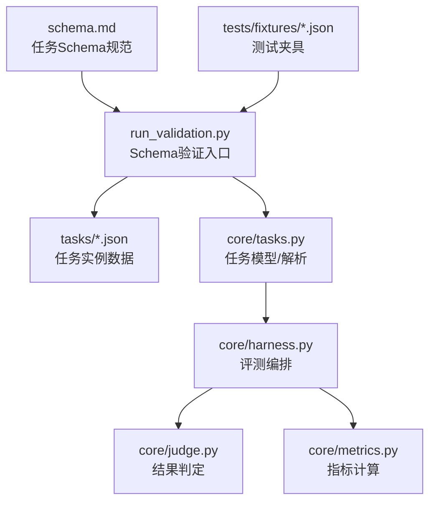
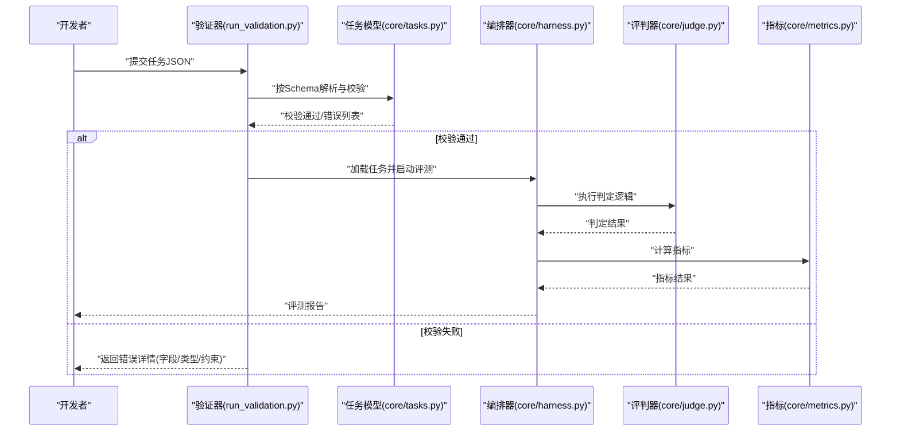
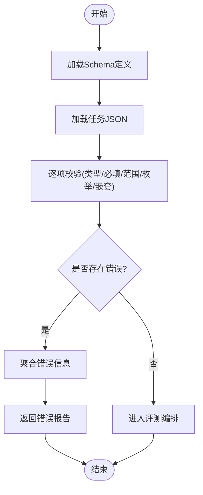
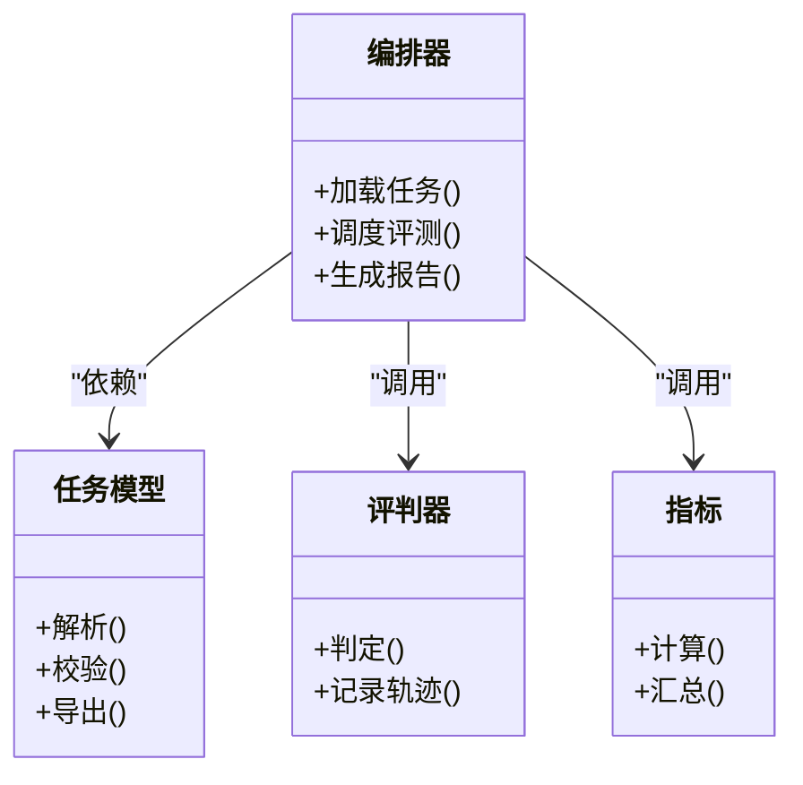
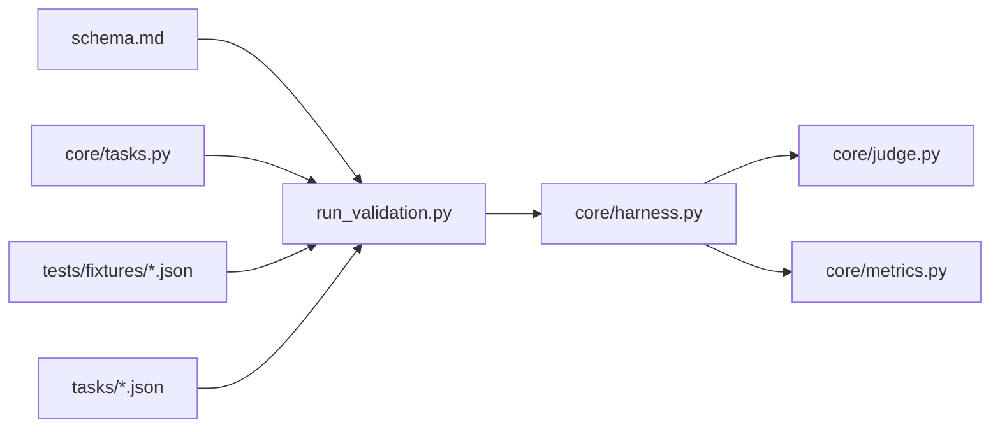

# 任务Schema基础概念

<cite>
**本文引用的文件**   
- [autonomy_mvp/schema.md](file://autonomy_mvp/schema.md)
- [autonomy_mvp/run_validation.py](file://autonomy_mvp/run_validation.py)
- [autonomy_mvp/core/tasks.py](file://autonomy_mvp/core/tasks.py)
- [autonomy_mvp/core/harness.py](file://autonomy_mvp/core/harness.py)
- [autonomy_mvp/core/judge.py](file://autonomy_mvp/core/judge.py)
- [autonomy_mvp/core/metrics.py](file://autonomy_mvp/core/metrics.py)
- [autonomy_mvp/tasks/drug_admet.json](file://autonomy_mvp/tasks/drug_admet.json)
- [autonomy_mvp/tasks/drug_screen_ms3.json](file://autonomy_mvp/tasks/drug_screen_ms3.json)
- [autonomy_mvp/tasks/materials_semiconductor_bandgap.json](file://autonomy_mvp/tasks/materials_semiconductor_bandgap.json)
- [autonomy_mvp/tests/fixtures/fixture_drugscreen.json](file://autonomy_mvp/tests/fixtures/fixture_drugscreen.json)
- [autonomy_mvp/tests/fixtures/fixture_materials.json](file://autonomy_mvp/tests/fixtures/fixture_materials.json)
</cite>

## 目录
1. [简介](#简介)
2. [项目结构](#项目结构)
3. [核心组件](#核心组件)
4. [架构总览](#架构总览)
5. [详细组件分析](#详细组件分析)
6. [依赖关系分析](#依赖关系分析)
7. [性能考虑](#性能考虑)
8. [故障排查指南](#故障排查指南)
9. [结论](#结论)
10. [附录](#附录)

## 简介
本文件面向科学计算基准测试中的“任务”定义，系统阐述JSON Schema在其中的作用与价值，解释任务定义的核心概念与数据结构，说明基本字段（如id、name、description等）的含义与用法，并介绍Schema验证机制的工作原理与错误处理策略。文末提供简明的任务定义示例路径，帮助初学者快速上手。

## 项目结构
本项目围绕“任务”的声明式描述与可执行评测展开，关键位置如下：
- 任务Schema规范文档：位于 autonomy_mvp/schema.md，用于统一任务定义的约束与约定。
- 任务实例数据：位于 autonomy_mvp/tasks/*.json，每个文件代表一个具体任务的输入与期望输出。
- 验证脚本：位于 autonomy_mvp/run_validation.py，负责加载Schema并对任务数据进行校验。
- 核心运行与评测逻辑：位于 autonomy_mvp/core 下的 tasks.py、harness.py、judge.py、metrics.py 等模块。
- 测试夹具：位于 autonomy_mvp/tests/fixtures/*.json，用于单元测试与回归验证。

图表来源
- [autonomy_mvp/schema.md](file://autonomy_mvp/schema.md)
- [autonomy_mvp/run_validation.py](file://autonomy_mvp/run_validation.py)
- [autonomy_mvp/core/tasks.py](file://autonomy_mvp/core/tasks.py)
- [autonomy_mvp/core/harness.py](file://autonomy_mvp/core/harness.py)
- [autonomy_mvp/core/judge.py](file://autonomy_mvp/core/judge.py)
- [autonomy_mvp/core/metrics.py](file://autonomy_mvp/core/metrics.py)

章节来源
- [autonomy_mvp/schema.md](file://autonomy_mvp/schema.md)
- [autonomy_mvp/run_validation.py](file://autonomy_mvp/run_validation.py)
- [autonomy_mvp/core/tasks.py](file://autonomy_mvp/core/tasks.py)
- [autonomy_mvp/core/harness.py](file://autonomy_mvp/core/harness.py)
- [autonomy_mvp/core/judge.py](file://autonomy_mvp/core/judge.py)
- [autonomy_mvp/core/metrics.py](file://autonomy_mvp/core/metrics.py)

## 核心组件
- 任务Schema规范：定义任务数据的必填字段、类型约束、枚举值、嵌套结构与校验规则，确保不同任务具有一致的结构。
- 任务实例：以JSON形式描述具体任务的数据，包括问题描述、输入、参考输出、评估参数等。
- 验证器：读取Schema与任务实例，进行结构化校验，返回详细的错误信息以便修复。
- 评测编排：根据任务Schema加载数据，驱动评测流程，调用评判器与指标计算模块产出最终结果。

章节来源
- [autonomy_mvp/schema.md](file://autonomy_mvp/schema.md)
- [autonomy_mvp/run_validation.py](file://autonomy_mvp/run_validation.py)
- [autonomy_mvp/core/tasks.py](file://autonomy_mvp/core/tasks.py)
- [autonomy_mvp/core/harness.py](file://autonomy_mvp/core/harness.py)

## 架构总览
下图展示了从任务定义到评测产出的端到端流程：Schema作为契约，验证器保证数据合规，编排器协调评测，评判器与指标模块完成打分与汇总。

图表来源
- [autonomy_mvp/run_validation.py](file://autonomy_mvp/run_validation.py)
- [autonomy_mvp/core/tasks.py](file://autonomy_mvp/core/tasks.py)
- [autonomy_mvp/core/harness.py](file://autonomy_mvp/core/harness.py)
- [autonomy_mvp/core/judge.py](file://autonomy_mvp/core/judge.py)
- [autonomy_mvp/core/metrics.py](file://autonomy_mvp/core/metrics.py)

## 详细组件分析

### 任务Schema与基本字段
- id：任务的唯一标识符，通常要求为字符串或整数，且全局唯一。用于索引、追踪与复现实验。
- name：任务名称，便于人类阅读与检索。
- description：任务描述，说明目标、背景与预期输出。
- input：任务输入数据，可能包含原始文本、数值、文件或引用路径等。
- expected_output：期望输出，供评判器比对或指标计算使用。
- evaluation：评测配置，包含评判方法、阈值、权重等。
- tags：标签集合，用于分类与筛选。
- version：任务版本，支持迭代演进与回溯。

这些字段共同构成任务的最小可用集，其他扩展字段可按需添加并在Schema中声明。

章节来源
- [autonomy_mvp/schema.md](file://autonomy_mvp/schema.md)

### 任务实例与示例
以下为典型任务文件的示例路径，可直接查看其结构以理解字段组织方式：
- 药物ADMET任务：[drug_admet.json](file://autonomy_mvp/tasks/drug_admet.json)
- 药物MS3筛选任务：[drug_screen_ms3.json](file://autonomy_mvp/tasks/drug_screen_ms3.json)
- 材料半导体带隙任务：[materials_semiconductor_bandgap.json](file://autonomy_mvp/tasks/materials_semiconductor_bandgap.json)
- 测试夹具（药物筛选）：[fixture_drugscreen.json](file://autonomy_mvp/tests/fixtures/fixture_drugscreen.json)
- 测试夹具（材料）：[fixture_materials.json](file://autonomy_mvp/tests/fixtures/fixture_materials.json)

建议初学者先对照Schema规范，再逐一打开上述文件观察字段布局与数据类型。

章节来源
- [autonomy_mvp/tasks/drug_admet.json](file://autonomy_mvp/tasks/drug_admet.json)
- [autonomy_mvp/tasks/drug_screen_ms3.json](file://autonomy_mvp/tasks/drug_screen_ms3.json)
- [autonomy_mvp/tasks/materials_semiconductor_bandgap.json](file://autonomy_mvp/tasks/materials_semiconductor_bandgap.json)
- [autonomy_mvp/tests/fixtures/fixture_drugscreen.json](file://autonomy_mvp/tests/fixtures/fixture_drugscreen.json)
- [autonomy_mvp/tests/fixtures/fixture_materials.json](file://autonomy_mvp/tests/fixtures/fixture_materials.json)

### Schema验证机制与错误处理
验证流程要点：
- 加载Schema：从 schema.md 或对应Schema文件中读取约束定义。
- 解析任务JSON：将任务实例转换为内部数据结构。
- 逐项校验：检查必填字段、类型、范围、枚举、嵌套结构等。
- 错误聚合：收集所有不满足约束的错误信息，形成结构化错误列表。
- 反馈与重试：向用户返回错误详情，指导修正后重新提交。

图表来源
- [autonomy_mvp/run_validation.py](file://autonomy_mvp/run_validation.py)
- [autonomy_mvp/schema.md](file://autonomy_mvp/schema.md)

章节来源
- [autonomy_mvp/run_validation.py](file://autonomy_mvp/run_validation.py)
- [autonomy_mvp/schema.md](file://autonomy_mvp/schema.md)

### 评测编排与指标
- 编排器：依据任务Schema加载数据，组织评测步骤，管理生命周期与资源。
- 评判器：实现领域特定的判定逻辑，比较预测与期望输出。
- 指标模块：计算准确率、误差、相关性等量化指标，汇总成报告。

图表来源
- [autonomy_mvp/core/tasks.py](file://autonomy_mvp/core/tasks.py)
- [autonomy_mvp/core/harness.py](file://autonomy_mvp/core/harness.py)
- [autonomy_mvp/core/judge.py](file://autonomy_mvp/core/judge.py)
- [autonomy_mvp/core/metrics.py](file://autonomy_mvp/core/metrics.py)

章节来源
- [autonomy_mvp/core/tasks.py](file://autonomy_mvp/core/tasks.py)
- [autonomy_mvp/core/harness.py](file://autonomy_mvp/core/harness.py)
- [autonomy_mvp/core/judge.py](file://autonomy_mvp/core/judge.py)
- [autonomy_mvp/core/metrics.py](file://autonomy_mvp/core/metrics.py)

## 依赖关系分析
- 验证器依赖Schema与任务模型，确保输入数据符合约定。
- 编排器依赖任务模型、评判器与指标模块，串联评测全流程。
- 任务实例与测试夹具为验证与回归提供数据支撑。

图表来源
- [autonomy_mvp/schema.md](file://autonomy_mvp/schema.md)
- [autonomy_mvp/run_validation.py](file://autonomy_mvp/run_validation.py)
- [autonomy_mvp/core/tasks.py](file://autonomy_mvp/core/tasks.py)
- [autonomy_mvp/core/harness.py](file://autonomy_mvp/core/harness.py)
- [autonomy_mvp/core/judge.py](file://autonomy_mvp/core/judge.py)
- [autonomy_mvp/core/metrics.py](file://autonomy_mvp/core/metrics.py)
- [autonomy_mvp/tests/fixtures/fixture_drugscreen.json](file://autonomy_mvp/tests/fixtures/fixture_drugscreen.json)
- [autonomy_mvp/tests/fixtures/fixture_materials.json](file://autonomy_mvp/tests/fixtures/fixture_materials.json)
- [autonomy_mvp/tasks/drug_admet.json](file://autonomy_mvp/tasks/drug_admet.json)
- [autonomy_mvp/tasks/drug_screen_ms3.json](file://autonomy_mvp/tasks/drug_screen_ms3.json)
- [autonomy_mvp/tasks/materials_semiconductor_bandgap.json](file://autonomy_mvp/tasks/materials_semiconductor_bandgap.json)

章节来源
- [autonomy_mvp/run_validation.py](file://autonomy_mvp/run_validation.py)
- [autonomy_mvp/core/tasks.py](file://autonomy_mvp/core/tasks.py)
- [autonomy_mvp/core/harness.py](file://autonomy_mvp/core/harness.py)
- [autonomy_mvp/core/judge.py](file://autonomy_mvp/core/judge.py)
- [autonomy_mvp/core/metrics.py](file://autonomy_mvp/core/metrics.py)

## 性能考虑
- 批量验证：对大量任务实例进行并行或批处理验证，减少I/O开销。
- 增量校验：仅对变更的任务文件进行校验，避免全量重跑。
- 缓存中间结果：对重复计算的指标或判定结果进行缓存，提升整体吞吐。
- 流式处理：大文件输入时采用流式解析，降低内存占用。

## 故障排查指南
常见问题与定位思路：
- 字段缺失或类型不符：检查Schema中对必填字段与类型的约束，确认任务JSON是否完整与正确。
- 枚举值非法：核对字段允许的值集合，修正为合法枚举项。
- 嵌套结构错误：逐层检查对象与数组的层级关系，确保与Schema一致。
- 数值范围越界：调整数值至规定范围内，或更新Schema并同步验证器。
- 评测失败：查看评判器日志与指标输出，定位差异来源。

章节来源
- [autonomy_mvp/run_validation.py](file://autonomy_mvp/run_validation.py)
- [autonomy_mvp/core/judge.py](file://autonomy_mvp/core/judge.py)
- [autonomy_mvp/core/metrics.py](file://autonomy_mvp/core/metrics.py)

## 结论
通过统一的JSON Schema，任务定义具备强约束与高可读性，验证器保障数据质量，编排器串联评测流程，评判器与指标模块完成结果量化。遵循本文档的基本字段与验证策略，可以快速构建稳定、可复现的科学计算基准任务。

## 附录
- 快速上手清单：
  - 阅读Schema规范，明确必填字段与类型。
  - 参考示例任务文件，复制并修改必要字段。
  - 使用验证脚本进行预检，修复错误后再提交评测。
  - 关注评测报告与指标输出，持续优化任务定义。