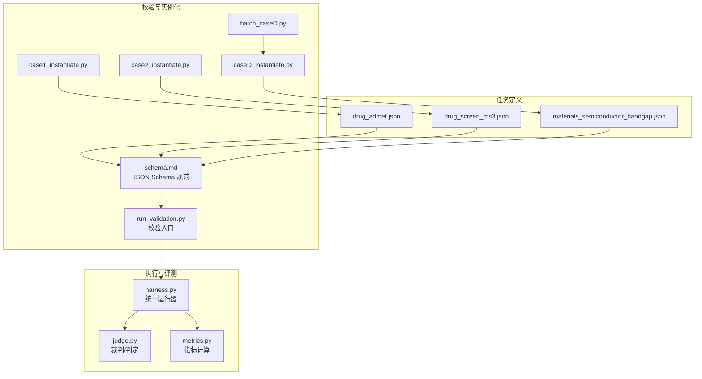
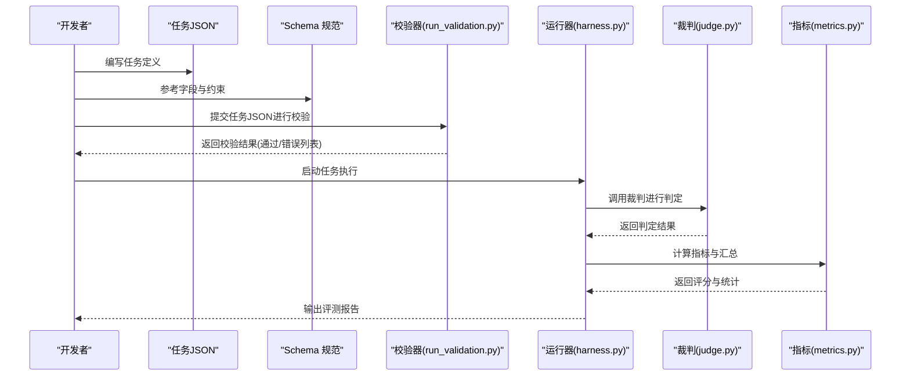
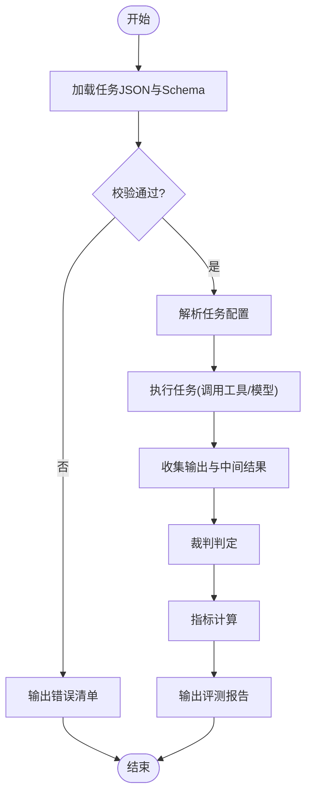
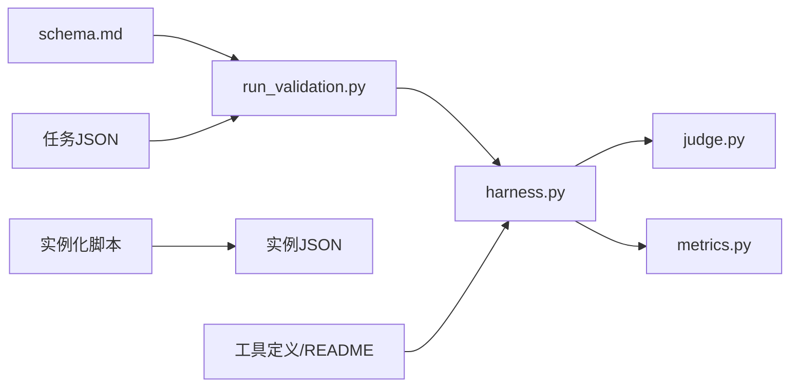

# 任务定义教程

<cite>
**本文引用的文件**   
- [autonomy_mvp/schema.md](file://autonomy_mvp/schema.md)
- [autonomy_mvp/core/tasks.py](file://autonomy_mvp/core/tasks.py)
- [autonomy_mvp/core/harness.py](file://autonomy_mvp/core/harness.py)
- [autonomy_mvp/core/judge.py](file://autonomy_mvp/core/judge.py)
- [autonomy_mvp/core/metrics.py](file://autonomy_mvp/core/metrics.py)
- [autonomy_mvp/tasks/drug_admet.json](file://autonomy_mvp/tasks/drug_admet.json)
- [autonomy_mvp/tasks/drug_screen_ms3.json](file://autonomy_mvp/tasks/drug_screen_ms3.json)
- [autonomy_mvp/tasks/materials_semiconductor_bandgap.json](file://autonomy_mvp/tasks/materials_semiconductor_bandgap.json)
- [autonomy_mvp/tests/fixtures/fixture_drugscreen.json](file://autonomy_mvp/tests/fixtures/fixture_drugscreen.json)
- [autonomy_mvp/tests/fixtures/fixture_materials.json](file://autonomy_mvp/tests/fixtures/fixture_materials.json)
- [autonomy_mvp/run_validation.py](file://autonomy_mvp/run_validation.py)
- [longhorizon/instantiate/instances/drug2_BACE1.json](file://longhorizon/instantiate/instances/drug2_BACE1.json)
- [longhorizon/instantiate/instances/mat1_Ca-Si-O_funnel.json](file://longhorizon/instantiate/instances/mat1_Ca-Si-O_funnel.json)
- [longhorizon/instantiate/case1_instantiate.py](file://longhorizon/instantiate/case1_instantiate.py)
- [longhorizon/instantiate/case2_instantiate.py](file://longhorizon/instantiate/case2_instantiate.py)
- [longhorizon/instantiate/caseD_instantiate.py](file://longhorizon/instantiate/caseD_instantiate.py)
- [longhorizon/instantiate/batch_caseD.py](file://longhorizon/instantiate/batch_caseD.py)
- [docs/prd/molbench_repo/skills/L1_tools/molclaw-mol-basic-metrics/tool.json](file://docs/prd/molbench_repo/skills/L1_tools/molclaw-mol-basic-metrics/tool.json)
- [docs/prd/molbench_repo/skills/L1_tools/molclaw-mol-basic-metrics/README.md](file://docs/prd/molbench_repo/skills/L1_tools/molclaw-mol-basic-metrics/README.md)
</cite>

## 目录
1. [简介](#简介)
2. [项目结构](#项目结构)
3. [核心组件](#核心组件)
4. [架构总览](#架构总览)
5. [详细组件分析](#详细组件分析)
6. [依赖关系分析](#依赖关系分析)
7. [性能与可扩展性](#性能与可扩展性)
8. [故障排查指南](#故障排查指南)
9. [结论](#结论)
10. [附录：JSON Schema 规范与字段说明](#附录json-schema-规范与字段说明)

## 简介
本教程面向需要在药物发现、材料科学等科学领域定义“可验证、可度量、可复用”的任务的用户。文档围绕 JSON Schema 规范、字段说明、验证规则展开，结合仓库中真实任务样例，系统讲解如何构建高质量任务定义，包括模板化参数、约束条件设置、评测指标与判分逻辑的对接方式，以及最佳实践建议。

## 项目结构
本项目将“任务定义（JSON）+ 校验与运行（Python）+ 评测（指标/裁判）”解耦，形成清晰的分层：
- 任务定义层：以 JSON 描述任务输入、输出、约束与评测目标
- 校验与实例化层：基于 JSON Schema 对任务进行强类型校验，并支持批量实例化
- 执行与评测层：提供统一运行 harness、裁判 judge 与指标 metrics

图表来源
- [autonomy_mvp/schema.md](file://autonomy_mvp/schema.md)
- [autonomy_mvp/run_validation.py](file://autonomy_mvp/run_validation.py)
- [autonomy_mvp/core/harness.py](file://autonomy_mvp/core/harness.py)
- [autonomy_mvp/core/judge.py](file://autonomy_mvp/core/judge.py)
- [autonomy_mvp/core/metrics.py](file://autonomy_mvp/core/metrics.py)
- [autonomy_mvp/tasks/drug_admet.json](file://autonomy_mvp/tasks/drug_admet.json)
- [autonomy_mvp/tasks/drug_screen_ms3.json](file://autonomy_mvp/tasks/drug_screen_ms3.json)
- [autonomy_mvp/tasks/materials_semiconductor_bandgap.json](file://autonomy_mvp/tasks/materials_semiconductor_bandgap.json)
- [longhorizon/instantiate/case1_instantiate.py](file://longhorizon/instantiate/case1_instantiate.py)
- [longhorizon/instantiate/case2_instantiate.py](file://longhorizon/instantiate/case2_instantiate.py)
- [longhorizon/instantiate/caseD_instantiate.py](file://longhorizon/instantiate/caseD_instantiate.py)
- [longhorizon/instantiate/batch_caseD.py](file://longhorizon/instantiate/batch_caseD.py)

章节来源
- [autonomy_mvp/schema.md](file://autonomy_mvp/schema.md)
- [autonomy_mvp/run_validation.py](file://autonomy_mvp/run_validation.py)
- [autonomy_mvp/core/harness.py](file://autonomy_mvp/core/harness.py)
- [autonomy_mvp/core/judge.py](file://autonomy_mvp/core/judge.py)
- [autonomy_mvp/core/metrics.py](file://autonomy_mvp/core/metrics.py)
- [autonomy_mvp/tasks/drug_admet.json](file://autonomy_mvp/tasks/drug_admet.json)
- [autonomy_mvp/tasks/drug_screen_ms3.json](file://autonomy_mvp/tasks/drug_screen_ms3.json)
- [autonomy_mvp/tasks/materials_semiconductor_bandgap.json](file://autonomy_mvp/tasks/materials_semiconductor_bandgap.json)
- [longhorizon/instantiate/case1_instantiate.py](file://longhorizon/instantiate/case1_instantiate.py)
- [longhorizon/instantiate/case2_instantiate.py](file://longhorizon/instantiate/case2_instantiate.py)
- [longhorizon/instantiate/caseD_instantiate.py](file://longhorizon/instantiate/caseD_instantiate.py)
- [longhorizon/instantiate/batch_caseD.py](file://longhorizon/instantiate/batch_caseD.py)

## 核心组件
- JSON Schema 规范：集中定义任务定义的字段、类型、必填项、枚举值、范围约束与嵌套结构，确保所有任务定义一致且可被程序化校验。
- 校验与运行：通过校验脚本加载 Schema 并对任务 JSON 进行严格校验；通过后进入统一运行 harness，驱动任务执行与结果收集。
- 裁判与指标：裁判负责将模型输出与期望答案或规则进行比对，指标模块提供数值型评分与统计汇总能力。
- 实例化与批量：针对同一任务模板，通过实例化脚本生成具体案例集，便于大规模评测与回归测试。

章节来源
- [autonomy_mvp/schema.md](file://autonomy_mvp/schema.md)
- [autonomy_mvp/run_validation.py](file://autonomy_mvp/run_validation.py)
- [autonomy_mvp/core/harness.py](file://autonomy_mvp/core/harness.py)
- [autonomy_mvp/core/judge.py](file://autonomy_mvp/core/judge.py)
- [autonomy_mvp/core/metrics.py](file://autonomy_mvp/core/metrics.py)

## 架构总览
下图展示了从“任务定义”到“执行评测”的端到端流程，强调 JSON Schema 在数据契约中的核心作用。

图表来源
- [autonomy_mvp/schema.md](file://autonomy_mvp/schema.md)
- [autonomy_mvp/run_validation.py](file://autonomy_mvp/run_validation.py)
- [autonomy_mvp/core/harness.py](file://autonomy_mvp/core/harness.py)
- [autonomy_mvp/core/judge.py](file://autonomy_mvp/core/judge.py)
- [autonomy_mvp/core/metrics.py](file://autonomy_mvp/core/metrics.py)

## 详细组件分析

### 任务定义与 JSON Schema 规范
- 目的：用结构化方式描述任务的输入、输出、约束与评测目标，使不同团队/工具链能稳定消费同一份任务定义。
- 关键要点：
  - 字段分层：元信息（名称、版本、领域）、输入模式（参数、数据源）、输出模式（格式、单位、取值范围）、约束（必填、枚举、范围、正则）、评测（裁判、指标、阈值）。
  - 类型与约束：使用字符串、数字、布尔、数组、对象等基础类型，配合最小/最大、包含、唯一、正则表达式等约束。
  - 扩展点：为未来新增字段预留扩展空间，避免破坏向后兼容。
- 示例任务：
  - 药物 ADMET 预测任务：关注分子描述符、属性预测、阈值筛选与排序。
  - 药物筛选 MS3 任务：关注候选化合物集合、筛选策略、打分与排名。
  - 半导体带隙任务：关注材料组成、结构特征、带隙预测与误差评估。

章节来源
- [autonomy_mvp/schema.md](file://autonomy_mvp/schema.md)
- [autonomy_mvp/tasks/drug_admet.json](file://autonomy_mvp/tasks/drug_admet.json)
- [autonomy_mvp/tasks/drug_screen_ms3.json](file://autonomy_mvp/tasks/drug_screen_ms3.json)
- [autonomy_mvp/tasks/materials_semiconductor_bandgap.json](file://autonomy_mvp/tasks/materials_semiconductor_bandgap.json)

### 校验与运行流程
- 校验阶段：
  - 读取任务 JSON 与 Schema，逐项校验字段存在性、类型、取值范围与依赖关系。
  - 失败时输出清晰的错误定位与修复建议，便于快速迭代。
- 运行阶段：
  - 解析任务定义，加载输入数据，调用外部工具或模型进行推理。
  - 收集中间产物与最终输出，交由裁判与指标模块处理。
- 批量实例化：
  - 基于模板与种子数据，自动生成多组任务实例，覆盖边界条件与典型场景。

图表来源
- [autonomy_mvp/run_validation.py](file://autonomy_mvp/run_validation.py)
- [autonomy_mvp/core/harness.py](file://autonomy_mvp/core/harness.py)
- [autonomy_mvp/core/judge.py](file://autonomy_mvp/core/judge.py)
- [autonomy_mvp/core/metrics.py](file://autonomy_mvp/core/metrics.py)

章节来源
- [autonomy_mvp/run_validation.py](file://autonomy_mvp/run_validation.py)
- [autonomy_mvp/core/harness.py](file://autonomy_mvp/core/harness.py)
- [autonomy_mvp/core/judge.py](file://autonomy_mvp/core/judge.py)
- [autonomy_mvp/core/metrics.py](file://autonomy_mvp/core/metrics.py)

### 实例化与批量评测
- 单例实例化：
  - 针对特定任务（如药物靶点、材料体系），通过实例化脚本生成单个任务实例，便于调试与可视化。
- 批量实例化：
  - 基于批次脚本，按模板与数据集批量生成任务实例，用于回归测试与性能基准。
- 典型路径：
  - 药物实例：BACE1 等靶点的筛选与优化任务
  - 材料实例：Ca-Si-O 漏斗搜索等高通量筛选任务

章节来源
- [longhorizon/instantiate/case1_instantiate.py](file://longhorizon/instantiate/case1_instantiate.py)
- [longhorizon/instantiate/case2_instantiate.py](file://longhorizon/instantiate/case2_instantiate.py)
- [longhorizon/instantiate/caseD_instantiate.py](file://longhorizon/instantiate/caseD_instantiate.py)
- [longhorizon/instantiate/batch_caseD.py](file://longhorizon/instantiate/batch_caseD.py)
- [longhorizon/instantiate/instances/drug2_BACE1.json](file://longhorizon/instantiate/instances/drug2_BACE1.json)
- [longhorizon/instantiate/instances/mat1_Ca-Si-O_funnel.json](file://longhorizon/instantiate/instances/mat1_Ca-Si-O_funnel.json)

### 评测与指标
- 裁判（Judge）：
  - 将模型输出与期望答案或规则进行匹配，支持精确匹配、模糊匹配、阈值比较与排序一致性判断。
- 指标（Metrics）：
  - 提供准确率、召回率、F1、AUC、RMSE、MAE、Top-K 命中率等常用指标，支持分组统计与显著性检验。
- 集成方式：
  - 运行器在任务完成后自动调用裁判与指标，生成结构化评测报告，便于横向对比与趋势分析。

章节来源
- [autonomy_mvp/core/judge.py](file://autonomy_mvp/core/judge.py)
- [autonomy_mvp/core/metrics.py](file://autonomy_mvp/core/metrics.py)

### 工具与技能（以分子基础指标为例）
- 工具定义：
  - 通过工具配置文件声明输入参数、输出字段、单位与约束，供任务定义引用。
- 使用说明：
  - README 提供调用方式、依赖环境与注意事项，确保跨环境可复现。
- 与任务的关系：
  - 任务定义可组合多个工具，形成工作流；工具的输出作为下一环节的输入，实现流水线式评测。

章节来源
- [docs/prd/molbench_repo/skills/L1_tools/molclaw-mol-basic-metrics/tool.json](file://docs/prd/molbench_repo/skills/L1_tools/molclaw-mol-basic-metrics/tool.json)
- [docs/prd/molbench_repo/skills/L1_tools/molclaw-mol-basic-metrics/README.md](file://docs/prd/molbench_repo/skills/L1_tools/molclaw-mol-basic-metrics/README.md)

## 依赖关系分析
- 任务 JSON 依赖 Schema 规范进行校验，确保数据结构一致。
- 运行器依赖裁判与指标模块完成评测闭环。
- 实例化脚本依赖任务模板与数据集，生成可运行的任务实例。
- 工具定义与 README 为任务执行提供外部能力支撑。

图表来源
- [autonomy_mvp/schema.md](file://autonomy_mvp/schema.md)
- [autonomy_mvp/run_validation.py](file://autonomy_mvp/run_validation.py)
- [autonomy_mvp/core/harness.py](file://autonomy_mvp/core/harness.py)
- [autonomy_mvp/core/judge.py](file://autonomy_mvp/core/judge.py)
- [autonomy_mvp/core/metrics.py](file://autonomy_mvp/core/metrics.py)
- [longhorizon/instantiate/case1_instantiate.py](file://longhorizon/instantiate/case1_instantiate.py)
- [longhorizon/instantiate/case2_instantiate.py](file://longhorizon/instantiate/case2_instantiate.py)
- [longhorizon/instantiate/caseD_instantiate.py](file://longhorizon/instantiate/caseD_instantiate.py)
- [docs/prd/molbench_repo/skills/L1_tools/molclaw-mol-basic-metrics/tool.json](file://docs/prd/molbench_repo/skills/L1_tools/molclaw-mol-basic-metrics/tool.json)
- [docs/prd/molbench_repo/skills/L1_tools/molclaw-mol-basic-metrics/README.md](file://docs/prd/molbench_repo/skills/L1_tools/molclaw-mol-basic-metrics/README.md)

## 性能与可扩展性
- 并行与批处理：
  - 通过批量实例化与并行运行提升吞吐，注意资源隔离与结果聚合。
- 缓存与增量：
  - 对重复计算的工具输出进行缓存，减少冗余开销。
- 指标扩展：
  - 新增指标应遵循统一接口，便于运行器无缝接入。
- 任务模板：
  - 抽象通用字段与约束，降低重复定义成本，提高复用性。

[本节为通用指导，不直接分析具体文件]

## 故障排查指南
- 校验失败：
  - 检查必填字段是否缺失、类型是否正确、取值范围是否越界、枚举值是否合法。
  - 根据错误清单逐条修正，必要时参考 Schema 规范与示例任务。
- 运行异常：
  - 确认外部工具依赖与环境变量配置正确，查看运行日志定位问题。
- 评测不一致：
  - 核对裁判规则与指标计算逻辑，确保输入输出格式符合约定。
- 回归测试：
  - 使用 fixtures 提供的样例数据进行回归验证，确保改动未引入退化。

章节来源
- [autonomy_mvp/run_validation.py](file://autonomy_mvp/run_validation.py)
- [autonomy_mvp/tests/fixtures/fixture_drugscreen.json](file://autonomy_mvp/tests/fixtures/fixture_drugscreen.json)
- [autonomy_mvp/tests/fixtures/fixture_materials.json](file://autonomy_mvp/tests/fixtures/fixture_materials.json)

## 结论
通过统一的 JSON Schema 规范与严格的校验机制，任务定义具备高一致性与可维护性；结合实例化、运行器、裁判与指标模块，形成完整的科学任务评测闭环。建议在团队内推广模板化与工具化的任务定义方式，持续提升研发效率与评测质量。

[本节为总结性内容，不直接分析具体文件]

## 附录：JSON Schema 规范与字段说明
以下为任务定义的核心字段类别与常见约束建议（以概念性说明为主，具体字段以实际 Schema 为准）：
- 元信息
  - 名称、版本、作者、描述、领域标签
  - 约束：名称唯一、版本语义化、描述简洁明确
- 输入模式
  - 参数键值、数据类型、默认值、取值范围、枚举、正则
  - 约束：必填标记、最小/最大值、长度限制、唯一性
- 输出模式
  - 字段名、类型、单位、取值范围、解释说明
  - 约束：非空、精度要求、格式规范
- 约束条件
  - 全局约束、字段间依赖、条件必填、互斥字段
  - 约束：逻辑一致性、可解释性
- 评测配置
  - 裁判类型、指标列表、阈值、权重、排序规则
  - 约束：可复现、可审计、可对比

章节来源
- [autonomy_mvp/schema.md](file://autonomy_mvp/schema.md)
- [autonomy_mvp/tasks/drug_admet.json](file://autonomy_mvp/tasks/drug_admet.json)
- [autonomy_mvp/tasks/drug_screen_ms3.json](file://autonomy_mvp/tasks/drug_screen_ms3.json)
- [autonomy_mvp/tasks/materials_semiconductor_bandgap.json](file://autonomy_mvp/tasks/materials_semiconductor_bandgap.json)