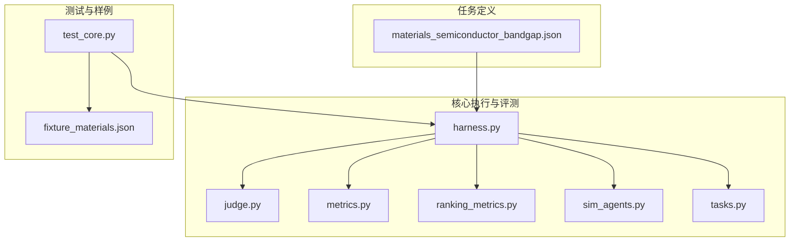
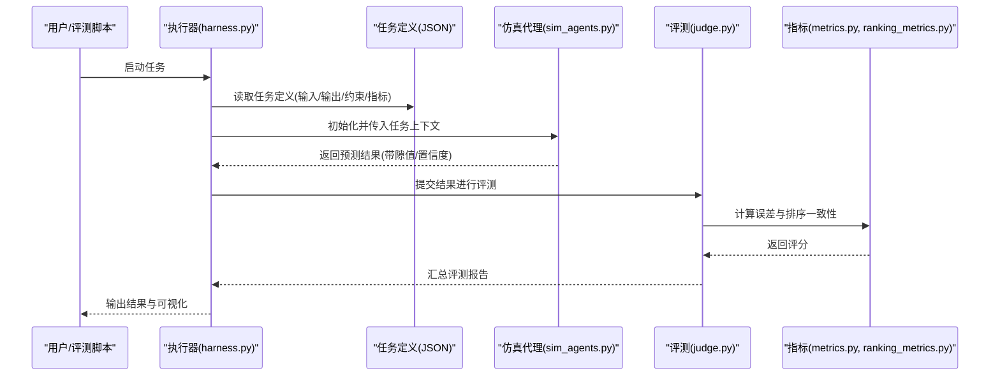
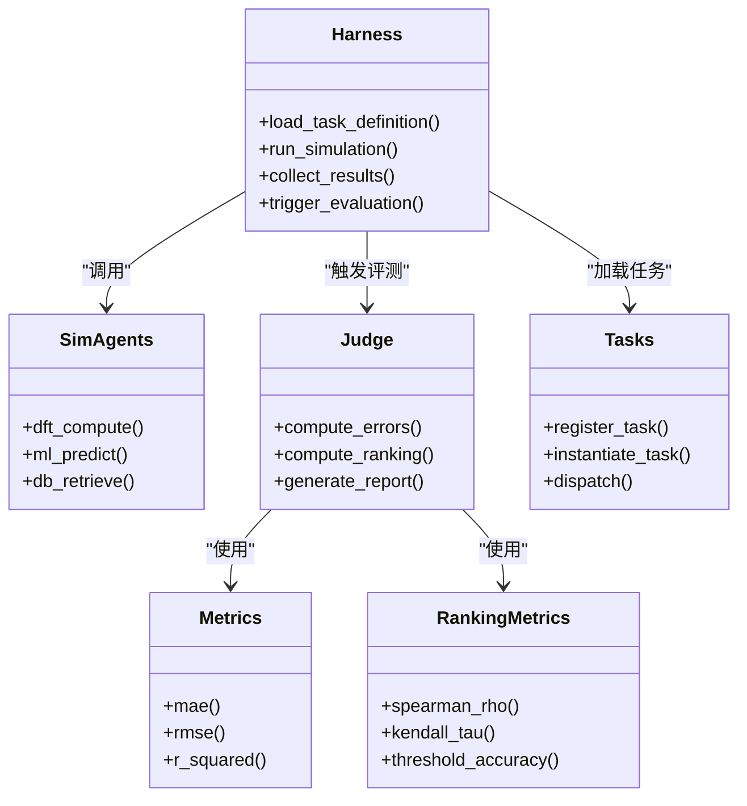

# 材料科学任务定义

<cite>
**本文档引用的文件**
- [materials_semiconductor_bandgap.json](file://autonomy_mvp/tasks/materials_semiconductor_bandgap.json)
- [schema.md](file://autonomy_mvp/schema.md)
- [ACCEPTANCE.md](file://autonomy_mvp/ACCEPTANCE.md)
- [core.py](file://autonomy_mvp/core/harness.py)
- [judge.py](file://autonomy_mvp/core/judge.py)
- [metrics.py](file://autonomy_mvp/core/metrics.py)
- [ranking_metrics.py](file://autonomy_mvp/core/ranking_metrics.py)
- [sim_agents.py](file://autonomy_mvp/core/sim_agents.py)
- [tasks.py](file://autonomy_mvp/core/tasks.py)
- [test_core.py](file://autonomy_mvp/tests/test_core.py)
- [fixture_materials.json](file://autonomy_mvp/tests/fixtures/fixture_materials.json)
</cite>

## 目录
1. [简介](#简介)
2. [项目结构](#项目结构)
3. [核心组件](#核心组件)
4. [架构总览](#架构总览)
5. [详细组件分析](#详细组件分析)
6. [依赖关系分析](#依赖关系分析)
7. [性能考量](#性能考量)
8. [故障排查指南](#故障排查指南)
9. [结论](#结论)
10. [附录](#附录)

## 简介
本教程聚焦于材料科学领域的任务定义，以“半导体带隙预测”为示例，系统阐述该领域任务的特殊要求与配置方法。内容涵盖：
- 晶体结构表示（如空间群、晶格参数、原子坐标）
- 材料属性参数（带隙类型、单位、参考值来源）
- 物理计算约束（DFT计算设置、收敛标准、交换关联泛函）
- 材料数据库集成（MP、OQMD、Materials Project等）
- 性能指标定义（MAE、RMSE、R²、排序一致性等）
并提供从任务定义到评估的完整流程，帮助读者掌握复杂材料科学问题的建模与求解。

## 项目结构
本项目围绕“任务定义—执行—评估”的闭环展开，关键目录与文件如下：
- tasks：任务定义文件（JSON），包含输入输出规范、约束、评测指标等
- core：任务执行与评测的核心逻辑（数据加载、仿真代理、评分与排名）
- tests：测试用例与样例数据（含材料相关fixture）
- schema.md、ACCEPTANCE.md：任务与验收规范说明

图表来源
- [materials_semiconductor_bandgap.json](file://autonomy_mvp/tasks/materials_semiconductor_bandgap.json)
- [harness.py](file://autonomy_mvp/core/harness.py)
- [judge.py](file://autonomy_mvp/core/judge.py)
- [metrics.py](file://autonomy_mvp/core/metrics.py)
- [ranking_metrics.py](file://autonomy_mvp/core/ranking_metrics.py)
- [sim_agents.py](file://autonomy_mvp/core/sim_agents.py)
- [tasks.py](file://autonomy_mvp/core/tasks.py)
- [test_core.py](file://autonomy_mvp/tests/test_core.py)
- [fixture_materials.json](file://autonomy_mvp/tests/fixtures/fixture_materials.json)

章节来源
- [schema.md](file://autonomy_mvp/schema.md)
- [ACCEPTANCE.md](file://autonomy_mvp/ACCEPTANCE.md)

## 核心组件
- 任务定义（JSON）：描述输入结构（晶体信息、元素组成、计算条件）、输出目标（带隙预测值或区间）、约束（DFT参数、收敛阈值）、评测指标（误差、排序一致性）。
- 执行器（harness）：负责加载任务定义、准备数据、驱动仿真代理、收集结果并调用评测模块。
- 评测器（judge/metrics/ranking_metrics）：实现误差度量（MAE/RMSE/R²）、排序一致性（Spearman/Kendall）、阈值准确率等。
- 仿真代理（sim_agents）：封装材料计算流程（如DFT计算、机器学习模型推理、数据库检索）。
- 任务编排（tasks）：提供任务注册、实例化与调度能力。
- 测试（tests）：确保任务定义与评测逻辑的一致性，使用fixture_materials.json作为样例输入。

章节来源
- [harness.py](file://autonomy_mvp/core/harness.py)
- [judge.py](file://autonomy_mvp/core/judge.py)
- [metrics.py](file://autonomy_mvp/core/metrics.py)
- [ranking_metrics.py](file://autonomy_mvp/core/ranking_metrics.py)
- [sim_agents.py](file://autonomy_mvp/core/sim_agents.py)
- [tasks.py](file://autonomy_mvp/core/tasks.py)
- [test_core.py](file://autonomy_mvp/tests/test_core.py)
- [fixture_materials.json](file://autonomy_mvp/tests/fixtures/fixture_materials.json)

## 架构总览
下图展示了从任务定义到评测的端到端流程，以及各模块之间的交互关系。

图表来源
- [harness.py](file://autonomy_mvp/core/harness.py)
- [sim_agents.py](file://autonomy_mvp/core/sim_agents.py)
- [judge.py](file://autonomy_mvp/core/judge.py)
- [metrics.py](file://autonomy_mvp/core/metrics.py)
- [ranking_metrics.py](file://autonomy_mvp/core/ranking_metrics.py)

## 详细组件分析

### 任务定义：半导体带隙预测
- 输入字段建议：
  - 晶体结构：空间群、晶格常数、原子坐标、占据数
  - 化学式与元素比例
  - 计算条件：DFT泛函（PBE/HSE06）、截断能、k点网格、自旋极化开关
  - 数据来源：实验值或高精度计算基准（如G₀W₀）
- 输出字段建议：
  - 带隙值（eV）、带隙类型（直接/间接）
  - 不确定性估计（置信区间）
- 约束与规则：
  - 能量收敛阈值（如1e-5 eV/atom）
  - 力收敛阈值（如0.01 eV/Å）
  - 禁止非物理结构（如负体积、重叠原子）
- 评测指标：
  - 回归误差：MAE、RMSE、R²
  - 排序一致性：Spearman ρ、Kendall τ
  - 分类准确率：带隙类型正确率、阈值准确率（如>1.1 eV为宽禁带）

章节来源
- [materials_semiconductor_bandgap.json](file://autonomy_mvp/tasks/materials_semiconductor_bandgap.json)
- [schema.md](file://autonomy_mvp/schema.md)

### 执行器（harness）
- 职责：解析任务定义、加载数据集、驱动仿真代理、聚合结果、触发评测。
- 关键点：
  - 输入校验：检查晶体结构与计算参数的合法性
  - 并行执行：支持批量DFT或ML推理
  - 错误处理：记录失败样本与重试策略

章节来源
- [harness.py](file://autonomy_mvp/core/harness.py)

### 评测器（judge/metrics/ranking_metrics）
- 职责：根据任务定义的指标计算评分，生成可解释的报告。
- 关键点：
  - 误差度量：对带隙值进行MAE/RMSE/R²计算
  - 排序一致性：对候选材料按预测带隙排序，与基准对比
  - 阈值准确率：对“宽禁带/窄禁带”分类进行评估

章节来源
- [judge.py](file://autonomy_mvp/core/judge.py)
- [metrics.py](file://autonomy_mvp/core/metrics.py)
- [ranking_metrics.py](file://autonomy_mvp/core/ranking_metrics.py)

### 仿真代理（sim_agents）
- 职责：封装材料计算流程，包括：
  - DFT计算（VASP/Quantum ESPRESSO接口）
  - ML模型推理（图神经网络、描述符+回归）
  - 数据库检索（Materials Project、OQMD）
- 关键点：
  - 参数标准化：统一单位与格式
  - 缓存机制：避免重复计算
  - 资源管理：GPU/CPU分配与超时控制

章节来源
- [sim_agents.py](file://autonomy_mvp/core/sim_agents.py)

### 任务编排（tasks）
- 职责：注册任务、实例化任务对象、调度执行。
- 关键点：
  - 任务版本管理
  - 动态加载任务定义
  - 与执行器解耦

章节来源
- [tasks.py](file://autonomy_mvp/core/tasks.py)

### 测试与样例（tests/fixtures）
- 作用：验证任务定义与评测逻辑的正确性。
- fixture_materials.json：提供最小可用材料样例（含晶体信息与参考带隙）。

章节来源
- [test_core.py](file://autonomy_mvp/tests/test_core.py)
- [fixture_materials.json](file://autonomy_mvp/tests/fixtures/fixture_materials.json)

## 依赖关系分析

图表来源
- [harness.py](file://autonomy_mvp/core/harness.py)
- [sim_agents.py](file://autonomy_mvp/core/sim_agents.py)
- [judge.py](file://autonomy_mvp/core/judge.py)
- [metrics.py](file://autonomy_mvp/core/metrics.py)
- [ranking_metrics.py](file://autonomy_mvp/core/ranking_metrics.py)
- [tasks.py](file://autonomy_mvp/core/tasks.py)

## 性能考量
- 计算成本：DFT计算昂贵，建议使用预筛选（ML模型）减少高成本计算数量
- 并行化：批处理与分布式计算，合理分配GPU/CPU资源
- 缓存与复用：对相同结构或相似计算的中间结果进行缓存
- 精度与效率平衡：在探索阶段使用低精度快速迭代，最终验证使用高精度

## 故障排查指南
- 常见错误：
  - 输入结构非法（键长异常、对称性破坏）
  - DFT计算不收敛（需调整k点、截断能、混合泛函参数）
  - 指标计算异常（单位不一致、缺失参考值）
- 调试建议：
  - 启用详细日志，记录每一步的参数与输出
  - 使用最小样例（fixture_materials.json）逐步验证流程
  - 隔离问题模块（如单独测试DFT接口或ML模型）

章节来源
- [ACCEPTANCE.md](file://autonomy_mvp/ACCEPTANCE.md)
- [test_core.py](file://autonomy_mvp/tests/test_core.py)

## 结论
通过标准化的任务定义与模块化执行框架，材料科学任务（如半导体带隙预测）可实现从数据准备、计算模拟到评测反馈的闭环自动化。关键在于：
- 明确输入输出与约束（晶体结构、DFT参数、物理合理性）
- 选择合适的计算路径（DFT/ML/数据库）
- 设计合理的评测指标（误差、排序、分类）
- 构建可扩展的执行与评测架构

## 附录
- 推荐工具链：
  - DFT：VASP、Quantum ESPRESSO、ABINIT
  - ML：MatGL、CGCNN、SchNet
  - 数据库：Materials Project、OQMD、AFLOW
- 最佳实践：
  - 数据清洗与标准化
  - 交叉验证与外部验证集
  - 不确定性量化与可解释性分析