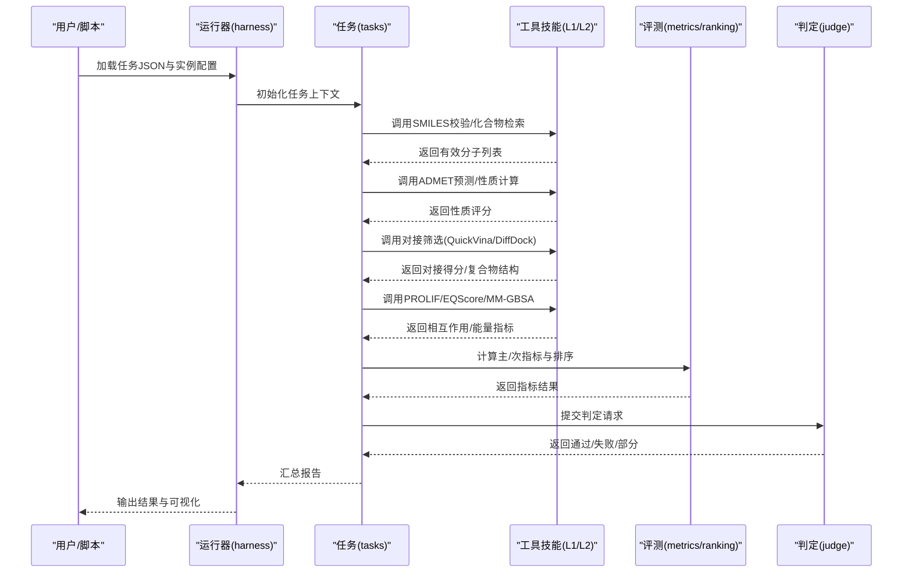
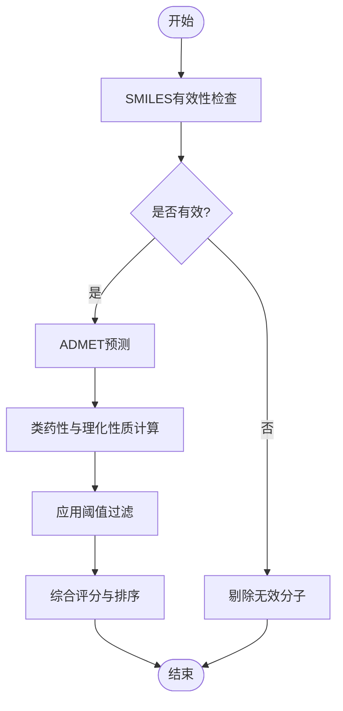
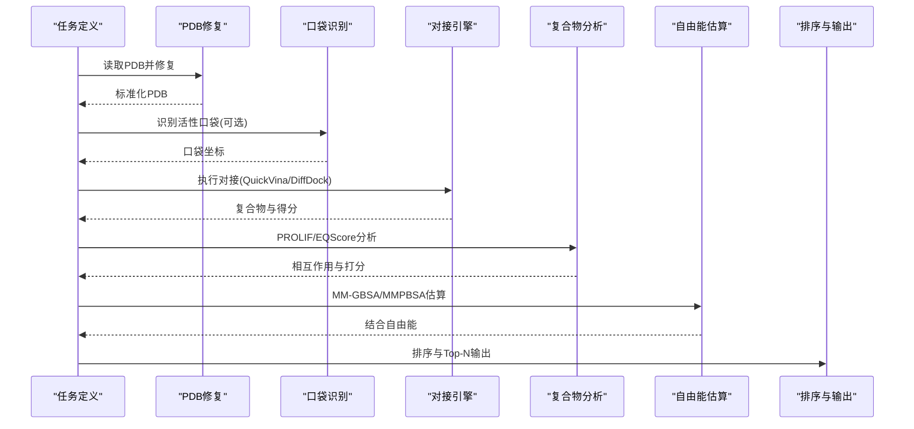
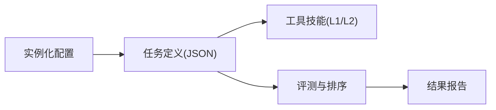

# 药物发现任务定义

<cite>
**本文引用的文件**   
- [autonomy_mvp/core/tasks.py](file://autonomy_mvp/core/tasks.py)
- [autonomy_mvp/core/harness.py](file://autonomy_mvp/core/harness.py)
- [autonomy_mvp/core/metrics.py](file://autonomy_mvp/core/metrics.py)
- [autonomy_mvp/core/judge.py](file://autonomy_mvp/core/judge.py)
- [autonomy_mvp/core/ranking_metrics.py](file://autonomy_mvp/core/ranking_metrics.py)
- [autonomy_mvp/tasks/drug_admet.json](file://autonomy_mvp/tasks/drug_admet.json)
- [autonomy_mvp/tasks/drug_screen_ms3.json](file://autonomy_mvp/tasks/drug_screen_ms3.json)
- [autonomy_mvp/tests/fixtures/fixture_drugscreen.json](file://autonomy_mvp/tests/fixtures/fixture_drugscreen.json)
- [docs/prd/molbench_repo/config/baseline_molbench-ms-1.yaml](file://docs/prd/molbench_repo/config/baseline_molbench-ms-1.yaml)
- [docs/prd/molbench_repo/config/baseline_molbench-ms-2.yaml](file://docs/prd/molbench_repo/config/baseline_molbench-ms-2.yaml)
- [docs/prd/molbench_repo/config/baseline_molbench-ms-3.yaml](file://docs/prd/molbench_repo/config/baseline_molbench-ms-3.yaml)
- [docs/prd/molbench_repo/data_full/molbench-ms-1/molbench-ms-1.csv](file://docs/prd/molbench_repo/data_full/molbench-ms-1/molbench-ms-1.csv)
- [docs/prd/molbench_repo/data_full/molbench-ms-2/molbench-ms-2.csv](file://docs/prd/molbench_repo/data_full/molbench-ms-2/molbench-ms-2.csv)
- [docs/prd/molbench_repo/data_full/molbench-ms-3/molbench-ms-3.csv](file://docs/prd/molbench_repo/data_full/molbench-ms-3/molbench-ms-3.csv)
- [docs/prd/molbench_repo/skills/L1_tools/molclaw-docking-screening/tool.md](file://docs/prd/molbench_repo/skills/L1_tools/molclaw-docking-screening/tool.md)
- [docs/prd/molbench_repo/skills/L1_tools/molclaw-mol-basic-metrics/tool.md](file://docs/prd/molbench_repo/skills/L1_tools/molclaw-mol-basic-metrics/tool.md)
- [docs/prd/molbench_repo/skills/L1_tools/molclaw-prolif-tool/tool.md](file://docs/prd/molbench_repo/skills/L1_tools/molclaw-prolif-tool/tool.md)
- [docs/prd/molbench_repo/skills/L1_tools/molclaw-equiscore-tool/tool.md](file://docs/prd/molbench_repo/skills/L1_tools/molclaw-equiscore-tool/tool.md)
- [docs/prd/molbench_repo/skills/L1_tools/molclaw-fpocket-toolkit-base/tool.md](file://docs/prd/molbench_repo/skills/L1_tools/molclaw-fpocket-toolkit-base/tool.md)
- [docs/prd/molbench_repo/skills/L1_tools/molclaw-fix-pdb/tool.md](file://docs/prd/molbench_repo/skills/L1_tools/molclaw-fix-pdb/tool.md)
- [docs/prd/molbench_repo/skills/L1_tools/molclaw-smiles-valid-check/tool.md](file://docs/prd/molbench_repo/skills/L1_tools/molclaw-smiles-valid-check/tool.md)
- [docs/prd/molbench_repo/skills/L1_tools/molclaw-compound-retrieve/tool.md](file://docs/prd/molbench_repo/skills/L1_tools/molclaw-compound-retrieve/tool.md)
- [docs/prd/molbench_repo/skills/L1_tools/molclaw-protein-structure-retrieve/tool.md](file://docs/prd/molbench_repo/skills/L1_tools/molclaw-protein-structure-retrieve/tool.md)
- [docs/prd/molbench_repo/skills/L1_tools/molclaw-prolif-md/tool.md](file://docs/prd/molbench_repo/skills/L1_tools/molclaw-prolif-md/tool.md)
- [docs/prd/molbench_repo/skills/L1_tools/molclaw-prolif-pdb/tool.md](file://docs/prd/molbench_repo/skills/L1_tools/molclaw-prolif-pdb/tool.md)
- [docs/prd/molbench_repo/skills/L1_tools/molclaw-protein-ligand-mmpbsa/tool.md](file://docs/prd/molbench_repo/skills/L1_tools/molclaw-protein-ligand-mmpbsa/tool.md)
- [docs/prd/molbench_repo/skills/L1_tools/molclaw-quickvina-docking/tool.md](file://docs/prd/molbench_repo/skills/L1_tools/molclaw-quickvina-docking/tool.md)
- [docs/prd/molbench_repo/skills/L1_tools/molclaw-diffdock-auto/tool.md](file://docs/prd/molbench_repo/skills/L1_tools/molclaw-diffdock-auto/tool.md)
- [docs/prd/molbench_repo/skills/L1_tools/molclaw-chai1-predict/tool.md](file://docs/prd/molbench_repo/skills/L1_tools/molclaw-chai1-predict/tool.md)
- [docs/prd/molbench_repo/skills/L1_tools/molclaw-esmfold/tool.md](file://docs/prd/molbench_repo/skills/L1_tools/molclaw-esmfold/tool.md)
- [docs/prd/molbench_repo/skills/L1_tools/molclaw-admet/tool.md](file://docs/prd/molbench_repo/skills/L1_tools/molclaw-admet/tool.md)
- [docs/prd/molbench_repo/skills/L1_tools/molclaw-drug-likeness/tool.md](file://docs/prd/molbench_repo/skills/L1_tools/molclaw-drug-likeness/tool.md)
- [docs/prd/molbench_repo/skills/L1_tools/molclaw-mol-opt-physchem/tool.md](file://docs/prd/molbench_repo/skills/L1_tools/molclaw-mol-opt-physchem/tool.md)
- [docs/prd/molbench_repo/skills/L1_tools/molclaw-mol-similarity/tool.md](file://docs/prd/molbench_repo/skills/L1_tools/molclaw-mol-similarity/tool.md)
- [docs/prd/molbench_repo/skills/L1_tools/molclaw-mol-structure-metrics/tool.md](file://docs/prd/molbench_repo/skills/L1_tools/molclaw-mol-structure-metrics/tool.md)
- [docs/prd/molbench_repo/skills/L1_tools/molclaw-mol-topology-metrics/tool.md](file://docs/prd/molbench_repo/skills/L1_tools/molclaw-mol-topology-metrics/tool.md)
- [docs/prd/molbench_repo/skills/L1_tools/molclaw-mol-hydrophobicity-metrics/tool.md](file://docs/prd/molbench_repo/skills/L1_tools/molclaw-mol-hydrophobicity-metrics/tool.md)
- [docs/prd/molbench_repo/skills/L1_tools/molclaw-mol-hbond-metrics/tool.md](file://docs/prd/molbench_repo/skills/L1_tools/molclaw-mol-hbond-metrics/tool.md)
- [docs/prd/molbench_repo/skills/L1_tools/molclaw-mol-complexity-metrics/tool.md](file://docs/prd/molbench_repo/skills/L1_tools/molclaw-mol-complexity-metrics/tool.md)
- [docs/prd/molbench_repo/skills/L1_tools/molclaw-mol-charge-metrics/tool.md](file://docs/prd/molbench_repo/skills/L1_tools/molclaw-mol-charge-metrics/tool.md)
- [docs/prd/molbench_repo/skills/L1_tools/molclaw-prolif-protein-protein/tool.md](file://docs/prd/molbench_repo/skills/L1_tools/molclaw-prolif-protein-protein/tool.md)
- [docs/prd/molbench_repo/skills/L1_tools/molclaw-prolif-tool/__init__.py](file://docs/prd/molbench_repo/skills/L1_tools/molclaw-prolif-tool/__init__.py)
- [docs/prd/molbench_repo/skills/L2_workflows/02-molecular-docking-screening.md](file://docs/prd/molbench_repo/skills/L2_workflows/02-molecular-docking-screening.md)
- [docs/prd/molbench_repo/skills/L2_workflows/03-molecular-property-analysis-filtering.md](file://docs/prd/molbench_repo/skills/L2_workflows/03-molecular-property-analysis-filtering.md)
- [docs/prd/molbench_repo/skills/L2_workflows/04-generative-molecular-design.md](file://docs/prd/molbench_repo/skills/L2_workflows/04-generative-molecular-design.md)
- [docs/prd/molbench_repo/skills/L2_workflows/05-iterative-molecular-optimization.md](file://docs/prd/molbench_repo/skills/L2_workflows/05-iterative-molecular-optimization.md)
- [docs/prd/molbench_repo/skills/L2_workflows/06-binding-free-energy-calculation.md](file://docs/prd/molbench_repo/skills/L2_workflows/06-binding-free-energy-calculation.md)
- [docs/prd/molbench_repo/skills/L2_workflows/07-conformational-sampling-analysis.md](file://docs/prd/molbench_repo/skills/L2_workflows/07-conformational-sampling-analysis.md)
- [docs/prd/molbench_repo/skills/L2_workflows/08-post-docking-evaluation.md](file://docs/prd/molbench_repo/skills/L2_workflows/08-post-docking-evaluation.md)
- [longhorizon/instantiate/instances/drug2_BACE1.json](file://longhorizon/instantiate/instances/drug2_BACE1.json)
- [longhorizon/instantiate/instances/drug2_DPP-4.json](file://longhorizon/instantiate/instances/drug2_DPP-4.json)
- [longhorizon/instantiate/instances/drug2_EGFR.json](file://longhorizon/instantiate/instances/drug2_EGFR.json)
- [longhorizon/instantiate/instances/drug2_GLP-1R.json](file://longhorizon/instantiate/instances/drug2_GLP-1R.json)
- [longhorizon/instantiate/instances/drug2_mTOR.json](file://longhorizon/instantiate/instances/drug2_mTOR.json)
</cite>

## 目录
1. [引言](#引言)
2. [项目结构](#项目结构)
3. [核心组件](#核心组件)
4. [架构总览](#架构总览)
5. [详细组件分析](#详细组件分析)
6. [依赖关系分析](#依赖关系分析)
7. [性能与可扩展性](#性能与可扩展性)
8. [故障排查指南](#故障排查指南)
9. [结论](#结论)
10. [附录：完整示例与最佳实践](#附录完整示例与最佳实践)

## 引言
本教程面向药物研发工程师与算法研究者，系统讲解如何在现有框架中定义“ADME性质预测”和“分子对接筛选”两类复杂任务。内容覆盖：
- 任务定义的JSON结构与字段语义（输入、约束、评估指标）
- 分子结构SMILES与靶点PDB文件的处理规范
- 化学性质计算与对接流程的工具链集成
- 从分子设计到活性评估的端到端工作流编排
- 可复现实验配置与基准数据组织方式

## 项目结构
仓库围绕“任务定义—工具技能—工作流—评测指标—实例化案例”分层组织：
- 任务定义层：以JSON描述任务目标、输入输出、约束与评估
- 工具技能层：L1原子工具（如SMILES校验、ADMET预测、对接、打分等）与L2工作流（对接筛选、性质过滤、生成优化等）
- 评测层：统一度量接口与排序指标
- 实例层：具体靶点或数据集的任务实例化配置

```mermaid
graph TB
subgraph "任务定义"
T1["drug_admet.json"]
T2["drug_screen_ms3.json"]
end
subgraph "工具技能 L1"
S_SMILES["molclaw-smiles-valid-check"]
S_ADMET["molclaw-admet"]
S_DOCK["molclaw-docking-screening"]
S_PROLIF["molclaw-prolif-tool"]
S_EQUI["molclaw-equiscore-tool"]
S_FP["molclaw-fpocket-toolkit-base"]
S_FIX["molclaw-fix-pdb"]
S_RETRIEVE_MOL["molclaw-compound-retrieve"]
S_RETRIEVE_PDB["molclaw-protein-structure-retrieve"]
S_MD["molclaw-prolif-md"]
S_MMGBSA["molclaw-protein-ligand-mmpbsa"]
S_QUICKVINA["molclaw-quickvina-docking"]
S_DIFFDOCK["molclaw-diffdock-auto"]
S_CHAI["molclaw-chai1-predict"]
S_ESMFOLD["molclaw-esmfold"]
S_DRUGLIKE["molclaw-drug-likeness"]
S_PHYS["molclaw-mol-opt-physchem"]
S_SIM["molclaw-mol-similarity"]
S_STRUCT["molclaw-mol-structure-metrics"]
S_TOPO["molclaw-mol-topology-metrics"]
S_HYDRO["molclaw-mol-hydrophobicity-metrics"]
S_HBOND["molclaw-mol-hbond-metrics"]
S_COMPLEX["molclaw-mol-complexity-metrics"]
S_CHARGE["molclaw-mol-charge-metrics"]
end
subgraph "工作流 L2"
W_DOCK["02-molecular-docking-screening.md"]
W_PROP["03-molecular-property-analysis-filtering.md"]
W_GEN["04-generative-molecular-design.md"]
W_OPT["05-iterative-molecular-optimization.md"]
W_ENERGY["06-binding-free-energy-calculation.md"]
W_CONF["07-conformational-sampling-analysis.md"]
W_POST["08-post-docking-evaluation.md"]
end
subgraph "评测"
M_CORE["core/metrics.py"]
M_RANK["core/ranking_metrics.py"]
JUDGE["core/judge.py"]
end
subgraph "实例"
I1["drug2_BACE1.json"]
I2["drug2_DPP-4.json"]
I3["drug2_EGFR.json"]
I4["drug2_GLP-1R.json"]
I5["drug2_mTOR.json"]
end
T1 --> S_SMILES
T1 --> S_ADMET
T2 --> S_DOCK
T2 --> S_PROLIF
T2 --> S_EQUI
T2 --> S_FP
T2 --> S_FIX
T2 --> S_RETRIEVE_MOL
T2 --> S_RETRIEVE_PDB
T2 --> S_MD
T2 --> S_MMGBSA
T2 --> S_QUICKVINA
T2 --> S_DIFFDOCK
T2 --> S_CHAI
T2 --> S_ESMFOLD
T2 --> S_DRUGLIKE
T2 --> S_PHYS
T2 --> S_SIM
T2 --> S_STRUCT
T2 --> S_TOPO
T2 --> S_HYDRO
T2 --> S_HBOND
T2 --> S_COMPLEX
T2 --> S_CHARGE
W_DOCK --> S_DOCK
W_PROP --> S_ADMET
W_GEN --> S_DRUGLIKE
W_OPT --> S_SIM
W_ENERGY --> S_MMGBSA
W_CONF --> S_MD
W_POST --> S_PROLIF
M_CORE --> T1
M_RANK --> T2
JUDGE --> T1
JUDGE --> T2
I1 --> T1
I2 --> T1
I3 --> T1
I4 --> T1
I5 --> T1
```

图表来源
- [autonomy_mvp/tasks/drug_admet.json](file://autonomy_mvp/tasks/drug_admet.json)
- [autonomy_mvp/tasks/drug_screen_ms3.json](file://autonomy_mvp/tasks/drug_screen_ms3.json)
- [docs/prd/molbench_repo/skills/L1_tools/molclaw-docking-screening/tool.md](file://docs/prd/molbench_repo/skills/L1_tools/molclaw-docking-screening/tool.md)
- [docs/prd/molbench_repo/skills/L1_tools/molclaw-mol-basic-metrics/tool.md](file://docs/prd/molbench_repo/skills/L1_tools/molclaw-mol-basic-metrics/tool.md)
- [docs/prd/molbench_repo/skills/L1_tools/molclaw-prolif-tool/tool.md](file://docs/prd/molbench_repo/skills/L1_tools/molclaw-prolif-tool/tool.md)
- [docs/prd/molbench_repo/skills/L1_tools/molclaw-equiscore-tool/tool.md](file://docs/prd/molbench_repo/skills/L1_tools/molclaw-equiscore-tool/tool.md)
- [docs/prd/molbench_repo/skills/L1_tools/molclaw-fpocket-toolkit-base/tool.md](file://docs/prd/molbench_repo/skills/L1_tools/molclaw-fpocket-toolkit-base/tool.md)
- [docs/prd/molbench_repo/skills/L1_tools/molclaw-fix-pdb/tool.md](file://docs/prd/molbench_repo/skills/L1_tools/molclaw-fix-pdb/tool.md)
- [docs/prd/molbench_repo/skills/L1_tools/molclaw-smiles-valid-check/tool.md](file://docs/prd/molbench_repo/skills/L1_tools/molclaw-smiles-valid-check/tool.md)
- [docs/prd/molbench_repo/skills/L1_tools/molclaw-compound-retrieve/tool.md](file://docs/prd/molbench_repo/skills/L1_tools/molclaw-compound-retrieve/tool.md)
- [docs/prd/molbench_repo/skills/L1_tools/molclaw-protein-structure-retrieve/tool.md](file://docs/prd/molbench_repo/skills/L1_tools/molclaw-protein-structure-retrieve/tool.md)
- [docs/prd/molbench_repo/skills/L1_tools/molclaw-prolif-md/tool.md](file://docs/prd/molbench_repo/skills/L1_tools/molclaw-prolif-md/tool.md)
- [docs/prd/molbench_repo/skills/L1_tools/molclaw-prolif-pdb/tool.md](file://docs/prd/molbench_repo/skills/L1_tools/molclaw-prolif-pdb/tool.md)
- [docs/prd/molbench_repo/skills/L1_tools/molclaw-protein-ligand-mmpbsa/tool.md](file://docs/prd/molbench_repo/skills/L1_tools/molclaw-protein-ligand-mmpbsa/tool.md)
- [docs/prd/molbench_repo/skills/L1_tools/molclaw-quickvina-docking/tool.md](file://docs/prd/molbench_repo/skills/L1_tools/molclaw-quickvina-docking/tool.md)
- [docs/prd/molbench_repo/skills/L1_tools/molclaw-diffdock-auto/tool.md](file://docs/prd/molbench_repo/skills/L1_tools/molclaw-diffdock-auto/tool.md)
- [docs/prd/molbench_repo/skills/L1_tools/molclaw-chai1-predict/tool.md](file://docs/prd/molbench_repo/skills/L1_tools/molclaw-chai1-predict/tool.md)
- [docs/prd/molbench_repo/skills/L1_tools/molclaw-esmfold/tool.md](file://docs/prd/molbench_repo/skills/L1_tools/molclaw-esmfold/tool.md)
- [docs/prd/molbench_repo/skills/L1_tools/molclaw-admet/tool.md](file://docs/prd/molbench_repo/skills/L1_tools/molclaw-admet/tool.md)
- [docs/prd/molbench_repo/skills/L1_tools/molclaw-drug-likeness/tool.md](file://docs/prd/molbench_repo/skills/L1_tools/molclaw-drug-likeness/tool.md)
- [docs/prd/molbench_repo/skills/L1_tools/molclaw-mol-opt-physchem/tool.md](file://docs/prd/molbench_repo/skills/L1_tools/molclaw-mol-opt-physchem/tool.md)
- [docs/prd/molbench_repo/skills/L1_tools/molclaw-mol-similarity/tool.md](file://docs/prd/molbench_repo/skills/L1_tools/molclaw-mol-similarity/tool.md)
- [docs/prd/molbench_repo/skills/L1_tools/molclaw-mol-structure-metrics/tool.md](file://docs/prd/molbench_repo/skills/L1_tools/molclaw-mol-structure-metrics/tool.md)
- [docs/prd/molbench_repo/skills/L1_tools/molclaw-mol-topology-metrics/tool.md](file://docs/prd/molbench_repo/skills/L1_tools/molclaw-mol-topology-metrics/tool.md)
- [docs/prd/molbench_repo/skills/L1_tools/molclaw-mol-hydrophobicicity-metrics/tool.md](file://docs/prd/molbench_repo/skills/L1_tools/molclaw-mol-hydrophobicity-metrics/tool.md)
- [docs/prd/molbench_repo/skills/L1_tools/molclaw-mol-hbond-metrics/tool.md](file://docs/prd/molbench_repo/skills/L1_tools/molclaw-mol-hbond-metrics/tool.md)
- [docs/prd/molbench_repo/skills/L1_tools/molclaw-mol-complexity-metrics/tool.md](file://docs/prd/molbench_repo/skills/L1_tools/molclaw-mol-complexity-metrics/tool.md)
- [docs/prd/molbench_repo/skills/L1_tools/molclaw-mol-charge-metrics/tool.md](file://docs/prd/molbench_repo/skills/L1_tools/molclaw-mol-charge-metrics/tool.md)
- [autonomy_mvp/core/metrics.py](file://autonomy_mvp/core/metrics.py)
- [autonomy_mvp/core/ranking_metrics.py](file://autonomy_mvp/core/ranking_metrics.py)
- [autonomy_mvp/core/judge.py](file://autonomy_mvp/core/judge.py)
- [longhorizon/instantiate/instances/drug2_BACE1.json](file://longhorizon/instantiate/instances/drug2_BACE1.json)
- [longhorizon/instantiate/instances/drug2_DPP-4.json](file://longhorizon/instantiate/instances/drug2_DPP-4.json)
- [longhorizon/instantiate/instances/drug2_EGFR.json](file://longhorizon/instantiate/instances/drug2_EGFR.json)
- [longhorizon/instantiate/instances/drug2_GLP-1R.json](file://longhorizon/instantiate/instances/drug2_GLP-1R.json)
- [longhorizon/instantiate/instances/drug2_mTOR.json](file://longhorizon/instantiate/instances/drug2_mTOR.json)

章节来源
- [autonomy_mvp/tasks/drug_admet.json](file://autonomy_mvp/tasks/drug_admet.json)
- [autonomy_mvp/tasks/drug_screen_ms3.json](file://autonomy_mvp/tasks/drug_screen_ms3.json)
- [docs/prd/molbench_repo/skills/L2_workflows/02-molecular-docking-screening.md](file://docs/prd/molbench_repo/skills/L2_workflows/02-molecular-docking-screening.md)
- [docs/prd/molbench_repo/skills/L2_workflows/03-molecular-property-analysis-filtering.md](file://docs/prd/molbench_repo/skills/L2_workflows/03-molecular-property-analysis-filtering.md)
- [docs/prd/molbench_repo/skills/L2_workflows/04-generative-molecular-design.md](file://docs/prd/molbench_repo/skills/L2_workflows/04-generative-molecular-design.md)
- [docs/prd/molbench_repo/skills/L2_workflows/05-iterative-molecular-optimization.md](file://docs/prd/molbench_repo/skills/L2_workflows/05-iterative-molecular-optimization.md)
- [docs/prd/molbench_repo/skills/L2_workflows/06-binding-free-energy-calculation.md](file://docs/prd/molbench_repo/skills/L2_workflows/06-binding-free-energy-calculation.md)
- [docs/prd/molbench_repo/skills/L2_workflows/07-conformational-sampling-analysis.md](file://docs/prd/molbench_repo/skills/L2_workflows/07-conformational-sampling-analysis.md)
- [docs/prd/molbench_repo/skills/L2_workflows/08-post-docking-evaluation.md](file://docs/prd/molbench_repo/skills/L2_workflows/08-post-docking-evaluation.md)

## 核心组件
- 任务定义器：负责解析任务JSON、组装输入上下文、驱动工具与工作流执行、收集结果并调用评测模块。
- 评测与排序：提供通用指标与排序指标，支持多目标权衡与排名统计。
- 判定器：对任务完成度进行结构化判定（通过/失败/部分），便于自动化验收。
- 工具技能：按L1原子能力与L2工作流分层，覆盖SMILES/PDB处理、ADMET预测、对接、结合自由能估算、构象采样、性质计算等。
- 实例化配置：将抽象任务映射到具体靶点或数据集，形成可运行的实验用例。

章节来源
- [autonomy_mvp/core/tasks.py](file://autonomy_mvp/core/tasks.py)
- [autonomy_mvp/core/harness.py](file://autonomy_mvp/core/harness.py)
- [autonomy_mvp/core/metrics.py](file://autonomy_mvp/core/metrics.py)
- [autonomy_mvp/core/ranking_metrics.py](file://autonomy_mvp/core/ranking_metrics.py)
- [autonomy_mvp/core/judge.py](file://autonomy_mvp/core/judge.py)

## 架构总览
下图展示从任务定义到评测输出的端到端流程，包括输入验证、工具调用、工作流编排与指标计算。

图表来源
- [autonomy_mvp/core/harness.py](file://autonomy_mvp/core/harness.py)
- [autonomy_mvp/core/tasks.py](file://autonomy_mvp/core/tasks.py)
- [autonomy_mvp/core/metrics.py](file://autonomy_mvp/core/metrics.py)
- [autonomy_mvp/core/ranking_metrics.py](file://autonomy_mvp/core/ranking_metrics.py)
- [autonomy_mvp/core/judge.py](file://autonomy_mvp/core/judge.py)
- [docs/prd/molbench_repo/skills/L1_tools/molclaw-docking-screening/tool.md](file://docs/prd/molbench_repo/skills/L1_tools/molclaw-docking-screening/tool.md)
- [docs/prd/molbench_repo/skills/L1_tools/molclaw-admet/tool.md](file://docs/prd/molbench_repo/skills/L1_tools/molclaw-admet/tool.md)
- [docs/prd/molbench_repo/skills/L1_tools/molclaw-prolif-tool/tool.md](file://docs/prd/molbench_repo/skills/L1_tools/molclaw-prolif-tool/tool.md)
- [docs/prd/molbench_repo/skills/L1_tools/molclaw-equiscore-tool/tool.md](file://docs/prd/molbench_repo/skills/L1_tools/molclaw-equiscore-tool/tool.md)
- [docs/prd/molbench_repo/skills/L1_tools/molclaw-protein-ligand-mmpbsa/tool.md](file://docs/prd/molbench_repo/skills/L1_tools/molclaw-protein-ligand-mmpbsa/tool.md)

## 详细组件分析

### ADME性质预测任务定义
- 输入字段
  - 分子结构：SMILES字符串数组；需先经SMILES有效性检查。
  - 可选：分子ID、来源数据库、初始筛选阈值。
- 处理步骤
  - SMILES有效性校验与去重
  - ADMET属性预测（吸收、分布、代谢、排泄、毒性）
  - 类药性与理化性质计算（如LogP、分子量、氢键供体/受体、拓扑复杂度等）
- 输出字段
  - 各ADME指标数值与阈值判定
  - 综合评分与排序
- 评估指标
  - 分类准确率/ROC-AUC（若含标签）
  - 回归误差（MAE/RMSE）
  - 多目标加权得分（类药性+ADMET）

图表来源
- [autonomy_mvp/tasks/drug_admet.json](file://autonomy_mvp/tasks/drug_admet.json)
- [docs/prd/molbench_repo/skills/L1_tools/molclaw-smiles-valid-check/tool.md](file://docs/prd/molbench_repo/skills/L1_tools/molclaw-smiles-valid-check/tool.md)
- [docs/prd/molbench_repo/skills/L1_tools/molclaw-admet/tool.md](file://docs/prd/molbench_repo/skills/L1_tools/molclaw-admet/tool.md)
- [docs/prd/molbench_repo/skills/L1_tools/molclaw-drug-likeness/tool.md](file://docs/prd/molbench_repo/skills/L1_tools/molclaw-drug-likeness/tool.md)
- [docs/prd/molbench_repo/skills/L1_tools/molclaw-mol-opt-physchem/tool.md](file://docs/prd/molbench_repo/skills/L1_tools/molclaw-mol-opt-physchem/tool.md)
- [docs/prd/molbench_repo/skills/L1_tools/molclaw-mol-structure-metrics/tool.md](file://docs/prd/molbench_repo/skills/L1_tools/molclaw-mol-structure-metrics/tool.md)
- [docs/prd/molbench_repo/skills/L1_tools/molclaw-mol-topology-metrics/tool.md](file://docs/prd/molbench_repo/skills/L1_tools/molclaw-mol-topology-metrics/tool.md)
- [docs/prd/molbench_repo/skills/L1_tools/molclaw-mol-hydrophobicity-metrics/tool.md](file://docs/prd/molbench_repo/skills/L1_tools/molclaw-mol-hydrophobicity-metrics/tool.md)
- [docs/prd/molbench_repo/skills/L1_tools/molclaw-mol-hbond-metrics/tool.md](file://docs/prd/molbench_repo/skills/L1_tools/molclaw-mol-hbond-metrics/tool.md)
- [docs/prd/molbench_repo/skills/L1_tools/molclaw-mol-complexity-metrics/tool.md](file://docs/prd/molbench_repo/skills/L1_tools/molclaw-mol-complexity-metrics/tool.md)
- [docs/prd/molbench_repo/skills/L1_tools/molclaw-mol-charge-metrics/tool.md](file://docs/prd/molbench_repo/skills/L1_tools/molclaw-mol-charge-metrics/tool.md)

章节来源
- [autonomy_mvp/tasks/drug_admet.json](file://autonomy_mvp/tasks/drug_admet.json)
- [docs/prd/molbench_repo/skills/L1_tools/molclaw-admet/tool.md](file://docs/prd/molbench_repo/skills/L1_tools/molclaw-admet/tool.md)
- [docs/prd/molbench_repo/skills/L1_tools/molclaw-drug-likeness/tool.md](file://docs/prd/molbench_repo/skills/L1_tools/molclaw-drug-likeness/tool.md)
- [docs/prd/molbench_repo/skills/L1_tools/molclaw-mol-opt-physchem/tool.md](file://docs/prd/molbench_repo/skills/L1_tools/molclaw-mol-opt-physchem/tool.md)
- [docs/prd/molbench_repo/skills/L1_tools/molclaw-mol-structure-metrics/tool.md](file://docs/prd/molbench_repo/skills/L1_tools/molclaw-mol-structure-metrics/tool.md)
- [docs/prd/molbench_repo/skills/L1_tools/molclaw-mol-topology-metrics/tool.md](file://docs/prd/molbench_repo/skills/L1_tools/molclaw-mol-topology-metrics/tool.md)
- [docs/prd/molbench_repo/skills/L1_tools/molclaw-mol-hydrophobicity-metrics/tool.md](file://docs/prd/molbench_repo/skills/L1_tools/molclaw-mol-hydrophobicity-metrics/tool.md)
- [docs/prd/molbench_repo/skills/L1_tools/molclaw-mol-hbond-metrics/tool.md](file://docs/prd/molbench_repo/skills/L1_tools/molclaw-mol-hbond-metrics/tool.md)
- [docs/prd/molbench_repo/skills/L1_tools/molclaw-mol-complexity-metrics/tool.md](file://docs/prd/molbench_repo/skills/L1_tools/molclaw-mol-complexity-metrics/tool.md)
- [docs/prd/molbench_repo/skills/L1_tools/molclaw-mol-charge-metrics/tool.md](file://docs/prd/molbench_repo/skills/L1_tools/molclaw-mol-charge-metrics/tool.md)

### 分子对接筛选任务定义
- 输入字段
  - 配体集合：SMILES或SDF路径
  - 靶点蛋白：PDB文件路径或序列（必要时使用结构预测工具）
  - 对接参数：搜索空间、网格中心、步数、采样策略
  - 筛选阈值：对接得分、相互作用数量、类药性要求
- 处理步骤
  - PDB预处理（修复缺失原子、加氢、分配电荷）
  - 口袋识别（可选）
  - 对接（QuickVina/DiffDock）
  - 复合物分析与打分（PROLIF/EQScore）
  - 结合自由能估算（MM-GBSA/MMPBSA）
  - 构象采样与稳定性分析（可选）
- 输出字段
  - 每个分子的对接得分、关键相互作用、复合物结构
  - 排序与Top-N候选集
- 评估指标
  - 富集因子、AUC-ROC（若有活性标签）
  - Top-N命中率、平均倒数秩
  - 结合自由能与相互作用一致性

图表来源
- [autonomy_mvp/tasks/drug_screen_ms3.json](file://autonomy_mvp/tasks/drug_screen_ms3.json)
- [docs/prd/molbench_repo/skills/L1_tools/molclaw-fix-pdb/tool.md](file://docs/prd/molbench_repo/skills/L1_tools/molclaw-fix-pdb/tool.md)
- [docs/prd/molbench_repo/skills/L1_tools/molclaw-fpocket-toolkit-base/tool.md](file://docs/prd/molbench_repo/skills/L1_tools/molclaw-fpocket-toolkit-base/tool.md)
- [docs/prd/molbench_repo/skills/L1_tools/molclaw-quickvina-docking/tool.md](file://docs/prd/molbench_repo/skills/L1_tools/molclaw-quickvina-docking/tool.md)
- [docs/prd/molbench_repo/skills/L1_tools/molclaw-diffdock-auto/tool.md](file://docs/prd/molbench_repo/skills/L1_tools/molclaw-diffdock-auto/tool.md)
- [docs/prd/molbench_repo/skills/L1_tools/molclaw-prolif-tool/tool.md](file://docs/prd/molbench_repo/skills/L1_tools/molclaw-prolif-tool/tool.md)
- [docs/prd/molbench_repo/skills/L1_tools/molclaw-equiscore-tool/tool.md](file://docs/prd/molbench_repo/skills/L1_tools/molclaw-equiscore-tool/tool.md)
- [docs/prd/molbench_repo/skills/L1_tools/molclaw-protein-ligand-mmpbsa/tool.md](file://docs/prd/molbench_repo/skills/L1_tools/molclaw-protein-ligand-mmpbsa/tool.md)

章节来源
- [autonomy_mvp/tasks/drug_screen_ms3.json](file://autonomy_mvp/tasks/drug_screen_ms3.json)
- [docs/prd/molbench_repo/skills/L1_tools/molclaw-docking-screening/tool.md](file://docs/prd/molbench_repo/skills/L1_tools/molclaw-docking-screening/tool.md)
- [docs/prd/molbench_repo/skills/L1_tools/molclaw-prolif-tool/tool.md](file://docs/prd/molbench_repo/skills/L1_tools/molclaw-prolif-tool/tool.md)
- [docs/prd/molbench_repo/skills/L1_tools/molclaw-equiscore-tool/tool.md](file://docs/prd/molbench_repo/skills/L1_tools/molclaw-equiscore-tool/tool.md)
- [docs/prd/molbench_repo/skills/L1_tools/molclaw-protein-ligand-mmpbsa/tool.md](file://docs/prd/molbench_repo/skills/L1_tools/molclaw-protein-ligand-mmpbsa/tool.md)
- [docs/prd/molbench_repo/skills/L1_tools/molclaw-quickvina-docking/tool.md](file://docs/prd/molbench_repo/skills/L1_tools/molclaw-quickvina-docking/tool.md)
- [docs/prd/molbench_repo/skills/L1_tools/molclaw-diffdock-auto/tool.md](file://docs/prd/molbench_repo/skills/L1_tools/molclaw-diffdock-auto/tool.md)

### 工作流编排（L2）
- 对接筛选工作流：串联PDB修复、口袋识别、对接、复合物分析、自由能估算与排序。
- 性质分析与过滤工作流：串联SMILES校验、ADMET预测、类药性与理化性质计算、阈值过滤与排序。
- 生成与迭代优化工作流：基于相似性或生成模型产生新分子，循环评估并优化。
- 构象采样与分析工作流：对Top候选进行MD或构象搜索，评估稳定性与相互作用持久性。
- 对接后评估工作流：综合多种打分与自由能，输出最终候选清单与可视化报告。

章节来源
- [docs/prd/molbench_repo/skills/L2_workflows/02-molecular-docking-screening.md](file://docs/prd/molbench_repo/skills/L2_workflows/02-molecular-docking-screening.md)
- [docs/prd/molbench_repo/skills/L2_workflows/03-molecular-property-analysis-filtering.md](file://docs/prd/molbench_repo/skills/L2_workflows/03-molecular-property-analysis-filtering.md)
- [docs/prd/molbench_repo/skills/L2_workflows/04-generative-molecular-design.md](file://docs/prd/molbench_repo/skills/L2_workflows/04-generative-molecular-design.md)
- [docs/prd/molbench_repo/skills/L2_workflows/05-iterative-molecular-optimization.md](file://docs/prd/molbench_repo/skills/L2_workflows/05-iterative-molecular-optimization.md)
- [docs/prd/molbench_repo/skills/L2_workflows/06-binding-free-energy-calculation.md](file://docs/prd/molbench_repo/skills/L2_workflows/06-binding-free-energy-calculation.md)
- [docs/prd/molbench_repo/skills/L2_workflows/07-conformational-sampling-analysis.md](file://docs/prd/molbench_repo/skills/L2_workflows/07-conformational-sampling-analysis.md)
- [docs/prd/molbench_repo/skills/L2_workflows/08-post-docking-evaluation.md](file://docs/prd/molbench_repo/skills/L2_workflows/08-post-docking-evaluation.md)

### 评测与排序
- 通用指标：分类与回归指标、富集与排序指标。
- 排序指标：Top-N命中率、平均倒数秩、AUC-ROC、富集因子等。
- 多目标权衡：为ADMET与对接得分设置权重，生成综合评分。

章节来源
- [autonomy_mvp/core/metrics.py](file://autonomy_mvp/core/metrics.py)
- [autonomy_mvp/core/ranking_metrics.py](file://autonomy_mvp/core/ranking_metrics.py)

### 判定器与验收
- 对任务输出进行结构化判定（通过/失败/部分），支持自定义规则与阈值。
- 与评测模块联动，确保指标达标方可视为通过。

章节来源
- [autonomy_mvp/core/judge.py](file://autonomy_mvp/core/judge.py)

## 依赖关系分析
- 任务定义依赖工具技能：通过JSON中的工具引用与工作流编排实现解耦。
- 评测模块独立于工具：通过统一接口接收结果，保证可替换性与扩展性。
- 实例化配置将抽象任务映射到具体数据与参数，便于批量运行与对比。

图表来源
- [autonomy_mvp/tasks/drug_admet.json](file://autonomy_mvp/tasks/drug_admet.json)
- [autonomy_mvp/tasks/drug_screen_ms3.json](file://autonomy_mvp/tasks/drug_screen_ms3.json)
- [autonomy_mvp/core/metrics.py](file://autonomy_mvp/core/metrics.py)
- [autonomy_mvp/core/ranking_metrics.py](file://autonomy_mvp/core/ranking_metrics.py)
- [longhorizon/instantiate/instances/drug2_BACE1.json](file://longhorizon/instantiate/instances/drug2_BACE1.json)
- [longhorizon/instantiate/instances/drug2_DPP-4.json](file://longhorizon/instantiate/instances/drug2_DPP-4.json)
- [longhorizon/instantiate/instances/drug2_EGFR.json](file://longhorizon/instantiate/instances/drug2_EGFR.json)
- [longhorizon/instantiate/instances/drug2_GLP-1R.json](file://longhorizon/instantiate/instances/drug2_GLP-1R.json)
- [longhorizon/instantiate/instances/drug2_mTOR.json](file://longhorizon/instantiate/instances/drug2_mTOR.json)

章节来源
- [autonomy_mvp/core/tasks.py](file://autonomy_mvp/core/tasks.py)
- [autonomy_mvp/core/harness.py](file://autonomy_mvp/core/harness.py)
- [autonomy_mvp/core/metrics.py](file://autonomy_mvp/core/metrics.py)
- [autonomy_mvp/core/ranking_metrics.py](file://autonomy_mvp/core/ranking_metrics.py)
- [autonomy_mvp/core/judge.py](file://autonomy_mvp/core/judge.py)

## 性能与可扩展性
- 并行化：对接与性质预测可并行执行，提升吞吐。
- 缓存：对重复SMILES与PDB预处理结果进行缓存，避免重复计算。
- 资源控制：对接与MM-GBSA计算可按GPU/CPU资源限制并发度。
- 可扩展：新增工具只需注册接口并在任务JSON中引用，无需修改核心逻辑。

[本节为通用指导，不直接分析具体文件]

## 故障排查指南
- SMILES无效：检查SMILES语法与立体化学标记，使用SMILES校验工具定位问题分子。
- PDB异常：缺失原子或链标识错误时，使用PDB修复工具；确认链ID与口袋区域一致。
- 对接失败：调整搜索空间与网格参数；检查配体与蛋白电荷状态；尝试不同对接引擎。
- 指标异常：核对阈值与权重设置；确认评估标签与数据格式一致。
- 资源不足：降低并发度或分批运行；启用缓存减少重复计算。

章节来源
- [autonomy_mvp/core/judge.py](file://autonomy_mvp/core/judge.py)
- [autonomy_mvp/core/metrics.py](file://autonomy_mvp/core/metrics.py)
- [autonomy_mvp/core/ranking_metrics.py](file://autonomy_mvp/core/ranking_metrics.py)
- [docs/prd/molbench_repo/skills/L1_tools/molclaw-smiles-valid-check/tool.md](file://docs/prd/molbench_repo/skills/L1_tools/molclaw-smiles-valid-check/tool.md)
- [docs/prd/molbench_repo/skills/L1_tools/molclaw-fix-pdb/tool.md](file://docs/prd/molbench_repo/skills/L1_tools/molclaw-fix-pdb/tool.md)
- [docs/prd/molbench_repo/skills/L1_tools/molclaw-docking-screening/tool.md](file://docs/prd/molbench_repo/skills/L1_tools/molclaw-docking-screening/tool.md)

## 结论
通过JSON任务定义与工具技能分层，本项目实现了从分子设计到活性评估的端到端药物发现流程。ADME预测与对接筛选两大典型任务均可通过模块化配置快速搭建与扩展，配合统一的评测与判定机制，保障结果的可比性与可复现性。

[本节为总结，不直接分析具体文件]

## 附录：完整示例与最佳实践

### 示例一：ADME性质预测任务
- 任务文件：参考ADME任务定义
- 工具链：SMILES校验、ADMET预测、类药性与理化性质计算
- 评估：分类/回归指标与多目标加权得分
- 最佳实践
  - 在任务JSON中明确输入字段类型与必填项
  - 设置合理的阈值与权重，避免过度筛选导致召回过低
  - 记录每次运行的参数与随机种子，确保可复现

章节来源
- [autonomy_mvp/tasks/drug_admet.json](file://autonomy_mvp/tasks/drug_admet.json)
- [docs/prd/molbench_repo/skills/L1_tools/molclaw-admet/tool.md](file://docs/prd/molbench_repo/skills/L1_tools/molclaw-admet/tool.md)
- [docs/prd/molbench_repo/skills/L1_tools/molclaw-drug-likeness/tool.md](file://docs/prd/molbench_repo/skills/L1_tools/molclaw-drug-likeness/tool.md)
- [docs/prd/molbench_repo/skills/L1_tools/molclaw-mol-opt-physchem/tool.md](file://docs/prd/molbench_repo/skills/L1_tools/molclaw-mol-opt-physchem/tool.md)
- [docs/prd/molbench_repo/skills/L1_tools/molclaw-mol-structure-metrics/tool.md](file://docs/prd/molbench_repo/skills/L1_tools/molclaw-mol-structure-metrics/tool.md)
- [docs/prd/molbench_repo/skills/L1_tools/molclaw-mol-topology-metrics/tool.md](file://docs/prd/molbench_repo/skills/L1_tools/molclaw-mol-topology-metrics/tool.md)
- [docs/prd/molbench_repo/skills/L1_tools/molclaw-mol-hydrophobicity-metrics/tool.md](file://docs/prd/molbench_repo/skills/L1_tools/molclaw-mol-hydrophobicity-metrics/tool.md)
- [docs/prd/molbench_repo/skills/L1_tools/molclaw-mol-hbond-metrics/tool.md](file://docs/prd/molbench_repo/skills/L1_tools/molclaw-mol-hbond-metrics/tool.md)
- [docs/prd/molbench_repo/skills/L1_tools/molclaw-mol-complexity-metrics/tool.md](file://docs/prd/molbench_repo/skills/L1_tools/molclaw-mol-complexity-metrics/tool.md)
- [docs/prd/molbench_repo/skills/L1_tools/molclaw-mol-charge-metrics/tool.md](file://docs/prd/molbench_repo/skills/L1_tools/molclaw-mol-charge-metrics/tool.md)

### 示例二：分子对接筛选任务
- 任务文件：参考对接筛选任务定义
- 工具链：PDB修复、口袋识别、对接、复合物分析、自由能估算
- 评估：富集因子、Top-N命中率、AUC-ROC、平均倒数秩
- 最佳实践
  - 对PDB进行严格修复与标准化，确保对接质量
  - 合理设置搜索空间与采样参数，平衡精度与效率
  - 结合多种打分与自由能，提高候选可靠性

章节来源
- [autonomy_mvp/tasks/drug_screen_ms3.json](file://autonomy_mvp/tasks/drug_screen_ms3.json)
- [docs/prd/molbench_repo/skills/L1_tools/molclaw-fix-pdb/tool.md](file://docs/prd/molbench_repo/skills/L1_tools/molclaw-fix-pdb/tool.md)
- [docs/prd/molbench_repo/skills/L1_tools/molclaw-fpocket-toolkit-base/tool.md](file://docs/prd/molbench_repo/skills/L1_tools/molclaw-fpocket-toolkit-base/tool.md)
- [docs/prd/molbench_repo/skills/L1_tools/molclaw-quickvina-docking/tool.md](file://docs/prd/molbench_repo/skills/L1_tools/molclaw-quickvina-docking/tool.md)
- [docs/prd/molbench_repo/skills/L1_tools/molclaw-diffdock-auto/tool.md](file://docs/prd/molbench_repo/skills/L1_tools/molclaw-diffdock-auto/tool.md)
- [docs/prd/molbench_repo/skills/L1_tools/molclaw-prolif-tool/tool.md](file://docs/prd/molbench_repo/skills/L1_tools/molclaw-prolif-tool/tool.md)
- [docs/prd/molbench_repo/skills/L1_tools/molclaw-equiscore-tool/tool.md](file://docs/prd/molbench_repo/skills/L1_tools/molclaw-equiscore-tool/tool.md)
- [docs/prd/molbench_repo/skills/L1_tools/molclaw-protein-ligand-mmpbsa/tool.md](file://docs/prd/molbench_repo/skills/L1_tools/molclaw-protein-ligand-mmpbsa/tool.md)

### 基准数据与配置
- 基准数据：MolBench MS系列CSV文件，包含分子与标签信息
- 配置文件：baseline_molbench-ms-*.yaml，定义数据路径、指标与运行参数
- 建议：在任务JSON中引用基准数据与配置，确保实验可复现

章节来源
- [docs/prd/molbench_repo/data_full/molbench-ms-1/molbench-ms-1.csv](file://docs/prd/molbench_repo/data_full/molbench-ms-1/molbench-ms-1.csv)
- [docs/prd/molbench_repo/data_full/molbench-ms-2/molbench-ms-2.csv](file://docs/prd/molbench_repo/data_full/molbench-ms-2/molbench-ms-2.csv)
- [docs/prd/molbench_repo/data_full/molbench-ms-3/molbench-ms-3.csv](file://docs/prd/molbench_repo/data_full/molbench-ms-3/molbench-ms-3.csv)
- [docs/prd/molbench_repo/config/baseline_molbench-ms-1.yaml](file://docs/prd/molbench_repo/config/baseline_molbench-ms-1.yaml)
- [docs/prd/molbench_repo/config/baseline_molbench-ms-2.yaml](file://docs/prd/molbench_repo/config/baseline_molbench-ms-2.yaml)
- [docs/prd/molbench_repo/config/baseline_molbench-ms-3.yaml](file://docs/prd/molbench_repo/config/baseline_molbench-ms-3.yaml)

### 实例化案例
- 靶点实例：BACE1、DPP-4、EGFR、GLP-1R、mTOR等
- 建议：在实例JSON中指定SMILES集合、PDB路径、对接参数与评估阈值

章节来源
- [longhorizon/instantiate/instances/drug2_BACE1.json](file://longhorizon/instantiate/instances/drug2_BACE1.json)
- [longhorizon/instantiate/instances/drug2_DPP-4.json](file://longhorizon/instantiate/instances/drug2_DPP-4.json)
- [longhorizon/instantiate/instances/drug2_EGFR.json](file://longhorizon/instantiate/instances/drug2_EGFR.json)
- [longhorizon/instantiate/instances/drug2_GLP-1R.json](file://longhorizon/instantiate/instances/drug2_GLP-1R.json)
- [longhorizon/instantiate/instances/drug2_mTOR.json](file://longhorizon/instantiate/instances/drug2_mTOR.json)