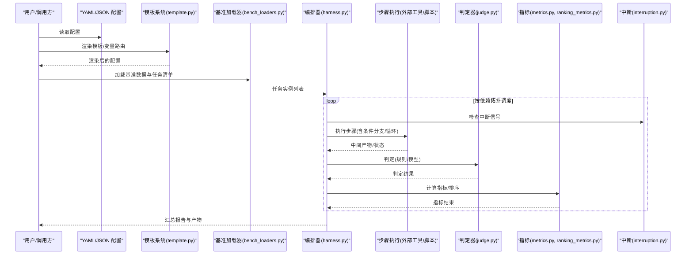
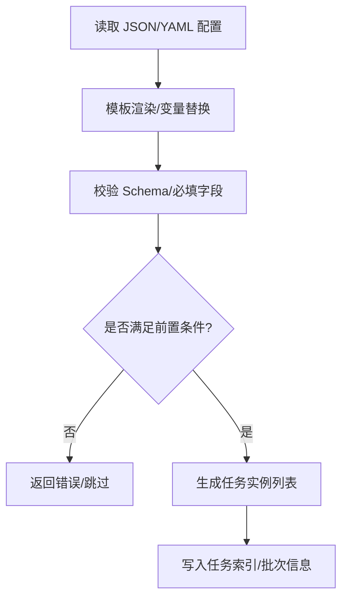
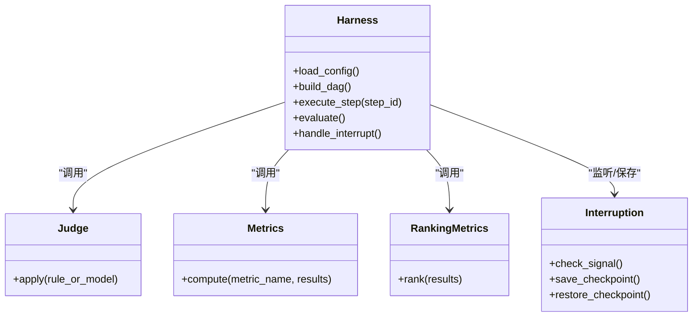
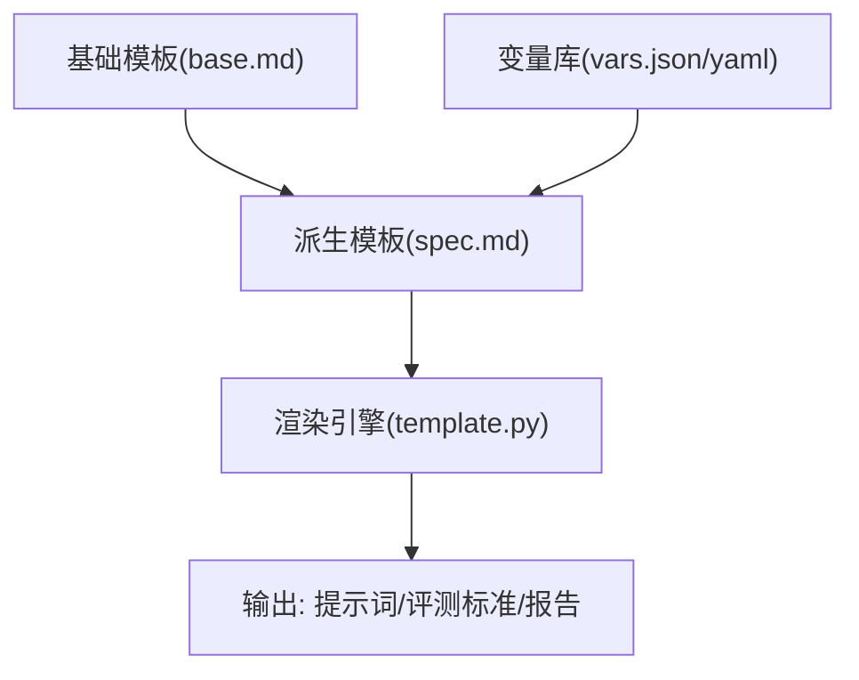
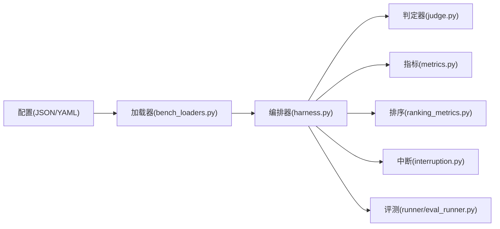
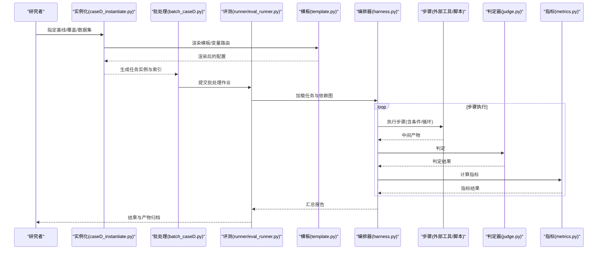

# 高级任务配置

<cite>
**本文引用的文件**   
- [autonomy_mvp/core/tasks.py](file://autonomy_mvp/core/tasks.py)
- [autonomy_mvp/core/harness.py](file://autonomy_mvp/core/harness.py)
- [autonomy_mvp/core/judge.py](file://autonomy_mvp/core/judge.py)
- [autonomy_mvp/core/metrics.py](file://autonomy_mvp/core/metrics.py)
- [autonomy_mvp/core/ranking_metrics.py](file://autonomy_mvp/core/ranking_metrics.py)
- [autonomy_mvp/core/interruption.py](file://autonomy_mvp/core/interruption.py)
- [autonomy_mvp/core/sim_agents.py](file://autonomy_mvp/core/sim_agents.py)
- [autonomy_mvp/tasks/drug_admet.json](file://autonomy_mvp/tasks/drug_admet.json)
- [autonomy_mvp/tasks/drug_screen_ms3.json](file://autonomy_mvp/tasks/drug_screen_ms3.json)
- [autonomy_mvp/tasks/materials_semiconductor_bandgap.json](file://autonomy_mvp/tasks/materials_semiconductor_bandgap.json)
- [autonomy_mvp/tests/fixtures/fixture_drugscreen.json](file://autonomy_mvp/tests/fixtures/fixture_drugscreen.json)
- [autonomy_mvp/tests/fixtures/fixture_materials.json](file://autonomy_mvp/tests/fixtures/fixture_materials.json)
- [autonomy_mvp/run_validation.py](file://autonomy_mvp/run_validation.py)
- [autonomy_mvp/schema.md](file://autonomy_mvp/schema.md)
- [docs/prd/molbench_repo/config/baseline_molbench-ms-1.yaml](file://docs/prd/molbench_repo/config/baseline_molbench-ms-1.yaml)
- [docs/prd/molbench_repo/config/baseline_molbench-ms-2.yaml](file://docs/prd/molbench_repo/config/baseline_molbench-ms-2.yaml)
- [docs/prd/molbench_repo/config/baseline_molbench-ms-3.yaml](file://docs/prd/molbench_repo/config/baseline_molbench-ms-3.yaml)
- [docs/prd/molbench_repo/config/chemcot_mo_edit.yaml](file://docs/prd/molbench_repo/config/chemcot_mo_edit.yaml)
- [docs/prd/molbench_repo/config/chemcot_mo_opt.yaml](file://docs/prd/molbench_repo/config/chemcot_mo_opt.yaml)
- [docs/prd/molbench_repo/config/claude_template.yaml](file://docs/prd/molbench_repo/config/claude_template.yaml)
- [docs/prd/molbench_repo/eval/eval_runner.py](file://docs/prd/molbench_repo/eval/eval_runner.py)
- [docs/prd/molbench_repo/eval/bench_loaders.py](file://docs/prd/molbench_repo/eval/bench_loaders.py)
- [docs/prd/molbench_repo/templates/template.py](file://docs/prd/molbench_repo/templates/template.py)
- [docs/prd/molbench_repo/templates/outliners.py](file://docs/prd/molbench_repo/templates/outliners.py)
- [longhorizon/instantiate/caseD_instantiate.py](file://longhorizon/instantiate/caseD_instantiate.py)
- [longhorizon/instantiate/caseE_instantiate.py](file://longhorizon/instantiate/caseE_instantiate.py)
- [longhorizon/instantiate/caseF_instantiate.py](file://longhorizon/instantiate/caseF_instantiate.py)
- [longhorizon/instantiate/batch_caseD.py](file://longhorizon/instantiate/batch_caseD.py)
- [task4/runner.py](file://task4/runner.py)
- [task5/runner.py](file://task5/runner.py)
</cite>

## 目录
1. [简介](#简介)
2. [项目结构](#项目结构)
3. [核心组件](#核心组件)
4. [架构总览](#架构总览)
5. [详细组件分析](#详细组件分析)
6. [依赖关系分析](#依赖关系分析)
7. [性能与可扩展性](#性能与可扩展性)
8. [故障排查指南](#故障排查指南)
9. [结论](#结论)
10. [附录：多步骤科学实验任务完整示例](#附录多步骤科学实验任务完整示例)

## 简介
本教程面向需要构建复杂自动化工作流的研发人员，聚焦“高级任务配置”能力。内容覆盖参数化配置、条件分支、循环执行、任务依赖管理、环境变量注入、动态参数生成、模板系统与继承机制、模块化配置等最佳实践，并以多步骤科学实验任务为例，展示如何组合上述特性构建可复用、可维护、可观测的端到端流程。

## 项目结构
仓库采用“领域驱动 + 分层组织”的方式：
- 核心运行期（autonomy_mvp/core）：定义任务模型、编排器、评测指标、中断控制与模拟代理等基础能力。
- 任务定义（autonomy_mvp/tasks）：以 JSON 描述具体任务的数据集、步骤、评估方式等。
- 基准与模板（docs/prd/molbench_repo）：提供 YAML 配置、评测脚本、模板系统（Markdown 模板与变量路由）。
- 长周期案例（longhorizon/instantiate）：通过 Python 实例化脚本将模板与数据装配为可执行任务集合。
- 任务级 Runner（task4/runner.py、task5/runner.py）：封装不同任务的执行入口与批处理逻辑。

```mermaid
graph TB
subgraph "核心运行期"
T["tasks.py<br/>任务模型"]
H["harness.py<br/>编排器"]
J["judge.py<br/>判定器"]
M["metrics.py<br/>指标计算"]
RM["ranking_metrics.py<br/>排序指标"]
I["interruption.py<br/>中断控制"]
SA["sim_agents.py<br/>模拟代理"]
end
subgraph "任务定义"
D1["drug_admet.json"]
D2["drug_screen_ms3.json"]
D3["materials_semiconductor_bandgap.json"]
end
subgraph "基准与模板"
C1["baseline_molbench-ms-1.yaml"]
C2["baseline_molbench-ms-2.yaml"]
C3["baseline_molbench-ms-3.yaml"]
CT["claude_template.yaml"]
ER["eval_runner.py"]
BL["bench_loaders.py"]
TP["template.py"]
OUT["outliners.py"]
end
subgraph "长周期案例"
CD["caseD_instantiate.py"]
CE["caseE_instantiate.py"]
CF["caseF_instantiate.py"]
BCD["batch_caseD.py"]
end
subgraph "任务Runner"
R4["task4/runner.py"]
R5["task5/runner.py"]
end
T --> H
H --> J
H --> M
H --> RM
H --> I
H --> SA
D1 --> H
D2 --> H
D3 --> H
C1 --> ER
C2 --> ER
C3 --> ER
CT --> TP
TP --> OUT
ER --> BL
CD --> ER
CE --> ER
CF --> ER
BCD --> ER
R4 --> H
R5 --> H
```

图表来源
- [autonomy_mvp/core/tasks.py](file://autonomy_mvp/core/tasks.py)
- [autonomy_mvp/core/harness.py](file://autonomy_mvp/core/harness.py)
- [autonomy_mvp/core/judge.py](file://autonomy_mvp/core/judge.py)
- [autonomy_mvp/core/metrics.py](file://autonomy_mvp/core/metrics.py)
- [autonomy_mvp/core/ranking_metrics.py](file://autonomy_mvp/core/ranking_metrics.py)
- [autonomy_mvp/core/interruption.py](file://autonomy_mvp/core/interruption.py)
- [autonomy_mvp/core/sim_agents.py](file://autonomy_mvp/core/sim_agents.py)
- [autonomy_mvp/tasks/drug_admet.json](file://autonomy_mvp/tasks/drug_admet.json)
- [autonomy_mvp/tasks/drug_screen_ms3.json](file://autonomy_mvp/tasks/drug_screen_ms3.json)
- [autonomy_mvp/tasks/materials_semiconductor_bandgap.json](file://autonomy_mvp/tasks/materials_semiconductor_bandgap.json)
- [docs/prd/molbench_repo/config/baseline_molbench-ms-1.yaml](file://docs/prd/molbench_repo/config/baseline_molbench-ms-1.yaml)
- [docs/prd/molbench_repo/config/baseline_molbench-ms-2.yaml](file://docs/prd/molbench_repo/config/baseline_molbench-ms-2.yaml)
- [docs/prd/molbench_repo/config/baseline_molbench-ms-3.yaml](file://docs/prd/molbench_repo/config/baseline_molbench-ms-3.yaml)
- [docs/prd/molbench_repo/config/claude_template.yaml](file://docs/prd/molbench_repo/config/claude_template.yaml)
- [docs/prd/molbench_repo/eval/eval_runner.py](file://docs/prd/molbench_repo/eval/eval_runner.py)
- [docs/prd/molbench_repo/eval/bench_loaders.py](file://docs/prd/molbench_repo/eval/bench_loaders.py)
- [docs/prd/molbench_repo/templates/template.py](file://docs/prd/molbench_repo/templates/template.py)
- [docs/prd/molbench_repo/templates/outliners.py](file://docs/prd/molbench_repo/templates/outliners.py)
- [longhorizon/instantiate/caseD_instantiate.py](file://longhorizon/instantiate/caseD_instantiate.py)
- [longhorizon/instantiate/caseE_instantiate.py](file://longhorizon/instantiate/caseE_instantiate.py)
- [longhorizon/instantiate/caseF_instantiate.py](file://longhorizon/instantiate/caseF_instantiate.py)
- [longhorizon/instantiate/batch_caseD.py](file://longhorizon/instantiate/batch_caseD.py)
- [task4/runner.py](file://task4/runner.py)
- [task5/runner.py](file://task5/runner.py)

章节来源
- [autonomy_mvp/schema.md](file://autonomy_mvp/schema.md)
- [autonomy_mvp/core/tasks.py](file://autonomy_mvp/core/tasks.py)
- [autonomy_mvp/core/harness.py](file://autonomy_mvp/core/harness.py)
- [docs/prd/molbench_repo/eval/eval_runner.py](file://docs/prd/molbench_repo/eval/eval_runner.py)
- [docs/prd/molbench_repo/templates/template.py](file://docs/prd/molbench_repo/templates/template.py)

## 核心组件
- 任务模型与元数据：在 tasks.py 中定义任务的结构化表示，包括输入数据、步骤序列、依赖关系、输出与评估方式等。
- 编排器（Harness）：负责加载任务定义、解析参数与环境变量、按依赖拓扑调度步骤、处理条件分支与循环、收集中间结果并触发评估。
- 判定器与指标：judge.py 实现基于规则或模型的判定逻辑；metrics.py 与 ranking_metrics.py 提供通用指标与排序指标计算。
- 中断与容错：interruption.py 提供任务级中断信号与恢复点，保障长时间运行的稳定性。
- 模拟代理：sim_agents.py 用于在无真实环境时进行仿真执行，便于快速验证配置正确性。
- 任务定义（JSON）：在 autonomy_mvp/tasks/*.json 中以声明式方式描述数据集路径、步骤、阈值、评估函数等。
- 基准配置（YAML）：docs/prd/molbench_repo/config/*.yaml 提供可复用的基线配置，支持参数覆盖与模板渲染。
- 模板系统：templates/template.py 与 outliners.py 提供 Markdown 模板渲染、变量路由与大纲生成能力。
- 实例化与批处理：longhorizon/instantiate/*_instantiate.py 将模板与数据装配为具体任务实例；batch_caseD.py 提供批量执行入口。
- 任务 Runner：task4/runner.py、task5/runner.py 封装特定任务的执行入口与日志/结果落盘策略。

章节来源
- [autonomy_mvp/core/tasks.py](file://autonomy_mvp/core/tasks.py)
- [autonomy_mvp/core/harness.py](file://autonomy_mvp/core/harness.py)
- [autonomy_mvp/core/judge.py](file://autonomy_mvp/core/judge.py)
- [autonomy_mvp/core/metrics.py](file://autonomy_mvp/core/metrics.py)
- [autonomy_mvp/core/ranking_metrics.py](file://autonomy_mvp/core/ranking_metrics.py)
- [autonomy_mvp/core/interruption.py](file://autonomy_mvp/core/interruption.py)
- [autonomy_mvp/core/sim_agents.py](file://autonomy_mvp/core/sim_agents.py)
- [autonomy_mvp/tasks/drug_admet.json](file://autonomy_mvp/tasks/drug_admet.json)
- [autonomy_mvp/tasks/drug_screen_ms3.json](file://autonomy_mvp/tasks/drug_screen_ms3.json)
- [autonomy_mvp/tasks/materials_semiconductor_bandgap.json](file://autonomy_mvp/tasks/materials_semiconductor_bandgap.json)
- [docs/prd/molbench_repo/config/baseline_molbench-ms-1.yaml](file://docs/prd/molbench_repo/config/baseline_molbench-ms-1.yaml)
- [docs/prd/molbench_repo/config/baseline_molbench-ms-2.yaml](file://docs/prd/molbench_repo/config/baseline_molbench-ms-2.yaml)
- [docs/prd/molbench_repo/config/baseline_molbench-ms-3.yaml](file://docs/prd/molbench_repo/config/baseline_molbench-ms-3.yaml)
- [docs/prd/molbench_repo/config/chemcot_mo_edit.yaml](file://docs/prd/molbench_repo/config/chemcot_mo_edit.yaml)
- [docs/prd/molbench_repo/config/chemcot_mo_opt.yaml](file://docs/prd/molbench_repo/config/chemcot_mo_opt.yaml)
- [docs/prd/molbench_repo/config/claude_template.yaml](file://docs/prd/molbench_repo/config/claude_template.yaml)
- [docs/prd/molbench_repo/eval/eval_runner.py](file://docs/prd/molbench_repo/eval/eval_runner.py)
- [docs/prd/molbench_repo/templates/template.py](file://docs/prd/molbench_repo/templates/template.py)
- [docs/prd/molbench_repo/templates/outliners.py](file://docs/prd/molbench_repo/templates/outliners.py)
- [longhorizon/instantiate/caseD_instantiate.py](file://longhorizon/instantiate/caseD_instantiate.py)
- [longhorizon/instantiate/caseE_instantiate.py](file://longhorizon/instantiate/caseE_instantiate.py)
- [longhorizon/instantiate/caseF_instantiate.py](file://longhorizon/instantiate/caseF_instantiate.py)
- [longhorizon/instantiate/batch_caseD.py](file://longhorizon/instantiate/batch_caseD.py)
- [task4/runner.py](file://task4/runner.py)
- [task5/runner.py](file://task5/runner.py)

## 架构总览
下图展示了从“配置到执行”的关键路径：YAML/JSON 配置经模板渲染后由基准加载器解析，交由编排器根据依赖图调度步骤，期间使用判定器与指标模块产出结果，并通过中断控制保障稳健性。

图表来源
- [docs/prd/molbench_repo/eval/eval_runner.py](file://docs/prd/molbench_repo/eval/eval_runner.py)
- [docs/prd/molbench_repo/eval/bench_loaders.py](file://docs/prd/molbench_repo/eval/bench_loaders.py)
- [docs/prd/molbench_repo/templates/template.py](file://docs/prd/molbench_repo/templates/template.py)
- [autonomy_mvp/core/harness.py](file://autonomy_mvp/core/harness.py)
- [autonomy_mvp/core/judge.py](file://autonomy_mvp/core/judge.py)
- [autonomy_mvp/core/metrics.py](file://autonomy_mvp/core/metrics.py)
- [autonomy_mvp/core/ranking_metrics.py](file://autonomy_mvp/core/ranking_metrics.py)
- [autonomy_mvp/core/interruption.py](file://autonomy_mvp/core/interruption.py)

## 详细组件分析

### 任务模型与声明式配置（JSON/YAML）
- JSON 任务定义（autonomy_mvp/tasks/*.json）：以声明式方式描述数据集路径、步骤序列、依赖关系、阈值、评估函数名等，适合快速迭代与版本化管理。
- YAML 基线配置（docs/prd/molbench_repo/config/*.yaml）：提供可复用的基线，支持参数覆盖、环境切换与模板引用，便于在不同数据集/方法间切换。
- 模板与变量路由（docs/prd/molbench_repo/templates/template.py、outliners.py）：支持 Markdown 模板渲染、变量路由与大纲生成，使提示词、评测标准与报告模板统一治理。

图表来源
- [autonomy_mvp/tasks/drug_admet.json](file://autonomy_mvp/tasks/drug_admet.json)
- [autonomy_mvp/tasks/drug_screen_ms3.json](file://autonomy_mvp/tasks/drug_screen_ms3.json)
- [autonomy_mvp/tasks/materials_semiconductor_bandgap.json](file://autonomy_mvp/tasks/materials_semiconductor_bandgap.json)
- [docs/prd/molbench_repo/config/baseline_molbench-ms-1.yaml](file://docs/prd/molbench_repo/config/baseline_molbench-ms-1.yaml)
- [docs/prd/molbench_repo/config/baseline_molbench-ms-2.yaml](file://docs/prd/molbench_repo/config/baseline_molbench-ms-2.yaml)
- [docs/prd/molbench_repo/config/baseline_molbench-ms-3.yaml](file://docs/prd/molbench_repo/config/baseline_molbench-ms-3.yaml)
- [docs/prd/molbench_repo/config/chemcot_mo_edit.yaml](file://docs/prd/molbench_repo/config/chemcot_mo_edit.yaml)
- [docs/prd/molbench_repo/config/chemcot_mo_opt.yaml](file://docs/prd/molbench_repo/config/chemcot_mo_opt.yaml)
- [docs/prd/molbench_repo/config/claude_template.yaml](file://docs/prd/molbench_repo/config/claude_template.yaml)
- [docs/prd/molbench_repo/templates/template.py](file://docs/prd/molbench_repo/templates/template.py)
- [docs/prd/molbench_repo/templates/outliners.py](file://docs/prd/molbench_repo/templates/outliners.py)

章节来源
- [autonomy_mvp/schema.md](file://autonomy_mvp/schema.md)
- [autonomy_mvp/tasks/drug_admet.json](file://autonomy_mvp/tasks/drug_admet.json)
- [autonomy_mvp/tasks/drug_screen_ms3.json](file://autonomy_mvp/tasks/drug_screen_ms3.json)
- [autonomy_mvp/tasks/materials_semiconductor_bandgap.json](file://autonomy_mvp/tasks/materials_semiconductor_bandgap.json)
- [docs/prd/molbench_repo/config/baseline_molbench-ms-1.yaml](file://docs/prd/molbench_repo/config/baseline_molbench-ms-1.yaml)
- [docs/prd/molbench_repo/config/baseline_molbench-ms-2.yaml](file://docs/prd/molbench_repo/config/baseline_molbench-ms-2.yaml)
- [docs/prd/molbench_repo/config/baseline_molbench-ms-3.yaml](file://docs/prd/molbench_repo/config/baseline_molbench-ms-3.yaml)
- [docs/prd/molbench_repo/config/chemcot_mo_edit.yaml](file://docs/prd/molbench_repo/config/chemcot_mo_edit.yaml)
- [docs/prd/molbench_repo/config/chemcot_mo_opt.yaml](file://docs/prd/molbench_repo/config/chemcot_mo_opt.yaml)
- [docs/prd/molbench_repo/config/claude_template.yaml](file://docs/prd/molbench_repo/config/claude_template.yaml)
- [docs/prd/molbench_repo/templates/template.py](file://docs/prd/molbench_repo/templates/template.py)
- [docs/prd/molbench_repo/templates/outliners.py](file://docs/prd/molbench_repo/templates/outliners.py)

### 编排器与依赖管理（Harness）
- 依赖拓扑：根据任务步骤间的依赖关系构建有向无环图（DAG），确保先决步骤完成后才执行后续步骤。
- 条件分支：在步骤前评估布尔表达式或阈值，决定是否跳过、重试或走替代路径。
- 循环执行：对数据集条目或超参网格进行遍历，支持并发度控制与失败重试策略。
- 中间产物与缓存：步骤产物持久化，避免重复计算；支持增量执行。
- 中断与恢复：通过 interruption.py 提供的信号与检查点，支持优雅停止与断点续跑。

图表来源
- [autonomy_mvp/core/harness.py](file://autonomy_mvp/core/harness.py)
- [autonomy_mvp/core/judge.py](file://autonomy_mvp/core/judge.py)
- [autonomy_mvp/core/metrics.py](file://autonomy_mvp/core/metrics.py)
- [autonomy_mvp/core/ranking_metrics.py](file://autonomy_mvp/core/ranking_metrics.py)
- [autonomy_mvp/core/interruption.py](file://autonomy_mvp/core/interruption.py)

章节来源
- [autonomy_mvp/core/harness.py](file://autonomy_mvp/core/harness.py)
- [autonomy_mvp/core/judge.py](file://autonomy_mvp/core/judge.py)
- [autonomy_mvp/core/metrics.py](file://autonomy_mvp/core/metrics.py)
- [autonomy_mvp/core/ranking_metrics.py](file://autonomy_mvp/core/ranking_metrics.py)
- [autonomy_mvp/core/interruption.py](file://autonomy_mvp/core/interruption.py)

### 模板系统与继承机制
- 模板渲染：通过 template.py 将变量注入到 Markdown 模板，形成提示词、评测标准或报告。
- 变量路由：outliners.py 提供结构化变量映射，便于跨模板复用与一致性维护。
- 继承与组合：YAML 配置支持“基线 + 覆盖”的组合模式，减少重复配置；模板之间可通过 include 或变量传递实现复用。

图表来源
- [docs/prd/molbench_repo/templates/template.py](file://docs/prd/molbench_repo/templates/template.py)
- [docs/prd/molbench_repo/templates/outliners.py](file://docs/prd/molbench_repo/templates/outliners.py)
- [docs/prd/molbench_repo/config/claude_template.yaml](file://docs/prd/molbench_repo/config/claude_template.yaml)

章节来源
- [docs/prd/molbench_repo/templates/template.py](file://docs/prd/molbench_repo/templates/template.py)
- [docs/prd/molbench_repo/templates/outliners.py](file://docs/prd/molbench_repo/templates/outliners.py)
- [docs/prd/molbench_repo/config/claude_template.yaml](file://docs/prd/molbench_repo/config/claude_template.yaml)

### 环境变量注入与动态参数生成
- 环境变量注入：在 harness 启动阶段读取环境变量，覆盖配置中的默认值，实现不同环境（开发/测试/生产）的参数隔离。
- 动态参数生成：基于时间戳、随机种子、数据集哈希等生成唯一标识，避免冲突并提升可追溯性。
- 安全与审计：敏感信息通过环境变量传入，不落盘到配置文件中；关键参数变更记录审计日志。

章节来源
- [autonomy_mvp/core/harness.py](file://autonomy_mvp/core/harness.py)
- [docs/prd/molbench_repo/eval/eval_runner.py](file://docs/prd/molbench_repo/eval/eval_runner.py)

### 模块化配置与最佳实践
- 分层配置：将通用基线（YAML）、任务特定覆盖（JSON）、运行时参数（环境变量）分层管理，职责清晰。
- 模板复用：将提示词、评测标准、报告模板抽离为独立文件，通过变量路由集中维护。
- 版本化与回归：所有配置纳入版本控制，结合自动化回归测试（fixtures）保证向后兼容。

章节来源
- [autonomy_mvp/tests/fixtures/fixture_drugscreen.json](file://autonomy_mvp/tests/fixtures/fixture_drugscreen.json)
- [autonomy_mvp/tests/fixtures/fixture_materials.json](file://autonomy_mvp/tests/fixtures/fixture_materials.json)
- [docs/prd/molbench_repo/config/baseline_molbench-ms-1.yaml](file://docs/prd/molbench_repo/config/baseline_molbench-ms-1.yaml)
- [docs/prd/molbench_repo/config/baseline_molbench-ms-2.yaml](file://docs/prd/molbench_repo/config/baseline_molbench-ms-2.yaml)
- [docs/prd/molbench_repo/config/baseline_molbench-ms-3.yaml](file://docs/prd/molbench_repo/config/baseline_molbench-ms-3.yaml)

## 依赖关系分析
- 组件耦合：编排器（harness）为核心枢纽，依赖 judge、metrics、ranking_metrics、interruption 等模块；任务定义（JSON/YAML）作为输入源。
- 外部集成：通过 eval_runner 与 bench_loaders 对接外部基准数据与评测流程；模板系统对外暴露渲染接口。
- 潜在环路：应避免在步骤间引入循环依赖，DAG 构建阶段需检测并报错。
- 扩展点：新增步骤类型、指标或判定规则只需实现对应接口并在配置中注册即可。

图表来源
- [docs/prd/molbench_repo/eval/bench_loaders.py](file://docs/prd/molbench_repo/eval/bench_loaders.py)
- [autonomy_mvp/core/harness.py](file://autonomy_mvp/core/harness.py)
- [autonomy_mvp/core/judge.py](file://autonomy_mvp/core/judge.py)
- [autonomy_mvp/core/metrics.py](file://autonomy_mvp/core/metrics.py)
- [autonomy_mvp/core/ranking_metrics.py](file://autonomy_mvp/core/ranking_metrics.py)
- [autonomy_mvp/core/interruption.py](file://autonomy_mvp/core/interruption.py)
- [docs/prd/molbench_repo/eval/eval_runner.py](file://docs/prd/molbench_repo/eval/eval_runner.py)

章节来源
- [docs/prd/molbench_repo/eval/bench_loaders.py](file://docs/prd/molbench_repo/eval/bench_loaders.py)
- [autonomy_mvp/core/harness.py](file://autonomy_mvp/core/harness.py)
- [docs/prd/molbench_repo/eval/eval_runner.py](file://docs/prd/molbench_repo/eval/eval_runner.py)

## 性能与可扩展性
- 并行与并发：在循环执行中对数据集条目或超参网格进行并行处理，注意资源限制与 I/O 竞争。
- 增量与缓存：利用中间产物缓存与依赖图，仅重算受影响步骤，显著缩短二次运行时间。
- 指标计算优化：对大规模结果集采用流式计算与分块聚合，降低内存峰值。
- 模板渲染优化：预编译常用模板，减少重复解析开销。

[本节为通用指导，不直接分析具体文件]

## 故障排查指南
- 配置校验失败：检查 JSON/YAML 语法与必填字段，参考 schema 文档定位缺失项。
- 依赖未满足：确认前置步骤产物是否存在且格式正确，必要时清理缓存后重试。
- 中断与恢复：若任务被中断，检查中断信号与检查点文件，确认可从最近检查点恢复。
- 指标异常：核对指标输入维度与阈值设置，必要时使用模拟代理（sim_agents.py）进行最小用例验证。
- 模板渲染错误：检查变量路由映射与模板占位符一致性，确保所有变量已注入。

章节来源
- [autonomy_mvp/schema.md](file://autonomy_mvp/schema.md)
- [autonomy_mvp/core/interruption.py](file://autonomy_mvp/core/interruption.py)
- [autonomy_mvp/core/sim_agents.py](file://autonomy_mvp/core/sim_agents.py)
- [docs/prd/molbench_repo/templates/template.py](file://docs/prd/molbench_repo/templates/template.py)

## 结论
通过声明式配置、模板系统、依赖管理与编排器的协同，本仓库提供了构建复杂自动化工作流的坚实基础。建议在实际项目中遵循分层配置、模板复用、增量执行与可观测性原则，以获得更高的可维护性与可扩展性。

[本节为总结性内容，不直接分析具体文件]

## 附录：多步骤科学实验任务完整示例
以下示例演示如何组合参数化配置、条件分支、循环执行、依赖管理与环境变量注入，构建一个“材料闭环优化”的多步骤科学实验任务。该示例基于 longhorizon 的 caseD 系列脚本与 docs/prd/molbench_repo 的模板与评测体系。

- 目标：以 BaTiO 等材料体系为对象，完成“问题发现 → 靶点准备 → 分子对接筛选 → 性质分析与过滤 → 生成设计 → 自由能计算 → 构象采样分析 → 对接后评估”的闭环优化流程。
- 关键特性：
  - 参数化配置：通过 YAML 基线与覆盖文件定义数据集路径、模型选择、阈值与并发度。
  - 条件分支：依据初步筛选结果决定进入“生成设计”或“终止”。
  - 循环执行：对候选化合物或构象集合进行批量计算与评估。
  - 依赖管理：各步骤严格依赖上一步产物，确保数据一致性与可追溯性。
  - 环境变量注入：通过环境变量注入 API Key、路径与随机种子，实现环境隔离与安全。
  - 模板系统：使用模板渲染生成提示词、评测标准与报告。
  - 实例化与批处理：通过 *_instantiate.py 生成任务实例，batch_caseD.py 批量执行。

图表来源
- [longhorizon/instantiate/caseD_instantiate.py](file://longhorizon/instantiate/caseD_instantiate.py)
- [longhorizon/instantiate/batch_caseD.py](file://longhorizon/instantiate/batch_caseD.py)
- [docs/prd/molbench_repo/eval/eval_runner.py](file://docs/prd/molbench_repo/eval/eval_runner.py)
- [docs/prd/molbench_repo/templates/template.py](file://docs/prd/molbench_repo/templates/template.py)
- [autonomy_mvp/core/harness.py](file://autonomy_mvp/core/harness.py)
- [autonomy_mvp/core/judge.py](file://autonomy_mvp/core/judge.py)
- [autonomy_mvp/core/metrics.py](file://autonomy_mvp/core/metrics.py)

章节来源
- [longhorizon/instantiate/caseD_instantiate.py](file://longhorizon/instantiate/caseD_instantiate.py)
- [longhorizon/instantiate/batch_caseD.py](file://longhorizon/instantiate/batch_caseD.py)
- [docs/prd/molbench_repo/eval/eval_runner.py](file://docs/prd/molbench_repo/eval/eval_runner.py)
- [docs/prd/molbench_repo/templates/template.py](file://docs/prd/molbench_repo/templates/template.py)
- [autonomy_mvp/core/harness.py](file://autonomy_mvp/core/harness.py)
- [autonomy_mvp/core/judge.py](file://autonomy_mvp/core/judge.py)
- [autonomy_mvp/core/metrics.py](file://autonomy_mvp/core/metrics.py)