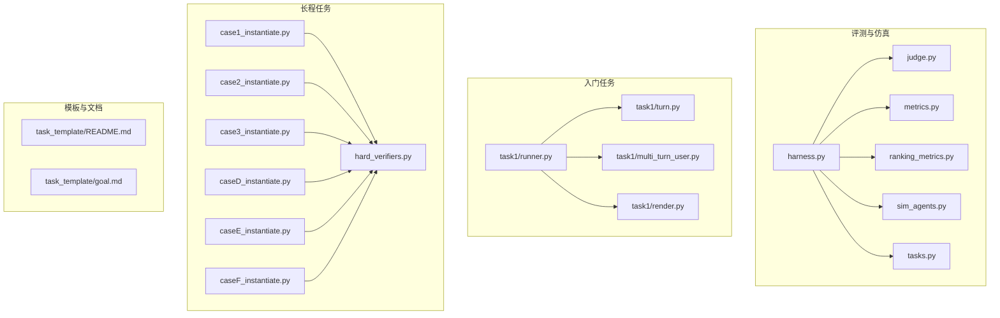
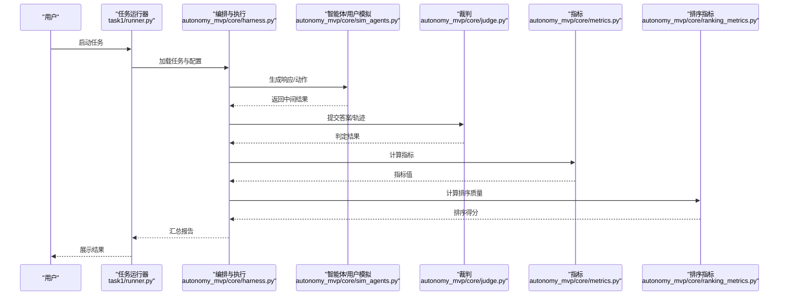
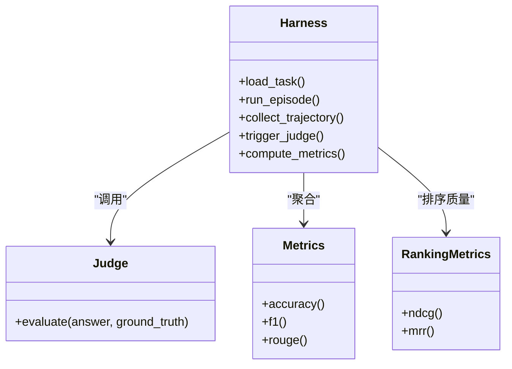
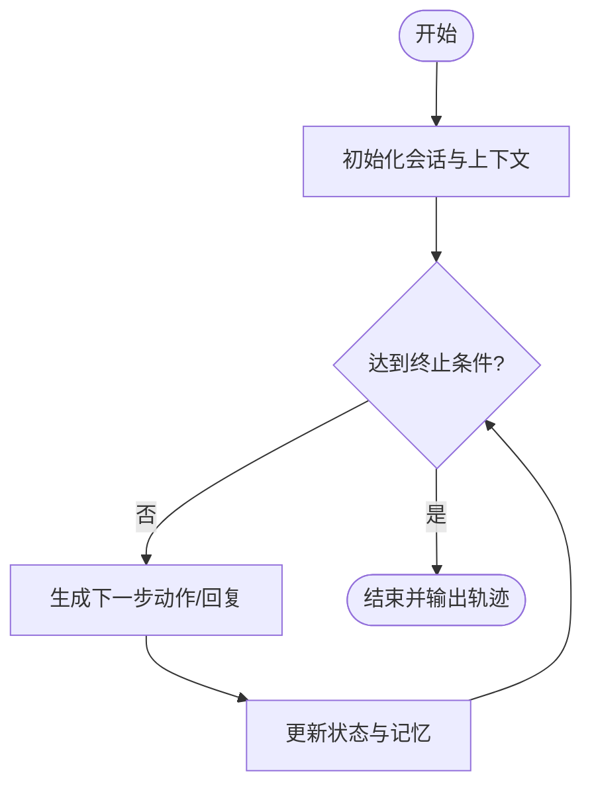
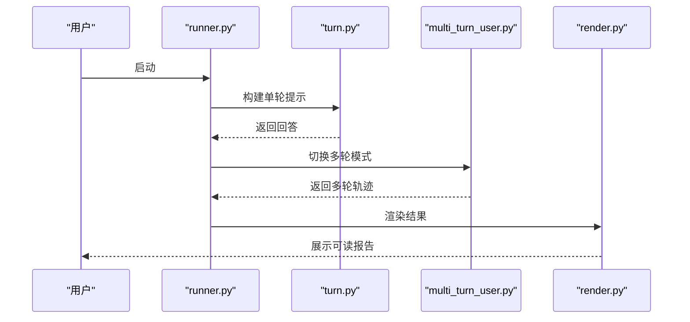
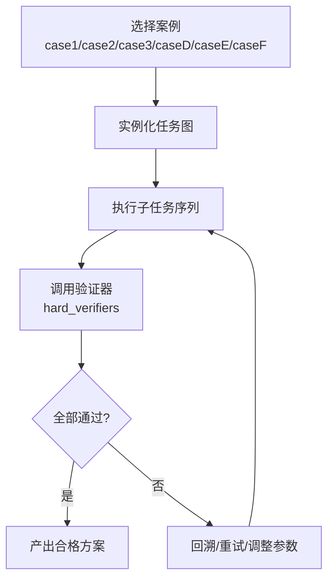
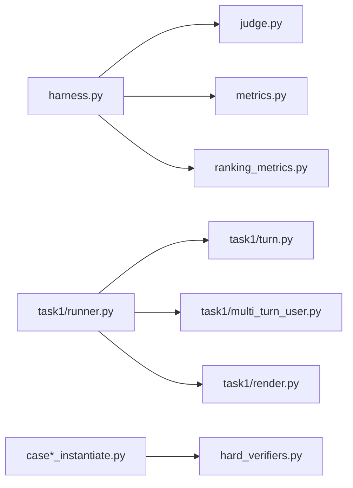

# 基础教程

<cite>
**本文引用的文件**   
- [autonomy_mvp/core/harness.py](file://autonomy_mvp/core/harness.py)
- [autonomy_mvp/core/judge.py](file://autonomy_mvp/core/judge.py)
- [autonomy_mvp/core/metrics.py](file://autonomy_mvp/core/metrics.py)
- [autonomy_mvp/core/ranking_metrics.py](file://autonomy_mvp/core/ranking_metrics.py)
- [autonomy_mvp/core/sim_agents.py](file://autonomy_mvp/core/sim_agents.py)
- [autonomy_mvp/core/tasks.py](file://autonomy_mvp/core/tasks.py)
- [autonomy_mvp/run_validation.py](file://autonomy_mvp/run_validation.py)
- [task1/runner.py](file://task1/runner.py)
- [task1/turn.py](file://task1/turn.py)
- [task1/multi_turn_user.py](file://task1/multi_turn_user.py)
- [task1/render.py](file://task1/render.py)
- [longhorizon/instantiate/case1_instantiate.py](file://longhorizon/instantiate/case1_instantiate.py)
- [longhorizon/instantiate/case2_instantiate.py](file://longhorizon/instantiate/case2_instantiate.py)
- [longhorizon/instantiate/case3_instantiate.py](file://longhorizon/instantiate/case3_instantiate.py)
- [longhorizon/instantiate/caseD_instantiate.py](file://longhorizon/instantiate/caseD_instantiate.py)
- [longhorizon/instantiate/caseE_instantiate.py](file://longhorizon/instantiate/caseE_instantiate.py)
- [longhorizon/instantiate/caseF_instantiate.py](file://longhorizon/instantiate/caseF_instantiate.py)
- [longhorizon/verifiers/hard_verifiers.py](file://longhorizon/verifiers/hard_verifiers.py)
- [docs/templates/task_template/README.md](file://docs/templates/task_template/README.md)
- [docs/templates/task_template/goal.md](file://docs/templates/task_template/goal.md)
</cite>

## 目录
1. [简介](#简介)
2. [项目结构](#项目结构)
3. [核心组件](#核心组件)
4. [架构总览](#架构总览)
5. [详细组件分析](#详细组件分析)
6. [依赖关系分析](#依赖关系分析)
7. [性能与可扩展性](#性能与可扩展性)
8. [故障排查指南](#故障排查指南)
9. [结论](#结论)
10. [附录：交互式练习与参考答案](#附录交互式练习与参考答案)

## 简介
本教程面向初学者，围绕“单轮对话—多轮交互—工具调用—结果评估”的渐进路径，系统讲解框架的核心功能与使用模式。通过最小可运行示例、分步注释说明与预期输出，帮助读者边学边练；每章配套练习题与参考答案，巩固关键概念。

## 项目结构
仓库采用“任务驱动 + 评测基座”的组织方式：
- autonomy_mvp：评测与仿真核心（任务定义、智能体模拟、裁判与指标）
- task1：入门级多轮对话与提示工程示例
- longhorizon：长程任务实例化与验证器集合
- docs：模板与文档（任务模板、评测说明等）

图示来源
- [autonomy_mvp/core/harness.py](file://autonomy_mvp/core/harness.py)
- [autonomy_mvp/core/judge.py](file://autonomy_mvp/core/judge.py)
- [autonomy_mvp/core/metrics.py](file://autonomy_mvp/core/metrics.py)
- [autonomy_mvp/core/ranking_metrics.py](file://autonomy_mvp/core/ranking_metrics.py)
- [autonomy_mvp/core/sim_agents.py](file://autonomy_mvp/core/sim_agents.py)
- [autonomy_mvp/core/tasks.py](file://autonomy_mvp/core/tasks.py)
- [task1/runner.py](file://task1/runner.py)
- [task1/turn.py](file://task1/turn.py)
- [task1/multi_turn_user.py](file://task1/multi_turn_user.py)
- [task1/render.py](file://task1/render.py)
- [longhorizon/instantiate/case1_instantiate.py](file://longhorizon/instantiate/case1_instantiate.py)
- [longhorizon/instantiate/case2_instantiate.py](file://longhorizon/instantiate/case2_instantiate.py)
- [longhorizon/instantiate/case3_instantiate.py](file://longhorizon/instantiate/case3_instantiate.py)
- [longhorizon/instantiate/caseD_instantiate.py](file://longhorizon/instantiate/caseD_instantiate.py)
- [longhorizon/instantiate/caseE_instantiate.py](file://longhorizon/instantiate/caseE_instantiate.py)
- [longhorizon/instantiate/caseF_instantiate.py](file://longhorizon/instantiate/caseF_instantiate.py)
- [longhorizon/verifiers/hard_verifiers.py](file://longhorizon/verifiers/hard_verifiers.py)
- [docs/templates/task_template/README.md](file://docs/templates/task_template/README.md)
- [docs/templates/task_template/goal.md](file://docs/templates/task_template/goal.md)

章节来源
- [autonomy_mvp/core/harness.py](file://autonomy_mvp/core/harness.py)
- [autonomy_mvp/core/judge.py](file://autonomy_mvp/core/judge.py)
- [autonomy_mvp/core/metrics.py](file://autonomy_mvp/core/metrics.py)
- [autonomy_mvp/core/ranking_metrics.py](file://autonomy_mvp/core/ranking_metrics.py)
- [autonomy_mvp/core/sim_agents.py](file://autonomy_mvp/core/sim_agents.py)
- [autonomy_mvp/core/tasks.py](file://autonomy_mvp/core/tasks.py)
- [task1/runner.py](file://task1/runner.py)
- [task1/turn.py](file://task1/turn.py)
- [task1/multi_turn_user.py](file://task1/multi_turn_user.py)
- [task1/render.py](file://task1/render.py)
- [longhorizon/instantiate/case1_instantiate.py](file://longhorizon/instantiate/case1_instantiate.py)
- [longhorizon/instantiate/case2_instantiate.py](file://longhorizon/instantiate/case2_instantiate.py)
- [longhorizon/instantiate/case3_instantiate.py](file://longhorizon/instantiate/case3_instantiate.py)
- [longhorizon/instantiate/caseD_instantiate.py](file://longhorizon/instantiate/caseD_instantiate.py)
- [longhorizon/instantiate/caseE_instantiate.py](file://longhorizon/instantiate/caseE_instantiate.py)
- [longhorizon/instantiate/caseF_instantiate.py](file://longhorizon/instantiate/caseF_instantiate.py)
- [longhorizon/verifiers/hard_verifiers.py](file://longhorizon/verifiers/hard_verifiers.py)
- [docs/templates/task_template/README.md](file://docs/templates/task_template/README.md)
- [docs/templates/task_template/goal.md](file://docs/templates/task_template/goal.md)

## 核心组件
- 任务编排与执行
  - 负责加载任务、驱动智能体、收集轨迹、触发评测与指标计算。
  - 典型入口位于自动化验证脚本与任务运行器中。
- 智能体与用户模拟
  - 提供轻量模拟智能体与交互式用户，便于快速上手与离线回放。
- 裁判与指标
  - 裁判用于判定答案或步骤是否满足要求；指标用于量化表现（如准确率、排序质量等）。
- 长程任务实例化
  - 将复杂目标拆解为可执行的子任务序列，并绑定验证器进行闭环校验。

章节来源
- [autonomy_mvp/core/harness.py](file://autonomy_mvp/core/harness.py)
- [autonomy_mvp/core/sim_agents.py](file://autonomy_mvp/core/sim_agents.py)
- [autonomy_mvp/core/judge.py](file://autonomy_mvp/core/judge.py)
- [autonomy_mvp/core/metrics.py](file://autonomy_mvp/core/metrics.py)
- [autonomy_mvp/core/ranking_metrics.py](file://autonomy_mvp/core/ranking_metrics.py)
- [autonomy_mvp/core/tasks.py](file://autonomy_mvp/core/tasks.py)
- [autonomy_mvp/run_validation.py](file://autonomy_mvp/run_validation.py)
- [task1/runner.py](file://task1/runner.py)
- [longhorizon/instantiate/case1_instantiate.py](file://longhorizon/instantiate/case1_instantiate.py)
- [longhorizon/instantiate/case2_instantiate.py](file://longhorizon/instantiate/case2_instantiate.py)
- [longhorizon/instantiate/case3_instantiate.py](file://longhorizon/instantiate/case3_instantiate.py)
- [longhorizon/instantiate/caseD_instantiate.py](file://longhorizon/instantiate/caseD_instantiate.py)
- [longhorizon/instantiate/caseE_instantiate.py](file://longhorizon/instantiate/caseE_instantiate.py)
- [longhorizon/instantiate/caseF_instantiate.py](file://longhorizon/instantiate/caseF_instantiate.py)
- [longhorizon/verifiers/hard_verifiers.py](file://longhorizon/verifiers/hard_verifiers.py)

## 架构总览
下图展示了从“任务定义”到“执行—评测—报告”的端到端流程，以及各模块之间的职责边界。

图示来源
- [task1/runner.py](file://task1/runner.py)
- [autonomy_mvp/core/harness.py](file://autonomy_mvp/core/harness.py)
- [autonomy_mvp/core/sim_agents.py](file://autonomy_mvp/core/sim_agents.py)
- [autonomy_mvp/core/judge.py](file://autonomy_mvp/core/judge.py)
- [autonomy_mvp/core/metrics.py](file://autonomy_mvp/core/metrics.py)
- [autonomy_mvp/core/ranking_metrics.py](file://autonomy_mvp/core/ranking_metrics.py)

## 详细组件分析

### 组件A：任务编排与执行（harness）
- 职责
  - 统一加载任务、驱动智能体、记录轨迹、触发评测与指标计算。
- 关键点
  - 任务生命周期管理（初始化、步进、终止条件）
  - 与裁判和指标的解耦接口
  - 错误处理与重试策略
- 优化建议
  - 对耗时操作引入缓存与批处理
  - 将评测逻辑抽象为插件式扩展点

图示来源
- [autonomy_mvp/core/harness.py](file://autonomy_mvp/core/harness.py)
- [autonomy_mvp/core/judge.py](file://autonomy_mvp/core/judge.py)
- [autonomy_mvp/core/metrics.py](file://autonomy_mvp/core/metrics.py)
- [autonomy_mvp/core/ranking_metrics.py](file://autonomy_mvp/core/ranking_metrics.py)

章节来源
- [autonomy_mvp/core/harness.py](file://autonomy_mvp/core/harness.py)
- [autonomy_mvp/core/judge.py](file://autonomy_mvp/core/judge.py)
- [autonomy_mvp/core/metrics.py](file://autonomy_mvp/core/metrics.py)
- [autonomy_mvp/core/ranking_metrics.py](file://autonomy_mvp/core/ranking_metrics.py)

### 组件B：智能体与用户模拟（sim_agents）
- 职责
  - 提供轻量模拟智能体与交互式用户，支持离线回放与快速验证。
- 关键点
  - 状态机驱动的对话推进
  - 与任务接口的适配层
- 使用建议
  - 先用模拟智能体跑通流程，再替换为真实模型或服务

图示来源
- [autonomy_mvp/core/sim_agents.py](file://autonomy_mvp/core/sim_agents.py)

章节来源
- [autonomy_mvp/core/sim_agents.py](file://autonomy_mvp/core/sim_agents.py)

### 组件C：任务定义与数据契约（tasks）
- 职责
  - 定义任务输入、期望输出、约束与评测契约。
- 关键点
  - 结构化任务描述（目标、输入、输出格式、评分规则）
  - 与裁判/指标的对接约定
- 最佳实践
  - 明确输入校验与失败分支
  - 将评测规则与业务逻辑分离

章节来源
- [autonomy_mvp/core/tasks.py](file://autonomy_mvp/core/tasks.py)

### 组件D：入门任务运行器（task1）
- 职责
  - 演示单轮/多轮对话、提示工程、渲染与结果可视化。
- 关键点
  - runner：串联 turn 与 multi_turn_user，驱动完整流程
  - render：格式化输出便于阅读
- 学习路径
  - 先运行单轮示例，理解输入输出契约
  - 再进入多轮，观察上下文管理与策略演进

图示来源
- [task1/runner.py](file://task1/runner.py)
- [task1/turn.py](file://task1/turn.py)
- [task1/multi_turn_user.py](file://task1/multi_turn_user.py)
- [task1/render.py](file://task1/render.py)

章节来源
- [task1/runner.py](file://task1/runner.py)
- [task1/turn.py](file://task1/turn.py)
- [task1/multi_turn_user.py](file://task1/multi_turn_user.py)
- [task1/render.py](file://task1/render.py)

### 组件E：长程任务实例化与验证（longhorizon）
- 职责
  - 将复杂目标实例化为可执行子任务，并绑定验证器进行闭环校验。
- 关键点
  - caseX_instantiate：不同场景的任务装配
  - hard_verifiers：严格验证器，确保关键属性满足要求
- 适用场景
  - 材料发现、药物筛选、逆合成规划等需要多步推理与强约束的场景

图示来源
- [longhorizon/instantiate/case1_instantiate.py](file://longhorizon/instantiate/case1_instantiate.py)
- [longhorizon/instantiate/case2_instantiate.py](file://longhorizon/instantiate/case2_instantiate.py)
- [longhorizon/instantiate/case3_instantiate.py](file://longhorizon/instantiate/case3_instantiate.py)
- [longhorizon/instantiate/caseD_instantiate.py](file://longhorizon/instantiate/caseD_instantiate.py)
- [longhorizon/instantiate/caseE_instantiate.py](file://longhorizon/instantiate/caseE_instantiate.py)
- [longhorizon/instantiate/caseF_instantiate.py](file://longhorizon/instantiate/caseF_instantiate.py)
- [longhorizon/verifiers/hard_verifiers.py](file://longhorizon/verifiers/hard_verifiers.py)

章节来源
- [longhorizon/instantiate/case1_instantiate.py](file://longhorizon/instantiate/case1_instantiate.py)
- [longhorizon/instantiate/case2_instantiate.py](file://longhorizon/instantiate/case2_instantiate.py)
- [longhorizon/instantiate/case3_instantiate.py](file://longhorizon/instantiate/case3_instantiate.py)
- [longhorizon/instantiate/caseD_instantiate.py](file://longhorizon/instantiate/caseD_instantiate.py)
- [longhorizon/instantiate/caseE_instantiate.py](file://longhorizon/instantiate/caseE_instantiate.py)
- [longhorizon/instantiate/caseF_instantiate.py](file://longhorizon/instantiate/caseF_instantiate.py)
- [longhorizon/verifiers/hard_verifiers.py](file://longhorizon/verifiers/hard_verifiers.py)

## 依赖关系分析
- 低耦合高内聚
  - harness 作为编排中心，仅通过稳定接口与 judge、metrics、ranking_metrics 交互。
- 外部依赖
  - 任务数据与模板由 docs/templates 提供，便于复用与扩展。
- 潜在风险
  - 若 judge 或 metrics 变更频繁，需加强版本兼容与回归测试。

图示来源
- [autonomy_mvp/core/harness.py](file://autonomy_mvp/core/harness.py)
- [autonomy_mvp/core/judge.py](file://autonomy_mvp/core/judge.py)
- [autonomy_mvp/core/metrics.py](file://autonomy_mvp/core/metrics.py)
- [autonomy_mvp/core/ranking_metrics.py](file://autonomy_mvp/core/ranking_metrics.py)
- [task1/runner.py](file://task1/runner.py)
- [task1/turn.py](file://task1/turn.py)
- [task1/multi_turn_user.py](file://task1/multi_turn_user.py)
- [task1/render.py](file://task1/render.py)
- [longhorizon/instantiate/case1_instantiate.py](file://longhorizon/instantiate/case1_instantiate.py)
- [longhorizon/instantiate/case2_instantiate.py](file://longhorizon/instantiate/case2_instantiate.py)
- [longhorizon/instantiate/case3_instantiate.py](file://longhorizon/instantiate/case3_instantiate.py)
- [longhorizon/instantiate/caseD_instantiate.py](file://longhorizon/instantiate/caseD_instantiate.py)
- [longhorizon/instantiate/caseE_instantiate.py](file://longhorizon/instantiate/caseE_instantiate.py)
- [longhorizon/instantiate/caseF_instantiate.py](file://longhorizon/instantiate/caseF_instantiate.py)
- [longhorizon/verifiers/hard_verifiers.py](file://longhorizon/verifiers/hard_verifiers.py)

章节来源
- [autonomy_mvp/core/harness.py](file://autonomy_mvp/core/harness.py)
- [autonomy_mvp/core/judge.py](file://autonomy_mvp/core/judge.py)
- [autonomy_mvp/core/metrics.py](file://autonomy_mvp/core/metrics.py)
- [autonomy_mvp/core/ranking_metrics.py](file://autonomy_mvp/core/ranking_metrics.py)
- [task1/runner.py](file://task1/runner.py)
- [task1/turn.py](file://task1/turn.py)
- [task1/multi_turn_user.py](file://task1/multi_turn_user.py)
- [task1/render.py](file://task1/render.py)
- [longhorizon/instantiate/case1_instantiate.py](file://longhorizon/instantiate/case1_instantiate.py)
- [longhorizon/instantiate/case2_instantiate.py](file://longhorizon/instantiate/case2_instantiate.py)
- [longhorizon/instantiate/case3_instantiate.py](file://longhorizon/instantiate/case3_instantiate.py)
- [longhorizon/instantiate/caseD_instantiate.py](file://longhorizon/instantiate/caseD_instantiate.py)
- [longhorizon/instantiate/caseE_instantiate.py](file://longhorizon/instantiate/caseE_instantiate.py)
- [longhorizon/instantiate/caseF_instantiate.py](file://longhorizon/instantiate/caseF_instantiate.py)
- [longhorizon/verifiers/hard_verifiers.py](file://longhorizon/verifiers/hard_verifiers.py)

## 性能与可扩展性
- 并行与批处理
  - 在 runner 与 harness 层面支持批量任务与并发执行，缩短整体时延。
- 缓存与增量计算
  - 对重复子任务与指标计算引入缓存，避免重复开销。
- 插件化扩展
  - 将 judge、metrics、ranking_metrics 设计为可插拔组件，便于按场景定制。
- 资源控制
  - 对长程任务设置超时、重试上限与内存限制，保障稳定性。

[本节为通用指导，不直接分析具体文件]

## 故障排查指南
- 常见问题定位
  - 任务未加载：检查任务配置文件与路径
  - 智能体无响应：确认模拟智能体状态机与终止条件
  - 裁判判定异常：核对输入输出契约与字段类型
  - 指标缺失：确认已正确注册并传入必要字段
- 调试技巧
  - 开启详细日志，打印关键中间态
  - 使用最小数据集复现问题
  - 逐步替换组件（模拟智能体→真实智能体），隔离问题域

章节来源
- [autonomy_mvp/core/harness.py](file://autonomy_mvp/core/harness.py)
- [autonomy_mvp/core/judge.py](file://autonomy_mvp/core/judge.py)
- [autonomy_mvp/core/metrics.py](file://autonomy_mvp/core/metrics.py)
- [autonomy_mvp/core/ranking_metrics.py](file://autonomy_mvp/core/ranking_metrics.py)
- [autonomy_mvp/core/sim_agents.py](file://autonomy_mvp/core/sim_agents.py)
- [autonomy_mvp/core/tasks.py](file://autonomy_mvp/core/tasks.py)
- [task1/runner.py](file://task1/runner.py)
- [task1/turn.py](file://task1/turn.py)
- [task1/multi_turn_user.py](file://task1/multi_turn_user.py)
- [task1/render.py](file://task1/render.py)
- [longhorizon/instantiate/case1_instantiate.py](file://longhorizon/instantiate/case1_instantiate.py)
- [longhorizon/instantiate/case2_instantiate.py](file://longhorizon/instantiate/case2_instantiate.py)
- [longhorizon/instantiate/case3_instantiate.py](file://longhorizon/instantiate/case3_instantiate.py)
- [longhorizon/instantiate/caseD_instantiate.py](file://longhorizon/instantiate/caseD_instantiate.py)
- [longhorizon/instantiate/caseE_instantiate.py](file://longhorizon/instantiate/caseE_instantiate.py)
- [longhorizon/instantiate/caseF_instantiate.py](file://longhorizon/instantiate/caseF_instantiate.py)
- [longhorizon/verifiers/hard_verifiers.py](file://longhorizon/verifiers/hard_verifiers.py)

## 结论
本教程以“最小可用”为原则，带你从单轮对话起步，逐步掌握多轮交互、工具调用与结果评估的关键能力。通过模块化设计与清晰的契约约定，你可以快速扩展新任务与新指标，并在长程场景中实现稳健的闭环验证。

[本节为总结性内容，不直接分析具体文件]

## 附录：交互式练习与参考答案

### 练习一：完成一个单轮问答任务
- 目标
  - 基于任务模板，定义一个简单问答任务，并运行 runner 得到结果。
- 步骤
  - 参考任务模板 README 与 goal 文件，编写任务描述与输入输出规范
  - 使用 runner 驱动 turn 生成回答
  - 使用 render 查看结果
- 预期输出
  - 包含问答对与简要统计的报告
- 参考答案要点
  - 任务契约清晰、输入校验完备、输出格式符合约定
  - 使用 render 进行可读性展示

章节来源
- [docs/templates/task_template/README.md](file://docs/templates/task_template/README.md)
- [docs/templates/task_template/goal.md](file://docs/templates/task_template/goal.md)
- [task1/runner.py](file://task1/runner.py)
- [task1/turn.py](file://task1/turn.py)
- [task1/render.py](file://task1/render.py)

### 练习二：实现多轮对话与上下文管理
- 目标
  - 在多轮模式下维护上下文，使智能体能根据历史做出合理决策。
- 步骤
  - 使用 multi_turn_user 构造多轮交互
  - 在 runner 中集成多轮策略
  - 使用 render 输出对话轨迹
- 预期输出
  - 多轮对话轨迹与关键节点摘要
- 参考答案要点
  - 上下文窗口管理、记忆压缩与检索、终止条件设计

章节来源
- [task1/runner.py](file://task1/runner.py)
- [task1/multi_turn_user.py](file://task1/multi_turn_user.py)
- [task1/render.py](file://task1/render.py)

### 练习三：接入裁判与指标进行自动评测
- 目标
  - 将任务答案交由 judge 判定，并用 metrics 与 ranking_metrics 计算综合得分。
- 步骤
  - 在 harness 中集成 judge 与指标
  - 定义评判规则与指标口径
  - 输出评测报告
- 预期输出
  - 包含准确率、F1、排序质量等维度的报告
- 参考答案要点
  - 裁判规则与业务语义一致、指标覆盖全面且可解释

章节来源
- [autonomy_mvp/core/harness.py](file://autonomy_mvp/core/harness.py)
- [autonomy_mvp/core/judge.py](file://autonomy_mvp/core/judge.py)
- [autonomy_mvp/core/metrics.py](file://autonomy_mvp/core/metrics.py)
- [autonomy_mvp/core/ranking_metrics.py](file://autonomy_mvp/core/ranking_metrics.py)

### 练习四：搭建长程任务的实例化与验证闭环
- 目标
  - 选择一个案例（如 case1/case2/case3/caseD/caseE/caseF），完成实例化并通过 hard_verifiers 验证。
- 步骤
  - 依据案例脚本组装任务图
  - 执行子任务并调用验证器
  - 针对失败项进行回溯与调优
- 预期输出
  - 通过所有验证器的最终方案与过程日志
- 参考答案要点
  - 任务分解合理、验证器覆盖关键约束、具备容错与重试机制

章节来源
- [longhorizon/instantiate/case1_instantiate.py](file://longhorizon/instantiate/case1_instantiate.py)
- [longhorizon/instantiate/case2_instantiate.py](file://longhorizon/instantiate/case2_instantiate.py)
- [longhorizon/instantiate/case3_instantiate.py](file://longhorizon/instantiate/case3_instantiate.py)
- [longhorizon/instantiate/caseD_instantiate.py](file://longhorizon/instantiate/caseD_instantiate.py)
- [longhorizon/instantiate/caseE_instantiate.py](file://longhorizon/instantiate/caseE_instantiate.py)
- [longhorizon/instantiate/caseF_instantiate.py](file://longhorizon/instantiate/caseF_instantiate.py)
- [longhorizon/verifiers/hard_verifiers.py](file://longhorizon/verifiers/hard_verifiers.py)