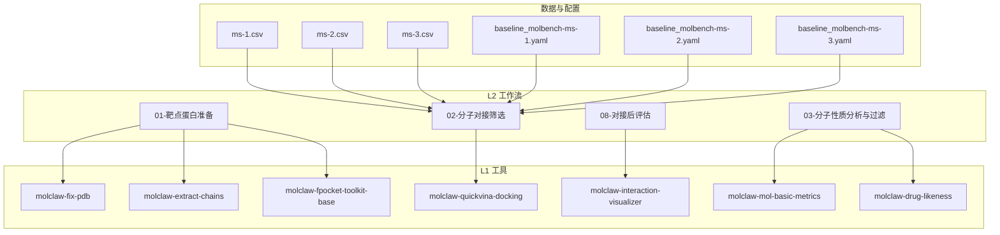
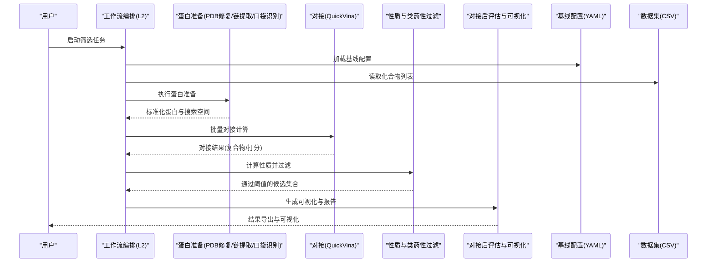
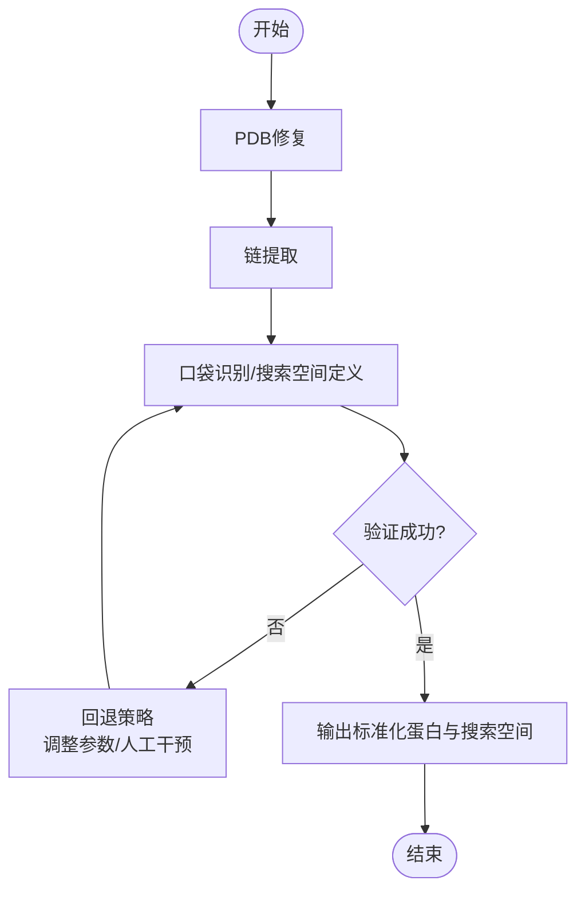
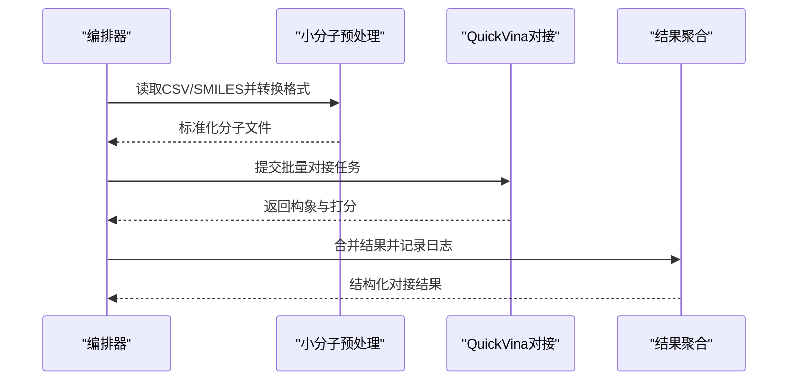
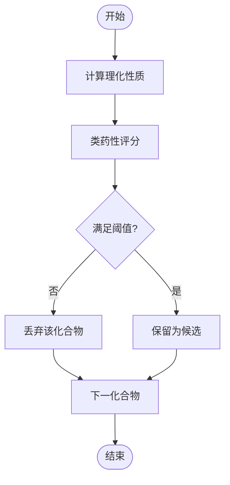
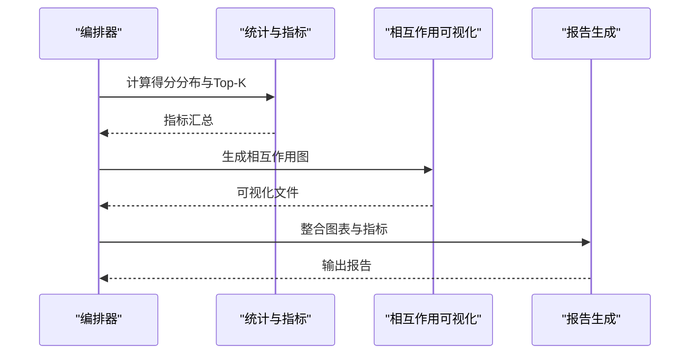
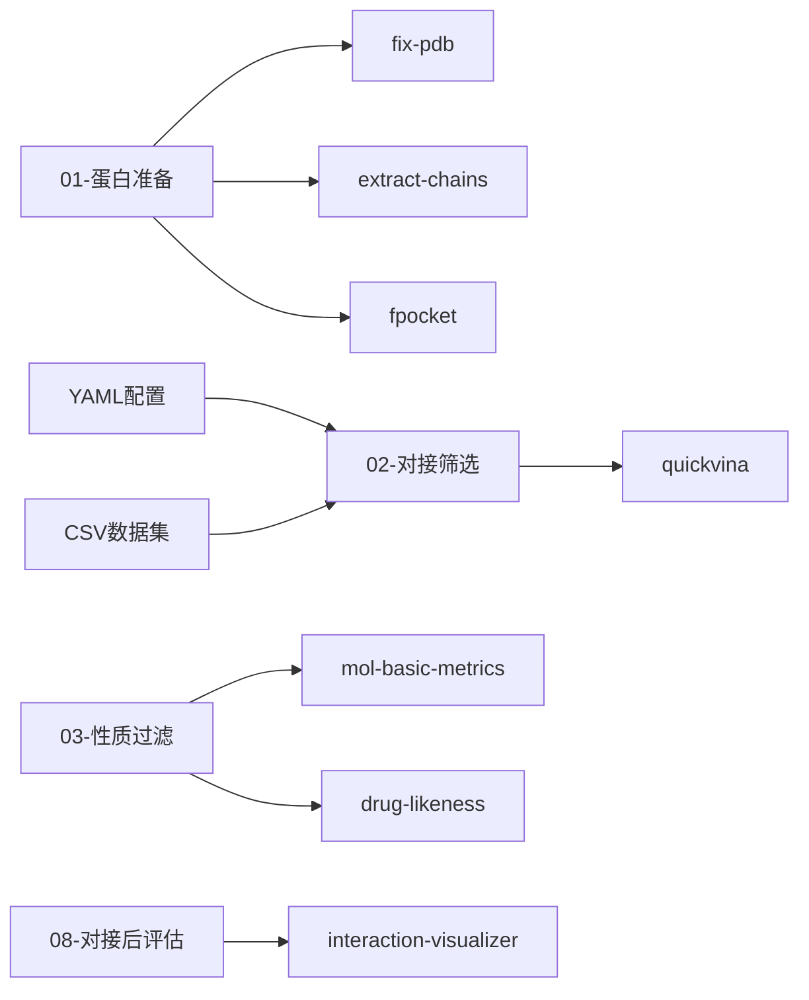

# 分子对接筛选工作流

<cite>
**本文引用的文件**   
- [docs/molbench_repo/skills/L2_workflows/01-target-protein-preparation.md](file://docs/molbench_repo/skills/L2_workflows/01-target-protein-preparation.md)
- [docs/molbench_repo/skills/L2_workflows/02-molecular-docking-screening.md](file://docs/molbench_repo/skills/L2_workflows/02-molecular-docking-screening.md)
- [docs/molbench_repo/skills/L2_workflows/03-molecular-property-analysis-filtering.md](file://docs/molbench_repo/skills/L2_workflows/03-molecular-property-analysis-filtering.md)
- [docs/molbench_repo/skills/L2_workflows/08-post-docking-evaluation.md](file://docs/molbench_repo/skills/L2_workflows/08-post-docking-evaluation.md)
- [docs/molbench_repo/skills/L1_tools/molclaw-docking-screening/README.md](file://docs/molbench_repo/skills/L1_tools/molclaw-docking-screening/README.md)
- [docs/molbench_repo/skills/L1_tools/molclaw-fix-pdb/README.md](file://docs/molbench_repo/skills/L1_tools/molclaw-fix-pdb/README.md)
- [docs/molbench_repo/skills/L1_tools/molclaw-extract-chains/README.md](file://docs/molbench_repo/skills/L1_tools/molclaw-extract-chains/README.md)
- [docs/molbench_repo/skills/L1_tools/molclaw-fpocket-toolkit-base/README.md](file://docs/molbench_repo/skills/L1_tools/molclaw-fpocket-toolkit-base/README.md)
- [docs/molbench_repo/skills/L1_tools/molclaw-quickvina-docking/README.md](file://docs/molbench_repo/skills/L1_tools/molclaw-quickvina-docking/README.md)
- [docs/molbench_repo/skills/L1_tools/molclaw-interaction-visualizer/README.md](file://docs/molbench_repo/skills/L1_tools/molclaw-interaction-visualizer/README.md)
- [docs/molbench_repo/skills/L1_tools/molclaw-mol-basic-metrics/README.md](file://docs/molbench_repo/skills/L1_tools/molclaw-mol-basic-metrics/README.md)
- [docs/molbench_repo/skills/L1_tools/molclaw-drug-likeness/README.md](file://docs/molbench_repo/skills/L1_tools/molclaw-drug-likeness/README.md)
- [docs/molbench_repo/config/baseline_molbench-ms-1.yaml](file://docs/molbench_repo/config/baseline_molbench-ms-1.yaml)
- [docs/molbench_repo/config/baseline_molbench-ms-2.yaml](file://docs/molbench_repo/config/baseline_molbench-ms-2.yaml)
- [docs/molbench_repo/config/baseline_molbench-ms-3.yaml](file://docs/molbench_repo/config/baseline_molbench-ms-3.yaml)
- [docs/molbench_repo/data_full/molbench-ms-1/molbench-ms-1.csv](file://docs/molbench_repo/data_full/molbench-ms-1/molbench-ms-1.csv)
- [docs/molbench_repo/data_full/molbench-ms-2/molbench-ms-2.csv](file://docs/molbench_repo/data_full/molbench-ms-2/molbench-ms-2.csv)
- [docs/molbench_repo/data_full/molbench-ms-3/molbench-ms-3.csv](file://docs/molbench_repo/data_full/molbench-ms-3/molbench-ms-3.csv)
- [autonomy_mvp/tasks/drug_screen_ms3.json](file://autonomy_mvp/tasks/drug_screen_ms3.json)
</cite>

## 目录
1. [简介](#简介)
2. [项目结构](#项目结构)
3. [核心组件](#核心组件)
4. [架构总览](#架构总览)
5. [详细组件分析](#详细组件分析)
6. [依赖关系分析](#依赖关系分析)
7. [性能与可扩展性](#性能与可扩展性)
8. [故障排查指南](#故障排查指南)
9. [结论](#结论)
10. [附录：配置与参数调优](#附录配置与参数调优)

## 简介
本教程面向药物发现与计算化学团队，提供一套从“化合物库准备”到“对接结果分析与可视化”的端到端自动化工作流。内容覆盖：
- 蛋白质结构准备（去水、加氢、选择链、结合位点定义）
- 小分子预处理（格式转换、价态与质子化状态处理）
- 批量对接计算（以QuickVina为例，支持并行与任务编排）
- 结果排序与过滤（结合亲和力、类药性、理化性质）
- 可视化与报告（相互作用图、汇总报表）

同时给出完整配置文件示例与参数调优建议，帮助在不同规模数据集上稳定复现实验。

## 项目结构
仓库中与分子对接筛选相关的核心资源集中在 docs/molbench_repo 下，包含：
- L2 工作流文档：目标蛋白准备、分子对接筛选、性质分析与过滤、对接后评估等
- L1 工具说明：对接、口袋识别、PDB修复、可视化、性质计算等
- 基准数据与配置：MS-1/2/3 数据集及基线配置
- 任务清单：用于驱动自动化执行的 JSON 任务描述

图表来源
- [docs/molbench_repo/skills/L2_workflows/01-target-protein-preparation.md](file://docs/molbench_repo/skills/L2_workflows/01-target-protein-preparation.md)
- [docs/molbench_repo/skills/L2_workflows/02-molecular-docking-screening.md](file://docs/molbench_repo/skills/L2_workflows/02-molecular-docking-screening.md)
- [docs/molbench_repo/skills/L2_workflows/03-molecular-property-analysis-filtering.md](file://docs/molbench_repo/skills/L2_workflows/03-molecular-property-analysis-filtering.md)
- [docs/molbench_repo/skills/L2_workflows/08-post-docking-evaluation.md](file://docs/molbench_repo/skills/L2_workflows/08-post-docking-evaluation.md)
- [docs/molbench_repo/skills/L1_tools/molclaw-fix-pdb/README.md](file://docs/molbench_repo/skills/L1_tools/molclaw-fix-pdb/README.md)
- [docs/molbench_repo/skills/L1_tools/molclaw-extract-chains/README.md](file://docs/molbench_repo/skills/L1_tools/molclaw-extract-chains/README.md)
- [docs/molbench_repo/skills/L1_tools/molclaw-fpocket-toolkit-base/README.md](file://docs/molbench_repo/skills/L1_tools/molclaw-fpocket-toolkit-base/README.md)
- [docs/molbench_repo/skills/L1_tools/molclaw-quickvina-docking/README.md](file://docs/molbench_repo/skills/L1_tools/molclaw-quickvina-docking/README.md)
- [docs/molbench_repo/skills/L1_tools/molclaw-interaction-visualizer/README.md](file://docs/molbench_repo/skills/L1_tools/molclaw-interaction-visualizer/README.md)
- [docs/molbench_repo/skills/L1_tools/molclaw-mol-basic-metrics/README.md](file://docs/molbench_repo/skills/L1_tools/molclaw-mol-basic-metrics/README.md)
- [docs/molbench_repo/skills/L1_tools/molclaw-drug-likeness/README.md](file://docs/molbench_repo/skills/L1_tools/molclaw-drug-likeness/README.md)
- [docs/molbench_repo/data_full/molbench-ms-1/molbench-ms-1.csv](file://docs/molbench_repo/data_full/molbench-ms-1/molbench-ms-1.csv)
- [docs/molbench_repo/data_full/molbench-ms-2/molbench-ms-2.csv](file://docs/molbench_repo/data_full/molbench-ms-2/molbench-ms-2.csv)
- [docs/molbench_repo/data_full/molbench-ms-3/molbench-ms-3.csv](file://docs/molbench_repo/data_full/molbench-ms-3/molbench-ms-3.csv)
- [docs/molbench_repo/config/baseline_molbench-ms-1.yaml](file://docs/molbench_repo/config/baseline_molbench-ms-1.yaml)
- [docs/molbench_repo/config/baseline_molbench-ms-2.yaml](file://docs/molbench_repo/config/baseline_molbench-ms-2.yaml)
- [docs/molbench_repo/config/baseline_molbench-ms-3.yaml](file://docs/molbench_repo/config/baseline_molbench-ms-3.yaml)

章节来源
- [docs/molbench_repo/skills/L2_workflows/01-target-protein-preparation.md](file://docs/molbench_repo/skills/L2_workflows/01-target-protein-preparation.md)
- [docs/molbench_repo/skills/L2_workflows/02-molecular-docking-screening.md](file://docs/molbench_repo/skills/L2_workflows/02-molecular-docking-screening.md)
- [docs/molbench_repo/skills/L2_workflows/03-molecular-property-analysis-filtering.md](file://docs/molbench_repo/skills/L2_workflows/03-molecular-property-analysis-filtering.md)
- [docs/molbench_repo/skills/L2_workflows/08-post-docking-evaluation.md](file://docs/molbench_repo/skills/L2_workflows/08-post-docking-evaluation.md)
- [docs/molbench_repo/skills/L1_tools/molclaw-docking-screening/README.md](file://docs/molbench_repo/skills/L1_tools/molclaw-docking-screening/README.md)
- [docs/molbench_repo/config/baseline_molbench-ms-1.yaml](file://docs/molbench_repo/config/baseline_molbench-ms-1.yaml)
- [docs/molbench_repo/config/baseline_molbench-ms-2.yaml](file://docs/molbench_repo/config/baseline_molbench-ms-2.yaml)
- [docs/molbench_repo/config/baseline_molbench-ms-3.yaml](file://docs/molbench_repo/config/baseline_molbench-ms-3.yaml)
- [docs/molbench_repo/data_full/molbench-ms-1/molbench-ms-1.csv](file://docs/molbench_repo/data_full/molbench-ms-1/molbench-ms-1.csv)
- [docs/molbench_repo/data_full/molbench-ms-2/molbench-ms-2.csv](file://docs/molbench_repo/data_full/molbench-ms-2/molbench-ms-2.csv)
- [docs/molbench_repo/data_full/molbench-ms-3/molbench-ms-3.csv](file://docs/molbench_repo/data_full/molbench-ms-3/molbench-ms-3.csv)
- [autonomy_mvp/tasks/drug_screen_ms3.json](file://autonomy_mvp/tasks/drug_screen_ms3.json)

## 核心组件
- 工作流编排（L2）
  - 靶点蛋白准备：清理PDB、添加缺失原子/氢、选择活性链、基于口袋或配体定义搜索空间
  - 分子对接筛选：批量读取化合物列表，调用对接引擎生成复合物构象与打分
  - 分子性质分析与过滤：计算基础理化指标与类药性评分，按阈值筛选候选
  - 对接后评估：统计分布、可视化关键相互作用、输出可复现报告
- 工具集（L1）
  - PDB修复、链提取、口袋识别、对接引擎（QuickVina）、相互作用可视化、基础度量、类药性评估
- 数据与配置
  - MS-1/2/3 数据集CSV；对应基线YAML配置，统一输入路径、对接参数、过滤阈值、输出目录等

章节来源
- [docs/molbench_repo/skills/L2_workflows/01-target-protein-preparation.md](file://docs/molbench_repo/skills/L2_workflows/01-target-protein-preparation.md)
- [docs/molbench_repo/skills/L2_workflows/02-molecular-docking-screening.md](file://docs/molbench_repo/skills/L2_workflows/02-molecular-docking-screening.md)
- [docs/molbench_repo/skills/L2_workflows/03-molecular-property-analysis-filtering.md](file://docs/molbench_repo/skills/L2_workflows/03-molecular-property-analysis-filtering.md)
- [docs/molbench_repo/skills/L2_workflows/08-post-docking-evaluation.md](file://docs/molbench_repo/skills/L2_workflows/08-post-docking-evaluation.md)
- [docs/molbench_repo/skills/L1_tools/molclaw-docking-screening/README.md](file://docs/molbench_repo/skills/L1_tools/molclaw-docking-screening/README.md)

## 架构总览
下图展示从原始数据到最终报告的端到端流程，以及各步骤对应的L1工具与配置文件。

图表来源
- [docs/molbench_repo/skills/L2_workflows/02-molecular-docking-screening.md](file://docs/molbench_repo/skills/L2_workflows/02-molecular-docking-screening.md)
- [docs/molbench_repo/skills/L2_workflows/01-target-protein-preparation.md](file://docs/molbench_repo/skills/L2_workflows/01-target-protein-preparation.md)
- [docs/molbench_repo/skills/L2_workflows/03-molecular-property-analysis-filtering.md](file://docs/molbench_repo/skills/L2_workflows/03-molecular-property-analysis-filtering.md)
- [docs/molbench_repo/skills/L2_workflows/08-post-docking-evaluation.md](file://docs/molbench_repo/skills/L2_workflows/08-post-docking-evaluation.md)
- [docs/molbench_repo/config/baseline_molbench-ms-1.yaml](file://docs/molbench_repo/config/baseline_molbench-ms-1.yaml)
- [docs/molbench_repo/data_full/molbench-ms-1/molbench-ms-1.csv](file://docs/molbench_repo/data_full/molbench-ms-1/molbench-ms-1.csv)

## 详细组件分析

### 组件A：靶点蛋白准备（PDB修复、链提取、口袋识别）
- 功能要点
  - 修复PDB：去除异常残基、补全缺失原子、统一命名
  - 链选择：仅保留目标链或活性中心相关链
  - 口袋识别：使用fpocket工具定位潜在结合位点，或基于已知配体定义搜索框
- 输入/输出
  - 输入：原始PDB、链ID或配体坐标
  - 输出：标准化蛋白文件、搜索空间定义（中心与尺寸）
- 关键参数
  - 是否去水、是否加氢、链过滤规则、口袋半径与网格分辨率
- 常见问题
  - 缺失侧链导致对接失败；需回退策略（如使用同源模型或放宽修复选项）
  - 多聚体蛋白链选择错误导致搜索空间偏离活性位点

图表来源
- [docs/molbench_repo/skills/L1_tools/molclaw-fix-pdb/README.md](file://docs/molbench_repo/skills/L1_tools/molclaw-fix-pdb/README.md)
- [docs/molbench_repo/skills/L1_tools/molclaw-extract-chains/README.md](file://docs/molbench_repo/skills/L1_tools/molclaw-extract-chains/README.md)
- [docs/molbench_repo/skills/L1_tools/molclaw-fpocket-toolkit-base/README.md](file://docs/molbench_repo/skills/L1_tools/molclaw-fpocket-toolkit-base/README.md)
- [docs/molbench_repo/skills/L2_workflows/01-target-protein-preparation.md](file://docs/molbench_repo/skills/L2_workflows/01-target-protein-preparation.md)

章节来源
- [docs/molbench_repo/skills/L2_workflows/01-target-protein-preparation.md](file://docs/molbench_repo/skills/L2_workflows/01-target-protein-preparation.md)
- [docs/molbench_repo/skills/L1_tools/molclaw-fix-pdb/README.md](file://docs/molbench_repo/skills/L1_tools/molclaw-fix-pdb/README.md)
- [docs/molbench_repo/skills/L1_tools/molclaw-extract-chains/README.md](file://docs/molbench_repo/skills/L1_tools/molclaw-extract-chains/README.md)
- [docs/molbench_repo/skills/L1_tools/molclaw-fpocket-toolkit-base/README.md](file://docs/molbench_repo/skills/L1_tools/molclaw-fpocket-toolkit-base/README.md)

### 组件B：分子对接筛选（批量对接）
- 功能要点
  - 读取化合物列表（SMILES/分子文件），转换为对接所需格式
  - 调用QuickVina进行批量对接，输出复合物构象与打分
  - 支持并行执行与任务分片，适配不同规模数据集
- 输入/输出
  - 输入：标准化蛋白、搜索空间、化合物列表、对接参数
  - 输出：每个化合物的对接结果（构象、能量/打分、元数据）
- 关键参数
  - 搜索空间中心与尺寸、采样步数、最大构象数、并行度、超时与重试策略
- 性能优化
  - 合理设置并行度与内存占用；对大库采用分批提交与断点续跑

图表来源
- [docs/molbench_repo/skills/L2_workflows/02-molecular-docking-screening.md](file://docs/molbench_repo/skills/L2_workflows/02-molecular-docking-screening.md)
- [docs/molbench_repo/skills/L1_tools/molclaw-quickvina-docking/README.md](file://docs/molbench_repo/skills/L1_tools/molclaw-quickvina-docking/README.md)
- [docs/molbench_repo/skills/L1_tools/molclaw-docking-screening/README.md](file://docs/molbench_repo/skills/L1_tools/molclaw-docking-screening/README.md)
- [docs/molbench_repo/config/baseline_molbench-ms-1.yaml](file://docs/molbench_repo/config/baseline_molbench-ms-1.yaml)
- [docs/molbench_repo/data_full/molbench-ms-1/molbench-ms-1.csv](file://docs/molbench_repo/data_full/molbench-ms-1/molbench-ms-1.csv)

章节来源
- [docs/molbench_repo/skills/L2_workflows/02-molecular-docking-screening.md](file://docs/molbench_repo/skills/L2_workflows/02-molecular-docking-screening.md)
- [docs/molbench_repo/skills/L1_tools/molclaw-quickvina-docking/README.md](file://docs/molbench_repo/skills/L1_tools/molclaw-quickvina-docking/README.md)
- [docs/molbench_repo/skills/L1_tools/molclaw-docking-screening/README.md](file://docs/molbench_repo/skills/L1_tools/molclaw-docking-screening/README.md)
- [docs/molbench_repo/config/baseline_molbench-ms-1.yaml](file://docs/molbench_repo/config/baseline_molbench-ms-1.yaml)
- [docs/molbench_repo/data_full/molbench-ms-1/molbench-ms-1.csv](file://docs/molbench_repo/data_full/molbench-ms-1/molbench-ms-1.csv)

### 组件C：分子性质分析与过滤
- 功能要点
  - 计算基础理化指标（分子量、LogP、H键供体/受体、旋转键数等）
  - 类药性评分（如Lipinski规则、Veber规则等）
  - 根据阈值筛选候选，减少后续计算成本
- 输入/输出
  - 输入：化合物结构（SMILES/分子文件）
  - 输出：性质指标与过滤标记（通过/不通过）
- 关键参数
  - 阈值设定（如MW≤500、LogP≤5、HBD≤5、HBA≤10、TPSA等）
- 注意事项
  - 不同靶点/适应症可能适用不同类药性标准，应结合领域知识调整

图表来源
- [docs/molbench_repo/skills/L2_workflows/03-molecular-property-analysis-filtering.md](file://docs/molbench_repo/skills/L2_workflows/03-molecular-property-analysis-filtering.md)
- [docs/molbench_repo/skills/L1_tools/molclaw-mol-basic-metrics/README.md](file://docs/molbench_repo/skills/L1_tools/molclaw-mol-basic-metrics/README.md)
- [docs/molbench_repo/skills/L1_tools/molclaw-drug-likeness/README.md](file://docs/molbench_repo/skills/L1_tools/molclaw-drug-likeness/README.md)

章节来源
- [docs/molbench_repo/skills/L2_workflows/03-molecular-property-analysis-filtering.md](file://docs/molbench_repo/skills/L2_workflows/03-molecular-property-analysis-filtering.md)
- [docs/molbench_repo/skills/L1_tools/molclaw-mol-basic-metrics/README.md](file://docs/molbench_repo/skills/L1_tools/molclaw-mol-basic-metrics/README.md)
- [docs/molbench_repo/skills/L1_tools/molclaw-drug-likeness/README.md](file://docs/molbench_repo/skills/L1_tools/molclaw-drug-likeness/README.md)

### 组件D：对接后评估与可视化
- 功能要点
  - 统计对接得分分布、命中率、Top-K命中
  - 可视化关键相互作用（氢键、疏水接触、盐桥等）
  - 生成可复现的报告与图表
- 输入/输出
  - 输入：对接结果、化合物结构、蛋白结构
  - 输出：可视化图像、统计报表、交互式视图
- 关键参数
  - 可视化阈值（距离、角度）、报告模板、导出格式

图表来源
- [docs/molbench_repo/skills/L2_workflows/08-post-docking-evaluation.md](file://docs/molbench_repo/skills/L2_workflows/08-post-docking-evaluation.md)
- [docs/molbench_repo/skills/L1_tools/molclaw-interaction-visualizer/README.md](file://docs/molbench_repo/skills/L1_tools/molclaw-interaction-visualizer/README.md)

章节来源
- [docs/molbench_repo/skills/L2_workflows/08-post-docking-evaluation.md](file://docs/molbench_repo/skills/L2_workflows/08-post-docking-evaluation.md)
- [docs/molbench_repo/skills/L1_tools/molclaw-interaction-visualizer/README.md](file://docs/molbench_repo/skills/L1_tools/molclaw-interaction-visualizer/README.md)

## 依赖关系分析
- 工作流与工具的耦合
  - L2工作流依赖L1工具完成具体计算任务；通过配置文件统一管理输入输出路径与参数
- 外部依赖
  - fpocket（口袋识别）、QuickVina（对接引擎）、可视化与性质计算库
- 数据依赖
  - MS-1/2/3数据集作为基准输入；YAML配置决定运行模式与参数

图表来源
- [docs/molbench_repo/skills/L2_workflows/01-target-protein-preparation.md](file://docs/molbench_repo/skills/L2_workflows/01-target-protein-preparation.md)
- [docs/molbench_repo/skills/L2_workflows/02-molecular-docking-screening.md](file://docs/molbench_repo/skills/L2_workflows/02-molecular-docking-screening.md)
- [docs/molbench_repo/skills/L2_workflows/03-molecular-property-analysis-filtering.md](file://docs/molbench_repo/skills/L2_workflows/03-molecular-property-analysis-filtering.md)
- [docs/molbench_repo/skills/L2_workflows/08-post-docking-evaluation.md](file://docs/molbench_repo/skills/L2_workflows/08-post-docking-evaluation.md)
- [docs/molbench_repo/config/baseline_molbench-ms-1.yaml](file://docs/molbench_repo/config/baseline_molbench-ms-1.yaml)
- [docs/molbench_repo/data_full/molbench-ms-1/molbench-ms-1.csv](file://docs/molbench_repo/data_full/molbench-ms-1/molbench-ms-1.csv)

章节来源
- [docs/molbench_repo/skills/L2_workflows/01-target-protein-preparation.md](file://docs/molbench_repo/skills/L2_workflows/01-target-protein-preparation.md)
- [docs/molbench_repo/skills/L2_workflows/02-molecular-docking-screening.md](file://docs/molbench_repo/skills/L2_workflows/02-molecular-docking-screening.md)
- [docs/molbench_repo/skills/L2_workflows/03-molecular-property-analysis-filtering.md](file://docs/molbench_repo/skills/L2_workflows/03-molecular-property-analysis-filtering.md)
- [docs/molbench_repo/skills/L2_workflows/08-post-docking-evaluation.md](file://docs/molbench_repo/skills/L2_workflows/08-post-docking-evaluation.md)
- [docs/molbench_repo/config/baseline_molbench-ms-1.yaml](file://docs/molbench_repo/config/baseline_molbench-ms-1.yaml)
- [docs/molbench_repo/data_full/molbench-ms-1/molbench-ms-1.csv](file://docs/molbench_repo/data_full/molbench-ms-1/molbench-ms-1.csv)

## 性能与可扩展性
- 并行与批处理
  - 对接任务可按批次拆分，结合队列系统实现高并发；注意I/O与磁盘带宽瓶颈
- 内存与CPU
  - QuickVina与fpocket对CPU敏感；合理设置线程数与进程数避免过载
- 断点续跑与容错
  - 对接结果落盘，失败任务可重试；属性计算与可视化阶段也应具备幂等性
- 数据规模扩展
  - 对百万级库可采用分层筛选（先快速预筛再精细对接），降低总体计算量

[本节为通用指导，无需特定文件引用]

## 故障排查指南
- 蛋白准备失败
  - 检查PDB完整性与链ID；必要时启用回退策略（简化修复或人工修正）
- 对接无结果或异常打分
  - 确认搜索空间是否覆盖活性位点；调整网格尺寸与采样步数
- 过滤误杀候选
  - 复核类药性阈值；针对特定靶点放宽或收紧标准
- 可视化缺失相互作用
  - 检查距离/角度阈值；确保复合物构象正确且原子命名一致

章节来源
- [docs/molbench_repo/skills/L2_workflows/01-target-protein-preparation.md](file://docs/molbench_repo/skills/L2_workflows/01-target-protein-preparation.md)
- [docs/molbench_repo/skills/L2_workflows/02-molecular-docking-screening.md](file://docs/molbench_repo/skills/L2_workflows/02-molecular-docking-screening.md)
- [docs/molbench_repo/skills/L2_workflows/03-molecular-property-analysis-filtering.md](file://docs/molbench_repo/skills/L2_workflows/03-molecular-property-analysis-filtering.md)
- [docs/molbench_repo/skills/L2_workflows/08-post-docking-evaluation.md](file://docs/molbench_repo/skills/L2_workflows/08-post-docking-evaluation.md)

## 结论
本工作流将“蛋白准备—对接—过滤—评估”串联为可复现的自动化流水线，配合基线配置与基准数据集，可在不同规模任务中稳定运行。通过合理的参数调优与性能优化，能够在保证质量的前提下显著提升筛选效率。

[本节为总结性内容，无需特定文件引用]

## 附录：配置与参数调优
- 基线配置
  - MS-1/2/3 分别对应 baseline_molbench-ms-{1,2,3}.yaml，涵盖输入路径、对接参数、过滤阈值、输出目录等
- 数据集
  - ms-1/2/3.csv 提供化合物列表与必要元信息，可直接作为对接输入
- 参数调优建议
  - 蛋白准备：优先保证活性位点完整性；口袋半径与网格分辨率影响对接精度
  - 对接：在可接受时间内最大化采样；对难结合体系增加构象数与迭代次数
  - 过滤：依据目标适应症调整类药性与理化阈值；对特殊骨架放宽限制
  - 评估：关注Top-K命中率与相互作用一致性；必要时引入更严格的自由能估算

章节来源
- [docs/molbench_repo/config/baseline_molbench-ms-1.yaml](file://docs/molbench_repo/config/baseline_molbench-ms-1.yaml)
- [docs/molbench_repo/config/baseline_molbench-ms-2.yaml](file://docs/molbench_repo/config/baseline_molbench-ms-2.yaml)
- [docs/molbench_repo/config/baseline_molbench-ms-3.yaml](file://docs/molbench_repo/config/baseline_molbench-ms-3.yaml)
- [docs/molbench_repo/data_full/molbench-ms-1/molbench-ms-1.csv](file://docs/molbench_repo/data_full/molbench-ms-1/molbench-ms-1.csv)
- [docs/molbench_repo/data_full/molbench-ms-2/molbench-ms-2.csv](file://docs/molbench_repo/data_full/molbench-ms-2/molbench-ms-2.csv)
- [docs/molbench_repo/data_full/molbench-ms-3/molbench-ms-3.csv](file://docs/molbench_repo/data_full/molbench-ms-3/molbench-ms-3.csv)
- [autonomy_mvp/tasks/drug_screen_ms3.json](file://autonomy_mvp/tasks/drug_screen_ms3.json)