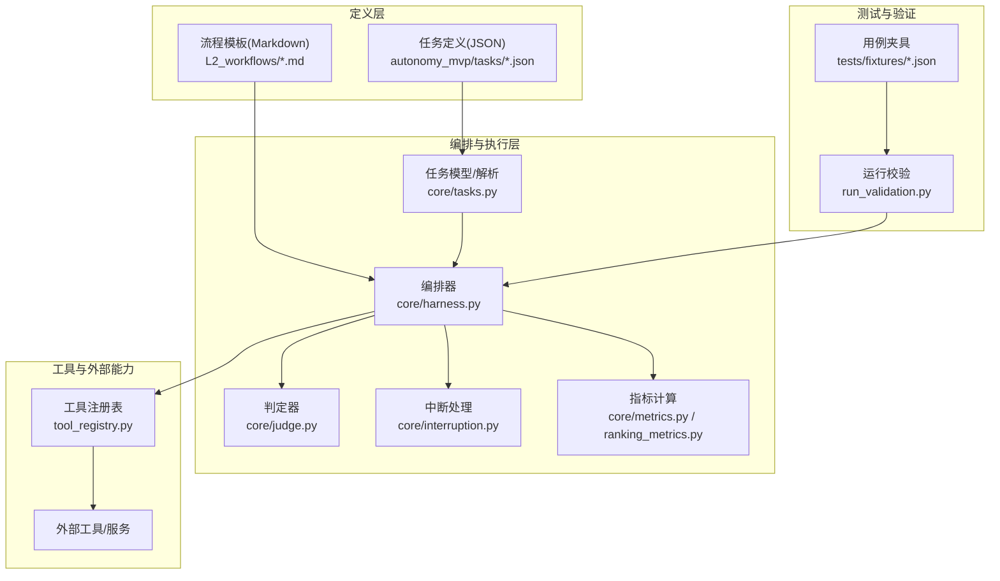
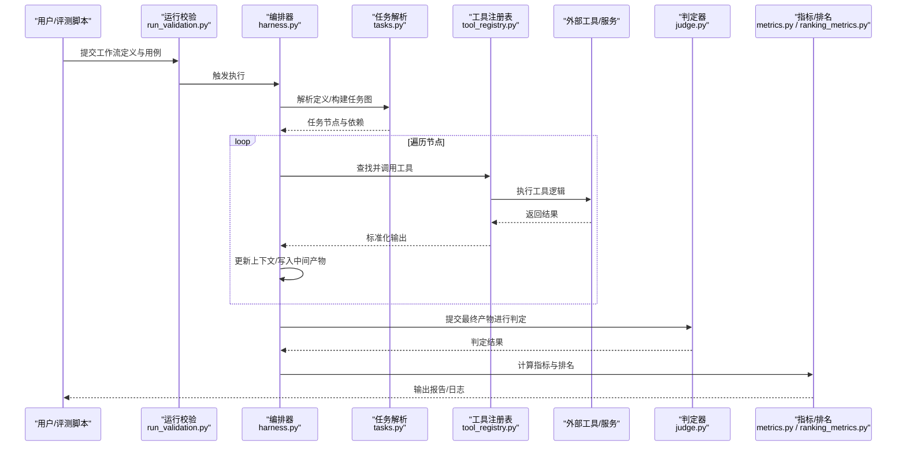
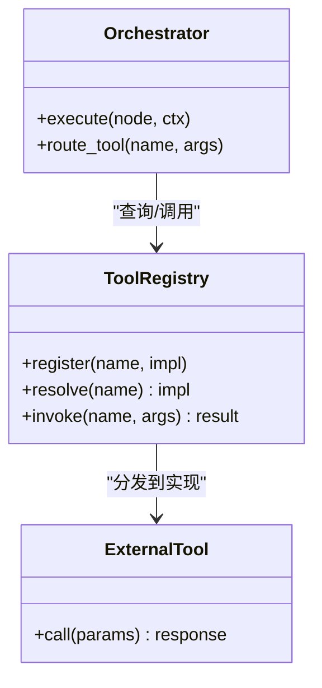
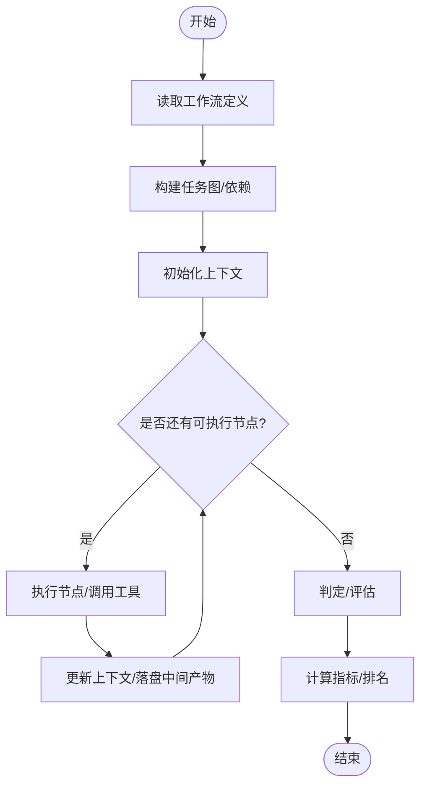
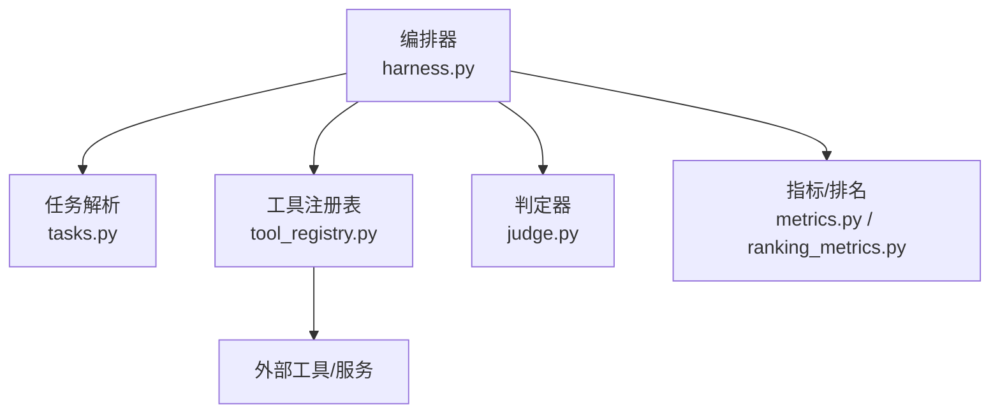

# 工作流基础概念

<cite>
**本文引用的文件**   
- [autonomy_mvp/schema.md](file://autonomy_mvp/schema.md)
- [autonomy_mvp/core/tasks.py](file://autonomy_mvp/core/tasks.py)
- [autonomy_mvp/core/harness.py](file://autonomy_mvp/core/harness.py)
- [autonomy_mvp/core/judge.py](file://autonomy_mvp/core/judge.py)
- [autonomy_mvp/core/interruption.py](file://autonomy_mvp/core/interruption.py)
- [autonomy_mvp/core/metrics.py](file://autonomy_mvp/core/metrics.py)
- [autonomy_mvp/core/ranking_metrics.py](file://autonomy_mvp/core/ranking_metrics.py)
- [autonomy_mvp/core/sim_agents.py](file://autonomy_mvp/core/sim_agents.py)
- [autonomy_mvp/run_validation.py](file://autonomy_mvp/run_validation.py)
- [autonomy_mvp/tests/fixtures/fixture_drugscreen.json](file://autonomy_mvp/tests/fixtures/fixture_drugscreen.json)
- [autonomy_mvp/tests/fixtures/fixture_materials.json](file://autonomy_mvp/tests/fixtures/fixture_materials.json)
- [autonomy_mvp/tasks/drug_admet.json](file://autonomy_mvp/tasks/drug_admet.json)
- [autonomy_mvp/tasks/drug_screen_ms3.json](file://autonomy_mvp/tasks/drug_screen_ms3.json)
- [autonomy_mvp/tasks/materials_semiconductor_bandgap.json](file://autonomy_mvp/tasks/materials_semiconductor_bandgap.json)
- [docs/prd/molbench_repo/skills/L2_workflows/01-target-protein-preparation.md](file://docs/prd/molbench_repo/skills/L2_workflows/01-target-protein-preparation.md)
- [docs/prd/molbench_repo/skills/L2_workflows/02-molecular-docking-screening.md](file://docs/prd/molbench_repo/skills/L2_workflows/02-molecular-docking-screening.md)
- [docs/prd/molbench_repo/skills/L2_workflows/04-generative-molecular-design.md](file://docs/prd/molbench_repo/skills/L2_workflows/04-generative-molecular-design.md)
- [docs/prd/molbench_repo/skills/L2_workflows/05-iterative-molecular-optimization.md](file://docs/prd/molbench_repo/skills/L2_workflows/05-iterative-molecular-optimization.md)
- [docs/prd/molbench_repo/templates/tool_routing.md](file://docs/prd/molbench_repo/templates/tool_routing.md)
- [docs/prd/molbench_repo/templates/variable_routing.md](file://docs/prd/molbench_repo/templates/variable_routing.md)
- [longhorizon/instantiate/case1_instantiate.py](file://longhorizon/instantiate/case1_instantiate.py)
- [longhorizon/instantiate/caseD_instantiate.py](file://longhorizon/instantiate/caseD_instantiate.py)
- [task7/poc3_physicianbench/agent/tool_registry.py](file://task7/poc3_physicianbench/agent/tool_registry.py)
</cite>

## 目录
1. [简介](#简介)
2. [项目结构](#项目结构)
3. [核心组件](#核心组件)
4. [架构总览](#架构总览)
5. [详细组件分析](#详细组件分析)
6. [依赖关系分析](#依赖关系分析)
7. [性能与可扩展性](#性能与可扩展性)
8. [故障排查指南](#故障排查指南)
9. [结论](#结论)
10. [附录：定义格式与语法规范](#附录定义格式与语法规范)

## 简介
本文件面向希望理解并设计复杂工作流的读者，系统阐述工作流编排的核心概念、基本组件与设计理念。围绕“任务节点”“工具调用”“数据流转”等关键主题，结合仓库中的工作流定义样例、调度与评估实现，给出可操作的规范与建议，为后续构建高质量、可维护的工作流打下基础。

## 项目结构
仓库中包含多类与工作流相关的素材：
- 工作流定义与示例：在 autonomy_mvp 的 tasks 目录下提供 JSON 形式的工作流/任务定义；在 docs/prd/molbench_repo/skills/L2_workflows 下提供以 Markdown 描述的多步流程模板。
- 执行与编排：autonomy_mvp/core 下的 harness、tasks、judge、interruption、metrics 等模块负责加载定义、驱动执行、中断处理与结果度量。
- 工具注册与路由：task7/poc3_physicianbench/agent/tool_registry.py 展示了工具注册与调用的通用模式；docs/prd/molbench_repo/templates 提供了工具路由与变量路由的模板说明。
- 实例化与运行：longhorizon/instantiate 下的脚本演示了如何将高层目标实例化为具体工作流步骤。

图表来源
- [autonomy_mvp/core/harness.py](file://autonomy_mvp/core/harness.py)
- [autonomy_mvp/core/tasks.py](file://autonomy_mvp/core/tasks.py)
- [autonomy_mvp/core/judge.py](file://autonomy_mvp/core/judge.py)
- [autonomy_mvp/core/interruption.py](file://autonomy_mvp/core/interruption.py)
- [autonomy_mvp/core/metrics.py](file://autonomy_mvp/core/metrics.py)
- [autonomy_mvp/core/ranking_metrics.py](file://autonomy_mvp/core/ranking_metrics.py)
- [autonomy_mvp/tasks/drug_admet.json](file://autonomy_mvp/tasks/drug_admet.json)
- [autonomy_mvp/tasks/drug_screen_ms3.json](file://autonomy_mvp/tasks/drug_screen_ms3.json)
- [autonomy_mvp/tasks/materials_semiconductor_bandgap.json](file://autonomy_mvp/tasks/materials_semiconductor_bandgap.json)
- [docs/prd/molbench_repo/skills/L2_workflows/01-target-protein-preparation.md](file://docs/prd/molbench_repo/skills/L2_workflows/01-target-protein-preparation.md)
- [docs/prd/molbench_repo/skills/L2_workflows/02-molecular-docking-screening.md](file://docs/prd/molbench_repo/skills/L2_workflows/02-molecular-docking-screening.md)
- [docs/prd/molbench_repo/skills/L2_workflows/04-generative-molecular-design.md](file://docs/prd/molbench_repo/skills/L2_workflows/04-generative-molecular-design.md)
- [docs/prd/molbench_repo/skills/L2_workflows/05-iterative-molecular-optimization.md](file://docs/prd/molbench_repo/skills/L2_workflows/05-iterative-molecular-optimization.md)
- [task7/poc3_physicianbench/agent/tool_registry.py](file://task7/poc3_physicianbench/agent/tool_registry.py)
- [autonomy_mvp/run_validation.py](file://autonomy_mvp/run_validation.py)
- [autonomy_mvp/tests/fixtures/fixture_drugscreen.json](file://autonomy_mvp/tests/fixtures/fixture_drugscreen.json)
- [autonomy_mvp/tests/fixtures/fixture_materials.json](file://autonomy_mvp/tests/fixtures/fixture_materials.json)

章节来源
- [autonomy_mvp/schema.md](file://autonomy_mvp/schema.md)
- [autonomy_mvp/core/harness.py](file://autonomy_mvp/core/harness.py)
- [autonomy_mvp/core/tasks.py](file://autonomy_mvp/core/tasks.py)
- [autonomy_mvp/core/judge.py](file://autonomy_mvp/core/judge.py)
- [autonomy_mvp/core/interruption.py](file://autonomy_mvp/core/interruption.py)
- [autonomy_mvp/core/metrics.py](file://autonomy_mvp/core/metrics.py)
- [autonomy_mvp/core/ranking_metrics.py](file://autonomy_mvp/core/ranking_metrics.py)
- [autonomy_mvp/run_validation.py](file://autonomy_mvp/run_validation.py)
- [autonomy_mvp/tests/fixtures/fixture_drugscreen.json](file://autonomy_mvp/tests/fixtures/fixture_drugscreen.json)
- [autonomy_mvp/tests/fixtures/fixture_materials.json](file://autonomy_mvp/tests/fixtures/fixture_materials.json)
- [autonomy_mvp/tasks/drug_admet.json](file://autonomy_mvp/tasks/drug_admet.json)
- [autonomy_mvp/tasks/drug_screen_ms3.json](file://autonomy_mvp/tasks/drug_screen_ms3.json)
- [autonomy_mvp/tasks/materials_semiconductor_bandgap.json](file://autonomy_mvp/tasks/materials_semiconductor_bandgap.json)
- [docs/prd/molbench_repo/skills/L2_workflows/01-target-protein-preparation.md](file://docs/prd/molbench_repo/skills/L2_workflows/01-target-protein-preparation.md)
- [docs/prd/molbench_repo/skills/L2_workflows/02-molecular-docking-screening.md](file://docs/prd/molbench_repo/skills/L2_workflows/02-molecular-docking-screening.md)
- [docs/prd/molbench_repo/skills/L2_workflows/04-generative-molecular-design.md](file://docs/prd/molbench_repo/skills/L2_workflows/04-generative-molecular-design.md)
- [docs/prd/molbench_repo/skills/L2_workflows/05-iterative-molecular-optimization.md](file://docs/prd/molbench_repo/skills/L2_workflows/05-iterative-molecular-optimization.md)
- [task7/poc3_physicianbench/agent/tool_registry.py](file://task7/poc3_physicianbench/agent/tool_registry.py)

## 核心组件
- 工作流定义（Definition）
  - 以结构化数据描述任务序列、输入输出、条件分支与工具调用。
  - 参考路径：[autonomy_mvp/tasks/drug_admet.json](file://autonomy_mvp/tasks/drug_admet.json)、[autonomy_mvp/tasks/drug_screen_ms3.json](file://autonomy_mvp/tasks/drug_screen_ms3.json)、[autonomy_mvp/tasks/materials_semiconductor_bandgap.json](file://autonomy_mvp/tasks/materials_semiconductor_bandgap.json)。
- 编排器（Orchestrator）
  - 负责解析定义、调度节点、管理上下文、协调工具调用与结果聚合。
  - 参考路径：[autonomy_mvp/core/harness.py](file://autonomy_mvp/core/harness.py)。
- 任务模型与解析（Task Model & Parser）
  - 将定义映射为内部任务图，进行拓扑排序、依赖检查与参数绑定。
  - 参考路径：[autonomy_mvp/core/tasks.py](file://autonomy_mvp/core/tasks.py)。
- 工具注册与路由（Tool Registry & Routing）
  - 集中注册可用工具，按名称或策略路由到具体实现。
  - 参考路径：[task7/poc3_physicianbench/agent/tool_registry.py](file://task7/poc3_physicianbench/agent/tool_registry.py)。
- 判定器（Judge/Evaluator）
  - 对最终产出进行规则或指标判定，支撑自动化验收。
  - 参考路径：[autonomy_mvp/core/judge.py](file://autonomy_mvp/core/judge.py)。
- 中断与恢复（Interruption）
  - 支持长时任务的暂停、恢复与状态快照。
  - 参考路径：[autonomy_mvp/core/interruption.py](file://autonomy_mvp/core/interruption.py)。
- 指标与排名（Metrics & Ranking）
  - 计算质量、效率与对比排名，辅助实验复现与报告生成。
  - 参考路径：[autonomy_mvp/core/metrics.py](file://autonomy_mvp/core/metrics.py)、[autonomy_mvp/core/ranking_metrics.py](file://autonomy_mvp/core/ranking_metrics.py)。
- 运行校验与测试（Validation & Tests）
  - 通过夹具与校验脚本保障定义与实现的稳定性。
  - 参考路径：[autonomy_mvp/run_validation.py](file://autonomy_mvp/run_validation.py)、[autonomy_mvp/tests/fixtures/fixture_drugscreen.json](file://autonomy_mvp/tests/fixtures/fixture_drugscreen.json)、[autonomy_mvp/tests/fixtures/fixture_materials.json](file://autonomy_mvp/tests/fixtures/fixture_materials.json)。

章节来源
- [autonomy_mvp/core/harness.py](file://autonomy_mvp/core/harness.py)
- [autonomy_mvp/core/tasks.py](file://autonomy_mvp/core/tasks.py)
- [autonomy_mvp/core/judge.py](file://autonomy_mvp/core/judge.py)
- [autonomy_mvp/core/interruption.py](file://autonomy_mvp/core/interruption.py)
- [autonomy_mvp/core/metrics.py](file://autonomy_mvp/core/metrics.py)
- [autonomy_mvp/core/ranking_metrics.py](file://autonomy_mvp/core/ranking_metrics.py)
- [autonomy_mvp/run_validation.py](file://autonomy_mvp/run_validation.py)
- [autonomy_mvp/tests/fixtures/fixture_drugscreen.json](file://autonomy_mvp/tests/fixtures/fixture_drugscreen.json)
- [autonomy_mvp/tests/fixtures/fixture_materials.json](file://autonomy_mvp/tests/fixtures/fixture_materials.json)
- [autonomy_mvp/tasks/drug_admet.json](file://autonomy_mvp/tasks/drug_admet.json)
- [autonomy_mvp/tasks/drug_screen_ms3.json](file://autonomy_mvp/tasks/drug_screen_ms3.json)
- [autonomy_mvp/tasks/materials_semiconductor_bandgap.json](file://autonomy_mvp/tasks/materials_semiconductor_bandgap.json)
- [task7/poc3_physicianbench/agent/tool_registry.py](file://task7/poc3_physicianbench/agent/tool_registry.py)

## 架构总览
下图展示从“定义→编排→工具→判定→指标”的端到端数据与控制流。

图表来源
- [autonomy_mvp/run_validation.py](file://autonomy_mvp/run_validation.py)
- [autonomy_mvp/core/harness.py](file://autonomy_mvp/core/harness.py)
- [autonomy_mvp/core/tasks.py](file://autonomy_mvp/core/tasks.py)
- [task7/poc3_physicianbench/agent/tool_registry.py](file://task7/poc3_physicianbench/agent/tool_registry.py)
- [autonomy_mvp/core/judge.py](file://autonomy_mvp/core/judge.py)
- [autonomy_mvp/core/metrics.py](file://autonomy_mvp/core/metrics.py)
- [autonomy_mvp/core/ranking_metrics.py](file://autonomy_mvp/core/ranking_metrics.py)

## 详细组件分析

### 工作流定义与节点类型
- 定义载体
  - JSON 定义：用于机器可读的任务图、参数与工具调用约定。
    - 参考：[autonomy_mvp/tasks/drug_admet.json](file://autonomy_mvp/tasks/drug_admet.json)、[autonomy_mvp/tasks/drug_screen_ms3.json](file://autonomy_mvp/tasks/drug_screen_ms3.json)、[autonomy_mvp/tasks/materials_semiconductor_bandgap.json](file://autonomy_mvp/tasks/materials_semiconductor_bandgap.json)。
  - Markdown 流程模板：用于人类可读的流程说明与协作文档。
    - 参考：[docs/prd/molbench_repo/skills/L2_workflows/01-target-protein-preparation.md](file://docs/prd/molbench_repo/skills/L2_workflows/01-target-protein-preparation.md)、[docs/prd/molbench_repo/skills/L2_workflows/02-molecular-docking-screening.md](file://docs/prd/molbench_repo/skills/L2_workflows/02-molecular-docking-screening.md)、[docs/prd/molbench_repo/skills/L2_workflows/04-generative-molecular-design.md](file://docs/prd/molbench_repo/skills/L2_workflows/04-generative-molecular-design.md)、[docs/prd/molbench_repo/skills/L2_workflows/05-iterative-molecular-optimization.md](file://docs/prd/molbench_repo/skills/L2_workflows/05-iterative-molecular-optimization.md)。
- 常见节点类型
  - 工具节点：封装对外部工具的调用，包含入参映射与出参规范化。
  - 计算节点：纯函数式数据处理，无副作用。
  - 条件分支：基于前序节点输出决定后续路径。
  - 循环/迭代：重复执行某段子流程直至满足终止条件。
  - 汇聚节点：合并多个并行分支的结果。
- 设计建议
  - 明确每个节点的输入/输出契约，避免隐式共享状态。
  - 将易变逻辑下沉至工具层，保持编排稳定。
  - 使用命名空间隔离不同阶段的变量，降低耦合。

章节来源
- [autonomy_mvp/tasks/drug_admet.json](file://autonomy_mvp/tasks/drug_admet.json)
- [autonomy_mvp/tasks/drug_screen_ms3.json](file://autonomy_mvp/tasks/drug_screen_ms3.json)
- [autonomy_mvp/tasks/materials_semiconductor_bandgap.json](file://autonomy_mvp/tasks/materials_semiconductor_bandgap.json)
- [docs/prd/molbench_repo/skills/L2_workflows/01-target-protein-preparation.md](file://docs/prd/molbench_repo/skills/L2_workflows/01-target-protein-preparation.md)
- [docs/prd/molbench_repo/skills/L2_workflows/02-molecular-docking-screening.md](file://docs/prd/molbench_repo/skills/L2_workflows/02-molecular-docking-screening.md)
- [docs/prd/molbench_repo/skills/L2_workflows/04-generative-molecular-design.md](file://docs/prd/molbench_repo/skills/L2_workflows/04-generative-molecular-design.md)
- [docs/prd/molbench_repo/skills/L2_workflows/05-iterative-molecular-optimization.md](file://docs/prd/molbench_repo/skills/L2_workflows/05-iterative-molecular-optimization.md)

### 工具调用与路由
- 工具注册表
  - 提供统一的工具发现与调用接口，便于扩展与维护。
  - 参考：[task7/poc3_physicianbench/agent/tool_registry.py](file://task7/poc3_physicianbench/agent/tool_registry.py)。
- 路由策略
  - 名称匹配：根据工具名直接定位实现。
  - 条件路由：依据上下文动态选择工具。
  - 版本兼容：同一工具多版本并存时的选择策略。
- 最佳实践
  - 工具应幂等、可重试、带超时与错误码。
  - 输入校验前置，失败快速返回。
  - 输出标准化，便于下游消费。

图表来源
- [task7/poc3_physicianbench/agent/tool_registry.py](file://task7/poc3_physicianbench/agent/tool_registry.py)
- [autonomy_mvp/core/harness.py](file://autonomy_mvp/core/harness.py)

章节来源
- [task7/poc3_physicianbench/agent/tool_registry.py](file://task7/poc3_physicianbench/agent/tool_registry.py)
- [autonomy_mvp/core/harness.py](file://autonomy_mvp/core/harness.py)

### 数据流转与上下文管理
- 上下文对象
  - 贯穿整个工作流的键值存储，承载中间产物、配置与元数据。
- 数据契约
  - 节点间通过明确的字段名与类型传递数据，避免强耦合。
- 典型流转
  - 上游节点产出 → 上下文写入 → 下游节点读取 → 结果聚合/判定。
- 注意事项
  - 控制上下文大小，避免大对象频繁拷贝。
  - 对敏感信息做脱敏与访问控制。

图表来源
- [autonomy_mvp/core/harness.py](file://autonomy_mvp/core/harness.py)
- [autonomy_mvp/core/tasks.py](file://autonomy_mvp/core/tasks.py)
- [autonomy_mvp/core/judge.py](file://autonomy_mvp/core/judge.py)
- [autonomy_mvp/core/metrics.py](file://autonomy_mvp/core/metrics.py)
- [autonomy_mvp/core/ranking_metrics.py](file://autonomy_mvp/core/ranking_metrics.py)

章节来源
- [autonomy_mvp/core/harness.py](file://autonomy_mvp/core/harness.py)
- [autonomy_mvp/core/tasks.py](file://autonomy_mvp/core/tasks.py)
- [autonomy_mvp/core/judge.py](file://autonomy_mvp/core/judge.py)
- [autonomy_mvp/core/metrics.py](file://autonomy_mvp/core/metrics.py)
- [autonomy_mvp/core/ranking_metrics.py](file://autonomy_mvp/core/ranking_metrics.py)

### 中断与恢复
- 场景
  - 长时间运行的科学计算、外部 API 限流、资源不足等。
- 机制
  - 保存检查点（上下文快照）、记录已执行节点、支持断点续跑。
- 参考实现
  - 参考：[autonomy_mvp/core/interruption.py](file://autonomy_mvp/core/interruption.py)。

章节来源
- [autonomy_mvp/core/interruption.py](file://autonomy_mvp/core/interruption.py)

### 判定与指标
- 判定器
  - 基于规则或启发式方法对最终产物打分/通过性判断。
  - 参考：[autonomy_mvp/core/judge.py](file://autonomy_mvp/core/judge.py)。
- 指标与排名
  - 多维度量化质量与效率，并进行横向对比。
  - 参考：[autonomy_mvp/core/metrics.py](file://autonomy_mvp/core/metrics.py)、[autonomy_mvp/core/ranking_metrics.py](file://autonomy_mvp/core/ranking_metrics.py)。

章节来源
- [autonomy_mvp/core/judge.py](file://autonomy_mvp/core/judge.py)
- [autonomy_mvp/core/metrics.py](file://autonomy_mvp/core/metrics.py)
- [autonomy_mvp/core/ranking_metrics.py](file://autonomy_mvp/core/ranking_metrics.py)

### 运行校验与测试
- 运行校验
  - 统一入口加载定义、执行并收集结果，便于回归与对比。
  - 参考：[autonomy_mvp/run_validation.py](file://autonomy_mvp/run_validation.py)。
- 测试夹具
  - 提供最小可复现实例，覆盖边界与异常路径。
  - 参考：[autonomy_mvp/tests/fixtures/fixture_drugscreen.json](file://autonomy_mvp/tests/fixtures/fixture_drugscreen.json)、[autonomy_mvp/tests/fixtures/fixture_materials.json](file://autonomy_mvp/tests/fixtures/fixture_materials.json)。

章节来源
- [autonomy_mvp/run_validation.py](file://autonomy_mvp/run_validation.py)
- [autonomy_mvp/tests/fixtures/fixture_drugscreen.json](file://autonomy_mvp/tests/fixtures/fixture_drugscreen.json)
- [autonomy_mvp/tests/fixtures/fixture_materials.json](file://autonomy_mvp/tests/fixtures/fixture_materials.json)

### 概念总览（非代码映射）

## 依赖关系分析
- 组件内聚与耦合
  - 编排器与任务解析紧密耦合，共同完成图构建与调度。
  - 工具注册表与外部工具松耦合，通过接口抽象提升可替换性。
  - 判定与指标相对独立，便于按需启用。
- 外部依赖
  - 外部工具/服务作为黑盒接入，需关注可用性、延迟与一致性。
- 潜在环路与风险
  - 避免在工具中反向调用编排器造成循环依赖。
  - 对长尾依赖设置超时与降级策略。

图表来源
- [autonomy_mvp/core/harness.py](file://autonomy_mvp/core/harness.py)
- [autonomy_mvp/core/tasks.py](file://autonomy_mvp/core/tasks.py)
- [task7/poc3_physicianbench/agent/tool_registry.py](file://task7/poc3_physicianbench/agent/tool_registry.py)
- [autonomy_mvp/core/judge.py](file://autonomy_mvp/core/judge.py)
- [autonomy_mvp/core/metrics.py](file://autonomy_mvp/core/metrics.py)
- [autonomy_mvp/core/ranking_metrics.py](file://autonomy_mvp/core/ranking_metrics.py)

章节来源
- [autonomy_mvp/core/harness.py](file://autonomy_mvp/core/harness.py)
- [autonomy_mvp/core/tasks.py](file://autonomy_mvp/core/tasks.py)
- [task7/poc3_physicianbench/agent/tool_registry.py](file://task7/poc3_physicianbench/agent/tool_registry.py)
- [autonomy_mvp/core/judge.py](file://autonomy_mvp/core/judge.py)
- [autonomy_mvp/core/metrics.py](file://autonomy_mvp/core/metrics.py)
- [autonomy_mvp/core/ranking_metrics.py](file://autonomy_mvp/core/ranking_metrics.py)

## 性能与可扩展性
- 并发与并行
  - 对无依赖节点进行并行执行，缩短整体时延。
  - 对外部工具调用采用连接池与批量请求。
- 缓存与复用
  - 对确定性计算结果进行缓存，减少重复开销。
- 资源治理
  - 限制并发度、设置超时与重试退避，防止雪崩。
- 可扩展性
  - 工具注册表支持热插拔；定义格式保持稳定演进。

## 故障排查指南
- 常见问题
  - 工具未注册或名称不匹配：检查注册表与路由策略。
  - 上下文键缺失或类型不符：核对节点输入/输出契约。
  - 外部服务不可用：查看超时、重试与降级配置。
  - 判定失败：审查判定规则与输入数据分布。
- 定位手段
  - 开启细粒度日志，记录节点进入/退出、上下文快照与工具调用轨迹。
  - 使用运行校验脚本与测试夹具进行最小化复现。
- 参考实现
  - 中断与恢复：[autonomy_mvp/core/interruption.py](file://autonomy_mvp/core/interruption.py)
  - 运行校验：[autonomy_mvp/run_validation.py](file://autonomy_mvp/run_validation.py)
  - 判定与指标：[autonomy_mvp/core/judge.py](file://autonomy_mvp/core/judge.py)、[autonomy_mvp/core/metrics.py](file://autonomy_mvp/core/metrics.py)、[autonomy_mvp/core/ranking_metrics.py](file://autonomy_mvp/core/ranking_metrics.py)

章节来源
- [autonomy_mvp/core/interruption.py](file://autonomy_mvp/core/interruption.py)
- [autonomy_mvp/run_validation.py](file://autonomy_mvp/run_validation.py)
- [autonomy_mvp/core/judge.py](file://autonomy_mvp/core/judge.py)
- [autonomy_mvp/core/metrics.py](file://autonomy_mvp/core/metrics.py)
- [autonomy_mvp/core/ranking_metrics.py](file://autonomy_mvp/core/ranking_metrics.py)

## 结论
工作流编排的关键在于清晰的定义、稳定的编排器、可插拔的工具生态以及完善的判定与指标体系。通过严格的输入/输出契约、上下文管理与中断恢复机制，可以在保证正确性的同时获得良好的性能与可维护性。建议在团队内沉淀通用的定义模板与工具规范，持续完善测试与监控，从而支撑更复杂的业务场景。

## 附录：定义格式与语法规范
- 定义载体
  - JSON：适合机器解析与自动化执行。
    - 参考：[autonomy_mvp/tasks/drug_admet.json](file://autonomy_mvp/tasks/drug_admet.json)、[autonomy_mvp/tasks/drug_screen_ms3.json](file://autonomy_mvp/tasks/drug_screen_ms3.json)、[autonomy_mvp/tasks/materials_semiconductor_bandgap.json](file://autonomy_mvp/tasks/materials_semiconductor_bandgap.json)。
  - Markdown：适合人类阅读与协作评审。
    - 参考：[docs/prd/molbench_repo/skills/L2_workflows/01-target-protein-preparation.md](file://docs/prd/molbench_repo/skills/L2_workflows/01-target-protein-preparation.md)、[docs/prd/molbench_repo/skills/L2_workflows/02-molecular-docking-screening.md](file://docs/prd/molbench_repo/skills/L2_workflows/02-molecular-docking-screening.md)、[docs/prd/molbench_repo/skills/L2_workflows/04-generative-molecular-design.md](file://docs/prd/molbench_repo/skills/L2_workflows/04-generative-molecular-design.md)、[docs/prd/molbench_repo/skills/L2_workflows/05-iterative-molecular-optimization.md](file://docs/prd/molbench_repo/skills/L2_workflows/05-iterative-molecular-optimization.md)。
- 节点语法要点
  - 唯一标识：每个节点应具备稳定 ID。
  - 输入/输出：显式声明字段名、类型与默认值。
  - 依赖关系：声明前置节点与数据引用方式。
  - 工具调用：指定工具名、参数映射与重试策略。
  - 条件与循环：明确分支条件与终止条件。
- 路由与变量
  - 工具路由：参见模板 [docs/prd/molbench_repo/templates/tool_routing.md](file://docs/prd/molbench_repo/templates/tool_routing.md)。
  - 变量路由：参见模板 [docs/prd/molbench_repo/templates/variable_routing.md](file://docs/prd/molbench_repo/templates/variable_routing.md)。
- 实例化与运行
  - 从高层目标到具体步骤的实例化过程可参考：
    - [longhorizon/instantiate/case1_instantiate.py](file://longhorizon/instantiate/case1_instantiate.py)
    - [longhorizon/instantiate/caseD_instantiate.py](file://longhorizon/instantiate/caseD_instantiate.py)

章节来源
- [autonomy_mvp/tasks/drug_admet.json](file://autonomy_mvp/tasks/drug_admet.json)
- [autonomy_mvp/tasks/drug_screen_ms3.json](file://autonomy_mvp/tasks/drug_screen_ms3.json)
- [autonomy_mvp/tasks/materials_semiconductor_bandgap.json](file://autonomy_mvp/tasks/materials_semiconductor_bandgap.json)
- [docs/prd/molbench_repo/skills/L2_workflows/01-target-protein-preparation.md](file://docs/prd/molbench_repo/skills/L2_workflows/01-target-protein-preparation.md)
- [docs/prd/molbench_repo/skills/L2_workflows/02-molecular-docking-screening.md](file://docs/prd/molbench_repo/skills/L2_workflows/02-molecular-docking-screening.md)
- [docs/prd/molbench_repo/skills/L2_workflows/04-generative-molecular-design.md](file://docs/prd/molbench_repo/skills/L2_workflows/04-generative-molecular-design.md)
- [docs/prd/molbench_repo/skills/L2_workflows/05-iterative-molecular-optimization.md](file://docs/prd/molbench_repo/skills/L2_workflows/05-iterative-molecular-optimization.md)
- [docs/prd/molbench_repo/templates/tool_routing.md](file://docs/prd/molbench_repo/templates/tool_routing.md)
- [docs/prd/molbench_repo/templates/variable_routing.md](file://docs/prd/molbench_repo/templates/variable_routing.md)
- [longhorizon/instantiate/case1_instantiate.py](file://longhorizon/instantiate/case1_instantiate.py)
- [longhorizon/instantiate/caseD_instantiate.py](file://longhorizon/instantiate/caseD_instantiate.py)