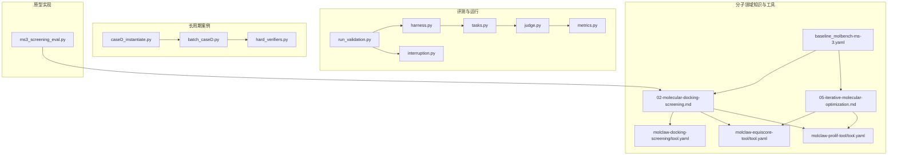
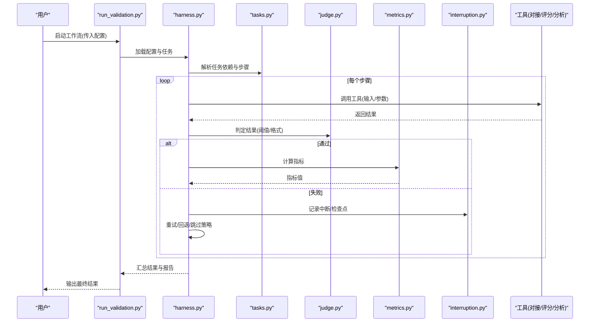
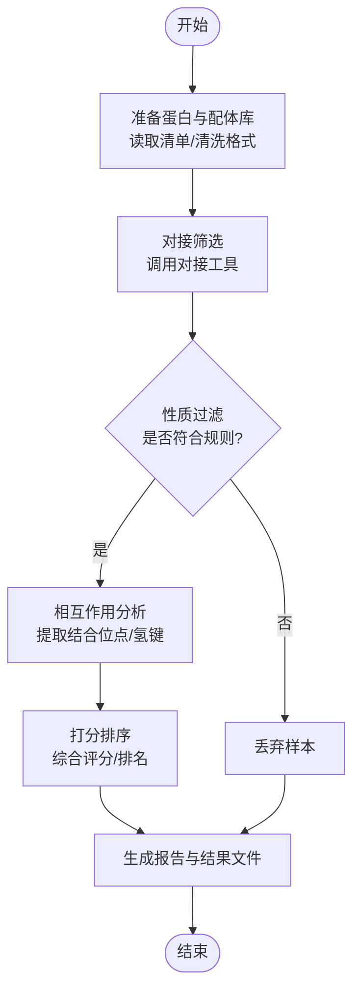
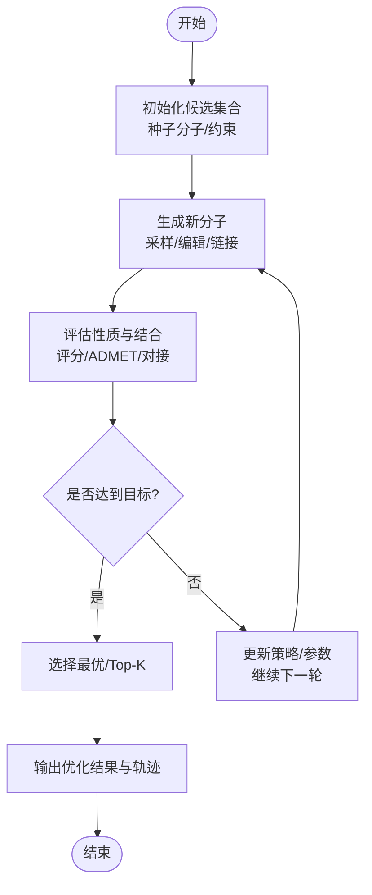
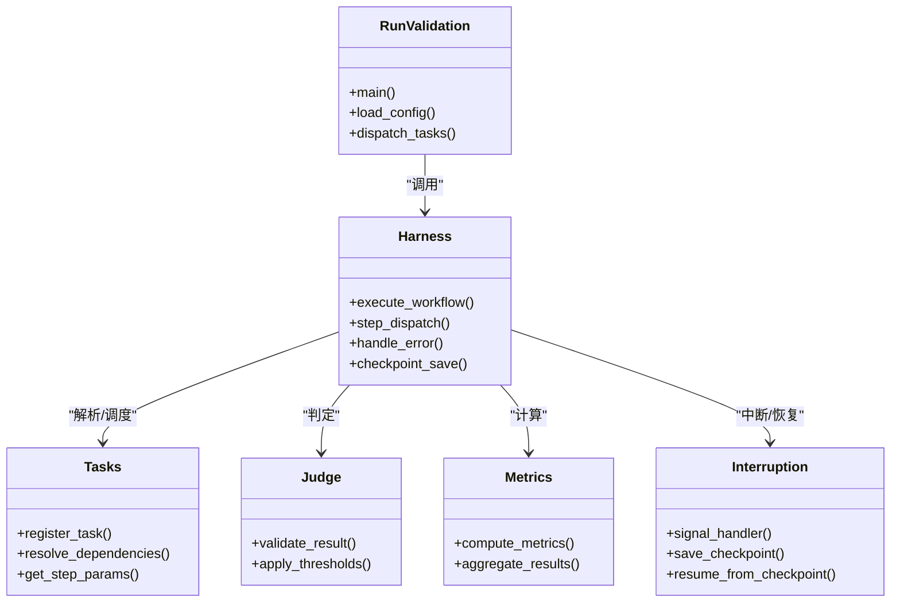
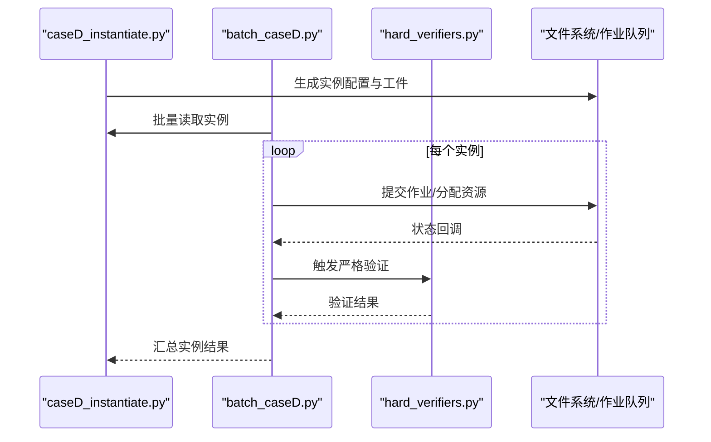
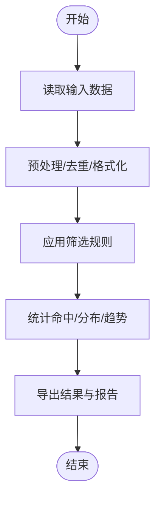
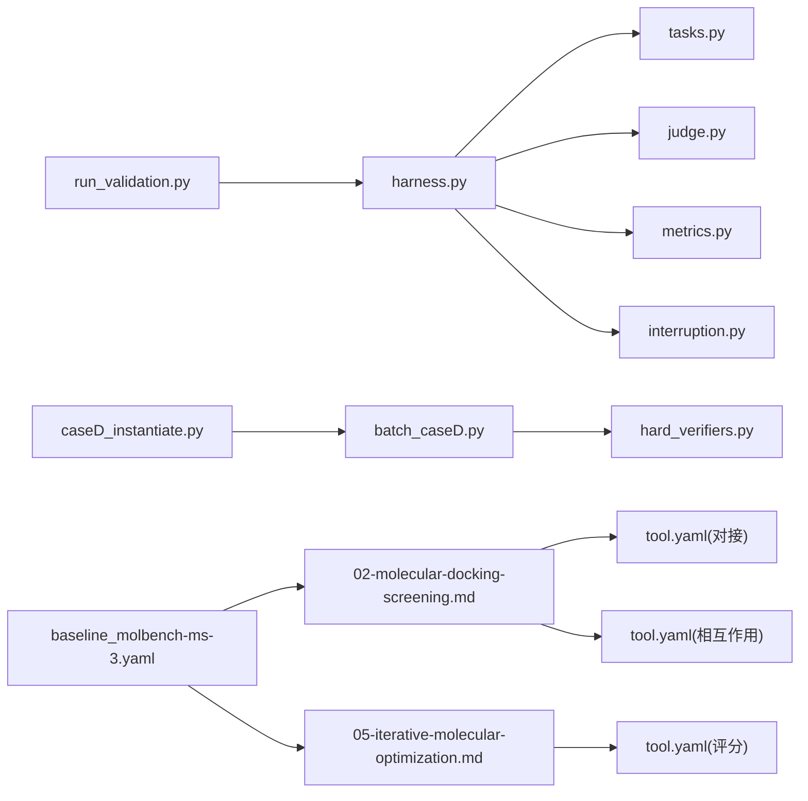

# 工作流编排教程

<cite>
**本文引用的文件**   
- [autonomy_mvp/core/harness.py](file://autonomy_mvp/core/harness.py)
- [autonomy_mvp/core/tasks.py](file://autonomy_mvp/core/tasks.py)
- [autonomy_mvp/core/judge.py](file://autonomy_mvp/core/judge.py)
- [autonomy_mvp/core/metrics.py](file://autonomy_mvp/core/metrics.py)
- [autonomy_mvp/core/interruption.py](file://autonomy_mvp/core/interruption.py)
- [autonomy_mvp/run_validation.py](file://autonomy_mvp/run_validation.py)
- [longhorizon/instantiate/caseD_instantiate.py](file://longhorizon/instantiate/caseD_instantiate.py)
- [longhorizon/instantiate/batch_caseD.py](file://longhorizon/instantiate/batch_caseD.py)
- [longhorizon/verifiers/hard_verifiers.py](file://longhorizon/verifiers/hard_verifiers.py)
- [docs/prd/molbench_repo/skills/L2_workflows/02-molecular-docking-screening.md](file://docs/prd/molbench_repo/skills/L2_workflows/02-molecular-docking-screening.md)
- [docs/prd/molbench_repo/skills/L2_workflows/05-iterative-molecular-optimization.md](file://docs/prd/molbench_repo/skills/L2_workflows/05-iterative-molecular-optimization.md)
- [docs/prd/molbench_repo/skills/L1_tools/molclaw-docking-screening/tool.yaml](file://docs/prd/molbench_repo/skills/L1_tools/molclaw-docking-screening/tool.yaml)
- [docs/prd/molbench_repo/skills/L1_tools/molclaw-equiscore-tool/tool.yaml](file://docs/prd/molbench_repo/skills/L1_tools/molclaw-equiscore-tool/tool.yaml)
- [docs/prd/molbench_repo/skills/L1_tools/molclaw-prolif-tool/tool.yaml](file://docs/prd/molbench_repo/skills/L1_tools/molclaw-prolif-tool/tool.yaml)
- [docs/prd/molbench_repo/config/baseline_molbench-ms-3.yaml](file://docs/prd/molbench_repo/config/baseline_molbench-ms-3.yaml)
- [task3/B_ms3_screening_prototype/ms3_screening_eval.py](file://task3/B_ms3_screening_prototype/ms3_screening_eval.py)
</cite>

## 目录
1. [简介](#简介)
2. [项目结构](#项目结构)
3. [核心组件](#核心组件)
4. [架构总览](#架构总览)
5. [详细组件分析](#详细组件分析)
6. [依赖分析](#依赖分析)
7. [性能考虑](#性能考虑)
8. [故障排查指南](#故障排查指南)
9. [结论](#结论)
10. [附录](#附录)

## 简介
本教程面向希望将多个工具与任务组合为自动化工作流的工程师与科研人员，聚焦“分子对接筛选”和“迭代优化”两类典型科学任务。通过仓库中的可执行脚本、评测框架与工作流定义，展示如何构建包含条件分支、循环控制与错误恢复的复杂工作流，并给出可视化流程图与调用时序图，帮助读者快速上手与扩展。

## 项目结构
仓库围绕“评测与验证（autonomy_mvp）”、“长周期案例（longhorizon）”、“分子技能与工作流定义（docs/prd/molbench_repo）”以及“原型实现（task3）”四个层次组织：
- autonomy_mvp：提供统一的工作流运行器、任务描述、评判与指标计算等基础设施。
- longhorizon：以具体案例（如材料闭环优化）演示工作流实例化与批处理。
- docs/prd/molbench_repo：沉淀分子领域的L1工具与L2工作流定义，便于复用与组合。
- task3：针对MS3筛选的原型评估脚本，体现端到端的数据流转与结果汇总。

图表来源
- [autonomy_mvp/run_validation.py](file://autonomy_mvp/run_validation.py)
- [autonomy_mvp/core/harness.py](file://autonomy_mvp/core/harness.py)
- [autonomy_mvp/core/tasks.py](file://autonomy_mvp/core/tasks.py)
- [autonomy_mvp/core/judge.py](file://autonomy_mvp/core/judge.py)
- [autonomy_mvp/core/metrics.py](file://autonomy_mvp/core/metrics.py)
- [autonomy_mvp/core/interruption.py](file://autonomy_mvp/core/interruption.py)
- [longhorizon/instantiate/caseD_instantiate.py](file://longhorizon/instantiate/caseD_instantiate.py)
- [longhorizon/instantiate/batch_caseD.py](file://longhorizon/instantiate/batch_caseD.py)
- [longhorizon/verifiers/hard_verifiers.py](file://longhorizon/verifiers/hard_verifiers.py)
- [docs/prd/molbench_repo/skills/L2_workflows/02-molecular-docking-screening.md](file://docs/prd/molbench_repo/skills/L2_workflows/02-molecular-docking-screening.md)
- [docs/prd/molbench_repo/skills/L2_workflows/05-iterative-molecular-optimization.md](file://docs/prd/molbench_repo/skills/L2_workflows/05-iterative-molecular-optimization.md)
- [docs/prd/molbench_repo/skills/L1_tools/molclaw-docking-screening/tool.yaml](file://docs/prd/molbench_repo/skills/L1_tools/molclaw-docking-screening/tool.yaml)
- [docs/prd/molbench_repo/skills/L1_tools/molclaw-equiscore-tool/tool.yaml](file://docs/prd/molbench_repo/skills/L1_tools/molclaw-equiscore-tool/tool.yaml)
- [docs/prd/molbench_repo/skills/L1_tools/molclaw-prolif-tool/tool.yaml](file://docs/prd/molbench_repo/skills/L1_tools/molclaw-prolif-tool/tool.yaml)
- [docs/prd/molbench_repo/config/baseline_molbench-ms-3.yaml](file://docs/prd/molbench_repo/config/baseline_molbench-ms-3.yaml)
- [task3/B_ms3_screening_prototype/ms3_screening_eval.py](file://task3/B_ms3_screening_prototype/ms3_screening_eval.py)

章节来源
- [autonomy_mvp/run_validation.py](file://autonomy_mvp/run_validation.py)
- [autonomy_mvp/core/harness.py](file://autonomy_mvp/core/harness.py)
- [autonomy_mvp/core/tasks.py](file://autonomy_mvp/core/tasks.py)
- [autonomy_mvp/core/judge.py](file://autonomy_mvp/core/judge.py)
- [autonomy_mvp/core/metrics.py](file://autonomy_mvp/core/metrics.py)
- [autonomy_mvp/core/interruption.py](file://autonomy_mvp/core/interruption.py)
- [longhorizon/instantiate/caseD_instantiate.py](file://longhorizon/instantiate/caseD_instantiate.py)
- [longhorizon/instantiate/batch_caseD.py](file://longhorizon/instantiate/batch_caseD.py)
- [longhorizon/verifiers/hard_verifiers.py](file://longhorizon/verifiers/hard_verifiers.py)
- [docs/prd/molbench_repo/skills/L2_workflows/02-molecular-docking-screening.md](file://docs/prd/molbench_repo/skills/L2_workflows/02-molecular-docking-screening.md)
- [docs/prd/molbench_repo/skills/L2_workflows/05-iterative-molecular-optimization.md](file://docs/prd/molbench_repo/skills/L2_workflows/05-iterative-molecular-optimization.md)
- [docs/prd/molbench_repo/skills/L1_tools/molclaw-docking-screening/tool.yaml](file://docs/prd/molbench_repo/skills/L1_tools/molclaw-docking-screening/tool.yaml)
- [docs/prd/molbench_repo/skills/L1_tools/molclaw-equiscore-tool/tool.yaml](file://docs/prd/molbench_repo/skills/L1_tools/molclaw-equiscore-tool/tool.yaml)
- [docs/prd/molbench_repo/skills/L1_tools/molclaw-prolif-tool/tool.yaml](file://docs/prd/molbench_repo/skills/L1_tools/molclaw-prolif-tool/tool.yaml)
- [docs/prd/molbench_repo/config/baseline_molbench-ms-3.yaml](file://docs/prd/molbench_repo/config/baseline_molbench-ms-3.yaml)
- [task3/B_ms3_screening_prototype/ms3_screening_eval.py](file://task3/B_ms3_screening_prototype/ms3_screening_eval.py)

## 核心组件
- 运行器与编排
  - run_validation.py：入口脚本，负责加载配置、解析任务、调度执行与输出结果。
  - harness.py：工作流执行引擎，管理步骤顺序、并发、上下文传递与异常捕获。
  - tasks.py：任务抽象与注册机制，定义任务接口、参数与依赖关系。
- 评判与度量
  - judge.py：对中间或最终结果进行判定（例如是否满足阈值、格式校验）。
  - metrics.py：计算指标（如命中率、富集因子、AUC等），支持聚合与导出。
- 中断与恢复
  - interruption.py：提供中断信号、检查点写入与断点续跑能力。
- 长周期案例
  - caseD_instantiate.py：将通用工作流模板实例化为具体案例（如BaTiO闭环优化）。
  - batch_caseD.py：批量实例化与并行提交，结合资源配额与重试策略。
  - hard_verifiers.py：严格验证器，用于关键节点的强约束检查。
- 分子领域工作流与工具
  - 02-molecular-docking-screening.md：对接筛选工作流说明（输入、步骤、输出）。
  - 05-iterative-molecular-optimization.md：迭代优化工作流（生成-评估-反馈循环）。
  - tool.yaml（对接、评分、相互作用分析）：工具契约（输入/输出、参数、环境要求）。
  - baseline_molbench-ms-3.yaml：基准配置，串联多步工具链。
- 原型实现
  - ms3_screening_eval.py：MS3筛选原型，端到端数据读取、筛选、统计与报告生成。

章节来源
- [autonomy_mvp/run_validation.py](file://autonomy_mvp/run_validation.py)
- [autonomy_mvp/core/harness.py](file://autonomy_mvp/core/harness.py)
- [autonomy_mvp/core/tasks.py](file://autonomy_mvp/core/tasks.py)
- [autonomy_mvp/core/judge.py](file://autonomy_mvp/core/judge.py)
- [autonomy_mvp/core/metrics.py](file://autonomy_mvp/core/metrics.py)
- [autonomy_mvp/core/interruption.py](file://autonomy_mvp/core/interruption.py)
- [longhorizon/instantiate/caseD_instantiate.py](file://longhorizon/instantiate/caseD_instantiate.py)
- [longhorizon/instantiate/batch_caseD.py](file://longhorizon/instantiate/batch_caseD.py)
- [longhorizon/verifiers/hard_verifiers.py](file://longhorizon/verifiers/hard_verifiers.py)
- [docs/prd/molbench_repo/skills/L2_workflows/02-molecular-docking-screening.md](file://docs/prd/molbench_repo/skills/L2_workflows/02-molecular-docking-screening.md)
- [docs/prd/molbench_repo/skills/L2_workflows/05-iterative-molecular-optimization.md](file://docs/prd/molbench_repo/skills/L2_workflows/05-iterative-molecular-optimization.md)
- [docs/prd/molbench_repo/skills/L1_tools/molclaw-docking-screening/tool.yaml](file://docs/prd/molbench_repo/skills/L1_tools/molclaw-docking-screening/tool.yaml)
- [docs/prd/molbench_repo/skills/L1_tools/molclaw-equiscore-tool/tool.yaml](file://docs/prd/molbench_repo/skills/L1_tools/molclaw-equiscore-tool/tool.yaml)
- [docs/prd/molbench_repo/skills/L1_tools/molclaw-prolif-tool/tool.yaml](file://docs/prd/molbench_repo/skills/L1_tools/molclaw-prolif-tool/tool.yaml)
- [docs/prd/molbench_repo/config/baseline_molbench-ms-3.yaml](file://docs/prd/molbench_repo/config/baseline_molbench-ms-3.yaml)
- [task3/B_ms3_screening_prototype/ms3_screening_eval.py](file://task3/B_ms3_screening_prototype/ms3_screening_eval.py)

## 架构总览
下图展示了从配置到执行的端到端流程，包括工作流编排、工具调用、评判与指标计算、以及中断恢复。

图表来源
- [autonomy_mvp/run_validation.py](file://autonomy_mvp/run_validation.py)
- [autonomy_mvp/core/harness.py](file://autonomy_mvp/core/harness.py)
- [autonomy_mvp/core/tasks.py](file://autonomy_mvp/core/tasks.py)
- [autonomy_mvp/core/judge.py](file://autonomy_mvp/core/judge.py)
- [autonomy_mvp/core/metrics.py](file://autonomy_mvp/core/metrics.py)
- [autonomy_mvp/core/interruption.py](file://autonomy_mvp/core/interruption.py)

## 详细组件分析

### 分子对接筛选工作流（L2）
该工作流将“对接筛选”作为核心步骤，配合“性质过滤”“相互作用分析”“打分排序”形成完整管线。

图表来源
- [docs/prd/molbench_repo/skills/L2_workflows/02-molecular-docking-screening.md](file://docs/prd/molbench_repo/skills/L2_workflows/02-molecular-docking-screening.md)
- [docs/prd/molbench_repo/skills/L1_tools/molclaw-docking-screening/tool.yaml](file://docs/prd/molbench_repo/skills/L1_tools/molclaw-docking-screening/tool.yaml)
- [docs/prd/molbench_repo/skills/L1_tools/molclaw-prolif-tool/tool.yaml](file://docs/prd/molbench_repo/skills/L1_tools/molclaw-prolif-tool/tool.yaml)
- [docs/prd/molbench_repo/skills/L1_tools/molclaw-equiscore-tool/tool.yaml](file://docs/prd/molbench_repo/skills/L1_tools/molclaw-equiscore-tool/tool.yaml)

章节来源
- [docs/prd/molbench_repo/skills/L2_workflows/02-molecular-docking-screening.md](file://docs/prd/molbench_repo/skills/L2_workflows/02-molecular-docking-screening.md)
- [docs/prd/molbench_repo/skills/L1_tools/molclaw-docking-screening/tool.yaml](file://docs/prd/molbench_repo/skills/L1_tools/molclaw-docking-screening/tool.yaml)
- [docs/prd/molbench_repo/skills/L1_tools/molclaw-equiscore-tool/tool.yaml](file://docs/prd/molbench_repo/skills/L1_tools/molclaw-equiscore-tool/tool.yaml)
- [docs/prd/molbench_repo/skills/L1_tools/molclaw-prolif-tool/tool.yaml](file://docs/prd/molbench_repo/skills/L1_tools/molclaw-prolif-tool/tool.yaml)

### 迭代分子优化工作流（L2）
该工作流采用“生成-评估-反馈”的闭环，结合条件分支与循环控制，逐步提升候选分子的结合亲和力与成药性。

图表来源
- [docs/prd/molbench_repo/skills/L2_workflows/05-iterative-molecular-optimization.md](file://docs/prd/molbench_repo/skills/L2_workflows/05-iterative-molecular-optimization.md)
- [docs/prd/molbench_repo/skills/L1_tools/molclaw-equiscore-tool/tool.yaml](file://docs/prd/molbench_repo/skills/L1_tools/molclaw-equiscore-tool/tool.yaml)
- [docs/prd/molbench_repo/skills/L1_tools/molclaw-prolif-tool/tool.yaml](file://docs/prd/molbench_repo/skills/L1_tools/molclaw-prolif-tool/tool.yaml)

章节来源
- [docs/prd/molbench_repo/skills/L2_workflows/05-iterative-molecular-optimization.md](file://docs/prd/molbench_repo/skills/L2_workflows/05-iterative-molecular-optimization.md)
- [docs/prd/molbench_repo/skills/L1_tools/molclaw-equiscore-tool/tool.yaml](file://docs/prd/molbench_repo/skills/L1_tools/molclaw-equiscore-tool/tool.yaml)
- [docs/prd/molbench_repo/skills/L1_tools/molclaw-prolif-tool/tool.yaml](file://docs/prd/molbench_repo/skills/L1_tools/molclaw-prolif-tool/tool.yaml)

### 运行器与编排（代码级）
以下类图展示运行器、执行引擎、任务、评判与指标之间的依赖关系。

图表来源
- [autonomy_mvp/run_validation.py](file://autonomy_mvp/run_validation.py)
- [autonomy_mvp/core/harness.py](file://autonomy_mvp/core/harness.py)
- [autonomy_mvp/core/tasks.py](file://autonomy_mvp/core/tasks.py)
- [autonomy_mvp/core/judge.py](file://autonomy_mvp/core/judge.py)
- [autonomy_mvp/core/metrics.py](file://autonomy_mvp/core/metrics.py)
- [autonomy_mvp/core/interruption.py](file://autonomy_mvp/core/interruption.py)

章节来源
- [autonomy_mvp/run_validation.py](file://autonomy_mvp/run_validation.py)
- [autonomy_mvp/core/harness.py](file://autonomy_mvp/core/harness.py)
- [autonomy_mvp/core/tasks.py](file://autonomy_mvp/core/tasks.py)
- [autonomy_mvp/core/judge.py](file://autonomy_mvp/core/judge.py)
- [autonomy_mvp/core/metrics.py](file://autonomy_mvp/core/metrics.py)
- [autonomy_mvp/core/interruption.py](file://autonomy_mvp/core/interruption.py)

### 长周期案例：材料闭环优化（实例化与批处理）
该案例演示如何将通用工作流模板实例化为具体对象，并通过批处理脚本进行大规模并行执行与结果收集。

图表来源
- [longhorizon/instantiate/caseD_instantiate.py](file://longhorizon/instantiate/caseD_instantiate.py)
- [longhorizon/instantiate/batch_caseD.py](file://longhorizon/instantiate/batch_caseD.py)
- [longhorizon/verifiers/hard_verifiers.py](file://longhorizon/verifiers/hard_verifiers.py)

章节来源
- [longhorizon/instantiate/caseD_instantiate.py](file://longhorizon/instantiate/caseD_instantiate.py)
- [longhorizon/instantiate/batch_caseD.py](file://longhorizon/instantiate/batch_caseD.py)
- [longhorizon/verifiers/hard_verifiers.py](file://longhorizon/verifiers/hard_verifiers.py)

### MS3筛选原型（端到端示例）
该原型脚本展示了从数据读取、筛选逻辑、结果统计到报告生成的完整流程，适合作为自定义工作流的参考实现。

图表来源
- [task3/B_ms3_screening_prototype/ms3_screening_eval.py](file://task3/B_ms3_screening_prototype/ms3_screening_eval.py)

章节来源
- [task3/B_ms3_screening_prototype/ms3_screening_eval.py](file://task3/B_ms3_screening_prototype/ms3_screening_eval.py)

## 依赖分析
- 模块耦合
  - run_validation.py 依赖 harness.py 完成编排；harness.py 依赖 tasks.py 解析任务；judge.py 与 metrics.py 被 harness.py 在步骤完成后调用；interruption.py 提供中断与检查点能力。
  - 长周期案例中，caseD_instantiate.py 产出实例，batch_caseD.py 驱动执行与验证，hard_verifiers.py 提供强约束检查。
  - 分子工作流由 L2 文档定义，L1 工具通过 tool.yaml 暴露接口，baseline 配置串联多步。
- 外部依赖
  - 工具层（对接、评分、相互作用分析）通过 tool.yaml 声明参数与环境，工作流按契约调用。
  - 基准配置（yaml）决定数据路径、阈值与工具版本，确保可复现。

图表来源
- [autonomy_mvp/run_validation.py](file://autonomy_mvp/run_validation.py)
- [autonomy_mvp/core/harness.py](file://autonomy_mvp/core/harness.py)
- [autonomy_mvp/core/tasks.py](file://autonomy_mvp/core/tasks.py)
- [autonomy_mvp/core/judge.py](file://autonomy_mvp/core/judge.py)
- [autonomy_mvp/core/metrics.py](file://autonomy_mvp/core/metrics.py)
- [autonomy_mvp/core/interruption.py](file://autonomy_mvp/core/interruption.py)
- [longhorizon/instantiate/caseD_instantiate.py](file://longhorizon/instantiate/caseD_instantiate.py)
- [longhorizon/instantiate/batch_caseD.py](file://longhorizon/instantiate/batch_caseD.py)
- [longhorizon/verifiers/hard_verifiers.py](file://longhorizon/verifiers/hard_verifiers.py)
- [docs/prd/molbench_repo/skills/L2_workflows/02-molecular-docking-screening.md](file://docs/prd/molbench_repo/skills/L2_workflows/02-molecular-docking-screening.md)
- [docs/prd/molbench_repo/skills/L2_workflows/05-iterative-molecular-optimization.md](file://docs/prd/molbench_repo/skills/L2_workflows/05-iterative-molecular-optimization.md)
- [docs/prd/molbench_repo/skills/L1_tools/molclaw-docking-screening/tool.yaml](file://docs/prd/molbench_repo/skills/L1_tools/molclaw-docking-screening/tool.yaml)
- [docs/prd/molbench_repo/skills/L1_tools/molclaw-equiscore-tool/tool.yaml](file://docs/prd/molbench_repo/skills/L1_tools/molclaw-equiscore-tool/tool.yaml)
- [docs/prd/molbench_repo/skills/L1_tools/molclaw-prolif-tool/tool.yaml](file://docs/prd/molbench_repo/skills/L1_tools/molclaw-prolif-tool/tool.yaml)
- [docs/prd/molbench_repo/config/baseline_molbench-ms-3.yaml](file://docs/prd/molbench_repo/config/baseline_molbench-ms-3.yaml)

章节来源
- [autonomy_mvp/run_validation.py](file://autonomy_mvp/run_validation.py)
- [autonomy_mvp/core/harness.py](file://autonomy_mvp/core/harness.py)
- [autonomy_mvp/core/tasks.py](file://autonomy_mvp/core/tasks.py)
- [autonomy_mvp/core/judge.py](file://autonomy_mvp/core/judge.py)
- [autonomy_mvp/core/metrics.py](file://autonomy_mvp/core/metrics.py)
- [autonomy_mvp/core/interruption.py](file://autonomy_mvp/core/interruption.py)
- [longhorizon/instantiate/caseD_instantiate.py](file://longhorizon/instantiate/caseD_instantiate.py)
- [longhorizon/instantiate/batch_caseD.py](file://longhorizon/instantiate/batch_caseD.py)
- [longhorizon/verifiers/hard_verifiers.py](file://longhorizon/verifiers/hard_verifiers.py)
- [docs/prd/molbench_repo/skills/L2_workflows/02-molecular-docking-screening.md](file://docs/prd/molbench_repo/skills/L2_workflows/02-molecular-docking-screening.md)
- [docs/prd/molbench_repo/skills/L2_workflows/05-iterative-molecular-optimization.md](file://docs/prd/molbench_repo/skills/L2_workflows/05-iterative-molecular-optimization.md)
- [docs/prd/molbench_repo/skills/L1_tools/molclaw-docking-screening/tool.yaml](file://docs/prd/molbench_repo/skills/L1_tools/molclaw-docking-screening/tool.yaml)
- [docs/prd/molbench_repo/skills/L1_tools/molclaw-equiscore-tool/tool.yaml](file://docs/prd/molbench_repo/skills/L1_tools/molclaw-equiscore-tool/tool.yaml)
- [docs/prd/molbench_repo/skills/L1_tools/molclaw-prolif-tool/tool.yaml](file://docs/prd/molbench_repo/skills/L1_tools/molclaw-prolif-tool/tool.yaml)
- [docs/prd/molbench_repo/config/baseline_molbench-ms-3.yaml](file://docs/prd/molbench_repo/config/baseline_molbench-ms-3.yaml)

## 性能考虑
- 并行与批处理
  - 使用批处理脚本（如 batch_caseD.py）进行任务分发与资源隔离，避免单点瓶颈。
  - 在工作流内对独立步骤启用并发（如对接批次），注意共享资源竞争与I/O阻塞。
- 缓存与增量计算
  - 利用检查点与中间结果缓存，减少重复计算；仅在输入变化时重新执行受影响步骤。
- 阈值与早停
  - 在评判阶段设置合理阈值，提前终止低质量分支，降低无效计算。
- 资源监控
  - 监控CPU/GPU/内存/磁盘I/O，识别热点步骤并进行针对性优化（如批大小调整、算法替换）。

[本节为通用指导，不直接分析具体文件]

## 故障排查指南
- 常见错误定位
  - 工具调用失败：检查 tool.yaml 的参数与环境变量是否正确；确认输入文件格式与路径。
  - 评判失败：查看 judge.py 的阈值与规则；核对指标计算逻辑与数据范围。
  - 中断与恢复：确认 interruption.py 的检查点文件是否存在且可读；必要时从最近检查点续跑。
- 调试建议
  - 开启详细日志，记录每一步的输入/输出摘要与耗时。
  - 对小规模数据进行回归测试，逐步扩大规模定位问题。
  - 对关键节点增加断言与快照，便于回溯。

章节来源
- [autonomy_mvp/core/judge.py](file://autonomy_mvp/core/judge.py)
- [autonomy_mvp/core/metrics.py](file://autonomy_mvp/core/metrics.py)
- [autonomy_mvp/core/interruption.py](file://autonomy_mvp/core/interruption.py)

## 结论
通过将L2工作流与L1工具解耦，并以统一的运行器与编排引擎串联，本仓库提供了构建复杂科学任务自动化的坚实基础。借助条件分支、循环控制与错误恢复机制，可在分子对接筛选与迭代优化等场景中实现高效、稳定与可复现的流水线。建议在实际项目中优先完善工具契约与评判规则，并结合批处理与检查点机制提升鲁棒性与吞吐。

[本节为总结性内容，不直接分析具体文件]

## 附录
- 快速上手
  - 使用 run_validation.py 加载 baseline 配置，观察工作流执行与结果输出。
  - 参考 02-molecular-docking-screening.md 与 05-iterative-molecular-optimization.md 修改步骤与参数。
  - 基于 ms3_screening_eval.py 扩展自定义筛选逻辑与报告模板。
- 扩展建议
  - 新增工具：在 L1_tools 下添加 tool.yaml，明确输入/输出与依赖。
  - 新增工作流：在 L2_workflows 下编写流程说明，并在 baseline 中引用。
  - 强化验证：在 hard_verifiers.py 中添加更严格的约束与回归测试用例。

[本节为补充信息，不直接分析具体文件]