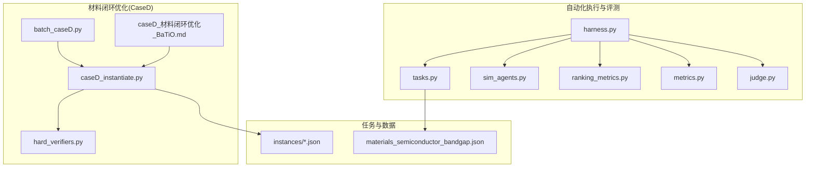
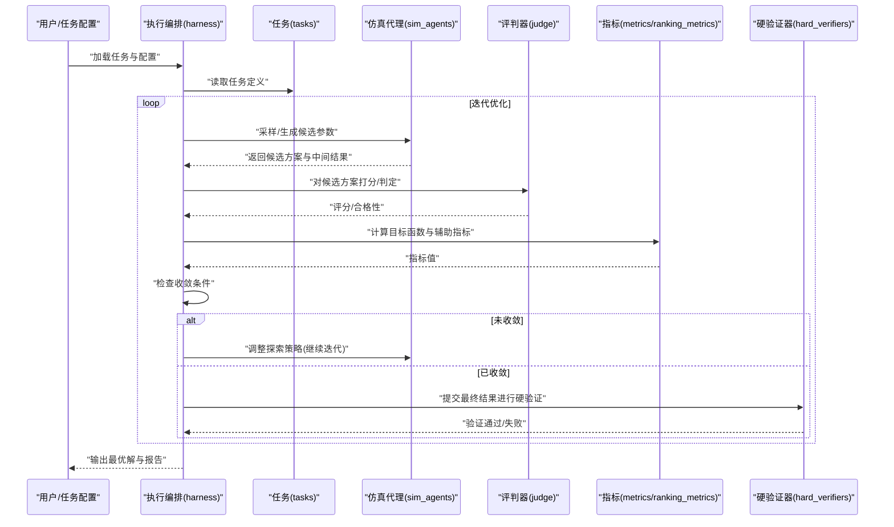
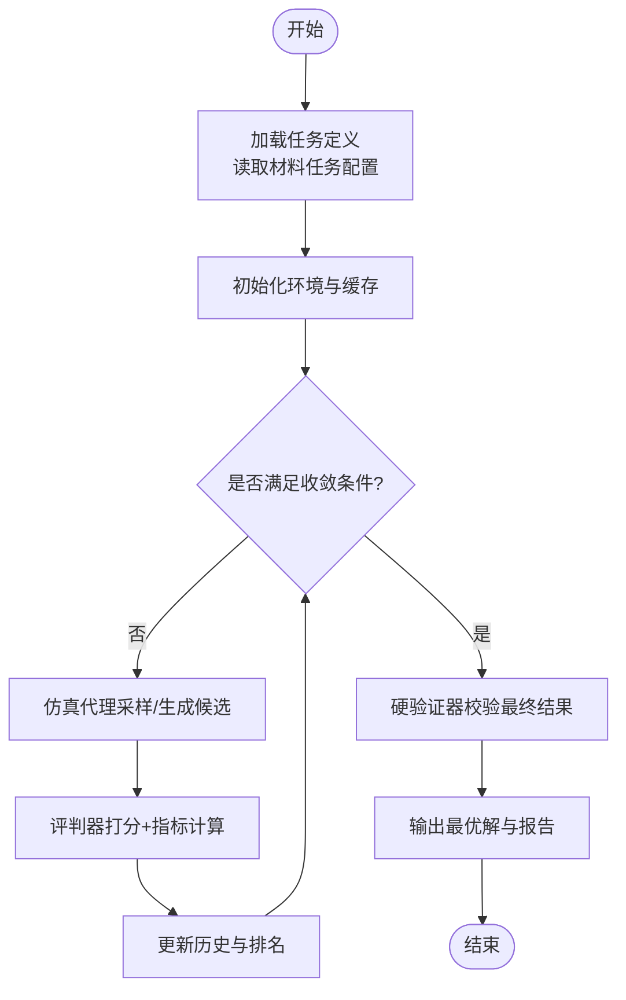
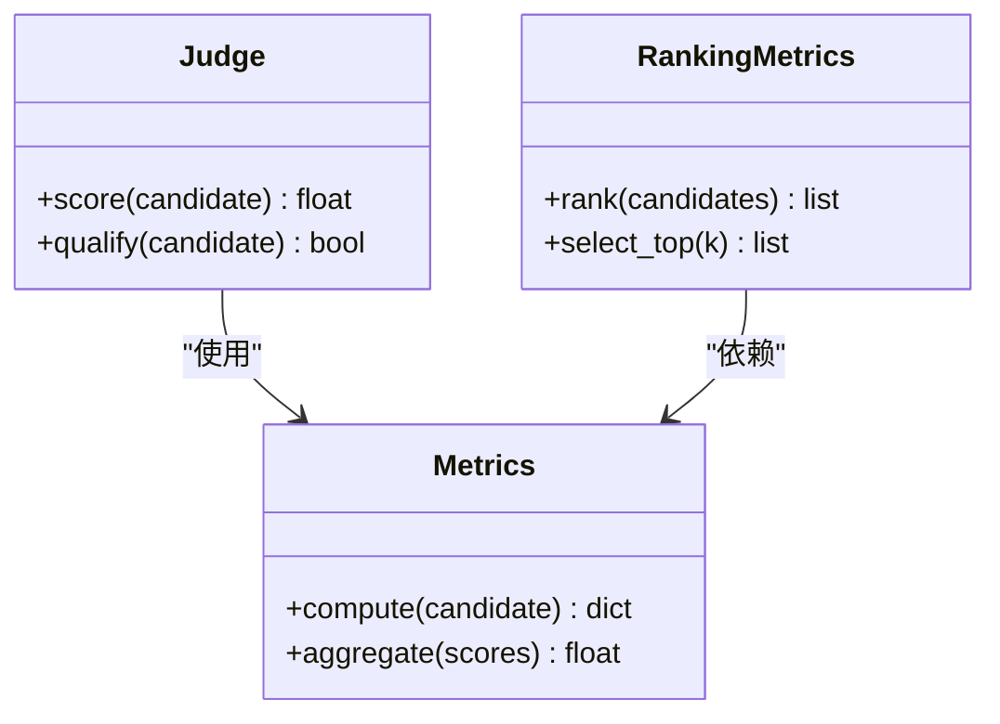
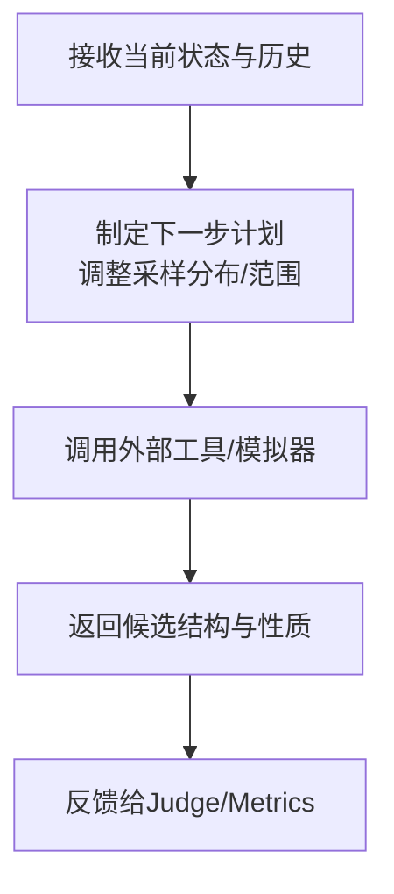
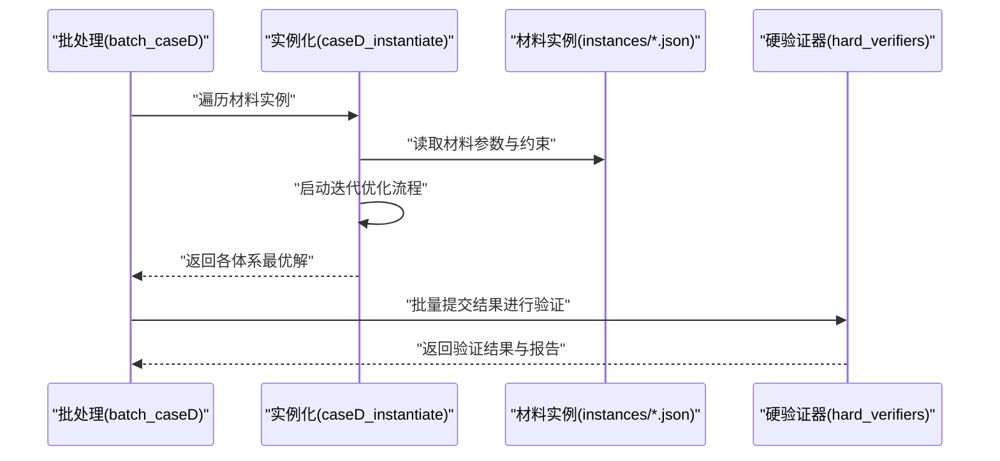
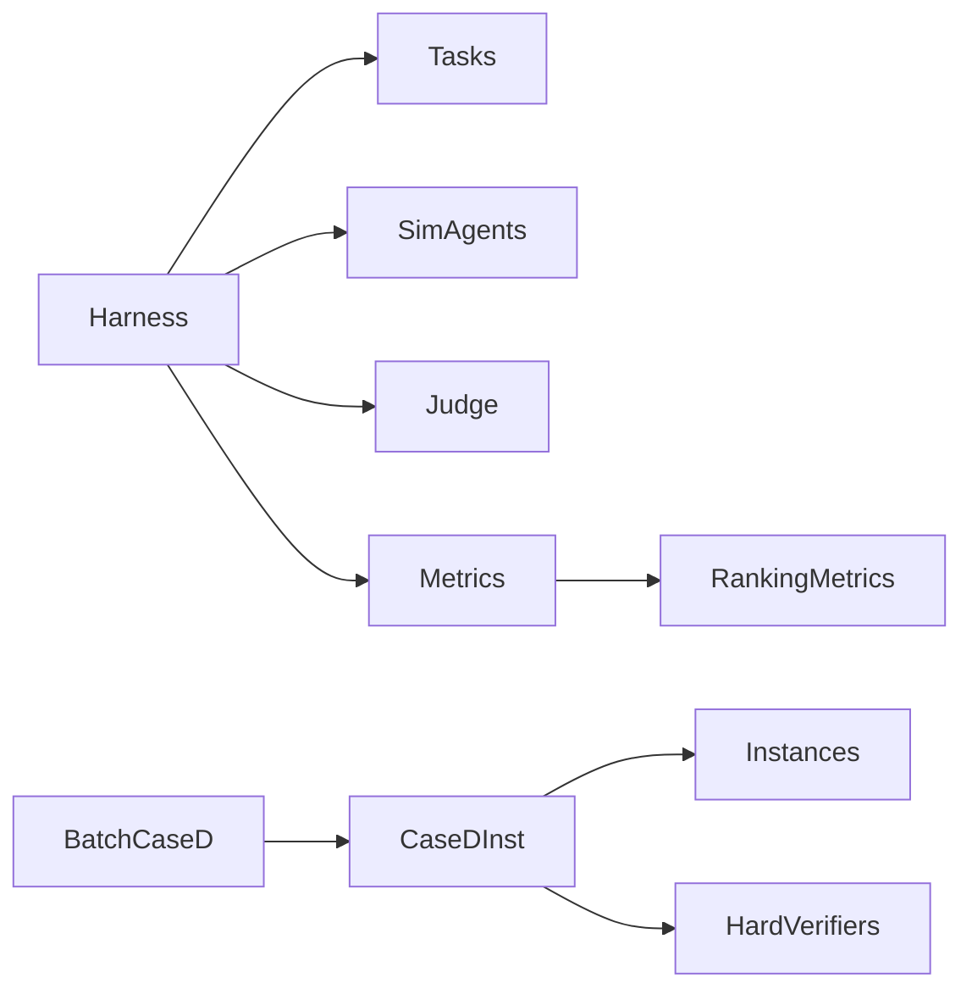

# 迭代优化工作流

<cite>
**本文引用的文件**   
- [autonomy_mvp/core/harness.py](file://autonomy_mvp/core/harness.py)
- [autonomy_mvp/core/judge.py](file://autonomy_mvp/core/judge.py)
- [autonomy_mvp/core/metrics.py](file://autonomy_mvp/core/metrics.py)
- [autonomy_mvp/core/ranking_metrics.py](file://autonomy_mvp/core/ranking_metrics.py)
- [autonomy_mvp/core/sim_agents.py](file://autonomy_mvp/core/sim_agents.py)
- [autonomy_mvp/core/tasks.py](file://autonomy_mvp/core/tasks.py)
- [autonomy_mvp/tasks/materials_semiconductor_bandgap.json](file://autonomy_mvp/tasks/materials_semiconductor_bandgap.json)
- [longhorizon/instantiate/caseD_instantiate.py](file://longhorizon/instantiate/caseD_instantiate.py)
- [longhorizon/instantiate/batch_caseD.py](file://longhorizon/instantiate/batch_caseD.py)
- [longhorizon/verifiers/hard_verifiers.py](file://longhorizon/verifiers/hard_verifiers.py)
- [longhorizon/caseD_材料闭环优化_BaTiO.md](file://longhorizon/caseD_材料闭环优化_BaTiO.md)
- [longhorizon/instantiate/instances/mat1_Ca-Si-O_funnel.json](file://longhorizon/instantiate/instances/mat1_Ca-Si-O_funnel.json)
- [longhorizon/instantiate/instances/mat1_Li-Fe-O_funnel.json](file://longhorizon/instantiate/instances/mat1_Li-Fe-O_funnel.json)
- [longhorizon/instantiate/instances/mat1_Na-Nb-O_funnel.json](file://longhorizon/instantiate/instances/mat1_Na-Nb-O_funnel.json)
- [longhorizon/instantiate/instances/mat1_superconductor_premium.json](file://longhorizon/instantiate/instances/mat1_superconductor_premium.json)
</cite>

## 目录
1. [引言](#引言)
2. [项目结构](#项目结构)
3. [核心组件](#核心组件)
4. [架构总览](#架构总览)
5. [详细组件分析](#详细组件分析)
6. [依赖关系分析](#依赖关系分析)
7. [性能与收敛性考虑](#性能与收敛性考虑)
8. [故障排查指南](#故障排查指南)
9. [结论](#结论)
10. [附录](#附录)

## 引言
本教程面向希望在复杂科学问题中构建“基于反馈循环的自动优化”工作流的工程师与研究者。我们将以材料性能优化为实际案例，系统讲解如何定义目标函数、设置收敛条件、设计参数空间探索策略，并建立结果验证机制。通过仓库中的自动化执行框架、任务编排与验证器实现，读者可以复现从“问题建模—迭代优化—收敛判定—结果验证”的完整闭环。

## 项目结构
围绕“迭代优化工作流”，仓库中与闭环优化最相关的代码集中在以下位置：
- 自动化执行与评测框架：autonomy_mvp/core 下的 harness、judge、metrics、ranking_metrics、sim_agents、tasks
- 材料半导体带隙任务配置：autonomy_mvp/tasks/materials_semiconductor_bandgap.json
- 材料闭环优化（caseD）实例化与批处理脚本：longhorizon/instantiate/caseD_instantiate.py、batch_caseD.py
- 硬验证器（用于结果校验）：longhorizon/verifiers/hard_verifiers.py
- 案例说明文档：longhorizon/caseD_材料闭环优化_BaTiO.md
- 材料漏斗/超导体等实例数据：longhorizon/instantiate/instances/*.json

图表来源
- [autonomy_mvp/core/harness.py](file://autonomy_mvp/core/harness.py)
- [autonomy_mvp/core/judge.py](file://autonomy_mvp/core/judge.py)
- [autonomy_mvp/core/metrics.py](file://autonomy_mvp/core/metrics.py)
- [autonomy_mvp/core/ranking_metrics.py](file://autonomy_mvp/core/ranking_metrics.py)
- [autonomy_mvp/core/sim_agents.py](file://autonomy_mvp/core/sim_agents.py)
- [autonomy_mvp/core/tasks.py](file://autonomy_mvp/core/tasks.py)
- [autonomy_mvp/tasks/materials_semiconductor_bandgap.json](file://autonomy_mvp/tasks/materials_semiconductor_bandgap.json)
- [longhorizon/instantiate/caseD_instantiate.py](file://longhorizon/instantiate/caseD_instantiate.py)
- [longhorizon/instantiate/batch_caseD.py](file://longhorizon/instantiate/batch_caseD.py)
- [longhorizon/verifiers/hard_verifiers.py](file://longhorizon/verifiers/hard_verifiers.py)
- [longhorizon/caseD_材料闭环优化_BaTiO.md](file://longhorizon/caseD_材料闭环优化_BaTiO.md)
- [longhorizon/instantiate/instances/mat1_Ca-Si-O_funnel.json](file://longhorizon/instantiate/instances/mat1_Ca-Si-O_funnel.json)
- [longhorizon/instantiate/instances/mat1_Li-Fe-O_funnel.json](file://longhorizon/instantiate/instances/mat1_Li-Fe-O_funnel.json)
- [longhorizon/instantiate/instances/mat1_Na-Nb-O_funnel.json](file://longhorizon/instantiate/instances/mat1_Na-Nb-O_funnel.json)
- [longhorizon/instantiate/instances/mat1_superconductor_premium.json](file://longhorizon/instantiate/instances/mat1_superconductor_premium.json)

章节来源
- [autonomy_mvp/core/harness.py](file://autonomy_mvp/core/harness.py)
- [autonomy_mvp/core/judge.py](file://autonomy_mvp/core/judge.py)
- [autonomy_mvp/core/metrics.py](file://autonomy_mvp/core/metrics.py)
- [autonomy_mvp/core/ranking_metrics.py](file://autonomy_mvp/core/ranking_metrics.py)
- [autonomy_mvp/core/sim_agents.py](file://autonomy_mvp/core/sim_agents.py)
- [autonomy_mvp/core/tasks.py](file://autonomy_mvp/core/tasks.py)
- [autonomy_mvp/tasks/materials_semiconductor_bandgap.json](file://autonomy_mvp/tasks/materials_semiconductor_bandgap.json)
- [longhorizon/instantiate/caseD_instantiate.py](file://longhorizon/instantiate/caseD_instantiate.py)
- [longhorizon/instantiate/batch_caseD.py](file://longhorizon/instantiate/batch_caseD.py)
- [longhorizon/verifiers/hard_verifiers.py](file://longhorizon/verifiers/hard_verifiers.py)
- [longhorizon/caseD_材料闭环优化_BaTiO.md](file://longhorizon/caseD_材料闭环优化_BaTiO.md)
- [longhorizon/instantiate/instances/mat1_Ca-Si-O_funnel.json](file://longhorizon/instantiate/instances/mat1_Ca-Si-O_funnel.json)
- [longhorizon/instantiate/instances/mat1_Li-Fe-O_funnel.json](file://longhorizon/instantiate/instances/mat1_Li-Fe-O_funnel.json)
- [longhorizon/instantiate/instances/mat1_Na-Nb-O_funnel.json](file://longhorizon/instantiate/instances/mat1_Na-Nb-O_funnel.json)
- [longhorizon/instantiate/instances/mat1_superconductor_premium.json](file://longhorizon/instantiate/instances/mat1_superconductor_premium.json)

## 核心组件
本节聚焦于支撑“迭代优化工作流”的关键模块及其职责边界。

- 执行编排（Harness）
  - 负责加载任务、驱动仿真代理、组织评估与记录流程，是闭环优化的主控制器。
  - 典型职责：初始化环境、调度步骤、收集指标、触发收敛判断与终止。
  
- 评判器（Judge）
  - 对候选方案进行质量打分或合格性判定，提供可比较的标量或结构化评分。
  
- 指标体系（Metrics/Ranking Metrics）
  - 定义目标函数与辅助指标，包括单目标/多目标度量、排序指标等，用于指导搜索方向。
  
- 仿真代理（Sim Agents）
  - 封装具体求解器或外部工具调用，将“参数空间探索策略”落地为可执行的实验步骤。
  
- 任务定义（Tasks）
  - 描述问题输入、约束、目标与评估协议；材料半导体带隙任务即在此处声明。
  
- 材料闭环优化（CaseD）
  - 针对特定材料体系（如 BaTiO 相关）的实例化脚本与批处理脚本，串联“生成—评估—筛选—再优化”的闭环。
  
- 硬验证器（Hard Verifiers）
  - 在最终阶段对结果进行严格校验，确保物理一致性、格式正确性与指标可达性。

章节来源
- [autonomy_mvp/core/harness.py](file://autonomy_mvp/core/harness.py)
- [autonomy_mvp/core/judge.py](file://autonomy_mvp/core/judge.py)
- [autonomy_mvp/core/metrics.py](file://autonomy_mvp/core/metrics.py)
- [autonomy_mvp/core/ranking_metrics.py](file://autonomy_mvp/core/ranking_metrics.py)
- [autonomy_mvp/core/sim_agents.py](file://autonomy_mvp/core/sim_agents.py)
- [autonomy_mvp/core/tasks.py](file://autonomy_mvp/core/tasks.py)
- [longhorizon/instantiate/caseD_instantiate.py](file://longhorizon/instantiate/caseD_instantiate.py)
- [longhorizon/instantiate/batch_caseD.py](file://longhorizon/instantiate/batch_caseD.py)
- [longhorizon/verifiers/hard_verifiers.py](file://longhorizon/verifiers/hard_verifiers.py)

## 架构总览
下图展示了“迭代优化工作流”的整体架构与数据流向：从任务定义到执行编排，再到指标计算、收敛判断与结果验证。

图表来源
- [autonomy_mvp/core/harness.py](file://autonomy_mvp/core/harness.py)
- [autonomy_mvp/core/tasks.py](file://autonomy_mvp/core/tasks.py)
- [autonomy_mvp/core/sim_agents.py](file://autonomy_mvp/core/sim_agents.py)
- [autonomy_mvp/core/judge.py](file://autonomy_mvp/core/judge.py)
- [autonomy_mvp/core/metrics.py](file://autonomy_mvp/core/metrics.py)
- [autonomy_mvp/core/ranking_metrics.py](file://autonomy_mvp/core/ranking_metrics.py)
- [longhorizon/verifiers/hard_verifiers.py](file://longhorizon/verifiers/hard_verifiers.py)

## 详细组件分析

### 执行编排（Harness）与任务（Tasks）
- 角色定位
  - Harness 作为主控制器，协调 Tasks、Agents、Judge、Metrics 的协作，管理迭代生命周期。
  - Tasks 提供问题描述、输入数据、约束与评估协议；材料半导体带隙任务即由该模块加载。
- 关键流程
  - 初始化：解析任务配置，准备环境与缓存。
  - 迭代：驱动 Agent 生成候选，调用 Judge 与 Metrics 进行评估，更新状态。
  - 收敛：依据阈值、步数或改进幅度停止。
  - 输出：汇总最优解与过程日志。
- 与材料任务的衔接
  - 通过 materials_semiconductor_bandgap.json 指定材料体系、目标属性（如带隙）、搜索范围与评估方式。

图表来源
- [autonomy_mvp/core/harness.py](file://autonomy_mvp/core/harness.py)
- [autonomy_mvp/core/tasks.py](file://autonomy_mvp/core/tasks.py)
- [autonomy_mvp/tasks/materials_semiconductor_bandgap.json](file://autonomy_mvp/tasks/materials_semiconductor_bandgap.json)

章节来源
- [autonomy_mvp/core/harness.py](file://autonomy_mvp/core/harness.py)
- [autonomy_mvp/core/tasks.py](file://autonomy_mvp/core/tasks.py)
- [autonomy_mvp/tasks/materials_semiconductor_bandgap.json](file://autonomy_mvp/tasks/materials_semiconductor_bandgap.json)

### 评判器（Judge）与指标（Metrics/Ranking Metrics）
- 目标函数与辅助指标
  - Judge 提供统一的质量评估接口，支持单目标或多目标聚合。
  - Metrics 定义具体的数值指标（如带隙大小、稳定性、合成可行性等），Ranking Metrics 提供排序与选择策略。
- 收敛条件
  - 常见策略：最大迭代次数、目标值阈值、连续若干步无显著改进、置信区间收敛等。
- 与 Agent 的耦合
  - Agent 根据指标反馈调整采样分布或搜索区域，形成“评估—反馈—再采样”的闭环。

图表来源
- [autonomy_mvp/core/judge.py](file://autonomy_mvp/core/judge.py)
- [autonomy_mvp/core/metrics.py](file://autonomy_mvp/core/metrics.py)
- [autonomy_mvp/core/ranking_metrics.py](file://autonomy_mvp/core/ranking_metrics.py)

章节来源
- [autonomy_mvp/core/judge.py](file://autonomy_mvp/core/judge.py)
- [autonomy_mvp/core/metrics.py](file://autonomy_mvp/core/metrics.py)
- [autonomy_mvp/core/ranking_metrics.py](file://autonomy_mvp/core/ranking_metrics.py)

### 仿真代理（Sim Agents）与参数空间探索
- 代理职责
  - 封装材料计算/模拟工具，将“参数空间探索策略”转化为可执行的实验序列。
- 探索策略
  - 随机采样、网格搜索、贝叶斯优化、启发式规则等；可根据指标反馈动态调整步长与范围。
- 与任务配置的对接
  - 通过任务配置文件限定元素组合、结构类型、计算精度与资源限制。

图表来源
- [autonomy_mvp/core/sim_agents.py](file://autonomy_mvp/core/sim_agents.py)
- [autonomy_mvp/core/tasks.py](file://autonomy_mvp/core/tasks.py)

章节来源
- [autonomy_mvp/core/sim_agents.py](file://autonomy_mvp/core/sim_agents.py)
- [autonomy_mvp/core/tasks.py](file://autonomy_mvp/core/tasks.py)

### 材料闭环优化（CaseD）与批处理
- CaseD 实例化脚本
  - 负责加载材料实例（如 Ca-Si-O、Li-Fe-O、Na-Nb-O、超导体等），设定优化目标与约束，启动迭代流程。
- 批处理脚本
  - 并行或串行运行多个材料体系的优化任务，汇总结果与对比分析。
- 与硬验证器的集成
  - 在最终阶段调用 hard_verifiers 对结果进行严格校验，确保物理一致性与格式合规。

图表来源
- [longhorizon/instantiate/batch_caseD.py](file://longhorizon/instantiate/batch_caseD.py)
- [longhorizon/instantiate/caseD_instantiate.py](file://longhorizon/instantiate/caseD_instantiate.py)
- [longhorizon/instantiate/instances/mat1_Ca-Si-O_funnel.json](file://longhorizon/instantiate/instances/mat1_Ca-Si-O_funnel.json)
- [longhorizon/instantiate/instances/mat1_Li-Fe-O_funnel.json](file://longhorizon/instantiate/instances/mat1_Li-Fe-O_funnel.json)
- [longhorizon/instantiate/instances/mat1_Na-Nb-O_funnel.json](file://longhorizon/instantiate/instances/mat1_Na-Nb-O_funnel.json)
- [longhorizon/instantiate/instances/mat1_superconductor_premium.json](file://longhorizon/instantiate/instances/mat1_superconductor_premium.json)
- [longhorizon/verifiers/hard_verifiers.py](file://longhorizon/verifiers/hard_verifiers.py)

章节来源
- [longhorizon/instantiate/caseD_instantiate.py](file://longhorizon/instantiate/caseD_instantiate.py)
- [longhorizon/instantiate/batch_caseD.py](file://longhorizon/instantiate/batch_caseD.py)
- [longhorizon/instantiate/instances/mat1_Ca-Si-O_funnel.json](file://longhorizon/instantiate/instances/mat1_Ca-Si-O_funnel.json)
- [longhorizon/instantiate/instances/mat1_Li-Fe-O_funnel.json](file://longhorizon/instantiate/instances/mat1_Li-Fe-O_funnel.json)
- [longhorizon/instantiate/instances/mat1_Na-Nb-O_funnel.json](file://longhorizon/instantiate/instances/mat1_Na-Nb-O_funnel.json)
- [longhorizon/instantiate/instances/mat1_superconductor_premium.json](file://longhorizon/instantiate/instances/mat1_superconductor_premium.json)
- [longhorizon/verifiers/hard_verifiers.py](file://longhorizon/verifiers/hard_verifiers.py)

### 案例说明文档（BaTiO 材料闭环优化）
- 文档内容
  - 阐述 BaTiO 相关材料的优化目标、参数空间、收敛策略与验证方法。
  - 提供实践建议与常见问题解答，帮助快速上手闭环优化。
- 使用方式
  - 结合 caseD 实例化脚本与硬验证器，按文档指引完成端到端实验。

章节来源
- [longhorizon/caseD_材料闭环优化_BaTiO.md](file://longhorizon/caseD_材料闭环优化_BaTiO.md)

## 依赖关系分析
- 模块耦合
  - Harness 强依赖 Tasks、Agents、Judge、Metrics；Ranking Metrics 依赖 Metrics。
  - CaseD 实例化脚本依赖材料实例 JSON 与硬验证器。
- 外部依赖
  - 仿真代理可能调用外部计算工具或数据库；需确保环境可用与权限正确。
- 潜在循环依赖
  - 应避免 Metrics 反向依赖 Agents；保持单向数据流以提升可维护性。

图表来源
- [autonomy_mvp/core/harness.py](file://autonomy_mvp/core/harness.py)
- [autonomy_mvp/core/tasks.py](file://autonomy_mvp/core/tasks.py)
- [autonomy_mvp/core/sim_agents.py](file://autonomy_mvp/core/sim_agents.py)
- [autonomy_mvp/core/judge.py](file://autonomy_mvp/core/judge.py)
- [autonomy_mvp/core/metrics.py](file://autonomy_mvp/core/metrics.py)
- [autonomy_mvp/core/ranking_metrics.py](file://autonomy_mvp/core/ranking_metrics.py)
- [longhorizon/instantiate/caseD_instantiate.py](file://longhorizon/instantiate/caseD_instantiate.py)
- [longhorizon/instantiate/batch_caseD.py](file://longhorizon/instantiate/batch_caseD.py)
- [longhorizon/verifiers/hard_verifiers.py](file://longhorizon/verifiers/hard_verifiers.py)

章节来源
- [autonomy_mvp/core/harness.py](file://autonomy_mvp/core/harness.py)
- [autonomy_mvp/core/tasks.py](file://autonomy_mvp/core/tasks.py)
- [autonomy_mvp/core/sim_agents.py](file://autonomy_mvp/core/sim_agents.py)
- [autonomy_mvp/core/judge.py](file://autonomy_mvp/core/judge.py)
- [autonomy_mvp/core/metrics.py](file://autonomy_mvp/core/metrics.py)
- [autonomy_mvp/core/ranking_metrics.py](file://autonomy_mvp/core/ranking_metrics.py)
- [longhorizon/instantiate/caseD_instantiate.py](file://longhorizon/instantiate/caseD_instantiate.py)
- [longhorizon/instantiate/batch_caseD.py](file://longhorizon/instantiate/batch_caseD.py)
- [longhorizon/verifiers/hard_verifiers.py](file://longhorizon/verifiers/hard_verifiers.py)

## 性能与收敛性考虑
- 收敛条件设计
  - 绝对阈值：当目标函数达到预设上限/下限时停止。
  - 相对改进：当连续 N 步改进小于 ε 时停止。
  - 时间/预算：限制总迭代次数或计算预算。
- 探索策略调优
  - 初期广域探索（高方差采样），后期精细开发（小步长局部搜索）。
  - 利用历史结果构建代理模型，提高采样效率。
- 并行与缓存
  - 批处理脚本支持并行运行不同材料体系；对重复计算结果进行缓存以减少开销。
- 指标鲁棒性
  - 引入噪声容忍与多次平均，避免过拟合短期波动。

[本节为通用指导，不直接分析具体文件]

## 故障排查指南
- 常见问题
  - 任务配置缺失或字段错误：检查 materials_semiconductor_bandgap.json 与实例 JSON 的必填字段。
  - 外部工具不可用：确认仿真代理所需的环境变量、路径与权限。
  - 指标计算异常：核对 Judge 与 Metrics 的输入输出格式与单位。
  - 收敛过早或过晚：调整阈值、步长与探索策略。
- 诊断手段
  - 启用详细日志，记录每步候选、评分与指标变化。
  - 对硬验证失败的案例进行回溯，定位输入不一致或物理约束违反。
  - 使用 ranking metrics 对比不同策略的效果，辅助策略选择。

章节来源
- [autonomy_mvp/core/judge.py](file://autonomy_mvp/core/judge.py)
- [autonomy_mvp/core/metrics.py](file://autonomy_mvp/core/metrics.py)
- [autonomy_mvp/core/ranking_metrics.py](file://autonomy_mvp/core/ranking_metrics.py)
- [autonomy_mvp/core/sim_agents.py](file://autonomy_mvp/core/sim_agents.py)
- [autonomy_mvp/core/tasks.py](file://autonomy_mvp/core/tasks.py)
- [autonomy_mvp/tasks/materials_semiconductor_bandgap.json](file://autonomy_mvp/tasks/materials_semiconductor_bandgap.json)
- [longhorizon/verifiers/hard_verifiers.py](file://longhorizon/verifiers/hard_verifiers.py)

## 结论
通过将任务定义、执行编排、指标体系、仿真代理与硬验证器有机整合，本仓库提供了构建“基于反馈循环的自动优化”工作流的完整范式。以材料性能优化为例，读者可以据此快速搭建从“目标函数—收敛条件—参数空间探索—结果验证”的闭环系统，并在多材料体系中复用与扩展。

[本节为总结性内容，不直接分析具体文件]

## 附录
- 快速上手清单
  - 准备任务配置与材料实例 JSON
  - 安装并配置仿真代理所需的外部工具
  - 运行 CaseD 实例化脚本，观察迭代过程与指标变化
  - 使用硬验证器对最终结果进行校验
  - 根据结果调整收敛条件与探索策略
- 参考文档
  - 材料闭环优化案例说明（BaTiO）

[本节为补充信息，不直接分析具体文件]