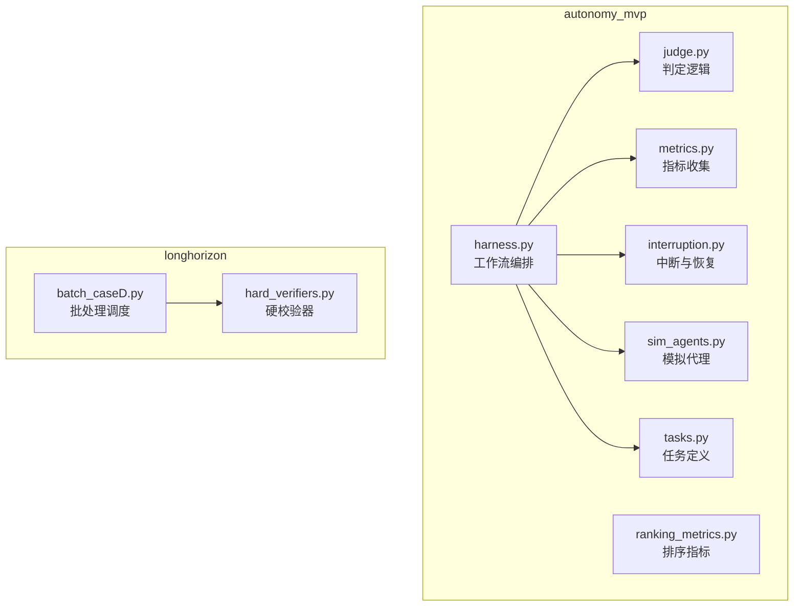
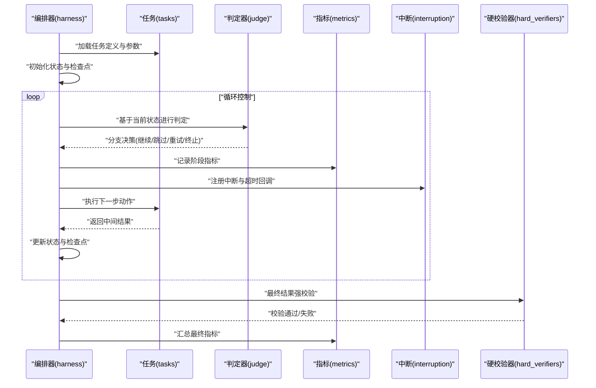
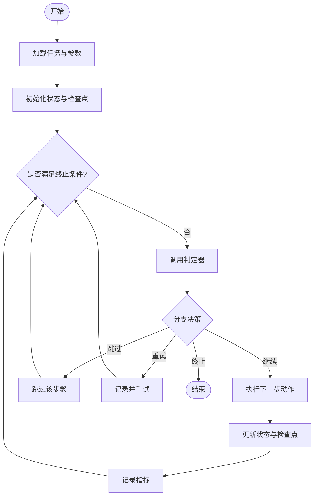
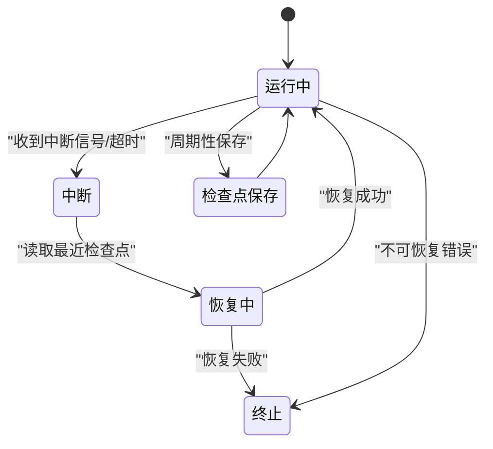
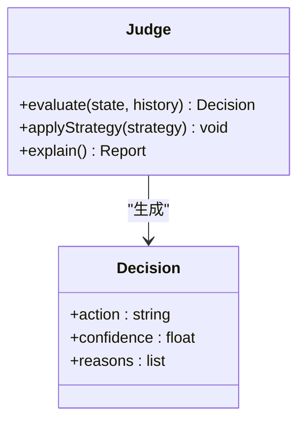
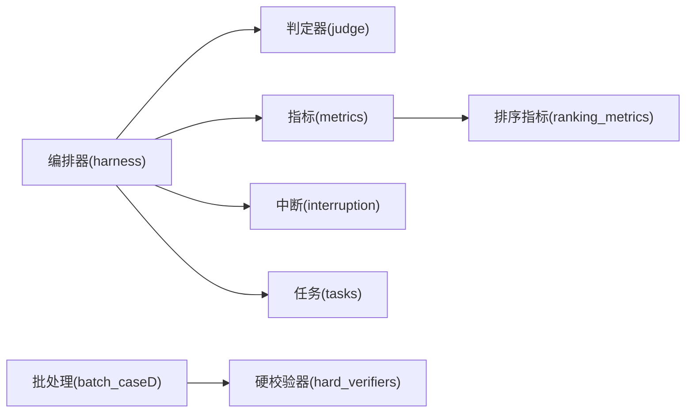

# 高级控制流与错误处理

<cite>
**本文引用的文件**   
- [autonomy_mvp/core/harness.py](file://autonomy_mvp/core/harness.py)
- [autonomy_mvp/core/interruption.py](file://autonomy_mvp/core/interruption.py)
- [autonomy_mvp/core/judge.py](file://autonomy_mvp/core/judge.py)
- [autonomy_mvp/core/metrics.py](file://autonomy_mvp/core/metrics.py)
- [autonomy_mvp/core/ranking_metrics.py](file://autonomy_mvp/core/ranking_metrics.py)
- [autonomy_mvp/core/sim_agents.py](file://autonomy_mvp/core/sim_agents.py)
- [autonomy_mvp/core/tasks.py](file://autonomy_mvp/core/tasks.py)
- [autonomy_mvp/run_validation.py](file://autonomy_mvp/run_validation.py)
- [longhorizon/instantiate/batch_caseD.py](file://longhorizon/instantiate/batch_caseD.py)
- [longhorizon/verifiers/hard_verifiers.py](file://longhorizon/verifiers/hard_verifiers.py)
</cite>

## 目录
1. [简介](#简介)
2. [项目结构](#项目结构)
3. [核心组件](#核心组件)
4. [架构总览](#架构总览)
5. [详细组件分析](#详细组件分析)
6. [依赖关系分析](#依赖关系分析)
7. [性能考量](#性能考量)
8. [故障排查指南](#故障排查指南)
9. [结论](#结论)
10. [附录](#附录)

## 简介
本文件聚焦于工作流的高级控制特性，包括条件分支、循环控制、异常处理与恢复机制，并结合复杂科学计算场景（如药物筛选、材料发现）展示如何实现智能决策路径、动态参数调整与容错执行。文档同时覆盖监控指标收集、日志记录与调试技巧，帮助读者在长周期、高成本任务中构建稳健的自动化流水线。

## 项目结构
仓库包含多个子项目与实验用例，其中与工作流控制相关的关键代码集中在以下模块：
- autonomy_mvp：提供评估与验证框架，包含编排器、中断处理、评判器、指标统计与模拟代理等。
- longhorizon：面向长周期任务的实例化与批处理脚本，以及硬校验器用于结果验证。

图表来源
- [autonomy_mvp/core/harness.py](file://autonomy_mvp/core/harness.py)
- [autonomy_mvp/core/interruption.py](file://autonomy_mvp/core/interruption.py)
- [autonomy_mvp/core/judge.py](file://autonomy_mvp/core/judge.py)
- [autonomy_mvp/core/metrics.py](file://autonomy_mvp/core/metrics.py)
- [autonomy_mvp/core/ranking_metrics.py](file://autonomy_mvp/core/ranking_metrics.py)
- [autonomy_mvp/core/sim_agents.py](file://autonomy_mvp/core/sim_agents.py)
- [autonomy_mvp/core/tasks.py](file://autonomy_mvp/core/tasks.py)
- [longhorizon/instantiate/batch_caseD.py](file://longhorizon/instantiate/batch_caseD.py)
- [longhorizon/verifiers/hard_verifiers.py](file://longhorizon/verifiers/hard_verifiers.py)

章节来源
- [autonomy_mvp/core/harness.py](file://autonomy_mvp/core/harness.py)
- [autonomy_mvp/core/interruption.py](file://autonomy_mvp/core/interruption.py)
- [autonomy_mvp/core/judge.py](file://autonomy_mvp/core/judge.py)
- [autonomy_mvp/core/metrics.py](file://autonomy_mvp/core/metrics.py)
- [autonomy_mvp/core/ranking_metrics.py](file://autonomy_mvp/core/ranking_metrics.py)
- [autonomy_mvp/core/sim_agents.py](file://autonomy_mvp/core/sim_agents.py)
- [autonomy_mvp/core/tasks.py](file://autonomy_mvp/core/tasks.py)
- [longhorizon/instantiate/batch_caseD.py](file://longhorizon/instantiate/batch_caseD.py)
- [longhorizon/verifiers/hard_verifiers.py](file://longhorizon/verifiers/hard_verifiers.py)

## 核心组件
- 工作流编排器：负责串联任务步骤、管理状态机、触发条件分支与循环、捕获异常并执行恢复策略。
- 中断与恢复：支持外部中断信号、超时保护、检查点保存与断点续跑。
- 判定器：根据业务规则或模型输出进行决策，驱动流程进入不同分支。
- 指标收集：采集运行时长、资源占用、成功率、失败原因分布等关键指标。
- 排序指标：对候选方案进行排序与筛选，辅助动态参数调整。
- 模拟代理：在仿真环境中执行动作，便于快速试错与策略迭代。
- 任务定义：描述输入、约束、工具调用与期望输出，作为编排器的可配置单元。
- 批处理调度：批量提交任务实例，管理并发与重试。
- 硬校验器：对最终结果进行强一致性校验，确保数据质量。

章节来源
- [autonomy_mvp/core/harness.py](file://autonomy_mvp/core/harness.py)
- [autonomy_mvp/core/interruption.py](file://autonomy_mvp/core/interruption.py)
- [autonomy_mvp/core/judge.py](file://autonomy_mvp/core/judge.py)
- [autonomy_mvp/core/metrics.py](file://autonomy_mvp/core/metrics.py)
- [autonomy_mvp/core/ranking_metrics.py](file://autonomy_mvp/core/ranking_metrics.py)
- [autonomy_mvp/core/sim_agents.py](file://autonomy_mvp/core/sim_agents.py)
- [autonomy_mvp/core/tasks.py](file://autonomy_mvp/core/tasks.py)
- [longhorizon/instantiate/batch_caseD.py](file://longhorizon/instantiate/batch_caseD.py)
- [longhorizon/verifiers/hard_verifiers.py](file://longhorizon/verifiers/hard_verifiers.py)

## 架构总览
下图展示了从任务实例到执行、判定、指标收集与恢复的整体流程。编排器协调各组件，形成闭环控制。

图表来源
- [autonomy_mvp/core/harness.py](file://autonomy_mvp/core/harness.py)
- [autonomy_mvp/core/judge.py](file://autonomy_mvp/core/judge.py)
- [autonomy_mvp/core/metrics.py](file://autonomy_mvp/core/metrics.py)
- [autonomy_mvp/core/interruption.py](file://autonomy_mvp/core/interruption.py)
- [autonomy_mvp/core/tasks.py](file://autonomy_mvp/core/tasks.py)
- [longhorizon/verifiers/hard_verifiers.py](file://longhorizon/verifiers/hard_verifiers.py)

## 详细组件分析

### 编排器（harness）
- 职责：维护工作流状态机，驱动条件分支与循环；统一捕获异常并触发恢复；聚合指标与日志。
- 关键点：
  - 条件分支：依据判定器输出选择后续步骤，支持短路、回退与旁路。
  - 循环控制：支持固定次数与自适应终止（收敛阈值、最大步数）。
  - 异常处理：区分可恢复与不可恢复错误，结合检查点进行断点续跑。
  - 动态参数：根据历史指标与排序结果调整超参（如采样规模、温度、阈值）。
  - 监控：记录每步耗时、资源使用、成功/失败计数与原因分类。

图表来源
- [autonomy_mvp/core/harness.py](file://autonomy_mvp/core/harness.py)
- [autonomy_mvp/core/judge.py](file://autonomy_mvp/core/judge.py)
- [autonomy_mvp/core/metrics.py](file://autonomy_mvp/core/metrics.py)

章节来源
- [autonomy_mvp/core/harness.py](file://autonomy_mvp/core/harness.py)
- [autonomy_mvp/core/judge.py](file://autonomy_mvp/core/judge.py)
- [autonomy_mvp/core/metrics.py](file://autonomy_mvp/core/metrics.py)

### 中断与恢复（interruption）
- 职责：监听外部中断信号、实现超时保护、保存检查点、支持断点续跑。
- 关键点：
  - 信号处理：优雅退出，避免数据损坏。
  - 超时控制：为昂贵操作设置上限，防止长时间阻塞。
  - 检查点：周期性持久化状态，支持失败后从最近检查点恢复。
  - 恢复策略：按错误类型选择重试、降级或终止。

图表来源
- [autonomy_mvp/core/interruption.py](file://autonomy_mvp/core/interruption.py)

章节来源
- [autonomy_mvp/core/interruption.py](file://autonomy_mvp/core/interruption.py)

### 判定器（judge）
- 职责：根据当前状态与历史结果进行决策，输出分支指令。
- 关键点：
  - 规则引擎：组合阈值、启发式规则与模型评分。
  - 可插拔策略：支持多套判定策略切换。
  - 可解释性：输出决策依据与置信度，便于调试与审计。

图表来源
- [autonomy_mvp/core/judge.py](file://autonomy_mvp/core/judge.py)

章节来源
- [autonomy_mvp/core/judge.py](file://autonomy_mvp/core/judge.py)

### 指标收集（metrics）
- 职责：采集运行期指标，支持聚合与导出。
- 关键点：
  - 指标类型：计时、计数、分布、直方图。
  - 分层粒度：步骤级、任务级、批次级。
  - 可视化：导出为结构化格式供后续分析。

章节来源
- [autonomy_mvp/core/metrics.py](file://autonomy_mvp/core/metrics.py)

### 排序指标（ranking_metrics）
- 职责：对候选方案进行排序与筛选，支撑动态参数调整。
- 关键点：
  - 多目标权衡：兼顾质量、成本与风险。
  - 自适应阈值：根据历史表现动态调整筛选标准。

章节来源
- [autonomy_mvp/core/ranking_metrics.py](file://autonomy_mvp/core/ranking_metrics.py)

### 模拟代理（sim_agents）
- 职责：在仿真环境中执行动作，快速验证策略。
- 关键点：
  - 环境抽象：屏蔽底层差异，统一接口。
  - 回放能力：记录轨迹以便复现与分析。

章节来源
- [autonomy_mvp/core/sim_agents.py](file://autonomy_mvp/core/sim_agents.py)

### 任务定义（tasks）
- 职责：描述任务输入、约束、工具调用与期望输出。
- 关键点：
  - 声明式配置：便于版本管理与复用。
  - 参数化：支持运行时注入与替换。

章节来源
- [autonomy_mvp/core/tasks.py](file://autonomy_mvp/core/tasks.py)

### 批处理调度（batch_caseD）
- 职责：批量提交任务实例，管理并发与重试。
- 关键点：
  - 并发控制：限制并行度以避免资源争用。
  - 失败隔离：单个任务失败不影响整体批次。
  - 进度追踪：汇总批次级指标与状态。

章节来源
- [longhorizon/instantiate/batch_caseD.py](file://longhorizon/instantiate/batch_caseD.py)

### 硬校验器（hard_verifiers）
- 职责：对最终结果进行强一致性校验，确保数据质量。
- 关键点：
  - 完整性检查：字段存在性与类型正确性。
  - 业务规则：范围、单调性、守恒律等。
  - 失败告警：输出详细错误定位与修复建议。

章节来源
- [longhorizon/verifiers/hard_verifiers.py](file://longhorizon/verifiers/hard_verifiers.py)

## 依赖关系分析
- 编排器依赖判定器、指标收集、中断与任务定义。
- 批处理调度依赖硬校验器进行结果验证。
- 指标与排序指标为编排器与批处理提供观测与优化依据。

图表来源
- [autonomy_mvp/core/harness.py](file://autonomy_mvp/core/harness.py)
- [autonomy_mvp/core/judge.py](file://autonomy_mvp/core/judge.py)
- [autonomy_mvp/core/metrics.py](file://autonomy_mvp/core/metrics.py)
- [autonomy_mvp/core/interruption.py](file://autonomy_mvp/core/interruption.py)
- [autonomy_mvp/core/tasks.py](file://autonomy_mvp/core/tasks.py)
- [autonomy_mvp/core/ranking_metrics.py](file://autonomy_mvp/core/ranking_metrics.py)
- [longhorizon/instantiate/batch_caseD.py](file://longhorizon/instantiate/batch_caseD.py)
- [longhorizon/verifiers/hard_verifiers.py](file://longhorizon/verifiers/hard_verifiers.py)

章节来源
- [autonomy_mvp/core/harness.py](file://autonomy_mvp/core/harness.py)
- [autonomy_mvp/core/judge.py](file://autonomy_mvp/core/judge.py)
- [autonomy_mvp/core/metrics.py](file://autonomy_mvp/core/metrics.py)
- [autonomy_mvp/core/interruption.py](file://autonomy_mvp/core/interruption.py)
- [autonomy_mvp/core/tasks.py](file://autonomy_mvp/core/tasks.py)
- [autonomy_mvp/core/ranking_metrics.py](file://autonomy_mvp/core/ranking_metrics.py)
- [longhorizon/instantiate/batch_caseD.py](file://longhorizon/instantiate/batch_caseD.py)
- [longhorizon/verifiers/hard_verifiers.py](file://longhorizon/verifiers/hard_verifiers.py)

## 性能考量
- 并发与资源：合理设置并行度，避免CPU/内存/IO瓶颈；对昂贵操作采用异步与缓存。
- 早停与剪枝：基于排序指标与阈值提前终止低价值分支，降低计算开销。
- 增量计算：利用检查点与中间结果减少重复计算。
- 监控与调优：持续观察指标，识别热点与抖动，动态调整参数。

## 故障排查指南
- 常见问题：
  - 中断导致的数据不一致：确认检查点写入原子性与幂等性。
  - 判定器误判：审查决策依据与置信度，必要时引入更多特征或放宽阈值。
  - 指标缺失：检查指标埋点位置与粒度，确保关键路径均有记录。
  - 批处理卡住：查看并发限制与资源竞争，适当降低并行度或增加超时。
- 调试技巧：
  - 启用详细日志与轨迹回放，定位失败步骤。
  - 使用最小可复现实例缩小问题范围。
  - 对比历史成功轨迹，识别偏差来源。

章节来源
- [autonomy_mvp/core/interruption.py](file://autonomy_mvp/core/interruption.py)
- [autonomy_mvp/core/judge.py](file://autonomy_mvp/core/judge.py)
- [autonomy_mvp/core/metrics.py](file://autonomy_mvp/core/metrics.py)
- [longhorizon/instantiate/batch_caseD.py](file://longhorizon/instantiate/batch_caseD.py)
- [longhorizon/verifiers/hard_verifiers.py](file://longhorizon/verifiers/hard_verifiers.py)

## 结论
通过编排器、判定器、中断与恢复、指标收集与排序指标的组合，可在复杂科学计算场景中实现智能决策路径、动态参数调整与容错执行。配合批处理调度与硬校验器，能够保障大规模任务的高可用与高质量输出。持续的监控与调试实践是提升系统稳定性的关键。

## 附录
- 最佳实践：
  - 将任务定义为可配置单元，便于版本管理与复用。
  - 为每个关键步骤埋点指标，确保可观测性。
  - 设计可插拔的判定策略，支持A/B测试与快速迭代。
  - 建立完善的检查点与恢复机制，提高鲁棒性。
- 参考入口：
  - 验证脚本：[run_validation.py](file://autonomy_mvp/run_validation.py)

章节来源
- [autonomy_mvp/run_validation.py](file://autonomy_mvp/run_validation.py)