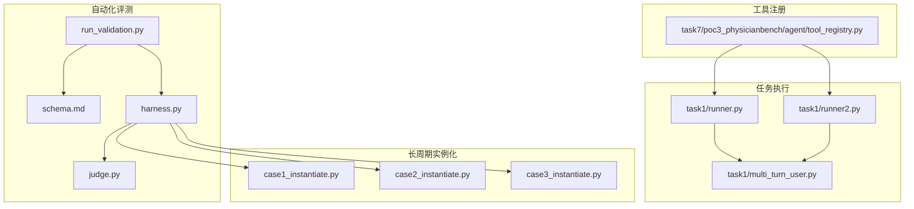
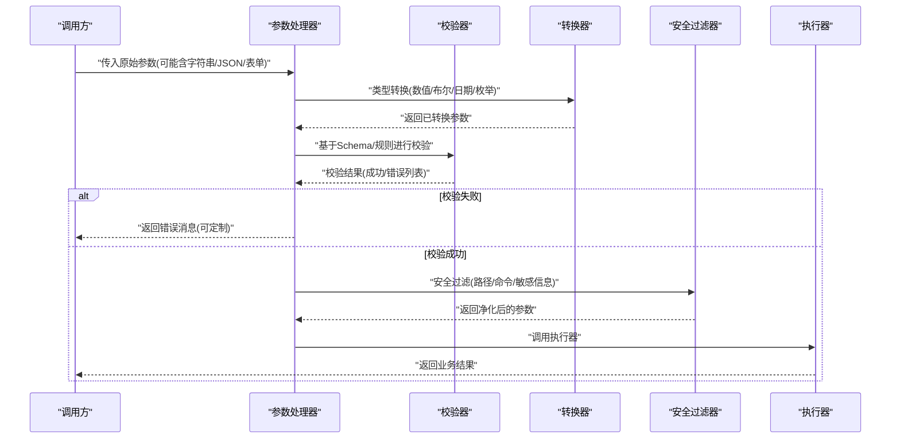
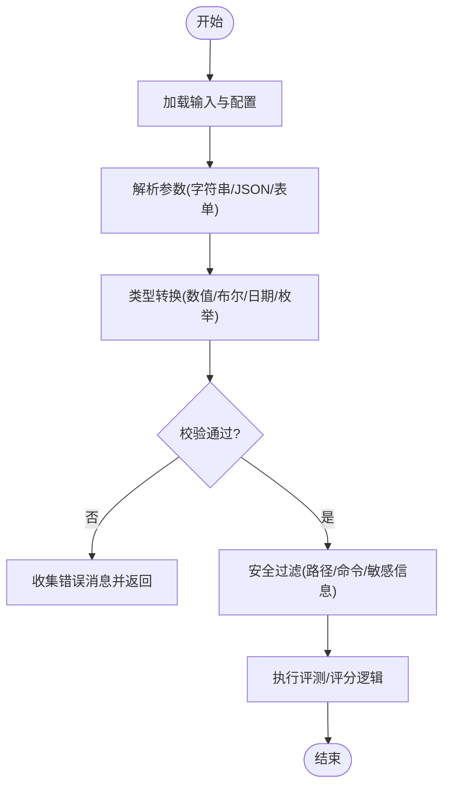
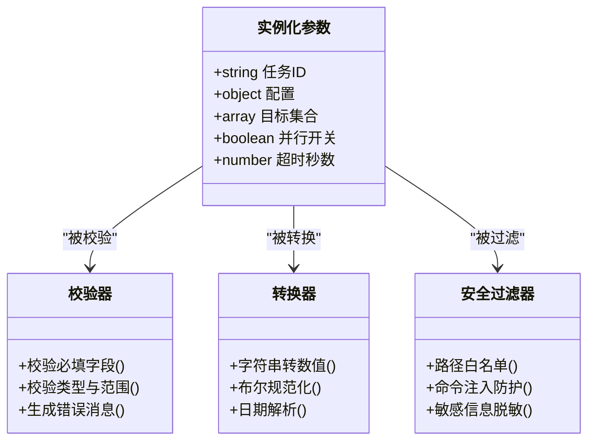
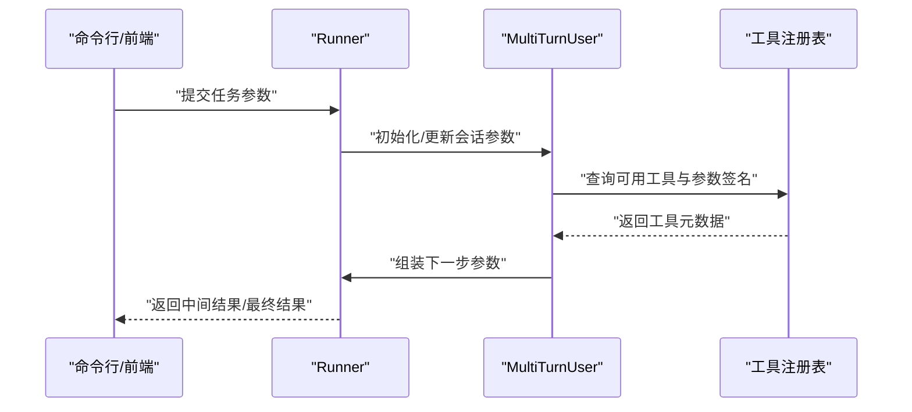
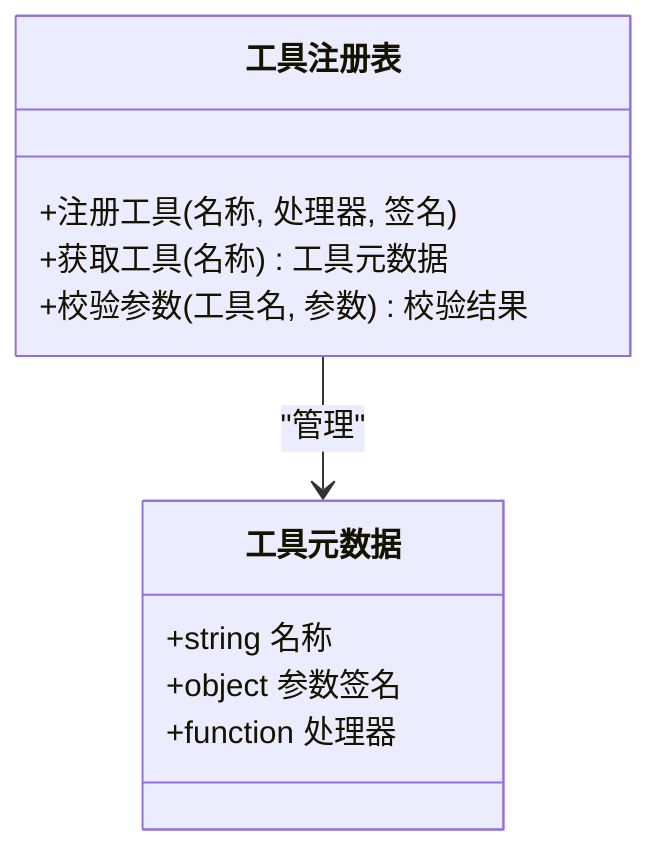
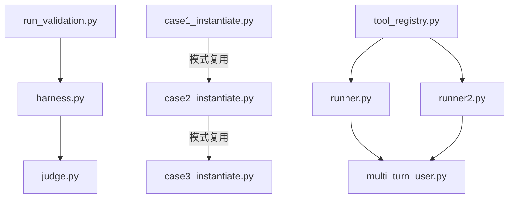

# 参数处理与验证

<cite>
**本文引用的文件**   
- [autonomy_mvp/core/harness.py](file://autonomy_mvp/core/harness.py)
- [autonomy_mvp/core/judge.py](file://autonomy_mvp/core/judge.py)
- [autonomy_mvp/run_validation.py](file://autonomy_mvp/run_validation.py)
- [autonomy_mvp/schema.md](file://autonomy_mvp/schema.md)
- [longhorizon/instantiate/case1_instantiate.py](file://longhorizon/instantiate/case1_instantiate.py)
- [longhorizon/instantiate/case2_instantiate.py](file://longhorizon/instantiate/case2_instantiate.py)
- [longhorizon/instantiate/case3_instantiate.py](file://longhorizon/instantiate/case3_instantiate.py)
- [task1/runner.py](file://task1/runner.py)
- [task1/runner2.py](file://task1/runner2.py)
- [task1/multi_turn_user.py](file://task1/multi_turn_user.py)
- [task7/poc3_physicianbench/agent/tool_registry.py](file://task7/poc3_physicianbench/agent/tool_registry.py)
</cite>

## 目录
1. [简介](#简介)
2. [项目结构](#项目结构)
3. [核心组件](#核心组件)
4. [架构总览](#架构总览)
5. [详细组件分析](#详细组件分析)
6. [依赖关系分析](#依赖关系分析)
7. [性能考量](#性能考量)
8. [故障排查指南](#故障排查指南)
9. [结论](#结论)
10. [附录](#附录)

## 简介
本指南聚焦于“参数处理与验证”的完整实践，覆盖输入参数的类型定义、格式校验、默认值处理与类型转换机制。通过仓库中的工具与流程示例，展示复杂参数解析、嵌套对象处理、数组操作等常见场景；并总结参数校验规则、错误消息定制与安全过滤策略，最后给出参数设计模式与性能优化建议。

## 项目结构
仓库包含多个子任务与实验脚本，其中与参数处理与验证相关的代码主要分布在以下位置：
- 自动化评测与校验入口：autonomy_mvp 下的 harness、judge、run_validation 以及 schema 文档
- 长周期实例化脚本：longhorizon/instantiate 下按案例组织的实例化脚本
- 多轮对话与任务执行：task1 下的 runner、multi_turn_user 等
- 工具注册与路由：task7/poc3_physicianbench/agent/tool_registry.py

图表来源
- [autonomy_mvp/core/harness.py](file://autonomy_mvp/core/harness.py)
- [autonomy_mvp/core/judge.py](file://autonomy_mvp/core/judge.py)
- [autonomy_mvp/run_validation.py](file://autonomy_mvp/run_validation.py)
- [autonomy_mvp/schema.md](file://autonomy_mvp/schema.md)
- [longhorizon/instantiate/case1_instantiate.py](file://longhorizon/instantiate/case1_instantiate.py)
- [longhorizon/instantiate/case2_instantiate.py](file://longhorizon/instantiate/case2_instantiate.py)
- [longhorizon/instantiate/case3_instantiate.py](file://longhorizon/instantiate/case3_instantiate.py)
- [task1/runner.py](file://task1/runner.py)
- [task1/runner2.py](file://task1/runner2.py)
- [task1/multi_turn_user.py](file://task1/multi_turn_user.py)
- [task7/poc3_physicianbench/agent/tool_registry.py](file://task7/poc3_physicianbench/agent/tool_registry.py)

章节来源
- [autonomy_mvp/core/harness.py](file://autonomy_mvp/core/harness.py)
- [autonomy_mvp/core/judge.py](file://autonomy_mvp/core/judge.py)
- [autonomy_mvp/run_validation.py](file://autonomy_mvp/run_validation.py)
- [autonomy_mvp/schema.md](file://autonomy_mvp/schema.md)
- [longhorizon/instantiate/case1_instantiate.py](file://longhorizon/instantiate/case1_instantiate.py)
- [longhorizon/instantiate/case2_instantiate.py](file://longhorizon/instantiate/case2_instantiate.py)
- [longhorizon/instantiate/case3_instantiate.py](file://longhorizon/instantiate/case3_instantiate.py)
- [task1/runner.py](file://task1/runner.py)
- [task1/runner2.py](file://task1/runner2.py)
- [task1/multi_turn_user.py](file://task1/multi_turn_user.py)
- [task7/poc3_physicianbench/agent/tool_registry.py](file://task7/poc3_physicianbench/agent/tool_registry.py)

## 核心组件
- 参数定义与校验契约
  - 使用结构化描述（如 JSON Schema）声明参数类型、必填项、取值范围与嵌套结构，作为统一校验依据。
  - 在入口处集中进行类型检查、格式校验与默认值填充，确保下游逻辑仅接收已清洗的参数。
- 参数解析与转换
  - 支持字符串到数值、布尔、日期等类型的自动转换；对数组与嵌套对象进行递归解析与扁平化处理。
- 校验规则与错误消息
  - 为每个字段提供明确的校验规则与可定制的错误消息，便于快速定位问题。
- 安全过滤
  - 对路径、命令注入、敏感信息进行白名单或正则过滤，避免不安全输入进入执行层。

章节来源
- [autonomy_mvp/schema.md](file://autonomy_mvp/schema.md)
- [autonomy_mvp/run_validation.py](file://autonomy_mvp/run_validation.py)
- [autonomy_mvp/core/harness.py](file://autonomy_mvp/core/harness.py)
- [autonomy_mvp/core/judge.py](file://autonomy_mvp/core/judge.py)
- [longhorizon/instantiate/case1_instantiate.py](file://longhorizon/instantiate/case1_instantiate.py)
- [longhorizon/instantiate/case2_instantiate.py](file://longhorizon/instantiate/case2_instantiate.py)
- [longhorizon/instantiate/case3_instantiate.py](file://longhorizon/instantiate/case3_instantiate.py)
- [task1/runner.py](file://task1/runner.py)
- [task1/runner2.py](file://task1/runner2.py)
- [task1/multi_turn_user.py](file://task1/multi_turn_user.py)
- [task7/poc3_physicianbench/agent/tool_registry.py](file://task7/poc3_physicianbench/agent/tool_registry.py)

## 架构总览
下图展示了从外部输入到内部执行的参数处理流水线，包括解析、校验、转换、默认值填充与安全过滤等环节。

图表来源
- [autonomy_mvp/run_validation.py](file://autonomy_mvp/run_validation.py)
- [autonomy_mvp/core/harness.py](file://autonomy_mvp/core/harness.py)
- [autonomy_mvp/core/judge.py](file://autonomy_mvp/core/judge.py)
- [task1/runner.py](file://task1/runner.py)
- [task1/runner2.py](file://task1/runner2.py)
- [task1/multi_turn_user.py](file://task1/multi_turn_user.py)
- [task7/poc3_physicianbench/agent/tool_registry.py](file://task7/poc3_physicianbench/agent/tool_registry.py)

## 详细组件分析

### 组件A：自动化评测参数处理（harness + judge + run_validation）
- 职责分工
  - run_validation：负责加载配置与数据、触发校验流程、汇总结果。
  - harness：编排评测步骤，将参数传递给具体评测逻辑。
  - judge：实现评分与判定逻辑，依赖经校验的参数。
- 关键流程
  - 读取输入（JSON/CSV/命令行），解析为结构化参数。
  - 根据 schema 进行类型与格式校验，生成错误报告。
  - 将清洗后的参数传入评测与评分模块。

图表来源
- [autonomy_mvp/run_validation.py](file://autonomy_mvp/run_validation.py)
- [autonomy_mvp/core/harness.py](file://autonomy_mvp/core/harness.py)
- [autonomy_mvp/core/judge.py](file://autonomy_mvp/core/judge.py)
- [autonomy_mvp/schema.md](file://autonomy_mvp/schema.md)

章节来源
- [autonomy_mvp/run_validation.py](file://autonomy_mvp/run_validation.py)
- [autonomy_mvp/core/harness.py](file://autonomy_mvp/core/harness.py)
- [autonomy_mvp/core/judge.py](file://autonomy_mvp/core/judge.py)
- [autonomy_mvp/schema.md](file://autonomy_mvp/schema.md)

### 组件B：长周期实例化参数处理（case1/case2/case3_instantiate）
- 典型场景
  - 批量实例化任务时，需要解析复杂的嵌套对象（如任务模板、环境配置、资源限制）。
  - 数组参数用于指定多目标或多样本集合，需进行去重与边界检查。
- 处理要点
  - 默认值填充：未提供的可选字段采用合理默认值，保证运行稳定性。
  - 类型转换：将配置文件中的字符串数字转换为整型/浮点型，布尔值规范化。
  - 校验规则：对路径合法性、端口范围、内存/CPU上限等进行约束。

图表来源
- [longhorizon/instantiate/case1_instantiate.py](file://longhorizon/instantiate/case1_instantiate.py)
- [longhorizon/instantiate/case2_instantiate.py](file://longhorizon/instantiate/case2_instantiate.py)
- [longhorizon/instantiate/case3_instantiate.py](file://longhorizon/instantiate/case3_instantiate.py)

章节来源
- [longhorizon/instantiate/case1_instantiate.py](file://longhorizon/instantiate/case1_instantiate.py)
- [longhorizon/instantiate/case2_instantiate.py](file://longhorizon/instantiate/case2_instantiate.py)
- [longhorizon/instantiate/case3_instantiate.py](file://longhorizon/instantiate/case3_instantiate.py)

### 组件C：任务执行与多轮交互（runner/runner2/multi_turn_user）
- 职责分工
  - runner/runner2：负责任务调度与参数传递，聚合多步执行结果。
  - multi_turn_user：管理多轮对话上下文，维护会话级参数状态。
- 参数处理要点
  - 会话参数持久化：在多轮交互中保持必要上下文，避免重复解析。
  - 增量更新：只合并变更字段，减少冗余计算。
  - 错误恢复：对单次失败进行重试或降级，保障整体流程稳定。

图表来源
- [task1/runner.py](file://task1/runner.py)
- [task1/runner2.py](file://task1/runner2.py)
- [task1/multi_turn_user.py](file://task1/multi_turn_user.py)
- [task7/poc3_physicianbench/agent/tool_registry.py](file://task7/poc3_physicianbench/agent/tool_registry.py)

章节来源
- [task1/runner.py](file://task1/runner.py)
- [task1/runner2.py](file://task1/runner2.py)
- [task1/multi_turn_user.py](file://task1/multi_turn_user.py)
- [task7/poc3_physicianbench/agent/tool_registry.py](file://task7/poc3_physicianbench/agent/tool_registry.py)

### 组件D：工具注册与参数签名（tool_registry）
- 作用
  - 集中管理工具元数据与参数签名，为上层提供统一的参数解析与校验接口。
- 关键点
  - 参数签名声明：明确每个工具的输入输出类型、必填项与默认值。
  - 动态绑定：根据工具名解析对应处理器，并应用一致的参数处理流程。

图表来源
- [task7/poc3_physicianbench/agent/tool_registry.py](file://task7/poc3_physicianbench/agent/tool_registry.py)

章节来源
- [task7/poc3_physicianbench/agent/tool_registry.py](file://task7/poc3_physicianbench/agent/tool_registry.py)

## 依赖关系分析
- 组件耦合
  - run_validation 依赖 schema 定义与 harness 编排；harness 依赖 judge 实现。
  - 实例化脚本相互独立，但共享通用的参数处理模式（类型转换、校验、默认值）。
  - runner/runner2 与 multi_turn_user 协作完成多轮交互；tool_registry 为工具调用提供元数据支撑。
- 潜在循环依赖
  - 当前结构未见明显循环依赖；若引入跨模块直接引用，应通过接口抽象解耦。
- 外部依赖
  - 配置文件（JSON/YAML）、命令行参数、HTTP请求体等均为常见外部输入源。

图表来源
- [autonomy_mvp/run_validation.py](file://autonomy_mvp/run_validation.py)
- [autonomy_mvp/core/harness.py](file://autonomy_mvp/core/harness.py)
- [autonomy_mvp/core/judge.py](file://autonomy_mvp/core/judge.py)
- [longhorizon/instantiate/case1_instantiate.py](file://longhorizon/instantiate/case1_instantiate.py)
- [longhorizon/instantiate/case2_instantiate.py](file://longhorizon/instantiate/case2_instantiate.py)
- [longhorizon/instantiate/case3_instantiate.py](file://longhorizon/instantiate/case3_instantiate.py)
- [task1/runner.py](file://task1/runner.py)
- [task1/runner2.py](file://task1/runner2.py)
- [task1/multi_turn_user.py](file://task1/multi_turn_user.py)
- [task7/poc3_physicianbench/agent/tool_registry.py](file://task7/poc3_physicianbench/agent/tool_registry.py)

章节来源
- [autonomy_mvp/run_validation.py](file://autonomy_mvp/run_validation.py)
- [autonomy_mvp/core/harness.py](file://autonomy_mvp/core/harness.py)
- [autonomy_mvp/core/judge.py](file://autonomy_mvp/core/judge.py)
- [longhorizon/instantiate/case1_instantiate.py](file://longhorizon/instantiate/case1_instantiate.py)
- [longhorizon/instantiate/case2_instantiate.py](file://longhorizon/instantiate/case2_instantiate.py)
- [longhorizon/instantiate/case3_instantiate.py](file://longhorizon/instantiate/case3_instantiate.py)
- [task1/runner.py](file://task1/runner.py)
- [task1/runner2.py](file://task1/runner2.py)
- [task1/multi_turn_user.py](file://task1/multi_turn_user.py)
- [task7/poc3_physicianbench/agent/tool_registry.py](file://task7/poc3_physicianbench/agent/tool_registry.py)

## 性能考量
- 批量处理
  - 对大规模数组参数采用流式处理与分片计算，避免一次性加载导致内存峰值过高。
- 缓存与复用
  - 对频繁使用的工具签名与默认值进行缓存，减少重复解析与校验开销。
- 并发控制
  - 在实例化与评测阶段合理使用并发，结合限流与熔断策略，防止系统过载。
- 早失败原则
  - 尽早进行轻量校验（如类型与必填项），快速返回错误，降低后续昂贵操作的概率。

[本节为通用指导，不直接分析具体文件]

## 故障排查指南
- 常见问题
  - 类型不匹配：字符串无法转换为数值或布尔，需检查输入格式与转换规则。
  - 缺失必填字段：根据错误消息定位缺失键，补充后重试。
  - 越界值：数值超出允许范围，调整至合法区间。
  - 安全拦截：路径或命令包含非法字符，遵循白名单或正则规则修正。
- 调试建议
  - 开启详细日志，记录原始输入、转换前后值与校验错误详情。
  - 使用最小复现用例隔离问题，逐步缩小范围。
  - 对复杂嵌套对象，先校验顶层结构，再逐层深入。

章节来源
- [autonomy_mvp/run_validation.py](file://autonomy_mvp/run_validation.py)
- [autonomy_mvp/core/harness.py](file://autonomy_mvp/core/harness.py)
- [autonomy_mvp/core/judge.py](file://autonomy_mvp/core/judge.py)
- [task1/runner.py](file://task1/runner.py)
- [task1/runner2.py](file://task1/runner2.py)
- [task1/multi_turn_user.py](file://task1/multi_turn_user.py)
- [task7/poc3_physicianbench/agent/tool_registry.py](file://task7/poc3_physicianbench/agent/tool_registry.py)

## 结论
通过统一的参数处理与验证流水线，可在复杂场景中保证输入的安全性与一致性。结合 Schema 驱动的类型定义、严格的校验规则、完善的错误消息与安全防护，能够显著提升系统的健壮性与可维护性。建议在新增工具与流程时，沿用现有模式，持续完善参数签名与校验规则，并关注性能与可扩展性。

[本节为总结性内容，不直接分析具体文件]

## 附录
- 参数设计模式
  - 分层校验：基础类型校验 → 业务规则校验 → 安全过滤。
  - 默认值策略：可选字段提供合理默认值，避免空指针与异常。
  - 错误消息定制：按字段维度提供清晰提示，便于用户快速修复。
- 最佳实践
  - 使用结构化描述（如 JSON Schema）统一管理参数契约。
  - 在入口集中处理参数，避免散落各处导致不一致。
  - 对敏感信息与外部路径进行严格白名单与正则校验。
  - 对大数组与嵌套对象进行分批处理与深度限制。

[本节为概念性内容，不直接分析具体文件]