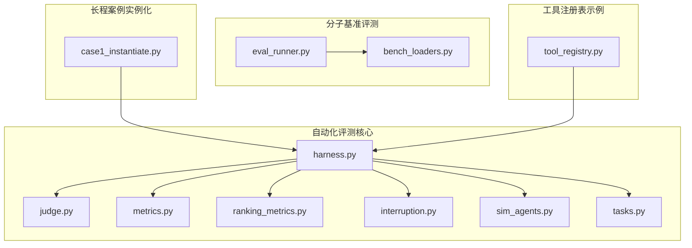
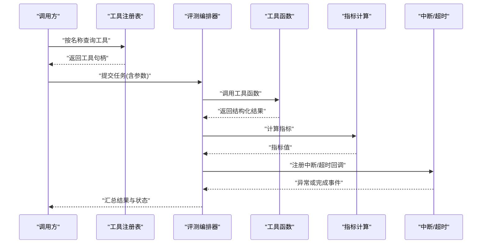
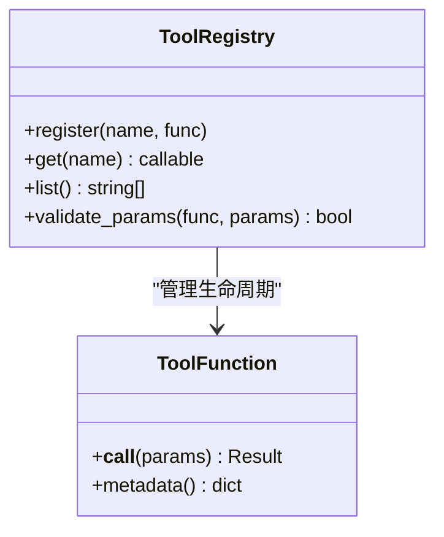
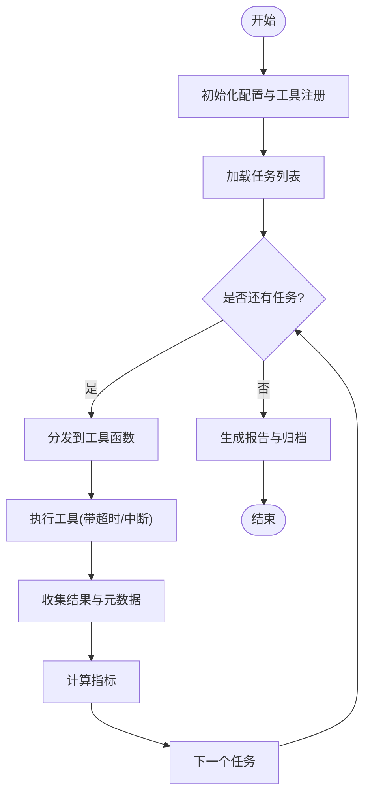
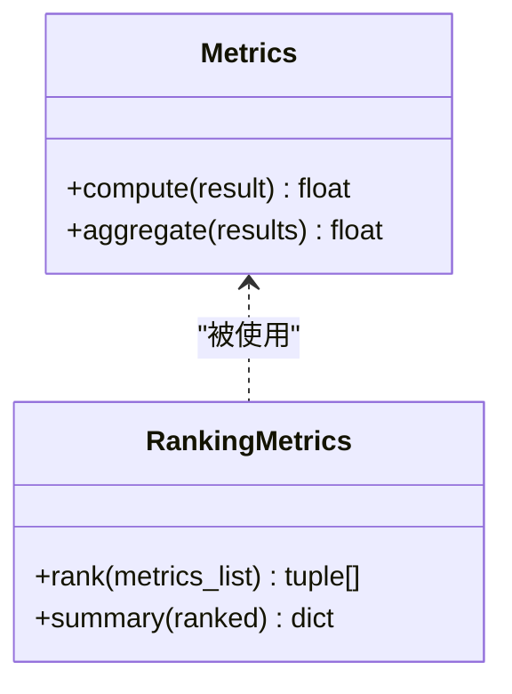
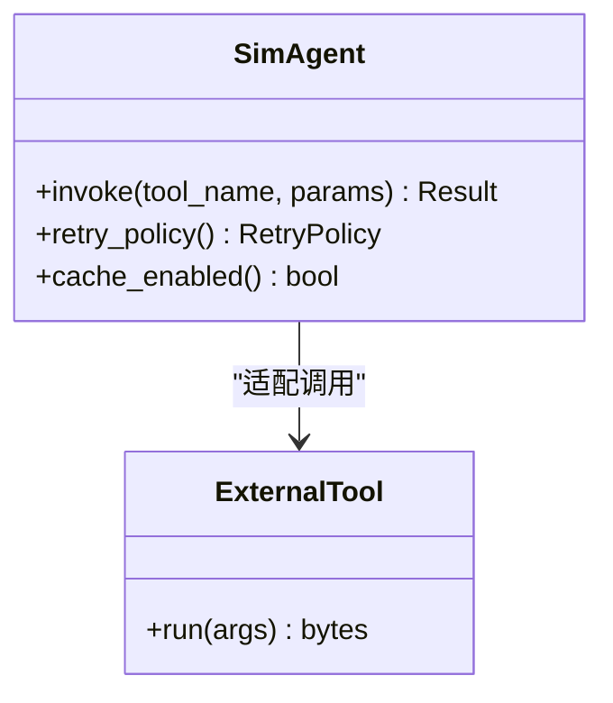
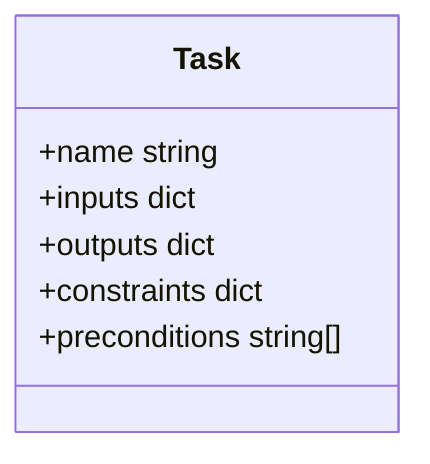
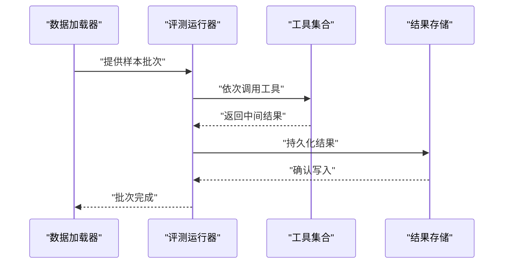
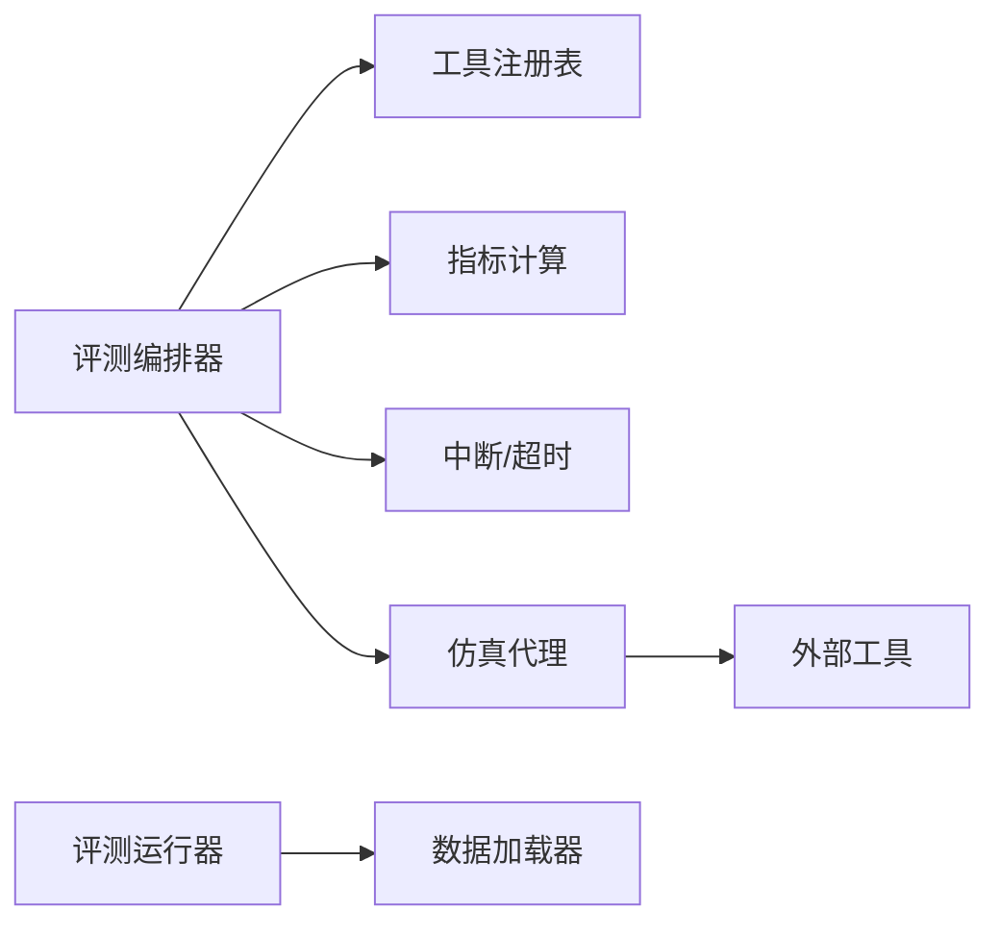

# 工具函数开发

<cite>
**本文引用的文件**   
- [autonomy_mvp/core/harness.py](file://autonomy_mvp/core/harness.py)
- [autonomy_mvp/core/judge.py](file://autonomy_mvp/core/judge.py)
- [autonomy_mvp/core/metrics.py](file://autonomy_mvp/core/metrics.py)
- [autonomy_mvp/core/ranking_metrics.py](file://autonomy_mvp/core/ranking_metrics.py)
- [autonomy_mvp/core/interruption.py](file://autonomy_mvp/core/interruption.py)
- [autonomy_mvp/core/sim_agents.py](file://autonomy_mvp/core/sim_agents.py)
- [autonomy_mvp/core/tasks.py](file://autonomy_mvp/core/tasks.py)
- [autonomy_mvp/tests/test_core.py](file://autonomy_mvp/tests/test_core.py)
- [docs/molbench_repo/eval/bench_loaders.py](file://docs/molbench_repo/eval/bench_loaders.py)
- [docs/molbench_repo/eval/eval_runner.py](file://docs/molbench_repo/eval/eval_runner.py)
- [longhorizon/instantiate/case1_instantiate.py](file://longhorizon/instantiate/case1_instantiate.py)
- [task7/poc3_physicianbench/agent/tool_registry.py](file://task7/poc3_physicianbench/agent/tool_registry.py)
</cite>

## 目录
1. [简介](#简介)
2. [项目结构](#项目结构)
3. [核心组件](#核心组件)
4. [架构总览](#架构总览)
5. [详细组件分析](#详细组件分析)
6. [依赖关系分析](#依赖关系分析)
7. [性能考量](#性能考量)
8. [故障排查指南](#故障排查指南)
9. [结论](#结论)
10. [附录](#附录)

## 简介
本指南面向在科学计算与分子模拟场景中编写“工具函数”的工程师，聚焦于：
- 工具函数的编写规范、参数校验、返回值格式与错误处理机制
- 以分子操作、物理化学计算等典型任务为例，展示从输入到输出的完整流程
- 工程化特性：异步处理、资源管理、日志记录、可观测性与可测试性
- 函数签名设计模式与调试技巧

目标读者包括算法工程师、平台开发者与评测框架维护者。

## 项目结构
仓库包含多个子项目与评测数据集。与“工具函数开发”最相关的代码集中在以下位置：
- 自动化评测核心：autonomy_mvp/core（编排、指标、中断、仿真代理、任务定义）
- 分子基准评测：docs/molbench_repo/eval（数据加载、评测运行器）
- 长程案例实例化：longhorizon/instantiate（用例构造与批处理入口）
- 工具注册表示例：task7/poc3_physicianbench/agent/tool_registry.py（工具发现与路由）

图表来源
- [autonomy_mvp/core/harness.py](file://autonomy_mvp/core/harness.py)
- [autonomy_mvp/core/judge.py](file://autonomy_mvp/core/judge.py)
- [autonomy_mvp/core/metrics.py](file://autonomy_mvp/core/metrics.py)
- [autonomy_mvp/core/ranking_metrics.py](file://autonomy_mvp/core/ranking_metrics.py)
- [autonomy_mvp/core/interruption.py](file://autonomy_mvp/core/interruption.py)
- [autonomy_mvp/core/sim_agents.py](file://autonomy_mvp/core/sim_agents.py)
- [autonomy_mvp/core/tasks.py](file://autonomy_mvp/core/tasks.py)
- [docs/molbench_repo/eval/bench_loaders.py](file://docs/molbench_repo/eval/bench_loaders.py)
- [docs/molbench_repo/eval/eval_runner.py](file://docs/molbench_repo/eval/eval_runner.py)
- [longhorizon/instantiate/case1_instantiate.py](file://longhorizon/instantiate/case1_instantiate.py)
- [task7/poc3_physicianbench/agent/tool_registry.py](file://task7/poc3_physicianbench/agent/tool_registry.py)

章节来源
- [autonomy_mvp/core/harness.py](file://autonomy_mvp/core/harness.py)
- [docs/molbench_repo/eval/bench_loaders.py](file://docs/molbench_repo/eval/bench_loaders.py)
- [docs/molbench_repo/eval/eval_runner.py](file://docs/molbench_repo/eval/eval_runner.py)
- [longhorizon/instantiate/case1_instantiate.py](file://longhorizon/instantiate/case1_instantiate.py)
- [task7/poc3_physicianbench/agent/tool_registry.py](file://task7/poc3_physicianbench/agent/tool_registry.py)

## 核心组件
围绕“工具函数”的开发与使用，本项目提供了如下关键能力：
- 工具注册与路由：集中式工具注册表，支持按名称查找与调用，便于扩展与维护
- 评测编排：统一的任务执行、结果收集、指标计算与排名汇总
- 中断与容错：对长时间运行的工具提供中断信号与超时控制
- 仿真代理：封装外部工具调用，屏蔽底层差异，向上层暴露一致接口
- 数据加载与评测运行：标准化数据读取与批量评测流程

章节来源
- [task7/poc3_physicianbench/agent/tool_registry.py](file://task7/poc3_physicianbench/agent/tool_registry.py)
- [autonomy_mvp/core/harness.py](file://autonomy_mvp/core/harness.py)
- [autonomy_mvp/core/interruption.py](file://autonomy_mvp/core/interruption.py)
- [autonomy_mvp/core/sim_agents.py](file://autonomy_mvp/core/sim_agents.py)
- [docs/molbench_repo/eval/bench_loaders.py](file://docs/molbench_repo/eval/bench_loaders.py)
- [docs/molbench_repo/eval/eval_runner.py](file://docs/molbench_repo/eval/eval_runner.py)

## 架构总览
下图展示了“工具函数”在评测系统中的角色与交互：上层通过工具注册表发现并调用工具；评测编排器负责调度、监控与结果聚合；指标模块对输出进行量化评估；中断模块保障长时间任务的稳定性。

图表来源
- [task7/poc3_physicianbench/agent/tool_registry.py](file://task7/poc3_physicianbench/agent/tool_registry.py)
- [autonomy_mvp/core/harness.py](file://autonomy_mvp/core/harness.py)
- [autonomy_mvp/core/metrics.py](file://autonomy_mvp/core/metrics.py)
- [autonomy_mvp/core/interruption.py](file://autonomy_mvp/core/interruption.py)

## 详细组件分析

### 工具注册与路由（工具函数入口）
- 职责
  - 维护工具名称到实现的可调用对象的映射
  - 提供统一的查询与调用接口，便于动态发现与热插拔
  - 可选：参数校验、默认值填充、版本兼容
- 设计要点
  - 命名空间隔离：不同领域（如分子、材料、生物信息）的工具分组注册
  - 幂等与可重试：对网络或外部进程调用增加重试策略
  - 文档与契约：每个工具需声明输入/输出模式、单位、取值范围
- 推荐签名模式
  - 输入：字典或具名参数对象，字段类型严格约束
  - 输出：包含“结果数据 + 元数据（耗时、警告、错误码）”的结构体
  - 错误：抛出明确异常类型，或在结果中携带错误上下文

图表来源
- [task7/poc3_physicianbench/agent/tool_registry.py](file://task7/poc3_physicianbench/agent/tool_registry.py)

章节来源
- [task7/poc3_physicianbench/agent/tool_registry.py](file://task7/poc3_physicianbench/agent/tool_registry.py)

### 评测编排器（工具调度的中枢）
- 职责
  - 解析任务描述，组装参数，分发到具体工具
  - 收集工具输出，触发指标计算与排名
  - 管理并发、超时、重试与失败恢复
- 关键流程
  - 初始化：加载配置、注册工具、准备日志与存储
  - 执行：遍历任务队列，逐个或并行调用工具
  - 收尾：汇总结果、生成报告、清理临时资源
- 与中断模块协作
  - 为每个工具调用注册中断信号与超时回调
  - 捕获异常并转换为标准错误结构，避免污染后续任务

图表来源
- [autonomy_mvp/core/harness.py](file://autonomy_mvp/core/harness.py)
- [autonomy_mvp/core/interruption.py](file://autonomy_mvp/core/interruption.py)

章节来源
- [autonomy_mvp/core/harness.py](file://autonomy_mvp/core/harness.py)
- [autonomy_mvp/core/interruption.py](file://autonomy_mvp/core/interruption.py)

### 指标与排名（工具输出的量化）
- 职责
  - 将工具返回的结果转换为可比对的数值指标
  - 支持多种度量（如准确性、鲁棒性、效率）
  - 提供排名与排序逻辑，便于横向对比
- 设计要点
  - 指标函数应纯函数化，避免副作用
  - 对缺失值、异常值进行稳健处理
  - 输出包含置信区间或误差估计更佳

图表来源
- [autonomy_mvp/core/metrics.py](file://autonomy_mvp/core/metrics.py)
- [autonomy_mvp/core/ranking_metrics.py](file://autonomy_mvp/core/ranking_metrics.py)

章节来源
- [autonomy_mvp/core/metrics.py](file://autonomy_mvp/core/metrics.py)
- [autonomy_mvp/core/ranking_metrics.py](file://autonomy_mvp/core/ranking_metrics.py)

### 仿真代理（对外部工具的封装）
- 职责
  - 屏蔽底层差异（本地进程、远程服务、第三方库）
  - 统一参数序列化与反序列化
  - 提供重试、缓存与降级策略
- 适用场景
  - 分子对接、性质预测、结构检索等需要稳定接口的工具
  - 多后端切换（如不同对接引擎）

图表来源
- [autonomy_mvp/core/sim_agents.py](file://autonomy_mvp/core/sim_agents.py)

章节来源
- [autonomy_mvp/core/sim_agents.py](file://autonomy_mvp/core/sim_agents.py)

### 任务定义（工具函数的业务上下文）
- 职责
  - 描述任务输入、期望输出、前置条件与约束
  - 作为工具注册与评测编排的契约
- 建议
  - 使用结构化描述（如JSON Schema）确保一致性
  - 标注单位、取值范围与边界条件

图表来源
- [autonomy_mvp/core/tasks.py](file://autonomy_mvp/core/tasks.py)

章节来源
- [autonomy_mvp/core/tasks.py](file://autonomy_mvp/core/tasks.py)

### 数据加载与评测运行（分子基准示例）
- 职责
  - 从数据集文件中加载样本，构建评测批次
  - 驱动评测运行器执行工具链，产出结果
- 关键点
  - 数据路径与环境变量管理
  - 批大小与内存占用控制
  - 断点续跑与增量更新

图表来源
- [docs/molbench_repo/eval/bench_loaders.py](file://docs/molbench_repo/eval/bench_loaders.py)
- [docs/molbench_repo/eval/eval_runner.py](file://docs/molbench_repo/eval/eval_runner.py)

章节来源
- [docs/molbench_repo/eval/bench_loaders.py](file://docs/molbench_repo/eval/bench_loaders.py)
- [docs/molbench_repo/eval/eval_runner.py](file://docs/molbench_repo/eval/eval_runner.py)

### 长程案例实例化（用例构造入口）
- 职责
  - 根据模板与配置生成具体任务实例
  - 为评测系统提供标准化的输入集
- 关注点
  - 参数组合爆炸的控制
  - 随机种子与可复现性

章节来源
- [longhorizon/instantiate/case1_instantiate.py](file://longhorizon/instantiate/case1_instantiate.py)

## 依赖关系分析
- 组件耦合
  - 评测编排器依赖工具注册表、指标与中断模块
  - 仿真代理依赖外部工具实现，向上层暴露统一接口
  - 数据加载与评测运行器解耦，便于替换数据源与运行后端
- 潜在循环依赖
  - 应避免评测编排器直接依赖具体工具实现，保持通过注册表间接访问
- 外部依赖
  - 文件系统、网络请求、第三方科学计算库（如分子工具包）

图表来源
- [autonomy_mvp/core/harness.py](file://autonomy_mvp/core/harness.py)
- [task7/poc3_physicianbench/agent/tool_registry.py](file://task7/poc3_physicianbench/agent/tool_registry.py)
- [autonomy_mvp/core/metrics.py](file://autonomy_mvp/core/metrics.py)
- [autonomy_mvp/core/interruption.py](file://autonomy_mvp/core/interruption.py)
- [autonomy_mvp/core/sim_agents.py](file://autonomy_mvp/core/sim_agents.py)
- [docs/molbench_repo/eval/eval_runner.py](file://docs/molbench_repo/eval/eval_runner.py)
- [docs/molbench_repo/eval/bench_loaders.py](file://docs/molbench_repo/eval/bench_loaders.py)

章节来源
- [autonomy_mvp/core/harness.py](file://autonomy_mvp/core/harness.py)
- [task7/poc3_physicianbench/agent/tool_registry.py](file://task7/poc3_physicianbench/agent/tool_registry.py)
- [autonomy_mvp/core/metrics.py](file://autonomy_mvp/core/metrics.py)
- [autonomy_mvp/core/interruption.py](file://autonomy_mvp/core/interruption.py)
- [autonomy_mvp/core/sim_agents.py](file://autonomy_mvp/core/sim_agents.py)
- [docs/molbench_repo/eval/eval_runner.py](file://docs/molbench_repo/eval/eval_runner.py)
- [docs/molbench_repo/eval/bench_loaders.py](file://docs/molbench_repo/eval/bench_loaders.py)

## 性能考量
- 并发与批处理
  - 合理设置并发度，避免资源争用与OOM
  - 对I/O密集型工具采用异步或线程池
- 缓存与去重
  - 对相同输入的结果进行缓存，减少重复计算
  - 使用指纹或哈希键避免缓存污染
- 内存与磁盘
  - 流式读取大文件，避免一次性加载
  - 及时释放临时文件与句柄
- 可观测性
  - 记录关键指标（耗时、吞吐、错误率）
  - 采样日志，避免日志风暴

[本节为通用指导，不直接分析具体文件]

## 故障排查指南
- 常见问题
  - 参数校验失败：检查输入结构与类型约束
  - 工具调用超时：调整超时阈值与重试策略
  - 指标计算异常：验证结果完整性与单位一致性
- 定位方法
  - 启用详细日志与追踪ID，关联单次调用链路
  - 使用最小可复现实例逐步缩小范围
  - 借助单元测试与回归用例快速验证修复

章节来源
- [autonomy_mvp/tests/test_core.py](file://autonomy_mvp/tests/test_core.py)

## 结论
通过统一的工具注册与评测编排，结合明确的参数契约、稳健的错误处理与完善的可观测性，可以在复杂科学计算场景中高效地开发与集成工具函数。建议在团队内建立工具设计规范与评审流程，持续提升工具质量与可维护性。

[本节为总结性内容，不直接分析具体文件]

## 附录

### 工具函数编写规范清单
- 输入
  - 使用具名参数或结构化对象，字段类型与单位明确
  - 提供默认值与可选参数的清晰语义
- 输出
  - 返回包含“数据+元数据”的结构体，便于下游消费
  - 对异常分支给出可解释的错误码与提示
- 错误处理
  - 区分可恢复与不可恢复错误，决定重试或终止
  - 记录上下文信息（输入摘要、环境、时间戳）
- 资源管理
  - 显式打开/关闭外部资源（文件、连接、进程）
  - 使用上下文管理器或析构保证释放
- 日志与可观测性
  - 分级日志（DEBUG/INFO/WARN/ERROR）
  - 关键路径埋点，便于性能分析与问题定位
- 可测试性
  - 提供Mock与Fixture，覆盖正常与异常路径
  - 使用确定性随机种子保证可复现

[本节为通用指导，不直接分析具体文件]

### 函数签名设计模式
- 基础模式
  - def tool_func(params: Dict[str, Any]) -> ToolResult
- 带选项的模式
  - def tool_func(params: Dict[str, Any], options: Optional[Dict] = None) -> ToolResult
- 异步模式
  - async def tool_func_async(params: Dict[str, Any]) -> ToolResult
- 结果结构体
  - 包含：data、warnings、errors、meta（耗时、版本、来源）

[本节为通用指导，不直接分析具体文件]

### 调试技巧
- 单步执行与断点
  - 在参数校验、工具调用、指标计算处设置断点
- 日志增强
  - 打印输入摘要与中间状态，避免敏感信息泄露
- 最小复现
  - 抽取单个样本与最小参数集，快速定位问题
- 回归测试
  - 将问题用例加入测试套件，防止回归

[本节为通用指导，不直接分析具体文件]