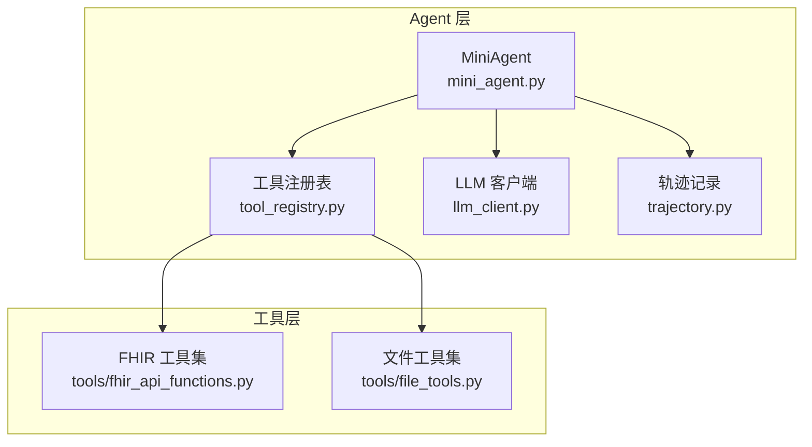
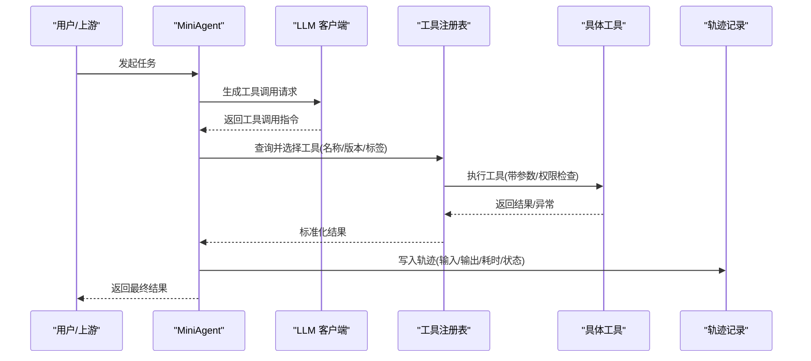
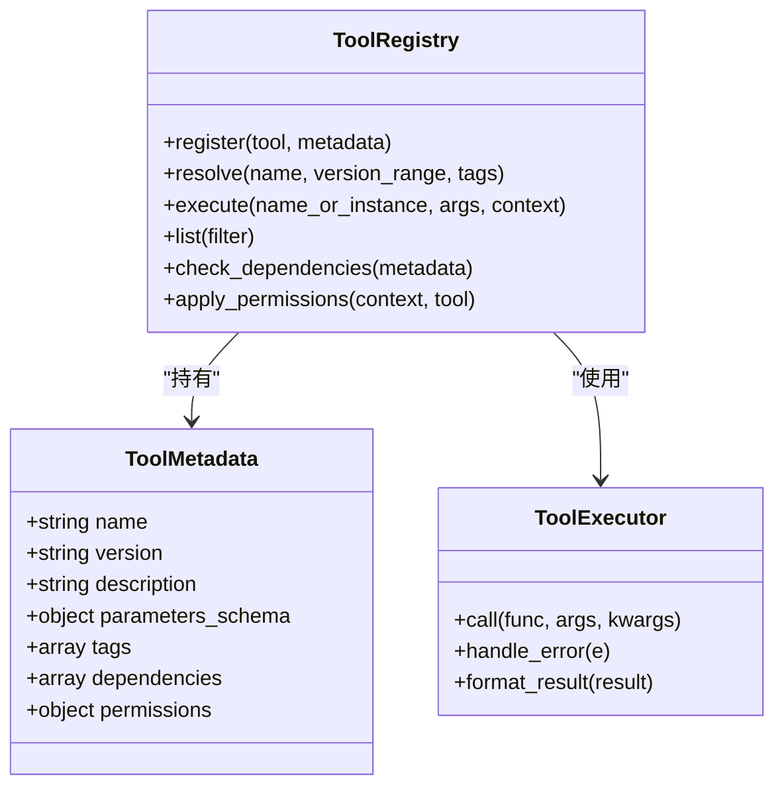
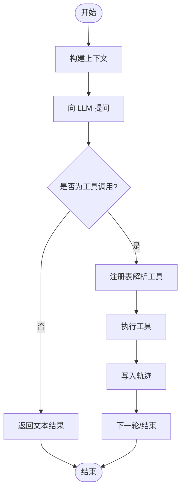
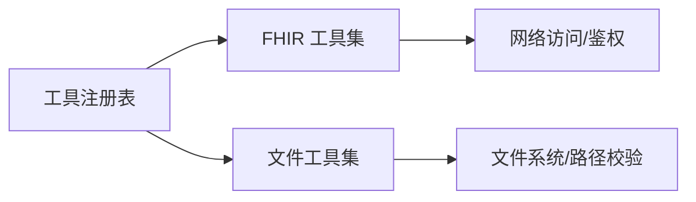
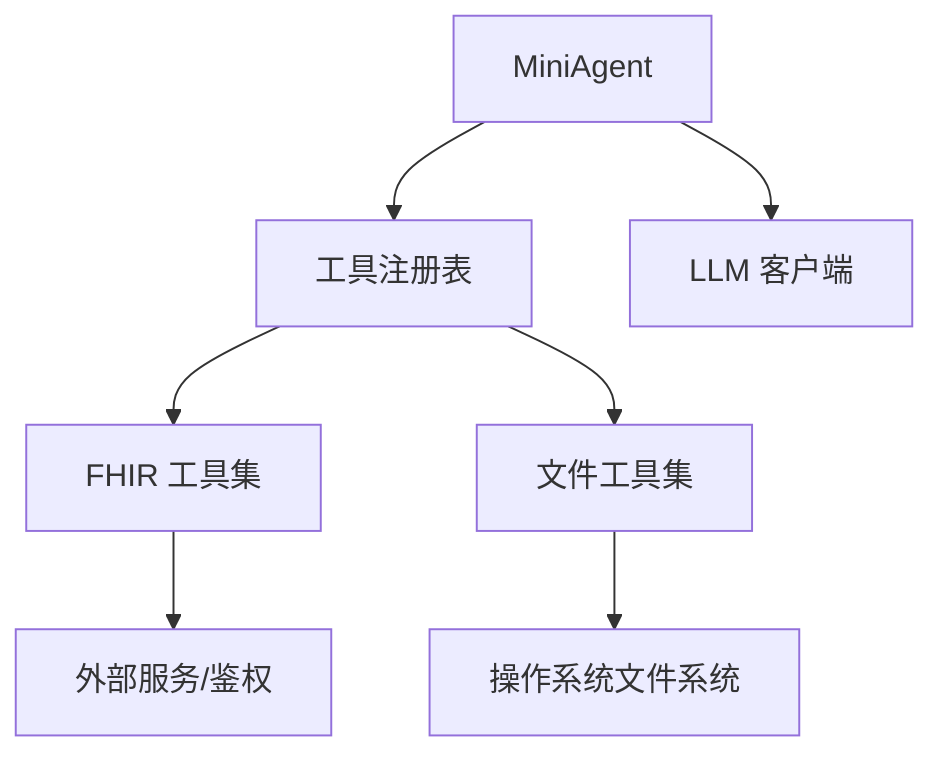

# 工具注册机制

<cite>
**本文引用的文件**   
- [tool_registry.py](file://task7/poc3_physicianbench/PhysicianBench/agent/tool_registry.py)
- [mini_agent.py](file://task7/poc3_physicianbench/PhysicianBench/agent/mini_agent.py)
- [llm_client.py](file://task7/poc3_physicianbench/PhysicianBench/agent/llm_client.py)
- [trajectory.py](file://task7/poc3_physicianbench/PhysicianBench/agent/trajectory.py)
- [fhir_api_functions.py](file://task7/poc3_physicianbench/PhysicianBench/tools/fhir_api_functions.py)
- [file_tools.py](file://task7/poc3_physicianbench/PhysicianBench/tools/file_tools.py)
</cite>

## 目录
1. [简介](#简介)
2. [项目结构](#项目结构)
3. [核心组件](#核心组件)
4. [架构总览](#架构总览)
5. [详细组件分析](#详细组件分析)
6. [依赖关系分析](#依赖关系分析)
7. [性能与可扩展性](#性能与可扩展性)
8. [故障排查指南](#故障排查指南)
9. [结论](#结论)
10. [附录：模板与最佳实践](#附录模板与最佳实践)

## 简介
本文件面向“工具注册机制”的设计与实现，聚焦以下目标：
- 解释工具注册的核心原理、注册接口定义与配置方式
- 通过实际代码示例展示如何声明工具元数据、定义工具描述信息、设置权限控制
- 覆盖工具版本管理、依赖声明、冲突处理等高级特性
- 提供完整的工具注册模板与最佳实践指南

该机制在 PhysicianBench 的 Agent 子系统中落地，围绕工具发现、注册、路由、执行与结果回传形成闭环。

## 项目结构
与工具注册相关的关键位置如下：
- agent/tool_registry.py：工具注册表与调度器（注册、发现、路由、执行）
- agent/mini_agent.py：Agent 主循环，调用注册表进行工具选择与执行
- agent/llm_client.py：与大模型交互，生成工具调用请求
- agent/trajectory.py：轨迹记录，用于审计与回放
- tools/fhir_api_functions.py：FHIR API 工具集（示例：网络访问、鉴权）
- tools/file_tools.py：文件系统工具集（示例：读写、路径校验）

图示来源
- [tool_registry.py](file://task7/poc3_physicianbench/PhysicianBench/agent/tool_registry.py)
- [mini_agent.py](file://task7/poc3_physicianbench/PhysicianBench/agent/mini_agent.py)
- [llm_client.py](file://task7/poc3_physicianbench/PhysicianBench/agent/llm_client.py)
- [trajectory.py](file://task7/poc3_physicianbench/PhysicianBench/agent/trajectory.py)
- [fhir_api_functions.py](file://task7/poc3_physicianbench/PhysicianBench/tools/fhir_api_functions.py)
- [file_tools.py](file://task7/poc3_physicianbench/PhysicianBench/tools/file_tools.py)

章节来源
- [tool_registry.py](file://task7/poc3_physicianbench/PhysicianBench/agent/tool_registry.py)
- [mini_agent.py](file://task7/poc3_physicianbench/PhysicianBench/agent/mini_agent.py)
- [llm_client.py](file://task7/poc3_physicianbench/PhysicianBench/agent/llm_client.py)
- [trajectory.py](file://task7/poc3_physicianbench/PhysicianBench/agent/trajectory.py)
- [fhir_api_functions.py](file://task7/poc3_physicianbench/PhysicianBench/tools/fhir_api_functions.py)
- [file_tools.py](file://task7/poc3_physicianbench/PhysicianBench/tools/file_tools.py)

## 核心组件
- 工具注册表（ToolRegistry）
  - 职责：维护工具清单、解析元数据、处理版本与冲突、提供按名称或标签查找、统一执行入口
  - 关键能力：
    - 注册：接收工具对象及其元数据（名称、版本、描述、参数模式、权限、依赖等）
    - 发现：支持按名称、标签、版本范围检索
    - 路由：根据上下文（用户角色、环境、可用依赖）选择合适工具
    - 执行：封装调用、错误处理、日志与轨迹写入
- MiniAgent
  - 职责：编排 LLM 对话、解析工具调用、委托注册表执行、更新轨迹
- LLM 客户端
  - 职责：构造提示词、发送请求、解析返回的工具调用指令
- 轨迹记录
  - 职责：持久化每次工具调用的输入输出、耗时、状态码、错误信息等
- 工具集合
  - FHIR 工具集：对外部医疗数据接口的封装
  - 文件工具集：对本地文件系统的操作封装

章节来源
- [tool_registry.py](file://task7/poc3_physicianbench/PhysicianBench/agent/tool_registry.py)
- [mini_agent.py](file://task7/poc3_physicianbench/PhysicianBench/agent/mini_agent.py)
- [llm_client.py](file://task7/poc3_physicianbench/PhysicianBench/agent/llm_client.py)
- [trajectory.py](file://task7/poc3_physicianbench/PhysicianBench/agent/trajectory.py)
- [fhir_api_functions.py](file://task7/poc3_physicianbench/PhysicianBench/tools/fhir_api_functions.py)
- [file_tools.py](file://task7/poc3_physicianbench/PhysicianBench/tools/file_tools.py)

## 架构总览
工具注册机制的整体流程如下：
- 启动阶段：加载各工具模块，解析元数据并注册到注册表
- 运行阶段：Agent 从 LLM 获取工具调用意图，交由注册表路由与执行
- 记录阶段：将调用过程与结果写入轨迹，供审计与回放

图示来源
- [mini_agent.py](file://task7/poc3_physicianbench/PhysicianBench/agent/mini_agent.py)
- [llm_client.py](file://task7/poc3_physicianbench/PhysicianBench/agent/llm_client.py)
- [tool_registry.py](file://task7/poc3_physicianbench/PhysicianBench/agent/tool_registry.py)
- [trajectory.py](file://task7/poc3_physicianbench/PhysicianBench/agent/trajectory.py)
- [fhir_api_functions.py](file://task7/poc3_physicianbench/PhysicianBench/tools/fhir_api_functions.py)
- [file_tools.py](file://task7/poc3_physicianbench/PhysicianBench/tools/file_tools.py)

## 详细组件分析

### 工具注册表（ToolRegistry）
- 设计要点
  - 元数据结构：包含名称、版本、描述、参数模式、权限策略、依赖列表、标签等
  - 版本管理：支持语义化版本比较与兼容区间匹配
  - 冲突处理：同名工具按优先级/版本策略合并或拒绝
  - 权限控制：基于角色/环境/资源白名单的动态授权
  - 依赖声明：运行时检测外部库/服务可用性，不满足时降级或报错
- 关键方法（概念说明）
  - register(tool, metadata): 注册工具及元数据
  - resolve(name, version_range=None, tags=None): 解析最合适的工具实例
  - execute(name_or_instance, args, context): 执行工具并包装结果
  - list(filter=None): 列出已注册工具（支持过滤）
  - check_dependencies(metadata): 校验依赖是否满足
  - apply_permissions(context, tool): 权限判定与拦截

图示来源
- [tool_registry.py](file://task7/poc3_physicianbench/PhysicianBench/agent/tool_registry.py)

章节来源
- [tool_registry.py](file://task7/poc3_physicianbench/PhysicianBench/agent/tool_registry.py)

### MiniAgent 与 LLM 客户端协作
- 工作流
  - 构建上下文（用户角色、历史对话、可用工具列表）
  - 调用 LLM 生成下一步动作（文本或工具调用）
  - 若为工具调用，则交给注册表解析与执行
  - 将结果追加到轨迹并继续下一轮
- 错误与重试
  - 捕获工具执行异常，记录错误原因，必要时触发重试或降级策略

图示来源
- [mini_agent.py](file://task7/poc3_physicianbench/PhysicianBench/agent/mini_agent.py)
- [llm_client.py](file://task7/poc3_physicianbench/PhysicianBench/agent/llm_client.py)
- [tool_registry.py](file://task7/poc3_physicianbench/PhysicianBench/agent/tool_registry.py)
- [trajectory.py](file://task7/poc3_physicianbench/PhysicianBench/agent/trajectory.py)

章节来源
- [mini_agent.py](file://task7/poc3_physicianbench/PhysicianBench/agent/mini_agent.py)
- [llm_client.py](file://task7/poc3_physicianbench/PhysicianBench/agent/llm_client.py)
- [trajectory.py](file://task7/poc3_physicianbench/PhysicianBench/agent/trajectory.py)

### 工具集合示例：FHIR 与文件工具
- FHIR 工具集
  - 典型能力：患者信息查询、处方读取、检验结果拉取
  - 安全要求：鉴权令牌、最小权限原则、敏感字段脱敏
- 文件工具集
  - 典型能力：读取/写入/移动/删除文件，路径白名单校验
  - 安全要求：沙箱路径、大小限制、类型白名单

图示来源
- [fhir_api_functions.py](file://task7/poc3_physicianbench/PhysicianBench/tools/fhir_api_functions.py)
- [file_tools.py](file://task7/poc3_physicianbench/PhysicianBench/tools/file_tools.py)
- [tool_registry.py](file://task7/poc3_physicianbench/PhysicianBench/agent/tool_registry.py)

章节来源
- [fhir_api_functions.py](file://task7/poc3_physicianbench/PhysicianBench/tools/fhir_api_functions.py)
- [file_tools.py](file://task7/poc3_physicianbench/PhysicianBench/tools/file_tools.py)

## 依赖关系分析
- 组件耦合
  - MiniAgent 强依赖 LLM 客户端与工具注册表
  - 工具注册表弱依赖具体工具实现，通过元数据与接口契约解耦
- 外部依赖
  - FHIR 工具集依赖外部医疗数据服务与鉴权
  - 文件工具集依赖操作系统文件系统
- 潜在风险
  - 循环依赖：避免工具反向引用注册表导致环
  - 版本漂移：严格约束依赖版本区间，发布前进行兼容性测试

图示来源
- [mini_agent.py](file://task7/poc3_physicianbench/PhysicianBench/agent/mini_agent.py)
- [llm_client.py](file://task7/poc3_physicianbench/PhysicianBench/agent/llm_client.py)
- [tool_registry.py](file://task7/poc3_physicianbench/PhysicianBench/agent/tool_registry.py)
- [fhir_api_functions.py](file://task7/poc3_physicianbench/PhysicianBench/tools/fhir_api_functions.py)
- [file_tools.py](file://task7/poc3_physicianbench/PhysicianBench/tools/file_tools.py)

章节来源
- [mini_agent.py](file://task7/poc3_physicianbench/PhysicianBench/agent/mini_agent.py)
- [llm_client.py](file://task7/poc3_physicianbench/PhysicianBench/agent/llm_client.py)
- [tool_registry.py](file://task7/poc3_physicianbench/PhysicianBench/agent/tool_registry.py)
- [fhir_api_functions.py](file://task7/poc3_physicianbench/PhysicianBench/tools/fhir_api_functions.py)
- [file_tools.py](file://task7/poc3_physicianbench/PhysicianBench/tools/file_tools.py)

## 性能与可扩展性
- 注册阶段
  - 建议延迟加载：按需导入工具模块，减少冷启动时间
  - 元数据缓存：对工具列表与解析结果做内存缓存
- 执行阶段
  - 并发控制：对 I/O 密集型工具采用异步或线程池
  - 超时与熔断：防止慢调用拖垮整体链路
- 扩展性
  - 插件化：通过约定式目录扫描自动发现新工具
  - 多租户：基于上下文隔离工具可见性与权限

[本节为通用指导，无需源码引用]

## 故障排查指南
- 常见问题
  - 工具未找到：检查名称、版本区间与标签是否正确
  - 权限不足：确认当前上下文角色与工具权限策略
  - 依赖缺失：安装必要的外部库或服务端点不可达
  - 版本冲突：调整依赖版本区间或升级工具
- 定位手段
  - 查看轨迹记录中的错误堆栈与输入输出
  - 启用调试日志，打印工具解析与执行细节
  - 使用工具列表过滤功能验证可见性

章节来源
- [trajectory.py](file://task7/poc3_physicianbench/PhysicianBench/agent/trajectory.py)
- [tool_registry.py](file://task7/poc3_physicianbench/PhysicianBench/agent/tool_registry.py)

## 结论
工具注册机制通过统一的元数据与注册表，实现了工具的集中管理、动态发现与安全执行。结合 MiniAgent 与 LLM 客户端，形成了“意图识别—工具路由—执行—记录”的完整闭环。通过版本管理、依赖声明与权限控制，系统具备良好的可维护性与可扩展性。

[本节为总结性内容，无需源码引用]

## 附录：模板与最佳实践

### 工具元数据模板（字段说明）
- 名称：唯一标识符，建议使用小写短横线命名
- 版本：遵循语义化版本（主.次.修订），用于兼容区间匹配
- 描述：人类可读的功能说明，便于 LLM 理解与选择
- 参数模式：JSON Schema 风格，定义必填/可选、类型、枚举、默认值
- 标签：分类与场景标签，辅助筛选与路由
- 依赖：外部库或服务清单，含最低版本要求
- 权限：角色/环境/资源白名单策略，决定谁可以调用

章节来源
- [tool_registry.py](file://task7/poc3_physicianbench/PhysicianBench/agent/tool_registry.py)

### 声明与注册步骤（流程）
- 编写工具函数或类，确保输入输出符合参数模式
- 准备元数据字典，填写名称、版本、描述、参数模式、标签、依赖、权限
- 调用注册表的注册接口完成登记
- 在启动阶段批量注册所有工具，或在运行时按需注册
- 使用列表与解析接口进行验证与调试

章节来源
- [tool_registry.py](file://task7/poc3_physicianbench/PhysicianBench/agent/tool_registry.py)

### 权限控制最佳实践
- 最小权限：仅授予完成任务所需的最小资源访问
- 显式白名单：对敏感操作（如网络、文件）采用白名单策略
- 上下文感知：根据用户角色、会话环境与数据敏感度动态授权
- 审计留痕：所有权限判定与拦截事件写入轨迹

章节来源
- [tool_registry.py](file://task7/poc3_physicianbench/PhysicianBench/agent/tool_registry.py)
- [trajectory.py](file://task7/poc3_physicianbench/PhysicianBench/agent/trajectory.py)

### 版本管理与冲突处理
- 版本区间：使用兼容区间表达需求，避免硬编码精确版本
- 冲突策略：优先最新稳定版；若存在破坏性变更，明确标记并引导迁移
- 依赖锁定：在部署环境中固定依赖版本，保证可重现性

章节来源
- [tool_registry.py](file://task7/poc3_physicianbench/PhysicianBench/agent/tool_registry.py)

### 依赖声明与校验
- 声明格式：库名与最低版本，必要时指定平台差异
- 运行时校验：启动时预检依赖，失败时给出清晰修复指引
- 降级策略：当依赖不可用时，返回友好错误并提供替代方案

章节来源
- [tool_registry.py](file://task7/poc3_physicianbench/PhysicianBench/agent/tool_registry.py)

### 示例工具参考
- FHIR 工具集：适合需要访问外部医疗数据的场景，注意鉴权与脱敏
- 文件工具集：适合本地数据处理与报告生成，注意路径与大小限制

章节来源
- [fhir_api_functions.py](file://task7/poc3_physicianbench/PhysicianBench/tools/fhir_api_functions.py)
- [file_tools.py](file://task7/poc3_physicianbench/PhysicianBench/tools/file_tools.py)