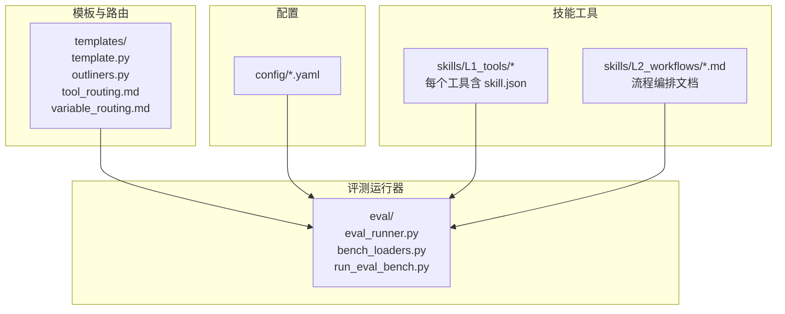
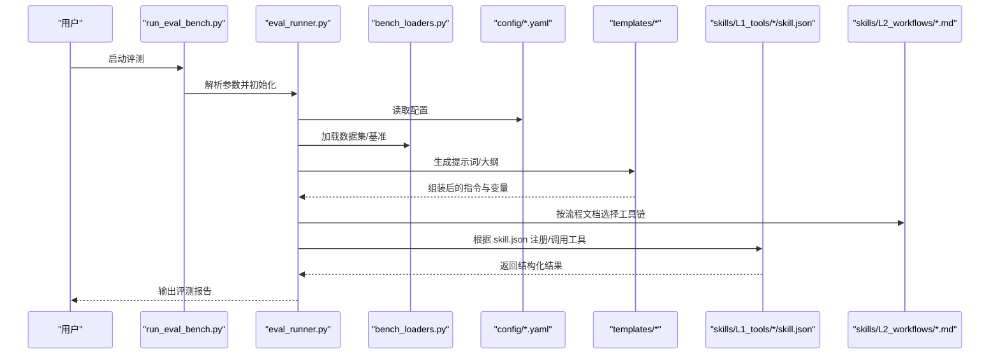
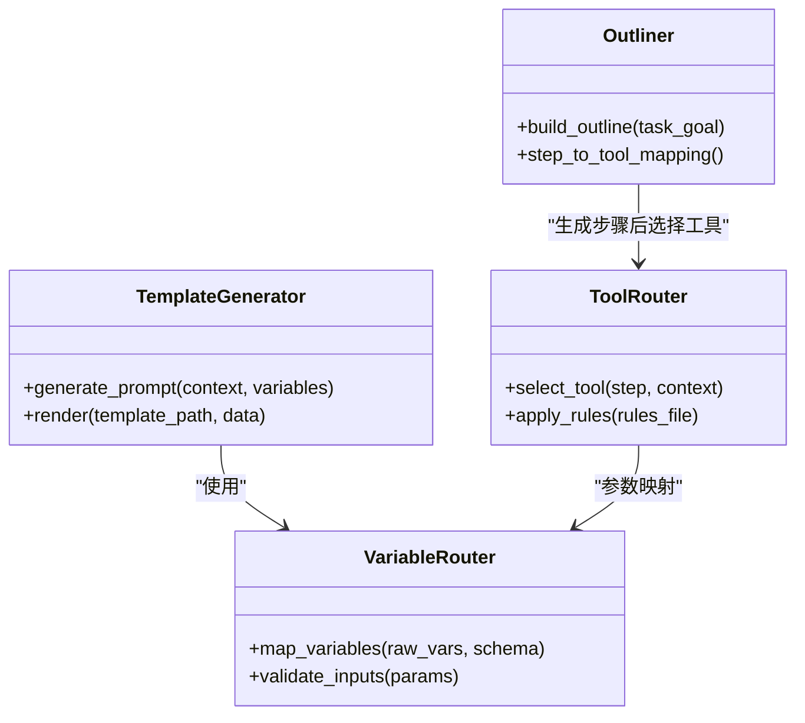
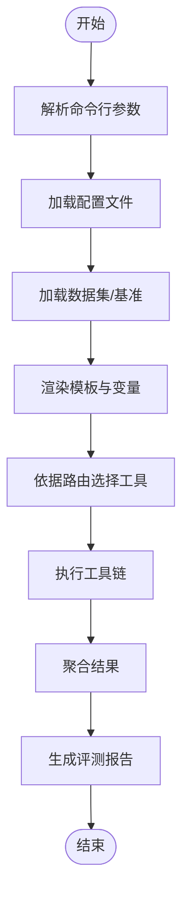
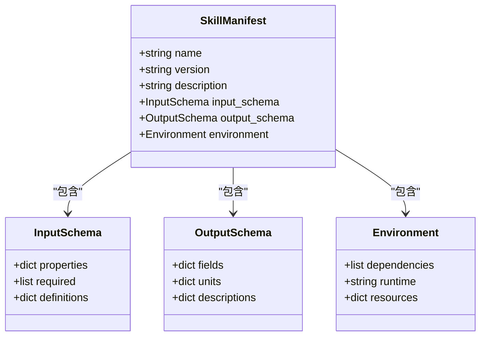
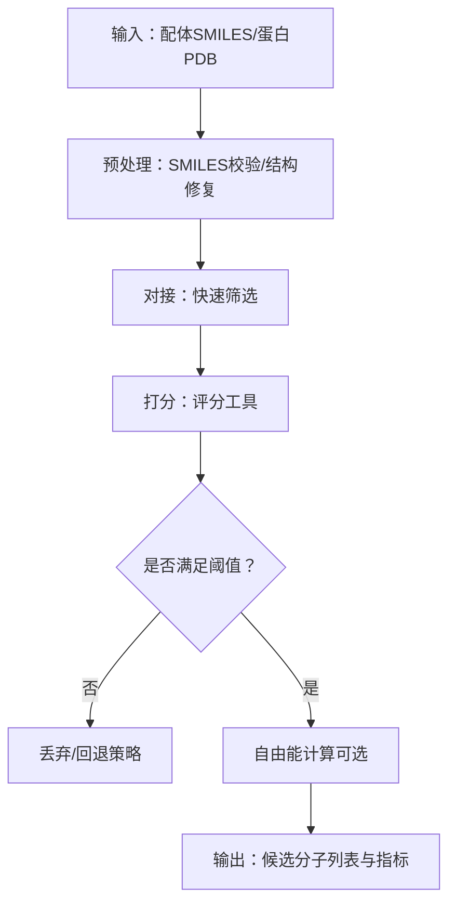
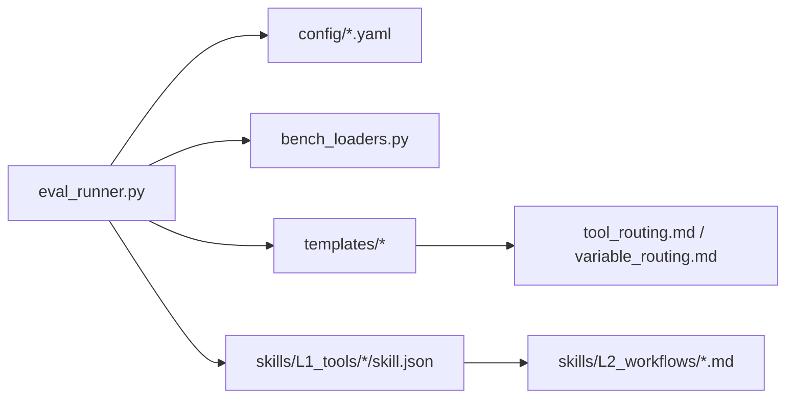

# 工具集成教程

<cite>
**本文引用的文件**   
- [tool_routing.md](file://docs/molbench_repo/templates/tool_routing.md)
- [variable_routing.md](file://docs/molbench_repo/templates/variable_routing.md)
- [template.py](file://docs/molbench_repo/templates/template.py)
- [outliners.py](file://docs/molbench_repo/templates/outliners.py)
- [__init__.py](file://docs/molbench_repo/templates/__init__.py)
- [eval_runner.py](file://docs/molbench_repo/eval/eval_runner.py)
- [bench_loaders.py](file://docs/molbench_repo/eval/bench_loaders.py)
- [run_eval_bench.py](file://docs/molbench_repo/eval/run_eval_bench.py)
- [baseline_molbench-ms-1.yaml](file://docs/molbench_repo/config/baseline_molbench-ms-1.yaml)
- [baseline_molbench-ms-2.yaml](file://docs/molbench_repo/config/baseline_molbench-ms-2.yaml)
- [baseline_molbench-ms-3.yaml](file://docs/molbench_repo/config/baseline_molbench-ms-3.yaml)
- [chemcot_mo_edit.yaml](file://docs/molbench_repo/config/chemcot_mo_edit.yaml)
- [chemcot_mo_opt.yaml](file://docs/molbench_repo/config/chemcot_mo_opt.yaml)
- [claude_template.yaml](file://docs/molbench_repo/config/claude_template.yaml)
- [molclaw-mol-opt-physchem/skill.json](file://docs/molbench_repo/skills/L1_tools/molclaw-mol-opt-physchem/skill.json)
- [molclaw-mol-basic-metrics/skill.json](file://docs/molbench_repo/skills/L1_tools/molclaw-mol-basic-metrics/skill.json)
- [molclaw-docking-screening/skill.json](file://docs/molbench_repo/skills/L1_tools/molclaw-docking-screening/skill.json)
- [molclaw-prolif-tool/skill.json](file://docs/molbench_repo/skills/L1_tools/molclaw-prolif-tool/skill.json)
- [molclaw-equiscore-tool/skill.json](file://docs/molbench_repo/skills/L1_tools/molclaw-equiscore-tool/skill.json)
- [molclaw-smiles-valid-check/skill.json](file://docs/molbench_repo/skills/L1_tools/molclaw-smiles-valid-check/skill.json)
- [molclaw-pdbfixer/skill.json](file://docs/molbench_repo/skills/L1_tools/molclaw-pdbfixer/skill.json)
- [molclaw-fpocket-toolkit-base/skill.json](file://docs/molbench_repo/skills/L1_tools/molclaw-fpocket-toolkit-base/skill.json)
- [molclaw-interaction-visualizer/skill.json](file://docs/molbench_repo/skills/L1_tools/molclaw-interaction-visualizer/skill.json)
- [molclaw-scp-server/skill.json](file://docs/molbench_repo/skills/L1_tools/molclaw-scp-server/skill.json)
- [02-molecular-docking-screening.md](file://docs/molbench_repo/skills/L2_workflows/02-molecular-docking-screening.md)
- [03-molecular-property-analysis-filtering.md](file://docs/molbench_repo/skills/L2_workflows/03-molecular-property-analysis-filtering.md)
- [06-binding-free-energy-calculation.md](file://docs/molbench_repo/skills/L2_workflows/06-binding-free-energy-calculation.md)
- [README.md](file://docs/molbench_repo/README.md)
</cite>

## 目录
1. [简介](#简介)
2. [项目结构](#项目结构)
3. [核心组件](#核心组件)
4. [架构总览](#架构总览)
5. [详细组件分析](#详细组件分析)
6. [依赖关系分析](#依赖关系分析)
7. [性能考虑](#性能考虑)
8. [故障排查指南](#故障排查指南)
9. [结论](#结论)
10. [附录](#附录)

## 简介
本教程面向希望在本仓库中注册与开发“工具”的工程师，围绕分子操作、物理化学计算等真实场景，系统讲解：
- 如何注册自定义工具（技能）
- 如何编写工具函数并定义输入输出参数
- 如何通过模板与路由配置将工具编排进工作流
- 错误处理与调试技巧
- 性能优化建议与最佳实践

本仓库采用“技能（Skill）+ 模板（Template）+ 评测运行器（Eval Runner）”的分层设计。L1 为原子工具（如 SMILES 校验、对接筛选、物化性质计算），L2 为可复用的流程（如分子对接筛选、自由能计算），通过模板与变量路由进行组合与调度。

## 项目结构
下图展示了与本教程相关的顶层结构与关键路径：

图表来源
- [template.py:1-200](file://docs/molbench_repo/templates/template.py#L1-L200)
- [outliners.py:1-200](file://docs/molbench_repo/templates/outliners.py#L1-L200)
- [tool_routing.md:1-200](file://docs/molbench_repo/templates/tool_routing.md#L1-L200)
- [variable_routing.md:1-200](file://docs/molbench_repo/templates/variable_routing.md#L1-L200)
- [eval_runner.py:1-200](file://docs/molbench_repo/eval/eval_runner.py#L1-L200)
- [bench_loaders.py:1-200](file://docs/molbench_repo/eval/bench_loaders.py#L1-L200)
- [run_eval_bench.py:1-200](file://docs/molbench_repo/eval/run_eval_bench.py#L1-L200)
- [baseline_molbench-ms-1.yaml:1-200](file://docs/molbench_repo/config/baseline_molbench-ms-1.yaml#L1-L200)
- [baseline_molbench-ms-2.yaml:1-200](file://docs/molbench_repo/config/baseline_molbench-ms-2.yaml#L1-L200)
- [baseline_molbench-ms-3.yaml:1-200](file://docs/molbench_repo/config/baseline_molbench-ms-3.yaml#L1-L200)
- [chemcot_mo_edit.yaml:1-200](file://docs/molbench_repo/config/chemcot_mo_edit.yaml#L1-L200)
- [chemcot_mo_opt.yaml:1-200](file://docs/molbench_repo/config/chemcot_mo_opt.yaml#L1-L200)
- [claude_template.yaml:1-200](file://docs/molbench_repo/config/claude_template.yaml#L1-L200)
- [molclaw-mol-opt-physchem/skill.json:1-200](file://docs/molbench_repo/skills/L1_tools/molclaw-mol-opt-physchem/skill.json#L1-L200)
- [molclaw-mol-basic-metrics/skill.json:1-200](file://docs/molbench_repo/skills/L1_tools/molclaw-mol-basic-metrics/skill.json#L1-L200)
- [molclaw-docking-screening/skill.json:1-200](file://docs/molbench_repo/skills/L1_tools/molclaw-docking-screening/skill.json#L1-L200)
- [molclaw-prolif-tool/skill.json:1-200](file://docs/molbench_repo/skills/L1_tools/molclaw-prolif-tool/skill.json#L1-L200)
- [molclaw-equiscore-tool/skill.json:1-200](file://docs/molbench_repo/skills/L1_tools/molclaw-equiscore-tool/skill.json#L1-L200)
- [molclaw-smiles-valid-check/skill.json:1-200](file://docs/molbench_repo/skills/L1_tools/molclaw-smiles-valid-check/skill.json#L1-L200)
- [molclaw-pdbfixer/skill.json:1-200](file://docs/molbench_repo/skills/L1_tools/molclaw-pdbfixer/skill.json#L1-L200)
- [molclaw-fpocket-toolkit-base/skill.json:1-200](file://docs/molbench_repo/skills/L1_tools/molclaw-fpocket-toolkit-base/skill.json#L1-L200)
- [molclaw-interaction-visualizer/skill.json:1-200](file://docs/molbench_repo/skills/L1_tools/molclaw-interaction-visualizer/skill.json#L1-L200)
- [molclaw-scp-server/skill.json:1-200](file://docs/molbench_repo/skills/L1_tools/molclaw-scp-server/skill.json#L1-L200)
- [02-molecular-docking-screening.md:1-200](file://docs/molbench_repo/skills/L2_workflows/02-molecular-docking-screening.md#L1-L200)
- [03-molecular-property-analysis-filtering.md:1-200](file://docs/molbench_repo/skills/L2_workflows/03-molecular-property-analysis-filtering.md#L1-L200)
- [06-binding-free-energy-calculation.md:1-200](file://docs/molbench_repo/skills/L2_workflows/06-binding-free-energy-calculation.md#L1-L200)

章节来源
- [README.md:1-200](file://docs/molbench_repo/README.md#L1-L200)

## 核心组件
- 模板与路由
  - 模板生成器与大纲生成器负责拼装提示词、变量注入与步骤大纲，驱动工具调用序列。
  - tool_routing.md 与 variable_routing.md 定义了工具选择与变量映射策略。
- 评测运行器
  - eval_runner.py 负责加载任务、执行评测、汇总结果；bench_loaders.py 提供数据集与基准加载能力；run_eval_bench.py 是统一入口。
- 配置
  - config/*.yaml 描述基线、模型、数据与评测选项，供运行器读取。
- 技能（工具）
  - L1_tools 下每个子目录为一个原子工具，包含 skill.json 声明其元信息、输入输出、依赖与环境。
  - L2_workflows 下为多步流程文档，串联多个 L1 工具形成端到端任务。

章节来源
- [template.py:1-200](file://docs/molbench_repo/templates/template.py#L1-L200)
- [outliners.py:1-200](file://docs/molbench_repo/templates/outliners.py#L1-L200)
- [tool_routing.md:1-200](file://docs/molbench_repo/templates/tool_routing.md#L1-L200)
- [variable_routing.md:1-200](file://docs/molbench_repo/templates/variable_routing.md#L1-L200)
- [eval_runner.py:1-200](file://docs/molbench_repo/eval/eval_runner.py#L1-L200)
- [bench_loaders.py:1-200](file://docs/molbench_repo/eval/bench_loaders.py#L1-L200)
- [run_eval_bench.py:1-200](file://docs/molbench_repo/eval/run_eval_bench.py#L1-L200)
- [baseline_molbench-ms-1.yaml:1-200](file://docs/molbench_repo/config/baseline_molbench-ms-1.yaml#L1-L200)
- [baseline_molbench-ms-2.yaml:1-200](file://docs/molbench_repo/config/baseline_molbench-ms-2.yaml#L1-L200)
- [baseline_molbench-ms-3.yaml:1-200](file://docs/molbench_repo/config/baseline_molbench-ms-3.yaml#L1-L200)
- [chemcot_mo_edit.yaml:1-200](file://docs/molbench_repo/config/chemcot_mo_edit.yaml#L1-L200)
- [chemcot_mo_opt.yaml:1-200](file://docs/molbench_repo/config/chemcot_mo_opt.yaml#L1-L200)
- [claude_template.yaml:1-200](file://docs/molbench_repo/config/claude_template.yaml#L1-L200)
- [molclaw-mol-opt-physchem/skill.json:1-200](file://docs/molbench_repo/skills/L1_tools/molclaw-mol-opt-physchem/skill.json#L1-L200)
- [molclaw-mol-basic-metrics/skill.json:1-200](file://docs/molbench_repo/skills/L1_tools/molclaw-mol-basic-metrics/skill.json#L1-L200)
- [molclaw-docking-screening/skill.json:1-200](file://docs/molbench_repo/skills/L1_tools/molclaw-docking-screening/skill.json#L1-L200)
- [molclaw-prolif-tool/skill.json:1-200](file://docs/molbench_repo/skills/L1_tools/molclaw-prolif-tool/skill.json#L1-L200)
- [molclaw-equiscore-tool/skill.json:1-200](file://docs/molbench_repo/skills/L1_tools/molclaw-equiscore-tool/skill.json#L1-L200)
- [molclaw-smiles-valid-check/skill.json:1-200](file://docs/molbench_repo/skills/L1_tools/molclaw-smiles-valid-check/skill.json#L1-L200)
- [molclaw-pdbfixer/skill.json:1-200](file://docs/molbench_repo/skills/L1_tools/molclaw-pdbfixer/skill.json#L1-L200)
- [molclaw-fpocket-toolkit-base/skill.json:1-200](file://docs/molbench_repo/skills/L1_tools/molclaw-fpocket-toolkit-base/skill.json#L1-L200)
- [molclaw-interaction-visualizer/skill.json:1-200](file://docs/molbench_repo/skills/L1_tools/molclaw-interaction-visualizer/skill.json#L1-L200)
- [molclaw-scp-server/skill.json:1-200](file://docs/molbench_repo/skills/L1_tools/molclaw-scp-server/skill.json#L1-L200)
- [02-molecular-docking-screening.md:1-200](file://docs/molbench_repo/skills/L2_workflows/02-molecular-docking-screening.md#L1-L200)
- [03-molecular-property-analysis-filtering.md:1-200](file://docs/molbench_repo/skills/L2_workflows/03-molecular-property-analysis-filtering.md#L1-L200)
- [06-binding-free-energy-calculation.md:1-200](file://docs/molbench_repo/skills/L2_workflows/06-binding-free-energy-calculation.md#L1-L200)

## 架构总览
下图展示从评测入口到工具调用的整体流程：

图表来源
- [run_eval_bench.py:1-200](file://docs/molbench_repo/eval/run_eval_bench.py#L1-L200)
- [eval_runner.py:1-200](file://docs/molbench_repo/eval/eval_runner.py#L1-L200)
- [bench_loaders.py:1-200](file://docs/molbench_repo/eval/bench_loaders.py#L1-L200)
- [baseline_molbench-ms-1.yaml:1-200](file://docs/molbench_repo/config/baseline_molbench-ms-1.yaml#L1-L200)
- [baseline_molbench-ms-2.yaml:1-200](file://docs/molbench_repo/config/baseline_molbench-ms-2.yaml#L1-L200)
- [baseline_molbench-ms-3.yaml:1-200](file://docs/molbench_repo/config/baseline_molbench-ms-3.yaml#L1-L200)
- [chemcot_mo_edit.yaml:1-200](file://docs/molbench_repo/config/chemcot_mo_edit.yaml#L1-L200)
- [chemcot_mo_opt.yaml:1-200](file://docs/molbench_repo/config/chemcot_mo_opt.yaml#L1-L200)
- [claude_template.yaml:1-200](file://docs/molbench_repo/config/claude_template.yaml#L1-L200)
- [template.py:1-200](file://docs/molbench_repo/templates/template.py#L1-L200)
- [outliners.py:1-200](file://docs/molbench_repo/templates/outliners.py#L1-L200)
- [tool_routing.md:1-200](file://docs/molbench_repo/templates/tool_routing.md#L1-L200)
- [variable_routing.md:1-200](file://docs/molbench_repo/templates/variable_routing.md#L1-L200)
- [molclaw-mol-opt-physchem/skill.json:1-200](file://docs/molbench_repo/skills/L1_tools/molclaw-mol-opt-physchem/skill.json#L1-L200)
- [molclaw-mol-basic-metrics/skill.json:1-200](file://docs/molbench_repo/skills/L1_tools/molclaw-mol-basic-metrics/skill.json#L1-L200)
- [molclaw-docking-screening/skill.json:1-200](file://docs/molbench_repo/skills/L1_tools/molclaw-docking-screening/skill.json#L1-L200)
- [molclaw-prolif-tool/skill.json:1-200](file://docs/molbench_repo/skills/L1_tools/molclaw-prolif-tool/skill.json#L1-L200)
- [molclaw-equiscore-tool/skill.json:1-200](file://docs/molbench_repo/skills/L1_tools/molclaw-equiscore-tool/skill.json#L1-L200)
- [molclaw-smiles-valid-check/skill.json:1-200](file://docs/molbench_repo/skills/L1_tools/molclaw-smiles-valid-check/skill.json#L1-L200)
- [molclaw-pdbfixer/skill.json:1-200](file://docs/molbench_repo/skills/L1_tools/molclaw-pdbfixer/skill.json#L1-L200)
- [molclaw-fpocket-toolkit-base/skill.json:1-200](file://docs/molbench_repo/skills/L1_tools/molclaw-fpocket-toolkit-base/skill.json#L1-L200)
- [molclaw-interaction-visualizer/skill.json:1-200](file://docs/molbench_repo/skills/L1_tools/molclaw-interaction-visualizer/skill.json#L1-L200)
- [molclaw-scp-server/skill.json:1-200](file://docs/molbench_repo/skills/L1_tools/molclaw-scp-server/skill.json#L1-L200)
- [02-molecular-docking-screening.md:1-200](file://docs/molbench_repo/skills/L2_workflows/02-molecular-docking-screening.md#L1-L200)
- [03-molecular-property-analysis-filtering.md:1-200](file://docs/molbench_repo/skills/L2_workflows/03-molecular-property-analysis-filtering.md#L1-L200)
- [06-binding-free-energy-calculation.md:1-200](file://docs/molbench_repo/skills/L2_workflows/06-binding-free-energy-calculation.md#L1-L200)

## 详细组件分析

### 模板与路由组件
- 模板生成器（template.py）
  - 负责将任务上下文、变量与工具说明拼装成模型可读的提示词。
  - 支持在运行时注入变量，便于同一模板适配不同数据集与参数。
- 大纲生成器（outliners.py）
  - 基于任务目标生成步骤大纲，指导后续工具选择与顺序。
- 工具路由（tool_routing.md）
  - 定义“何时选择哪个工具”的规则，包括条件分支与优先级。
- 变量路由（variable_routing.md）
  - 定义“如何将外部变量映射到工具参数”，确保输入一致性。

图表来源
- [template.py:1-200](file://docs/molbench_repo/templates/template.py#L1-L200)
- [outliners.py:1-200](file://docs/molbench_repo/templates/outliners.py#L1-L200)
- [tool_routing.md:1-200](file://docs/molbench_repo/templates/tool_routing.md#L1-L200)
- [variable_routing.md:1-200](file://docs/molbench_repo/templates/variable_routing.md#L1-L200)

章节来源
- [template.py:1-200](file://docs/molbench_repo/templates/template.py#L1-L200)
- [outliners.py:1-200](file://docs/molbench_repo/templates/outliners.py#L1-L200)
- [tool_routing.md:1-200](file://docs/molbench_repo/templates/tool_routing.md#L1-L200)
- [variable_routing.md:1-200](file://docs/molbench_repo/templates/variable_routing.md#L1-L200)

### 评测运行器组件
- 运行入口（run_eval_bench.py）
  - 解析命令行参数，调用评测运行器，输出最终报告。
- 评测运行器（eval_runner.py）
  - 协调配置加载、数据加载、模板渲染、工具调用与结果聚合。
- 基准加载器（bench_loaders.py）
  - 提供统一的基准与数据集加载接口，屏蔽底层格式差异。

图表来源
- [run_eval_bench.py:1-200](file://docs/molbench_repo/eval/run_eval_bench.py#L1-L200)
- [eval_runner.py:1-200](file://docs/molbench_repo/eval/eval_runner.py#L1-L200)
- [bench_loaders.py:1-200](file://docs/molbench_repo/eval/bench_loaders.py#L1-L200)
- [baseline_molbench-ms-1.yaml:1-200](file://docs/molbench_repo/config/baseline_molbench-ms-1.yaml#L1-L200)
- [baseline_molbench-ms-2.yaml:1-200](file://docs/molbench_repo/config/baseline_molbench-ms-2.yaml#L1-L200)
- [baseline_molbench-ms-3.yaml:1-200](file://docs/molbench_repo/config/baseline_molbench-ms-3.yaml#L1-L200)
- [chemcot_mo_edit.yaml:1-200](file://docs/molbench_repo/config/chemcot_mo_edit.yaml#L1-L200)
- [chemcot_mo_opt.yaml:1-200](file://docs/molbench_repo/config/chemcot_mo_opt.yaml#L1-L200)
- [claude_template.yaml:1-200](file://docs/molbench_repo/config/claude_template.yaml#L1-L200)

章节来源
- [run_eval_bench.py:1-200](file://docs/molbench_repo/eval/run_eval_bench.py#L1-L200)
- [eval_runner.py:1-200](file://docs/molbench_repo/eval/eval_runner.py#L1-L200)
- [bench_loaders.py:1-200](file://docs/molbench_repo/eval/bench_loaders.py#L1-L200)

### 技能（工具）注册与参数规范
- 每个 L1 工具位于 skills/L1_tools/<tool_name>/ 目录下，并通过 skill.json 声明：
  - 名称、版本、描述
  - 输入参数模式（类型、必填、默认值、约束）
  - 输出字段模式（类型、单位、含义）
  - 依赖环境与资源（可选）
- 典型示例工具（仅列出路径，不展示内容）：
  - 分子物化性质计算：[molclaw-mol-opt-physchem/skill.json](file://docs/molbench_repo/skills/L1_tools/molclaw-mol-opt-physchem/skill.json)
  - 基础分子指标：[molclaw-mol-basic-metrics/skill.json](file://docs/molbench_repo/skills/L1_tools/molclaw-mol-basic-metrics/skill.json)
  - 对接筛选：[molclaw-docking-screening/skill.json](file://docs/molbench_repo/skills/L1_tools/molclaw-docking-screening/skill.json)
  - 相互作用分析：[molclaw-prolif-tool/skill.json](file://docs/molbench_repo/skills/L1_tools/molclaw-prolif-tool/skill.json)
  - 评分工具：[molclaw-equiscore-tool/skill.json](file://docs/molbench_repo/skills/L1_tools/molclaw-equiscore-tool/skill.json)
  - SMILES 校验：[molclaw-smiles-valid-check/skill.json](file://docs/molbench_repo/skills/L1_tools/molclaw-smiles-valid-check/skill.json)
  - PDB 修复：[molclaw-pdbfixer/skill.json](file://docs/molbench_repo/skills/L1_tools/molclaw-pdbfixer/skill.json)
  - 口袋检测基础：[molclaw-fpocket-toolkit-base/skill.json](file://docs/molbench_repo/skills/L1_tools/molclaw-fpocket-toolkit-base/skill.json)
  - 可视化：[molclaw-interaction-visualizer/skill.json](file://docs/molbench_repo/skills/L1_tools/molclaw-interaction-visualizer/skill.json)
  - 远程服务：[molclaw-scp-server/skill.json](file://docs/molbench_repo/skills/L1_tools/molclaw-scp-server/skill.json)

图表来源
- [molclaw-mol-opt-physchem/skill.json:1-200](file://docs/molbench_repo/skills/L1_tools/molclaw-mol-opt-physchem/skill.json#L1-L200)
- [molclaw-mol-basic-metrics/skill.json:1-200](file://docs/molbench_repo/skills/L1_tools/molclaw-mol-basic-metrics/skill.json#L1-L200)
- [molclaw-docking-screening/skill.json:1-200](file://docs/molbench_repo/skills/L1_tools/molclaw-docking-screening/skill.json#L1-L200)
- [molclaw-prolif-tool/skill.json:1-200](file://docs/molbench_repo/skills/L1_tools/molclaw-prolif-tool/skill.json#L1-L200)
- [molclaw-equiscore-tool/skill.json:1-200](file://docs/molbench_repo/skills/L1_tools/molclaw-equiscore-tool/skill.json#L1-L200)
- [molclaw-smiles-valid-check/skill.json:1-200](file://docs/molbench_repo/skills/L1_tools/molclaw-smiles-valid-check/skill.json#L1-L200)
- [molclaw-pdbfixer/skill.json:1-200](file://docs/molbench_repo/skills/L1_tools/molclaw-pdbfixer/skill.json#L1-L200)
- [molclaw-fpocket-toolkit-base/skill.json:1-200](file://docs/molbench_repo/skills/L1_tools/molclaw-fpocket-toolkit-base/skill.json#L1-L200)
- [molclaw-interaction-visualizer/skill.json:1-200](file://docs/molbench_repo/skills/L1_tools/molclaw-interaction-visualizer/skill.json#L1-L200)
- [molclaw-scp-server/skill.json:1-200](file://docs/molbench_repo/skills/L1_tools/molclaw-scp-server/skill.json#L1-L200)

章节来源
- [molclaw-mol-opt-physchem/skill.json:1-200](file://docs/molbench_repo/skills/L1_tools/molclaw-mol-opt-physchem/skill.json#L1-L200)
- [molclaw-mol-basic-metrics/skill.json:1-200](file://docs/molbench_repo/skills/L1_tools/molclaw-mol-basic-metrics/skill.json#L1-L200)
- [molclaw-docking-screening/skill.json:1-200](file://docs/molbench_repo/skills/L1_tools/molclaw-docking-screening/skill.json#L1-L200)
- [molclaw-prolif-tool/skill.json:1-200](file://docs/molbench_repo/skills/L1_tools/molclaw-prolif-tool/skill.json#L1-L200)
- [molclaw-equiscore-tool/skill.json:1-200](file://docs/molbench_repo/skills/L1_tools/molclaw-equiscore-tool/skill.json#L1-L200)
- [molclaw-smiles-valid-check/skill.json:1-200](file://docs/molbench_repo/skills/L1_tools/molclaw-smiles-valid-check/skill.json#L1-L200)
- [molclaw-pdbfixer/skill.json:1-200](file://docs/molbench_repo/skills/L1_tools/molclaw-pdbfixer/skill.json#L1-L200)
- [molclaw-fpocket-toolkit-base/skill.json:1-200](file://docs/molbench_repo/skills/L1_tools/molclaw-fpocket-toolkit-base/skill.json#L1-L200)
- [molclaw-interaction-visualizer/skill.json:1-200](file://docs/molbench_repo/skills/L1_tools/molclaw-interaction-visualizer/skill.json#L1-L200)
- [molclaw-scp-server/skill.json:1-200](file://docs/molbench_repo/skills/L1_tools/molclaw-scp-server/skill.json#L1-L200)

### 工作流编排（L2）
- 分子对接筛选流程（02-molecular-docking-screening.md）
  - 串联蛋白准备、小分子预处理、对接、打分与结果过滤。
- 分子性质分析与过滤（03-molecular-property-analysis-filtering.md）
  - 基于物化指标与规则进行初筛与排序。
- 结合自由能计算（06-binding-free-energy-calculation.md）
  - 在对接基础上引入更精确的自由能评估方法。

图表来源
- [02-molecular-docking-screening.md:1-200](file://docs/molbench_repo/skills/L2_workflows/02-molecular-docking-screening.md#L1-L200)
- [03-molecular-property-analysis-filtering.md:1-200](file://docs/molbench_repo/skills/L2_workflows/03-molecular-property-analysis-filtering.md#L1-L200)
- [06-binding-free-energy-calculation.md:1-200](file://docs/molbench_repo/skills/L2_workflows/06-binding-free-energy-calculation.md#L1-L200)

章节来源
- [02-molecular-docking-screening.md:1-200](file://docs/molbench_repo/skills/L2_workflows/02-molecular-docking-screening.md#L1-L200)
- [03-molecular-property-analysis-filtering.md:1-200](file://docs/molbench_repo/skills/L2_workflows/03-molecular-property-analysis-filtering.md#L1-L200)
- [06-binding-free-energy-calculation.md:1-200](file://docs/molbench_repo/skills/L2_workflows/06-binding-free-energy-calculation.md#L1-L200)

## 依赖关系分析
- 模块耦合
  - 运行器强依赖配置与加载器；模板与路由对运行器提供“指令与变量”。
  - 工具通过 skill.json 与运行器解耦，降低耦合度，提升可插拔性。
- 外部依赖
  - 各工具的依赖环境由 skill.json 的 environment 字段声明，便于隔离与复用。
- 潜在循环依赖
  - 当前结构以单向依赖为主（运行器→模板/加载器→工具），未见明显循环。

图表来源
- [eval_runner.py:1-200](file://docs/molbench_repo/eval/eval_runner.py#L1-L200)
- [bench_loaders.py:1-200](file://docs/molbench_repo/eval/bench_loaders.py#L1-L200)
- [template.py:1-200](file://docs/molbench_repo/templates/template.py#L1-L200)
- [outliners.py:1-200](file://docs/molbench_repo/templates/outliners.py#L1-L200)
- [tool_routing.md:1-200](file://docs/molbench_repo/templates/tool_routing.md#L1-L200)
- [variable_routing.md:1-200](file://docs/molbench_repo/templates/variable_routing.md#L1-L200)
- [baseline_molbench-ms-1.yaml:1-200](file://docs/molbench_repo/config/baseline_molbench-ms-1.yaml#L1-L200)
- [baseline_molbench-ms-2.yaml:1-200](file://docs/molbench_repo/config/baseline_molbench-ms-2.yaml#L1-L200)
- [baseline_molbench-ms-3.yaml:1-200](file://docs/molbench_repo/config/baseline_molbench-ms-3.yaml#L1-L200)
- [chemcot_mo_edit.yaml:1-200](file://docs/molbench_repo/config/chemcot_mo_edit.yaml#L1-L200)
- [chemcot_mo_opt.yaml:1-200](file://docs/molbench_repo/config/chemcot_mo_opt.yaml#L1-L200)
- [claude_template.yaml:1-200](file://docs/molbench_repo/config/claude_template.yaml#L1-L200)
- [molclaw-mol-opt-physchem/skill.json:1-200](file://docs/molbench_repo/skills/L1_tools/molclaw-mol-opt-physchem/skill.json#L1-L200)
- [molclaw-mol-basic-metrics/skill.json:1-200](file://docs/molbench_repo/skills/L1_tools/molclaw-mol-basic-metrics/skill.json#L1-L200)
- [molclaw-docking-screening/skill.json:1-200](file://docs/molbench_repo/skills/L1_tools/molclaw-docking-screening/skill.json#L1-L200)
- [molclaw-prolif-tool/skill.json:1-200](file://docs/molbench_repo/skills/L1_tools/molclaw-prolif-tool/skill.json#L1-L200)
- [molclaw-equiscore-tool/skill.json:1-200](file://docs/molbench_repo/skills/L1_tools/molclaw-equiscore-tool/skill.json#L1-L200)
- [molclaw-smiles-valid-check/skill.json:1-200](file://docs/molbench_repo/skills/L1_tools/molclaw-smiles-valid-check/skill.json#L1-L200)
- [molclaw-pdbfixer/skill.json:1-200](file://docs/molbench_repo/skills/L1_tools/molclaw-pdbfixer/skill.json#L1-L200)
- [molclaw-fpocket-toolkit-base/skill.json:1-200](file://docs/molbench_repo/skills/L1_tools/molclaw-fpocket-toolkit-base/skill.json#L1-L200)
- [molclaw-interaction-visualizer/skill.json:1-200](file://docs/molbench_repo/skills/L1_tools/molclaw-interaction-visualizer/skill.json#L1-L200)
- [molclaw-scp-server/skill.json:1-200](file://docs/molbench_repo/skills/L1_tools/molclaw-scp-server/skill.json#L1-L200)
- [02-molecular-docking-screening.md:1-200](file://docs/molbench_repo/skills/L2_workflows/02-molecular-docking-screening.md#L1-L200)
- [03-molecular-property-analysis-filtering.md:1-200](file://docs/molbench_repo/skills/L2_workflows/03-molecular-property-analysis-filtering.md#L1-L200)
- [06-binding-free-energy-calculation.md:1-200](file://docs/molbench_repo/skills/L2_workflows/06-binding-free-energy-calculation.md#L1-L200)

章节来源
- [eval_runner.py:1-200](file://docs/molbench_repo/eval/eval_runner.py#L1-L200)
- [bench_loaders.py:1-200](file://docs/molbench_repo/eval/bench_loaders.py#L1-L200)
- [template.py:1-200](file://docs/molbench_repo/templates/template.py#L1-L200)
- [outliners.py:1-200](file://docs/molbench_repo/templates/outliners.py#L1-L200)
- [tool_routing.md:1-200](file://docs/molbench_repo/templates/tool_routing.md#L1-L200)
- [variable_routing.md:1-200](file://docs/molbench_repo/templates/variable_routing.md#L1-L200)
- [baseline_molbench-ms-1.yaml:1-200](file://docs/molbench_repo/config/baseline_molbench-ms-1.yaml#L1-L200)
- [baseline_molbench-ms-2.yaml:1-200](file://docs/molbench_repo/config/baseline_molbench-ms-2.yaml#L1-L200)
- [baseline_molbench-ms-3.yaml:1-200](file://docs/molbench_repo/config/baseline_molbench-ms-3.yaml#L1-L200)
- [chemcot_mo_edit.yaml:1-200](file://docs/molbench_repo/config/chemcot_mo_edit.yaml#L1-L200)
- [chemcot_mo_opt.yaml:1-200](file://docs/molbench_repo/config/chemcot_mo_opt.yaml#L1-L200)
- [claude_template.yaml:1-200](file://docs/molbench_repo/config/claude_template.yaml#L1-L200)
- [molclaw-mol-opt-physchem/skill.json:1-200](file://docs/molbench_repo/skills/L1_tools/molclaw-mol-opt-physchem/skill.json#L1-L200)
- [molclaw-mol-basic-metrics/skill.json:1-200](file://docs/molbench_repo/skills/L1_tools/molclaw-mol-basic-metrics/skill.json#L1-L200)
- [molclaw-docking-screening/skill.json:1-200](file://docs/molbench_repo/skills/L1_tools/molclaw-docking-screening/skill.json#L1-L200)
- [molclaw-prolif-tool/skill.json:1-200](file://docs/molbench_repo/skills/L1_tools/molclaw-prolif-tool/skill.json#L1-L200)
- [molclaw-equiscore-tool/skill.json:1-200](file://docs/molbench_repo/skills/L1_tools/molclaw-equiscore-tool/skill.json#L1-L200)
- [molclaw-smiles-valid-check/skill.json:1-200](file://docs/molbench_repo/skills/L1_tools/molclaw-smiles-valid-check/skill.json#L1-L200)
- [molclaw-pdbfixer/skill.json:1-200](file://docs/molbench_repo/skills/L1_tools/molclaw-pdbfixer/skill.json#L1-L200)
- [molclaw-fpocket-toolkit-base/skill.json:1-200](file://docs/molbench_repo/skills/L1_tools/molclaw-fpocket-toolkit-base/skill.json#L1-L200)
- [molclaw-interaction-visualizer/skill.json:1-200](file://docs/molbench_repo/skills/L1_tools/molclaw-interaction-visualizer/skill.json#L1-L200)
- [molclaw-scp-server/skill.json:1-200](file://docs/molbench_repo/skills/L1_tools/molclaw-scp-server/skill.json#L1-L200)
- [02-molecular-docking-screening.md:1-200](file://docs/molbench_repo/skills/L2_workflows/02-molecular-docking-screening.md#L1-L200)
- [03-molecular-property-analysis-filtering.md:1-200](file://docs/molbench_repo/skills/L2_workflows/03-molecular-property-analysis-filtering.md#L1-L200)
- [06-binding-free-energy-calculation.md:1-200](file://docs/molbench_repo/skills/L2_workflows/06-binding-free-energy-calculation.md#L1-L200)

## 性能考虑
- 并行与批处理
  - 对于独立的小分子计算（如物化性质、相似度），建议在运行器层面启用并发或批处理，减少 I/O 与进程切换开销。
- 缓存与去重
  - 对相同输入的工具调用结果进行缓存（键可由输入指纹生成），避免重复计算。
- 资源限制
  - 在 skill.json 的 environment 中声明 CPU/GPU/内存上限，防止单工具占用过多资源影响整体吞吐。
- 流水线优化
  - 在 L2 流程中尽早过滤低质量候选，减少昂贵步骤（如自由能计算）的调用次数。

## 故障排查指南
- 常见问题定位
  - 参数不匹配：检查 variable_routing.md 的映射规则与 skill.json 的输入模式是否一致。
  - 工具缺失或依赖未安装：查看 skill.json 的 environment 字段，确认依赖已就绪。
  - 路由冲突：核对 tool_routing.md 的条件分支优先级，避免歧义。
  - 数据加载失败：确认 bench_loaders.py 的数据路径与格式符合预期。
- 调试技巧
  - 在运行器中开启详细日志，逐步打印模板渲染结果与工具调用参数。
  - 针对单个工具进行最小化测试，先验证输入输出是否符合 schema。
  - 使用 L2 流程中的中间产物（如对接结果、打分表）进行断点式检查。

章节来源
- [eval_runner.py:1-200](file://docs/molbench_repo/eval/eval_runner.py#L1-L200)
- [bench_loaders.py:1-200](file://docs/molbench_repo/eval/bench_loaders.py#L1-L200)
- [tool_routing.md:1-200](file://docs/molbench_repo/templates/tool_routing.md#L1-L200)
- [variable_routing.md:1-200](file://docs/molbench_repo/templates/variable_routing.md#L1-L200)
- [molclaw-mol-opt-physchem/skill.json:1-200](file://docs/molbench_repo/skills/L1_tools/molclaw-mol-opt-physchem/skill.json#L1-L200)
- [molclaw-mol-basic-metrics/skill.json:1-200](file://docs/molbench_repo/skills/L1_tools/molclaw-mol-basic-metrics/skill.json#L1-L200)
- [molclaw-docking-screening/skill.json:1-200](file://docs/molbench_repo/skills/L1_tools/molclaw-docking-screening/skill.json#L1-L200)
- [molclaw-prolif-tool/skill.json:1-200](file://docs/molbench_repo/skills/L1_tools/molclaw-prolif-tool/skill.json#L1-L200)
- [molclaw-equiscore-tool/skill.json:1-200](file://docs/molbench_repo/skills/L1_tools/molclaw-equiscore-tool/skill.json#L1-L200)
- [molclaw-smiles-valid-check/skill.json:1-200](file://docs/molbench_repo/skills/L1_tools/molclaw-smiles-valid-check/skill.json#L1-L200)
- [molclaw-pdbfixer/skill.json:1-200](file://docs/molbench_repo/skills/L1_tools/molclaw-pdbfixer/skill.json#L1-L200)
- [molclaw-fpocket-toolkit-base/skill.json:1-200](file://docs/molbench_repo/skills/L1_tools/molclaw-fpocket-toolkit-base/skill.json#L1-L200)
- [molclaw-interaction-visualizer/skill.json:1-200](file://docs/molbench_repo/skills/L1_tools/molclaw-interaction-visualizer/skill.json#L1-L200)
- [molclaw-scp-server/skill.json:1-200](file://docs/molbench_repo/skills/L1_tools/molclaw-scp-server/skill.json#L1-L200)

## 结论
本教程基于仓库现有结构，系统阐述了工具注册、参数建模、模板与路由编排、评测运行与调试优化的完整流程。通过 L1 原子工具与 L2 流程的组合，可在分子操作与物理化学计算场景中快速构建可扩展、可维护的工具生态。建议在实际项目中遵循以下原则：
- 以 skill.json 作为契约，严格定义输入输出
- 以模板与路由实现灵活编排
- 以运行器为中心进行统一调度与监控
- 以缓存与并发提升性能
- 以详尽日志与最小化测试保障稳定性

## 附录
- 工具开发模板清单（仅路径）
  - 模板与路由：
    - [template.py](file://docs/molbench_repo/templates/template.py)
    - [outliners.py](file://docs/molbench_repo/templates/outliners.py)
    - [tool_routing.md](file://docs/molbench_repo/templates/tool_routing.md)
    - [variable_routing.md](file://docs/molbench_repo/templates/variable_routing.md)
    - [__init__.py](file://docs/molbench_repo/templates/__init__.py)
  - 评测运行器：
    - [eval_runner.py](file://docs/molbench_repo/eval/eval_runner.py)
    - [bench_loaders.py](file://docs/molbench_repo/eval/bench_loaders.py)
    - [run_eval_bench.py](file://docs/molbench_repo/eval/run_eval_bench.py)
  - 配置样例：
    - [baseline_molbench-ms-1.yaml](file://docs/molbench_repo/config/baseline_molbench-ms-1.yaml)
    - [baseline_molbench-ms-2.yaml](file://docs/molbench_repo/config/baseline_molbench-ms-2.yaml)
    - [baseline_molbench-ms-3.yaml](file://docs/molbench_repo/config/baseline_molbench-ms-3.yaml)
    - [chemcot_mo_edit.yaml](file://docs/molbench_repo/config/chemcot_mo_edit.yaml)
    - [chemcot_mo_opt.yaml](file://docs/molbench_repo/config/chemcot_mo_opt.yaml)
    - [claude_template.yaml](file://docs/molbench_repo/config/claude_template.yaml)
  - 工具示例（skill.json）：
    - [molclaw-mol-opt-physchem/skill.json](file://docs/molbench_repo/skills/L1_tools/molclaw-mol-opt-physchem/skill.json)
    - [molclaw-mol-basic-metrics/skill.json](file://docs/molbench_repo/skills/L1_tools/molclaw-mol-basic-metrics/skill.json)
    - [molclaw-docking-screening/skill.json](file://docs/molbench_repo/skills/L1_tools/molclaw-docking-screening/skill.json)
    - [molclaw-prolif-tool/skill.json](file://docs/molbench_repo/skills/L1_tools/molclaw-prolif-tool/skill.json)
    - [molclaw-equiscore-tool/skill.json](file://docs/molbench_repo/skills/L1_tools/molclaw-equiscore-tool/skill.json)
    - [molclaw-smiles-valid-check/skill.json](file://docs/molbench_repo/skills/L1_tools/molclaw-smiles-valid-check/skill.json)
    - [molclaw-pdbfixer/skill.json](file://docs/molbench_repo/skills/L1_tools/molclaw-pdbfixer/skill.json)
    - [molclaw-fpocket-toolkit-base/skill.json](file://docs/molbench_repo/skills/L1_tools/molclaw-fpocket-toolkit-base/skill.json)
    - [molclaw-interaction-visualizer/skill.json](file://docs/molbench_repo/skills/L1_tools/molclaw-interaction-visualizer/skill.json)
    - [molclaw-scp-server/skill.json](file://docs/molbench_repo/skills/L1_tools/molclaw-scp-server/skill.json)
  - 流程编排（L2）：
    - [02-molecular-docking-screening.md](file://docs/molbench_repo/skills/L2_workflows/02-molecular-docking-screening.md)
    - [03-molecular-property-analysis-filtering.md](file://docs/molbench_repo/skills/L2_workflows/03-molecular-property-analysis-filtering.md)
    - [06-binding-free-energy-calculation.md](file://docs/molbench_repo/skills/L2_workflows/06-binding-free-energy-calculation.md)