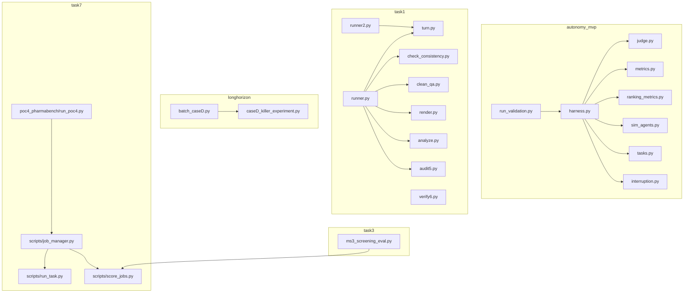
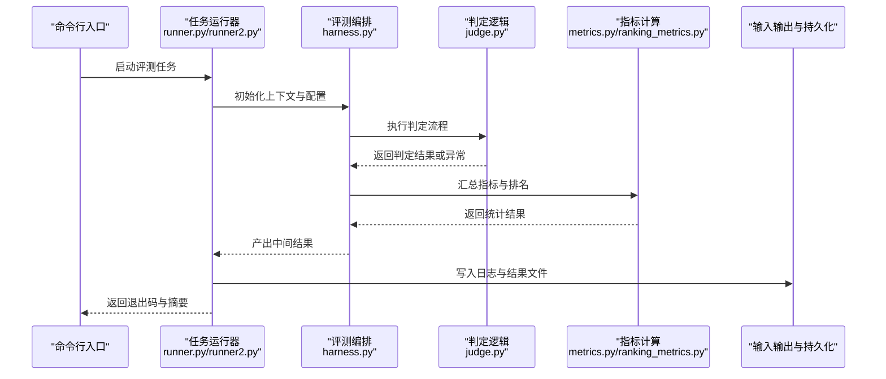
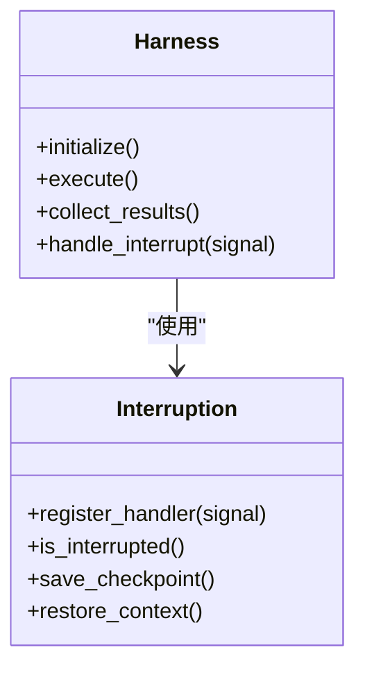
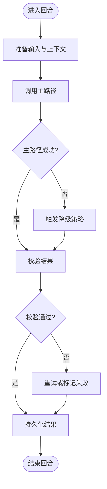
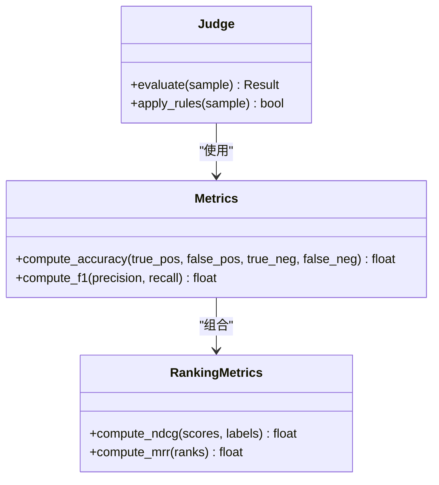
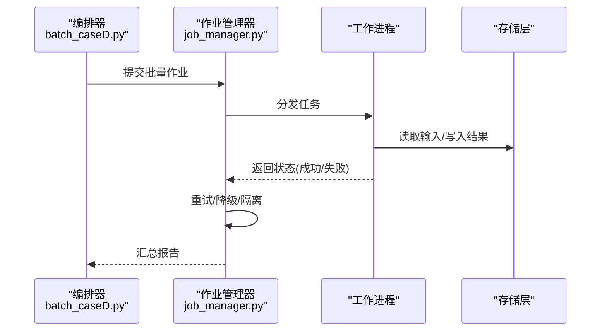
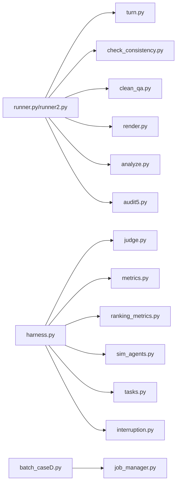

# 错误处理与调试

<cite>
**本文引用的文件**   
- [autonomy_mvp/core/harness.py](file://autonomy_mvp/core/harness.py)
- [autonomy_mvp/core/interruption.py](file://autonomy_mvp/core/interruption.py)
- [autonomy_mvp/core/judge.py](file://autonomy_mvp/core/judge.py)
- [autonomy_mvp/core/metrics.py](file://autonomy_mvp/core/metrics.py)
- [autonomy_mvp/core/ranking_metrics.py](file://autonomy_mvp/core/ranking_metrics.py)
- [autonomy_mvp/core/sim_agents.py](file://autonomy_mvp/core/sim_agents.py)
- [autonomy_mvp/core/tasks.py](file://autonomy_mvp/core/tasks.py)
- [autonomy_mvp/run_validation.py](file://autonomy_mvp/run_validation.py)
- [task1/runner.py](file://task1/runner.py)
- [task1/runner2.py](file://task1/runner2.py)
- [task1/turn.py](file://task1/turn.py)
- [task1/verify6.py](file://task1/verify6.py)
- [task1/check_consistency.py](file://task1/check_consistency.py)
- [task1/clean_qa.py](file://task1/clean_qa.py)
- [task1/render.py](file://task1/render.py)
- [task1/analyze.py](file://task1/analyze.py)
- [task1/audit5.py](file://task1/audit5.py)
- [longhorizon/instantiate/batch_caseD.py](file://longhorizon/instantiate/batch_caseD.py)
- [longhorizon/instantiate/caseD_killer_experiment.py](file://longhorizon/instantiate/caseD_killer_experiment.py)
- [task3/B_ms3_screening_prototype/ms3_screening_eval.py](file://task3/B_ms3_screening_prototype/ms3_screening_eval.py)
- [task7/poc3_physicianbench/scripts/job_manager.py](file://task7/poc3_physicianbench/scripts/job_manager.py)
- [task7/poc3_physicianbench/scripts/run_task.py](file://task7/poc3_physicianbench/scripts/run_task.py)
- [task7/poc3_physicianbench/scripts/score_jobs.py](file://task7/poc3_physicianbench/scripts/score_jobs.py)
- [task7/poc4_pharmabench/run_poc4.py](file://task7/poc4_pharmabench/run_poc4.py)
</cite>

## 目录
1. [简介](#简介)
2. [项目结构](#项目结构)
3. [核心组件](#核心组件)
4. [架构总览](#架构总览)
5. [详细组件分析](#详细组件分析)
6. [依赖分析](#依赖分析)
7. [性能考虑](#性能考虑)
8. [故障排查指南](#故障排查指南)
9. [结论](#结论)
10. [附录](#附录)

## 简介
本指南聚焦于“错误处理与调试”的实用方法，结合仓库中的评测与任务执行脚本，系统梳理异常分类、错误码设计、重试机制与降级策略；并通过真实场景展示错误捕获、日志记录、监控告警的实现思路。同时提供调试工具使用、性能分析与内存泄漏检测等高级技巧，以及最佳实践与常见问题解决方案，帮助读者在复杂评测与长周期任务中提升稳定性与可观测性。

## 项目结构
仓库包含多个独立的任务与评测模块，其中与错误处理和调试密切相关的代码主要分布在以下位置：
- autonomy_mvp：基准评测核心（编排、中断、判定、指标计算）
- task1：多轮对话与评估流程（运行器、回合控制、一致性检查、渲染与分析）
- longhorizon：长周期实例化与批处理（批量调度、杀手实验）
- task3：质谱筛选原型（评估脚本）
- task7：医疗与药物评测（作业管理、任务运行、评分、POC运行器）

图表来源
- [autonomy_mvp/run_validation.py](file://autonomy_mvp/run_validation.py)
- [autonomy_mvp/core/harness.py](file://autonomy_mvp/core/harness.py)
- [autonomy_mvp/core/judge.py](file://autonomy_mvp/core/judge.py)
- [autonomy_mvp/core/metrics.py](file://autonomy_mvp/core/metrics.py)
- [autonomy_mvp/core/ranking_metrics.py](file://autonomy_mvp/core/ranking_metrics.py)
- [autonomy_mvp/core/sim_agents.py](file://autonomy_mvp/core/sim_agents.py)
- [autonomy_mvp/core/tasks.py](file://autonomy_mvp/core/tasks.py)
- [autonomy_mvp/core/interruption.py](file://autonomy_mvp/core/interruption.py)
- [task1/runner.py](file://task1/runner.py)
- [task1/runner2.py](file://task1/runner2.py)
- [task1/turn.py](file://task1/turn.py)
- [task1/check_consistency.py](file://task1/check_consistency.py)
- [task1/clean_qa.py](file://task1/clean_qa.py)
- [task1/render.py](file://task1/render.py)
- [task1/analyze.py](file://task1/analyze.py)
- [task1/audit5.py](file://task1/audit5.py)
- [longhorizon/instantiate/batch_caseD.py](file://longhorizon/instantiate/batch_caseD.py)
- [longhorizon/instantiate/caseD_killer_experiment.py](file://longhorizon/instantiate/caseD_killer_experiment.py)
- [task3/B_ms3_screening_prototype/ms3_screening_eval.py](file://task3/B_ms3_screening_prototype/ms3_screening_eval.py)
- [task7/poc3_physicianbench/scripts/job_manager.py](file://task7/poc3_physicianbench/scripts/job_manager.py)
- [task7/poc3_physicianbench/scripts/run_task.py](file://task7/poc3_physicianbench/scripts/run_task.py)
- [task7/poc3_physicianbench/scripts/score_jobs.py](file://task7/poc3_physicianbench/scripts/score_jobs.py)
- [task7/poc4_pharmabench/run_poc4.py](file://task7/poc4_pharmabench/run_poc4.py)

章节来源
- [autonomy_mvp/run_validation.py](file://autonomy_mvp/run_validation.py)
- [autonomy_mvp/core/harness.py](file://autonomy_mvp/core/harness.py)
- [task1/runner.py](file://task1/runner.py)
- [task7/poc3_physicianbench/scripts/job_manager.py](file://task7/poc3_physicianbench/scripts/job_manager.py)

## 核心组件
围绕错误处理与调试的关键组件包括：
- 评测编排与生命周期管理：负责启动、终止、中断与结果收集，是错误捕获与恢复的第一道防线。
- 任务执行与回合控制：在多轮交互中维护状态、处理外部调用失败与超时，并实现重试与降级。
- 指标计算与排名：对异常数据进行容错处理，保证统计结果的稳健性。
- 作业管理与批处理：在分布式或批量场景中统一错误上报、重试与降级策略。

章节来源
- [autonomy_mvp/core/harness.py](file://autonomy_mvp/core/harness.py)
- [autonomy_mvp/core/interruption.py](file://autonomy_mvp/core/interruption.py)
- [autonomy_mvp/core/judge.py](file://autonomy_mvp/core/judge.py)
- [autonomy_mvp/core/metrics.py](file://autonomy_mvp/core/metrics.py)
- [autonomy_mvp/core/ranking_metrics.py](file://autonomy_mvp/core/ranking_metrics.py)
- [autonomy_mvp/core/sim_agents.py](file://autonomy_mvp/core/sim_agents.py)
- [autonomy_mvp/core/tasks.py](file://autonomy_mvp/core/tasks.py)
- [task1/runner.py](file://task1/runner.py)
- [task1/turn.py](file://task1/turn.py)
- [task7/poc3_physicianbench/scripts/job_manager.py](file://task7/poc3_physicianbench/scripts/job_manager.py)

## 架构总览
下图展示了从评测入口到任务执行、指标计算与结果输出的整体流程，并标注了错误处理与调试的关键节点。

图表来源
- [task1/runner.py](file://task1/runner.py)
- [task1/runner2.py](file://task1/runner2.py)
- [autonomy_mvp/core/harness.py](file://autonomy_mvp/core/harness.py)
- [autonomy_mvp/core/judge.py](file://autonomy_mvp/core/judge.py)
- [autonomy_mvp/core/metrics.py](file://autonomy_mvp/core/metrics.py)
- [autonomy_mvp/core/ranking_metrics.py](file://autonomy_mvp/core/ranking_metrics.py)

## 详细组件分析

### 组件A：评测编排与中断处理（harness.py + interruption.py）
- 职责边界
  - 编排评测生命周期：准备环境、加载任务、驱动执行、收集结果。
  - 中断与恢复：支持优雅终止、信号处理、断点续跑。
- 错误处理要点
  - 将外部依赖异常（网络、I/O、第三方库）与业务异常分离，便于分类与重试。
  - 在中断点记录上下文快照，确保可恢复性与可回溯性。
- 调试建议
  - 在关键阶段插入结构化日志（阶段名、耗时、资源占用）。
  - 为中断事件生成唯一ID，关联后续日志与结果文件。

图表来源
- [autonomy_mvp/core/harness.py](file://autonomy_mvp/core/harness.py)
- [autonomy_mvp/core/interruption.py](file://autonomy_mvp/core/interruption.py)

章节来源
- [autonomy_mvp/core/harness.py](file://autonomy_mvp/core/harness.py)
- [autonomy_mvp/core/interruption.py](file://autonomy_mvp/core/interruption.py)

### 组件B：任务执行与回合控制（runner.py/runner2.py + turn.py）
- 职责边界
  - runner：解析参数、加载数据、循环执行回合、聚合结果。
  - turn：单回合逻辑封装，包含模型调用、工具调用、校验与回退。
- 错误处理要点
  - 针对外部服务调用设置超时与重试（指数退避），并对不可重试错误快速失败。
  - 在回合级进行降级：当主路径失败时切换到备用策略或返回默认值。
- 调试建议
  - 为每回合生成追踪ID，串联请求、响应与中间状态。
  - 输出关键路径的性能指标（延迟分布、失败率）。

图表来源
- [task1/runner.py](file://task1/runner.py)
- [task1/runner2.py](file://task1/runner2.py)
- [task1/turn.py](file://task1/turn.py)

章节来源
- [task1/runner.py](file://task1/runner.py)
- [task1/runner2.py](file://task1/runner2.py)
- [task1/turn.py](file://task1/turn.py)

### 组件C：判定与指标计算（judge.py + metrics.py + ranking_metrics.py）
- 职责边界
  - judge：根据规则或模型输出进行判定，返回布尔或分数。
  - metrics：计算准确率、召回率、F1等基础指标。
  - ranking_metrics：排序相关指标（如NDCG、MRR）。
- 错误处理要点
  - 对缺失或脏数据进行容错处理（跳过、插补或标记）。
  - 指标计算过程中避免除零与越界，保证数值稳定。
- 调试建议
  - 输出样本级判定详情与指标贡献度，便于定位偏差来源。
  - 对异常样本进行抽样审计，形成回归测试集。

图表来源
- [autonomy_mvp/core/judge.py](file://autonomy_mvp/core/judge.py)
- [autonomy_mvp/core/metrics.py](file://autonomy_mvp/core/metrics.py)
- [autonomy_mvp/core/ranking_metrics.py](file://autonomy_mvp/core/ranking_metrics.py)

章节来源
- [autonomy_mvp/core/judge.py](file://autonomy_mvp/core/judge.py)
- [autonomy_mvp/core/metrics.py](file://autonomy_mvp/core/metrics.py)
- [autonomy_mvp/core/ranking_metrics.py](file://autonomy_mvp/core/ranking_metrics.py)

### 组件D：作业管理与批处理（job_manager.py + batch_caseD.py）
- 职责边界
  - job_manager：作业提交、状态跟踪、失败重试与结果汇总。
  - batch_caseD：批量实例化与并行执行，协调资源与并发度。
- 错误处理要点
  - 区分瞬时失败（网络抖动、资源争用）与永久失败（数据损坏、配置错误）。
  - 实现幂等提交与去重，避免重复执行导致的数据污染。
- 调试建议
  - 为每个作业生成唯一标识，集中采集日志与指标。
  - 提供作业级健康检查与自动隔离失败的节点。

图表来源
- [longhorizon/instantiate/batch_caseD.py](file://longhorizon/instantiate/batch_caseD.py)
- [task7/poc3_physicianbench/scripts/job_manager.py](file://task7/poc3_physicianbench/scripts/job_manager.py)

章节来源
- [longhorizon/instantiate/batch_caseD.py](file://longhorizon/instantiate/batch_caseD.py)
- [task7/poc3_physicianbench/scripts/job_manager.py](file://task7/poc3_physicianbench/scripts/job_manager.py)

### 组件E：专项评估与POC运行器（ms3_screening_eval.py + run_poc4.py）
- 职责边界
  - ms3_screening_eval：特定任务的评估流程，包含数据清洗、特征提取与评分。
  - run_poc4：POC运行器，整合工具链与外部依赖，输出验证结果。
- 错误处理要点
  - 对数据格式不一致进行强校验与修复，失败时记录样本ID以便人工复核。
  - 对工具调用失败采用短路策略，避免阻塞整个流水线。
- 调试建议
  - 输出中间产物与版本信息，便于复现与对比。
  - 引入最小可复现实例集，作为回归测试基线。

章节来源
- [task3/B_ms3_screening_prototype/ms3_screening_eval.py](file://task3/B_ms3_screening_prototype/ms3_screening_eval.py)
- [task7/poc4_pharmabench/run_poc4.py](file://task7/poc4_pharmabench/run_poc4.py)

## 依赖分析
- 内部依赖
  - runner/runner2 依赖 turn 与一致性检查、清理、渲染与分析工具。
  - harness 依赖 judge、metrics、ranking_metrics、sim_agents、tasks 与 interruption。
  - job_manager 与 batch_caseD 共同协作完成批处理与作业管理。
- 外部依赖
  - 评测与任务执行通常依赖外部API、文件系统与数据库，需统一错误分类与重试策略。
- 潜在耦合风险
  - 若指标计算与判定逻辑强耦合，可能导致错误传播范围扩大，建议通过接口解耦与契约测试保障。

图表来源
- [task1/runner.py](file://task1/runner.py)
- [task1/runner2.py](file://task1/runner2.py)
- [task1/turn.py](file://task1/turn.py)
- [task1/check_consistency.py](file://task1/check_consistency.py)
- [task1/clean_qa.py](file://task1/clean_qa.py)
- [task1/render.py](file://task1/render.py)
- [task1/analyze.py](file://task1/analyze.py)
- [task1/audit5.py](file://task1/audit5.py)
- [autonomy_mvp/core/harness.py](file://autonomy_mvp/core/harness.py)
- [autonomy_mvp/core/judge.py](file://autonomy_mvp/core/judge.py)
- [autonomy_mvp/core/metrics.py](file://autonomy_mvp/core/metrics.py)
- [autonomy_mvp/core/ranking_metrics.py](file://autonomy_mvp/core/ranking_metrics.py)
- [autonomy_mvp/core/sim_agents.py](file://autonomy_mvp/core/sim_agents.py)
- [autonomy_mvp/core/tasks.py](file://autonomy_mvp/core/tasks.py)
- [autonomy_mvp/core/interruption.py](file://autonomy_mvp/core/interruption.py)
- [longhorizon/instantiate/batch_caseD.py](file://longhorizon/instantiate/batch_caseD.py)
- [task7/poc3_physicianbench/scripts/job_manager.py](file://task7/poc3_physicianbench/scripts/job_manager.py)

章节来源
- [task1/runner.py](file://task1/runner.py)
- [autonomy_mvp/core/harness.py](file://autonomy_mvp/core/harness.py)
- [longhorizon/instantiate/batch_caseD.py](file://longhorizon/instantiate/batch_caseD.py)
- [task7/poc3_physicianbench/scripts/job_manager.py](file://task7/poc3_physicianbench/scripts/job_manager.py)

## 性能考虑
- 重试与退避
  - 对瞬时失败采用指数退避与抖动，避免雪崩效应。
  - 设置最大重试次数与超时阈值，防止无限等待。
- 降级策略
  - 在主路径失败时切换到轻量替代方案（缓存、默认值、简化模型）。
  - 对非关键路径进行异步执行与合并，降低阻塞时间。
- 资源与并发
  - 合理控制并发度，避免CPU/内存/IO瓶颈。
  - 对大对象进行流式处理与增量更新，减少峰值内存。
- 可观测性
  - 采集关键指标（延迟、吞吐、错误率、资源利用率）。
  - 建立SLO与告警阈值，及时发现问题。

[本节为通用指导，不直接分析具体文件]

## 故障排查指南
- 错误分类与错误码
  - 将错误分为：输入校验错误、外部依赖错误、业务逻辑错误、系统资源错误。
  - 为每类错误定义明确错误码与消息模板，便于检索与聚合。
- 日志与追踪
  - 使用结构化日志（JSON）记录上下文、追踪ID、耗时与堆栈。
  - 为关键操作添加埋点，形成端到端链路追踪。
- 监控与告警
  - 基于错误率、延迟分位与资源使用率设置告警。
  - 对高频错误进行趋势分析，识别退化与回归。
- 调试工具与技巧
  - 使用断点与条件断点缩小问题范围。
  - 利用性能剖析工具定位热点函数与锁竞争。
  - 通过内存快照与泄漏检测工具（如tracemalloc、objgraph）定位未释放引用。
- 常见场景与对策
  - 外部API不稳定：增加重试与熔断，启用降级路径。
  - 数据质量差：前置校验与清洗，失败样本隔离与人工复核。
  - 并发冲突：引入幂等键与分布式锁，避免重复执行。

章节来源
- [task1/verify6.py](file://task1/verify6.py)
- [task1/analyze.py](file://task1/analyze.py)
- [task1/audit5.py](file://task1/audit5.py)
- [task7/poc3_physicianbench/scripts/score_jobs.py](file://task7/poc3_physicianbench/scripts/score_jobs.py)

## 结论
通过在编排、执行、判定与批处理各层构建一致的错误处理与调试体系，可以显著提升评测与长周期任务的稳定性与可观测性。建议以错误分类为基础，结合重试与降级策略，辅以结构化日志、追踪与监控告警，形成闭环的故障治理机制。同时，持续完善调试工具链与性能分析方法，有助于快速定位与解决问题，保障系统在高负载与复杂依赖下的可靠运行。

## 附录
- 术语表
  - 重试：对瞬时失败再次尝试执行。
  - 降级：在主路径失败时使用替代方案维持基本功能。
  - 熔断：在错误率超过阈值时快速失败，避免雪崩。
  - 幂等：多次执行产生相同结果，避免重复副作用。
- 参考清单
  - 错误码规范模板
  - 结构化日志字段约定
  - 监控指标与告警阈值建议

[本节为补充说明，不直接分析具体文件]