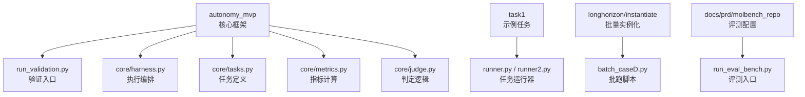
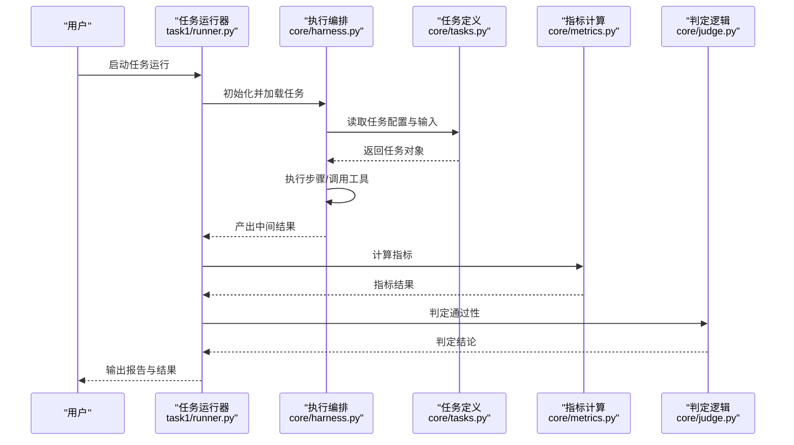
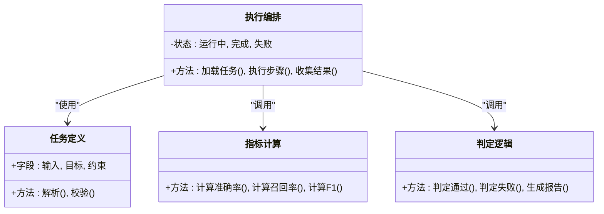
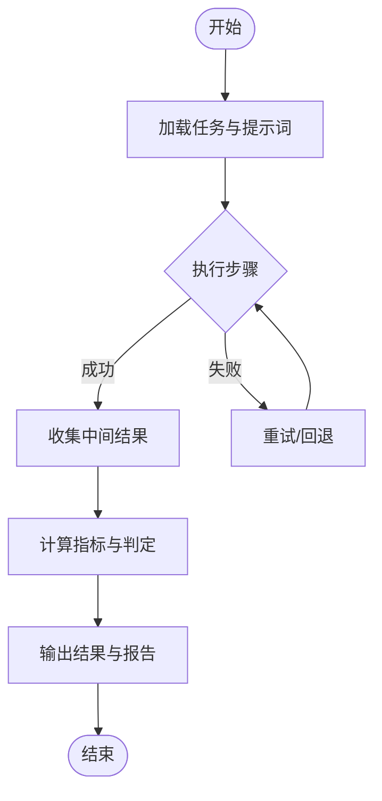
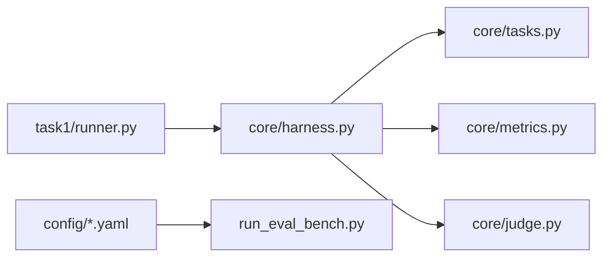

# 快速开始

<cite>
**本文档引用的文件**   
- [autonomy_mvp/core/harness.py](file://autonomy_mvp/core/harness.py)
- [autonomy_mvp/core/tasks.py](file://autonomy_mvp/core/tasks.py)
- [autonomy_mvp/core/metrics.py](file://autonomy_mvp/core/metrics.py)
- [autonomy_mvp/core/judge.py](file://autonomy_mvp/core/judge.py)
- [autonomy_mvp/run_validation.py](file://autonomy_mvp/run_validation.py)
- [autonomy_mvp/schema.md](file://autonomy_mvp/schema.md)
- [autonomy_mvp/ACCEPTANCE.md](file://autonomy_mvp/ACCEPTANCE.md)
- [task1/runner.py](file://task1/runner.py)
- [task1/runner2.py](file://task1/runner2.py)
- [task1/goal.md](file://task1/goal.md)
- [task1/session_1/B_result.json](file://task1/session_1/B_result.json)
- [task1/session_1/prompts/A_all.txt](file://task1/session_1/prompts/A_all.txt)
- [task1/session_1/prompts/B_step1.txt](file://task1/session_1/prompts/B_step1.txt)
- [longhorizon/instantiate/batch_caseD.py](file://longhorizon/instantiate/batch_caseD.py)
- [docs/prd/molbench_repo/config/baseline_molbench-ms-1.yaml](file://docs/prd/molbench_repo/config/baseline_molbench-ms-1.yaml)
- [docs/prd/molbench_repo/eval/run_eval_bench.py](file://docs/prd/molbench_repo/eval/run_eval_bench.py)
</cite>

## 目录
1. [简介](#简介)
2. [项目结构](#项目结构)
3. [核心组件](#核心组件)
4. [架构总览](#架构总览)
5. [详细组件分析](#详细组件分析)
6. [依赖关系分析](#依赖关系分析)
7. [性能注意事项](#性能注意事项)
8. [故障排查指南](#故障排查指南)
9. [结论](#结论)
10. [附录](#附录)

## 简介
本快速开始指南帮助你在5分钟内完成环境准备、配置设置，并运行第一个基准测试任务。你将体验到从任务定义、执行到评估的完整流程，并获得最小化的示例与预期输出说明。

## 项目结构
仓库包含多个子项目与实验目录，其中与“快速开始”最相关的部分包括：
- autonomy_mvp：核心基准框架（任务、评测、指标、验收规范）
- task1：首个可运行的任务会话与结果样例
- longhorizon/instantiate：批量实例化脚本（可用于批跑）
- docs/prd/molbench_repo：评测配置与评测入口（可选扩展）

图表来源
- [autonomy_mvp/run_validation.py](file://autonomy_mvp/run_validation.py)
- [autonomy_mvp/core/harness.py](file://autonomy_mvp/core/harness.py)
- [autonomy_mvp/core/tasks.py](file://autonomy_mvp/core/tasks.py)
- [autonomy_mvp/core/metrics.py](file://autonomy_mvp/core/metrics.py)
- [autonomy_mvp/core/judge.py](file://autonomy_mvp/core/judge.py)
- [task1/runner.py](file://task1/runner.py)
- [task1/runner2.py](file://task1/runner2.py)
- [longhorizon/instantiate/batch_caseD.py](file://longhorizon/instantiate/batch_caseD.py)
- [docs/prd/molbench_repo/eval/run_eval_bench.py](file://docs/prd/molbench_repo/eval/run_eval_bench.py)

章节来源
- [autonomy_mvp/schema.md](file://autonomy_mvp/schema.md)
- [autonomy_mvp/ACCEPTANCE.md](file://autonomy_mvp/ACCEPTANCE.md)

## 核心组件
- 任务定义与数据契约：通过 schema 与任务描述文件约定输入输出格式，确保评测一致性。
- 执行编排：harness 负责加载任务、驱动执行、收集中间结果。
- 指标与判定：metrics 提供度量方法，judge 提供判定规则。
- 运行入口：run_validation 提供一键验证能力；task1 下的 runner 系列用于具体任务运行。

章节来源
- [autonomy_mvp/core/tasks.py](file://autonomy_mvp/core/tasks.py)
- [autonomy_mvp/core/harness.py](file://autonomy_mvp/core/harness.py)
- [autonomy_mvp/core/metrics.py](file://autonomy_mvp/core/metrics.py)
- [autonomy_mvp/core/judge.py](file://autonomy_mvp/core/judge.py)
- [autonomy_mvp/run_validation.py](file://autonomy_mvp/run_validation.py)

## 架构总览
下图展示了从“任务定义”到“执行与评测”的整体流程，以及关键模块之间的交互关系。

图表来源
- [task1/runner.py](file://task1/runner.py)
- [autonomy_mvp/core/harness.py](file://autonomy_mvp/core/harness.py)
- [autonomy_mvp/core/tasks.py](file://autonomy_mvp/core/tasks.py)
- [autonomy_mvp/core/metrics.py](file://autonomy_mvp/core/metrics.py)
- [autonomy_mvp/core/judge.py](file://autonomy_mvp/core/judge.py)

## 详细组件分析

### 组件A：任务与评测核心（autonomy_mvp）
- 任务定义：tasks 提供任务结构与字段约束，配合 schema 文档统一数据契约。
- 执行编排：harness 负责生命周期管理、状态流转与错误处理。
- 指标与判定：metrics 提供数值型指标计算，judge 提供基于规则的判定。

图表来源
- [autonomy_mvp/core/tasks.py](file://autonomy_mvp/core/tasks.py)
- [autonomy_mvp/core/harness.py](file://autonomy_mvp/core/harness.py)
- [autonomy_mvp/core/metrics.py](file://autonomy_mvp/core/metrics.py)
- [autonomy_mvp/core/judge.py](file://autonomy_mvp/core/judge.py)

章节来源
- [autonomy_mvp/schema.md](file://autonomy_mvp/schema.md)
- [autonomy_mvp/ACCEPTANCE.md](file://autonomy_mvp/ACCEPTANCE.md)

### 组件B：第一个任务运行（task1）
- 运行器：runner.py / runner2.py 提供任务执行入口，支持多轮对话或单步执行。
- 提示词：session_1/prompts 下包含 A_all.txt、B_step*.txt 等提示模板。
- 结果：session_1/B_result.json 为典型输出样例，便于对比与调试。

图表来源
- [task1/runner.py](file://task1/runner.py)
- [task1/runner2.py](file://task1/runner2.py)
- [task1/session_1/prompts/A_all.txt](file://task1/session_1/prompts/A_all.txt)
- [task1/session_1/prompts/B_step1.txt](file://task1/session_1/prompts/B_step1.txt)
- [task1/session_1/B_result.json](file://task1/session_1/B_result.json)

章节来源
- [task1/goal.md](file://task1/goal.md)

### 组件C：批量实例化（longhorizon/instantiate）
- 批量脚本：batch_caseD.py 用于批量生成与运行实例，适合大规模评测。
- 适用场景：需要并行或批量化执行的任务集。

章节来源
- [longhorizon/instantiate/batch_caseD.py](file://longhorizon/instantiate/batch_caseD.py)

### 组件D：评测配置与入口（docs/prd/molbench_repo）
- 配置文件：baseline_molbench-ms-1.yaml 等 YAML 配置用于指定数据集、参数与评测选项。
- 评测入口：run_eval_bench.py 提供统一的评测执行命令。

章节来源
- [docs/prd/molbench_repo/config/baseline_molbench-ms-1.yaml](file://docs/prd/molbench_repo/config/baseline_molbench-ms-1.yaml)
- [docs/prd/molbench_repo/eval/run_eval_bench.py](file://docs/prd/molbench_repo/eval/run_eval_bench.py)

## 依赖关系分析
- 模块耦合：harness 强依赖 tasks、metrics、judge；runner 依赖 harness 与任务提示词。
- 外部依赖：评测配置与数据文件由 YAML/JSON 驱动，便于替换与扩展。
- 循环依赖：当前设计避免循环导入，职责清晰。

图表来源
- [task1/runner.py](file://task1/runner.py)
- [autonomy_mvp/core/harness.py](file://autonomy_mvp/core/harness.py)
- [autonomy_mvp/core/tasks.py](file://autonomy_mvp/core/tasks.py)
- [autonomy_mvp/core/metrics.py](file://autonomy_mvp/core/metrics.py)
- [autonomy_mvp/core/judge.py](file://autonomy_mvp/core/judge.py)
- [docs/prd/molbench_repo/config/baseline_molbench-ms-1.yaml](file://docs/prd/molbench_repo/config/baseline_molbench-ms-1.yaml)
- [docs/prd/molbench_repo/eval/run_eval_bench.py](file://docs/prd/molbench_repo/eval/run_eval_bench.py)

## 性能注意事项
- 批量化：优先使用 batch_caseD.py 进行批量实例化与执行，减少重复开销。
- 指标计算：在 metrics 中尽量复用中间结果，避免重复计算。
- I/O优化：对大文件读写采用流式处理，降低内存占用。
- 并行策略：根据硬件资源调整并发度，避免过度竞争导致抖动。

## 故障排查指南
- 安装问题
  - Python版本不匹配：确认环境与依赖要求一致。
  - 包冲突：使用独立虚拟环境隔离依赖。
- 配置问题
  - YAML/JSON格式错误：检查键名与数据类型是否符合 schema。
  - 路径错误：确认数据与配置文件路径正确。
- 运行问题
  - 任务加载失败：核对任务定义与输入格式。
  - 指标计算异常：检查输入数据范围与边界条件。
  - 判定失败：查看 judge 的规则与阈值设置。
- 日志定位
  - 启用详细日志，定位失败步骤与堆栈信息。
  - 对比 session_1/B_result.json 的预期结构，逐步缩小问题范围。

章节来源
- [autonomy_mvp/schema.md](file://autonomy_mvp/schema.md)
- [autonomy_mvp/ACCEPTANCE.md](file://autonomy_mvp/ACCEPTANCE.md)
- [task1/session_1/B_result.json](file://task1/session_1/B_result.json)

## 结论
通过本指南，你已了解如何准备环境、配置任务、运行第一个基准测试，并理解核心组件的职责与交互。建议后续结合批量脚本与评测配置，扩展更多任务与指标，构建完整的评测流水线。

## 附录

### 5分钟快速上手步骤
- 准备环境
  - 创建并激活Python虚拟环境
  - 安装必要依赖（参考各模块 requirements 或环境说明）
- 配置任务
  - 检查 schema 与任务描述文件，确保输入输出格式正确
  - 如需扩展评测，编辑 YAML 配置文件
- 运行任务
  - 使用 task1/runner.py 或 runner2.py 启动任务
  - 观察控制台输出与结果文件
- 验证结果
  - 对比 session_1/B_result.json 的结构与内容
  - 如失败，按故障排查指南定位问题

章节来源
- [autonomy_mvp/schema.md](file://autonomy_mvp/schema.md)
- [autonomy_mvp/ACCEPTANCE.md](file://autonomy_mvp/ACCEPTANCE.md)
- [task1/runner.py](file://task1/runner.py)
- [task1/runner2.py](file://task1/runner2.py)
- [task1/session_1/B_result.json](file://task1/session_1/B_result.json)