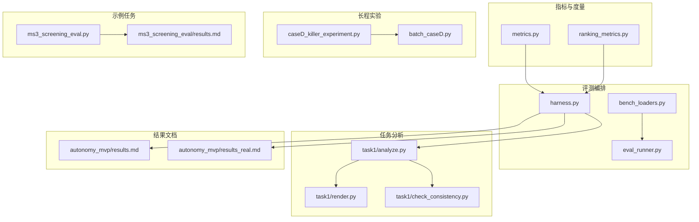
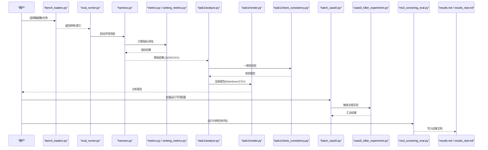
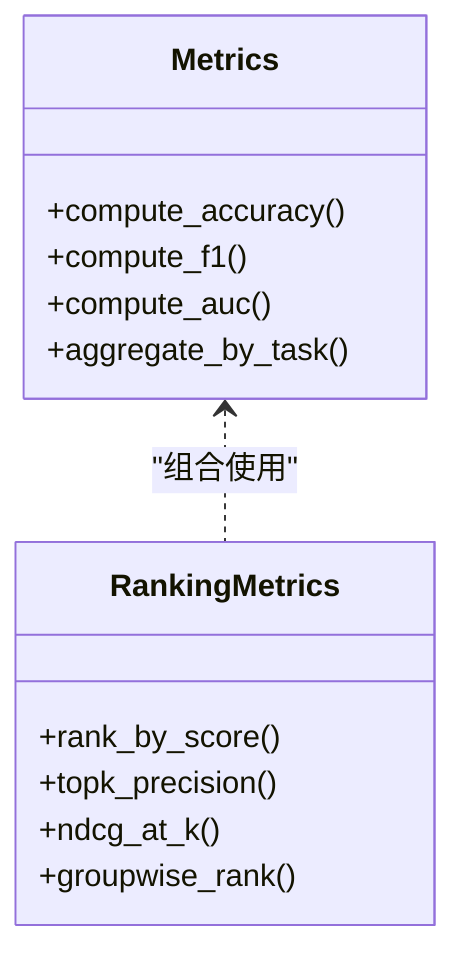
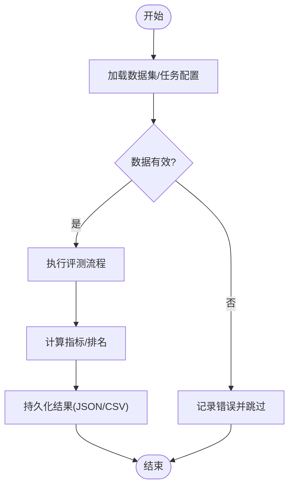
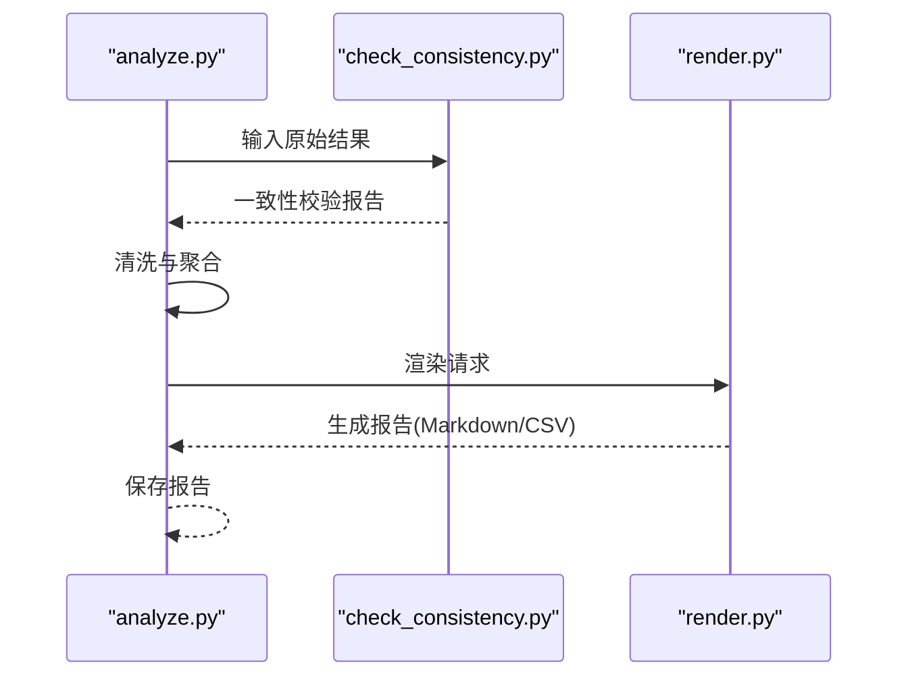
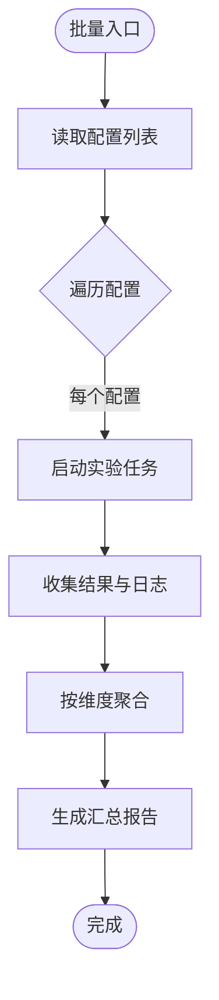
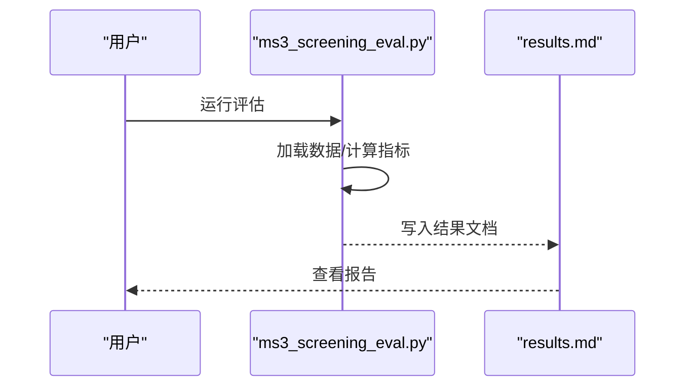
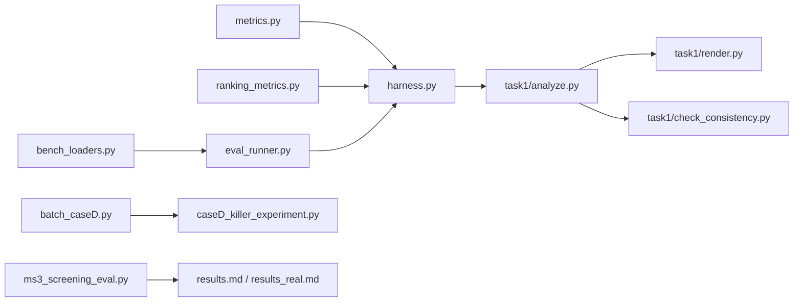

# 结果分析教程

<cite>
**本文引用的文件**   
- [autonomy_mvp/core/metrics.py](file://autonomy_mvp/core/metrics.py)
- [autonomy_mvp/core/ranking_metrics.py](file://autonomy_mvp/core/ranking_metrics.py)
- [autonomy_mvp/core/harness.py](file://autonomy_mvp/core/harness.py)
- [autonomy_mvp/results.md](file://autonomy_mvp/results.md)
- [autonomy_mvp/results_real.md](file://autonomy_mvp/results_real.md)
- [task1/analyze.py](file://task1/analyze.py)
- [task1/check_consistency.py](file://task1/check_consistency.py)
- [task1/render.py](file://task1/render.py)
- [task4_papers/eval/eval_runner.py](file://docs/prd/molbench_repo/eval/eval_runner.py)
- [docs/prd/molbench_repo/eval/bench_loaders.py](file://docs/prd/molbench_repo/eval/bench_loaders.py)
- [longhorizon/instantiate/caseD_killer_experiment.py](file://longhorizon/instantiate/caseD_killer_experiment.py)
- [longhorizon/instantiate/batch_caseD.py](file://longhorizon/instantiate/batch_caseD.py)
- [task3/B_ms3_screening_prototype/ms3_screening_eval.py](file://task3/B_ms3_screening_prototype/ms3_screening_eval.py)
- [task3/B_ms3_screening_prototype/results.md](file://task3/B_ms3_screening_prototype/results.md)
</cite>

## 目录
1. [引言](#引言)
2. [项目结构](#项目结构)
3. [核心组件](#核心组件)
4. [架构总览](#架构总览)
5. [详细组件分析](#详细组件分析)
6. [依赖关系分析](#依赖关系分析)
7. [性能考量](#性能考量)
8. [故障排查指南](#故障排查指南)
9. [结论](#结论)
10. [附录](#附录)

## 引言
本教程面向需要解读基准测试结果、生成分析报告并进行性能对比的工程师与研究人员。结合仓库中的实际实验数据与分析脚本，我们将系统讲解：
- 如何从原始运行结果中抽取指标并计算统计量
- 如何生成可读的分析报告（Markdown/CSV）
- 如何进行多组实验的性能对比与可视化
- 如何实现结果导出、格式转换与批量处理
- 提供可复用的分析模板与最佳实践

## 项目结构
仓库包含多个任务与子项目，其中与“结果分析”直接相关的代码与数据主要分布在以下位置：
- 通用评测指标与排名指标：autonomy_mvp/core 下的 metrics 与 ranking_metrics
- 评测编排与执行：autonomy_mvp/core/harness 与 docs/prd/molbench_repo/eval 下的 runner/loader
- 任务级分析与渲染：task1/analyze.py、render.py、check_consistency.py
- 长程实验批处理与案例：longhorizon/instantiate 下 caseD_* 相关脚本
- 特定任务评估示例：task3/B_ms3_screening_prototype 下的评估脚本与结果文档
- 已有结果文档：autonomy_mvp/results.md、results_real.md、task3/B_ms3_screening_prototype/results.md

图表来源
- [autonomy_mvp/core/metrics.py](file://autonomy_mvp/core/metrics.py)
- [autonomy_mvp/core/ranking_metrics.py](file://autonomy_mvp/core/ranking_metrics.py)
- [autonomy_mvp/core/harness.py](file://autonomy_mvp/core/harness.py)
- [docs/prd/molbench_repo/eval/eval_runner.py](file://docs/prd/molbench_repo/eval/eval_runner.py)
- [docs/prd/molbench_repo/eval/bench_loaders.py](file://docs/prd/molbench_repo/eval/bench_loaders.py)
- [task1/analyze.py](file://task1/analyze.py)
- [task1/render.py](file://task1/render.py)
- [task1/check_consistency.py](file://task1/check_consistency.py)
- [longhorizon/instantiate/caseD_killer_experiment.py](file://longhorizon/instantiate/caseD_killer_experiment.py)
- [longhorizon/instantiate/batch_caseD.py](file://longhorizon/instantiate/batch_caseD.py)
- [task3/B_ms3_screening_prototype/ms3_screening_eval.py](file://task3/B_ms3_screening_prototype/ms3_screening_eval.py)
- [task3/B_ms3_screening_prototype/results.md](file://task3/B_ms3_screening_prototype/results.md)
- [autonomy_mvp/results.md](file://autonomy_mvp/results.md)
- [autonomy_mvp/results_real.md](file://autonomy_mvp/results_real.md)

章节来源
- [autonomy_mvp/core/metrics.py](file://autonomy_mvp/core/metrics.py)
- [autonomy_mvp/core/ranking_metrics.py](file://autonomy_mvp/core/ranking_metrics.py)
- [autonomy_mvp/core/harness.py](file://autonomy_mvp/core/harness.py)
- [docs/prd/molbench_repo/eval/eval_runner.py](file://docs/prd/molbench_repo/eval/eval_runner.py)
- [docs/prd/molbench_repo/eval/bench_loaders.py](file://docs/prd/molbench_repo/eval/bench_loaders.py)
- [task1/analyze.py](file://task1/analyze.py)
- [task1/render.py](file://task1/render.py)
- [task1/check_consistency.py](file://task1/check_consistency.py)
- [longhorizon/instantiate/caseD_killer_experiment.py](file://longhorizon/instantiate/caseD_killer_experiment.py)
- [longhorizon/instantiate/batch_caseD.py](file://longhorizon/instantiate/batch_caseD.py)
- [task3/B_ms3_screening_prototype/ms3_screening_eval.py](file://task3/B_ms3_screening_prototype/ms3_screening_eval.py)
- [task3/B_ms3_screening_prototype/results.md](file://task3/B_ms3_screening_prototype/results.md)
- [autonomy_mvp/results.md](file://autonomy_mvp/results.md)
- [autonomy_mvp/results_real.md](file://autonomy_mvp/results_real.md)

## 核心组件
- 指标与排名模块
  - 负责定义与计算评测指标（如准确率、F1、AUC等）以及基于排名的评估方法，为后续聚合与对比提供统一度量基础。
- 评测编排与加载器
  - 负责加载数据集、组织评测流程、驱动具体评测逻辑，并将中间与最终结果持久化到磁盘或内存数据结构中。
- 任务级分析工具
  - 对单任务或多任务的原始结果进行清洗、一致性检查、汇总统计与可视化渲染，输出 Markdown/CSV 等格式的报告。
- 长程实验批处理
  - 针对长周期或大规模实验，提供批量运行、结果收集与汇总能力，便于跨配置/跨实例的横向对比。
- 示例任务评估
  - 以具体任务（如药物筛选）为例，展示端到端的评估与结果文档生成流程。

章节来源
- [autonomy_mvp/core/metrics.py](file://autonomy_mvp/core/metrics.py)
- [autonomy_mvp/core/ranking_metrics.py](file://autonomy_mvp/core/ranking_metrics.py)
- [autonomy_mvp/core/harness.py](file://autonomy_mvp/core/harness.py)
- [docs/prd/molbench_repo/eval/eval_runner.py](file://docs/prd/molbench_repo/eval/eval_runner.py)
- [docs/prd/molbench_repo/eval/bench_loaders.py](file://docs/prd/molbench_repo/eval/bench_loaders.py)
- [task1/analyze.py](file://task1/analyze.py)
- [task1/render.py](file://task1/render.py)
- [task1/check_consistency.py](file://task1/check_consistency.py)
- [longhorizon/instantiate/caseD_killer_experiment.py](file://longhorizon/instantiate/caseD_killer_experiment.py)
- [longhorizon/instantiate/batch_caseD.py](file://longhorizon/instantiate/batch_caseD.py)
- [task3/B_ms3_screening_prototype/ms3_screening_eval.py](file://task3/B_ms3_screening_prototype/ms3_screening_eval.py)

## 架构总览
下图展示了从数据加载、评测执行、结果聚合到报告生成的整体流程，以及各模块之间的调用关系。

图表来源
- [docs/prd/molbench_repo/eval/bench_loaders.py](file://docs/prd/molbench_repo/eval/bench_loaders.py)
- [docs/prd/molbench_repo/eval/eval_runner.py](file://docs/prd/molbench_repo/eval/eval_runner.py)
- [autonomy_mvp/core/harness.py](file://autonomy_mvp/core/harness.py)
- [autonomy_mvp/core/metrics.py](file://autonomy_mvp/core/metrics.py)
- [autonomy_mvp/core/ranking_metrics.py](file://autonomy_mvp/core/ranking_metrics.py)
- [task1/analyze.py](file://task1/analyze.py)
- [task1/render.py](file://task1/render.py)
- [task1/check_consistency.py](file://task1/check_consistency.py)
- [longhorizon/instantiate/batch_caseD.py](file://longhorizon/instantiate/batch_caseD.py)
- [longhorizon/instantiate/caseD_killer_experiment.py](file://longhorizon/instantiate/caseD_killer_experiment.py)
- [task3/B_ms3_screening_prototype/ms3_screening_eval.py](file://task3/B_ms3_screening_prototype/ms3_screening_eval.py)
- [autonomy_mvp/results.md](file://autonomy_mvp/results.md)
- [autonomy_mvp/results_real.md](file://autonomy_mvp/results_real.md)

## 详细组件分析

### 指标与排名模块（metrics.py / ranking_metrics.py）
- 职责
  - 定义评测指标的计算函数与排名算法，确保不同任务间指标口径一致。
- 关键要点
  - 指标应支持缺失值与异常值的稳健处理
  - 排名指标需考虑样本不均衡与截断效应
  - 建议将指标计算与数据加载解耦，便于单元测试与复用

图表来源
- [autonomy_mvp/core/metrics.py](file://autonomy_mvp/core/metrics.py)
- [autonomy_mvp/core/ranking_metrics.py](file://autonomy_mvp/core/ranking_metrics.py)

章节来源
- [autonomy_mvp/core/metrics.py](file://autonomy_mvp/core/metrics.py)
- [autonomy_mvp/core/ranking_metrics.py](file://autonomy_mvp/core/ranking_metrics.py)

### 评测编排与加载器（harness.py / eval_runner.py / bench_loaders.py）
- 职责
  - 加载数据集与任务配置，组织评测流水线，驱动指标计算，并持久化中间与最终结果。
- 关键要点
  - 数据加载器应支持增量读取与分页，避免内存溢出
  - 编排器需提供重试与容错机制，保证长时运行的稳定性
  - 结果结构应标准化，便于下游分析工具消费

图表来源
- [autonomy_mvp/core/harness.py](file://autonomy_mvp/core/harness.py)
- [docs/prd/molbench_repo/eval/eval_runner.py](file://docs/prd/molbench_repo/eval/eval_runner.py)
- [docs/prd/molbench_repo/eval/bench_loaders.py](file://docs/prd/molbench_repo/eval/bench_loaders.py)

章节来源
- [autonomy_mvp/core/harness.py](file://autonomy_mvp/core/harness.py)
- [docs/prd/molbench_repo/eval/eval_runner.py](file://docs/prd/molbench_repo/eval/eval_runner.py)
- [docs/prd/molbench_repo/eval/bench_loaders.py](file://docs/prd/molbench_repo/eval/bench_loaders.py)

### 任务级分析工具（task1/analyze.py / render.py / check_consistency.py）
- 职责
  - 对原始结果进行清洗、一致性校验、汇总统计与可视化渲染，输出 Markdown/CSV 等格式的报告。
- 关键要点
  - 一致性检查应覆盖字段完整性、类型约束与边界条件
  - 渲染器应支持多种输出格式，便于不同受众阅读
  - 分析流程应幂等，支持重复运行与增量更新

图表来源
- [task1/analyze.py](file://task1/analyze.py)
- [task1/check_consistency.py](file://task1/check_consistency.py)
- [task1/render.py](file://task1/render.py)

章节来源
- [task1/analyze.py](file://task1/analyze.py)
- [task1/check_consistency.py](file://task1/check_consistency.py)
- [task1/render.py](file://task1/render.py)

### 长程实验批处理（batch_caseD.py / caseD_killer_experiment.py）
- 职责
  - 针对长周期或大规模实验，提供批量运行、结果收集与汇总能力，便于跨配置/跨实例的横向对比。
- 关键要点
  - 批处理应支持并发控制与资源隔离
  - 结果汇总需按实验维度（配置、实例、时间戳）组织
  - 失败任务应可重试并保留日志以便回溯

图表来源
- [longhorizon/instantiate/batch_caseD.py](file://longhorizon/instantiate/batch_caseD.py)
- [longhorizon/instantiate/caseD_killer_experiment.py](file://longhorizon/instantiate/caseD_killer_experiment.py)

章节来源
- [longhorizon/instantiate/batch_caseD.py](file://longhorizon/instantiate/batch_caseD.py)
- [longhorizon/instantiate/caseD_killer_experiment.py](file://longhorizon/instantiate/caseD_killer_experiment.py)

### 示例任务评估（ms3_screening_eval.py / results.md）
- 职责
  - 以具体任务（如药物筛选）为例，展示端到端的评估与结果文档生成流程。
- 关键要点
  - 评估脚本应与指标模块解耦，便于替换不同指标实现
  - 结果文档应包含关键统计量、显著性检验与可视化摘要
  - 建议将示例作为新任务接入的参考模板

图表来源
- [task3/B_ms3_screening_prototype/ms3_screening_eval.py](file://task3/B_ms3_screening_prototype/ms3_screening_eval.py)
- [task3/B_ms3_screening_prototype/results.md](file://task3/B_ms3_screening_prototype/results.md)

章节来源
- [task3/B_ms3_screening_prototype/ms3_screening_eval.py](file://task3/B_ms3_screening_prototype/ms3_screening_eval.py)
- [task3/B_ms3_screening_prototype/results.md](file://task3/B_ms3_screening_prototype/results.md)

## 依赖关系分析
- 低耦合高内聚
  - 指标模块独立于数据加载与评测编排，便于替换与扩展
  - 分析工具仅依赖标准化的结果结构，降低与上游实现的耦合
- 外部依赖与集成点
  - 数据加载器对接外部数据集与配置文件
  - 渲染器可能依赖第三方库用于表格/图表生成（按需启用）
- 潜在循环依赖
  - 通过分层设计避免循环引用；若出现，应将共享逻辑下沉至公共模块

图表来源
- [autonomy_mvp/core/metrics.py](file://autonomy_mvp/core/metrics.py)
- [autonomy_mvp/core/ranking_metrics.py](file://autonomy_mvp/core/ranking_metrics.py)
- [autonomy_mvp/core/harness.py](file://autonomy_mvp/core/harness.py)
- [docs/prd/molbench_repo/eval/bench_loaders.py](file://docs/prd/molbench_repo/eval/bench_loaders.py)
- [docs/prd/molbench_repo/eval/eval_runner.py](file://docs/prd/molbench_repo/eval/eval_runner.py)
- [task1/analyze.py](file://task1/analyze.py)
- [task1/render.py](file://task1/render.py)
- [task1/check_consistency.py](file://task1/check_consistency.py)
- [longhorizon/instantiate/batch_caseD.py](file://longhorizon/instantiate/batch_caseD.py)
- [longhorizon/instantiate/caseD_killer_experiment.py](file://longhorizon/instantiate/caseD_killer_experiment.py)
- [task3/B_ms3_screening_prototype/ms3_screening_eval.py](file://task3/B_ms3_screening_prototype/ms3_screening_eval.py)
- [autonomy_mvp/results.md](file://autonomy_mvp/results.md)
- [autonomy_mvp/results_real.md](file://autonomy_mvp/results_real.md)

章节来源
- [autonomy_mvp/core/metrics.py](file://autonomy_mvp/core/metrics.py)
- [autonomy_mvp/core/ranking_metrics.py](file://autonomy_mvp/core/ranking_metrics.py)
- [autonomy_mvp/core/harness.py](file://autonomy_mvp/core/harness.py)
- [docs/prd/molbench_repo/eval/bench_loaders.py](file://docs/prd/molbench_repo/eval/bench_loaders.py)
- [docs/prd/molbench_repo/eval/eval_runner.py](file://docs/prd/molbench_repo/eval/eval_runner.py)
- [task1/analyze.py](file://task1/analyze.py)
- [task1/render.py](file://task1/render.py)
- [task1/check_consistency.py](file://task1/check_consistency.py)
- [longhorizon/instantiate/batch_caseD.py](file://longhorizon/instantiate/batch_caseD.py)
- [longhorizon/instantiate/caseD_killer_experiment.py](file://longhorizon/instantiate/caseD_killer_experiment.py)
- [task3/B_ms3_screening_prototype/ms3_screening_eval.py](file://task3/B_ms3_screening_prototype/ms3_screening_eval.py)
- [autonomy_mvp/results.md](file://autonomy_mvp/results.md)
- [autonomy_mvp/results_real.md](file://autonomy_mvp/results_real.md)

## 性能考量
- 数据加载
  - 采用流式/分页读取，避免一次性加载全部数据导致内存峰值过高
- 指标计算
  - 向量化计算优先，减少循环开销；对大样本排序类指标可使用近似算法
- 并行与批处理
  - 合理设置并发度，避免 I/O 竞争与资源争用；对 CPU/GPU 密集型任务分别优化
- 结果持久化
  - 使用列式存储（如 CSV/Parquet）提升后续分析效率；分片写入避免单文件过大
- 缓存与增量更新
  - 对稳定中间结果进行缓存，支持增量重算与快速回归测试

[本节为通用指导，无需列出具体文件来源]

## 故障排查指南
- 常见错误定位
  - 数据不一致：字段缺失、类型不符、空值过多
  - 指标异常：除零、NaN/Inf、越界值
  - 运行中断：超时、内存不足、外部服务不可用
- 排查步骤
  - 使用一致性检查工具验证输入/输出结构
  - 在关键节点打印/记录中间状态与耗时
  - 对失败任务保留完整日志与快照，便于复现
- 恢复策略
  - 重试与退避：对瞬时失败进行有限次重试
  - 断点续跑：记录已处理进度，支持从中断处继续
  - 降级模式：在部分数据缺失时采用保守估计或标记未决

章节来源
- [task1/check_consistency.py](file://task1/check_consistency.py)
- [task1/analyze.py](file://task1/analyze.py)
- [autonomy_mvp/core/harness.py](file://autonomy_mvp/core/harness.py)

## 结论
通过将指标计算、评测编排、结果分析与报告渲染模块化，本项目提供了从原始结果到可操作洞察的完整链路。借助统一的指标口径、标准化的结果结构与可扩展的分析工具，用户可以高效地进行性能对比、趋势分析与决策支持。建议在团队内推广本教程中的模板与实践，持续提升基准评测的可复现性与可比性。

[本节为总结性内容，无需列出具体文件来源]

## 附录

### 实用功能清单
- 结果导出
  - 支持 JSON/CSV/Markdown 等多种格式导出，便于不同工具链消费
- 格式转换
  - 提供轻量转换器，将评测中间结果转换为分析友好的宽表结构
- 批量处理
  - 通过批处理脚本驱动多配置/多实例实验，自动汇总与对比

章节来源
- [task1/analyze.py](file://task1/analyze.py)
- [task1/render.py](file://task1/render.py)
- [longhorizon/instantiate/batch_caseD.py](file://longhorizon/instantiate/batch_caseD.py)

### 结果分析模板与最佳实践
- 模板要素
  - 实验元信息（版本、配置、时间戳）
  - 指标汇总表（均值、方差、置信区间）
  - 显著性检验与效应量
  - 可视化摘要（柱状图、箱线图、折线图）
- 最佳实践
  - 固定随机种子以保证可复现性
  - 明确标注缺失值与剔除规则
  - 对极端值进行敏感性分析
  - 报告同时提供原始数据与加工后数据，便于二次分析

章节来源
- [autonomy_mvp/results.md](file://autonomy_mvp/results.md)
- [autonomy_mvp/results_real.md](file://autonomy_mvp/results_real.md)
- [task3/B_ms3_screening_prototype/results.md](file://task3/B_ms3_screening_prototype/results.md)