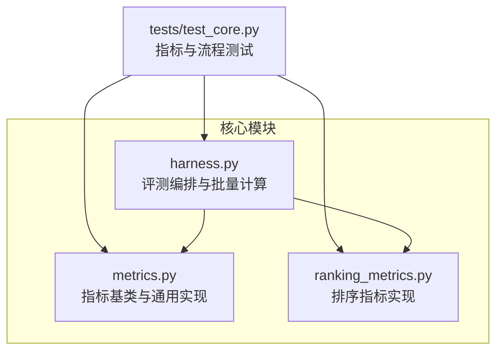
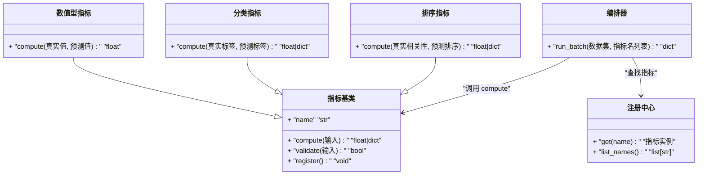
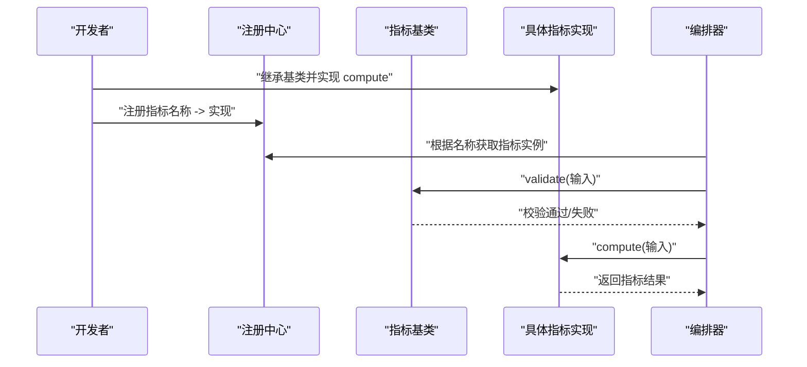
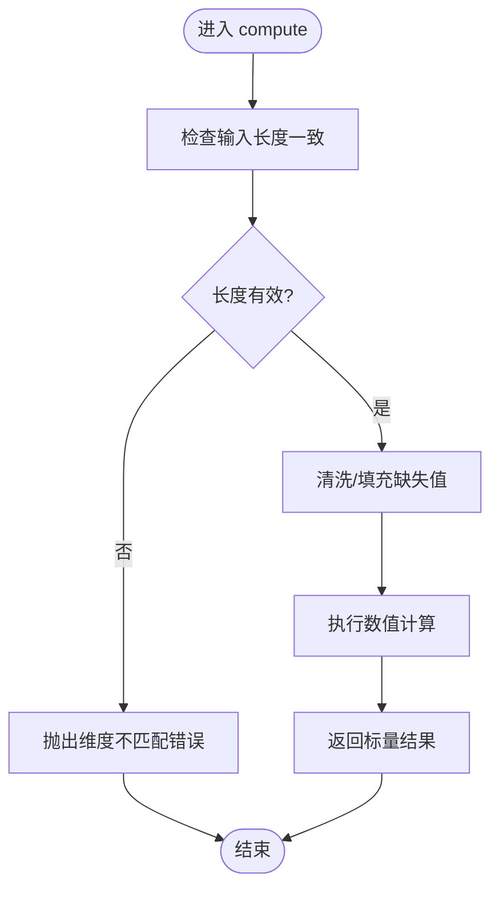
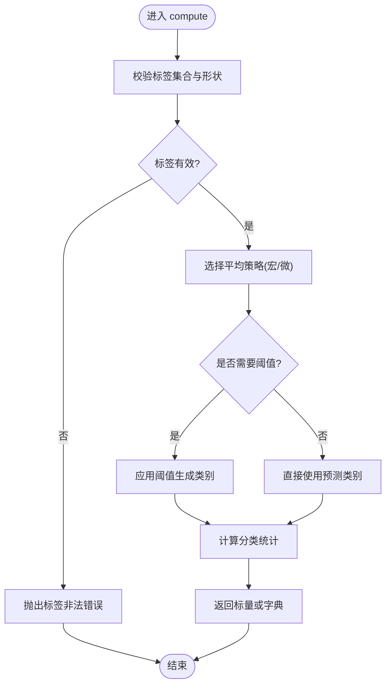
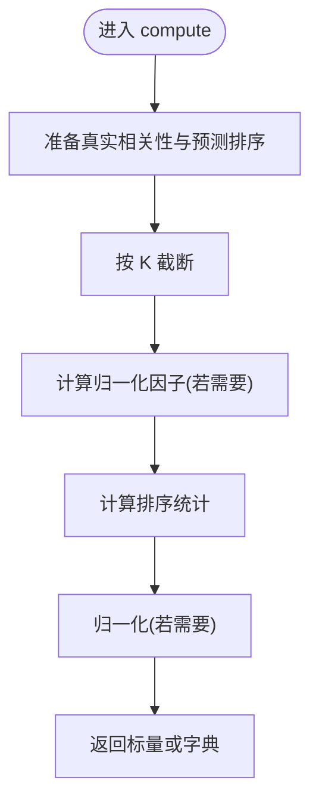
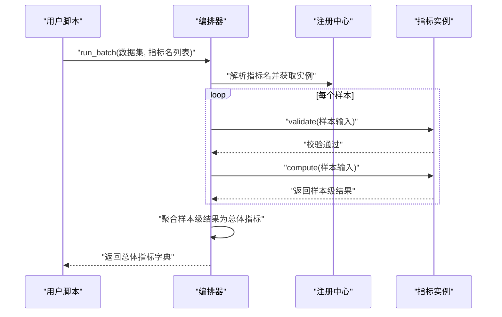
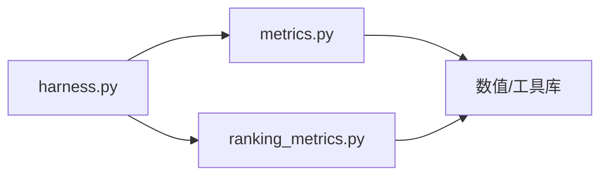

# 指标系统

<cite>
**本文引用的文件**   
- [autonomy_mvp/core/metrics.py](file://autonomy_mvp/core/metrics.py)
- [autonomy_mvp/core/ranking_metrics.py](file://autonomy_mvp/core/ranking_metrics.py)
- [autonomy_mvp/core/harness.py](file://autonomy_mvp/core/harness.py)
- [autonomy_mvp/tests/test_core.py](file://autonomy_mvp/tests/test_core.py)
</cite>

## 目录
1. [简介](#简介)
2. [项目结构](#项目结构)
3. [核心组件](#核心组件)
4. [架构总览](#架构总览)
5. [详细组件分析](#详细组件分析)
6. [依赖关系分析](#依赖关系分析)
7. [性能考虑](#性能考虑)
8. [故障排查指南](#故障排查指南)
9. [结论](#结论)
10. [附录](#附录)

## 简介
本教程面向需要定义、注册和使用自定义评估指标的开发者，围绕数值型指标、分类指标与排序指标三类典型场景，提供从输入输出约定、计算逻辑实现到性能优化与测试验证的完整实践指南。文档基于仓库中的指标子系统（位于 autonomy_mvp/core）进行系统化梳理，帮助读者快速上手并构建可复用的指标模块。

## 项目结构
指标相关代码集中在 autonomy_mvp/core 目录下：
- metrics.py：通用指标基类与常用数值/分类指标的实现入口
- ranking_metrics.py：排序类指标（如 NDCG、MRR 等）的具体实现
- harness.py：评测编排与指标调用流程（含批量计算、结果聚合）
- tests/test_core.py：针对指标与评测流程的单元测试样例

图表来源
- [autonomy_mvp/core/metrics.py](file://autonomy_mvp/core/metrics.py)
- [autonomy_mvp/core/ranking_metrics.py](file://autonomy_mvp/core/ranking_metrics.py)
- [autonomy_mvp/core/harness.py](file://autonomy_mvp/core/harness.py)
- [autonomy_mvp/tests/test_core.py](file://autonomy_mvp/tests/test_core.py)

章节来源
- [autonomy_mvp/core/metrics.py](file://autonomy_mvp/core/metrics.py)
- [autonomy_mvp/core/ranking_metrics.py](file://autonomy_mvp/core/ranking_metrics.py)
- [autonomy_mvp/core/harness.py](file://autonomy_mvp/core/harness.py)
- [autonomy_mvp/tests/test_core.py](file://autonomy_mvp/tests/test_core.py)

## 核心组件
- 指标基类与注册机制
  - 提供统一的指标接口与生命周期管理，支持按名称注册与查找
  - 统一输入输出规范，便于在评测流程中复用
- 数值型指标
  - 适用于回归或连续值预测任务，如均方误差、平均绝对误差等
  - 输入通常为真实值与预测值的同长度序列
- 分类指标
  - 适用于多分类/二分类任务，如准确率、精确率、召回率、F1 等
  - 输入为类别标签与预测类别（或概率分布），需明确阈值策略
- 排序指标
  - 适用于推荐/检索等排序任务，如 NDCG、MRR、AUC 等
  - 输入包含真实相关性分数与模型给出的排序列表

章节来源
- [autonomy_mvp/core/metrics.py](file://autonomy_mvp/core/metrics.py)
- [autonomy_mvp/core/ranking_metrics.py](file://autonomy_mvp/core/ranking_metrics.py)

## 架构总览
指标系统采用“基类抽象 + 具体实现 + 注册中心 + 编排器”的分层设计：
- 基类定义统一接口与校验逻辑
- 具体指标继承基类，实现 compute 方法
- 注册中心维护指标名称到实现的映射
- 编排器负责批量数据加载、指标调用与结果汇总

图表来源
- [autonomy_mvp/core/metrics.py](file://autonomy_mvp/core/metrics.py)
- [autonomy_mvp/core/ranking_metrics.py](file://autonomy_mvp/core/ranking_metrics.py)
- [autonomy_mvp/core/harness.py](file://autonomy_mvp/core/harness.py)

## 详细组件分析

### 指标基类与注册机制
- 职责
  - 定义统一的 compute 接口与 validate 校验
  - 提供 name 标识与 register 注册能力
  - 集中管理指标元信息（单位、方向、适用任务类型等）
- 输入输出约定
  - 输入：字典或结构化对象，包含必要字段（如真实值、预测值、权重等）
  - 输出：标量或字典（单指标返回标量，复合指标返回多个子指标）
- 注册流程
  - 通过装饰器或显式调用完成注册
  - 注册后由注册中心按名称分发

图表来源
- [autonomy_mvp/core/metrics.py](file://autonomy_mvp/core/metrics.py)
- [autonomy_mvp/core/harness.py](file://autonomy_mvp/core/harness.py)

章节来源
- [autonomy_mvp/core/metrics.py](file://autonomy_mvp/core/metrics.py)
- [autonomy_mvp/core/harness.py](file://autonomy_mvp/core/harness.py)

### 数值型指标
- 典型指标
  - 均方误差（MSE）、平均绝对误差（MAE）、R² 等
- 输入格式
  - 真实值：长度为 N 的数值序列
  - 预测值：长度为 N 的数值序列
- 计算逻辑要点
  - 对齐长度与数据类型
  - 处理缺失值与异常值（可选）
  - 支持加权计算（可选）
- 输出格式
  - 标量（单个数值）
- 示例路径
  - 参考：[autonomy_mvp/core/metrics.py](file://autonomy_mvp/core/metrics.py)

图表来源
- [autonomy_mvp/core/metrics.py](file://autonomy_mvp/core/metrics.py)

章节来源
- [autonomy_mvp/core/metrics.py](file://autonomy_mvp/core/metrics.py)

### 分类指标
- 典型指标
  - 准确率、精确率、召回率、F1、混淆矩阵统计
- 输入格式
  - 真实标签：长度为 N 的类别序列
  - 预测标签：长度为 N 的类别序列；或概率分布 + 阈值策略
- 计算逻辑要点
  - 类别一致性校验（标签集合是否合法）
  - 多分类时的宏/微平均策略选择
  - 阈值敏感型指标需明确阈值来源
- 输出格式
  - 标量或字典（例如 {"accuracy": ..., "f1_macro": ...}）
- 示例路径
  - 参考：[autonomy_mvp/core/metrics.py](file://autonomy_mvp/core/metrics.py)

图表来源
- [autonomy_mvp/core/metrics.py](file://autonomy_mvp/core/metrics.py)

章节来源
- [autonomy_mvp/core/metrics.py](file://autonomy_mvp/core/metrics.py)

### 排序指标
- 典型指标
  - NDCG@K、MRR、AUC、Precision@K 等
- 输入格式
  - 真实相关性：长度为 N 的数值序列（通常非负）
  - 预测排序：长度为 K 的索引序列或得分序列
- 计算逻辑要点
  - 截断长度 K 的处理
  - 归一化因子计算（NDCG）
  - 去重与并列排序处理
- 输出格式
  - 标量或字典（不同 K 或多个子指标）
- 示例路径
  - 参考：[autonomy_mvp/core/ranking_metrics.py](file://autonomy_mvp/core/ranking_metrics.py)

图表来源
- [autonomy_mvp/core/ranking_metrics.py](file://autonomy_mvp/core/ranking_metrics.py)

章节来源
- [autonomy_mvp/core/ranking_metrics.py](file://autonomy_mvp/core/ranking_metrics.py)

### 编排器与批量计算
- 职责
  - 读取数据集与标注
  - 按指标名解析并调用对应 compute
  - 汇总各样本与总体指标结果
- 关键流程
  - 初始化注册中心
  - 遍历样本，构造输入并调用指标
  - 聚合结果（均值、方差、分位数等）
- 示例路径
  - 参考：[autonomy_mvp/core/harness.py](file://autonomy_mvp/core/harness.py)

图表来源
- [autonomy_mvp/core/harness.py](file://autonomy_mvp/core/harness.py)
- [autonomy_mvp/core/metrics.py](file://autonomy_mvp/core/metrics.py)

章节来源
- [autonomy_mvp/core/harness.py](file://autonomy_mvp/core/harness.py)

## 依赖关系分析
- 模块内耦合
  - 编排器依赖注册中心与指标基类
  - 排序指标独立于数值/分类指标，但共享基类接口
- 外部依赖
  - 数值计算库（如 numpy/scipy）用于高效运算
  - 日志与异常处理用于调试与稳定性
- 潜在循环依赖
  - 避免在指标实现中反向导入编排器，保持单向依赖

图表来源
- [autonomy_mvp/core/harness.py](file://autonomy_mvp/core/harness.py)
- [autonomy_mvp/core/metrics.py](file://autonomy_mvp/core/metrics.py)
- [autonomy_mvp/core/ranking_metrics.py](file://autonomy_mvp/core/ranking_metrics.py)

章节来源
- [autonomy_mvp/core/harness.py](file://autonomy_mvp/core/harness.py)
- [autonomy_mvp/core/metrics.py](file://autonomy_mvp/core/metrics.py)
- [autonomy_mvp/core/ranking_metrics.py](file://autonomy_mvp/core/ranking_metrics.py)

## 性能考虑
- 向量化计算
  - 优先使用数组操作替代逐元素循环
- 内存管理
  - 大样本批处理时采用流式读取与增量聚合
- 缓存与复用
  - 对重复计算的中间结果进行缓存（如归一化因子）
- 并行化
  - 样本级计算可并行执行，注意线程安全与资源隔离
- 精度与稳定性
  - 数值型指标注意溢出与下溢，必要时使用高精度类型

## 故障排查指南
- 常见错误
  - 输入维度不一致：检查真实值与预测值长度
  - 标签非法：确认类别集合与编码方式
  - 排序越界：确保 K 不超过候选集大小
- 定位方法
  - 启用详细日志，记录输入摘要与中间状态
  - 使用最小可复现用例逐步缩小问题范围
- 测试建议
  - 边界用例：空输入、全零、极端值
  - 随机性：多次运行验证稳定性
  - 对比基准：与已知实现或手工计算结果比对
- 测试入口
  - 参考：[autonomy_mvp/tests/test_core.py](file://autonomy_mvp/tests/test_core.py)

章节来源
- [autonomy_mvp/tests/test_core.py](file://autonomy_mvp/tests/test_core.py)

## 结论
本指标系统以清晰的基类抽象与注册机制为核心，结合编排器的批量处理能力，为数值型、分类与排序指标提供了统一而可扩展的开发框架。遵循本文的输入输出约定、计算逻辑与性能优化建议，可以快速构建高质量、可复用的指标模块，并通过完善的测试保障其正确性与稳定性。

## 附录
- 开发清单
  - 定义指标类并实现 compute
  - 在注册中心登记指标名称
  - 编写单元测试覆盖正常与边界用例
  - 在编排器中集成新指标并进行端到端验证
- 最佳实践
  - 明确指标语义与适用场景
  - 提供清晰的输入校验与错误提示
  - 保持计算过程可解释与可复现
  - 对复杂指标提供可视化或中间结果导出