# 结果分析与报告

<cite>
**本文档引用的文件**   
- [task1/analyze.py](file://task1/analyze.py)
- [task1/render.py](file://task1/render.py)
- [task1/runner.py](file://task1/runner.py)
- [task1/runner2.py](file://task1/runner2.py)
- [task1/multi_turn_user.py](file://task1/multi_turn_user.py)
- [task1/check_consistency.py](file://task1/check_consistency.py)
- [task1/clean_qa.py](file://task1/clean_qa.py)
- [task1/verify6.py](file://task1/verify6.py)
- [task5/runner.py](file://task5/runner.py)
- [task3/B_ms3_screening_prototype/ms3_screening_eval.py](file://task3/B_ms3_screening_prototype/ms3_screening_eval.py)
- [autonomy_mvp/core/metrics.py](file://autonomy_mvp/core/metrics.py)
- [autonomy_mvp/core/ranking_metrics.py](file://autonomy_mvp/core/ranking_metrics.py)
- [autonomy_mvp/core/judge.py](file://autonomy_mvp/core/judge.py)
- [autonomy_mvp/core/harness.py](file://autonomy_mvp/core/harness.py)
- [longhorizon/instantiate/batch_caseD.py](file://longhorizon/instantiate/batch_caseD.py)
- [longhorizon/instantiate/caseD_killer_experiment.py](file://longhorizon/instantiate/caseD_killer_experiment.py)
- [docs/prd/molbench_repo/eval/eval_runner.py](file://docs/prd/molbench_repo/eval/eval_runner.py)
- [docs/prd/molbench_repo/eval/bench_loaders.py](file://docs/prd/molbench_repo/eval/bench_loaders.py)
</cite>

## 目录
1. [简介](#简介)
2. [项目结构](#项目结构)
3. [核心组件](#核心组件)
4. [架构总览](#架构总览)
5. [详细组件分析](#详细组件分析)
6. [依赖关系分析](#依赖关系分析)
7. [性能考量](#性能考量)
8. [故障排查指南](#故障排查指南)
9. [结论](#结论)
10. [附录](#附录)

## 简介
本教程面向需要系统化收集、存储、格式化评估结果，并基于内置工具进行数据可视化、统计分析与趋势洞察的工程师与研究者。内容覆盖：
- 结果采集与存储规范
- 数据清洗与一致性校验
- 统计分析与可视化方法
- 自定义报告生成（HTML、PDF、交互式仪表板）
- 批量对比、A/B测试、性能基准比较等高级分析
- 从原始数据到决策洞察的完整案例流程

## 项目结构
仓库采用按任务/场景划分的模块化组织方式，关键路径包括：
- task1：多轮对话与评测脚本、渲染与分析工具
- task3：筛选原型评测脚本
- task5：批处理运行器与报告输出
- autonomy_mvp：核心指标、排名指标、裁判与执行框架
- longhorizon：长周期实验批处理与杀手用例
- docs/prd/molbench_repo：评测加载与运行器

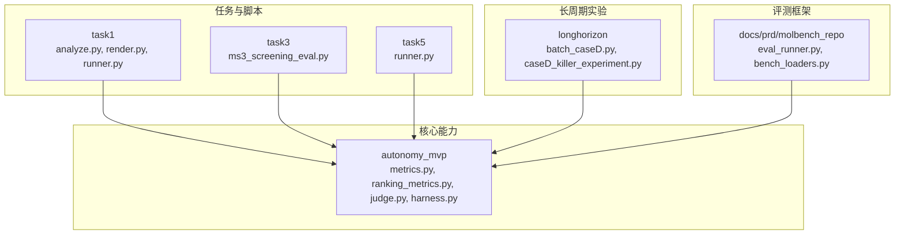

图表来源
- [task1/analyze.py](file://task1/analyze.py)
- [task1/render.py](file://task1/render.py)
- [task1/runner.py](file://task1/runner.py)
- [task3/B_ms3_screening_prototype/ms3_screening_eval.py](file://task3/B_ms3_screening_prototype/ms3_screening_eval.py)
- [task5/runner.py](file://task5/runner.py)
- [autonomy_mvp/core/metrics.py](file://autonomy_mvp/core/metrics.py)
- [autonomy_mvp/core/ranking_metrics.py](file://autonomy_mvp/core/ranking_metrics.py)
- [autonomy_mvp/core/judge.py](file://autonomy_mvp/core/judge.py)
- [autonomy_mvp/core/harness.py](file://autonomy_mvp/core/harness.py)
- [longhorizon/instantiate/batch_caseD.py](file://longhorizon/instantiate/batch_caseD.py)
- [longhorizon/instantiate/caseD_killer_experiment.py](file://longhorizon/instantiate/caseD_killer_experiment.py)
- [docs/prd/molbench_repo/eval/eval_runner.py](file://docs/prd/molbench_repo/eval/eval_runner.py)
- [docs/prd/molbench_repo/eval/bench_loaders.py](file://docs/prd/molbench_repo/eval/bench_loaders.py)

章节来源
- [task1/analyze.py](file://task1/analyze.py)
- [task1/render.py](file://task1/render.py)
- [task1/runner.py](file://task1/runner.py)
- [task3/B_ms3_screening_prototype/ms3_screening_eval.py](file://task3/B_ms3_screening_prototype/ms3_screening_eval.py)
- [task5/runner.py](file://task5/runner.py)
- [autonomy_mvp/core/metrics.py](file://autonomy_mvp/core/metrics.py)
- [autonomy_mvp/core/ranking_metrics.py](file://autonomy_mvp/core/ranking_metrics.py)
- [autonomy_mvp/core/judge.py](file://autonomy_mvp/core/judge.py)
- [autonomy_mvp/core/harness.py](file://autonomy_mvp/core/harness.py)
- [longhorizon/instantiate/batch_caseD.py](file://longhorizon/instantiate/batch_caseD.py)
- [longhorizon/instantiate/caseD_killer_experiment.py](file://longhorizon/instantiate/caseD_killer_experiment.py)
- [docs/prd/molbench_repo/eval/eval_runner.py](file://docs/prd/molbench_repo/eval/eval_runner.py)
- [docs/prd/molbench_repo/eval/bench_loaders.py](file://docs/prd/molbench_repo/eval/bench_loaders.py)

## 核心组件
- 指标与排名
  - metrics.py：基础指标计算与聚合
  - ranking_metrics.py：排序与相对提升度量
- 裁判与执行
  - judge.py：评分/裁决逻辑
  - harness.py：统一执行入口与生命周期管理
- 任务级运行器与渲染
  - task1/runner.py、runner2.py：会话级运行与结果落盘
  - task1/analyze.py：结果读取、清洗、统计
  - task1/render.py：结果渲染为可读格式
- 批量与长周期
  - task5/runner.py：批处理运行与汇总
  - longhorizon/batch_caseD.py、caseD_killer_experiment.py：大规模批处理与压力用例
- 评测框架
  - docs/prd/molbench_repo/eval_runner.py：评测编排
  - docs/prd/molbench_repo/bench_loaders.py：数据集加载

章节来源
- [autonomy_mvp/core/metrics.py](file://autonomy_mvp/core/metrics.py)
- [autonomy_mvp/core/ranking_metrics.py](file://autonomy_mvp/core/ranking_metrics.py)
- [autonomy_mvp/core/judge.py](file://autonomy_mvp/core/judge.py)
- [autonomy_mvp/core/harness.py](file://autonomy_mvp/core/harness.py)
- [task1/runner.py](file://task1/runner.py)
- [task1/runner2.py](file://task1/runner2.py)
- [task1/analyze.py](file://task1/analyze.py)
- [task1/render.py](file://task1/render.py)
- [task5/runner.py](file://task5/runner.py)
- [longhorizon/instantiate/batch_caseD.py](file://longhorizon/instantiate/batch_caseD.py)
- [longhorizon/instantiate/caseD_killer_experiment.py](file://longhorizon/instantiate/caseD_killer_experiment.py)
- [docs/prd/molbench_repo/eval/eval_runner.py](file://docs/prd/molbench_repo/eval/eval_runner.py)
- [docs/prd/molbench_repo/eval/bench_loaders.py](file://docs/prd/molbench_repo/eval/bench_loaders.py)

## 架构总览
整体流程分为“数据采集—清洗校验—指标计算—可视化/报告—对比分析”五个阶段。

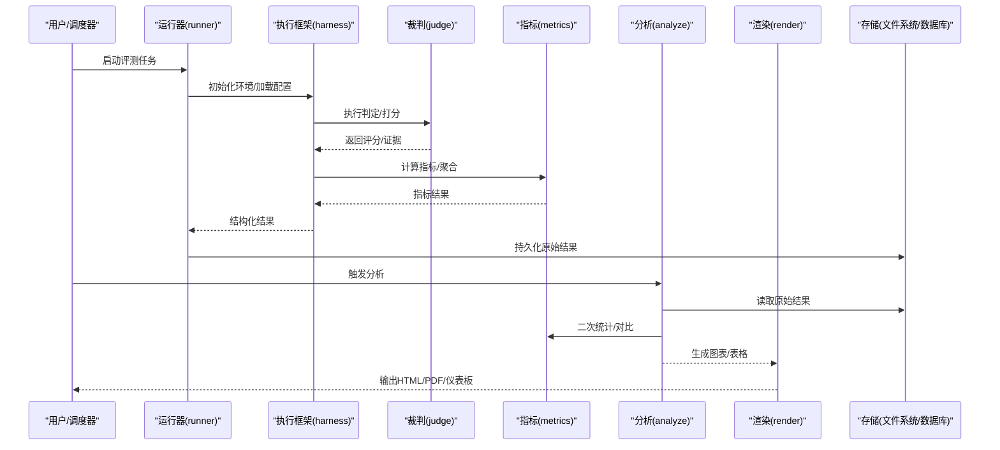

图表来源
- [task1/runner.py](file://task1/runner.py)
- [autonomy_mvp/core/harness.py](file://autonomy_mvp/core/harness.py)
- [autonomy_mvp/core/judge.py](file://autonomy_mvp/core/judge.py)
- [autonomy_mvp/core/metrics.py](file://autonomy_mvp/core/metrics.py)
- [task1/analyze.py](file://task1/analyze.py)
- [task1/render.py](file://task1/render.py)

## 详细组件分析

### 组件A：结果采集与存储（Runner + Harness）
- 职责
  - runner.py/runner2.py：任务编排、参数注入、结果落盘
  - harness.py：统一生命周期管理、异常捕获、日志记录
- 关键点
  - 标准化结果Schema（ID、时间戳、输入、输出、评分、元数据）
  - 断点续跑与幂等性设计
  - 并发控制与资源隔离

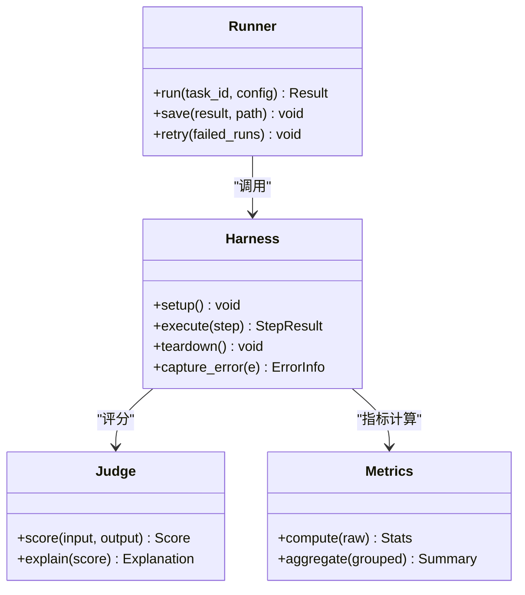

图表来源
- [task1/runner.py](file://task1/runner.py)
- [task1/runner2.py](file://task1/runner2.py)
- [autonomy_mvp/core/harness.py](file://autonomy_mvp/core/harness.py)
- [autonomy_mvp/core/judge.py](file://autonomy_mvp/core/judge.py)
- [autonomy_mvp/core/metrics.py](file://autonomy_mvp/core/metrics.py)

章节来源
- [task1/runner.py](file://task1/runner.py)
- [task1/runner2.py](file://task1/runner2.py)
- [autonomy_mvp/core/harness.py](file://autonomy_mvp/core/harness.py)

### 组件B：数据清洗与一致性校验（Clean + Check）
- clean_qa.py：清理噪声、规范化字段、去重
- check_consistency.py：跨轮次一致性检查、缺失值检测、分布漂移告警

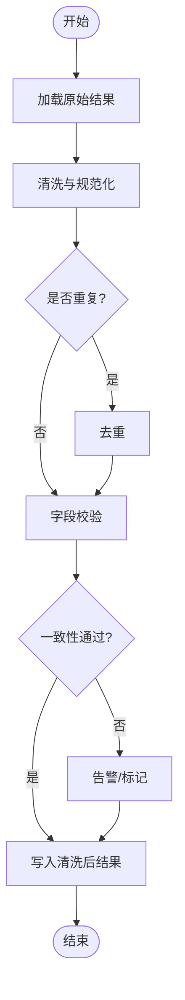

图表来源
- [task1/clean_qa.py](file://task1/clean_qa.py)
- [task1/check_consistency.py](file://task1/check_consistency.py)

章节来源
- [task1/clean_qa.py](file://task1/clean_qa.py)
- [task1/check_consistency.py](file://task1/check_consistency.py)

### 组件C：统计分析（Analyze + Metrics）
- analyze.py：汇总统计、分组对比、显著性检验
- metrics.py：基础指标（准确率、召回率、F1、AUC等）
- ranking_metrics.py：排序质量（NDCG、MAP、RR等）

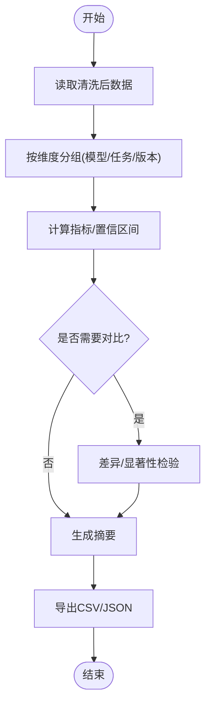

图表来源
- [task1/analyze.py](file://task1/analyze.py)
- [autonomy_mvp/core/metrics.py](file://autonomy_mvp/core/metrics.py)
- [autonomy_mvp/core/ranking_metrics.py](file://autonomy_mvp/core/ranking_metrics.py)

章节来源
- [task1/analyze.py](file://task1/analyze.py)
- [autonomy_mvp/core/metrics.py](file://autonomy_mvp/core/metrics.py)
- [autonomy_mvp/core/ranking_metrics.py](file://autonomy_mvp/core/ranking_metrics.py)

### 组件D：可视化与报告（Render + Report）
- render.py：将结构化结果渲染为Markdown/HTML
- 扩展建议：集成Plotly/ECharts生成交互图表；使用WeasyPrint或pdfkit导出PDF；FastAPI+Vue构建交互式仪表板

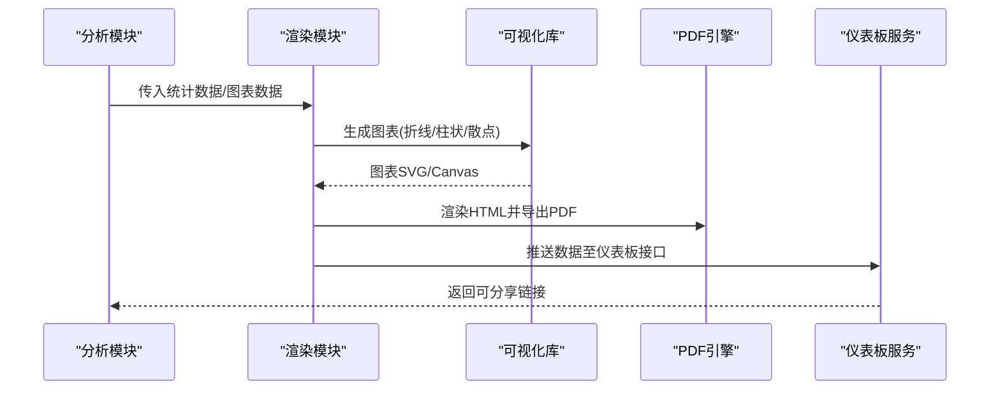

图表来源
- [task1/render.py](file://task1/render.py)

章节来源
- [task1/render.py](file://task1/render.py)

### 组件E：批量与长周期评测（Batch + Long Horizon）
- task5/runner.py：批量任务调度、失败重试、汇总报告
- longhorizon/batch_caseD.py、caseD_killer_experiment.py：大规模批处理、压力与回归用例

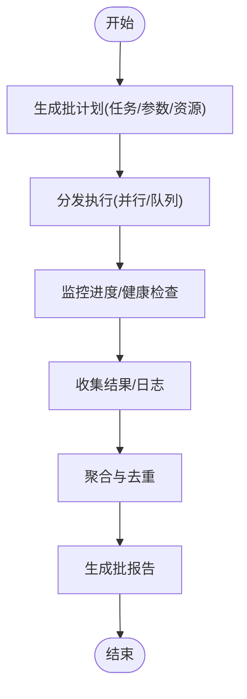

图表来源
- [task5/runner.py](file://task5/runner.py)
- [longhorizon/instantiate/batch_caseD.py](file://longhorizon/instantiate/batch_caseD.py)
- [longhorizon/instantiate/caseD_killer_experiment.py](file://longhorizon/instantiate/caseD_killer_experiment.py)

章节来源
- [task5/runner.py](file://task5/runner.py)
- [longhorizon/instantiate/batch_caseD.py](file://longhorizon/instantiate/batch_caseD.py)
- [longhorizon/instantiate/caseD_killer_experiment.py](file://longhorizon/instantiate/caseD_killer_experiment.py)

### 组件F：评测框架（Benchmark Loader + Runner）
- eval_runner.py：评测编排、指标注册、结果归档
- bench_loaders.py：数据集加载、划分、采样策略

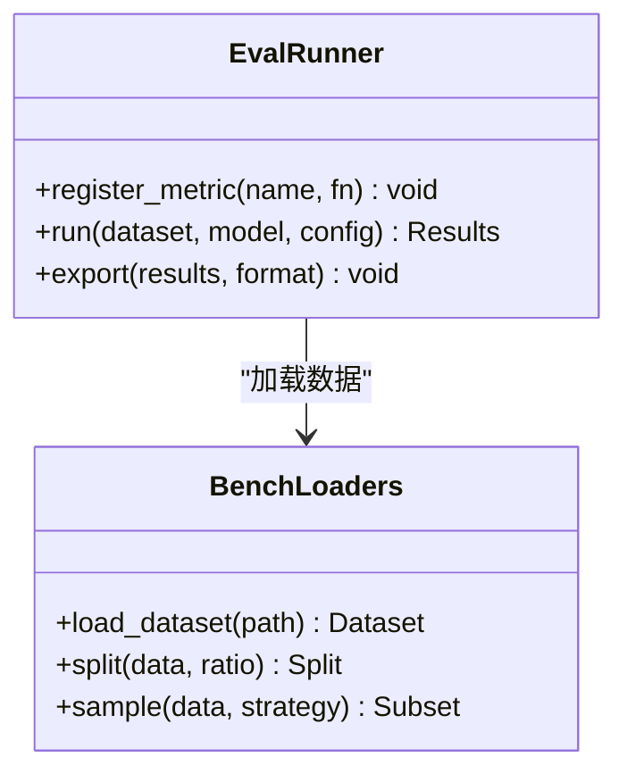

图表来源
- [docs/prd/molbench_repo/eval/eval_runner.py](file://docs/prd/molbench_repo/eval/eval_runner.py)
- [docs/prd/molbench_repo/eval/bench_loaders.py](file://docs/prd/molbench_repo/eval/bench_loaders.py)

章节来源
- [docs/prd/molbench_repo/eval/eval_runner.py](file://docs/prd/molbench_repo/eval/eval_runner.py)
- [docs/prd/molbench_repo/eval/bench_loaders.py](file://docs/prd/molbench_repo/eval/bench_loaders.py)

### 组件G：多轮对话与验证（Multi-turn + Verify）
- multi_turn_user.py：多轮交互构造与轨迹记录
- verify6.py：结果验证与回溯

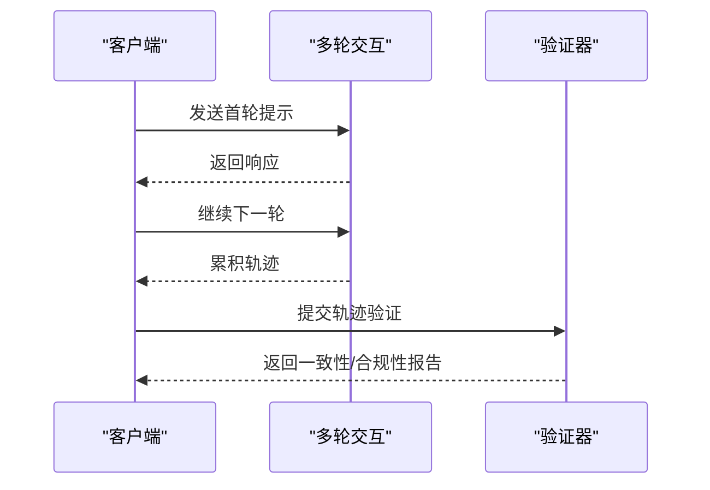

图表来源
- [task1/multi_turn_user.py](file://task1/multi_turn_user.py)
- [task1/verify6.py](file://task1/verify6.py)

章节来源
- [task1/multi_turn_user.py](file://task1/multi_turn_user.py)
- [task1/verify6.py](file://task1/verify6.py)

### 组件H：筛选原型评测（MS3 Screening）
- ms3_screening_eval.py：针对特定任务的筛选评测流程与指标

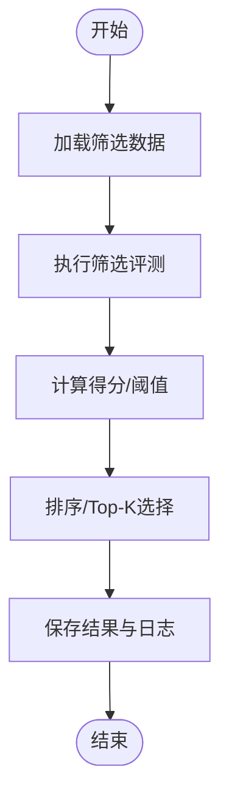

图表来源
- [task3/B_ms3_screening_prototype/ms3_screening_eval.py](file://task3/B_ms3_screening_prototype/ms3_screening_eval.py)

章节来源
- [task3/B_ms3_screening_prototype/ms3_screening_eval.py](file://task3/B_ms3_screening_prototype/ms3_screening_eval.py)

## 依赖关系分析
- 低耦合高内聚
  - runner/harness负责执行与生命周期，judge/metrics专注评分与指标，analyze/render专注分析与呈现
- 外部依赖
  - 数据处理与可视化（如pandas、matplotlib、plotly、weasyprint/pdfkit）
  - 评测框架（如pydantic用于Schema校验、pytest用于测试）
- 潜在循环依赖
  - 避免在metrics中直接依赖render，在render中反向依赖metrics，应通过中间数据结构解耦

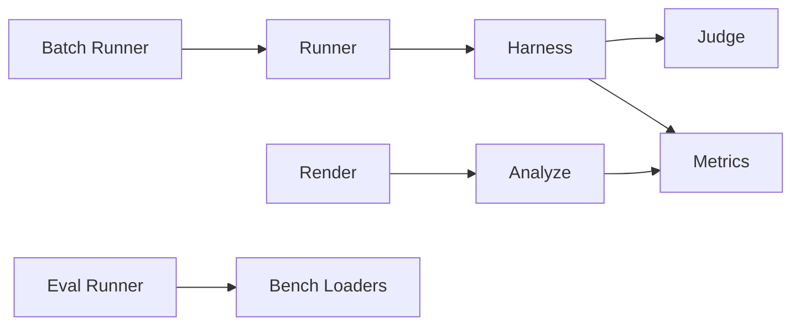

图表来源
- [task1/runner.py](file://task1/runner.py)
- [autonomy_mvp/core/harness.py](file://autonomy_mvp/core/harness.py)
- [autonomy_mvp/core/judge.py](file://autonomy_mvp/core/judge.py)
- [autonomy_mvp/core/metrics.py](file://autonomy_mvp/core/metrics.py)
- [task1/analyze.py](file://task1/analyze.py)
- [task1/render.py](file://task1/render.py)
- [task5/runner.py](file://task5/runner.py)
- [docs/prd/molbench_repo/eval/eval_runner.py](file://docs/prd/molbench_repo/eval/eval_runner.py)
- [docs/prd/molbench_repo/eval/bench_loaders.py](file://docs/prd/molbench_repo/eval/bench_loaders.py)

## 性能考量
- 批处理与并行
  - 合理设置并发度与队列长度，避免I/O瓶颈
  - 使用内存映射或流式读写处理大文件
- 指标计算优化
  - 向量化计算优先，避免逐行循环
  - 缓存中间结果，减少重复计算
- 存储与检索
  - 使用列式存储（Parquet）或时序数据库加速查询
  - 对高频字段建立索引
- 可视化渲染
  - 按需渲染，延迟加载大图
  - 使用WebGL/Canvas渲染大规模数据

## 故障排查指南
- 常见问题
  - 结果缺失或字段不一致：检查clean_qa.py与check_consistency.py的清洗规则
  - 指标异常：核对metrics.py中的边界条件与除零保护
  - 渲染失败：确认模板变量与数据类型匹配
  - 批处理中断：查看runner的错误重试与日志定位
- 诊断步骤
  - 启用详细日志与Trace ID
  - 最小化复现：抽取子集单独运行
  - 断点调试：在judge/metrics关键分支插入断点
  - 数据快照：保存问题样本与上下文

章节来源
- [task1/clean_qa.py](file://task1/clean_qa.py)
- [task1/check_consistency.py](file://task1/check_consistency.py)
- [autonomy_mvp/core/metrics.py](file://autonomy_mvp/core/metrics.py)
- [task1/runner.py](file://task1/runner.py)

## 结论
通过统一的执行框架、清晰的指标体系、完善的清洗与校验流程，以及灵活的渲染与报告机制，本仓库提供了从原始数据到决策洞察的完整分析闭环。建议在现有基础上进一步扩展交互式仪表板与自动化报告流水线，以提升团队协作效率与决策透明度。

## 附录
- 自定义报告生成器开发要点
  - HTML报告：模板驱动，支持嵌入图表与表格
  - PDF导出：HTML转PDF，注意字体与分页
  - 交互式仪表板：前后端分离，REST API提供数据，前端使用ECharts/Plotly.js
- 高级分析功能
  - 批量对比：按模型/任务/版本分组，输出差异矩阵
  - A/B测试：假设检验、效应量、置信区间
  - 性能基准：吞吐、延迟、资源占用趋势图
- 实战案例
  - 从task1的多轮对话评测到最终报告，展示端到端流程
  - 使用task5批处理进行大规模回归测试与发布前验证