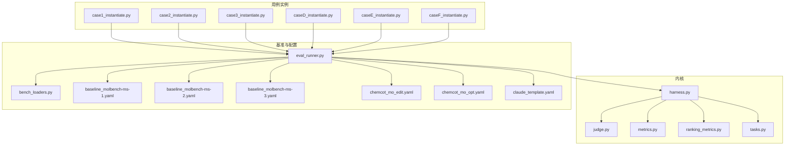
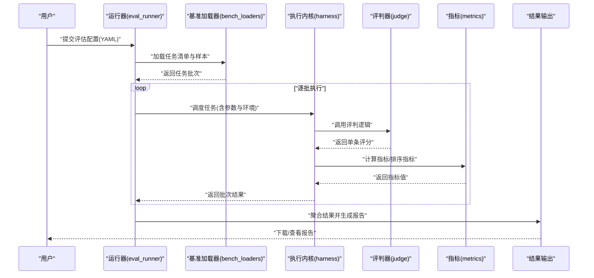
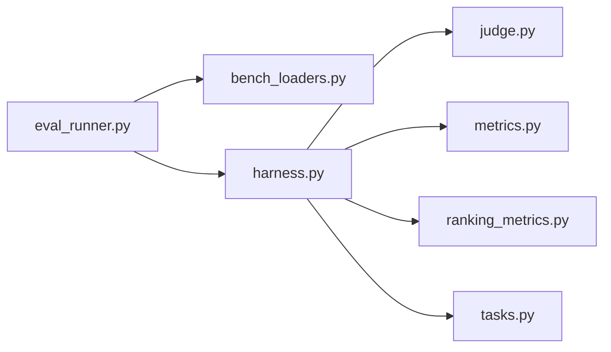

# 评估工作流

<cite>
**本文引用的文件**   
- [autonomy_mvp/core/harness.py](file://autonomy_mvp/core/harness.py)
- [autonomy_mvp/core/judge.py](file://autonomy_mvp/core/judge.py)
- [autonomy_mvp/core/metrics.py](file://autonomy_mvp/core/metrics.py)
- [autonomy_mvp/core/ranking_metrics.py](file://autonomy_mvp/core/ranking_metrics.py)
- [autonomy_mvp/core/tasks.py](file://autonomy_mvp/core/tasks.py)
- [autonomy_mvp/run_validation.py](file://autonomy_mvp/run_validation.py)
- [autonomy_mvp/schema.md](file://autonomy_mvp/schema.md)
- [autonomy_mvp/ACCEPTANCE.md](file://autonomy_mvp/ACCEPTANCE.md)
- [docs/prd/molbench_repo/eval/eval_runner.py](file://docs/prd/molbench_repo/eval/eval_runner.py)
- [docs/prd/molbench_repo/eval/bench_loaders.py](file://docs/prd/molbench_repo/eval/bench_loaders.py)
- [docs/prd/molbench_repo/config/baseline_molbench-ms-1.yaml](file://docs/prd/molbench_repo/config/baseline_molbench-ms-1.yaml)
- [docs/prd/molbench_repo/config/baseline_molbench-ms-2.yaml](file://docs/prd/molbench_repo/config/baseline_molbench-ms-2.yaml)
- [docs/prd/molbench_repo/config/baseline_molbench-ms-3.yaml](file://docs/prd/molbench_repo/config/baseline_molbench-ms-3.yaml)
- [docs/prd/molbench_repo/config/chemcot_mo_edit.yaml](file://docs/prd/molbench_repo/config/chemcot_mo_edit.yaml)
- [docs/prd/molbench_repo/config/chemcot_mo_opt.yaml](file://docs/prd/molbench_repo/config/chemcot_mo_opt.yaml)
- [docs/prd/molbench_repo/config/claude_template.yaml](file://docs/prd/molbench_repo/config/claude_template.yaml)
- [longhorizon/instantiate/case1_instantiate.py](file://longhorizon/instantiate/case1_instantiate.py)
- [longhorizon/instantiate/case2_instantiate.py](file://longhorizon/instantiate/case2_instantiate.py)
- [longhorizon/instantiate/case3_instantiate.py](file://longhorizon/instantiate/case3_instantiate.py)
- [longhorizon/instantiate/caseD_instantiate.py](file://longhorizon/instantiate/caseD_instantiate.py)
- [longhorizon/instantiate/caseE_instantiate.py](file://longhorizon/instantiate/caseE_instantiate.py)
- [longhorizon/instantiate/caseF_instantiate.py](file://longhorizon/instantiate/caseF_instantiate.py)
- [task4_papers/README.md](file://docs/prd/task4_papers/README.md)
- [task6_papers/README.md](file://docs/prd/task6_papers/README.md)
</cite>

## 目录
1. [简介](#简介)
2. [项目结构](#项目结构)
3. [核心组件](#核心组件)
4. [架构总览](#架构总览)
5. [详细组件分析](#详细组件分析)
6. [依赖关系分析](#依赖关系分析)
7. [性能与并发](#性能与并发)
8. [故障排查指南](#故障排查指南)
9. [结论](#结论)
10. [附录：模板与最佳实践](#附录模板与最佳实践)

## 简介
本教程面向需要构建“从任务定义到结果输出”的完整评估工作流的工程师与研究者。内容覆盖：
- 评估配置文件的结构与语法（任务参数、环境设置、执行策略）
- 批处理评估、并行执行、错误重试等关键特性
- 工作流模板与最佳实践（CI/CD集成、自动化测试、持续监控）
- 通过真实案例展示复杂评估任务的编排与执行过程

本仓库包含多套可复用的评估能力：统一的评测内核（harness/judge/metrics）、基准加载器（bench_loaders）、运行器（eval_runner）、以及多个领域用例（药物筛选、材料发现、医学推理等）。

## 项目结构
整体采用“内核 + 基准 + 运行器 + 用例实例”的分层组织方式：
- 内核层：提供任务执行、评判、指标计算、排序指标等通用能力
- 基准层：提供数据集加载、任务清单、数据格式规范
- 运行器层：负责解析配置、调度任务、聚合结果
- 用例层：针对具体场景（如分子性质预测、材料属性优化、医学问答）提供实例化脚本与示例数据

图表来源
- [autonomy_mvp/core/harness.py](file://autonomy_mvp/core/harness.py)
- [autonomy_mvp/core/judge.py](file://autonomy_mvp/core/judge.py)
- [autonomy_mvp/core/metrics.py](file://autonomy_mvp/core/metrics.py)
- [autonomy_mvp/core/ranking_metrics.py](file://autonomy_mvp/core/ranking_metrics.py)
- [autonomy_mvp/core/tasks.py](file://autonomy_mvp/core/tasks.py)
- [docs/prd/molbench_repo/eval/eval_runner.py](file://docs/prd/molbench_repo/eval/eval_runner.py)
- [docs/prd/molbench_repo/eval/bench_loaders.py](file://docs/prd/molbench_repo/eval/bench_loaders.py)
- [docs/prd/molbench_repo/config/baseline_molbench-ms-1.yaml](file://docs/prd/molbench_repo/config/baseline_molbench-ms-1.yaml)
- [docs/prd/molbench_repo/config/baseline_molbench-ms-2.yaml](file://docs/prd/molbench_repo/config/baseline_molbench-ms-2.yaml)
- [docs/prd/molbench_repo/config/baseline_molbench-ms-3.yaml](file://docs/prd/molbench_repo/config/baseline_molbench-ms-3.yaml)
- [docs/prd/molbench_repo/config/chemcot_mo_edit.yaml](file://docs/prd/molbench_repo/config/chemcot_mo_edit.yaml)
- [docs/prd/molbench_repo/config/chemcot_mo_opt.yaml](file://docs/prd/molbench_repo/config/chemcot_mo_opt.yaml)
- [docs/prd/molbench_repo/config/claude_template.yaml](file://docs/prd/molbench_repo/config/claude_template.yaml)
- [longhorizon/instantiate/case1_instantiate.py](file://longhorizon/instantiate/case1_instantiate.py)
- [longhorizon/instantiate/case2_instantiate.py](file://longhorizon/instantiate/case2_instantiate.py)
- [longhorizon/instantiate/case3_instantiate.py](file://longhorizon/instantiate/case3_instantiate.py)
- [longhorizon/instantiate/caseD_instantiate.py](file://longhorizon/instantiate/caseD_instantiate.py)
- [longhorizon/instantiate/caseE_instantiate.py](file://longhorizon/instantiate/caseE_instantiate.py)
- [longhorizon/instantiate/caseF_instantiate.py](file://longhorizon/instantiate/caseF_instantiate.py)

章节来源
- [autonomy_mvp/schema.md](file://autonomy_mvp/schema.md)
- [autonomy_mvp/ACCEPTANCE.md](file://autonomy_mvp/ACCEPTANCE.md)
- [docs/prd/molbench_repo/eval/eval_runner.py](file://docs/prd/molbench_repo/eval/eval_runner.py)
- [docs/prd/molbench_repo/eval/bench_loaders.py](file://docs/prd/molbench_repo/eval/bench_loaders.py)

## 核心组件
- 执行内核 harness：统一的任务编排入口，负责读取配置、加载数据、调用评判与指标模块、汇总结果并持久化。
- 评判器 judge：实现评分逻辑与判定规则，支持多种评分范式（例如基于阈值、基于模型打分、基于规则匹配等）。
- 指标 metrics：提供常用统计指标（准确率、召回率、AUC、RMSE 等），并可组合为复合指标。
- 排序指标 ranking_metrics：用于对候选方案进行排序与比较（如 Top-K 命中率、NDCG 等）。
- 任务 tasks：抽象任务接口与数据结构，便于扩展新任务类型。
- 基准加载器 bench_loaders：负责从不同数据源（JSON/CSV/JSONL）加载任务样本与标注。
- 运行器 eval_runner：解析 YAML 配置，驱动 harness 批量执行，管理并发与重试，生成报告。

章节来源
- [autonomy_mvp/core/harness.py](file://autonomy_mvp/core/harness.py)
- [autonomy_mvp/core/judge.py](file://autonomy_mvp/core/judge.py)
- [autonomy_mvp/core/metrics.py](file://autonomy_mvp/core/metrics.py)
- [autonomy_mvp/core/ranking_metrics.py](file://autonomy_mvp/core/ranking_metrics.py)
- [autonomy_mvp/core/tasks.py](file://autonomy_mvp/core/tasks.py)
- [docs/prd/molbench_repo/eval/bench_loaders.py](file://docs/prd/molbench_repo/eval/bench_loaders.py)
- [docs/prd/molbench_repo/eval/eval_runner.py](file://docs/prd/molbench_repo/eval/eval_runner.py)

## 架构总览
下图展示了从配置到结果输出的端到端流程：YAML 配置驱动运行器，运行器加载基准数据，调用内核执行任务，使用评判器与指标模块产出分数，最终汇总为报告。

图表来源
- [docs/prd/molbench_repo/eval/eval_runner.py](file://docs/prd/molbench_repo/eval/eval_runner.py)
- [docs/prd/molbench_repo/eval/bench_loaders.py](file://docs/prd/molbench_repo/eval/bench_loaders.py)
- [autonomy_mvp/core/harness.py](file://autonomy_mvp/core/harness.py)
- [autonomy_mvp/core/judge.py](file://autonomy_mvp/core/judge.py)
- [autonomy_mvp/core/metrics.py](file://autonomy_mvp/core/metrics.py)

## 详细组件分析

### 执行内核 harness
- 职责：统一入口，协调数据加载、任务执行、评判与指标计算、结果持久化。
- 关键点：
  - 支持按批次拉取任务，避免一次性加载全部数据导致内存压力。
  - 将评判与指标解耦，便于替换或扩展。
  - 提供失败重试与断点续跑能力（由运行器控制）。
- 复杂度：I/O 密集为主，CPU 取决于评判逻辑；建议结合并发与缓存提升吞吐。

章节来源
- [autonomy_mvp/core/harness.py](file://autonomy_mvp/core/harness.py)

### 评判器 judge
- 职责：实现业务相关的评分与判定逻辑。
- 关键点：
  - 支持多种评分模式（阈值、回归误差、分类正确性、LLM-as-a-Judge 等）。
  - 可配置判定规则与容错策略（如缺失字段时的降级评分）。
- 扩展建议：以插件形式注册新的评判函数，保持与 harness 的契约一致。

章节来源
- [autonomy_mvp/core/judge.py](file://autonomy_mvp/core/judge.py)

### 指标 metrics 与排序指标 ranking_metrics
- 职责：
  - metrics：计算常用统计指标，支持分组与加权聚合。
  - ranking_metrics：对候选项进行排序评估（Top-K、NDCG 等）。
- 关键点：
  - 指标可组合形成复合指标，便于多维度对比。
  - 支持对缺失值与异常值的稳健处理。
- 复杂度：通常为 O(N) 或 O(N log N)，注意大样本下的数值稳定性。

章节来源
- [autonomy_mvp/core/metrics.py](file://autonomy_mvp/core/metrics.py)
- [autonomy_mvp/core/ranking_metrics.py](file://autonomy_mvp/core/ranking_metrics.py)

### 任务 tasks
- 职责：定义任务的数据结构与执行接口，屏蔽底层差异。
- 关键点：
  - 明确输入输出契约，便于在不同基准间复用。
  - 支持元数据（如难度标签、领域标签）用于分层统计。

章节来源
- [autonomy_mvp/core/tasks.py](file://autonomy_mvp/core/tasks.py)

### 基准加载器 bench_loaders
- 职责：从 JSON/CSV/JSONL 等格式加载任务样本与标注，提供分页/采样能力。
- 关键点：
  - 支持过滤与映射，减少不必要的数据传输。
  - 与运行器的批大小配合，平衡吞吐与内存占用。

章节来源
- [docs/prd/molbench_repo/eval/bench_loaders.py](file://docs/prd/molbench_repo/eval/bench_loaders.py)

### 运行器 eval_runner
- 职责：解析 YAML 配置，驱动 harness 批量执行，管理并发、重试与日志，生成报告。
- 关键点：
  - 配置驱动：任务参数、环境设置、执行策略均通过 YAML 声明。
  - 并发控制：线程/进程池、限流、超时、重试次数与退避策略。
  - 结果聚合：按任务/批次/维度汇总，输出结构化报告。

章节来源
- [docs/prd/molbench_repo/eval/eval_runner.py](file://docs/prd/molbench_repo/eval/eval_runner.py)

### 配置系统（YAML）
- 典型字段（概念说明）：
  - 任务参数：任务 ID、输入路径、输出路径、随机种子、采样数量等。
  - 环境设置：依赖包版本、环境变量、GPU/CPU 资源限制。
  - 执行策略：并发度、批大小、超时时间、重试次数与退避策略。
  - 评判与指标：选择评判器、指标列表、权重与阈值。
- 参考样例：
  - baseline_molbench-ms-1.yaml / ms-2.yaml / ms-3.yaml
  - chemcot_mo_edit.yaml / chemcot_mo_opt.yaml
  - claude_template.yaml

章节来源
- [docs/prd/molbench_repo/config/baseline_molbench-ms-1.yaml](file://docs/prd/molbench_repo/config/baseline_molbench-ms-1.yaml)
- [docs/prd/molbench_repo/config/baseline_molbench-ms-2.yaml](file://docs/prd/molbench_repo/config/baseline_molbench-ms-2.yaml)
- [docs/prd/molbench_repo/config/baseline_molbench-ms-3.yaml](file://docs/prd/molbench_repo/config/baseline_molbench-ms-3.yaml)
- [docs/prd/molbench_repo/config/chemcot_mo_edit.yaml](file://docs/prd/molbench_repo/config/chemcot_mo_edit.yaml)
- [docs/prd/molbench_repo/config/chemcot_mo_opt.yaml](file://docs/prd/molbench_repo/config/chemcot_mo_opt.yaml)
- [docs/prd/molbench_repo/config/claude_template.yaml](file://docs/prd/molbench_repo/config/claude_template.yaml)

### 用例实例（长周期任务）
- case1~case3、caseD~caseF 等实例脚本演示了如何实例化任务、准备数据、调用运行器并收集结果。
- 适用场景：材料发现、逆合成规划、靶点验证、机理模拟等复杂工作流。

章节来源
- [longhorizon/instantiate/case1_instantiate.py](file://longhorizon/instantiate/case1_instantiate.py)
- [longhorizon/instantiate/case2_instantiate.py](file://longhorizon/instantiate/case2_instantiate.py)
- [longhorizon/instantiate/case3_instantiate.py](file://longhorizon/instantiate/case3_instantiate.py)
- [longhorizon/instantiate/caseD_instantiate.py](file://longhorizon/instantiate/caseD_instantiate.py)
- [longhorizon/instantiate/caseE_instantiate.py](file://longhorizon/instantiate/caseE_instantiate.py)
- [longhorizon/instantiate/caseF_instantiate.py](file://longhorizon/instantiate/caseF_instantiate.py)

## 依赖关系分析
- 低耦合高内聚：harness 仅依赖 judge、metrics、tasks 的接口；eval_runner 通过配置驱动，不感知具体评判细节。
- 外部依赖：
  - 数据格式：JSON/CSV/JSONL
  - 配置文件：YAML
  - 可选：分布式/队列（可扩展）
- 潜在循环依赖：应避免在 judge/metrics 中反向导入 harness；通过接口与配置解耦。

图表来源
- [docs/prd/molbench_repo/eval/eval_runner.py](file://docs/prd/molbench_repo/eval/eval_runner.py)
- [docs/prd/molbench_repo/eval/bench_loaders.py](file://docs/prd/molbench_repo/eval/bench_loaders.py)
- [autonomy_mvp/core/harness.py](file://autonomy_mvp/core/harness.py)
- [autonomy_mvp/core/judge.py](file://autonomy_mvp/core/judge.py)
- [autonomy_mvp/core/metrics.py](file://autonomy_mvp/core/metrics.py)
- [autonomy_mvp/core/ranking_metrics.py](file://autonomy_mvp/core/ranking_metrics.py)
- [autonomy_mvp/core/tasks.py](file://autonomy_mvp/core/tasks.py)

## 性能与并发
- 批处理：合理设置批大小，避免峰值内存过高；对 I/O 密集型任务优先增大批大小。
- 并行执行：根据 CPU/GPU 资源调整并发度；对外部 API 调用增加限流与退避。
- 重试机制：对网络抖动、临时不可用服务启用指数退避重试；记录失败原因以便定位。
- 缓存与去重：对重复样本或中间结果进行缓存，减少重复计算。
- 监控与度量：采集耗时、吞吐、错误率、资源利用率，纳入持续监控。

[本节为通用指导，无需列出具体文件来源]

## 故障排查指南
- 常见问题
  - 配置错误：字段缺失或类型不符，检查 YAML 校验与默认值。
  - 数据不一致：样本字段缺失或格式异常，使用加载器的容错与清洗能力。
  - 资源不足：并发过高导致 OOM 或 GPU 显存溢出，降低并发或批大小。
  - 外部依赖不稳定：API 超时或限流，增加重试与退避策略。
- 诊断步骤
  - 开启详细日志，定位失败任务 ID 与上下文。
  - 使用最小样本复现问题，逐步缩小范围。
  - 检查指标计算边界条件（除零、空集、NaN）。
- 恢复策略
  - 断点续跑：记录已完成的批次与任务 ID，跳过已完成部分。
  - 隔离失败：将失败任务写入独立队列，单独重试或人工介入。

章节来源
- [autonomy_mvp/run_validation.py](file://autonomy_mvp/run_validation.py)
- [autonomy_mvp/ACCEPTANCE.md](file://autonomy_mvp/ACCEPTANCE.md)

## 结论
本工作流以配置驱动为核心，通过可插拔的评判与指标模块，实现了跨领域的统一评估框架。借助批处理、并发与重试机制，可在保证稳定性的同时提升吞吐。建议在生产环境中结合 CI/CD 与监控系统，形成闭环的自动化评估流水线。

[本节为总结性内容，无需列出具体文件来源]

## 附录：模板与最佳实践

### 工作流模板（概念）
- 任务定义模板
  - 必填：任务 ID、输入路径、输出路径、评判器、指标列表
  - 可选：随机种子、采样数量、难度标签、领域标签
- 环境设置模板
  - 依赖版本、环境变量、资源配额（CPU/GPU/内存）
- 执行策略模板
  - 并发度、批大小、超时、重试次数、退避策略
- 结果输出模板
  - 原始评分、指标汇总、失败明细、运行元数据

[本节为概念性模板，无需列出具体文件来源]

### CI/CD 集成
- 触发条件：代码变更、定时任务、数据更新
- 步骤：拉取配置与数据 -> 安装依赖 -> 运行评估 -> 上传报告 -> 质量门禁（阈值告警）
- 产物：结构化报告、指标趋势图、失败任务清单

[本节为通用实践，无需列出具体文件来源]

### 自动化测试与持续监控
- 单元测试：评判器与指标函数的正确性与边界条件
- 集成测试：端到端小样本流水线验证
- 监控：延迟、吞吐、错误率、资源使用率、数据漂移检测

[本节为通用实践，无需列出具体文件来源]

### 实际案例：复杂评估任务编排
- 材料发现（case1）：从材料空间采样 -> 属性预测 -> 筛选与排序 -> 生成报告
- 逆合成规划（caseE）：目标分子 -> 逆向搜索 -> 可行性评估 -> 最优路线推荐
- 靶点验证（caseF）：化合物库 -> 结合亲和力预测 -> 命中筛选 -> 实验优先级排序

章节来源
- [longhorizon/instantiate/case1_instantiate.py](file://longhorizon/instantiate/case1_instantiate.py)
- [longhorizon/instantiate/caseE_instantiate.py](file://longhorizon/instantiate/caseE_instantiate.py)
- [longhorizon/instantiate/caseF_instantiate.py](file://longhorizon/instantiate/caseF_instantiate.py)

### 相关文档与背景
- 任务说明与背景文档有助于理解评估目标与约束条件。

章节来源
- [task4_papers/README.md](file://docs/prd/task4_papers/README.md)
- [task6_papers/README.md](file://docs/prd/task6_papers/README.md)