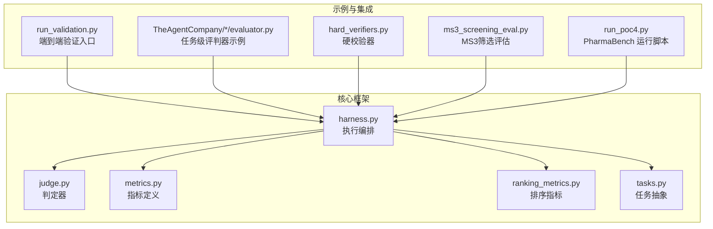
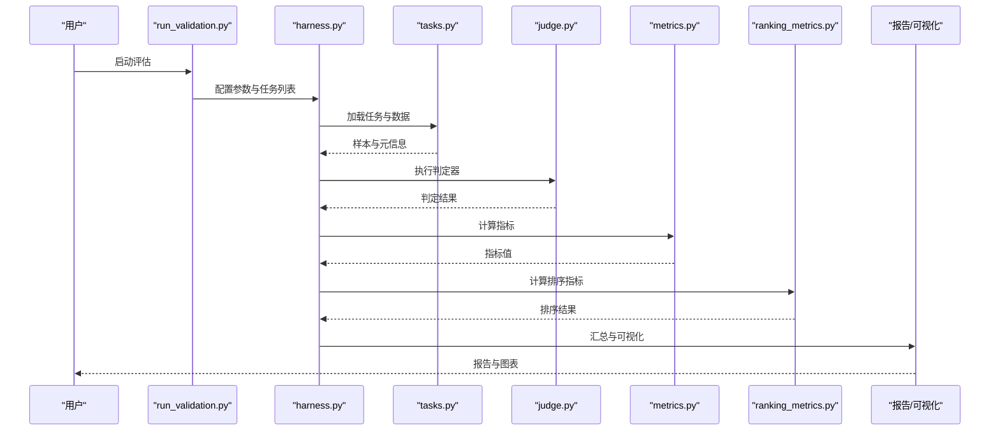
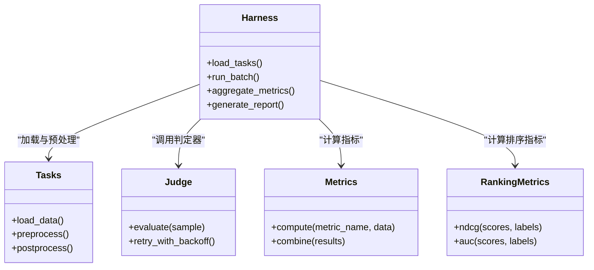

# 评估框架教程

<cite>
**本文引用的文件**   
- [autonomy_mvp/core/harness.py](file://autonomy_mvp/core/harness.py)
- [autonomy_mvp/core/judge.py](file://autonomy_mvp/core/judge.py)
- [autonomy_mvp/core/metrics.py](file://autonomy_mvp/core/metrics.py)
- [autonomy_mvp/core/ranking_metrics.py](file://autonomy_mvp/core/ranking_metrics.py)
- [autonomy_mvp/core/tasks.py](file://autonomy_mvp/core/tasks.py)
- [autonomy_mvp/run_validation.py](file://autonomy_mvp/run_validation.py)
- [autonomy_mvp/tests/test_core.py](file://autonomy_mvp/tests/test_core.py)
- [deep_research_longhorizon/datasets/TheAgentCompany/sample_tasks/*/evaluator.py](file://deep_research_longhorizon/datasets/TheAgentCompany/sample_tasks/bm-classify-nationality/evaluator.py)
- [longhorizon/verifiers/hard_verifiers.py](file://longhorizon/verifiers/hard_verifiers.py)
- [task3/B_ms3_screening_prototype/ms3_screening_eval.py](file://task3/B_ms3_screening_prototype/ms3_screening_eval.py)
- [task7/poc4_pharmabench/run_poc4.py](file://task7/poc4_pharmabench/run_poc4.py)
</cite>

## 目录
1. [简介](#简介)
2. [项目结构](#项目结构)
3. [核心组件](#核心组件)
4. [架构总览](#架构总览)
5. [详细组件分析](#详细组件分析)
6. [依赖关系分析](#依赖关系分析)
7. [性能与可扩展性](#性能与可扩展性)
8. [故障排查指南](#故障排查指南)
9. [结论](#结论)
10. [附录：模板与最佳实践](#附录模板与最佳实践)

## 简介
本教程面向需要构建、运行与分析自动化评估流程的工程师与研究者。围绕指标定义、评判器编写、结果分析与可视化、批量评估与报告生成等主题，结合仓库中的真实实现与示例，提供从入门到进阶的系统化指导。你将学会：
- 如何定义可复用的评估指标与排序指标
- 如何编写任务级评判器（Evaluator）并集成到统一执行管线
- 如何进行批量评估、结果汇总与可视化
- 如何为自定义评估逻辑设计测试用例与回归保障
- 如何在不同业务场景（如药物筛选、材料发现、医疗任务）中复用与扩展评估能力

## 项目结构
仓库采用“核心框架 + 多领域示例”的组织方式：
- 核心框架位于 autonomy_mvp/core，提供统一的执行编排、指标计算、排序指标与任务抽象
- 示例与评测脚本分布于 deep_research_longhorizon、longhorizon、task3、task7 等目录，覆盖多种评估场景
- 单元测试位于 autonomy_mvp/tests，用于验证核心逻辑与接口契约

图表来源
- [autonomy_mvp/core/harness.py](file://autonomy_mvp/core/harness.py)
- [autonomy_mvp/core/judge.py](file://autonomy_mvp/core/judge.py)
- [autonomy_mvp/core/metrics.py](file://autonomy_mvp/core/metrics.py)
- [autonomy_mvp/core/ranking_metrics.py](file://autonomy_mvp/core/ranking_metrics.py)
- [autonomy_mvp/core/tasks.py](file://autonomy_mvp/core/tasks.py)
- [autonomy_mvp/run_validation.py](file://autonomy_mvp/run_validation.py)
- [deep_research_longhorizon/datasets/TheAgentCompany/sample_tasks/*/evaluator.py](file://deep_research_longhorizon/datasets/TheAgentCompany/sample_tasks/bm-classify-nationality/evaluator.py)
- [longhorizon/verifiers/hard_verifiers.py](file://longhorizon/verifiers/hard_verifiers.py)
- [task3/B_ms3_screening_prototype/ms3_screening_eval.py](file://task3/B_ms3_screening_prototype/ms3_screening_eval.py)
- [task7/poc4_pharmabench/run_poc4.py](file://task7/poc4_pharmabench/run_poc4.py)

章节来源
- [autonomy_mvp/core/harness.py](file://autonomy_mvp/core/harness.py)
- [autonomy_mvp/core/judge.py](file://autonomy_mvp/core/judge.py)
- [autonomy_mvp/core/metrics.py](file://autonomy_mvp/core/metrics.py)
- [autonomy_mvp/core/ranking_metrics.py](file://autonomy_mvp/core/ranking_metrics.py)
- [autonomy_mvp/core/tasks.py](file://autonomy_mvp/core/tasks.py)
- [autonomy_mvp/run_validation.py](file://autonomy_mvp/run_validation.py)
- [deep_research_longhorizon/datasets/TheAgentCompany/sample_tasks/*/evaluator.py](file://deep_research_longhorizon/datasets/TheAgentCompany/sample_tasks/bm-classify-nationality/evaluator.py)
- [longhorizon/verifiers/hard_verifiers.py](file://longhorizon/verifiers/hard_verifiers.py)
- [task3/B_ms3_screening_prototype/ms3_screening_eval.py](file://task3/B_ms3_screening_prototype/ms3_screening_eval.py)
- [task7/poc4_pharmabench/run_poc4.py](file://task7/poc4_pharmabench/run_poc4.py)

## 核心组件
- 执行编排（Harness）
  - 负责加载任务、调度评判器、收集中间结果、聚合指标与排序指标、输出报告
  - 支持批量任务执行与错误隔离，保证长时运行的稳定性
- 判定器（Judge）
  - 封装对模型输出的判定逻辑，可与外部工具或规则引擎集成
  - 提供标准化输入输出契约，便于替换与扩展
- 指标（Metrics）
  - 定义常用评估指标的计算方法，包括数值型、分类型与序列型指标
  - 支持组合指标与加权聚合
- 排序指标（Ranking Metrics）
  - 针对排序类任务的评估，如命中率、NDCG、AUC 等
  - 提供与主指标一致的接口，便于在报告中统一展示
- 任务抽象（Tasks）
  - 将数据加载、预处理、后处理与评估步骤解耦
  - 提供默认实现与扩展点，适配不同数据集格式

章节来源
- [autonomy_mvp/core/harness.py](file://autonomy_mvp/core/harness.py)
- [autonomy_mvp/core/judge.py](file://autonomy_mvp/core/judge.py)
- [autonomy_mvp/core/metrics.py](file://autonomy_mvp/core/metrics.py)
- [autonomy_mvp/core/ranking_metrics.py](file://autonomy_mvp/core/ranking_metrics.py)
- [autonomy_mvp/core/tasks.py](file://autonomy_mvp/core/tasks.py)

## 架构总览
下图展示了从任务定义到结果报告的完整流水线，以及各模块之间的调用关系。

图表来源
- [autonomy_mvp/run_validation.py](file://autonomy_mvp/run_validation.py)
- [autonomy_mvp/core/harness.py](file://autonomy_mvp/core/harness.py)
- [autonomy_mvp/core/tasks.py](file://autonomy_mvp/core/tasks.py)
- [autonomy_mvp/core/judge.py](file://autonomy_mvp/core/judge.py)
- [autonomy_mvp/core/metrics.py](file://autonomy_mvp/core/metrics.py)
- [autonomy_mvp/core/ranking_metrics.py](file://autonomy_mvp/core/ranking_metrics.py)

## 详细组件分析

### 指标定义与使用（metrics.py）
- 目标
  - 提供可复用的指标函数族，支持单样本与批量计算
  - 暴露统一的接口以接入 Harness 的聚合流程
- 关键点
  - 输入规范化：缺失值、类型转换、边界条件处理
  - 组合策略：加权平均、分桶统计、置信区间估计
  - 可观测性：记录计算耗时与异常计数
- 建议
  - 为新指标创建独立函数，并在 metrics.py 中注册
  - 为复杂指标提供单元测试，覆盖典型与极端输入

章节来源
- [autonomy_mvp/core/metrics.py](file://autonomy_mvp/core/metrics.py)

### 排序指标（ranking_metrics.py）
- 目标
  - 针对排序任务提供命中率、NDCG、AUC 等指标
- 关键点
  - 相关性标签对齐与去重
  - 截断位置与权重策略
  - 与主指标的联合展示
- 建议
  - 在报告中同时呈现排序与主指标，增强解释力

章节来源
- [autonomy_mvp/core/ranking_metrics.py](file://autonomy_mvp/core/ranking_metrics.py)

### 判定器（judge.py）
- 目标
  - 将业务判定逻辑封装为可插拔的判定器
- 关键点
  - 输入输出契约：标准化字段名与类型
  - 外部工具集成：通过子进程或 API 调用
  - 失败重试与超时控制
- 建议
  - 为每个判定器提供最小可运行样例与文档

章节来源
- [autonomy_mvp/core/judge.py](file://autonomy_mvp/core/judge.py)

### 任务抽象（tasks.py）
- 目标
  - 将数据加载、预处理、后处理与评估步骤解耦
- 关键点
  - 数据源适配：JSON/CSV/JSONL 等格式
  - 批处理与流式读取
  - 缓存与增量更新
- 建议
  - 为每种数据格式提供适配器，避免重复解析

章节来源
- [autonomy_mvp/core/tasks.py](file://autonomy_mvp/core/tasks.py)

### 执行编排（harness.py）
- 目标
  - 串联任务、判定器、指标与排序指标，完成端到端评估
- 关键点
  - 并行与并发控制：线程/进程池、限流与退避
  - 错误隔离：单个任务失败不影响整体
  - 日志与追踪：结构化日志与关键路径埋点
- 建议
  - 为大规模评估启用检查点与断点续跑

章节来源
- [autonomy_mvp/core/harness.py](file://autonomy_mvp/core/harness.py)

### 端到端验证入口（run_validation.py）
- 目标
  - 提供一键运行评估的配置与命令行入口
- 关键点
  - 配置文件驱动：任务清单、参数、资源限制
  - 结果落盘：原始结果、指标汇总、可视化产物
- 建议
  - 为不同场景准备模板配置，减少重复工作

章节来源
- [autonomy_mvp/run_validation.py](file://autonomy_mvp/run_validation.py)

### 任务级评判器示例（TheAgentCompany/*/evaluator.py）
- 目标
  - 展示如何编写任务级评判器并接入框架
- 关键点
  - 输入：任务描述、样本、期望答案
  - 输出：分数、理由、中间证据
  - 与 judge.py 的对接方式
- 建议
  - 保持评判器幂等，便于重跑与对比

章节来源
- [deep_research_longhorizon/datasets/TheAgentCompany/sample_tasks/bm-classify-nationality/evaluator.py](file://deep_research_longhorizon/datasets/TheAgentCompany/sample_tasks/bm-classify-nationality/evaluator.py)

### 硬校验器（hard_verifiers.py）
- 目标
  - 提供强约束的校验逻辑，用于关键路径的可靠性保障
- 关键点
  - 快速失败：尽早检测不满足条件的样本
  - 可配置阈值与容错策略
- 建议
  - 与主评估流程分离，作为前置过滤器

章节来源
- [longhorizon/verifiers/hard_verifiers.py](file://longhorizon/verifiers/hard_verifiers.py)

### 领域评估示例：MS3 筛选（ms3_screening_eval.py）
- 目标
  - 展示在特定科学任务中如何组合指标与判定器
- 关键点
  - 数据对齐：分子表征与实验结果匹配
  - 阈值策略：筛选通过率与质量门槛
- 建议
  - 将领域知识固化为可配置参数，提升可移植性

章节来源
- [task3/B_ms3_screening_prototype/ms3_screening_eval.py](file://task3/B_ms3_screening_prototype/ms3_screening_eval.py)

### 领域评估示例：PharmaBench（run_poc4.py）
- 目标
  - 展示在制药场景中如何组织评估任务与报告
- 关键点
  - 任务编排：多子任务协同
  - 报告生成：指标表、趋势图、案例剖析
- 建议
  - 使用模板化报告，确保一致性

章节来源
- [task7/poc4_pharmabench/run_poc4.py](file://task7/poc4_pharmabench/run_poc4.py)

### 单元测试（test_core.py）
- 目标
  - 验证核心组件的正确性与兼容性
- 关键点
  - 覆盖正常路径与异常路径
  - 模拟外部依赖，保证可重复性
- 建议
  - 新增指标或判定器时同步补充测试

章节来源
- [autonomy_mvp/tests/test_core.py](file://autonomy_mvp/tests/test_core.py)

## 依赖关系分析
下图展示了核心模块之间的依赖与耦合情况，有助于识别潜在循环依赖与优化点。

图表来源
- [autonomy_mvp/core/harness.py](file://autonomy_mvp/core/harness.py)
- [autonomy_mvp/core/tasks.py](file://autonomy_mvp/core/tasks.py)
- [autonomy_mvp/core/judge.py](file://autonomy_mvp/core/judge.py)
- [autonomy_mvp/core/metrics.py](file://autonomy_mvp/core/metrics.py)
- [autonomy_mvp/core/ranking_metrics.py](file://autonomy_mvp/core/ranking_metrics.py)

章节来源
- [autonomy_mvp/core/harness.py](file://autonomy_mvp/core/harness.py)
- [autonomy_mvp/core/tasks.py](file://autonomy_mvp/core/tasks.py)
- [autonomy_mvp/core/judge.py](file://autonomy_mvp/core/judge.py)
- [autonomy_mvp/core/metrics.py](file://autonomy_mvp/core/metrics.py)
- [autonomy_mvp/core/ranking_metrics.py](file://autonomy_mvp/core/ranking_metrics.py)

## 性能与可扩展性
- 并行与并发
  - 使用线程/进程池进行任务级并行，注意 I/O 与 CPU 密集型任务的区分
  - 引入令牌桶或信号量控制并发度，避免资源争用
- 内存与磁盘
  - 大样本采用流式读取与分批处理
  - 中间结果落盘，支持断点续跑与增量更新
- 指标计算
  - 向量化与缓存命中，减少重复计算
  - 对高开销指标设置采样与近似算法选项
- 可观测性
  - 结构化日志与指标埋点，便于定位瓶颈
  - 关键路径耗时与错误率监控

[本节为通用指导，无需具体文件引用]

## 故障排查指南
- 常见问题
  - 数据格式不一致：检查 tasks.py 的数据适配器与字段映射
  - 判定器超时：调整 judge.py 的重试与超时策略
  - 指标计算异常：核对 metrics.py 的边界条件与类型转换
  - 排序指标偏差：确认相关性标签对齐与去重逻辑
- 诊断步骤
  - 启用详细日志，定位失败样本与堆栈
  - 使用最小数据集复现问题，逐步缩小范围
  - 对比历史版本，确认回归点
- 恢复策略
  - 启用检查点，从最近成功状态继续
  - 对不稳定外部依赖增加熔断与降级

章节来源
- [autonomy_mvp/core/judge.py](file://autonomy_mvp/core/judge.py)
- [autonomy_mvp/core/metrics.py](file://autonomy_mvp/core/metrics.py)
- [autonomy_mvp/core/ranking_metrics.py](file://autonomy_mvp/core/ranking_metrics.py)
- [autonomy_mvp/core/tasks.py](file://autonomy_mvp/core/tasks.py)

## 结论
本教程基于仓库中的核心框架与多领域示例，系统阐述了评估指标定义、评判器编写、结果分析与可视化的完整流程。通过模块化设计与统一编排，开发者可以快速构建可复用的评估体系，并在不同业务场景中高效落地。建议在团队内推广模板化配置与测试驱动开发，持续提升评估质量与效率。

[本节为总结性内容，无需具体文件引用]

## 附录：模板与最佳实践

### 指标定义模板
- 命名规范：metric_<类别>_<名称>
- 输入输出：明确数据类型与单位
- 组合策略：提供加权与分桶选项
- 测试要求：覆盖典型与极端输入

章节来源
- [autonomy_mvp/core/metrics.py](file://autonomy_mvp/core/metrics.py)

### 评判器开发模板
- 输入：任务描述、样本、期望答案
- 输出：分数、理由、证据
- 错误处理：重试、降级、记录
- 文档：接口说明与示例

章节来源
- [autonomy_mvp/core/judge.py](file://autonomy_mvp/core/judge.py)
- [deep_research_longhorizon/datasets/TheAgentCompany/sample_tasks/bm-classify-nationality/evaluator.py](file://deep_research_longhorizon/datasets/TheAgentCompany/sample_tasks/bm-classify-nationality/evaluator.py)

### 批量评估流程
- 配置驱动：任务清单、参数、资源限制
- 并行执行：并发度控制与退避
- 结果落盘：原始结果、汇总、可视化
- 断点续跑：检查点与增量更新

章节来源
- [autonomy_mvp/run_validation.py](file://autonomy_mvp/run_validation.py)
- [autonomy_mvp/core/harness.py](file://autonomy_mvp/core/harness.py)

### 结果可视化与报告
- 指标表：主指标与排序指标并列
- 趋势图：时间序列与对比分析
- 案例剖析：失败样本归因与改进建议

章节来源
- [task7/poc4_pharmabench/run_poc4.py](file://task7/poc4_pharmabench/run_poc4.py)

### 测试方法与回归保障
- 单元覆盖：正常与异常路径
- 模拟依赖：外部服务与文件系统
- 持续集成：每次提交自动运行

章节来源
- [autonomy_mvp/tests/test_core.py](file://autonomy_mvp/tests/test_core.py)