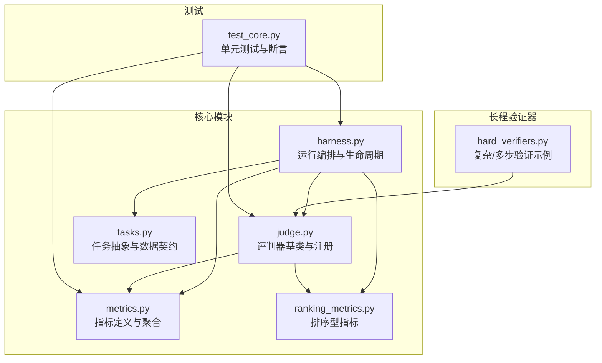
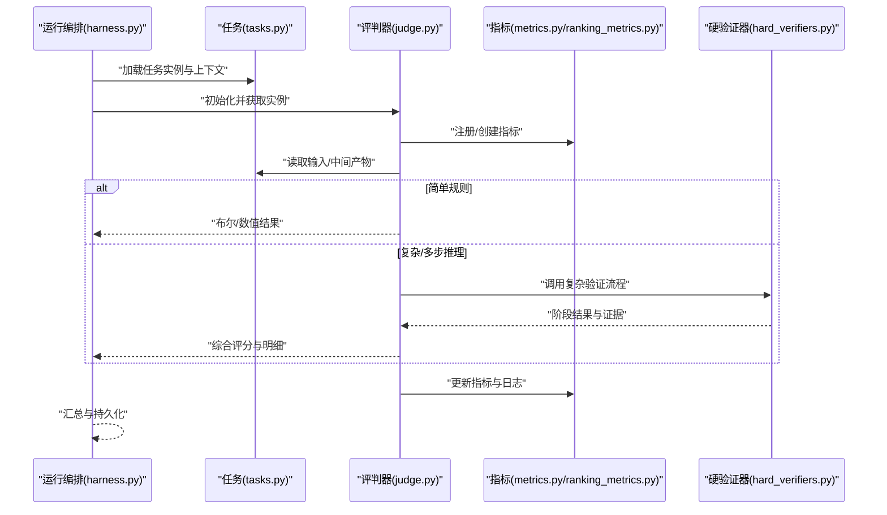
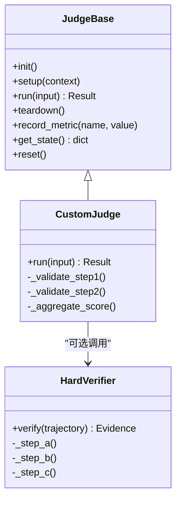
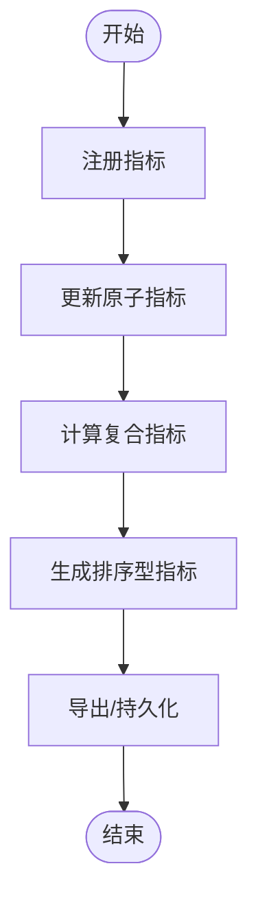
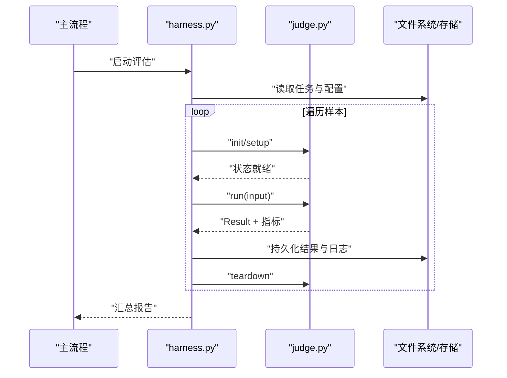
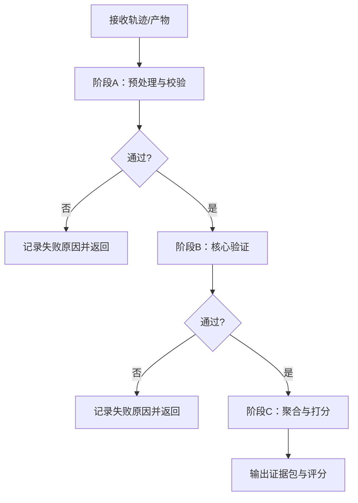
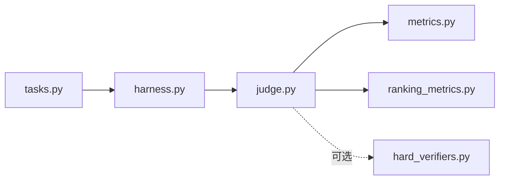

# 评判器开发

<cite>
**本文引用的文件**   
- [autonomy_mvp/core/judge.py](file://autonomy_mvp/core/judge.py)
- [autonomy_mvp/core/metrics.py](file://autonomy_mvp/core/metrics.py)
- [autonomy_mvp/core/ranking_metrics.py](file://autonomy_mvp/core/ranking_metrics.py)
- [autonomy_mvp/core/harness.py](file://autonomy_mvp/core/harness.py)
- [autonomy_mvp/core/tasks.py](file://autonomy_mvp/core/tasks.py)
- [autonomy_mvp/tests/test_core.py](file://autonomy_mvp/tests/test_core.py)
- [longhorizon/verifiers/hard_verifiers.py](file://longhorizon/verifiers/hard_verifiers.py)
</cite>

## 目录
1. [简介](#简介)
2. [项目结构](#项目结构)
3. [核心组件](#核心组件)
4. [架构总览](#架构总览)
5. [详细组件分析](#详细组件分析)
6. [依赖分析](#依赖分析)
7. [性能考虑](#性能考虑)
8. [故障排查指南](#故障排查指南)
9. [结论](#结论)
10. [附录](#附录)

## 简介
本教程面向希望在本基准框架中“开发自定义评判器”的工程师与研究者。内容覆盖评判器的架构设计、生命周期管理、状态处理，以及如何编写简单规则判断、复杂业务逻辑与多步骤推理等场景的评判器。同时提供模板化思路、调试技巧、性能优化建议，以及与指标系统的集成方式、错误处理机制和测试策略。文末通过实际案例展示评判器在不同评估场景中的应用。

## 项目结构
本项目围绕“任务执行—结果判定—指标聚合”的主线组织代码。评判器相关能力集中在 autonomy_mvp/core 与 longhorizon/verifiers 两个位置：
- autonomy_mvp/core：定义评判器接口、指标体系、编排与任务抽象
- longhorizon/verifiers：提供面向长程任务的“硬验证器”示例，体现复杂业务逻辑与多步推理的评判模式

图表来源
- [autonomy_mvp/core/judge.py](file://autonomy_mvp/core/judge.py)
- [autonomy_mvp/core/metrics.py](file://autonomy_mvp/core/metrics.py)
- [autonomy_mvp/core/ranking_metrics.py](file://autonomy_mvp/core/ranking_metrics.py)
- [autonomy_mvp/core/harness.py](file://autonomy_mvp/core/harness.py)
- [autonomy_mvp/core/tasks.py](file://autonomy_mvp/core/tasks.py)
- [longhorizon/verifiers/hard_verifiers.py](file://longhorizon/verifiers/hard_verifiers.py)
- [autonomy_mvp/tests/test_core.py](file://autonomy_mvp/tests/test_core.py)

章节来源
- [autonomy_mvp/core/judge.py](file://autonomy_mvp/core/judge.py)
- [autonomy_mvp/core/metrics.py](file://autonomy_mvp/core/metrics.py)
- [autonomy_mvp/core/ranking_metrics.py](file://autonomy_mvp/core/ranking_metrics.py)
- [autonomy_mvp/core/harness.py](file://autonomy_mvp/core/harness.py)
- [autonomy_mvp/core/tasks.py](file://autonomy_mvp/core/tasks.py)
- [longhorizon/verifiers/hard_verifiers.py](file://longhorizon/verifiers/hard_verifiers.py)
- [autonomy_mvp/tests/test_core.py](file://autonomy_mvp/tests/test_core.py)

## 核心组件
- 评判器基类与注册中心（judge.py）
  - 定义评判器统一接口、生命周期钩子、状态管理与结果上报
  - 提供注册表与工厂方法，便于按名称或配置动态加载
- 指标系统（metrics.py, ranking_metrics.py）
  - 定义原子指标、复合指标与排序型指标
  - 支持在评判器内部记录中间态与最终得分
- 运行编排（harness.py）
  - 负责任务实例化、调用评判器、收集指标、持久化结果
  - 管理评判器生命周期（初始化、运行、清理）
- 任务抽象（tasks.py）
  - 定义输入输出契约、上下文与元数据，供评判器消费
- 长程验证器示例（hard_verifiers.py）
  - 展示复杂业务逻辑与多步骤推理的评判器实现范式

章节来源
- [autonomy_mvp/core/judge.py](file://autonomy_mvp/core/judge.py)
- [autonomy_mvp/core/metrics.py](file://autonomy_mvp/core/metrics.py)
- [autonomy_mvp/core/ranking_metrics.py](file://autonomy_mvp/core/ranking_metrics.py)
- [autonomy_mvp/core/harness.py](file://autonomy_mvp/core/harness.py)
- [autonomy_mvp/core/tasks.py](file://autonomy_mvp/core/tasks.py)
- [longhorizon/verifiers/hard_verifiers.py](file://longhorizon/verifiers/hard_verifiers.py)

## 架构总览
评判器作为“可插拔”的评估单元，被运行编排驱动，依据任务契约读取输入、执行判定、写入指标并返回结构化结果。

图表来源
- [autonomy_mvp/core/harness.py](file://autonomy_mvp/core/harness.py)
- [autonomy_mvp/core/tasks.py](file://autonomy_mvp/core/tasks.py)
- [autonomy_mvp/core/judge.py](file://autonomy_mvp/core/judge.py)
- [autonomy_mvp/core/metrics.py](file://autonomy_mvp/core/metrics.py)
- [autonomy_mvp/core/ranking_metrics.py](file://autonomy_mvp/core/ranking_metrics.py)
- [longhorizon/verifiers/hard_verifiers.py](file://longhorizon/verifiers/hard_verifiers.py)

## 详细组件分析

### 评判器基类与生命周期（judge.py）
- 职责
  - 定义统一的 run/evaluate 入口
  - 暴露 init/setup/teardown 等生命周期钩子
  - 维护内部状态（如中间证据、阶段分数、失败原因）
  - 提供指标记录与结果序列化接口
- 关键要点
  - 状态隔离：每个任务实例应持有独立状态，避免跨样本污染
  - 幂等性：对相同输入应产生一致输出，便于重试与并行
  - 可扩展：通过注册表按需加载不同评判器实现

图表来源
- [autonomy_mvp/core/judge.py](file://autonomy_mvp/core/judge.py)
- [longhorizon/verifiers/hard_verifiers.py](file://longhorizon/verifiers/hard_verifiers.py)

章节来源
- [autonomy_mvp/core/judge.py](file://autonomy_mvp/core/judge.py)

### 指标系统与排序型指标（metrics.py, ranking_metrics.py）
- 职责
  - 定义原子指标（如准确率、F1、AUC）与复合指标（加权平均、分桶统计）
  - 提供排序型指标用于模型/方案横向对比
  - 支持增量更新与快照导出
- 使用建议
  - 在评判器中尽早注册指标，保证异常路径也能落盘
  - 将“过程指标”与“结果指标”分离，便于诊断

图表来源
- [autonomy_mvp/core/metrics.py](file://autonomy_mvp/core/metrics.py)
- [autonomy_mvp/core/ranking_metrics.py](file://autonomy_mvp/core/ranking_metrics.py)

章节来源
- [autonomy_mvp/core/metrics.py](file://autonomy_mvp/core/metrics.py)
- [autonomy_mvp/core/ranking_metrics.py](file://autonomy_mvp/core/ranking_metrics.py)

### 运行编排与生命周期（harness.py）
- 职责
  - 解析任务清单、构造上下文
  - 实例化评判器、驱动 run 流程
  - 捕获异常、记录日志、汇总指标并保存结果
- 关键点
  - 资源管理：确保 teardown 在异常时仍被执行
  - 并发控制：根据 I/O 与 CPU 特征调整并行度
  - 可观测性：为每个样本保留 trace 与中间产物

图表来源
- [autonomy_mvp/core/harness.py](file://autonomy_mvp/core/harness.py)
- [autonomy_mvp/core/judge.py](file://autonomy_mvp/core/judge.py)

章节来源
- [autonomy_mvp/core/harness.py](file://autonomy_mvp/core/harness.py)

### 任务抽象与数据契约（tasks.py）
- 职责
  - 定义输入数据结构、期望输出格式、元数据字段
  - 提供校验与默认值填充
- 与评判器关系
  - 评判器仅消费 tasks.py 定义的契约，降低耦合
  - 当输入/输出变更时，优先更新契约而非评判器内部假设

章节来源
- [autonomy_mvp/core/tasks.py](file://autonomy_mvp/core/tasks.py)

### 复杂/多步推理的硬验证器（hard_verifiers.py）
- 适用场景
  - 需要多阶段证据链、外部工具调用或条件分支的评估
  - 例如：轨迹回放、约束检查、阈值组合、反事实验证
- 设计建议
  - 将每一步封装为可复用的子函数，便于单测与复用
  - 明确失败短路策略与回退路径
  - 输出“证据包”，包含每步断言、中间值与解释

图表来源
- [longhorizon/verifiers/hard_verifiers.py](file://longhorizon/verifiers/hard_verifiers.py)

章节来源
- [longhorizon/verifiers/hard_verifiers.py](file://longhorizon/verifiers/hard_verifiers.py)

### 测试策略（test_core.py）
- 目标
  - 覆盖简单规则、边界条件与异常路径
  - 验证指标更新与结果序列化正确性
- 建议
  - 使用 fixtures 构造最小可复现输入
  - 针对多步验证器进行“阶段级”断言
  - 引入随机种子以保证可重复性

章节来源
- [autonomy_mvp/tests/test_core.py](file://autonomy_mvp/tests/test_core.py)

## 依赖分析
- 内聚与耦合
  - judge.py 与 metrics.py/ranking_metrics.py 存在强依赖（记录指标）
  - harness.py 作为编排层，依赖 tasks.py 的数据契约与 judge.py 的统一接口
  - hard_verifiers.py 作为扩展，可被 judge.py 按需调用
- 潜在循环
  - 应避免在 metrics 中反向依赖 judge；如需反馈，通过回调或事件总线解耦
- 外部依赖
  - 若涉及外部工具（仿真器、数据库、LLM），应在评测前完成环境准备与超时/重试策略

图表来源
- [autonomy_mvp/core/tasks.py](file://autonomy_mvp/core/tasks.py)
- [autonomy_mvp/core/harness.py](file://autonomy_mvp/core/harness.py)
- [autonomy_mvp/core/judge.py](file://autonomy_mvp/core/judge.py)
- [autonomy_mvp/core/metrics.py](file://autonomy_mvp/core/metrics.py)
- [autonomy_mvp/core/ranking_metrics.py](file://autonomy_mvp/core/ranking_metrics.py)
- [longhorizon/verifiers/hard_verifiers.py](file://longhorizon/verifiers/hard_verifiers.py)

章节来源
- [autonomy_mvp/core/judge.py](file://autonomy_mvp/core/judge.py)
- [autonomy_mvp/core/metrics.py](file://autonomy_mvp/core/metrics.py)
- [autonomy_mvp/core/ranking_metrics.py](file://autonomy_mvp/core/ranking_metrics.py)
- [autonomy_mvp/core/harness.py](file://autonomy_mvp/core/harness.py)
- [autonomy_mvp/core/tasks.py](file://autonomy_mvp/core/tasks.py)
- [longhorizon/verifiers/hard_verifiers.py](file://longhorizon/verifiers/hard_verifiers.py)

## 性能考虑
- 批处理与缓存
  - 对可并行的样本采用进程/线程池；对共享资源（文件、网络）加锁或队列限流
  - 对昂贵计算（如仿真、模型推理）启用结果缓存与去重
- 指标更新开销
  - 批量合并更新，减少频繁 I/O；仅在必要时写磁盘
- 内存与对象复用
  - 及时释放大对象引用；避免在循环中创建重型对象
- 可观测性
  - 采样式打点与慢查询告警，定位瓶颈

[本节为通用指导，不直接分析具体文件]

## 故障排查指南
- 常见问题
  - 指标未更新：确认是否在异常路径也记录了指标
  - 结果不一致：检查是否使用了全局可变状态或未设置随机种子
  - 多步验证失败：打印每步证据包，定位失败阶段
- 定位手段
  - 开启详细日志，记录输入摘要与中间值
  - 使用最小用例复现问题，逐步缩小范围
  - 对关键路径添加断言与快照比对

章节来源
- [autonomy_mvp/tests/test_core.py](file://autonomy_mvp/tests/test_core.py)
- [autonomy_mvp/core/harness.py](file://autonomy_mvp/core/harness.py)
- [autonomy_mvp/core/judge.py](file://autonomy_mvp/core/judge.py)

## 结论
通过统一的评判器接口、清晰的指标系统与稳健的运行编排，本框架能够支撑从简单规则到复杂多步推理的多样化评估需求。遵循本文的模板化思路、调试技巧与性能优化建议，可以快速构建高质量、可维护且可复现的自定义评判器。

## 附录

### 自定义评判器模板（思路）
- 继承基类，实现 run 与必要的生命周期钩子
- 在 setup 中注册指标、加载必要资源
- 在 run 中：
  - 校验输入
  - 执行规则/推理（可拆分为多步）
  - 更新指标与证据包
  - 返回结构化结果
- 在 teardown 中释放资源、持久化中间产物

章节来源
- [autonomy_mvp/core/judge.py](file://autonomy_mvp/core/judge.py)
- [autonomy_mvp/core/metrics.py](file://autonomy_mvp/core/metrics.py)
- [autonomy_mvp/core/ranking_metrics.py](file://autonomy_mvp/core/ranking_metrics.py)
- [autonomy_mvp/core/harness.py](file://autonomy_mvp/core/harness.py)
- [autonomy_mvp/core/tasks.py](file://autonomy_mvp/core/tasks.py)
- [longhorizon/verifiers/hard_verifiers.py](file://longhorizon/verifiers/hard_verifiers.py)