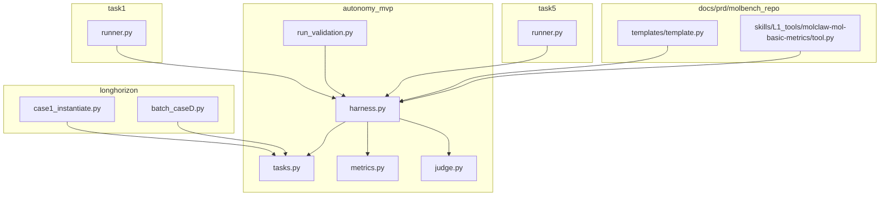
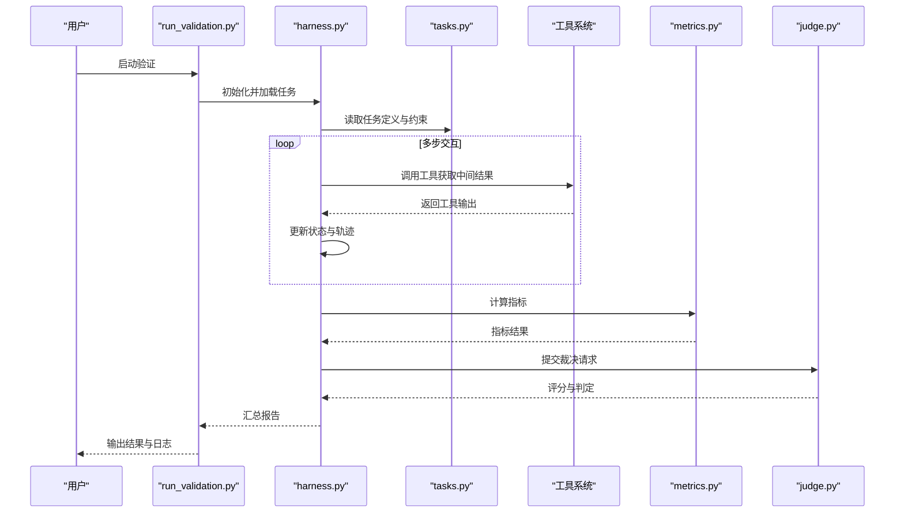
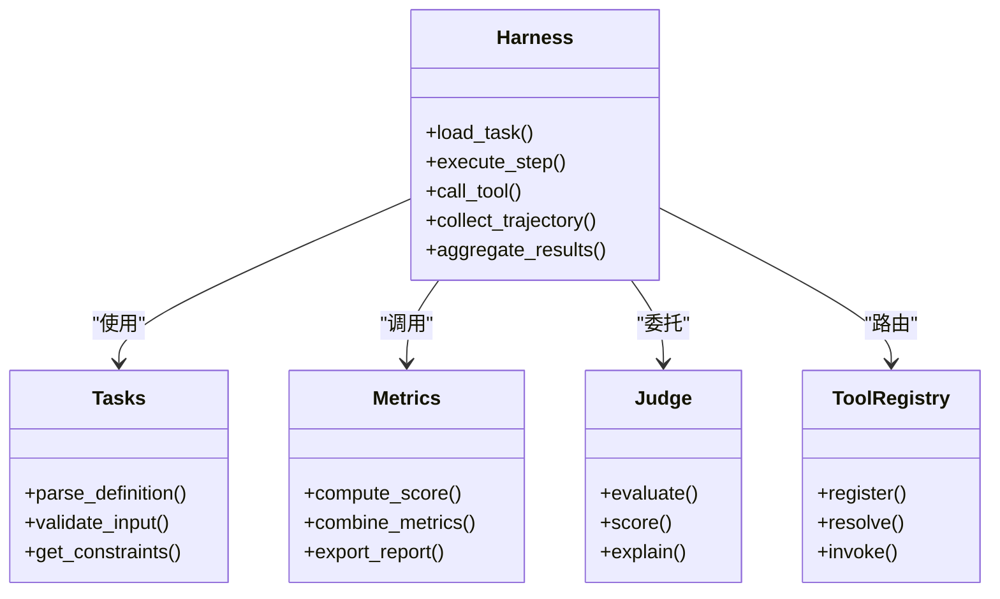

# 快速开始

<cite>
**本文引用的文件**   
- [autonomy_mvp/core/harness.py](file://autonomy_mvp/core/harness.py)
- [autonomy_mvp/core/tasks.py](file://autonomy_mvp/core/tasks.py)
- [autonomy_mvp/core/metrics.py](file://autonomy_mvp/core/metrics.py)
- [autonomy_mvp/core/judge.py](file://autonomy_mvp/core/judge.py)
- [autonomy_mvp/run_validation.py](file://autonomy_mvp/run_validation.py)
- [longhorizon/instantiate/case1_instantiate.py](file://longhorizon/instantiate/case1_instantiate.py)
- [longhorizon/instantiate/batch_caseD.py](file://longhorizon/instantiate/batch_caseD.py)
- [task1/runner.py](file://task1/runner.py)
- [task5/runner.py](file://task5/runner.py)
- [docs/prd/molbench_repo/skills/L1_tools/molclaw-mol-basic-metrics/__init__.py](file://docs/prd/molbench_repo/skills/L1_tools/molclaw-mol-basic-metrics/__init__.py)
- [docs/prd/molbench_repo/skills/L1_tools/molclaw-mol-basic-metrics/tool.py](file://docs/prd/molbench_repo/skills/L1_tools/molclaw-mol-basic-metrics/tool.py)
- [docs/prd/molbench_repo/templates/template.py](file://docs/prd/molbench_repo/templates/template.py)
</cite>

## 目录
1. [简介](#简介)
2. [项目结构](#项目结构)
3. [核心组件](#核心组件)
4. [架构总览](#架构总览)
5. [详细组件分析](#详细组件分析)
6. [依赖关系分析](#依赖关系分析)
7. [性能考虑](#性能考虑)
8. [故障排除指南](#故障排除指南)
9. [结论](#结论)
10. [附录：5分钟最小可运行示例](#附录5分钟最小可运行示例)

## 简介
本指南面向科学计算与智能体基准测试的新手，帮助你快速搭建环境、理解框架核心概念（长视域任务、自主性评估、工具系统），并在5分钟内运行一个最小可执行示例。框架围绕“任务定义—智能体执行—工具调用—指标评估”的闭环设计，支持材料、药物、医学等多领域长视域任务的评测与对比。

## 项目结构
仓库采用按功能域与任务类型划分的模块化组织方式：
- autonomy_mvp：最小可验证原型，包含任务、评估、裁判、指标等核心能力
- longhorizon：长视域任务实例化与批处理脚本，覆盖多种场景
- task1/task5：具体任务运行器与实验记录
- docs/prd/molbench_repo：分子基准相关的配置、技能工具、模板与数据说明

图表来源 
- [autonomy_mvp/core/harness.py](file://autonomy_mvp/core/harness.py)
- [autonomy_mvp/core/tasks.py](file://autonomy_mvp/core/tasks.py)
- [autonomy_mvp/core/metrics.py](file://autonomy_mvp/core/metrics.py)
- [autonomy_mvp/core/judge.py](file://autonomy_mvp/core/judge.py)
- [autonomy_mvp/run_validation.py](file://autonomy_mvp/run_validation.py)
- [longhorizon/instantiate/case1_instantiate.py](file://longhorizon/instantiate/case1_instantiate.py)
- [longhorizon/instantiate/batch_caseD.py](file://longhorizon/instantiate/batch_caseD.py)
- [task1/runner.py](file://task1/runner.py)
- [task5/runner.py](file://task5/runner.py)
- [docs/prd/molbench_repo/templates/template.py](file://docs/prd/molbench_repo/templates/template.py)
- [docs/prd/molbench_repo/skills/L1_tools/molclaw-mol-basic-metrics/tool.py](file://docs/prd/molbench_repo/skills/L1_tools/molclaw-mol-basic-metrics/tool.py)

章节来源
- [autonomy_mvp/run_validation.py](file://autonomy_mvp/run_validation.py)
- [longhorizon/instantiate/case1_instantiate.py](file://longhorizon/instantiate/case1_instantiate.py)
- [longhorizon/instantiate/batch_caseD.py](file://longhorizon/instantiate/batch_caseD.py)
- [task1/runner.py](file://task1/runner.py)
- [task5/runner.py](file://task5/runner.py)
- [docs/prd/molbench_repo/templates/template.py](file://docs/prd/molbench_repo/templates/template.py)
- [docs/prd/molbench_repo/skills/L1_tools/molclaw-mol-basic-metrics/tool.py](file://docs/prd/molbench_repo/skills/L1_tools/molclaw-mol-basic-metrics/tool.py)

## 核心组件
- 任务编排与执行（Harness）：负责加载任务、驱动智能体执行、管理工具调用、收集轨迹与结果
- 任务定义（Tasks）：描述任务输入、约束、期望输出与评测标准
- 指标体系（Metrics）：提供数值型与结构化指标的度量方法
- 裁判（Judge）：对复杂或主观结果进行裁决与打分
- 运行入口（run_validation）：统一启动验证流程，串联上述组件

章节来源
- [autonomy_mvp/core/harness.py](file://autonomy_mvp/core/harness.py)
- [autonomy_mvp/core/tasks.py](file://autonomy_mvp/core/tasks.py)
- [autonomy_mvp/core/metrics.py](file://autonomy_mvp/core/metrics.py)
- [autonomy_mvp/core/judge.py](file://autonomy_mvp/core/judge.py)
- [autonomy_mvp/run_validation.py](file://autonomy_mvp/run_validation.py)

## 架构总览
下图展示从运行入口到任务执行、工具调用与评估的整体流程。

图表来源 
- [autonomy_mvp/run_validation.py](file://autonomy_mvp/run_validation.py)
- [autonomy_mvp/core/harness.py](file://autonomy_mvp/core/harness.py)
- [autonomy_mvp/core/tasks.py](file://autonomy_mvp/core/tasks.py)
- [autonomy_mvp/core/metrics.py](file://autonomy_mvp/core/metrics.py)
- [autonomy_mvp/core/judge.py](file://autonomy_mvp/core/judge.py)

## 详细组件分析

### 任务编排与执行（Harness）
- 职责：加载任务、驱动智能体循环、管理工具注册与调用、维护执行轨迹、触发指标与裁判
- 关键点：
  - 任务生命周期管理：初始化、步进、终止条件判断
  - 工具路由：根据动作选择对应工具并解析参数
  - 错误恢复：捕获异常并记录上下文以便调试
  - 结果聚合：将多步输出整合为最终结果供评估

章节来源
- [autonomy_mvp/core/harness.py](file://autonomy_mvp/core/harness.py)

### 任务定义（Tasks）
- 职责：声明任务元数据、输入格式、约束条件、期望输出与评测规则
- 关键点：
  - 结构化描述便于自动化加载与校验
  - 支持多领域任务复用与扩展
  - 与模板系统配合生成提示词与评测脚本

章节来源
- [autonomy_mvp/core/tasks.py](file://autonomy_mvp/core/tasks.py)
- [docs/prd/molbench_repo/templates/template.py](file://docs/prd/molbench_repo/templates/template.py)

### 指标体系（Metrics）
- 职责：实现数值指标、相似度、覆盖率、稳定性等度量
- 关键点：
  - 指标可组合与加权
  - 支持离线批处理与在线流式计算
  - 与裁判模块解耦，保证客观性与可复现性

章节来源
- [autonomy_mvp/core/metrics.py](file://autonomy_mvp/core/metrics.py)

### 裁判（Judge）
- 职责：对难以自动判定的结果进行裁决，如文本质量、逻辑一致性、安全性
- 关键点：
  - 基于规则或模型裁决
  - 提供置信度与解释字段
  - 与指标模块协作形成综合评分

章节来源
- [autonomy_mvp/core/judge.py](file://autonomy_mvp/core/judge.py)

### 运行入口（run_validation）
- 职责：统一入口，串联任务加载、执行、评估与报告生成
- 关键点：
  - 支持批量任务与并行策略
  - 输出标准化结果与日志
  - 提供断点续跑与失败重试机制

章节来源
- [autonomy_mvp/run_validation.py](file://autonomy_mvp/run_validation.py)

### 工具系统（以分子基础指标为例）
- 职责：封装领域工具（如分子基础指标计算），暴露统一接口供Harness调用
- 关键点：
  - 工具注册与发现
  - 参数校验与错误处理
  - 与任务模板联动，动态注入变量

章节来源
- [docs/prd/molbench_repo/skills/L1_tools/molclaw-mol-basic-metrics/tool.py](file://docs/prd/molbench_repo/skills/L1_tools/molclaw-mol-basic-metrics/tool.py)
- [docs/prd/molbench_repo/skills/L1_tools/molclaw-mol-basic-metrics/__init__.py](file://docs/prd/molbench_repo/skills/L1_tools/molclaw-mol-basic-metrics/__init__.py)

### 长视域任务实例化（LongHorizon）
- 职责：将抽象任务实例化为具体案例，支持批处理与调度
- 关键点：
  - 案例生成与索引管理
  - 批处理脚本支持并发与资源控制
  - 与任务定义和模板系统紧密集成

章节来源
- [longhorizon/instantiate/case1_instantiate.py](file://longhorizon/instantiate/case1_instantiate.py)
- [longhorizon/instantiate/batch_caseD.py](file://longhorizon/instantiate/batch_caseD.py)

### 任务运行器（Task Runners）
- 职责：针对具体任务（如task1、task5）提供专用运行脚本，适配领域需求
- 关键点：
  - 自定义数据加载与预处理
  - 特定评估逻辑与可视化
  - 与通用Harness协同工作

章节来源
- [task1/runner.py](file://task1/runner.py)
- [task5/runner.py](file://task5/runner.py)

## 依赖关系分析
- 低耦合高内聚：Harness作为编排中心，依赖Tasks、Metrics、Judge与工具系统，但彼此通过明确接口通信
- 可扩展性：新增任务只需实现任务定义与可选工具；新增指标与裁判可通过插件方式接入
- 外部依赖：工具系统可能依赖第三方库（如分子计算库），需在环境中安装相应依赖

图表来源 
- [autonomy_mvp/core/harness.py](file://autonomy_mvp/core/harness.py)
- [autonomy_mvp/core/tasks.py](file://autonomy_mvp/core/tasks.py)
- [autonomy_mvp/core/metrics.py](file://autonomy_mvp/core/metrics.py)
- [autonomy_mvp/core/judge.py](file://autonomy_mvp/core/judge.py)

章节来源
- [autonomy_mvp/core/harness.py](file://autonomy_mvp/core/harness.py)
- [autonomy_mvp/core/tasks.py](file://autonomy_mvp/core/tasks.py)
- [autonomy_mvp/core/metrics.py](file://autonomy_mvp/core/metrics.py)
- [autonomy_mvp/core/judge.py](file://autonomy_mvp/core/judge.py)

## 性能考虑
- 并行与批处理：在长视域任务中合理使用并发，避免I/O瓶颈
- 缓存与复用：对昂贵工具调用结果进行缓存，减少重复计算
- 内存管理：大对象及时释放，避免长时间运行的内存泄漏
- 监控与日志：关键路径添加耗时统计与采样日志，便于定位热点

[本节为通用指导，不直接分析具体文件]

## 故障排除指南
- 常见问题
  - 工具未找到或版本不匹配：检查工具注册与环境依赖
  - 任务定义格式错误：核对JSON/YAML结构与必填字段
  - 指标计算异常：确认输入数据类型与范围
  - 裁判超时或失败：检查网络与模型服务可用性
- 调试建议
  - 启用详细日志与轨迹导出
  - 使用最小数据集复现问题
  - 逐步隔离问题模块（任务、工具、指标、裁判）

章节来源
- [autonomy_mvp/run_validation.py](file://autonomy_mvp/run_validation.py)
- [autonomy_mvp/core/harness.py](file://autonomy_mvp/core/harness.py)

## 结论
本框架以清晰的分层设计与可扩展的工具系统，支撑多领域科学计算的长视域任务评测。通过统一的运行入口与标准化的评估流程，用户可以快速上手并构建自己的任务与工具集。

[本节为总结，不直接分析具体文件]

## 附录：5分钟最小可运行示例
以下步骤帮助你在最短时间内看到效果：
- 准备环境
  - 确保Python环境与依赖已安装（参考各子模块requirements或环境说明）
  - 准备必要的API密钥或本地工具链（如分子计算工具）
- 运行最小示例
  - 使用run_validation启动验证流程，指定一个简单任务
  - 观察控制台输出与生成的结果文件
- 验证结果
  - 检查指标输出与裁判评分
  - 查看轨迹日志以理解执行过程

章节来源
- [autonomy_mvp/run_validation.py](file://autonomy_mvp/run_validation.py)
- [autonomy_mvp/core/harness.py](file://autonomy_mvp/core/harness.py)
- [autonomy_mvp/core/tasks.py](file://autonomy_mvp/core/tasks.py)
- [autonomy_mvp/core/metrics.py](file://autonomy_mvp/core/metrics.py)
- [autonomy_mvp/core/judge.py](file://autonomy_mvp/core/judge.py)