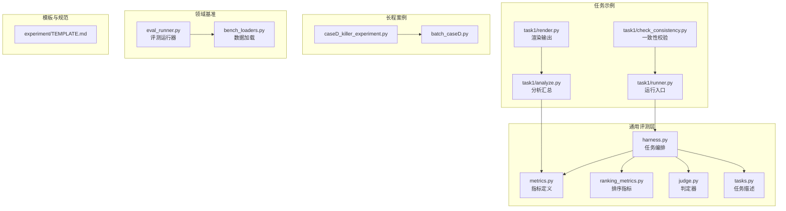
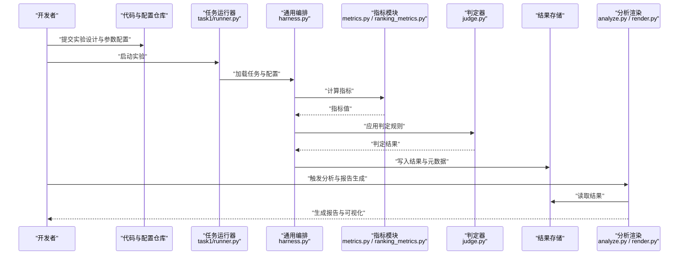
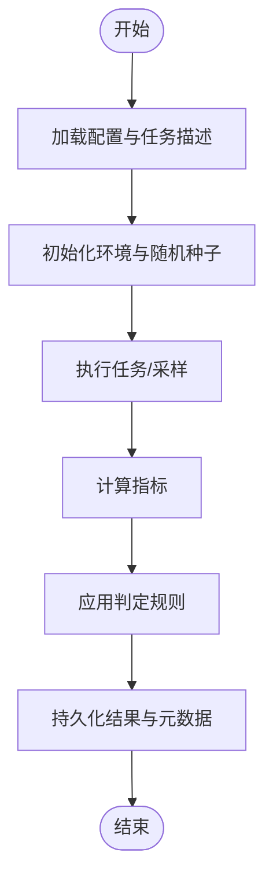
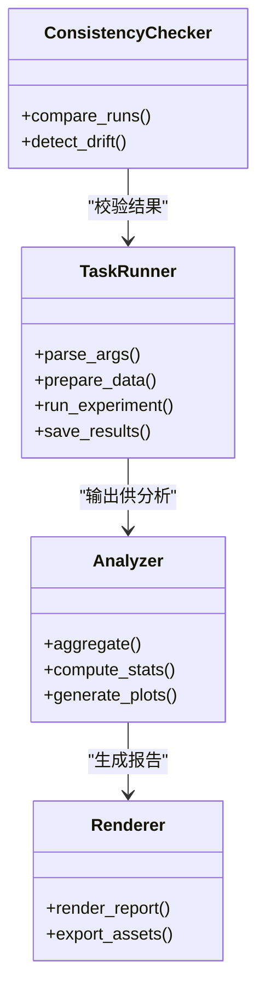
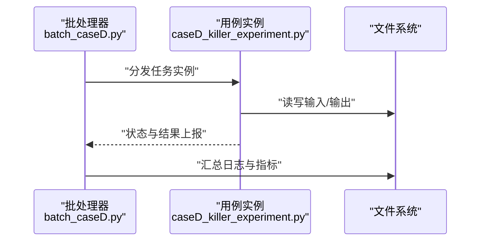
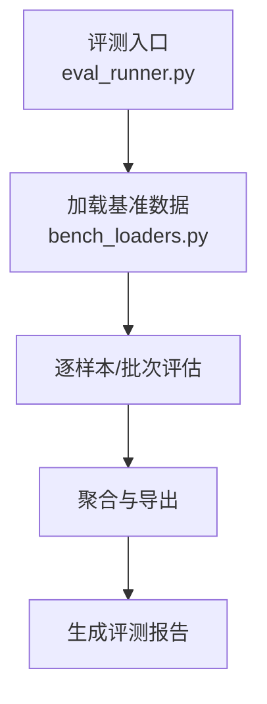
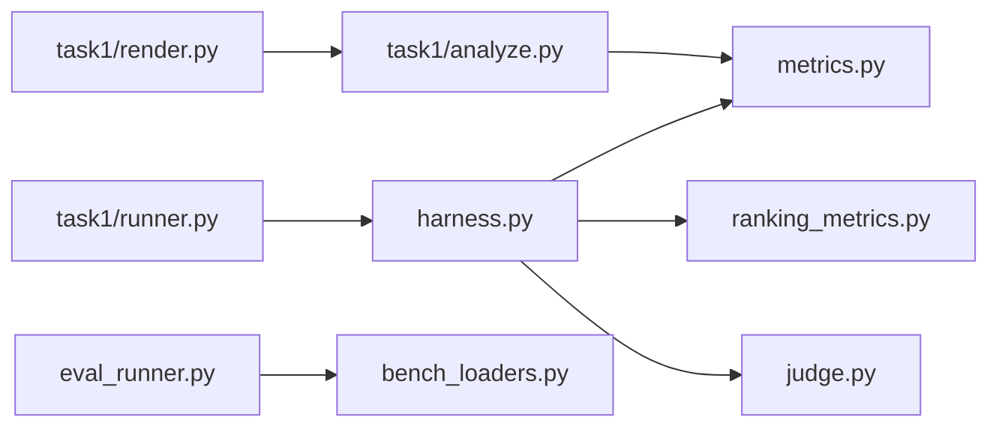

# 实验管理与结果分析

<cite>
**本文引用的文件**   
- [autonomy_mvp/core/harness.py](file://autonomy_mvp/core/harness.py)
- [autonomy_mvp/core/metrics.py](file://autonomy_mvp/core/metrics.py)
- [autonomy_mvp/core/ranking_metrics.py](file://autonomy_mvp/core/ranking_metrics.py)
- [autonomy_mvp/core/judge.py](file://autonomy_mvp/core/judge.py)
- [autonomy_mvp/core/tasks.py](file://autonomy_mvp/core/tasks.py)
- [autonomy_mvp/run_validation.py](file://autonomy_mvp/run_validation.py)
- [task1/runner.py](file://task1/runner.py)
- [task1/analyze.py](file://task1/analyze.py)
- [task1/check_consistency.py](file://task1/check_consistency.py)
- [task1/render.py](file://task1/render.py)
- [task4_papers/eval/eval_runner.py](file://docs/prd/molbench_repo/eval/eval_runner.py)
- [docs/prd/molbench_repo/eval/bench_loaders.py](file://docs/prd/molbench_repo/eval/bench_loaders.py)
- [longhorizon/instantiate/caseD_killer_experiment.py](file://longhorizon/instantiate/caseD_killer_experiment.py)
- [longhorizon/instantiate/batch_caseD.py](file://longhorizon/instantiate/batch_caseD.py)
- [docs/templates/task_template/experiment/TEMPLATE.md](file://docs/templates/task_template/experiment/TEMPLATE.md)
</cite>

## 目录
1. [引言](#引言)
2. [项目结构](#项目结构)
3. [核心组件](#核心组件)
4. [架构总览](#架构总览)
5. [详细组件分析](#详细组件分析)
6. [依赖关系分析](#依赖关系分析)
7. [性能与可扩展性](#性能与可扩展性)
8. [故障排查指南](#故障排查指南)
9. [结论](#结论)
10. [附录](#附录)

## 引言
本文件面向大规模实验管理，围绕实验设计原则、参数配置管理、版本控制与追踪策略、结果组织与存储（数据格式标准化、元数据管理、可视化）、统计分析方法（显著性检验、趋势分析、异常检测）、报告自动生成与团队协作共享机制，以及复现性与结果验证方法论进行系统化阐述。文档以仓库中现有实现为依据，提炼可复用的最佳实践，并提供可直接落地的流程与规范建议。

## 项目结构
仓库采用“按任务/场景分治 + 统一评测框架”的组织方式：
- 通用评测与指标：autonomy_mvp/core 提供任务编排、评估器、指标计算等基础能力。
- 多任务示例：task1、task4、task6 等各自维护目标、运行脚本与结果记录。
- 长程案例：longhorizon/instantiate 提供复杂场景的实例化与批处理脚本。
- 领域基准：docs/prd/molbench_repo 包含数据集、评测加载器与运行器。
- 模板与规范：docs/templates 提供实验记录模板，便于团队统一产出。

图表来源
- [autonomy_mvp/core/harness.py](file://autonomy_mvp/core/harness.py)
- [autonomy_mvp/core/metrics.py](file://autonomy_mvp/core/metrics.py)
- [autonomy_mvp/core/ranking_metrics.py](file://autonomy_mvp/core/ranking_metrics.py)
- [autonomy_mvp/core/judge.py](file://autonomy_mvp/core/judge.py)
- [autonomy_mvp/core/tasks.py](file://autonomy_mvp/core/tasks.py)
- [task1/runner.py](file://task1/runner.py)
- [task1/analyze.py](file://task1/analyze.py)
- [task1/check_consistency.py](file://task1/check_consistency.py)
- [task1/render.py](file://task1/render.py)
- [longhorizon/instantiate/caseD_killer_experiment.py](file://longhorizon/instantiate/caseD_killer_experiment.py)
- [longhorizon/instantiate/batch_caseD.py](file://longhorizon/instantiate/batch_caseD.py)
- [docs/prd/molbench_repo/eval/eval_runner.py](file://docs/prd/molbench_repo/eval/eval_runner.py)
- [docs/prd/molbench_repo/eval/bench_loaders.py](file://docs/prd/molbench_repo/eval/bench_loaders.py)
- [docs/templates/task_template/experiment/TEMPLATE.md](file://docs/templates/task_template/experiment/TEMPLATE.md)

章节来源
- [autonomy_mvp/core/harness.py](file://autonomy_mvp/core/harness.py)
- [autonomy_mvp/core/metrics.py](file://autonomy_mvp/core/metrics.py)
- [autonomy_mvp/core/ranking_metrics.py](file://autonomy_mvp/core/ranking_metrics.py)
- [autonomy_mvp/core/judge.py](file://autonomy_mvp/core/judge.py)
- [autonomy_mvp/core/tasks.py](file://autonomy_mvp/core/tasks.py)
- [task1/runner.py](file://task1/runner.py)
- [task1/analyze.py](file://task1/analyze.py)
- [task1/check_consistency.py](file://task1/check_consistency.py)
- [task1/render.py](file://task1/render.py)
- [longhorizon/instantiate/caseD_killer_experiment.py](file://longhorizon/instantiate/caseD_killer_experiment.py)
- [longhorizon/instantiate/batch_caseD.py](file://longhorizon/instantiate/batch_caseD.py)
- [docs/prd/molbench_repo/eval/eval_runner.py](file://docs/prd/molbench_repo/eval/eval_runner.py)
- [docs/prd/molbench_repo/eval/bench_loaders.py](file://docs/prd/molbench_repo/eval/bench_loaders.py)
- [docs/templates/task_template/experiment/TEMPLATE.md](file://docs/templates/task_template/experiment/TEMPLATE.md)

## 核心组件
- 任务编排与执行
  - harness.py 负责将任务、评估器、指标与运行环境组合，驱动单次或批量实验的执行与结果收集。
  - tasks.py 提供任务描述与输入数据契约，确保不同任务间的数据结构一致。
- 指标与判定
  - metrics.py 定义常用数值指标的计算逻辑；ranking_metrics.py 提供排序类指标；judge.py 封装判定规则与阈值。
- 任务级运行器与分析
  - task1/runner.py 作为具体任务的运行入口，串联数据准备、模型调用、结果落盘与日志记录。
  - task1/analyze.py 对原始结果进行聚合、统计与可视化素材生成。
  - task1/check_consistency.py 用于跨轮次/跨配置的一致性检查，保障结果稳定。
  - task1/render.py 将分析结果渲染为可读的报告或图表。
- 长程与批处理
  - longhorizon/instantiate 下的 caseD_killer_experiment.py 与 batch_caseD.py 展示复杂场景的实例化与批处理模式。
- 领域基准评测
  - docs/prd/molbench_repo/eval/eval_runner.py 与 bench_loaders.py 提供基准评测的运行与数据加载能力。
- 模板与规范
  - docs/templates/task_template/experiment/TEMPLATE.md 提供统一的实验记录模板，指导元数据与过程记录。

章节来源
- [autonomy_mvp/core/harness.py](file://autonomy_mvp/core/harness.py)
- [autonomy_mvp/core/metrics.py](file://autonomy_mvp/core/metrics.py)
- [autonomy_mvp/core/ranking_metrics.py](file://autonomy_mvp/core/ranking_metrics.py)
- [autonomy_mvp/core/judge.py](file://autonomy_mvp/core/judge.py)
- [autonomy_mvp/core/tasks.py](file://autonomy_mvp/core/tasks.py)
- [task1/runner.py](file://task1/runner.py)
- [task1/analyze.py](file://task1/analyze.py)
- [task1/check_consistency.py](file://task1/check_consistency.py)
- [task1/render.py](file://task1/render.py)
- [longhorizon/instantiate/caseD_killer_experiment.py](file://longhorizon/instantiate/caseD_killer_experiment.py)
- [longhorizon/instantiate/batch_caseD.py](file://longhorizon/instantiate/batch_caseD.py)
- [docs/prd/molbench_repo/eval/eval_runner.py](file://docs/prd/molbench_repo/eval/eval_runner.py)
- [docs/prd/molbench_repo/eval/bench_loaders.py](file://docs/prd/molbench_repo/eval/bench_loaders.py)
- [docs/templates/task_template/experiment/TEMPLATE.md](file://docs/templates/task_template/experiment/TEMPLATE.md)

## 架构总览
下图展示了从“实验定义 → 参数配置 → 运行执行 → 指标计算 → 结果归档 → 分析与报告”的端到端流程，并体现版本控制与复现性保障的关键节点。

图表来源
- [task1/runner.py](file://task1/runner.py)
- [autonomy_mvp/core/harness.py](file://autonomy_mvp/core/harness.py)
- [autonomy_mvp/core/metrics.py](file://autonomy_mvp/core/metrics.py)
- [autonomy_mvp/core/ranking_metrics.py](file://autonomy_mvp/core/ranking_metrics.py)
- [autonomy_mvp/core/judge.py](file://autonomy_mvp/core/judge.py)
- [task1/analyze.py](file://task1/analyze.py)
- [task1/render.py](file://task1/render.py)

## 详细组件分析

### 组件A：通用评测编排（harness）
- 职责
  - 组装任务、评估器与指标，驱动单次/批量执行。
  - 管理输入输出路径、随机种子与环境变量，保证可复现。
- 关键流程
  - 解析配置 → 初始化任务 → 执行推理/采样 → 计算指标 → 判定 → 持久化结果。
- 优化点
  - 并行化：在 I/O 密集或外部服务调用时启用并发。
  - 缓存：对中间产物与指标结果做幂等缓存，避免重复计算。
  - 错误隔离：单样本失败不影响整体批次，支持断点续跑。

图表来源
- [autonomy_mvp/core/harness.py](file://autonomy_mvp/core/harness.py)
- [autonomy_mvp/core/tasks.py](file://autonomy_mvp/core/tasks.py)
- [autonomy_mvp/core/metrics.py](file://autonomy_mvp/core/metrics.py)
- [autonomy_mvp/core/judge.py](file://autonomy_mvp/core/judge.py)

章节来源
- [autonomy_mvp/core/harness.py](file://autonomy_mvp/core/harness.py)
- [autonomy_mvp/core/tasks.py](file://autonomy_mvp/core/tasks.py)
- [autonomy_mvp/core/metrics.py](file://autonomy_mvp/core/metrics.py)
- [autonomy_mvp/core/judge.py](file://autonomy_mvp/core/judge.py)

### 组件B：任务运行器与分析（task1）
- runner.py
  - 作为任务入口，负责参数解析、数据准备、调用编排、结果落盘与日志记录。
- analyze.py
  - 聚合多轮/多配置结果，计算统计量（均值、方差、置信区间），生成图表素材。
- check_consistency.py
  - 对比不同运行之间的关键指标差异，识别漂移与异常。
- render.py
  - 将分析结果渲染为 Markdown/HTML/PNG 等格式，便于分享与归档。

图表来源
- [task1/runner.py](file://task1/runner.py)
- [task1/analyze.py](file://task1/analyze.py)
- [task1/check_consistency.py](file://task1/check_consistency.py)
- [task1/render.py](file://task1/render.py)

章节来源
- [task1/runner.py](file://task1/runner.py)
- [task1/analyze.py](file://task1/analyze.py)
- [task1/check_consistency.py](file://task1/check_consistency.py)
- [task1/render.py](file://task1/render.py)

### 组件C：长程案例与批处理（longhorizon）
- caseD_killer_experiment.py
  - 针对特定复杂场景的“杀手用例”，覆盖边界条件与压力测试。
- batch_caseD.py
  - 批处理调度，支持多实例并行、资源分配与失败重试。

图表来源
- [longhorizon/instantiate/caseD_killer_experiment.py](file://longhorizon/instantiate/caseD_killer_experiment.py)
- [longhorizon/instantiate/batch_caseD.py](file://longhorizon/instantiate/batch_caseD.py)

章节来源
- [longhorizon/instantiate/caseD_killer_experiment.py](file://longhorizon/instantiate/caseD_killer_experiment.py)
- [longhorizon/instantiate/batch_caseD.py](file://longhorizon/instantiate/batch_caseD.py)

### 组件D：领域基准评测（molbench）
- eval_runner.py
  - 统一评测入口，加载基准、执行评估、汇总结果。
- bench_loaders.py
  - 数据加载与预处理，屏蔽不同子集的数据格式差异。

图表来源
- [docs/prd/molbench_repo/eval/eval_runner.py](file://docs/prd/molbench_repo/eval/eval_runner.py)
- [docs/prd/molbench_repo/eval/bench_loaders.py](file://docs/prd/molbench_repo/eval/bench_loaders.py)

章节来源
- [docs/prd/molbench_repo/eval/eval_runner.py](file://docs/prd/molbench_repo/eval/eval_runner.py)
- [docs/prd/molbench_repo/eval/bench_loaders.py](file://docs/prd/molbench_repo/eval/bench_loaders.py)

## 依赖关系分析
- 低耦合高内聚
  - 指标与判定模块独立于任务编排，便于替换与扩展。
- 直接依赖
  - runner.py 依赖 harness.py；analyze.py 依赖 metrics.py；render.py 依赖 analyze.py 的输出。
- 潜在循环
  - 当前未见明显循环依赖；建议在新增模块时保持单向依赖。
- 外部集成点
  - 数据加载器（bench_loaders.py）对接外部数据集；评测运行器（eval_runner.py）可能调用外部工具或服务。

图表来源
- [task1/runner.py](file://task1/runner.py)
- [autonomy_mvp/core/harness.py](file://autonomy_mvp/core/harness.py)
- [autonomy_mvp/core/metrics.py](file://autonomy_mvp/core/metrics.py)
- [autonomy_mvp/core/ranking_metrics.py](file://autonomy_mvp/core/ranking_metrics.py)
- [autonomy_mvp/core/judge.py](file://autonomy_mvp/core/judge.py)
- [task1/analyze.py](file://task1/analyze.py)
- [task1/render.py](file://task1/render.py)
- [docs/prd/molbench_repo/eval/eval_runner.py](file://docs/prd/molbench_repo/eval/eval_runner.py)
- [docs/prd/molbench_repo/eval/bench_loaders.py](file://docs/prd/molbench_repo/eval/bench_loaders.py)

章节来源
- [task1/runner.py](file://task1/runner.py)
- [autonomy_mvp/core/harness.py](file://autonomy_mvp/core/harness.py)
- [autonomy_mvp/core/metrics.py](file://autonomy_mvp/core/metrics.py)
- [autonomy_mvp/core/ranking_metrics.py](file://autonomy_mvp/core/ranking_metrics.py)
- [autonomy_mvp/core/judge.py](file://autonomy_mvp/core/judge.py)
- [task1/analyze.py](file://task1/analyze.py)
- [task1/render.py](file://task1/render.py)
- [docs/prd/molbench_repo/eval/eval_runner.py](file://docs/prd/molbench_repo/eval/eval_runner.py)
- [docs/prd/molbench_repo/eval/bench_loaders.py](file://docs/prd/molbench_repo/eval/bench_loaders.py)

## 性能与可扩展性
- 并行与并发
  - 在 I/O 密集或外部 API 调用处使用线程/进程池；对 CPU 密集型指标计算使用多进程。
- 缓存与增量计算
  - 对中间结果与指标进行哈希键控缓存；支持断点续跑与增量更新。
- 资源隔离
  - 通过容器或虚拟环境锁定依赖版本，避免环境漂移影响性能。
- 监控与告警
  - 记录耗时、内存与错误率；设置阈值告警，快速定位瓶颈。

[本节为通用指导，不直接分析具体文件]

## 故障排查指南
- 常见问题
  - 指标不一致：检查随机种子、数据版本与浮点精度。
  - 运行中断：确认外部服务可用性、磁盘空间与权限。
  - 结果缺失：核对输出路径与命名约定，确保持久化步骤成功。
- 定位手段
  - 使用 check_consistency.py 对比历史运行，定位回归。
  - 查看 runner 与 harness 的日志，结合 analyze 的中间产物定位问题。
- 恢复策略
  - 基于幂等键重跑失败样本；清理临时文件后重试。

章节来源
- [task1/check_consistency.py](file://task1/check_consistency.py)
- [task1/runner.py](file://task1/runner.py)
- [autonomy_mvp/core/harness.py](file://autonomy_mvp/core/harness.py)

## 结论
本项目通过“通用编排 + 任务运行器 + 指标与判定 + 分析渲染”的分层架构，实现了大规模实验的可管理、可追踪与可复现。配合统一的实验模板与批处理脚本，团队可在多任务、多配置下高效协作，并以标准化的结果与报告支撑决策。

[本节为总结性内容，不直接分析具体文件]

## 附录

### 实验设计原则
- 明确假设与目标：每个实验对应一个清晰的研究问题与可量化目标。
- 控制变量：固定无关因素，仅改变待研究参数。
- 预注册方案：在运行前记录实验设计、参数与评估标准，避免事后选择偏差。
- 分层抽样与平衡：确保样本分布合理，避免过拟合特定子集。

[本节为通用指导，不直接分析具体文件]

### 参数配置管理
- 单一事实源：所有参数集中管理，避免硬编码。
- 版本化：配置文件随代码一起纳入版本控制，附带变更说明。
- 分层合并：默认配置 + 环境配置 + 运行时覆盖，提升灵活性。
- 校验与约束：对参数范围、类型与依赖关系进行校验。

[本节为通用指导，不直接分析具体文件]

### 版本控制与实验追踪
- 代码与数据版本：使用 Git 管理代码，数据使用快照或数据版本工具。
- 实验元数据：记录运行时间、环境、随机种子、参数、输入数据哈希与输出索引。
- 唯一标识：为每次运行生成不可变 ID，贯穿日志、结果与报告。
- 审计轨迹：保留关键决策与变更，便于回溯。

[本节为通用指导，不直接分析具体文件]

### 结果组织与存储
- 目录结构：按任务/日期/配置/运行ID 分层组织，便于检索与对比。
- 数据格式：优先使用 JSON/CSV/Parquet 等开放格式，附带 schema 说明。
- 元数据管理：为每个结果文件提供对应的元数据文件，描述字段含义与单位。
- 结果可视化：统一图表风格与配色，导出矢量图与高分辨率位图。

[本节为通用指导，不直接分析具体文件]

### 统计分析方法与解读
- 显著性检验：根据数据类型与分布选择合适的检验方法（如 t 检验、Mann-Whitney U、卡方等）。
- 效应量与置信区间：不仅关注 p 值，同时报告效应量与置信区间。
- 趋势分析：对时间序列或多配置曲线进行平滑与趋势拟合，识别拐点。
- 异常检测：基于统计阈值或鲁棒方法识别离群点，并结合业务背景解释。

[本节为通用指导，不直接分析具体文件]

### 报告自动生成与团队协作
- 自动化流水线：运行结束后自动触发分析、渲染与归档。
- 模板化报告：使用统一模板（如 experiment/TEMPLATE.md）填充关键信息。
- 共享机制：将报告与图表发布到团队知识库，附链接与摘要。
- 评审流程：重要结果需经同行评审后方可归档。

章节来源
- [docs/templates/task_template/experiment/TEMPLATE.md](file://docs/templates/task_template/experiment/TEMPLATE.md)

### 复现性与结果验证
- 确定性：固定随机种子、禁用非确定性操作或使用确定性后端。
- 环境锁定：使用环境文件或容器镜像锁定依赖版本。
- 交叉验证：在不同机器/平台上重复运行，验证稳定性。
- 结果校验：使用 check_consistency.py 与人工抽检相结合，确保一致。

章节来源
- [task1/check_consistency.py](file://task1/check_consistency.py)
- [autonomy_mvp/run_validation.py](file://autonomy_mvp/run_validation.py)