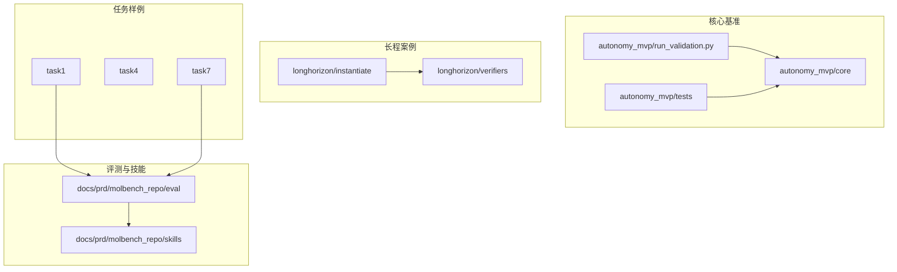
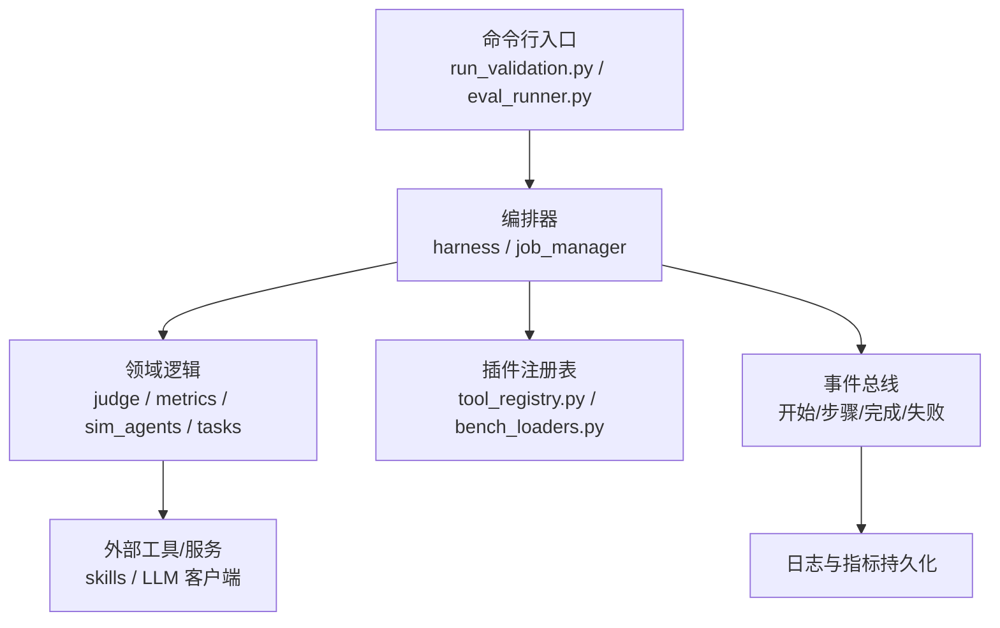
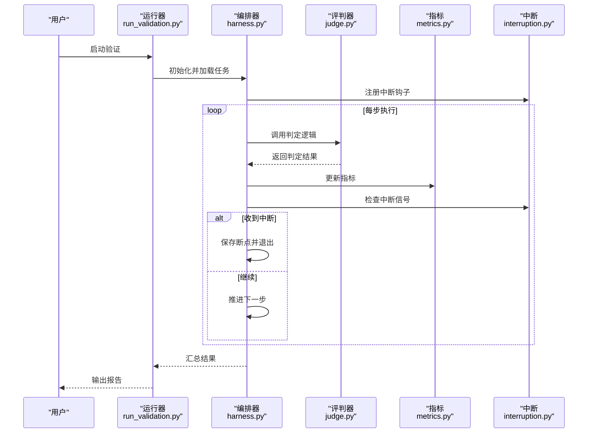
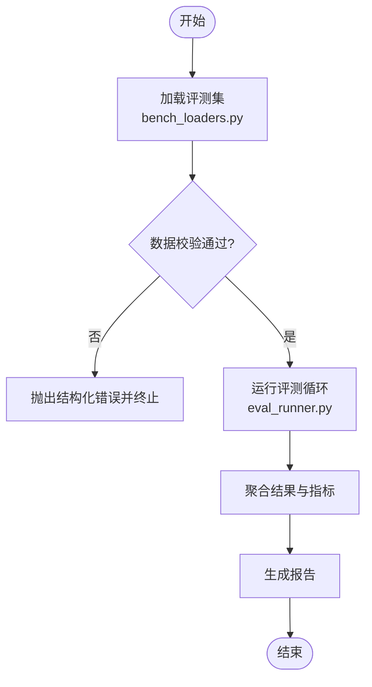
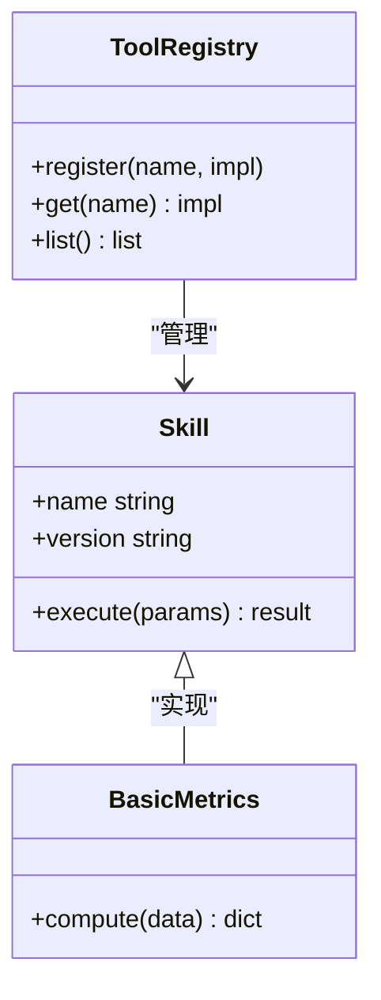
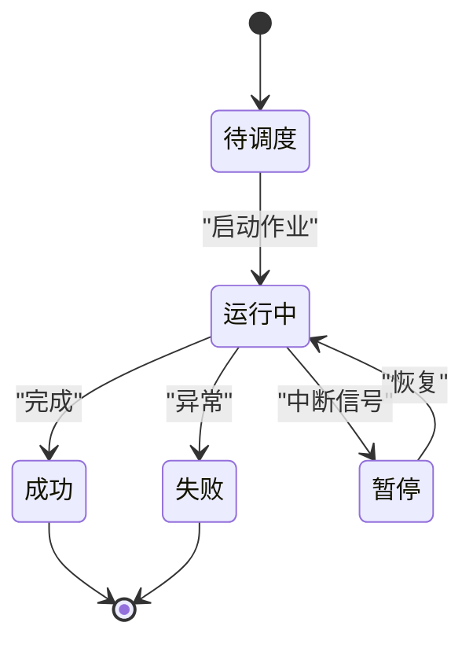
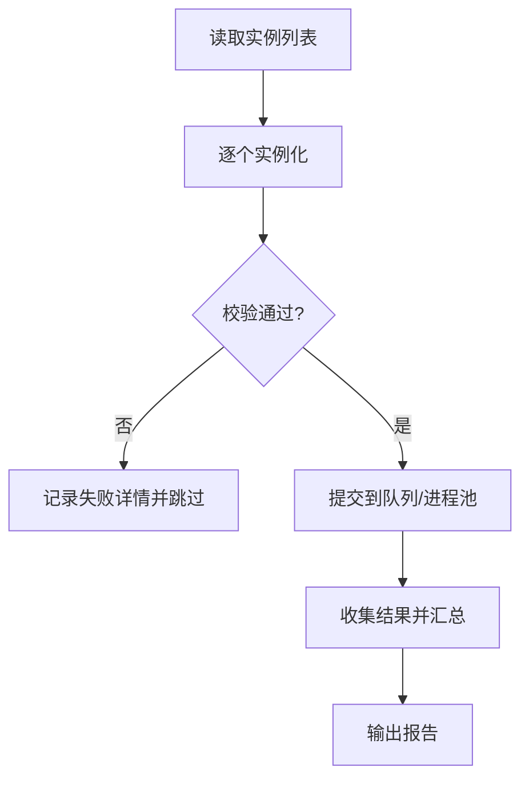
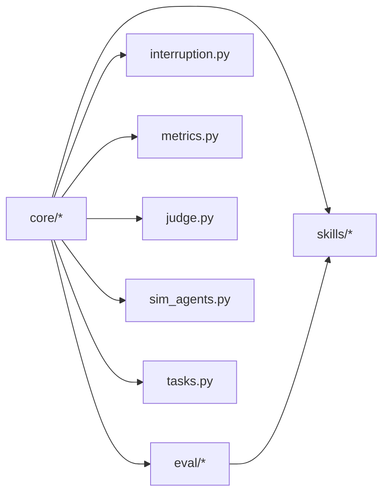

# 开发规范与代码组织

<cite>
**本文引用的文件**   
- [autonomy_mvp/core/harness.py](file://autonomy_mvp/core/harness.py)
- [autonomy_mvp/core/interruption.py](file://autonomy_mvp/core/interruption.py)
- [autonomy_mvp/core/judge.py](file://autonomy_mvp/core/judge.py)
- [autonomy_mvp/core/metrics.py](file://autonomy_mvp/core/metrics.py)
- [autonomy_mvp/core/ranking_metrics.py](file://autonomy_mvp/core/ranking_metrics.py)
- [autonomy_mvp/core/sim_agents.py](file://autonomy_mvp/core/sim_agents.py)
- [autonomy_mvp/core/tasks.py](file://autonomy_mvp/core/tasks.py)
- [autonomy_mvp/run_validation.py](file://autonomy_mvp/run_validation.py)
- [autonomy_mvp/tests/test_core.py](file://autonomy_mvp/tests/test_core.py)
- [longhorizon/instantiate/batch_caseD.py](file://longhorizon/instantiate/batch_caseD.py)
- [longhorizon/verifiers/hard_verifiers.py](file://longhorizon/verifiers/hard_verifiers.py)
- [task1/runner.py](file://task1/runner.py)
- [task1/runner2.py](file://task1/runner2.py)
- [task1/turn.py](file://task1/turn.py)
- [task4_papers/eval/eval_runner.py](file://docs/prd/molbench_repo/eval/eval_runner.py)
- [task4_papers/eval/bench_loaders.py](file://docs/prd/molbench_repo/eval/bench_loaders.py)
- [task4_papers/eval/__init__.py](file://docs/prd/molbench_repo/eval/__init__.py)
- [task4_papers/skills/L1_tools/molclaw-mol-basic-metrics/molclaw-mol-basic-metrics.py](file://docs/prd/molbench_repo/skills/L1_tools/molclaw-mol-basic-metrics/molclaw-mol-basic-metrics.py)
- [task7/poc3_physicianbench/agent/tool_registry.py](file://task7/poc3_physicianbench/agent/tool_registry.py)
- [task7/poc3_physicianbench/agent/llm_client.py](file://task7/poc3_physicianbench/agent/llm_client.py)
- [task7/poc3_physicianbench/agent/mini_agent.py](file://task7/poc3_physicianbench/agent/mini_agent.py)
- [task7/poc3_physicianbench/scripts/job_manager.py](file://task7/poc3_physicianbench/scripts/job_manager.py)
</cite>

## 目录
1. [简介](#简介)
2. [项目结构](#项目结构)
3. [核心组件](#核心组件)
4. [架构总览](#架构总览)
5. [详细组件分析](#详细组件分析)
6. [依赖关系分析](#依赖关系分析)
7. [性能考量](#性能考量)
8. [故障排查指南](#故障排查指南)
9. [结论](#结论)
10. [附录](#附录)

## 简介
本文件面向贡献者与维护者，系统化阐述本仓库的代码组织规范与开发标准。内容覆盖模块划分原则、命名约定、文件结构规范、注释与文档编写标准；并说明如何遵循分层设计、插件机制与事件驱动模式等架构风格。同时提供代码审查清单、质量检查工具配置建议、错误处理最佳实践、日志记录规范与异常管理策略，帮助团队建立统一的开发风格与高质量代码标准。

## 项目结构
仓库采用“多任务/多子域”的扁平化组织方式：每个任务或子域以独立目录承载其数据、脚本与产物，核心框架能力集中在 autonomy_mvp 与 longhorizon 两个子系统中，评测与示例在 docs/prd 与 task* 中分别落地。

- 核心基准与评估（autonomy_mvp）
  - core：基准运行器、中断控制、评判器、指标计算、模拟代理、任务定义等
  - tests：单元测试与夹具
  - run_validation.py：端到端验证入口
- 长程案例与实例化（longhorizon）
  - instantiate：批量实例化与批处理脚本
  - verifiers：强校验器
- 评测与技能（docs/prd/molbench_repo）
  - eval：评测加载与运行器
  - skills：按 L1/L2/L3 分层的可复用技能与工具
- 任务样例（task1、task4、task7 等）
  - 各自包含运行脚本、会话数据、结果与分析文档

图表来源
- [autonomy_mvp/run_validation.py](file://autonomy_mvp/run_validation.py)
- [autonomy_mvp/core/harness.py](file://autonomy_mvp/core/harness.py)
- [longhorizon/instantiate/batch_caseD.py](file://longhorizon/instantiate/batch_caseD.py)
- [docs/prd/molbench_repo/eval/eval_runner.py](file://docs/prd/molbench_repo/eval/eval_runner.py)

章节来源
- [autonomy_mvp/run_validation.py](file://autonomy_mvp/run_validation.py)
- [autonomy_mvp/core/harness.py](file://autonomy_mvp/core/harness.py)
- [longhorizon/instantiate/batch_caseD.py](file://longhorizon/instantiate/batch_caseD.py)
- [docs/prd/molbench_repo/eval/eval_runner.py](file://docs/prd/molbench_repo/eval/eval_runner.py)

## 核心组件
- 基准运行器与编排
  - 负责任务加载、执行流程编排、结果收集与指标汇总
  - 典型入口位于 run_validation.py 与 eval_runner.py
- 中断与容错
  - 通过 interruption.py 暴露中断信号与恢复点，保障长时间运行的稳定性
- 评判与指标
  - judge.py 实现判定逻辑；metrics.py 与 ranking_metrics.py 提供评分与排序指标
- 模拟代理与任务定义
  - sim_agents.py 提供仿真代理；tasks.py 定义任务结构与约束
- 长程案例批处理与强校验
  - batch_caseD.py 负责批量实例化与调度；hard_verifiers.py 提供严格验证规则
- 评测加载与技能体系
  - bench_loaders.py 负责数据集与用例加载；skills 下按层级组织可复用工具与工作流

章节来源
- [autonomy_mvp/core/harness.py](file://autonomy_mvp/core/harness.py)
- [autonomy_mvp/core/interruption.py](file://autonomy_mvp/core/interruption.py)
- [autonomy_mvp/core/judge.py](file://autonomy_mvp/core/judge.py)
- [autonomy_mvp/core/metrics.py](file://autonomy_mvp/core/metrics.py)
- [autonomy_mvp/core/ranking_metrics.py](file://autonomy_mvp/core/ranking_metrics.py)
- [autonomy_mvp/core/sim_agents.py](file://autonomy_mvp/core/sim_agents.py)
- [autonomy_mvp/core/tasks.py](file://autonomy_mvp/core/tasks.py)
- [autonomy_mvp/run_validation.py](file://autonomy_mvp/run_validation.py)
- [longhorizon/instantiate/batch_caseD.py](file://longhorizon/instantiate/batch_caseD.py)
- [longhorizon/verifiers/hard_verifiers.py](file://longhorizon/verifiers/hard_verifiers.py)
- [docs/prd/molbench_repo/eval/bench_loaders.py](file://docs/prd/molbench_repo/eval/bench_loaders.py)
- [docs/prd/molbench_repo/eval/eval_runner.py](file://docs/prd/molbench_repo/eval/eval_runner.py)

## 架构总览
整体采用“分层 + 插件 + 事件驱动”的混合架构：
- 分层设计
  - 表示层：CLI/脚本入口（run_validation.py、eval_runner.py、task1 runner 系列）
  - 编排层：harness、job_manager 等负责流程编排与并发控制
  - 领域层：judge、metrics、sim_agents、tasks 等实现业务逻辑
  - 基础设施层：中断、IO、外部工具调用（skills、LLM 客户端）
- 插件机制
  - 通过注册表（如 tool_registry.py）动态发现与加载工具/技能
  - 评测加载器（bench_loaders.py）将不同数据集作为插件接入统一接口
- 事件驱动模式
  - 关键阶段触发事件（开始、步骤、完成、失败），由监听器执行副作用（日志、指标更新、断点保存）

图表来源
- [autonomy_mvp/core/harness.py](file://autonomy_mvp/core/harness.py)
- [autonomy_mvp/core/judge.py](file://autonomy_mvp/core/judge.py)
- [autonomy_mvp/core/metrics.py](file://autonomy_mvp/core/metrics.py)
- [autonomy_mvp/core/sim_agents.py](file://autonomy_mvp/core/sim_agents.py)
- [autonomy_mvp/core/tasks.py](file://autonomy_mvp/core/tasks.py)
- [autonomy_mvp/run_validation.py](file://autonomy_mvp/run_validation.py)
- [task7/poc3_physicianbench/scripts/job_manager.py](file://task7/poc3_physicianbench/scripts/job_manager.py)
- [task7/poc3_physicianbench/agent/tool_registry.py](file://task7/poc3_physicianbench/agent/tool_registry.py)
- [docs/prd/molbench_repo/eval/bench_loaders.py](file://docs/prd/molbench_repo/eval/bench_loaders.py)
- [docs/prd/molbench_repo/eval/eval_runner.py](file://docs/prd/molbench_repo/eval/eval_runner.py)

## 详细组件分析

### 基准运行器与编排（harness 与 run_validation）
- 职责
  - 解析参数、加载任务、初始化环境、循环执行步骤、收集中间结果与最终输出
  - 与中断系统协作，支持安全退出与断点续跑
- 关键流程
  - 启动 -> 加载任务 -> 初始化指标与日志 -> 进入主循环 -> 调用 judge/sim_agents -> 写入结果 -> 上报事件 -> 结束

图表来源
- [autonomy_mvp/run_validation.py](file://autonomy_mvp/run_validation.py)
- [autonomy_mvp/core/harness.py](file://autonomy_mvp/core/harness.py)
- [autonomy_mvp/core/judge.py](file://autonomy_mvp/core/judge.py)
- [autonomy_mvp/core/metrics.py](file://autonomy_mvp/core/metrics.py)
- [autonomy_mvp/core/interruption.py](file://autonomy_mvp/core/interruption.py)

章节来源
- [autonomy_mvp/run_validation.py](file://autonomy_mvp/run_validation.py)
- [autonomy_mvp/core/harness.py](file://autonomy_mvp/core/harness.py)
- [autonomy_mvp/core/judge.py](file://autonomy_mvp/core/judge.py)
- [autonomy_mvp/core/metrics.py](file://autonomy_mvp/core/metrics.py)
- [autonomy_mvp/core/interruption.py](file://autonomy_mvp/core/interruption.py)

### 评测加载与运行（bench_loaders 与 eval_runner）
- 职责
  - 从多种数据源加载评测用例，统一封装为内部数据结构
  - 驱动评测循环，聚合各用例结果并生成报告
- 关键点
  - 加载器需保证输入校验与缺失字段提示
  - 运行器需支持并行与重试策略

图表来源
- [docs/prd/molbench_repo/eval/bench_loaders.py](file://docs/prd/molbench_repo/eval/bench_loaders.py)
- [docs/prd/molbench_repo/eval/eval_runner.py](file://docs/prd/molbench_repo/eval/eval_runner.py)

章节来源
- [docs/prd/molbench_repo/eval/bench_loaders.py](file://docs/prd/molbench_repo/eval/bench_loaders.py)
- [docs/prd/molbench_repo/eval/eval_runner.py](file://docs/prd/molbench_repo/eval/eval_runner.py)
- [docs/prd/molbench_repo/eval/__init__.py](file://docs/prd/molbench_repo/eval/__init__.py)

### 插件机制（工具注册表与技能）
- 职责
  - 维护工具/技能的注册表，支持动态发现、按需加载与版本兼容
  - 为上层编排提供统一调用接口
- 使用方式
  - 新增工具时，在注册表中声明元数据与实现路径
  - 通过名称或标签进行路由与分发

图表来源
- [task7/poc3_physicianbench/agent/tool_registry.py](file://task7/poc3_physicianbench/agent/tool_registry.py)
- [docs/prd/molbench_repo/skills/L1_tools/molclaw-mol-basic-metrics/molclaw-mol-basic-metrics.py](file://docs/prd/molbench_repo/skills/L1_tools/molclaw-mol-basic-metrics/molclaw-mol-basic-metrics.py)

章节来源
- [task7/poc3_physicianbench/agent/tool_registry.py](file://task7/poc3_physicianbench/agent/tool_registry.py)
- [docs/prd/molbench_repo/skills/L1_tools/molclaw-mol-basic-metrics/molclaw-mol-basic-metrics.py](file://docs/prd/molbench_repo/skills/L1_tools/molclaw-mol-basic-metrics/molclaw-mol-basic-metrics.py)

### 事件驱动与作业管理（job_manager 与 mini_agent）
- 职责
  - job_manager 负责作业生命周期管理与状态流转
  - mini_agent 作为轻量代理，订阅事件并执行动作（如调用 LLM、记录轨迹）
- 关键点
  - 事件类型应明确且稳定，避免耦合具体实现
  - 状态变更需幂等，便于重试与恢复

图表来源
- [task7/poc3_physicianbench/scripts/job_manager.py](file://task7/poc3_physicianbench/scripts/job_manager.py)
- [task7/poc3_physicianbench/agent/mini_agent.py](file://task7/poc3_physicianbench/agent/mini_agent.py)
- [task7/poc3_physicianbench/agent/llm_client.py](file://task7/poc3_physicianbench/agent/llm_client.py)

章节来源
- [task7/poc3_physicianbench/scripts/job_manager.py](file://task7/poc3_physicianbench/scripts/job_manager.py)
- [task7/poc3_physicianbench/agent/mini_agent.py](file://task7/poc3_physicianbench/agent/mini_agent.py)
- [task7/poc3_physicianbench/agent/llm_client.py](file://task7/poc3_physicianbench/agent/llm_client.py)

### 长程案例批处理与强校验（batch_caseD 与 hard_verifiers）
- 职责
  - batch_caseD 负责批量实例化与任务分发
  - hard_verifiers 提供严格的验证规则与边界检查
- 关键点
  - 批处理需具备失败隔离与重试能力
  - 强校验应返回明确的失败原因与修复建议

图表来源
- [longhorizon/instantiate/batch_caseD.py](file://longhorizon/instantiate/batch_caseD.py)
- [longhorizon/verifiers/hard_verifiers.py](file://longhorizon/verifiers/hard_verifiers.py)

章节来源
- [longhorizon/instantiate/batch_caseD.py](file://longhorizon/instantiate/batch_caseD.py)
- [longhorizon/verifiers/hard_verifiers.py](file://longhorizon/verifiers/hard_verifiers.py)

### 任务样例运行器（task1 runner 系列）
- 职责
  - 提供多轮对话与任务执行的简化入口
  - 与 prompt 模板、会话数据配合，快速复现实验
- 关键点
  - 保持入口函数单一职责，复杂逻辑下沉至 core 或 skills
  - 对输入参数进行严格校验并提供友好错误信息

章节来源
- [task1/runner.py](file://task1/runner.py)
- [task1/runner2.py](file://task1/runner2.py)
- [task1/turn.py](file://task1/turn.py)

## 依赖关系分析
- 模块内聚与耦合
  - core 模块高内聚：harness 仅依赖 judge、metrics、sim_agents、tasks 与 interruption，避免直接访问 IO 或外部服务
  - 评测与技能解耦：eval 通过 loaders 抽象数据源，skills 通过 registry 抽象工具实现
- 外部依赖
  - LLM 客户端、文件系统、第三方库通过适配器或包装类引入，降低耦合度
- 潜在循环依赖
  - 确保 eval 不反向依赖 core 的具体实现，仅通过公共接口交互

图表来源
- [autonomy_mvp/core/harness.py](file://autonomy_mvp/core/harness.py)
- [autonomy_mvp/core/judge.py](file://autonomy_mvp/core/judge.py)
- [autonomy_mvp/core/metrics.py](file://autonomy_mvp/core/metrics.py)
- [autonomy_mvp/core/sim_agents.py](file://autonomy_mvp/core/sim_agents.py)
- [autonomy_mvp/core/tasks.py](file://autonomy_mvp/core/tasks.py)
- [autonomy_mvp/core/interruption.py](file://autonomy_mvp/core/interruption.py)
- [docs/prd/molbench_repo/eval/eval_runner.py](file://docs/prd/molbench_repo/eval/eval_runner.py)
- [docs/prd/molbench_repo/eval/bench_loaders.py](file://docs/prd/molbench_repo/eval/bench_loaders.py)

章节来源
- [autonomy_mvp/core/harness.py](file://autonomy_mvp/core/harness.py)
- [docs/prd/molbench_repo/eval/eval_runner.py](file://docs/prd/molbench_repo/eval/eval_runner.py)
- [docs/prd/molbench_repo/eval/bench_loaders.py](file://docs/prd/molbench_repo/eval/bench_loaders.py)

## 性能考量
- 并发与批处理
  - 使用进程池或线程池提升吞吐，注意共享资源竞争与锁粒度
  - 批处理任务应具备失败隔离与重试策略，避免单点失败拖垮整体
- 内存与 I/O
  - 大对象及时释放，避免全局缓存膨胀
  - 读写文件采用缓冲与异步 I/O，减少阻塞
- 指标计算
  - 增量更新指标，避免全量重算
  - 排序与排名算法选择合适的数据结构，降低时间复杂度

[本节为通用指导，无需特定文件引用]

## 故障排查指南
- 常见问题定位
  - 中断导致未保存状态：检查 interruption 钩子是否注册与断点写入是否成功
  - 评测数据缺失字段：查看 bench_loaders 的校验逻辑与错误消息
  - 工具未找到或版本不匹配：确认 tool_registry 的注册信息与版本号
- 日志与调试
  - 关键路径添加结构化日志（含上下文 ID、阶段、耗时）
  - 开启详细日志级别用于问题复现，生产环境降级为警告及以上
- 异常管理策略
  - 区分可恢复与不可恢复异常，前者重试，后者快速失败并告警
  - 所有异常需携带可读的错误码与修复建议

章节来源
- [autonomy_mvp/core/interruption.py](file://autonomy_mvp/core/interruption.py)
- [docs/prd/molbench_repo/eval/bench_loaders.py](file://docs/prd/molbench_repo/eval/bench_loaders.py)
- [task7/poc3_physicianbench/agent/tool_registry.py](file://task7/poc3_physicianbench/agent/tool_registry.py)

## 结论
通过分层设计、插件机制与事件驱动模式的结合，本项目实现了高内聚、低耦合与可扩展的架构。遵循本文档的组织规范与开发标准，有助于提升代码质量、一致性与可维护性。建议在持续集成中引入自动化检查与测试，确保规范落地。

[本节为总结性内容，无需特定文件引用]

## 附录

### 模块划分原则
- 按职责分层：表示层、编排层、领域层、基础设施层清晰分离
- 按功能模块化：每个模块聚焦单一职责，避免跨层调用
- 插件优先：对外部能力通过注册表与接口抽象，避免硬编码

### 命名约定
- 模块与包：小写下划线分隔（如 tool_registry）
- 类名：大驼峰（如 ToolRegistry）
- 函数与方法：小写下划线（如 register_tool）
- 常量：大写加下划线（如 MAX_RETRIES）
- 变量：小写下划线（如 task_id）

### 文件结构规范
- Python 包根目录放置 __init__.py 与顶层入口
- 测试文件与源码同级或置于 tests 目录，文件名以 test_ 前缀
- 数据与配置与代码分离，配置文件使用 YAML/JSON 并纳入版本控制

### 注释与文档编写标准
- 模块级 docstring 说明用途、依赖与使用示例
- 函数/类 docstring 描述参数、返回值、异常与复杂度
- 复杂逻辑添加行内注释解释“为什么”，而非“是什么”
- 对外接口提供 README 或 API 文档，保持与代码同步

### 架构模式遵循
- 分层设计：入口脚本仅做参数解析与调度，核心逻辑下沉
- 插件机制：通过注册表统一管理工具与技能，支持热插拔
- 事件驱动：关键阶段发布事件，监听器执行副作用（日志、指标、断点）

### 代码审查清单
- 正确性：边界条件与异常路径是否覆盖
- 可读性：命名清晰、结构合理、注释充分
- 可维护性：模块职责单一、依赖清晰、无循环依赖
- 可测试性：是否提供单元测试与夹具
- 安全性：敏感信息不入日志、输入校验完备
- 性能：是否存在明显瓶颈与优化空间
- 一致性：遵循命名与结构规范

### 质量检查工具配置建议
- 静态检查：flake8/pylint，启用 PEP8 与自定义规则
- 类型检查：mypy，逐步引入类型注解
- 格式化：black/isort，统一代码风格
- 测试：pytest，覆盖率阈值设定
- 预提交钩子：pre-commit 集成上述工具，提交前自动检查

### 错误处理最佳实践
- 定义领域异常层次，捕获并转换底层异常
- 提供错误码与人类可读消息，便于追踪与排障
- 对可重试操作实施指数退避与最大重试次数限制

### 日志记录规范
- 使用结构化日志（JSON 格式），包含请求 ID、阶段、耗时、关键指标
- 分级输出：DEBUG/INFO/WARNING/ERROR，生产环境默认 INFO 及以上
- 避免记录敏感信息，必要时脱敏

### 异常管理策略
- 快速失败：不可恢复异常立即终止并告警
- 优雅降级：部分失败不影响整体流程，记录并继续
- 断点恢复：长时间任务支持中途保存与恢复

[本节为通用指导，无需特定文件引用]