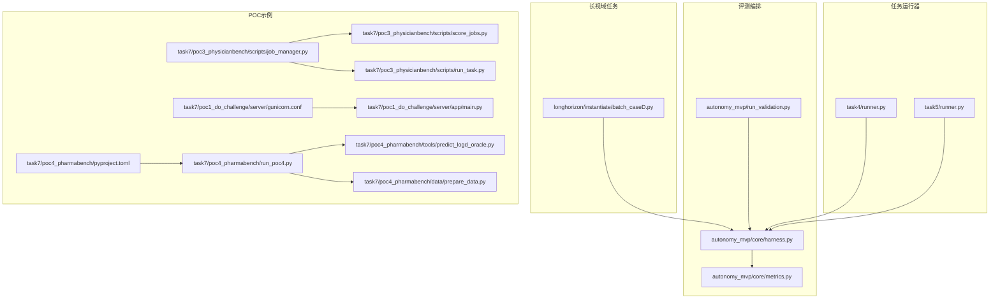
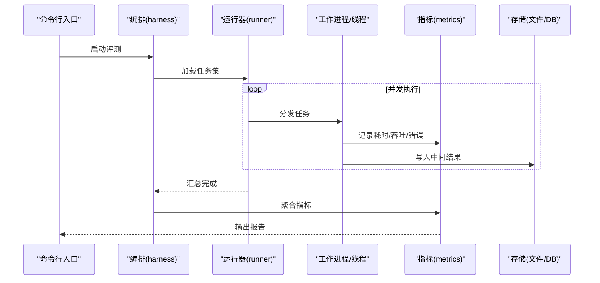
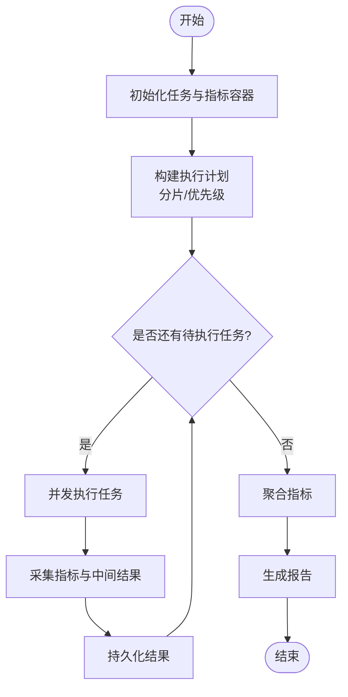
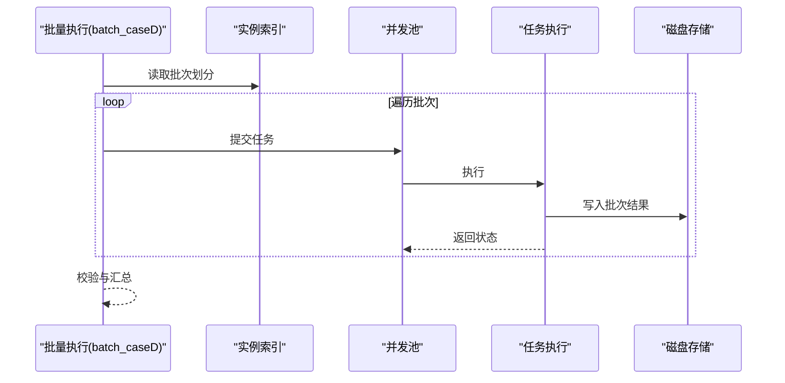
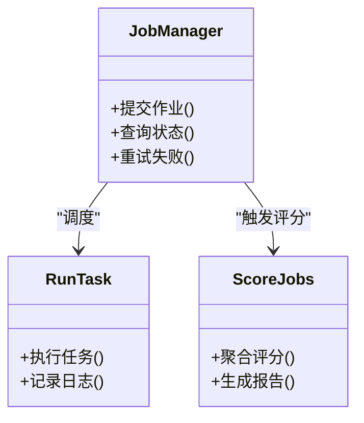
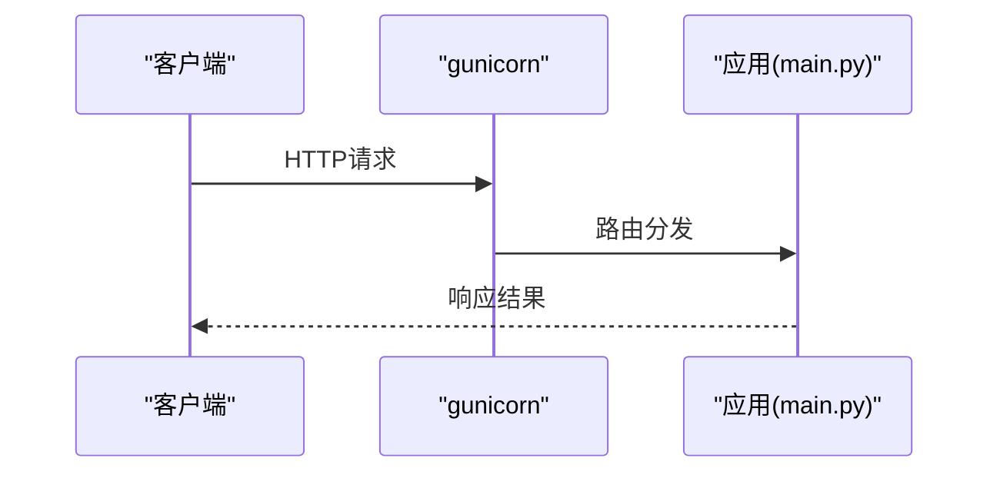
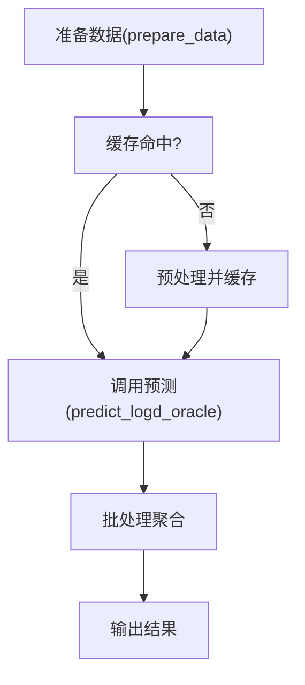
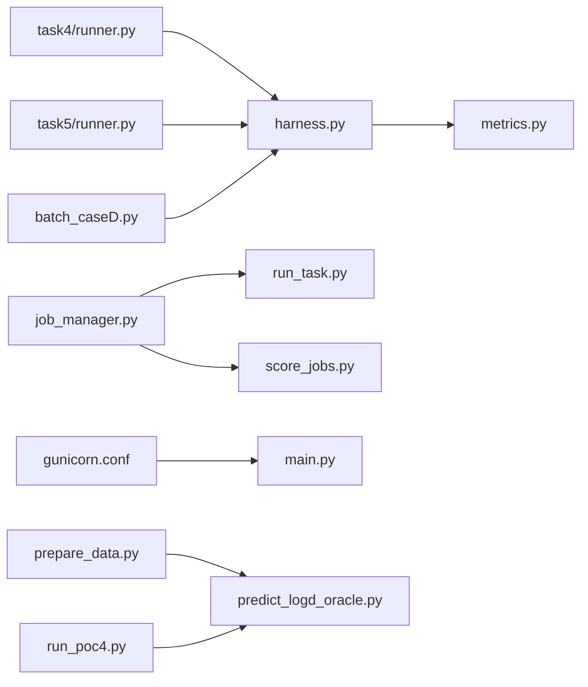

# 性能优化策略

<cite>
**本文引用的文件**   
- [autonomy_mvp/core/harness.py](file://autonomy_mvp/core/harness.py)
- [autonomy_mvp/core/metrics.py](file://autonomy_mvp/core/metrics.py)
- [autonomy_mvp/run_validation.py](file://autonomy_mvp/run_validation.py)
- [longhorizon/instantiate/batch_caseD.py](file://longhorizon/instantiate/batch_caseD.py)
- [task4/runner.py](file://task4/runner.py)
- [task5/runner.py](file://task5/runner.py)
- [task7/poc3_physicianbench/scripts/job_manager.py](file://task7/poc3_physicianbench/scripts/job_manager.py)
- [task7/poc3_physicianbench/scripts/score_jobs.py](file://task7/poc3_physicianbench/scripts/score_jobs.py)
- [task7/poc3_physicianbench/scripts/run_task.py](file://task7/poc3_physicianbench/scripts/run_task.py)
- [task7/poc1_do_challenge/server/gunicorn.conf](file://task7/poc1_do_challenge/server/gunicorn.conf)
- [task7/poc1_do_challenge/server/app/main.py](file://task7/poc1_do_challenge/server/app/main.py)
- [task7/poc4_pharmabench/tools/predict_logd_oracle.py](file://task7/poc4_pharmabench/tools/predict_logd_oracle.py)
- [task7/poc4_pharmabench/run_poc4.py](file://task7/poc4_pharmabench/run_poc4.py)
- [task7/poc4_pharmabench/data/prepare_data.py](file://task7/poc4_pharmabench/data/prepare_data.py)
- [task7/poc4_pharmabench/pyproject.toml](file://task7/poc4_pharmabench/pyproject.toml)
</cite>

## 目录
1. [引言](#引言)
2. [项目结构](#项目结构)
3. [核心组件](#核心组件)
4. [架构总览](#架构总览)
5. [详细组件分析](#详细组件分析)
6. [依赖关系分析](#依赖关系分析)
7. [性能考量](#性能考量)
8. [故障排查指南](#故障排查指南)
9. [结论](#结论)
10. [附录](#附录)

## 引言
本文件聚焦于框架在大规模实验与长视域任务中的性能优化策略与实践方法，涵盖并行执行、内存管理、资源调度、缓存与批处理、异步处理、监控指标定义、瓶颈分析与调优技巧，以及数据库查询与API调用优化和计算密集型任务的处理方案。文档同时给出实际测试案例的对比思路与可复现路径，帮助读者快速定位并改进系统性能。

## 项目结构
仓库按“任务/场景”组织，包含多套基准与工具链：
- autonomy_mvp：通用评测编排与指标统计
- longhorizon：长视域任务的实例化与批量执行
- task4/task5：不同运行器与报告生成
- task7：多个POC（含Web服务、批处理、评估脚本）

图表来源
- [autonomy_mvp/core/harness.py](file://autonomy_mvp/core/harness.py)
- [autonomy_mvp/core/metrics.py](file://autonomy_mvp/core/metrics.py)
- [autonomy_mvp/run_validation.py](file://autonomy_mvp/run_validation.py)
- [longhorizon/instantiate/batch_caseD.py](file://longhorizon/instantiate/batch_caseD.py)
- [task4/runner.py](file://task4/runner.py)
- [task5/runner.py](file://task5/runner.py)
- [task7/poc3_physicianbench/scripts/job_manager.py](file://task7/poc3_physicianbench/scripts/job_manager.py)
- [task7/poc3_physicianbench/scripts/score_jobs.py](file://task7/poc3_physicianbench/scripts/score_jobs.py)
- [task7/poc3_physicianbench/scripts/run_task.py](file://task7/poc3_physicianbench/scripts/run_task.py)
- [task7/poc1_do_challenge/server/gunicorn.conf](file://task7/poc1_do_challenge/server/gunicorn.conf)
- [task7/poc1_do_challenge/server/app/main.py](file://task7/poc1_do_challenge/server/app/main.py)
- [task7/poc4_pharmabench/tools/predict_logd_oracle.py](file://task7/poc4_pharmabench/tools/predict_logd_oracle.py)
- [task7/poc4_pharmabench/run_poc4.py](file://task7/poc4_pharmabench/run_poc4.py)
- [task7/poc4_pharmabench/data/prepare_data.py](file://task7/poc4_pharmabench/data/prepare_data.py)
- [task7/poc4_pharmabench/pyproject.toml](file://task7/poc4_pharmabench/pyproject.toml)

章节来源
- [autonomy_mvp/core/harness.py](file://autonomy_mvp/core/harness.py)
- [autonomy_mvp/core/metrics.py](file://autonomy_mvp/core/metrics.py)
- [autonomy_mvp/run_validation.py](file://autonomy_mvp/run_validation.py)
- [longhorizon/instantiate/batch_caseD.py](file://longhorizon/instantiate/batch_caseD.py)
- [task4/runner.py](file://task4/runner.py)
- [task5/runner.py](file://task5/runner.py)
- [task7/poc3_physicianbench/scripts/job_manager.py](file://task7/poc3_physicianbench/scripts/job_manager.py)
- [task7/poc3_physicianbench/scripts/score_jobs.py](file://task7/poc3_physicianbench/scripts/score_jobs.py)
- [task7/poc3_physicianbench/scripts/run_task.py](file://task7/poc3_physicianbench/scripts/run_task.py)
- [task7/poc1_do_challenge/server/gunicorn.conf](file://task7/poc1_do_challenge/server/gunicorn.conf)
- [task7/poc1_do_challenge/server/app/main.py](file://task7/poc1_do_challenge/server/app/main.py)
- [task7/poc4_pharmabench/tools/predict_logd_oracle.py](file://task7/poc4_pharmabench/tools/predict_logd_oracle.py)
- [task7/poc4_pharmabench/run_poc4.py](file://task7/poc4_pharmabench/run_poc4.py)
- [task7/poc4_pharmabench/data/prepare_data.py](file://task7/poc4_pharmabench/data/prepare_data.py)
- [task7/poc4_pharmabench/pyproject.toml](file://task7/poc4_pharmabench/pyproject.toml)

## 核心组件
- 评测编排与指标
  - 编排入口负责加载任务、分发执行、汇总结果与指标统计。
  - 指标模块提供吞吐、延迟、成功率等关键指标的采集与聚合。
- 长视域任务批量执行
  - 批量实例化与并发控制，结合队列与限流避免资源争用。
- 任务运行器
  - 统一的任务启动、日志记录、错误恢复与结果落盘。
- POC示例
  - Web服务通过WSGI服务器进行进程级并发；批处理脚本实现作业管理与评分；计算型工具封装为可复用函数供批处理调用。

章节来源
- [autonomy_mvp/core/harness.py](file://autonomy_mvp/core/harness.py)
- [autonomy_mvp/core/metrics.py](file://autonomy_mvp/core/metrics.py)
- [autonomy_mvp/run_validation.py](file://autonomy_mvp/run_validation.py)
- [longhorizon/instantiate/batch_caseD.py](file://longhorizon/instantiate/batch_caseD.py)
- [task4/runner.py](file://task4/runner.py)
- [task5/runner.py](file://task5/runner.py)
- [task7/poc3_physicianbench/scripts/job_manager.py](file://task7/poc3_physicianbench/scripts/job_manager.py)
- [task7/poc3_physicianbench/scripts/score_jobs.py](file://task7/poc3_physicianbench/scripts/score_jobs.py)
- [task7/poc3_physicianbench/scripts/run_task.py](file://task7/poc3_physicianbench/scripts/run_task.py)
- [task7/poc1_do_challenge/server/gunicorn.conf](file://task7/poc1_do_challenge/server/gunicorn.conf)
- [task7/poc1_do_challenge/server/app/main.py](file://task7/poc1_do_challenge/server/app/main.py)
- [task7/poc4_pharmabench/tools/predict_logd_oracle.py](file://task7/poc4_pharmabench/tools/predict_logd_oracle.py)
- [task7/poc4_pharmabench/run_poc4.py](file://task7/poc4_pharmabench/run_poc4.py)
- [task7/poc4_pharmabench/data/prepare_data.py](file://task7/poc4_pharmabench/data/prepare_data.py)
- [task7/poc4_pharmabench/pyproject.toml](file://task7/poc4_pharmabench/pyproject.toml)

## 架构总览
整体架构围绕“任务编排—并发执行—指标采集—结果持久化”的主循环展开，辅以Web服务与批处理子系统支撑不同使用场景。

图表来源
- [autonomy_mvp/core/harness.py](file://autonomy_mvp/core/harness.py)
- [autonomy_mvp/core/metrics.py](file://autonomy_mvp/core/metrics.py)
- [task4/runner.py](file://task4/runner.py)
- [task5/runner.py](file://task5/runner.py)

## 详细组件分析

### 组件A：评测编排与指标采集
- 职责
  - 解析配置与任务清单，构建执行计划
  - 控制并发度、重试与超时
  - 收集并聚合指标（吞吐、P50/P95延迟、失败率）
- 关键流程
  - 初始化阶段：加载任务、预热资源、创建指标容器
  - 执行阶段：分片并发、背压限流、异常隔离
  - 收尾阶段：合并结果、写报告、清理临时数据
- 优化要点
  - 动态调整并发度以匹配CPU/IO比例
  - 将I/O密集与CPU密集任务分离到不同池
  - 指标采样采用增量聚合，避免全量扫描

图表来源
- [autonomy_mvp/core/harness.py](file://autonomy_mvp/core/harness.py)
- [autonomy_mvp/core/metrics.py](file://autonomy_mvp/core/metrics.py)

章节来源
- [autonomy_mvp/core/harness.py](file://autonomy_mvp/core/harness.py)
- [autonomy_mvp/core/metrics.py](file://autonomy_mvp/core/metrics.py)

### 组件B：长视域任务批量执行
- 职责
  - 批量实例化长视域任务，控制并发与资源占用
  - 支持断点续跑与状态检查
- 关键流程
  - 读取实例索引，按批次切分
  - 并发执行，限制最大并发数
  - 每批完成后落盘，支持后续继续
- 优化要点
  - 批大小与并发度联合调参
  - 对重复子任务引入缓存键
  - 失败任务自动重试与退避

图表来源
- [longhorizon/instantiate/batch_caseD.py](file://longhorizon/instantiate/batch_caseD.py)

章节来源
- [longhorizon/instantiate/batch_caseD.py](file://longhorizon/instantiate/batch_caseD.py)

### 组件C：任务运行器与报告
- 职责
  - 统一任务生命周期管理（启动、监控、终止）
  - 生成单任务与汇总报告
- 关键流程
  - 解析参数与环境
  - 启动子进程/线程执行
  - 捕获异常与日志，输出结构化报告
- 优化要点
  - 进程隔离避免共享状态污染
  - 日志分级与异步落盘降低阻塞
  - 报告增量更新，避免重复计算

章节来源
- [task4/runner.py](file://task4/runner.py)
- [task5/runner.py](file://task5/runner.py)

### 组件D：作业管理与评分（POC3）
- 职责
  - 作业调度、状态跟踪、结果评分
- 关键流程
  - job_manager维护作业队列与状态机
  - run_task执行具体任务
  - score_jobs汇总评分并生成报表
- 优化要点
  - 作业去重与幂等设计
  - 评分阶段并行化，减少I/O等待
  - 中间状态快照用于恢复

图表来源
- [task7/poc3_physicianbench/scripts/job_manager.py](file://task7/poc3_physicianbench/scripts/job_manager.py)
- [task7/poc3_physicianbench/scripts/run_task.py](file://task7/poc3_physicianbench/scripts/run_task.py)
- [task7/poc3_physicianbench/scripts/score_jobs.py](file://task7/poc3_physicianbench/scripts/score_jobs.py)

章节来源
- [task7/poc3_physicianbench/scripts/job_manager.py](file://task7/poc3_physicianbench/scripts/job_manager.py)
- [task7/poc3_physicianbench/scripts/run_task.py](file://task7/poc3_physicianbench/scripts/run_task.py)
- [task7/poc3_physicianbench/scripts/score_jobs.py](file://task7/poc3_physicianbench/scripts/score_jobs.py)

### 组件E：Web服务并发与请求处理（POC1）
- 职责
  - 提供HTTP接口，承载外部调用
- 关键流程
  - gunicorn配置进程/线程并发
  - 应用层路由与业务逻辑
- 优化要点
  - 根据CPU核数设置worker数量
  - 合理配置线程数与连接池
  - 请求体大小与超时限制

图表来源
- [task7/poc1_do_challenge/server/gunicorn.conf](file://task7/poc1_do_challenge/server/gunicorn.conf)
- [task7/poc1_do_challenge/server/app/main.py](file://task7/poc1_do_challenge/server/app/main.py)

章节来源
- [task7/poc1_do_challenge/server/gunicorn.conf](file://task7/poc1_do_challenge/server/gunicorn.conf)
- [task7/poc1_do_challenge/server/app/main.py](file://task7/poc1_do_challenge/server/app/main.py)

### 组件F：计算密集型任务与批处理（POC4）
- 职责
  - 封装预测工具，批量处理数据集
- 关键流程
  - prepare_data准备输入
  - predict_logd_oracle执行计算
  - run_poc4协调批处理与输出
- 优化要点
  - 批内向量化与内存复用
  - 输入预处理缓存
  - 多进程并行与GPU显存管理

图表来源
- [task7/poc4_pharmabench/data/prepare_data.py](file://task7/poc4_pharmabench/data/prepare_data.py)
- [task7/poc4_pharmabench/tools/predict_logd_oracle.py](file://task7/poc4_pharmabench/tools/predict_logd_oracle.py)
- [task7/poc4_pharmabench/run_poc4.py](file://task7/poc4_pharmabench/run_poc4.py)

章节来源
- [task7/poc4_pharmabench/data/prepare_data.py](file://task7/poc4_pharmabench/data/prepare_data.py)
- [task7/poc4_pharmabench/tools/predict_logd_oracle.py](file://task7/poc4_pharmabench/tools/predict_logd_oracle.py)
- [task7/poc4_pharmabench/run_poc4.py](file://task7/poc4_pharmabench/run_poc4.py)
- [task7/poc4_pharmabench/pyproject.toml](file://task7/poc4_pharmabench/pyproject.toml)

## 依赖关系分析
- 内部耦合
  - 编排与指标强相关，运行器依赖编排接口
  - 批处理与实例索引解耦，便于扩展新任务类型
- 外部依赖
  - Web服务依赖WSGI服务器与网络栈
  - 计算工具可能依赖科学计算库或硬件加速

图表来源
- [autonomy_mvp/core/harness.py](file://autonomy_mvp/core/harness.py)
- [autonomy_mvp/core/metrics.py](file://autonomy_mvp/core/metrics.py)
- [task4/runner.py](file://task4/runner.py)
- [task5/runner.py](file://task5/runner.py)
- [longhorizon/instantiate/batch_caseD.py](file://longhorizon/instantiate/batch_caseD.py)
- [task7/poc3_physicianbench/scripts/job_manager.py](file://task7/poc3_physicianbench/scripts/job_manager.py)
- [task7/poc3_physicianbench/scripts/run_task.py](file://task7/poc3_physicianbench/scripts/run_task.py)
- [task7/poc3_physicianbench/scripts/score_jobs.py](file://task7/poc3_physicianbench/scripts/score_jobs.py)
- [task7/poc1_do_challenge/server/gunicorn.conf](file://task7/poc1_do_challenge/server/gunicorn.conf)
- [task7/poc1_do_challenge/server/app/main.py](file://task7/poc1_do_challenge/server/app/main.py)
- [task7/poc4_pharmabench/data/prepare_data.py](file://task7/poc4_pharmabench/data/prepare_data.py)
- [task7/poc4_pharmabench/tools/predict_logd_oracle.py](file://task7/poc4_pharmabench/tools/predict_logd_oracle.py)
- [task7/poc4_pharmabench/run_poc4.py](file://task7/poc4_pharmabench/run_poc4.py)

章节来源
- [autonomy_mvp/core/harness.py](file://autonomy_mvp/core/harness.py)
- [autonomy_mvp/core/metrics.py](file://autonomy_mvp/core/metrics.py)
- [task4/runner.py](file://task4/runner.py)
- [task5/runner.py](file://task5/runner.py)
- [longhorizon/instantiate/batch_caseD.py](file://longhorizon/instantiate/batch_caseD.py)
- [task7/poc3_physicianbench/scripts/job_manager.py](file://task7/poc3_physicianbench/scripts/job_manager.py)
- [task7/poc3_physicianbench/scripts/run_task.py](file://task7/poc3_physicianbench/scripts/run_task.py)
- [task7/poc3_physicianbench/scripts/score_jobs.py](file://task7/poc3_physicianbench/scripts/score_jobs.py)
- [task7/poc1_do_challenge/server/gunicorn.conf](file://task7/poc1_do_challenge/server/gunicorn.conf)
- [task7/poc1_do_challenge/server/app/main.py](file://task7/poc1_do_challenge/server/app/main.py)
- [task7/poc4_pharmabench/data/prepare_data.py](file://task7/poc4_pharmabench/data/prepare_data.py)
- [task7/poc4_pharmabench/tools/predict_logd_oracle.py](file://task7/poc4_pharmabench/tools/predict_logd_oracle.py)
- [task7/poc4_pharmabench/run_poc4.py](file://task7/poc4_pharmabench/run_poc4.py)

## 性能考量
- 大规模实验并行执行优化
  - 并发度选择：依据CPU核数与I/O占比动态调整
  - 背压与限流：防止下游服务过载
  - 任务分片：保证负载均衡与容错
- 内存管理与资源调度
  - 对象复用与零拷贝传输
  - 显式释放大对象，避免峰值内存过高
  - 进程/线程池隔离，避免相互影响
- 长视域任务效率优化
  - 缓存策略：基于输入指纹的键值缓存，支持TTL与LRU
  - 批处理技术：合并小请求，提升吞吐
  - 异步处理：非阻塞I/O与回调机制
- 监控指标定义
  - 吞吐：每秒任务数/请求数
  - 延迟：P50/P95/P99
  - 错误率：失败次数/总次数
  - 资源利用率：CPU/内存/GPU/磁盘I/O
- 瓶颈分析与调优技巧
  - CPU热点：向量化、算法复杂度优化
  - I/O热点：预取、分页、连接池
  - 锁竞争：无锁数据结构、细粒度锁
- 数据库查询优化
  - 索引设计与覆盖索引
  - 批量写入与事务合并
  - 读写分离与缓存层
- API调用优化
  - 连接复用与Keep-Alive
  - 压缩与序列化优化
  - 重试与熔断策略
- 计算密集型任务处理
  - 多进程并行与GPU批处理
  - 内存映射与分块计算
  - 结果增量保存与断点续算

[本节为通用指导，不直接分析具体文件]

## 故障排查指南
- 常见问题
  - 并发导致死锁或资源争用：检查锁粒度与等待图
  - 内存泄漏：追踪大对象引用与GC行为
  - 任务挂起：增加超时与心跳检测
- 诊断手段
  - 启用详细日志与结构化trace
  - 使用性能剖析工具定位热点
  - 监控指标告警与趋势分析
- 恢复策略
  - 幂等设计与重试退避
  - 状态快照与回滚
  - 降级与熔断保护

章节来源
- [autonomy_mvp/core/metrics.py](file://autonomy_mvp/core/metrics.py)
- [task7/poc3_physicianbench/scripts/job_manager.py](file://task7/poc3_physicianbench/scripts/job_manager.py)
- [task7/poc3_physicianbench/scripts/score_jobs.py](file://task7/poc3_physicianbench/scripts/score_jobs.py)

## 结论
通过在编排层实施并发控制与指标采集、在批处理层引入缓存与批处理、在服务层优化进程与连接池、在计算层利用向量化与并行，可以显著提升大规模实验与长视域任务的执行效率。建议建立统一的监控与告警体系，持续进行瓶颈分析与调优，确保系统在负载增长时保持稳定与高效。

[本节为总结性内容，不直接分析具体文件]

## 附录
- 实际性能测试案例与对比思路
  - 单测与回归：固定数据集，对比优化前后吞吐与延迟
  - 压力测试：逐步提高并发度，观察拐点与资源饱和
  - 端到端验证：从输入到输出的全流程计时与指标汇总
- 参考路径
  - 编排与指标：[autonomy_mvp/core/harness.py](file://autonomy_mvp/core/harness.py)、[autonomy_mvp/core/metrics.py](file://autonomy_mvp/core/metrics.py)
  - 批处理与实例化：[longhorizon/instantiate/batch_caseD.py](file://longhorizon/instantiate/batch_caseD.py)
  - 运行器与报告：[task4/runner.py](file://task4/runner.py)、[task5/runner.py](file://task5/runner.py)
  - 作业管理与评分：[task7/poc3_physicianbench/scripts/job_manager.py](file://task7/poc3_physicianbench/scripts/job_manager.py)、[task7/poc3_physicianbench/scripts/score_jobs.py](file://task7/poc3_physicianbench/scripts/score_jobs.py)
  - Web服务并发：[task7/poc1_do_challenge/server/gunicorn.conf](file://task7/poc1_do_challenge/server/gunicorn.conf)、[task7/poc1_do_challenge/server/app/main.py](file://task7/poc1_do_challenge/server/app/main.py)
  - 计算工具与批处理：[task7/poc4_pharmabench/tools/predict_logd_oracle.py](file://task7/poc4_pharmabench/tools/predict_logd_oracle.py)、[task7/poc4_pharmabench/run_poc4.py](file://task7/poc4_pharmabench/run_poc4.py)、[task7/poc4_pharmabench/data/prepare_data.py](file://task7/poc4_pharmabench/data/prepare_data.py)