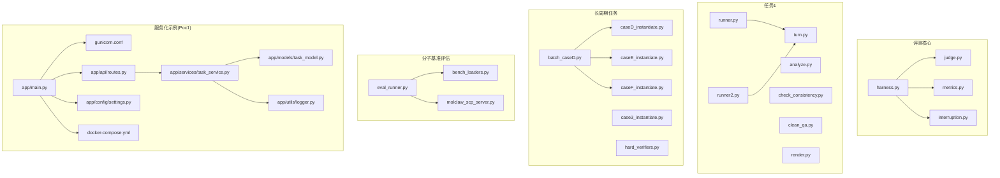
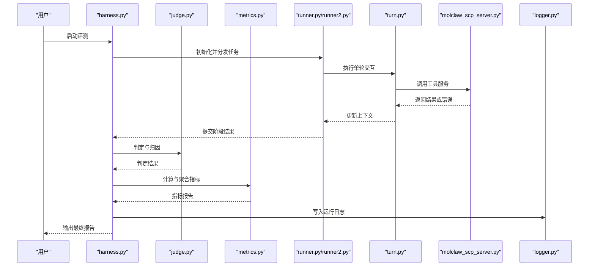
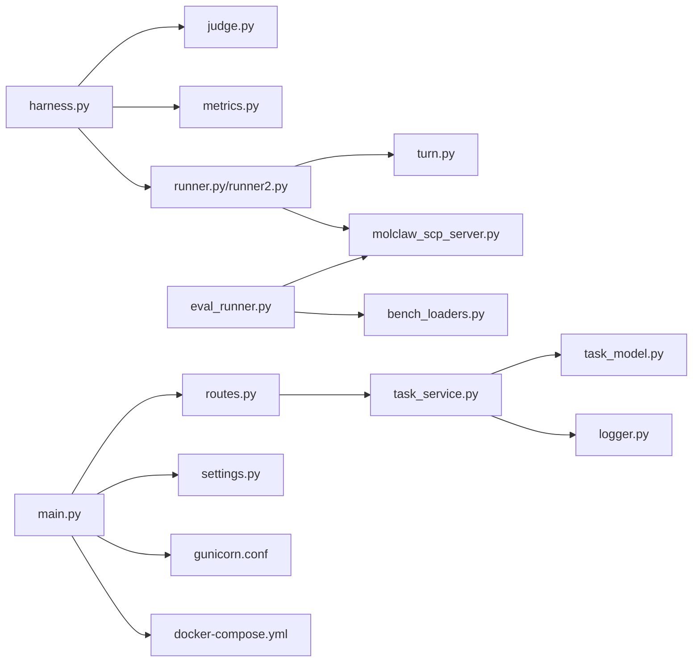

# 故障排除与调试技巧

<cite>
**本文引用的文件**   
- [autonomy_mvp/core/harness.py](file://autonomy_mvp/core/harness.py)
- [autonomy_mvp/core/judge.py](file://autonomy_mvp/core/judge.py)
- [autonomy_mvp/core/metrics.py](file://autonomy_mvp/core/metrics.py)
- [autonomy_mvp/core/interruption.py](file://autonomy_mvp/core/interruption.py)
- [autonomy_mvp/run_validation.py](file://autonomy_mvp/run_validation.py)
- [task1/runner.py](file://task1/runner.py)
- [task1/runner2.py](file://task1/runner2.py)
- [task1/turn.py](file://task1/turn.py)
- [task1/analyze.py](file://task1/analyze.py)
- [task1/check_consistency.py](file://task1/check_consistency.py)
- [task1/clean_qa.py](file://task1/clean_qa.py)
- [task1/render.py](file://task1/render.py)
- [longhorizon/instantiate/batch_caseD.py](file://longhorizon/instantiate/batch_caseD.py)
- [longhorizon/instantiate/case3_instantiate.py](file://longhorizon/instantiate/case3_instantiate.py)
- [longhorizon/instantiate/caseD_instantiate.py](file://longhorizon/instantiate/caseD_instantiate.py)
- [longhorizon/instantiate/caseE_instantiate.py](file://longhorizon/instantiate/caseE_instantiate.py)
- [longhorizon/instantiate/caseF_instantiate.py](file://longhorizon/instantiate/caseF_instantiate.py)
- [longhorizon/verifiers/hard_verifiers.py](file://longhorizon/verifiers/hard_verifiers.py)
- [docs/molbench_repo/eval/eval_runner.py](file://docs/molbench_repo/eval/eval_runner.py)
- [docs/molbench_repo/eval/bench_loaders.py](file://docs/molbench_repo/eval/bench_loaders.py)
- [docs/molbench_repo/skills/L1_tools/molclaw-scp-server/molclaw_scp_server.py](file://docs/molbench_repo/skills/L1_tools/molclaw-scp-server/molclaw_scp_server.py)
- [task7/poc1_do_challenge/server/gunicorn.conf](file://task7/poc1_do_challenge/server/gunicorn.conf)
- [task7/poc1_do_challenge/server/docker-compose.yml](file://task7/poc1_do_challenge/server/docker-compose.yml)
- [task7/poc1_do_challenge/server/app/main.py](file://task7/poc1_do_challenge/server/app/main.py)
- [task7/poc1_do_challenge/server/app/api/routes.py](file://task7/poc1_do_challenge/server/app/api/routes.py)
- [task7/poc1_do_challenge/server/app/services/task_service.py](file://task7/poc1_do_challenge/server/app/services/task_service.py)
- [task7/poc1_do_challenge/server/app/models/task_model.py](file://task7/poc1_do_challenge/server/app/models/task_model.py)
- [task7/poc1_do_challenge/server/app/utils/logger.py](file://task7/poc1_do_challenge/server/app/utils/logger.py)
- [task7/poc1_do_challenge/server/app/config/settings.py](file://task7/poc1_do_challenge/server/app/config/settings.py)
</cite>

## 目录
1. [简介](#简介)
2. [项目结构](#项目结构)
3. [核心组件](#核心组件)
4. [架构总览](#架构总览)
5. [详细组件分析](#详细组件分析)
6. [依赖分析](#依赖分析)
7. [性能考虑](#性能考虑)
8. [故障排除指南](#故障排除指南)
9. [结论](#结论)
10. [附录](#附录)

## 简介
本指南面向在基准评测、长周期任务编排、以及多工具/服务集成环境中遇到问题的工程师与研究者。内容覆盖：
- 常见问题诊断方法与错误日志分析
- 使用调试工具进行问题定位（性能分析、内存泄漏检测、并发问题排查）
- 环境配置问题、依赖冲突与版本兼容性处理
- 生产环境的监控告警、日志收集与分析策略
- 真实案例的问题排查过程与根本原因分析

## 项目结构
仓库包含多个子任务与实验模块，涉及评测框架、实例化脚本、评估器、以及一个小型服务端示例。关键路径包括：
- 评测核心：autonomy_mvp/core/*
- 运行与验证入口：autonomy_mvp/run_validation.py
- 任务1会话执行与结果分析：task1/*
- 长周期任务实例化与验证：longhorizon/*
- 分子基准评估：docs/molbench_repo/eval/* 与 skills/*
- 服务化示例（Poc1）：task7/poc1_do_challenge/server/*

图表来源
- [autonomy_mvp/core/harness.py](file://autonomy_mvp/core/harness.py)
- [autonomy_mvp/core/judge.py](file://autonomy_mvp/core/judge.py)
- [autonomy_mvp/core/metrics.py](file://autonomy_mvp/core/metrics.py)
- [autonomy_mvp/core/interruption.py](file://autonomy_mvp/core/interruption.py)
- [task1/runner.py](file://task1/runner.py)
- [task1/runner2.py](file://task1/runner2.py)
- [task1/turn.py](file://task1/turn.py)
- [task1/analyze.py](file://task1/analyze.py)
- [task1/check_consistency.py](file://task1/check_consistency.py)
- [task1/clean_qa.py](file://task1/clean_qa.py)
- [task1/render.py](file://task1/render.py)
- [longhorizon/instantiate/batch_caseD.py](file://longhorizon/instantiate/batch_caseD.py)
- [longhorizon/instantiate/case3_instantiate.py](file://longhorizon/instantiate/case3_instantiate.py)
- [longhorizon/instantiate/caseD_instantiate.py](file://longhorizon/instantiate/caseD_instantiate.py)
- [longhorizon/instantiate/caseE_instantiate.py](file://longhorizon/instantiate/caseE_instantiate.py)
- [longhorizon/instantiate/caseF_instantiate.py](file://longhorizon/instantiate/caseF_instantiate.py)
- [longhorizon/verifiers/hard_verifiers.py](file://longhorizon/verifiers/hard_verifiers.py)
- [docs/molbench_repo/eval/eval_runner.py](file://docs/molbench_repo/eval/eval_runner.py)
- [docs/molbench_repo/eval/bench_loaders.py](file://docs/molbench_repo/eval/bench_loaders.py)
- [docs/molbench_repo/skills/L1_tools/molclaw-scp-server/molclaw_scp_server.py](file://docs/molbench_repo/skills/L1_tools/molclaw-scp-server/molclaw_scp_server.py)
- [task7/poc1_do_challenge/server/gunicorn.conf](file://task7/poc1_do_challenge/server/gunicorn.conf)
- [task7/poc1_do_challenge/server/docker-compose.yml](file://task7/poc1_do_challenge/server/docker-compose.yml)
- [task7/poc1_do_challenge/server/app/main.py](file://task7/poc1_do_challenge/server/app/main.py)
- [task7/poc1_do_challenge/server/app/api/routes.py](file://task7/poc1_do_challenge/server/app/api/routes.py)
- [task7/poc1_do_challenge/server/app/services/task_service.py](file://task7/poc1_do_challenge/server/app/services/task_service.py)
- [task7/poc1_do_challenge/server/app/models/task_model.py](file://task7/poc1_do_challenge/server/app/models/task_model.py)
- [task7/poc1_do_challenge/server/app/utils/logger.py](file://task7/poc1_do_challenge/server/app/utils/logger.py)
- [task7/poc1_do_challenge/server/app/config/settings.py](file://task7/poc1_do_challenge/server/app/config/settings.py)

章节来源
- [autonomy_mvp/run_validation.py](file://autonomy_mvp/run_validation.py)
- [task1/runner.py](file://task1/runner.py)
- [task1/runner2.py](file://task1/runner2.py)
- [longhorizon/instantiate/batch_caseD.py](file://longhorizon/instantiate/batch_caseD.py)
- [docs/molbench_repo/eval/eval_runner.py](file://docs/molbench_repo/eval/eval_runner.py)
- [task7/poc1_do_challenge/server/app/main.py](file://task7/poc1_do_challenge/server/app/main.py)

## 核心组件
- 评测编排与中断控制
  - harness.py：负责评测流程编排、任务调度、结果汇总与异常捕获
  - interruption.py：提供中断信号处理与优雅退出机制
  - judge.py：判定逻辑封装，统一输出格式与失败归因
  - metrics.py：指标计算与聚合，支持多维度统计
- 任务1会话执行与分析
  - runner.py / runner2.py：会话级执行入口，管理轮次与状态
  - turn.py：单轮交互逻辑与上下文维护
  - analyze.py / check_consistency.py / clean_qa.py / render.py：结果清洗、一致性检查与渲染
- 长周期任务实例化与验证
  - batch_caseD.py：批量实例化与并行控制
  - case*_instantiate.py：不同场景的实例化模板
  - hard_verifiers.py：严格校验器，用于边界条件与健壮性测试
- 分子基准评估与服务
  - eval_runner.py / bench_loaders.py：评测驱动与数据加载
  - molclaw_scp_server.py：内部工具服务，供评测流程调用
- 服务化示例（Poc1）
  - main.py / routes.py / task_service.py / task_model.py：API路由、业务逻辑与模型定义
  - logger.py / settings.py：日志与配置中心
  - gunicorn.conf / docker-compose.yml：进程管理与容器编排

章节来源
- [autonomy_mvp/core/harness.py](file://autonomy_mvp/core/harness.py)
- [autonomy_mvp/core/interruption.py](file://autonomy_mvp/core/interruption.py)
- [autonomy_mvp/core/judge.py](file://autonomy_mvp/core/judge.py)
- [autonomy_mvp/core/metrics.py](file://autonomy_mvp/core/metrics.py)
- [task1/runner.py](file://task1/runner.py)
- [task1/runner2.py](file://task1/runner2.py)
- [task1/turn.py](file://task1/turn.py)
- [task1/analyze.py](file://task1/analyze.py)
- [task1/check_consistency.py](file://task1/check_consistency.py)
- [task1/clean_qa.py](file://task1/clean_qa.py)
- [task1/render.py](file://task1/render.py)
- [longhorizon/instantiate/batch_caseD.py](file://longhorizon/instantiate/batch_caseD.py)
- [longhorizon/instantiate/case3_instantiate.py](file://longhorizon/instantiate/case3_instantiate.py)
- [longhorizon/instantiate/caseD_instantiate.py](file://longhorizon/instantiate/caseD_instantiate.py)
- [longhorizon/instantiate/caseE_instantiate.py](file://longhorizon/instantiate/caseE_instantiate.py)
- [longhorizon/instantiate/caseF_instantiate.py](file://longhorizon/instantiate/caseF_instantiate.py)
- [longhorizon/verifiers/hard_verifiers.py](file://longhorizon/verifiers/hard_verifiers.py)
- [docs/molbench_repo/eval/eval_runner.py](file://docs/molbench_repo/eval/eval_runner.py)
- [docs/molbench_repo/eval/bench_loaders.py](file://docs/molbench_repo/eval/bench_loaders.py)
- [docs/molbench_repo/skills/L1_tools/molclaw-scp-server/molclaw_scp_server.py](file://docs/molbench_repo/skills/L1_tools/molclaw-scp-server/molclaw_scp_server.py)
- [task7/poc1_do_challenge/server/app/main.py](file://task7/poc1_do_challenge/server/app/main.py)
- [task7/poc1_do_challenge/server/app/api/routes.py](file://task7/poc1_do_challenge/server/app/api/routes.py)
- [task7/poc1_do_challenge/server/app/services/task_service.py](file://task7/poc1_do_challenge/server/app/services/task_service.py)
- [task7/poc1_do_challenge/server/app/models/task_model.py](file://task7/poc1_do_challenge/server/app/models/task_model.py)
- [task7/poc1_do_challenge/server/app/utils/logger.py](file://task7/poc1_do_challenge/server/app/utils/logger.py)
- [task7/poc1_do_challenge/server/app/config/settings.py](file://task7/poc1_do_challenge/server/app/config/settings.py)
- [task7/poc1_do_challenge/server/gunicorn.conf](file://task7/poc1_do_challenge/server/gunicorn.conf)
- [task7/poc1_do_challenge/server/docker-compose.yml](file://task7/poc1_do_challenge/server/docker-compose.yml)

## 架构总览
整体架构由“评测编排层”、“任务执行层”、“工具/服务层”和“持久化/日志层”构成。评测编排层通过harness协调judge与metrics；任务执行层负责会话与轮次；工具/服务层提供外部能力（如SCP服务）；持久化/日志层记录运行轨迹与指标。

图表来源
- [autonomy_mvp/core/harness.py](file://autonomy_mvp/core/harness.py)
- [autonomy_mvp/core/judge.py](file://autonomy_mvp/core/judge.py)
- [autonomy_mvp/core/metrics.py](file://autonomy_mvp/core/metrics.py)
- [task1/runner.py](file://task1/runner.py)
- [task1/runner2.py](file://task1/runner2.py)
- [task1/turn.py](file://task1/turn.py)
- [docs/molbench_repo/skills/L1_tools/molclaw-scp-server/molclaw_scp_server.py](file://docs/molbench_repo/skills/L1_tools/molclaw-scp-server/molclaw_scp_server.py)
- [task7/poc1_do_challenge/server/app/utils/logger.py](file://task7/poc1_do_challenge/server/app/utils/logger.py)

## 详细组件分析

### 评测编排与中断控制（harness + interruption）
- 职责
  - 编排评测生命周期：准备、执行、收尾
  - 捕获异常并转换为可解释的错误信息
  - 响应中断信号，确保资源释放与状态回滚
- 关键模式
  - 统一异常包装与错误码映射
  - 优雅退出钩子（清理临时文件、关闭连接）
- 常见故障点
  - 未正确注册中断处理器导致僵尸进程
  - 异常被吞掉或缺少堆栈信息
- 建议
  - 为每个阶段增加带时间戳的日志
  - 对关键资源使用上下文管理器保证释放

章节来源
- [autonomy_mvp/core/harness.py](file://autonomy_mvp/core/harness.py)
- [autonomy_mvp/core/interruption.py](file://autonomy_mvp/core/interruption.py)

### 判定与指标（judge + metrics）
- 职责
  - judge：将原始输出转化为结构化判定结果，附带归因标签
  - metrics：计算准确率、召回率、耗时、吞吐等指标
- 关键模式
  - 判定规则可配置，便于扩展新任务
  - 指标计算幂等，支持增量聚合
- 常见故障点
  - 判定规则与数据格式不匹配导致误判
  - 指标聚合时出现除零或空集合
- 建议
  - 引入最小数据集回归用例，防止规则退化
  - 对空输入做防御性处理并记录警告

章节来源
- [autonomy_mvp/core/judge.py](file://autonomy_mvp/core/judge.py)
- [autonomy_mvp/core/metrics.py](file://autonomy_mvp/core/metrics.py)

### 任务1会话执行（runner + turn）
- 职责
  - runner：管理会话生命周期、重试与超时
  - turn：维护对话上下文、解析输入输出
- 关键模式
  - 轮次级事务：每轮开始/结束打点
  - 上下文快照：失败后可恢复
- 常见故障点
  - 上下文过大导致内存增长
  - 网络或服务调用无超时保护
- 建议
  - 限制上下文大小，采用滑动窗口或摘要
  - 对所有外部调用设置超时与熔断

章节来源
- [task1/runner.py](file://task1/runner.py)
- [task1/runner2.py](file://task1/runner2.py)
- [task1/turn.py](file://task1/turn.py)

### 结果分析与一致性检查（analyze + check_consistency + clean_qa + render）
- 职责
  - analyze：汇总多轮结果，生成可读报告
  - check_consistency：对比多次运行的稳定性
  - clean_qa：清洗脏数据与无效条目
  - render：将结果渲染为表格或可视化
- 常见故障点
  - 字段缺失或类型不一致导致崩溃
  - 渲染时编码问题
- 建议
  - 建立Schema校验，失败即中止并输出差异
  - 统一编码与转义策略

章节来源
- [task1/analyze.py](file://task1/analyze.py)
- [task1/check_consistency.py](file://task1/check_consistency.py)
- [task1/clean_qa.py](file://task1/clean_qa.py)
- [task1/render.py](file://task1/render.py)

### 长周期任务实例化与验证（batch_caseD + case*_instantiate + hard_verifiers）
- 职责
  - batch_caseD：批量创建任务实例，控制并发度
  - case*_instantiate：按场景填充参数与数据
  - hard_verifiers：边界条件与压力测试
- 常见故障点
  - 并发过高导致资源耗尽
  - 实例化参数非法导致后续步骤失败
- 建议
  - 使用令牌桶或信号量限制并发
  - 参数预检与默认值兜底

章节来源
- [longhorizon/instantiate/batch_caseD.py](file://longhorizon/instantiate/batch_caseD.py)
- [longhorizon/instantiate/case3_instantiate.py](file://longhorizon/instantiate/case3_instantiate.py)
- [longhorizon/instantiate/caseD_instantiate.py](file://longhorizon/instantiate/caseD_instantiate.py)
- [longhorizon/instantiate/caseE_instantiate.py](file://longhorizon/instantiate/caseE_instantiate.py)
- [longhorizon/instantiate/caseF_instantiate.py](file://longhorizon/instantiate/caseF_instantiate.py)
- [longhorizon/verifiers/hard_verifiers.py](file://longhorizon/verifiers/hard_verifiers.py)

### 分子基准评估与服务（eval_runner + bench_loaders + scp_server）
- 职责
  - eval_runner：驱动评测流程，协调数据加载与工具调用
  - bench_loaders：读取与预处理基准数据
  - scp_server：提供文件传输等基础能力
- 常见故障点
  - 数据路径错误或权限不足
  - 服务端口占用或通信协议不匹配
- 建议
  - 启动前自检：路径存在性、端口可用性
  - 明确协议版本与序列化格式

章节来源
- [docs/molbench_repo/eval/eval_runner.py](file://docs/molbench_repo/eval/eval_runner.py)
- [docs/molbench_repo/eval/bench_loaders.py](file://docs/molbench_repo/eval/bench_loaders.py)
- [docs/molbench_repo/skills/L1_tools/molclaw-scp-server/molclaw_scp_server.py](file://docs/molbench_repo/skills/L1_tools/molclaw-scp-server/molclaw_scp_server.py)

### 服务化示例（Poc1）
- 职责
  - main.py：应用入口，挂载路由与中间件
  - routes.py：HTTP接口定义
  - task_service.py：任务业务逻辑
  - task_model.py：数据模型定义
  - logger.py：结构化日志
  - settings.py：集中配置
  - gunicorn.conf / docker-compose.yml：进程与容器编排
- 常见故障点
  - 配置项缺失或类型错误
  - 日志未滚动导致磁盘占满
  - 容器间网络不通或端口冲突
- 建议
  - 启动时校验所有必需配置
  - 启用日志轮转与分级
  - 使用健康检查端点与就绪探针

章节来源
- [task7/poc1_do_challenge/server/app/main.py](file://task7/poc1_do_challenge/server/app/main.py)
- [task7/poc1_do_challenge/server/app/api/routes.py](file://task7/poc1_do_challenge/server/app/api/routes.py)
- [task7/poc1_do_challenge/server/app/services/task_service.py](file://task7/poc1_do_challenge/server/app/services/task_service.py)
- [task7/poc1_do_challenge/server/app/models/task_model.py](file://task7/poc1_do_challenge/server/app/models/task_model.py)
- [task7/poc1_do_challenge/server/app/utils/logger.py](file://task7/poc1_do_challenge/server/app/utils/logger.py)
- [task7/poc1_do_challenge/server/app/config/settings.py](file://task7/poc1_do_challenge/server/app/config/settings.py)
- [task7/poc1_do_challenge/server/gunicorn.conf](file://task7/poc1_do_challenge/server/gunicorn.conf)
- [task7/poc1_do_challenge/server/docker-compose.yml](file://task7/poc1_do_challenge/server/docker-compose.yml)

## 依赖分析
- 模块耦合
  - harness强依赖judge与metrics，弱依赖runner与logger
  - runner依赖turn与外部工具（scp_server）
  - eval_runner依赖bench_loaders与工具服务
- 潜在循环依赖
  - 若工具服务反向调用评测核心，可能形成环，需解耦为事件总线或消息队列
- 外部依赖
  - 文件系统、网络IO、序列化库、进程管理（gunicorn）、容器编排（docker-compose）

图表来源
- [autonomy_mvp/core/harness.py](file://autonomy_mvp/core/harness.py)
- [autonomy_mvp/core/judge.py](file://autonomy_mvp/core/judge.py)
- [autonomy_mvp/core/metrics.py](file://autonomy_mvp/core/metrics.py)
- [task1/runner.py](file://task1/runner.py)
- [task1/runner2.py](file://task1/runner2.py)
- [task1/turn.py](file://task1/turn.py)
- [docs/molbench_repo/eval/eval_runner.py](file://docs/molbench_repo/eval/eval_runner.py)
- [docs/molbench_repo/eval/bench_loaders.py](file://docs/molbench_repo/eval/bench_loaders.py)
- [docs/molbench_repo/skills/L1_tools/molclaw-scp-server/molclaw_scp_server.py](file://docs/molbench_repo/skills/L1_tools/molclaw-scp-server/molclaw_scp_server.py)
- [task7/poc1_do_challenge/server/app/main.py](file://task7/poc1_do_challenge/server/app/main.py)
- [task7/poc1_do_challenge/server/app/api/routes.py](file://task7/poc1_do_challenge/server/app/api/routes.py)
- [task7/poc1_do_challenge/server/app/services/task_service.py](file://task7/poc1_do_challenge/server/app/services/task_service.py)
- [task7/poc1_do_challenge/server/app/models/task_model.py](file://task7/poc1_do_challenge/server/app/models/task_model.py)
- [task7/poc1_do_challenge/server/app/utils/logger.py](file://task7/poc1_do_challenge/server/app/utils/logger.py)
- [task7/poc1_do_challenge/server/app/config/settings.py](file://task7/poc1_do_challenge/server/app/config/settings.py)
- [task7/poc1_do_challenge/server/gunicorn.conf](file://task7/poc1_do_challenge/server/gunicorn.conf)
- [task7/poc1_do_challenge/server/docker-compose.yml](file://task7/poc1_do_challenge/server/docker-compose.yml)

## 性能考虑
- 并发与限流
  - 使用信号量或令牌桶限制并发，避免资源争用
  - 对慢依赖（网络、磁盘）设置超时与重试退避
- 内存管理
  - 避免大对象长期驻留，及时释放引用
  - 使用生成器与流式处理减少峰值内存
- I/O优化
  - 批量读写与缓冲，减少系统调用次数
  - 合理设置文件描述符与连接池大小
- 指标采集
  - 在关键路径埋点，记录延迟分布与错误率
  - 定期采样CPU与内存，识别热点

[本节为通用指导，无需特定文件来源]

## 故障排除指南

### 常见问题诊断方法
- 快速复现
  - 使用最小数据集与固定随机种子
  - 隔离外部依赖，优先本地模拟
- 分层定位
  - 从入口到叶子函数逐层打印关键变量与状态
  - 使用断言与不变量检查提前发现问题
- 日志与追踪
  - 为每个阶段添加唯一trace_id，贯穿调用链
  - 记录入参、出参与异常堆栈

章节来源
- [autonomy_mvp/core/harness.py](file://autonomy_mvp/core/harness.py)
- [task1/runner.py](file://task1/runner.py)
- [task7/poc1_do_challenge/server/app/utils/logger.py](file://task7/poc1_do_challenge/server/app/utils/logger.py)

### 错误日志分析与解决方案
- 分类与优先级
  - 致命错误（进程崩溃、数据损坏）优先处理
  - 可恢复错误（超时、重试）关注频率与趋势
- 根因定位
  - 关联trace_id与时间线，还原调用序列
  - 对比正常与异常样本的差异特征
- 修复策略
  - 短期：增加容错与降级
  - 长期：重构脆弱环节与完善契约

章节来源
- [autonomy_mvp/core/judge.py](file://autonomy_mvp/core/judge.py)
- [task7/poc1_do_challenge/server/app/api/routes.py](file://task7/poc1_do_challenge/server/app/api/routes.py)

### 调试工具使用
- 性能分析
  - 使用cProfile或py-spy定位热点函数
  - 结合火焰图观察调用开销
- 内存泄漏检测
  - tracemalloc跟踪分配热点
  - objgraph查找不可达对象
- 并发问题排查
  - 线程/进程dump查看锁持有与等待
  - 使用eventlet/gevent或asyncio调试器辅助定位

章节来源
- [task1/runner2.py](file://task1/runner2.py)
- [longhorizon/instantiate/batch_caseD.py](file://longhorizon/instantiate/batch_caseD.py)

### 环境配置问题、依赖冲突与版本兼容
- 环境自检
  - 启动前检查Python版本、依赖安装与路径权限
  - 环境变量与配置文件完整性校验
- 依赖冲突
  - 使用虚拟环境与lock文件锁定版本
  - 冲突时优先保持核心库稳定，替换非关键依赖
- 版本兼容
  - 维护向后兼容接口，逐步迁移
  - 发布前进行回归测试与灰度发布

章节来源
- [task7/poc1_do_challenge/server/app/config/settings.py](file://task7/poc1_do_challenge/server/app/config/settings.py)
- [docs/molbench_repo/eval/eval_runner.py](file://docs/molbench_repo/eval/eval_runner.py)

### 生产环境监控告警与日志策略
- 监控指标
  - 请求量、延迟分位、错误率、资源使用率
  - 业务指标：成功率、吞吐量、积压队列长度
- 告警规则
  - 基于阈值与同比环比变化触发
  - 分级告警与降噪策略
- 日志收集
  - 结构化JSON日志，统一字段与级别
  - 日志轮转、压缩与保留策略

章节来源
- [task7/poc1_do_challenge/server/app/utils/logger.py](file://task7/poc1_do_challenge/server/app/utils/logger.py)
- [task7/poc1_do_challenge/server/gunicorn.conf](file://task7/poc1_do_challenge/server/gunicorn.conf)
- [task7/poc1_do_challenge/server/docker-compose.yml](file://task7/poc1_do_challenge/server/docker-compose.yml)

### 真实案例排查与根因分析

#### 案例一：并行执行挂起
- 现象
  - 批量任务在并发模式下偶发挂起，无法完成
- 排查步骤
  - 检查并发控制与资源上限
  - 抓取线程/进程状态，确认是否死锁或资源竞争
  - 缩小并发度定位临界点
- 根因
  - 共享资源未加锁或锁粒度不当
  - 外部服务限流导致请求堆积
- 修复
  - 引入信号量限制并发
  - 增加超时与重试退避
  - 对共享资源加细粒度锁

章节来源
- [longhorizon/instantiate/batch_caseD.py](file://longhorizon/instantiate/batch_caseD.py)
- [task1/runner.py](file://task1/runner.py)

#### 案例二：工具服务通信失败
- 现象
  - 评测过程中调用SCP服务频繁失败
- 排查步骤
  - 检查端口占用与防火墙规则
  - 验证协议版本与序列化格式
  - 抓取网络抓包确认握手与数据传输
- 根因
  - 端口冲突或服务未启动
  - 客户端与服务端协议不匹配
- 修复
  - 启动前自检端口可用性
  - 统一协议版本并进行兼容性测试

章节来源
- [docs/molbench_repo/skills/L1_tools/molclaw-scp-server/molclaw_scp_server.py](file://docs/molbench_repo/skills/L1_tools/molclaw-scp-server/molclaw_scp_server.py)
- [docs/molbench_repo/eval/eval_runner.py](file://docs/molbench_repo/eval/eval_runner.py)

#### 案例三：服务启动后健康检查失败
- 现象
  - 容器启动成功但健康检查持续失败
- 排查步骤
  - 检查依赖服务连通性与配置
  - 查看应用日志中的初始化错误
  - 验证数据库/缓存连接
- 根因
  - 配置项缺失或类型错误
  - 依赖服务未就绪
- 修复
  - 启动时校验配置并给出明确错误信息
  - 增加就绪探针与重试机制

章节来源
- [task7/poc1_do_challenge/server/app/main.py](file://task7/poc1_do_challenge/server/app/main.py)
- [task7/poc1_do_challenge/server/app/config/settings.py](file://task7/poc1_do_challenge/server/app/config/settings.py)
- [task7/poc1_do_challenge/server/docker-compose.yml](file://task7/poc1_do_challenge/server/docker-compose.yml)

## 结论
通过分层定位、系统化日志与指标、严格的并发与资源管理，以及完善的监控告警与日志策略，可以显著提升问题发现与修复效率。建议在关键路径引入契约校验与回归用例，持续改进系统的可观测性与鲁棒性。

## 附录
- 术语表
  - trace_id：贯穿一次请求的唯一标识
  - 熔断：当错误率超过阈值时快速失败，避免雪崩
  - 灰度发布：逐步放量新版本以控制风险
- 参考命令与工具
  - cProfile、py-spy、tracemalloc、objgraph、tcpdump、curl、docker logs

[本节为补充信息，无需特定文件来源]