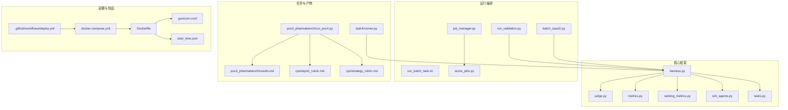
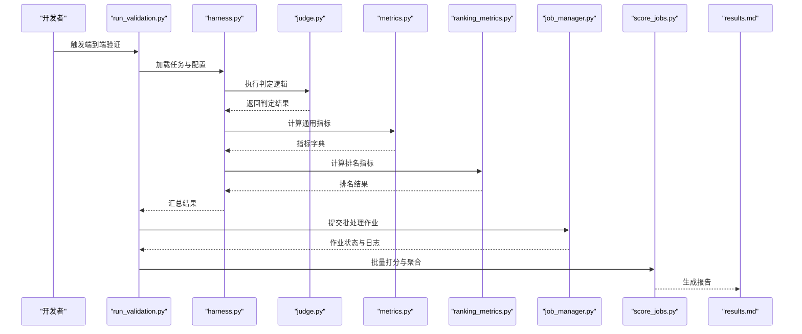
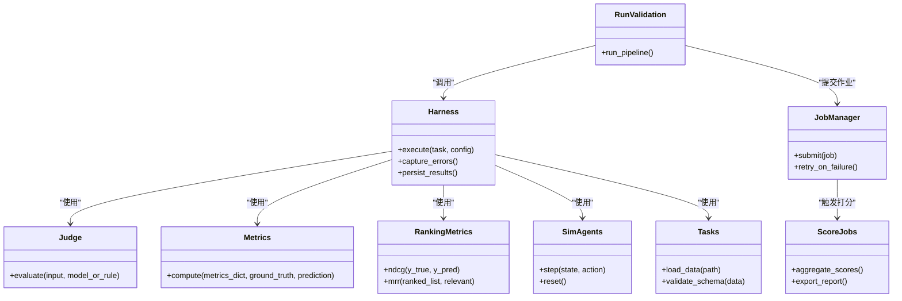

# 最佳实践

<cite>
**本文引用的文件**   
- [autonomy_mvp/core/harness.py](file://autonomy_mvp/core/harness.py)
- [autonomy_mvp/core/judge.py](file://autonomy_mvp/core/judge.py)
- [autonomy_mvp/core/metrics.py](file://autonomy_mvp/core/metrics.py)
- [autonomy_mvp/core/ranking_metrics.py](file://autonomy_mvp/core/ranking_metrics.py)
- [autonomy_mvp/core/sim_agents.py](file://autonomy_mvp/core/sim_agents.py)
- [autonomy_mvp/core/tasks.py](file://autonomy_mvp/core/tasks.py)
- [autonomy_mvp/run_validation.py](file://autonomy_mvp/run_validation.py)
- [autonomy_mvp/tests/test_core.py](file://autonomy_mvp/tests/test_core.py)
- [longhorizon/instantiate/batch_caseD.py](file://longhorizon/instantiate/batch_caseD.py)
- [task4/runner.py](file://task4/runner.py)
- [task7/poc3_physicianbench/scripts/job_manager.py](file://task7/poc3_physicianbench/scripts/job_manager.py)
- [task7/poc3_physicianbench/scripts/run_batch_task.sh](file://task7/poc3_physicianbench/scripts/run_batch_task.sh)
- [task7/poc3_physicianbench/scripts/score_jobs.py](file://task7/poc3_physicianbench/scripts/score_jobs.py)
- [task7/poc3_physicianbench/pyproject.toml](file://task7/poc3_physicianbench/pyproject.toml)
- [task7/poc3_physicianbench/.github/workflows/deploy.yml](file://task7/poc3_physicianbench/.github/workflows/deploy.yml)
- [task7/poc1_do_challenge/do-events-challenge2025/server/gunicorn.conf](file://task7/poc1_do_challenge/do-events-challenge2025/server/gunicorn.conf)
- [task7/poc1_do_challenge/do-events-challenge2025/server/docker-compose.yml](file://task7/poc1_do_challenge/do-events-challenge2025/server/docker-compose.yml)
- [task7/poc1_do_challenge/do-events-challenge2025/server/Dockerfile](file://task7/poc1_do_challenge/do-events-challenge2025/server/Dockerfile)
- [task7/poc1_do_challenge/do-events-challenge2025/server/start_time.json](file://task7/poc1_do_challenge/do-events-challenge2025/server/start_time.json)
- [task7/poc4_pharmabench/run_poc4.py](file://task7/poc4_pharmabench/run_poc4.py)
- [task7/poc4_pharmabench/results.md](file://task7/poc4_pharmabench/results.md)
- [task7/poc4_pharmabench/cps/report_rubric.md](file://task7/poc4_pharmabench/cps/report_rubric.md)
- [task7/poc4_pharmabench/cps/strategy_rubric.md](file://task7/poc4_pharmabench/cps/strategy_rubric.md)
</cite>

## 目录
1. [简介](#简介)
2. [项目结构](#项目结构)
3. [核心组件](#核心组件)
4. [架构总览](#架构总览)
5. [详细组件分析](#详细组件分析)
6. [依赖关系分析](#依赖关系分析)
7. [性能考虑](#性能考虑)
8. [故障排查指南](#故障排查指南)
9. [结论](#结论)
10. [附录](#附录)

## 简介
本文件面向使用本仓库进行大规模基准测试与实验的工程师与研究团队，聚焦“如何高效、稳定、可复现地组织代码、运行实验、评估结果并生成报告”。内容覆盖：
- 代码组织规范与分层职责
- 性能优化策略（并行、批处理、资源隔离）
- 错误处理模式与健壮性设计
- 测试编写指南与验收标准
- 大规模实验管理、结果分析与报告生成
- 团队协作、版本管理与部署注意事项
- 常见问题解决方案与调试技巧

## 项目结构
仓库采用按任务与领域划分的多模块结构，核心基准能力集中在 autonomy_mvp，长周期与案例化实验在 longhorizon，各 task 目录承载具体评测脚本与产物。关键组织原则：
- 核心框架层：harness、judge、metrics、sim_agents、tasks 等模块解耦清晰
- 运行编排层：run_validation、batch_caseD、job_manager 等负责调度与批处理
- 评测与工具层：score_jobs、eval_runner、模板与 rubric 提供标准化评估
- 部署与制品层：Docker、docker-compose、gunicorn、CI 流水线保障可重复部署

图表来源
- [autonomy_mvp/core/harness.py](file://autonomy_mvp/core/harness.py)
- [autonomy_mvp/core/judge.py](file://autonomy_mvp/core/judge.py)
- [autonomy_mvp/core/metrics.py](file://autonomy_mvp/core/metrics.py)
- [autonomy_mvp/core/ranking_metrics.py](file://autonomy_mvp/core/ranking_metrics.py)
- [autonomy_mvp/core/sim_agents.py](file://autonomy_mvp/core/sim_agents.py)
- [autonomy_mvp/core/tasks.py](file://autonomy_mvp/core/tasks.py)
- [autonomy_mvp/run_validation.py](file://autonomy_mvp/run_validation.py)
- [longhorizon/instantiate/batch_caseD.py](file://longhorizon/instantiate/batch_caseD.py)
- [task7/poc3_physicianbench/scripts/job_manager.py](file://task7/poc3_physicianbench/scripts/job_manager.py)
- [task7/poc3_physicianbench/scripts/run_batch_task.sh](file://task7/poc3_physicianbench/scripts/run_batch_task.sh)
- [task7/poc3_physicianbench/scripts/score_jobs.py](file://task7/poc3_physicianbench/scripts/score_jobs.py)
- [task4/runner.py](file://task4/runner.py)
- [task7/poc4_pharmabench/run_poc4.py](file://task7/poc4_pharmabench/run_poc4.py)
- [task7/poc4_pharmabench/results.md](file://task7/poc4_pharmabench/results.md)
- [task7/poc4_pharmabench/cps/report_rubric.md](file://task7/poc4_pharmabench/cps/report_rubric.md)
- [task7/poc4_pharmabench/cps/strategy_rubric.md](file://task7/poc4_pharmabench/cps/strategy_rubric.md)
- [task7/poc1_do_challenge/do-events-challenge2025/server/docker-compose.yml](file://task7/poc1_do_challenge/do-events-challenge2025/server/docker-compose.yml)
- [task7/poc1_do_challenge/do-events-challenge2025/server/Dockerfile](file://task7/poc1_do_challenge/do-events-challenge2025/server/Dockerfile)
- [task7/poc1_do_challenge/do-events-challenge2025/server/gunicorn.conf](file://task7/poc1_do_challenge/do-events-challenge2025/server/gunicorn.conf)
- [task7/poc1_do_challenge/do-events-challenge2025/server/start_time.json](file://task7/poc1_do_challenge/do-events-challenge2025/server/start_time.json)
- [task7/poc3_physicianbench/.github/workflows/deploy.yml](file://task7/poc3_physicianbench/.github/workflows/deploy.yml)

章节来源
- [autonomy_mvp/core/harness.py](file://autonomy_mvp/core/harness.py)
- [autonomy_mvp/core/judge.py](file://autonomy_mvp/core/judge.py)
- [autonomy_mvp/core/metrics.py](file://autonomy_mvp/core/metrics.py)
- [autonomy_mvp/core/ranking_metrics.py](file://autonomy_mvp/core/ranking_metrics.py)
- [autonomy_mvp/core/sim_agents.py](file://autonomy_mvp/core/sim_agents.py)
- [autonomy_mvp/core/tasks.py](file://autonomy_mvp/core/tasks.py)
- [autonomy_mvp/run_validation.py](file://autonomy_mvp/run_validation.py)
- [longhorizon/instantiate/batch_caseD.py](file://longhorizon/instantiate/batch_caseD.py)
- [task7/poc3_physicianbench/scripts/job_manager.py](file://task7/poc3_physicianbench/scripts/job_manager.py)
- [task7/poc3_physicianbench/scripts/run_batch_task.sh](file://task7/poc3_physicianbench/scripts/run_batch_task.sh)
- [task7/poc3_physicianbench/scripts/score_jobs.py](file://task7/poc3_physicianbench/scripts/score_jobs.py)
- [task4/runner.py](file://task4/runner.py)
- [task7/poc4_pharmabench/run_poc4.py](file://task7/poc4_pharmabench/run_poc4.py)
- [task7/poc4_pharmabench/results.md](file://task7/poc4_pharmabench/results.md)
- [task7/poc4_pharmabench/cps/report_rubric.md](file://task7/poc4_pharmabench/cps/report_rubric.md)
- [task7/poc4_pharmabench/cps/strategy_rubric.md](file://task7/poc4_pharmabench/cps/strategy_rubric.md)
- [task7/poc1_do_challenge/do-events-challenge2025/server/docker-compose.yml](file://task7/poc1_do_challenge/do-events-challenge2025/server/docker-compose.yml)
- [task7/poc1_do_challenge/do-events-challenge2025/server/Dockerfile](file://task7/poc1_do_challenge/do-events-challenge2025/server/Dockerfile)
- [task7/poc1_do_challenge/do-events-challenge2025/server/gunicorn.conf](file://task7/poc1_do_challenge/do-events-challenge2025/server/gunicorn.conf)
- [task7/poc1_do_challenge/do-events-challenge2025/server/start_time.json](file://task7/poc1_do_challenge/do-events-challenge2025/server/start_time.json)
- [task7/poc3_physicianbench/.github/workflows/deploy.yml](file://task7/poc3_physicianbench/.github/workflows/deploy.yml)

## 核心组件
- 执行器与编排
  - harness：统一的任务执行入口，负责生命周期管理、上下文传递、异常捕获与结果落盘
  - run_validation：端到端验证流程，串联数据加载、执行、评分与汇总
- 评判与指标
  - judge：判定逻辑封装，支持规则/模型双轨评判
  - metrics：通用指标计算（准确率、F1、AUC 等）
  - ranking_metrics：排序与排名相关指标（NDCG、MRR 等）
- 模拟与任务
  - sim_agents：仿真智能体接口与基线实现
  - tasks：任务定义与数据契约，保证输入输出一致性
- 批处理与作业管理
  - batch_caseD：批量实例化与并发控制
  - job_manager：作业队列、重试、超时与状态追踪
  - score_jobs：批量打分与聚合统计
- 部署与制品
  - Dockerfile + docker-compose：容器化服务与环境隔离
  - gunicorn.conf：进程与线程参数调优
  - start_time.json：启动时间戳用于可追溯性
  - deploy.yml：CI/CD 自动化构建与发布

章节来源
- [autonomy_mvp/core/harness.py](file://autonomy_mvp/core/harness.py)
- [autonomy_mvp/core/judge.py](file://autonomy_mvp/core/judge.py)
- [autonomy_mvp/core/metrics.py](file://autonomy_mvp/core/metrics.py)
- [autonomy_mvp/core/ranking_metrics.py](file://autonomy_mvp/core/ranking_metrics.py)
- [autonomy_mvp/core/sim_agents.py](file://autonomy_mvp/core/sim_agents.py)
- [autonomy_mvp/core/tasks.py](file://autonomy_mvp/core/tasks.py)
- [autonomy_mvp/run_validation.py](file://autonomy_mvp/run_validation.py)
- [longhorizon/instantiate/batch_caseD.py](file://longhorizon/instantiate/batch_caseD.py)
- [task7/poc3_physicianbench/scripts/job_manager.py](file://task7/poc3_physicianbench/scripts/job_manager.py)
- [task7/poc3_physicianbench/scripts/score_jobs.py](file://task7/poc3_physicianbench/scripts/score_jobs.py)
- [task7/poc1_do_challenge/do-events-challenge2025/server/docker-compose.yml](file://task7/poc1_do_challenge/do-events-challenge2025/server/docker-compose.yml)
- [task7/poc1_do_challenge/do-events-challenge2025/server/Dockerfile](file://task7/poc1_do_challenge/do-events-challenge2025/server/Dockerfile)
- [task7/poc1_do_challenge/do-events-challenge2025/server/gunicorn.conf](file://task7/poc1_do_challenge/do-events-challenge2025/server/gunicorn.conf)
- [task7/poc1_do_challenge/do-events-challenge2025/server/start_time.json](file://task7/poc1_do_challenge/do-events-challenge2025/server/start_time.json)
- [task7/poc3_physicianbench/.github/workflows/deploy.yml](file://task7/poc3_physicianbench/.github/workflows/deploy.yml)

## 架构总览
下图展示从任务定义到执行、评分、聚合与报告的端到端流程，以及容器化部署的关键节点。

图表来源
- [autonomy_mvp/run_validation.py](file://autonomy_mvp/run_validation.py)
- [autonomy_mvp/core/harness.py](file://autonomy_mvp/core/harness.py)
- [autonomy_mvp/core/judge.py](file://autonomy_mvp/core/judge.py)
- [autonomy_mvp/core/metrics.py](file://autonomy_mvp/core/metrics.py)
- [autonomy_mvp/core/ranking_metrics.py](file://autonomy_mvp/core/ranking_metrics.py)
- [task7/poc3_physicianbench/scripts/job_manager.py](file://task7/poc3_physicianbench/scripts/job_manager.py)
- [task7/poc3_physicianbench/scripts/score_jobs.py](file://task7/poc3_physicianbench/scripts/score_jobs.py)
- [task7/poc4_pharmabench/results.md](file://task7/poc4_pharmabench/results.md)

## 详细组件分析

### 执行器与编排（harness + run_validation）
- 职责边界
  - harness：抽象任务执行生命周期，统一异常捕获、中间态记录、结果序列化
  - run_validation：编排数据准备、执行、评分、归档与报告生成
- 最佳实践
  - 将外部依赖（LLM、数据库、文件系统）通过注入或配置方式接入，避免硬编码
  - 对长耗时步骤增加断点续跑与幂等写入，确保中断后可恢复
  - 为每个运行生成唯一 ID，关联日志、指标与产物，便于溯源
- 常见陷阱
  - 未限制并发导致资源争用；应结合系统负载与外部 API 限流设置上限
  - 未校验输入契约导致下游失败；应在入口处做 schema 校验与默认值填充

章节来源
- [autonomy_mvp/core/harness.py](file://autonomy_mvp/core/harness.py)
- [autonomy_mvp/run_validation.py](file://autonomy_mvp/run_validation.py)

### 评判与指标（judge + metrics + ranking_metrics）
- 职责边界
  - judge：封装判定规则与模型调用，屏蔽差异化的评判后端
  - metrics：提供通用数值指标计算
  - ranking_metrics：提供排序质量度量
- 最佳实践
  - 指标函数纯净化，无副作用，便于单元测试与并行计算
  - 对缺失值与异常值进行显式处理，避免污染整体统计
  - 将评判阈值与权重外置为配置，支持 A/B 对比与回归检查
- 常见陷阱
  - 不同任务指标口径不一致；需建立统一的指标字典与单位约定
  - 排名指标对样本量敏感；需在报告中注明置信区间或误差带

章节来源
- [autonomy_mvp/core/judge.py](file://autonomy_mvp/core/judge.py)
- [autonomy_mvp/core/metrics.py](file://autonomy_mvp/core/metrics.py)
- [autonomy_mvp/core/ranking_metrics.py](file://autonomy_mvp/core/ranking_metrics.py)

### 模拟与任务（sim_agents + tasks）
- 职责边界
  - sim_agents：提供可插拔的智能体实现与交互协议
  - tasks：定义任务的数据契约、环境初始化与终止条件
- 最佳实践
  - 以接口为中心扩展新智能体，保持与 harness 的兼容性
  - 任务数据采用 JSON/JSONL 等自描述格式，附带元数据与版本信息
  - 对随机种子进行固定与记录，提升可复现性
- 常见陷阱
  - 隐式全局状态导致跨任务污染；应使用会话级作用域隔离
  - 任务间共享资源未加锁；需引入互斥或队列机制

章节来源
- [autonomy_mvp/core/sim_agents.py](file://autonomy_mvp/core/sim_agents.py)
- [autonomy_mvp/core/tasks.py](file://autonomy_mvp/core/tasks.py)

### 批处理与作业管理（batch_caseD + job_manager + score_jobs）
- 职责边界
  - batch_caseD：批量实例化任务用例，生成可执行的作业清单
  - job_manager：作业调度、重试、超时、状态持久化
  - score_jobs：批量打分、聚合统计、导出报表
- 最佳实践
  - 作业粒度适中，避免过大导致内存溢出或过小导致调度开销
  - 为每个作业保留最小可复现实例（输入、种子、配置），便于回溯
  - 使用幂等写入与增量更新，避免重复计算
- 常见陷阱
  - 并发过高引发外部服务限流；需配合退避与熔断策略
  - 作业失败未告警；应集成通知与看板

章节来源
- [longhorizon/instantiate/batch_caseD.py](file://longhorizon/instantiate/batch_caseD.py)
- [task7/poc3_physicianbench/scripts/job_manager.py](file://task7/poc3_physicianbench/scripts/job_manager.py)
- [task7/poc3_physicianbench/scripts/score_jobs.py](file://task7/poc3_physicianbench/scripts/score_jobs.py)

### 部署与制品（Docker + docker-compose + gunicorn + CI）
- 职责边界
  - Dockerfile：定义镜像构建步骤与依赖
  - docker-compose：编排多服务与网络、卷挂载
  - gunicorn.conf：进程数、工作线程、超时等运行时参数
  - start_time.json：记录服务启动时间，辅助定位问题
  - deploy.yml：自动化构建、测试与发布
- 最佳实践
  - 镜像分层缓存依赖，缩短构建时间
  - 环境变量与密钥通过 secrets 管理，不入库
  - 健康检查与优雅停机，提高可用性
- 常见陷阱
  - 端口冲突与资源不足；需明确声明资源限制与端口映射
  - 时区与语言环境不一致；在镜像中固化基础环境

章节来源
- [task7/poc1_do_challenge/do-events-challenge2025/server/Dockerfile](file://task7/poc1_do_challenge/do-events-challenge2025/server/Dockerfile)
- [task7/poc1_do_challenge/do-events-challenge2025/server/docker-compose.yml](file://task7/poc1_do_challenge/do-events-challenge2025/server/docker-compose.yml)
- [task7/poc1_do_challenge/do-events-challenge2025/server/gunicorn.conf](file://task7/poc1_do_challenge/do-events-challenge2025/server/gunicorn.conf)
- [task7/poc1_do_challenge/do-events-challenge2025/server/start_time.json](file://task7/poc1_do_challenge/do-events-challenge2025/server/start_time.json)
- [task7/poc3_physicianbench/.github/workflows/deploy.yml](file://task7/poc3_physicianbench/.github/workflows/deploy.yml)

### 任务运行与报告（task4 runner + poc4 runner + rubrics）
- 职责边界
  - task4/runner.py：任务级运行脚本，驱动评测流程
  - poc4_pharmabench/run_poc4.py：特定场景的运行入口
  - report_rubric.md / strategy_rubric.md：报告与策略评价标准
  - results.md：最终结果汇总
- 最佳实践
  - 将评测维度与评分细则文档化，减少主观偏差
  - 报告模板化，自动填充关键指标与可视化摘要
  - 对关键路径添加审计日志，便于复盘
- 常见陷阱
  - 报告口径与指标定义不一致；需建立单一事实源
  - 结果不可复现；需锁定依赖版本与随机种子

章节来源
- [task4/runner.py](file://task4/runner.py)
- [task7/poc4_pharmabench/run_poc4.py](file://task7/poc4_pharmabench/run_poc4.py)
- [task7/poc4_pharmabench/cps/report_rubric.md](file://task7/poc4_pharmabench/cps/report_rubric.md)
- [task7/poc4_pharmabench/cps/strategy_rubric.md](file://task7/poc4_pharmabench/cps/strategy_rubric.md)
- [task7/poc4_pharmabench/results.md](file://task7/poc4_pharmabench/results.md)

### 测试编写指南（test_core）
- 建议
  - 针对 judge 与 metrics 编写单元与属性测试，覆盖边界与异常路径
  - 使用 fixtures 构造最小可复现实例，避免对外部依赖的耦合
  - 对并行与批处理逻辑进行压力与稳定性测试
- 参考
  - 现有测试结构与样例可作为模板扩展

章节来源
- [autonomy_mvp/tests/test_core.py](file://autonomy_mvp/tests/test_core.py)

## 依赖关系分析
- 模块内聚与耦合
  - harness 作为中心协调者，低耦合地依赖 judge、metrics、ranking_metrics、sim_agents、tasks
  - run_validation 仅编排高层流程，不侵入业务细节
- 外部依赖
  - 容器化与 CI 提供一致运行环境与自动化发布
  - 作业管理与批处理脚本支撑大规模并发与容错

图表来源
- [autonomy_mvp/core/harness.py](file://autonomy_mvp/core/harness.py)
- [autonomy_mvp/core/judge.py](file://autonomy_mvp/core/judge.py)
- [autonomy_mvp/core/metrics.py](file://autonomy_mvp/core/metrics.py)
- [autonomy_mvp/core/ranking_metrics.py](file://autonomy_mvp/core/ranking_metrics.py)
- [autonomy_mvp/core/sim_agents.py](file://autonomy_mvp/core/sim_agents.py)
- [autonomy_mvp/core/tasks.py](file://autonomy_mvp/core/tasks.py)
- [autonomy_mvp/run_validation.py](file://autonomy_mvp/run_validation.py)
- [task7/poc3_physicianbench/scripts/job_manager.py](file://task7/poc3_physicianbench/scripts/job_manager.py)
- [task7/poc3_physicianbench/scripts/score_jobs.py](file://task7/poc3_physicianbench/scripts/score_jobs.py)

章节来源
- [autonomy_mvp/core/harness.py](file://autonomy_mvp/core/harness.py)
- [autonomy_mvp/core/judge.py](file://autonomy_mvp/core/judge.py)
- [autonomy_mvp/core/metrics.py](file://autonomy_mvp/core/metrics.py)
- [autonomy_mvp/core/ranking_metrics.py](file://autonomy_mvp/core/ranking_metrics.py)
- [autonomy_mvp/core/sim_agents.py](file://autonomy_mvp/core/sim_agents.py)
- [autonomy_mvp/core/tasks.py](file://autonomy_mvp/core/tasks.py)
- [autonomy_mvp/run_validation.py](file://autonomy_mvp/run_validation.py)
- [task7/poc3_physicianbench/scripts/job_manager.py](file://task7/poc3_physicianbench/scripts/job_manager.py)
- [task7/poc3_physicianbench/scripts/score_jobs.py](file://task7/poc3_physicianbench/scripts/score_jobs.py)

## 性能考虑
- 并发与批处理
  - 根据外部服务 QPS 与本地 CPU/GPU 资源设定合理并发度
  - 使用批处理降低 I/O 与网络往返次数
- 资源隔离
  - 容器化隔离依赖，避免环境漂移
  - 通过进程/线程池限制资源占用，防止雪崩
- 缓存与幂等
  - 对昂贵计算结果进行缓存，键包含输入指纹与版本
  - 所有写入操作幂等，支持断点续跑
- 监控与观测
  - 记录关键路径耗时与错误率，形成 SLO 看板
  - 对慢查询与热点路径进行采样分析

[本节为通用指导，无需源码引用]

## 故障排查指南
- 常见问题
  - 并发导致的外部服务限流：降低并发、增加退避与重试
  - 作业长时间挂起：设置超时与心跳检测，及时回收僵尸作业
  - 指标异常波动：检查数据契约、缺失值处理与随机种子
  - 部署后端口冲突：核对 docker-compose 端口映射与服务发现
- 调试技巧
  - 启用结构化日志与 TraceID，贯穿请求链路
  - 使用最小可复现实例快速定位问题
  - 对关键路径增加断点与快照，便于回放
- 参考脚本与制品
  - 作业管理与打分脚本可用于复现与定位
  - 启动时间戳与配置文件有助于时序对齐

章节来源
- [task7/poc3_physicianbench/scripts/job_manager.py](file://task7/poc3_physicianbench/scripts/job_manager.py)
- [task7/poc3_physicianbench/scripts/score_jobs.py](file://task7/poc3_physicianbench/scripts/score_jobs.py)
- [task7/poc1_do_challenge/do-events-challenge2025/server/start_time.json](file://task7/poc1_do_challenge/do-events-challenge2025/server/start_time.json)
- [task7/poc1_do_challenge/do-events-challenge2025/server/docker-compose.yml](file://task7/poc1_do_challenge/do-events-challenge2025/server/docker-compose.yml)

## 结论
通过清晰的模块划分、严格的输入契约、完善的指标与评判体系、健壮的批处理与作业管理、以及容器化与 CI 的自动化保障，本仓库为大规模基准测试提供了高可靠、可复现、可扩展的工程基础。遵循本文的最佳实践，团队可在保证质量的前提下显著提升研发效率与交付稳定性。

[本节为总结性内容，无需源码引用]

## 附录
- 团队协作建议
  - 统一命名与目录规范，明确模块职责边界
  - 变更评审关注接口契约、指标口径与可复现性
  - 建立指标与报告模板库，减少重复劳动
- 版本管理
  - 依赖锁定与镜像标签化管理，确保环境一致
  - 重要运行附带种子、配置与数据哈希，形成完整证据链
- 部署注意事项
  - 预检资源与端口，灰度发布与回滚预案
  - 健康检查与告警联动，保障线上稳定性

[本节为通用指导，无需源码引用]