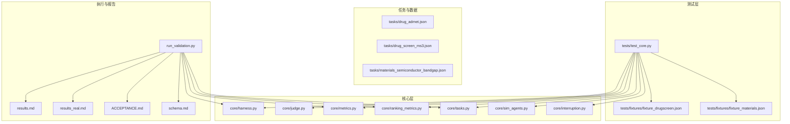
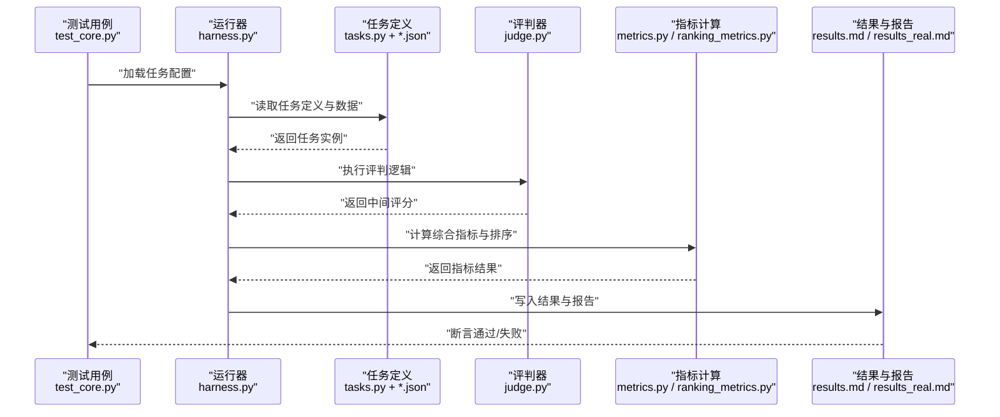
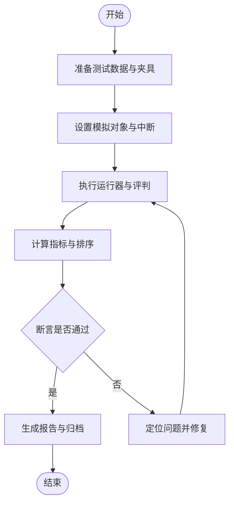
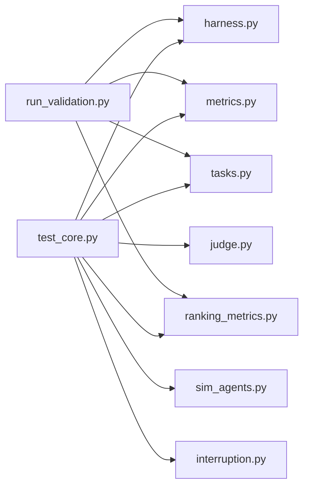

# 测试策略与实践

<cite>
**本文档引用的文件**   
- [autonomy_mvp/tests/test_core.py](file://autonomy_mvp/tests/test_core.py)
- [autonomy_mvp/core/harness.py](file://autonomy_mvp/core/harness.py)
- [autonomy_mvp/core/judge.py](file://autonomy_mvp/core/judge.py)
- [autonomy_mvp/core/metrics.py](file://autonomy_mvp/core/metrics.py)
- [autonomy_mvp/core/ranking_metrics.py](file://autonomy_mvp/core/ranking_metrics.py)
- [autonomy_mvp/core/tasks.py](file://autonomy_mvp/core/tasks.py)
- [autonomy_mvp/core/sim_agents.py](file://autonomy_mvp/core/sim_agents.py)
- [autonomy_mvp/core/interruption.py](file://autonomy_mvp/core/interruption.py)
- [autonomy_mvp/run_validation.py](file://autonomy_mvp/run_validation.py)
- [autonomy_mvp/ACCEPTANCE.md](file://autonomy_mvp/ACCEPTANCE.md)
- [autonomy_mvp/schema.md](file://autonomy_mvp/schema.md)
- [autonomy_mvp/results.md](file://autonomy_mvp/results.md)
- [autonomy_mvp/results_real.md](file://autonomy_mvp/results_real.md)
- [autonomy_mvp/tasks/drug_admet.json](file://autonomy_mvp/tasks/drug_admet.json)
- [autonomy_mvp/tasks/drug_screen_ms3.json](file://autonomy_mvp/tasks/drug_screen_ms3.json)
- [autonomy_mvp/tasks/materials_semiconductor_bandgap.json](file://autonomy_mvp/tasks/materials_semiconductor_bandgap.json)
- [autonomy_mvp/tests/fixtures/fixture_drugscreen.json](file://autonomy_mvp/tests/fixtures/fixture_drugscreen.json)
- [autonomy_mvp/tests/fixtures/fixture_materials.json](file://autonomy_mvp/tests/fixtures/fixture_materials.json)
</cite>

## 目录
1. [引言](#引言)
2. [项目结构](#项目结构)
3. [核心组件](#核心组件)
4. [架构总览](#架构总览)
5. [详细组件分析](#详细组件分析)
6. [依赖分析](#依赖分析)
7. [性能考虑](#性能考虑)
8. [故障排查指南](#故障排查指南)
9. [结论](#结论)
10. [附录](#附录)

## 引言
本文件面向框架的测试策略与最佳实践，覆盖单元测试、集成测试与端到端测试的设计原则，提供高质量测试用例编写方法（数据准备、模拟对象、断言策略），并给出测试环境搭建、测试数据管理与报告生成的实操指南。同时包含性能测试、压力测试与安全测试的实施建议，并结合药物发现与材料科学等真实场景展示测试案例。

## 项目结构
仓库围绕“自主性最小可行产品（Autonomy MVP）”展开，测试相关代码集中在 autonomy_mvp 模块内：
- tests：单元测试与夹具（fixtures）
- core：核心运行器、评估指标、任务编排与模拟代理
- tasks：领域任务定义（药物筛选、半导体能带等）
- run_validation：端到端验证脚本
- 文档与结果：验收标准、Schema、结果汇总

图表来源
- [autonomy_mvp/tests/test_core.py](file://autonomy_mvp/tests/test_core.py)
- [autonomy_mvp/core/harness.py](file://autonomy_mvp/core/harness.py)
- [autonomy_mvp/core/judge.py](file://autonomy_mvp/core/judge.py)
- [autonomy_mvp/core/metrics.py](file://autonomy_mvp/core/metrics.py)
- [autonomy_mvp/core/ranking_metrics.py](file://autonomy_mvp/core/ranking_metrics.py)
- [autonomy_mvp/core/tasks.py](file://autonomy_mvp/core/tasks.py)
- [autonomy_mvp/core/sim_agents.py](file://autonomy_mvp/core/sim_agents.py)
- [autonomy_mvp/core/interruption.py](file://autonomy_mvp/core/interruption.py)
- [autonomy_mvp/run_validation.py](file://autonomy_mvp/run_validation.py)
- [autonomy_mvp/results.md](file://autonomy_mvp/results.md)
- [autonomy_mvp/results_real.md](file://autonomy_mvp/results_real.md)
- [autonomy_mvp/ACCEPTANCE.md](file://autonomy_mvp/ACCEPTANCE.md)
- [autonomy_mvp/schema.md](file://autonomy_mvp/schema.md)
- [autonomy_mvp/tasks/drug_admet.json](file://autonomy_mvp/tasks/drug_admet.json)
- [autonomy_mvp/tasks/drug_screen_ms3.json](file://autonomy_mvp/tasks/drug_screen_ms3.json)
- [autonomy_mvp/tasks/materials_semiconductor_bandgap.json](file://autonomy_mvp/tasks/materials_semiconductor_bandgap.json)

章节来源
- [autonomy_mvp/tests/test_core.py](file://autonomy_mvp/tests/test_core.py)
- [autonomy_mvp/core/harness.py](file://autonomy_mvp/core/harness.py)
- [autonomy_mvp/core/judge.py](file://autonomy_mvp/core/judge.py)
- [autonomy_mvp/core/metrics.py](file://autonomy_mvp/core/metrics.py)
- [autonomy_mvp/core/ranking_metrics.py](file://autonomy_mvp/core/ranking_metrics.py)
- [autonomy_mvp/core/tasks.py](file://autonomy_mvp/core/tasks.py)
- [autonomy_mvp/core/sim_agents.py](file://autonomy_mvp/core/sim_agents.py)
- [autonomy_mvp/core/interruption.py](file://autonomy_mvp/core/interruption.py)
- [autonomy_mvp/run_validation.py](file://autonomy_mvp/run_validation.py)
- [autonomy_mvp/ACCEPTANCE.md](file://autonomy_mvp/ACCEPTANCE.md)
- [autonomy_mvp/schema.md](file://autonomy_mvp/schema.md)
- [autonomy_mvp/results.md](file://autonomy_mvp/results.md)
- [autonomy_mvp/results_real.md](file://autonomy_mvp/results_real.md)
- [autonomy_mvp/tasks/drug_admet.json](file://autonomy_mvp/tasks/drug_admet.json)
- [autonomy_mvp/tasks/drug_screen_ms3.json](file://autonomy_mvp/tasks/drug_screen_ms3.json)
- [autonomy_mvp/tasks/materials_semiconductor_bandgap.json](file://autonomy_mvp/tasks/materials_semiconductor_bandgap.json)

## 核心组件
- 测试入口与组织：tests/test_core.py 作为统一测试入口，集中组织单测与夹具使用。
- 运行器与编排：core/harness.py 负责任务加载、执行流程控制与结果聚合。
- 评判与指标：core/judge.py 与 core/metrics.py、core/ranking_metrics.py 提供评分、排序与多维指标计算。
- 任务与数据：core/tasks.py 与 tasks/*.json 描述不同领域的任务结构与输入输出契约。
- 模拟与中断：core/sim_agents.py 与 core/interruption.py 用于模拟外部依赖与异常路径。
- 端到端验证：run_validation.py 串联任务、运行器与指标，生成结果与报告。

章节来源
- [autonomy_mvp/tests/test_core.py](file://autonomy_mvp/tests/test_core.py)
- [autonomy_mvp/core/harness.py](file://autonomy_mvp/core/harness.py)
- [autonomy_mvp/core/judge.py](file://autonomy_mvp/core/judge.py)
- [autonomy_mvp/core/metrics.py](file://autonomy_mvp/core/metrics.py)
- [autonomy_mvp/core/ranking_metrics.py](file://autonomy_mvp/core/ranking_metrics.py)
- [autonomy_mvp/core/tasks.py](file://autonomy_mvp/core/tasks.py)
- [autonomy_mvp/core/sim_agents.py](file://autonomy_mvp/core/sim_agents.py)
- [autonomy_mvp/core/interruption.py](file://autonomy_mvp/core/interruption.py)
- [autonomy_mvp/run_validation.py](file://autonomy_mvp/run_validation.py)

## 架构总览
下图展示了从测试到执行的端到端调用链，以及指标与结果的流转关系。

图表来源
- [autonomy_mvp/tests/test_core.py](file://autonomy_mvp/tests/test_core.py)
- [autonomy_mvp/core/harness.py](file://autonomy_mvp/core/harness.py)
- [autonomy_mvp/core/tasks.py](file://autonomy_mvp/core/tasks.py)
- [autonomy_mvp/core/judge.py](file://autonomy_mvp/core/judge.py)
- [autonomy_mvp/core/metrics.py](file://autonomy_mvp/core/metrics.py)
- [autonomy_mvp/core/ranking_metrics.py](file://autonomy_mvp/core/ranking_metrics.py)
- [autonomy_mvp/results.md](file://autonomy_mvp/results.md)
- [autonomy_mvp/results_real.md](file://autonomy_mvp/results_real.md)

## 详细组件分析

### 单元测试设计与实现（test_core.py）
- 设计原则
  - 隔离性：每个测试聚焦单一职责，避免跨模块副作用。
  - 可重复性：固定随机种子、冻结时间、使用确定性夹具。
  - 可读性：命名清晰、断言明确、失败信息自解释。
- 数据准备
  - 使用 fixtures/ 下的 JSON 夹具，保证输入稳定且可追溯。
  - 针对药物与材料两类任务分别准备样例数据。
- 模拟对象
  - 对耗时或外部依赖（如模型推理、网络请求）使用 sim_agents.py 提供的模拟能力。
  - 通过 interruption.py 注入异常路径，验证健壮性。
- 断言策略
  - 结构化断言：对关键指标阈值、排序稳定性、边界条件进行断言。
  - 回归保护：将典型失败用例纳入回归集，防止退化。

章节来源
- [autonomy_mvp/tests/test_core.py](file://autonomy_mvp/tests/test_core.py)
- [autonomy_mvp/tests/fixtures/fixture_drugscreen.json](file://autonomy_mvp/tests/fixtures/fixture_drugscreen.json)
- [autonomy_mvp/tests/fixtures/fixture_materials.json](file://autonomy_mvp/tests/fixtures/fixture_materials.json)
- [autonomy_mvp/core/sim_agents.py](file://autonomy_mvp/core/sim_agents.py)
- [autonomy_mvp/core/interruption.py](file://autonomy_mvp/core/interruption.py)

### 运行器与编排（harness.py）
- 职责
  - 解析任务配置，驱动执行流水线，聚合中间结果。
  - 管理资源与并发，确保可复现实验。
- 关键点
  - 错误处理：捕获并记录运行时异常，支持重试与降级。
  - 日志与追踪：为调试与审计提供必要上下文。
  - 扩展点：便于接入新的任务类型与指标。

章节来源
- [autonomy_mvp/core/harness.py](file://autonomy_mvp/core/harness.py)

### 评判与指标（judge.py, metrics.py, ranking_metrics.py）
- 评判器（judge.py）
  - 将原始输出映射为标准评分，支持多目标权衡。
- 指标（metrics.py）
  - 提供通用度量（准确率、召回率、误差等）。
- 排序指标（ranking_metrics.py）
  - 针对排序与选择任务（如候选分子排序）提供专用指标。
- 最佳实践
  - 指标需具备单调性与鲁棒性，避免对噪声敏感。
  - 对缺失值与异常值进行显式处理。

章节来源
- [autonomy_mvp/core/judge.py](file://autonomy_mvp/core/judge.py)
- [autonomy_mvp/core/metrics.py](file://autonomy_mvp/core/metrics.py)
- [autonomy_mvp/core/ranking_metrics.py](file://autonomy_mvp/core/ranking_metrics.py)

### 任务与数据（tasks.py, tasks/*.json）
- 任务定义
  - 以 JSON 描述任务结构、输入输出约束与评估规则。
- 领域示例
  - 药物 ADME 预测、MS3 筛选、半导体能带预测。
- 数据治理
  - 版本化与校验（schema.md），确保数据一致性。

章节来源
- [autonomy_mvp/core/tasks.py](file://autonomy_mvp/core/tasks.py)
- [autonomy_mvp/tasks/drug_admet.json](file://autonomy_mvp/tasks/drug_admet.json)
- [autonomy_mvp/tasks/drug_screen_ms3.json](file://autonomy_mvp/tasks/drug_screen_ms3.json)
- [autonomy_mvp/tasks/materials_semiconductor_bandgap.json](file://autonomy_mvp/tasks/materials_semiconductor_bandgap.json)
- [autonomy_mvp/schema.md](file://autonomy_mvp/schema.md)

### 端到端验证（run_validation.py）
- 作用
  - 串联任务、运行器与指标，生成完整结果与报告。
- 输出
  - results.md、results_real.md 等汇总文件，便于对比与归档。
- 验收
  - 结合 ACCEPTANCE.md 中的验收标准，确保质量基线。

章节来源
- [autonomy_mvp/run_validation.py](file://autonomy_mvp/run_validation.py)
- [autonomy_mvp/results.md](file://autonomy_mvp/results.md)
- [autonomy_mvp/results_real.md](file://autonomy_mvp/results_real.md)
- [autonomy_mvp/ACCEPTANCE.md](file://autonomy_mvp/ACCEPTANCE.md)

### 概念总览（非代码映射）

[本图为概念流程图，不直接映射具体源码文件]

## 依赖分析
- 模块耦合
  - test_core.py 依赖 core 下多个模块，形成清晰的测试到实现的单向依赖。
  - run_validation.py 作为编排入口，依赖 harness、tasks、metrics 等。
- 外部依赖
  - 通过 sim_agents.py 与 interruption.py 解耦外部系统，降低测试复杂度。
- 风险点
  - 避免循环依赖；确保指标与评判逻辑独立于具体任务实现。

图表来源
- [autonomy_mvp/tests/test_core.py](file://autonomy_mvp/tests/test_core.py)
- [autonomy_mvp/core/harness.py](file://autonomy_mvp/core/harness.py)
- [autonomy_mvp/core/judge.py](file://autonomy_mvp/core/judge.py)
- [autonomy_mvp/core/metrics.py](file://autonomy_mvp/core/metrics.py)
- [autonomy_mvp/core/ranking_metrics.py](file://autonomy_mvp/core/ranking_metrics.py)
- [autonomy_mvp/core/tasks.py](file://autonomy_mvp/core/tasks.py)
- [autonomy_mvp/core/sim_agents.py](file://autonomy_mvp/core/sim_agents.py)
- [autonomy_mvp/core/interruption.py](file://autonomy_mvp/core/interruption.py)
- [autonomy_mvp/run_validation.py](file://autonomy_mvp/run_validation.py)

章节来源
- [autonomy_mvp/tests/test_core.py](file://autonomy_mvp/tests/test_core.py)
- [autonomy_mvp/run_validation.py](file://autonomy_mvp/run_validation.py)

## 性能考虑
- 基准与压测
  - 使用 run_validation.py 批量执行任务，统计吞吐与延迟。
  - 引入并发与缓存策略，减少重复计算。
- 内存与资源
  - 监控峰值内存，避免大对象常驻。
  - 合理划分任务批次，避免 OOM。
- 指标敏感性
  - 对排序与选择类指标进行扰动测试，确保稳健性。

[本节为通用指导，不直接分析具体文件]

## 故障排查指南
- 常见问题
  - 数据格式不一致：依据 schema.md 校验输入。
  - 指标异常：检查 judge.py 与 metrics.py 的边界处理。
  - 模拟失效：确认 sim_agents.py 与 interruption.py 的配置。
- 定位步骤
  - 启用详细日志，缩小问题范围。
  - 使用最小化夹具复现问题。
  - 逐步回滚变更，定位回归点。

章节来源
- [autonomy_mvp/schema.md](file://autonomy_mvp/schema.md)
- [autonomy_mvp/core/judge.py](file://autonomy_mvp/core/judge.py)
- [autonomy_mvp/core/metrics.py](file://autonomy_mvp/core/metrics.py)
- [autonomy_mvp/core/sim_agents.py](file://autonomy_mvp/core/sim_agents.py)
- [autonomy_mvp/core/interruption.py](file://autonomy_mvp/core/interruption.py)

## 结论
本框架通过清晰的层次划分与模块化设计，实现了从单元测试到端到端验证的完整测试体系。借助标准化任务定义、稳定的夹具与模拟机制，以及完善的指标与报告输出，能够在药物发现与材料科学等复杂场景中保障质量与可复现性。建议在持续集成中固化测试与报告流程，并不断扩充领域用例与性能基线。

[本节为总结性内容，不直接分析具体文件]

## 附录
- 测试环境搭建
  - 安装依赖，准备夹具与任务数据，确保环境变量与权限正确。
- 测试数据管理
  - 使用 fixtures/ 与 tasks/*.json 管理样例与基准数据，保持版本化与可追溯。
- 报告生成
  - 通过 run_validation.py 生成 results.md 与 results_real.md，结合 ACCEPTANCE.md 进行验收。
- 安全测试
  - 对输入进行严格校验，防范恶意构造；对外部依赖进行沙箱隔离。
- 真实场景案例
  - 药物发现：ADME 预测与 MS3 筛选的端到端验证。
  - 材料科学：半导体能带预测的任务编排与指标评估。

章节来源
- [autonomy_mvp/run_validation.py](file://autonomy_mvp/run_validation.py)
- [autonomy_mvp/results.md](file://autonomy_mvp/results.md)
- [autonomy_mvp/results_real.md](file://autonomy_mvp/results_real.md)
- [autonomy_mvp/ACCEPTANCE.md](file://autonomy_mvp/ACCEPTANCE.md)
- [autonomy_mvp/tasks/drug_admet.json](file://autonomy_mvp/tasks/drug_admet.json)
- [autonomy_mvp/tasks/drug_screen_ms3.json](file://autonomy_mvp/tasks/drug_screen_ms3.json)
- [autonomy_mvp/tasks/materials_semiconductor_bandgap.json](file://autonomy_mvp/tasks/materials_semiconductor_bandgap.json)