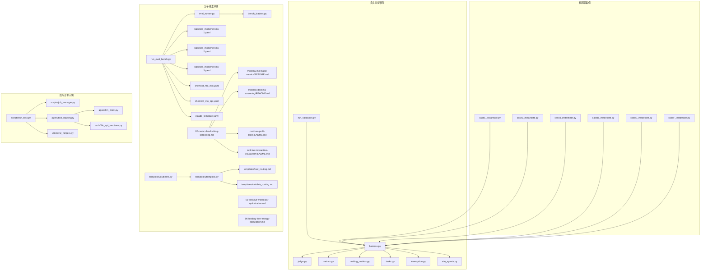
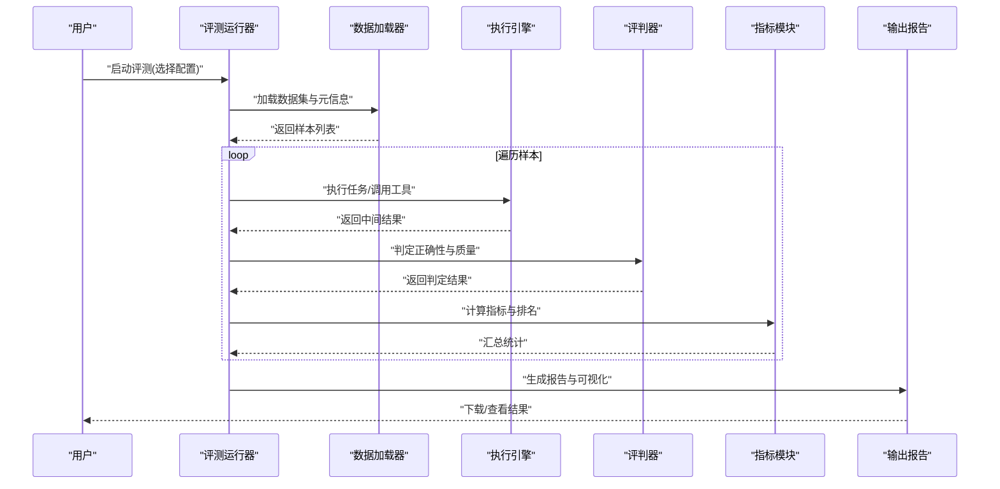
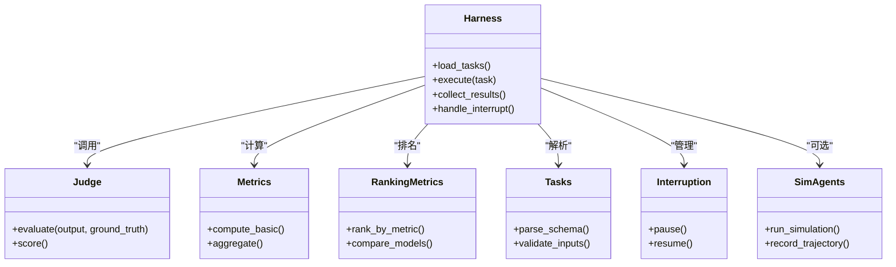
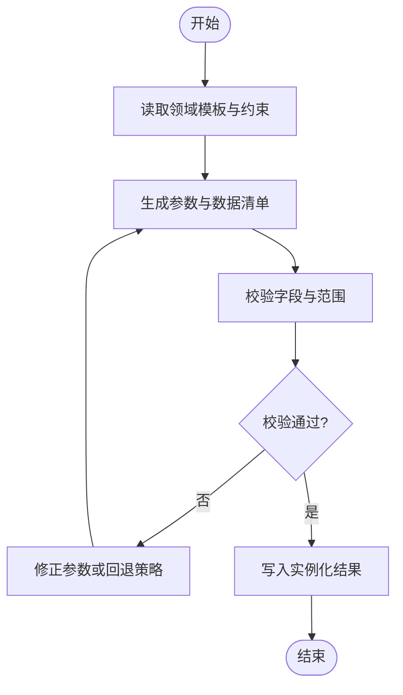
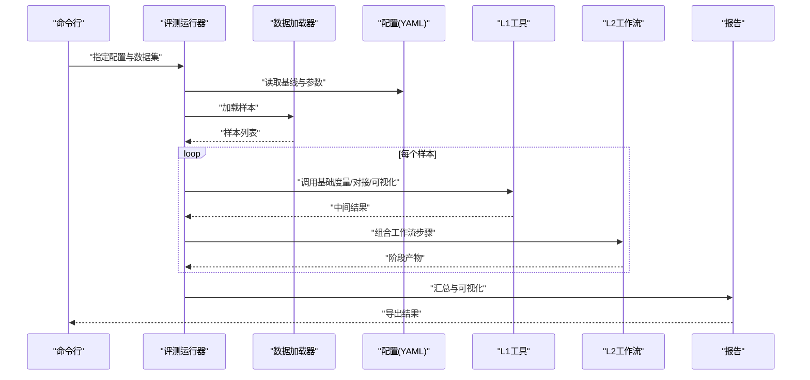
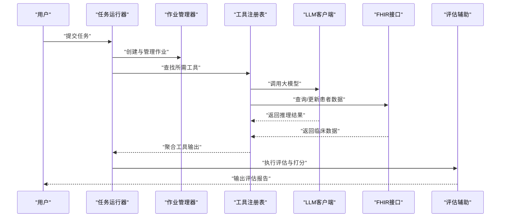
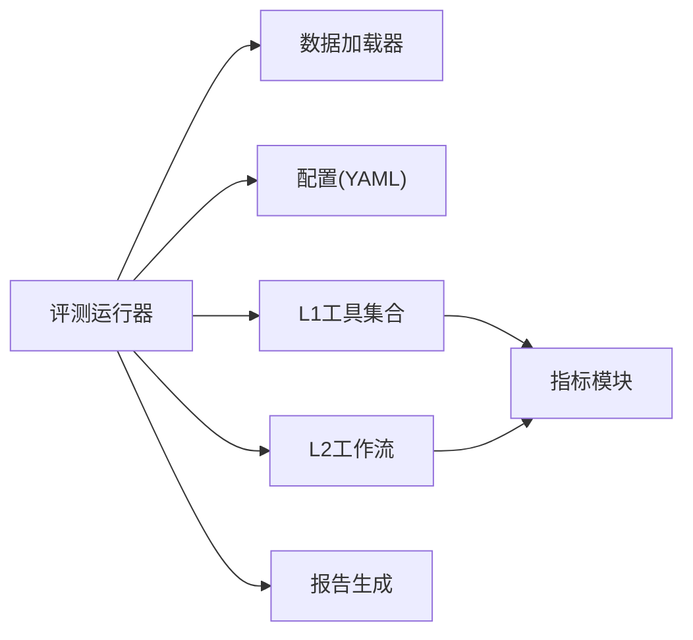

# 示例与教程

<cite>
**本文引用的文件**   
- [autonomy_mvp/core/harness.py](file://autonomy_mvp/core/harness.py)
- [autonomy_mvp/core/judge.py](file://autonomy_mvp/core/judge.py)
- [autonomy_mvp/core/metrics.py](file://autonomy_mvp/core/metrics.py)
- [autonomy_mvp/core/ranking_metrics.py](file://autonomy_mvp/core/ranking_metrics.py)
- [autonomy_mvp/core/tasks.py](file://autonomy_mvp/core/tasks.py)
- [autonomy_mvp/core/interruption.py](file://autonomy_mvp/core/interruption.py)
- [autonomy_mvp/core/sim_agents.py](file://autonomy_mvp/core/sim_agents.py)
- [autonomy_mvp/run_validation.py](file://autonomy_mvp/run_validation.py)
- [autonomy_mvp/schema.md](file://autonomy_mvp/schema.md)
- [longhorizon/instantiate/case1_instantiate.py](file://longhorizon/instantiate/case1_instantiate.py)
- [longhorizon/instantiate/case2_instantiate.py](file://longhorizon/instantiate/case2_instantiate.py)
- [longhorizon/instantiate/case3_instantiate.py](file://longhorizon/instantiate/case3_instantiate.py)
- [longhorizon/instantiate/caseD_instantiate.py](file://longhorizon/instantiate/caseD_instantiate.py)
- [longhorizon/instantiate/caseE_instantiate.py](file://longhorizon/instantiate/caseE_instantiate.py)
- [longhorizon/instantiate/caseF_instantiate.py](file://longhorizon/instantiate/caseF_instantiate.py)
- [task4_papers/molbench_repo/eval/bench_loaders.py](file://docs/task4_papers/molbench_repo/eval/bench_loaders.py)
- [task4_papers/molbench_repo/eval/eval_runner.py](file://docs/task4_papers/molbench_repo/eval/eval_runner.py)
- [task4_papers/molbench_repo/eval/run_eval_bench.py](file://docs/task4_papers/molbench_repo/eval/run_eval_bench.py)
- [task4_papers/molbench_repo/config/baseline_molbench-ms-1.yaml](file://docs/task4_papers/molbench_repo/config/baseline_molbench-ms-1.yaml)
- [task4_papers/molbench_repo/config/baseline_molbench-ms-2.yaml](file://docs/task4_papers/molbench_repo/config/baseline_molbench-ms-2.yaml)
- [task4_papers/molbench_repo/config/baseline_molbench-ms-3.yaml](file://docs/task4_papers/molbench_repo/config/baseline_molbench-ms-3.yaml)
- [task4_papers/molbench_repo/config/chemcot_mo_edit.yaml](file://docs/task4_papers/molbench_repo/config/chemcot_mo_edit.yaml)
- [task4_papers/molbench_repo/config/chemcot_mo_opt.yaml](file://docs/task4_papers/molbench_repo/config/chemcot_mo_opt.yaml)
- [task4_papers/molbench_repo/config/claude_template.yaml](file://docs/task4_papers/molbench_repo/config/claude_template.yaml)
- [task4_papers/molbench_repo/skills/L1_tools/molclaw-mol-basic-metrics/README.md](file://docs/task4_papers/molbench_repo/skills/L1_tools/molclaw-mol-basic-metrics/README.md)
- [task4_papers/molbench_repo/skills/L1_tools/molclaw-docking-screening/README.md](file://docs/task4_papers/molbench_repo/skills/L1_tools/molclaw-docking-screening/README.md)
- [task4_papers/molbench_repo/skills/L1_tools/molclaw-prolif-tool/README.md](file://docs/task4_papers/molbench_repo/skills/L1_tools/molclaw-prolif-tool/README.md)
- [task4_papers/molbench_repo/skills/L1_tools/molclaw-interaction-visualizer/README.md](file://docs/task4_papers/molbench_repo/skills/L1_tools/molclaw-interaction-visualizer/README.md)
- [task4_papers/molbench_repo/skills/L2_workflows/02-molecular-docking-screening.md](file://docs/task4_papers/molbench_repo/skills/L2_workflows/02-molecular-docking-screening.md)
- [task4_papers/molbench_repo/skills/L2_workflows/05-iterative-molecular-optimization.md](file://docs/task4_papers/molbench_repo/skills/L2_workflows/05-iterative-molecular-optimization.md)
- [task4_papers/molbench_repo/skills/L2_workflows/06-binding-free-energy-calculation.md](file://docs/task4_papers/molbench_repo/skills/L2_workflows/06-binding-free-energy-calculation.md)
- [task4_papers/molbench_repo/templates/template.py](file://docs/task4_papers/molbench_repo/templates/template.py)
- [task4_papers/molbench_repo/templates/outliners.py](file://docs/task4_papers/molbench_repo/templates/outliners.py)
- [task4_papers/molbench_repo/templates/tool_routing.md](file://docs/task4_papers/molbench_repo/templates/tool_routing.md)
- [task4_papers/molbench_repo/templates/variable_routing.md](file://docs/task4_papers/molbench_repo/templates/variable_routing.md)
- [task7/poc3_physicianbench/PhysicianBench/scripts/run_task.py](file://task7/poc3_physicianbench/PhysicianBench/scripts/run_task.py)
- [task7/poc3_physicianbench/PhysicianBench/scripts/job_manager.py](file://task7/poc3_physicianbench/PhysicianBench/scripts/job_manager.py)
- [task7/poc3_physicianbench/PhysicianBench/agent/tool_registry.py](file://task7/poc3_physicianbench/PhysicianBench/agent/tool_registry.py)
- [task7/poc3_physicianbench/PhysicianBench/agent/llm_client.py](file://task7/poc3_physicianbench/PhysicianBench/agent/llm_client.py)
- [task7/poc3_physicianbench/PhysicianBench/tools/fhir_api_functions.py](file://task7/poc3_physicianbench/PhysicianBench/tools/fhir_api_functions.py)
- [task7/poc3_physicianbench/PhysicianBench/utils/eval_helpers.py](file://task7/poc3_physicianbench/PhysicianBench/utils/eval_helpers.py)
</cite>

## 目录
1. [简介](#简介)
2. [项目结构](#项目结构)
3. [核心组件](#核心组件)
4. [架构总览](#架构总览)
5. [详细组件分析](#详细组件分析)
6. [依赖关系分析](#依赖关系分析)
7. [性能考虑](#性能考虑)
8. [故障排查指南](#故障排查指南)
9. [结论](#结论)
10. [附录](#附录)

## 简介
本教程面向科学计算基准测试框架的使用者与扩展者，提供从入门到高级的完整学习路径。内容覆盖：
- 快速上手：最小可运行示例、交互式提示与可视化演示建议
- 典型应用场景：药物筛选、材料优化、医疗诊断等端到端流程
- 最佳实践：常见陷阱避免、性能优化技巧
- 自定义应用：基于现有示例快速构建自有任务与工作流

## 项目结构
仓库包含多个子项目与示例集，围绕“任务定义—执行—评估—报告”的主线组织：
- autonomy_mvp：轻量验证框架，提供任务编排、中断控制、评分与排名指标
- longhorizon：长周期案例实例化脚本（材料发现、闭环优化、逆合成、靶点验证等）
- docs/task4_papers/molbench_repo：分子基准评测工具链（数据加载、评测运行、技能与工作流模板）
- task7/poc3_physicianbench：医疗诊断场景的Agent工作流与工具集成

图表来源
- [autonomy_mvp/core/harness.py](file://autonomy_mvp/core/harness.py)
- [autonomy_mvp/core/judge.py](file://autonomy_mvp/core/judge.py)
- [autonomy_mvp/core/metrics.py](file://autonomy_mvp/core/metrics.py)
- [autonomy_mvp/core/ranking_metrics.py](file://autonomy_mvp/core/ranking_metrics.py)
- [autonomy_mvp/core/tasks.py](file://autonomy_mvp/core/tasks.py)
- [autonomy_mvp/core/interruption.py](file://autonomy_mvp/core/interruption.py)
- [autonomy_mvp/core/sim_agents.py](file://autonomy_mvp/core/sim_agents.py)
- [autonomy_mvp/run_validation.py](file://autonomy_mvp/run_validation.py)
- [longhorizon/instantiate/case1_instantiate.py](file://longhorizon/instantiate/case1_instantiate.py)
- [longhorizon/instantiate/case2_instantiate.py](file://longhorizon/instantiate/case2_instantiate.py)
- [longhorizon/instantiate/case3_instantiate.py](file://longhorizon/instantiate/case3_instantiate.py)
- [longhorizon/instantiate/caseD_instantiate.py](file://longhorizon/instantiate/caseD_instantiate.py)
- [longhorizon/instantiate/caseE_instantiate.py](file://longhorizon/instantiate/caseE_instantiate.py)
- [longhorizon/instantiate/caseF_instantiate.py](file://longhorizon/instantiate/caseF_instantiate.py)
- [docs/task4_papers/molbench_repo/eval/bench_loaders.py](file://docs/task4_papers/molbench_repo/eval/bench_loaders.py)
- [docs/task4_papers/molbench_repo/eval/eval_runner.py](file://docs/task4_papers/molbench_repo/eval/eval_runner.py)
- [docs/task4_papers/molbench_repo/eval/run_eval_bench.py](file://docs/task4_papers/molbench_repo/eval/run_eval_bench.py)
- [docs/task4_papers/molbench_repo/config/baseline_molbench-ms-1.yaml](file://docs/task4_papers/molbench_repo/config/baseline_molbench-ms-1.yaml)
- [docs/task4_papers/molbench_repo/config/baseline_molbench-ms-2.yaml](file://docs/task4_papers/molbench_repo/config/baseline_molbench-ms-2.yaml)
- [docs/task4_papers/molbench_repo/config/baseline_molbench-ms-3.yaml](file://docs/task4_papers/molbench_repo/config/baseline_molbench-ms-3.yaml)
- [docs/task4_papers/molbench_repo/config/chemcot_mo_edit.yaml](file://docs/task4_papers/molbench_repo/config/chemcot_mo_edit.yaml)
- [docs/task4_papers/molbench_repo/config/chemcot_mo_opt.yaml](file://docs/task4_papers/molbench_repo/config/chemcot_mo_opt.yaml)
- [docs/task4_papers/molbench_repo/config/claude_template.yaml](file://docs/task4_papers/molbench_repo/config/claude_template.yaml)
- [docs/task4_papers/molbench_repo/skills/L1_tools/molclaw-mol-basic-metrics/README.md](file://docs/task4_papers/molbench_repo/skills/L1_tools/molclaw-mol-basic-metrics/README.md)
- [docs/task4_papers/molbench_repo/skills/L1_tools/molclaw-docking-screening/README.md](file://docs/task4_papers/molbench_repo/skills/L1_tools/molclaw-docking-screening/README.md)
- [docs/task4_papers/molbench_repo/skills/L1_tools/molclaw-prolif-tool/README.md](file://docs/task4_papers/molbench_repo/skills/L1_tools/molclaw-prolif-tool/README.md)
- [docs/task4_papers/molbench_repo/skills/L1_tools/molclaw-interaction-visualizer/README.md](file://docs/task4_papers/molbench_repo/skills/L1_tools/molclaw-interaction-visualizer/README.md)
- [docs/task4_papers/molbench_repo/skills/L2_workflows/02-molecular-docking-screening.md](file://docs/task4_papers/molbench_repo/skills/L2_workflows/02-molecular-docking-screening.md)
- [docs/task4_papers/molbench_repo/skills/L2_workflows/05-iterative-molecular-optimization.md](file://docs/task4_papers/molbench_repo/skills/L2_workflows/05-iterative-molecular-optimization.md)
- [docs/task4_papers/molbench_repo/skills/L2_workflows/06-binding-free-energy-calculation.md](file://docs/task4_papers/molbench_repo/skills/L2_workflows/06-binding-free-energy-calculation.md)
- [docs/task4_papers/molbench_repo/templates/template.py](file://docs/task4_papers/molbench_repo/templates/template.py)
- [docs/task4_papers/molbench_repo/templates/outliners.py](file://docs/task4_papers/molbench_repo/templates/outliners.py)
- [docs/task4_papers/molbench_repo/templates/tool_routing.md](file://docs/task4_papers/molbench_repo/templates/tool_routing.md)
- [docs/task4_papers/molbench_repo/templates/variable_routing.md](file://docs/task4_papers/molbench_repo/templates/variable_routing.md)
- [task7/poc3_physicianbench/PhysicianBench/scripts/run_task.py](file://task7/poc3_physicianbench/PhysicianBench/scripts/run_task.py)
- [task7/poc3_physicianbench/PhysicianBench/scripts/job_manager.py](file://task7/poc3_physicianbench/PhysicianBench/scripts/job_manager.py)
- [task7/poc3_physicianbench/PhysicianBench/agent/tool_registry.py](file://task7/poc3_physicianbench/PhysicianBench/agent/tool_registry.py)
- [task7/poc3_physicianbench/PhysicianBench/agent/llm_client.py](file://task7/poc3_physicianbench/PhysicianBench/agent/llm_client.py)
- [task7/poc3_physicianbench/PhysicianBench/tools/fhir_api_functions.py](file://task7/poc3_physicianbench/PhysicianBench/tools/fhir_api_functions.py)
- [task7/poc3_physicianbench/PhysicianBench/utils/eval_helpers.py](file://task7/poc3_physicianbench/PhysicianBench/utils/eval_helpers.py)

章节来源
- [autonomy_mvp/schema.md](file://autonomy_mvp/schema.md)
- [autonomy_mvp/run_validation.py](file://autonomy_mvp/run_validation.py)

## 核心组件
- 任务编排与执行
  - 通过统一入口加载任务配置、驱动执行并收集结果
  - 支持中断与重试机制，便于长时间运行的稳定性保障
- 评估与指标
  - 内置基础指标与排序指标，支持多目标比较与稳健性统计
- 模拟智能体
  - 提供轻量代理用于离线验证与快速原型
- 长周期案例实例化
  - 针对材料发现、闭环优化、逆合成、靶点验证等场景生成标准化输入
- 分子基准评测
  - 数据加载器、评测运行器与配置文件，支撑大规模基准对比
- 医疗诊断示例
  - Agent工具注册、LLM客户端、FHIR接口封装与评估辅助函数

章节来源
- [autonomy_mvp/core/harness.py](file://autonomy_mvp/core/harness.py)
- [autonomy_mvp/core/judge.py](file://autonomy_mvp/core/judge.py)
- [autonomy_mvp/core/metrics.py](file://autonomy_mvp/core/metrics.py)
- [autonomy_mvp/core/ranking_metrics.py](file://autonomy_mvp/core/ranking_metrics.py)
- [autonomy_mvp/core/tasks.py](file://autonomy_mvp/core/tasks.py)
- [autonomy_mvp/core/interruption.py](file://autonomy_mvp/core/interruption.py)
- [autonomy_mvp/core/sim_agents.py](file://autonomy_mvp/core/sim_agents.py)
- [longhorizon/instantiate/case1_instantiate.py](file://longhorizon/instantiate/case1_instantiate.py)
- [longhorizon/instantiate/case2_instantiate.py](file://longhorizon/instantiate/case2_instantiate.py)
- [longhorizon/instantiate/case3_instantiate.py](file://longhorizon/instantiate/case3_instantiate.py)
- [longhorizon/instantiate/caseD_instantiate.py](file://longhorizon/instantiate/caseD_instantiate.py)
- [longhorizon/instantiate/caseE_instantiate.py](file://longhorizon/instantiate/caseE_instantiate.py)
- [longhorizon/instantiate/caseF_instantiate.py](file://longhorizon/instantiate/caseF_instantiate.py)
- [docs/task4_papers/molbench_repo/eval/bench_loaders.py](file://docs/task4_papers/molbench_repo/eval/bench_loaders.py)
- [docs/task4_papers/molbench_repo/eval/eval_runner.py](file://docs/task4_papers/molbench_repo/eval/eval_runner.py)
- [docs/task4_papers/molbench_repo/eval/run_eval_bench.py](file://docs/task4_papers/molbench_repo/eval/run_eval_bench.py)
- [docs/task4_papers/molbench_repo/config/baseline_molbench-ms-1.yaml](file://docs/task4_papers/molbench_repo/config/baseline_molbench-ms-1.yaml)
- [docs/task4_papers/molbench_repo/config/baseline_molbench-ms-2.yaml](file://docs/task4_papers/molbench_repo/config/baseline_molbench-ms-2.yaml)
- [docs/task4_papers/molbench_repo/config/baseline_molbench-ms-3.yaml](file://docs/task4_papers/molbench_repo/config/baseline_molbench-ms-3.yaml)
- [docs/task4_papers/molbench_repo/config/chemcot_mo_edit.yaml](file://docs/task4_papers/molbench_repo/config/chemcot_mo_edit.yaml)
- [docs/task4_papers/molbench_repo/config/chemcot_mo_opt.yaml](file://docs/task4_papers/molbench_repo/config/chemcot_mo_opt.yaml)
- [docs/task4_papers/molbench_repo/config/claude_template.yaml](file://docs/task4_papers/molbench_repo/config/claude_template.yaml)
- [task7/poc3_physicianbench/PhysicianBench/scripts/run_task.py](file://task7/poc3_physicianbench/PhysicianBench/scripts/run_task.py)
- [task7/poc3_physicianbench/PhysicianBench/scripts/job_manager.py](file://task7/poc3_physicianbench/PhysicianBench/scripts/job_manager.py)
- [task7/poc3_physicianbench/PhysicianBench/agent/tool_registry.py](file://task7/poc3_physicianbench/PhysicianBench/agent/tool_registry.py)
- [task7/poc3_physicianbench/PhysicianBench/agent/llm_client.py](file://task7/poc3_physicianbench/PhysicianBench/agent/llm_client.py)
- [task7/poc3_physicianbench/PhysicianBench/tools/fhir_api_functions.py](file://task7/poc3_physicianbench/PhysicianBench/tools/fhir_api_functions.py)
- [task7/poc3_physicianbench/PhysicianBench/utils/eval_helpers.py](file://task7/poc3_physicianbench/PhysicianBench/utils/eval_helpers.py)

## 架构总览
整体采用“配置驱动 + 模块化组件”的架构：
- 配置层：YAML/JSON描述任务、数据源、评测方法与参数
- 执行层：统一编排器负责调度、容错与日志
- 评估层：指标计算与排名聚合
- 工具与工作流：按L1工具与L2工作流分层复用

图表来源
- [docs/task4_papers/molbench_repo/eval/run_eval_bench.py](file://docs/task4_papers/molbench_repo/eval/run_eval_bench.py)
- [docs/task4_papers/molbench_repo/eval/eval_runner.py](file://docs/task4_papers/molbench_repo/eval/eval_runner.py)
- [docs/task4_papers/molbench_repo/eval/bench_loaders.py](file://docs/task4_papers/molbench_repo/eval/bench_loaders.py)
- [autonomy_mvp/core/harness.py](file://autonomy_mvp/core/harness.py)
- [autonomy_mvp/core/judge.py](file://autonomy_mvp/core/judge.py)
- [autonomy_mvp/core/metrics.py](file://autonomy_mvp/core/metrics.py)
- [autonomy_mvp/core/ranking_metrics.py](file://autonomy_mvp/core/ranking_metrics.py)

## 详细组件分析

### 自主验证框架（autonomy_mvp）
- 关键职责
  - 任务加载与执行：根据schema解析任务，驱动执行并记录轨迹
  - 中断与恢复：在长时间运行中支持安全中断与断点续跑
  - 评判与指标：对输出进行结构化判定，计算基础与排序指标
  - 模拟智能体：提供轻量代理以加速迭代
- 使用建议
  - 先以最小任务样例验证环境，再逐步接入外部工具
  - 将指标与判定逻辑解耦，便于替换与扩展

图表来源
- [autonomy_mvp/core/harness.py](file://autonomy_mvp/core/harness.py)
- [autonomy_mvp/core/judge.py](file://autonomy_mvp/core/judge.py)
- [autonomy_mvp/core/metrics.py](file://autonomy_mvp/core/metrics.py)
- [autonomy_mvp/core/ranking_metrics.py](file://autonomy_mvp/core/ranking_metrics.py)
- [autonomy_mvp/core/tasks.py](file://autonomy_mvp/core/tasks.py)
- [autonomy_mvp/core/interruption.py](file://autonomy_mvp/core/interruption.py)
- [autonomy_mvp/core/sim_agents.py](file://autonomy_mvp/core/sim_agents.py)

章节来源
- [autonomy_mvp/core/harness.py](file://autonomy_mvp/core/harness.py)
- [autonomy_mvp/core/judge.py](file://autonomy_mvp/core/judge.py)
- [autonomy_mvp/core/metrics.py](file://autonomy_mvp/core/metrics.py)
- [autonomy_mvp/core/ranking_metrics.py](file://autonomy_mvp/core/ranking_metrics.py)
- [autonomy_mvp/core/tasks.py](file://autonomy_mvp/core/tasks.py)
- [autonomy_mvp/core/interruption.py](file://autonomy_mvp/core/interruption.py)
- [autonomy_mvp/core/sim_agents.py](file://autonomy_mvp/core/sim_agents.py)
- [autonomy_mvp/schema.md](file://autonomy_mvp/schema.md)

### 长周期案例实例化（longhorizon）
- 目标
  - 为不同科学领域（材料、药物、机理模拟、逆合成、靶点验证）生成标准化输入与实验计划
- 典型流程
  - 读取领域模板与约束
  - 生成实例化参数与数据清单
  - 输出可被评测运行器直接消费的格式

图表来源
- [longhorizon/instantiate/case1_instantiate.py](file://longhorizon/instantiate/case1_instantiate.py)
- [longhorizon/instantiate/case2_instantiate.py](file://longhorizon/instantiate/case2_instantiate.py)
- [longhorizon/instantiate/case3_instantiate.py](file://longhorizon/instantiate/case3_instantiate.py)
- [longhorizon/instantiate/caseD_instantiate.py](file://longhorizon/instantiate/caseD_instantiate.py)
- [longhorizon/instantiate/caseE_instantiate.py](file://longhorizon/instantiate/caseE_instantiate.py)
- [longhorizon/instantiate/caseF_instantiate.py](file://longhorizon/instantiate/caseF_instantiate.py)

章节来源
- [longhorizon/instantiate/case1_instantiate.py](file://longhorizon/instantiate/case1_instantiate.py)
- [longhorizon/instantiate/case2_instantiate.py](file://longhorizon/instantiate/case2_instantiate.py)
- [longhorizon/instantiate/case3_instantiate.py](file://longhorizon/instantiate/case3_instantiate.py)
- [longhorizon/instantiate/caseD_instantiate.py](file://longhorizon/instantiate/caseD_instantiate.py)
- [longhorizon/instantiate/caseE_instantiate.py](file://longhorizon/instantiate/caseE_instantiate.py)
- [longhorizon/instantiate/caseF_instantiate.py](file://longhorizon/instantiate/caseF_instantiate.py)

### 分子基准评测（molbench_repo）
- 数据加载与评测运行
  - 数据加载器负责解析CSV/JSON等格式，统一样本结构
  - 评测运行器串联加载、执行、评估与报告生成
- 配置与模板
  - YAML配置描述基线、模型、工具与工作流
  - 模板系统提供提示词、变量路由与工具路由
- 技能与工作流
  - L1工具：基础度量、对接筛选、相互作用可视化等
  - L2工作流：对接筛选、迭代优化、结合自由能计算等

图表来源
- [docs/task4_papers/molbench_repo/eval/run_eval_bench.py](file://docs/task4_papers/molbench_repo/eval/run_eval_bench.py)
- [docs/task4_papers/molbench_repo/eval/eval_runner.py](file://docs/task4_papers/molbench_repo/eval/eval_runner.py)
- [docs/task4_papers/molbench_repo/eval/bench_loaders.py](file://docs/task4_papers/molbench_repo/eval/bench_loaders.py)
- [docs/task4_papers/molbench_repo/config/baseline_molbench-ms-1.yaml](file://docs/task4_papers/molbench_repo/config/baseline_molbench-ms-1.yaml)
- [docs/task4_papers/molbench_repo/config/baseline_molbench-ms-2.yaml](file://docs/task4_papers/molbench_repo/config/baseline_molbench-ms-2.yaml)
- [docs/task4_papers/molbench_repo/config/baseline_molbench-ms-3.yaml](file://docs/task4_papers/molbench_repo/config/baseline_molbench-ms-3.yaml)
- [docs/task4_papers/molbench_repo/config/chemcot_mo_edit.yaml](file://docs/task4_papers/molbench_repo/config/chemcot_mo_edit.yaml)
- [docs/task4_papers/molbench_repo/config/chemcot_mo_opt.yaml](file://docs/task4_papers/molbench_repo/config/chemcot_mo_opt.yaml)
- [docs/task4_papers/molbench_repo/config/claude_template.yaml](file://docs/task4_papers/molbench_repo/config/claude_template.yaml)
- [docs/task4_papers/molbench_repo/skills/L1_tools/molclaw-mol-basic-metrics/README.md](file://docs/task4_papers/molbench_repo/skills/L1_tools/molclaw-mol-basic-metrics/README.md)
- [docs/task4_papers/molbench_repo/skills/L1_tools/molclaw-docking-screening/README.md](file://docs/task4_papers/molbench_repo/skills/L1_tools/molclaw-docking-screening/README.md)
- [docs/task4_papers/molbench_repo/skills/L1_tools/molclaw-prolif-tool/README.md](file://docs/task4_papers/molbench_repo/skills/L1_tools/molclaw-prolif-tool/README.md)
- [docs/task4_papers/molbench_repo/skills/L1_tools/molclaw-interaction-visualizer/README.md](file://docs/task4_papers/molbench_repo/skills/L1_tools/molclaw-interaction-visualizer/README.md)
- [docs/task4_papers/molbench_repo/skills/L2_workflows/02-molecular-docking-screening.md](file://docs/task4_papers/molbench_repo/skills/L2_workflows/02-molecular-docking-screening.md)
- [docs/task4_papers/molbench_repo/skills/L2_workflows/05-iterative-molecular-optimization.md](file://docs/task4_papers/molbench_repo/skills/L2_workflows/05-iterative-molecular-optimization.md)
- [docs/task4_papers/molbench_repo/skills/L2_workflows/06-binding-free-energy-calculation.md](file://docs/task4_papers/molbench_repo/skills/L2_workflows/06-binding-free-energy-calculation.md)
- [docs/task4_papers/molbench_repo/templates/template.py](file://docs/task4_papers/molbench_repo/templates/template.py)
- [docs/task4_papers/molbench_repo/templates/outliners.py](file://docs/task4_papers/molbench_repo/templates/outliners.py)
- [docs/task4_papers/molbench_repo/templates/tool_routing.md](file://docs/task4_papers/molbench_repo/templates/tool_routing.md)
- [docs/task4_papers/molbench_repo/templates/variable_routing.md](file://docs/task4_papers/molbench_repo/templates/variable_routing.md)

章节来源
- [docs/task4_papers/molbench_repo/eval/run_eval_bench.py](file://docs/task4_papers/molbench_repo/eval/run_eval_bench.py)
- [docs/task4_papers/molbench_repo/eval/eval_runner.py](file://docs/task4_papers/molbench_repo/eval/eval_runner.py)
- [docs/task4_papers/molbench_repo/eval/bench_loaders.py](file://docs/task4_papers/molbench_repo/eval/bench_loaders.py)
- [docs/task4_papers/molbench_repo/config/baseline_molbench-ms-1.yaml](file://docs/task4_papers/molbench_repo/config/baseline_molbench-ms-1.yaml)
- [docs/task4_papers/molbench_repo/config/baseline_molbench-ms-2.yaml](file://docs/task4_papers/molbench_repo/config/baseline_molbench-ms-2.yaml)
- [docs/task4_papers/molbench_repo/config/baseline_molbench-ms-3.yaml](file://docs/task4_papers/molbench_repo/config/baseline_molbench-ms-3.yaml)
- [docs/task4_papers/molbench_repo/config/chemcot_mo_edit.yaml](file://docs/task4_papers/molbench_repo/config/chemcot_mo_edit.yaml)
- [docs/task4_papers/molbench_repo/config/chemcot_mo_opt.yaml](file://docs/task4_papers/molbench_repo/config/chemcot_mo_opt.yaml)
- [docs/task4_papers/molbench_repo/config/claude_template.yaml](file://docs/task4_papers/molbench_repo/config/claude_template.yaml)
- [docs/task4_papers/molbench_repo/skills/L1_tools/molclaw-mol-basic-metrics/README.md](file://docs/task4_papers/molbench_repo/skills/L1_tools/molclaw-mol-basic-metrics/README.md)
- [docs/task4_papers/molbench_repo/skills/L1_tools/molclaw-docking-screening/README.md](file://docs/task4_papers/molbench_repo/skills/L1_tools/molclaw-docking-screening/README.md)
- [docs/task4_papers/molbench_repo/skills/L1_tools/molclaw-prolif-tool/README.md](file://docs/task4_papers/molbench_repo/skills/L1_tools/molclaw-prolif-tool/README.md)
- [docs/task4_papers/molbench_repo/skills/L1_tools/molclaw-interaction-visualizer/README.md](file://docs/task4_papers/molbench_repo/skills/L1_tools/molclaw-interaction-visualizer/README.md)
- [docs/task4_papers/molbench_repo/skills/L2_workflows/02-molecular-docking-screening.md](file://docs/task4_papers/molbench_repo/skills/L2_workflows/02-molecular-docking-screening.md)
- [docs/task4_papers/molbench_repo/skills/L2_workflows/05-iterative-molecular-optimization.md](file://docs/task4_papers/molbench_repo/skills/L2_workflows/05-iterative-molecular-optimization.md)
- [docs/task4_papers/molbench_repo/skills/L2_workflows/06-binding-free-energy-calculation.md](file://docs/task4_papers/molbench_repo/skills/L2_workflows/06-binding-free-energy-calculation.md)
- [docs/task4_papers/molbench_repo/templates/template.py](file://docs/task4_papers/molbench_repo/templates/template.py)
- [docs/task4_papers/molbench_repo/templates/outliners.py](file://docs/task4_papers/molbench_repo/templates/outliners.py)
- [docs/task4_papers/molbench_repo/templates/tool_routing.md](file://docs/task4_papers/molbench_repo/templates/tool_routing.md)
- [docs/task4_papers/molbench_repo/templates/variable_routing.md](file://docs/task4_papers/molbench_repo/templates/variable_routing.md)

### 医疗诊断示例（PhysicianBench）
- 关键职责
  - 任务运行器：协调作业管理与任务执行
  - 工具注册表：集中注册与分发工具（如FHIR API）
  - LLM客户端：封装大模型调用与重试策略
  - 评估辅助：标准化评分与结果汇总
- 使用建议
  - 优先在沙箱环境中验证FHIR接口连通性
  - 将敏感操作置于受控工具中，避免越权访问

图表来源
- [task7/poc3_physicianbench/PhysicianBench/scripts/run_task.py](file://task7/poc3_physicianbench/PhysicianBench/scripts/run_task.py)
- [task7/poc3_physicianbench/PhysicianBench/scripts/job_manager.py](file://task7/poc3_physicianbench/PhysicianBench/scripts/job_manager.py)
- [task7/poc3_physicianbench/PhysicianBench/agent/tool_registry.py](file://task7/poc3_physicianbench/PhysicianBench/agent/tool_registry.py)
- [task7/poc3_physicianbench/PhysicianBench/agent/llm_client.py](file://task7/poc3_physicianbench/PhysicianBench/agent/llm_client.py)
- [task7/poc3_physicianbench/PhysicianBench/tools/fhir_api_functions.py](file://task7/poc3_physicianbench/PhysicianBench/tools/fhir_api_functions.py)
- [task7/poc3_physicianbench/PhysicianBench/utils/eval_helpers.py](file://task7/poc3_physicianbench/PhysicianBench/utils/eval_helpers.py)

章节来源
- [task7/poc3_physicianbench/PhysicianBench/scripts/run_task.py](file://task7/poc3_physicianbench/PhysicianBench/scripts/run_task.py)
- [task7/poc3_physicianbench/PhysicianBench/scripts/job_manager.py](file://task7/poc3_physicianbench/PhysicianBench/scripts/job_manager.py)
- [task7/poc3_physicianbench/PhysicianBench/agent/tool_registry.py](file://task7/poc3_physicianbench/PhysicianBench/agent/tool_registry.py)
- [task7/poc3_physicianbench/PhysicianBench/agent/llm_client.py](file://task7/poc3_physicianbench/PhysicianBench/agent/llm_client.py)
- [task7/poc3_physicianbench/PhysicianBench/tools/fhir_api_functions.py](file://task7/poc3_physicianbench/PhysicianBench/tools/fhir_api_functions.py)
- [task7/poc3_physicianbench/PhysicianBench/utils/eval_helpers.py](file://task7/poc3_physicianbench/PhysicianBench/utils/eval_helpers.py)

## 依赖关系分析
- 模块内聚与耦合
  - 评测运行器与数据加载器低耦合，便于替换数据源
  - 指标与排名模块独立，支持多目标与多模型对比
- 外部依赖
  - 分子工具与工作流通过配置注入，降低硬编码耦合
  - 医疗场景中FHIR接口作为外部服务，需网络与权限保障

图表来源
- [docs/task4_papers/molbench_repo/eval/run_eval_bench.py](file://docs/task4_papers/molbench_repo/eval/run_eval_bench.py)
- [docs/task4_papers/molbench_repo/eval/eval_runner.py](file://docs/task4_papers/molbench_repo/eval/eval_runner.py)
- [docs/task4_papers/molbench_repo/eval/bench_loaders.py](file://docs/task4_papers/molbench_repo/eval/bench_loaders.py)
- [autonomy_mvp/core/metrics.py](file://autonomy_mvp/core/metrics.py)
- [autonomy_mvp/core/ranking_metrics.py](file://autonomy_mvp/core/ranking_metrics.py)

章节来源
- [docs/task4_papers/molbench_repo/eval/run_eval_bench.py](file://docs/task4_papers/molbench_repo/eval/run_eval_bench.py)
- [docs/task4_papers/molbench_repo/eval/eval_runner.py](file://docs/task4_papers/molbench_repo/eval/eval_runner.py)
- [docs/task4_papers/molbench_repo/eval/bench_loaders.py](file://docs/task4_papers/molbench_repo/eval/bench_loaders.py)
- [autonomy_mvp/core/metrics.py](file://autonomy_mvp/core/metrics.py)
- [autonomy_mvp/core/ranking_metrics.py](file://autonomy_mvp/core/ranking_metrics.py)

## 性能考虑
- 并行与批处理
  - 对无状态工具调用采用并发执行，注意限流与错误隔离
- 缓存与去重
  - 对重复输入的结果进行缓存，减少重复计算
- 资源管理
  - 合理设置内存与GPU配额，避免OOM
- 指标计算优化
  - 增量更新与向量化计算，降低时间复杂度

[本节为通用指导，不直接分析具体文件]

## 故障排查指南
- 常见问题定位
  - 数据加载失败：检查文件格式与字段映射
  - 工具调用超时：确认外部服务可用性与网络策略
  - 指标异常：核对阈值与单位换算
- 调试建议
  - 开启详细日志与中间产物保存
  - 使用最小样本复现问题
  - 分阶段验证（加载→执行→评估）

章节来源
- [autonomy_mvp/core/interruption.py](file://autonomy_mvp/core/interruption.py)
- [autonomy_mvp/core/judge.py](file://autonomy_mvp/core/judge.py)
- [autonomy_mvp/core/metrics.py](file://autonomy_mvp/core/metrics.py)
- [docs/task4_papers/molbench_repo/eval/eval_runner.py](file://docs/task4_papers/molbench_repo/eval/eval_runner.py)
- [task7/poc3_physicianbench/PhysicianBench/utils/eval_helpers.py](file://task7/poc3_physicianbench/PhysicianBench/utils/eval_helpers.py)

## 结论
本教程提供了从框架理解到实战落地的完整路径。通过模块化设计与配置驱动，用户可在药物筛选、材料优化与医疗诊断等场景中快速搭建可复现实验，并以统一的评估体系进行对比与优化。建议遵循最佳实践，关注性能与稳定性，持续扩展工具与工作流以满足多样化需求。

## 附录
- 快速上手清单
  - 准备数据与配置
  - 运行最小示例
  - 添加工具与工作流
  - 生成报告与可视化
- 交互式示例建议
  - 使用Notebook逐步展示数据加载、工具调用与结果可视化
  - 提供可下载的中间产物以便复现
- 常见陷阱避免
  - 避免在循环中频繁创建外部连接
  - 谨慎处理浮点精度与单位一致性
  - 明确失败重试与熔断策略
- 基于现有示例构建自定义应用
  - 复制模板与配置，替换数据源与工具
  - 新增指标与排名方法，保持接口一致
  - 编写工作流文档，规范步骤与依赖

[本节为通用指导，不直接分析具体文件]