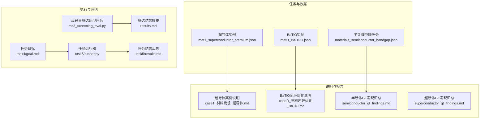
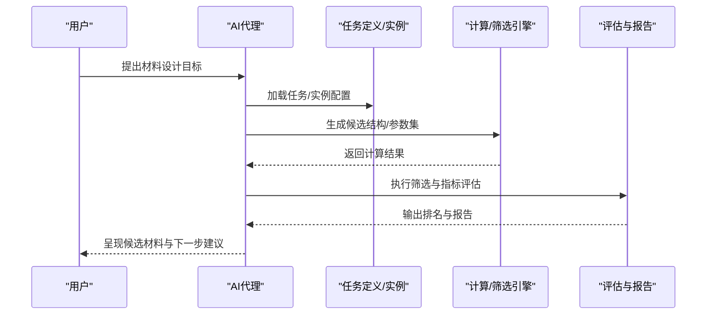
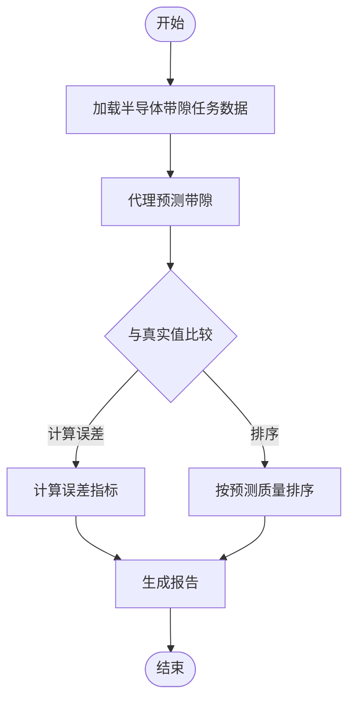
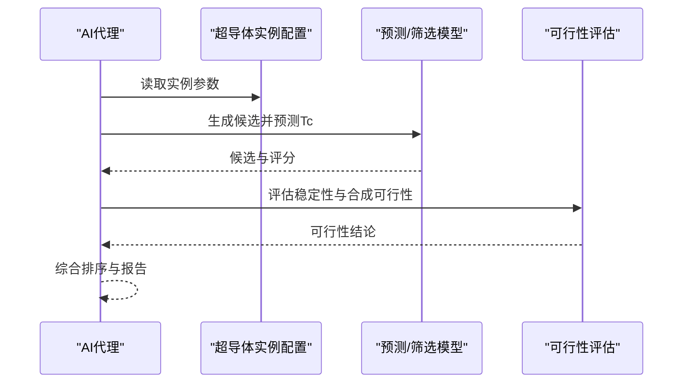
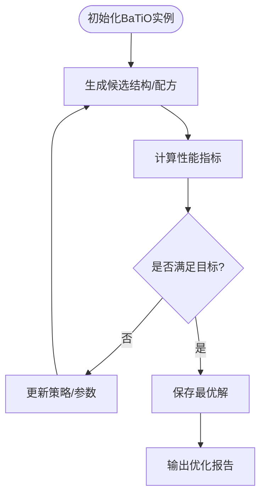
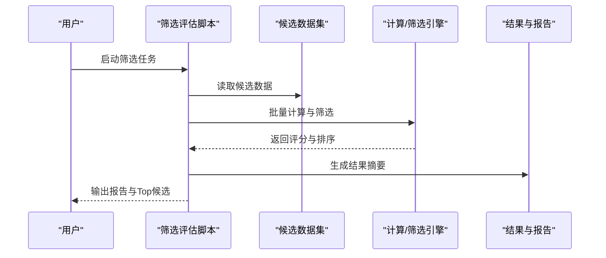
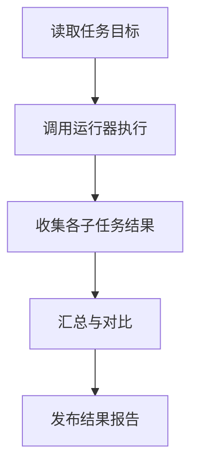
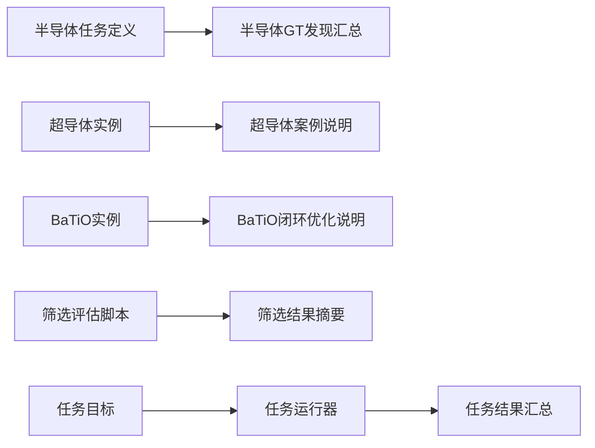

# 材料科学案例

<cite>
**本文引用的文件**   
- [autonomy_mvp/tasks/materials_semiconductor_bandgap.json](file://autonomy_mvp/tasks/materials_semiconductor_bandgap.json)
- [longhorizon/instantiate/instances/mat1_superconductor_premium.json](file://longhorizon/instantiate/instances/mat1_superconductor_premium.json)
- [longhorizon/case1_材料发现_超导体.md](file://longhorizon/case1_材料发现_超导体.md)
- [longhorizon/caseD_材料闭环优化_BaTiO.md](file://longhorizon/caseD_材料闭环优化_BaTiO.md)
- [longhorizon/instantiate/instances/matD_Ba-Ti-O.json](file://longhorizon/instantiate/instances/matD_Ba-Ti-O.json)
- [search/semiconductor_gt_findings.md](file://search/semiconductor_gt_findings.md)
- [search/superconductor_gt_findings.md](file://search/superconductor_gt_findings.md)
- [task3/B_ms3_screening_prototype/ms3_screening_eval.py](file://task3/B_ms3_screening_prototype/ms3_screening_eval.py)
- [task3/B_ms3_screening_prototype/results.md](file://task3/B_ms3_screening_prototype/results.md)
- [task4/goal.md](file://task4/goal.md)
- [task5/runner.py](file://task5/runner.py)
- [task5/results.md](file://task5/results.md)
</cite>

## 目录
1. [引言](#引言)
2. [项目结构](#项目结构)
3. [核心组件](#核心组件)
4. [架构总览](#架构总览)
5. [详细组件分析](#详细组件分析)
6. [依赖关系分析](#依赖关系分析)
7. [性能考量](#性能考量)
8. [故障排查指南](#故障排查指南)
9. [结论](#结论)
10. [附录](#附录)

## 引言
本案例聚焦材料科学中的三大任务：半导体带隙预测、超导体发现与材料性能优化。围绕“晶体结构生成—性能计算—高通量筛选”的完整工作流，结合AI代理（Agent）进行任务规划、工具调用与结果解释，形成可复现的计算脚本与分析报告。文档提供理论依据、方法选择与结果解读，并给出面向钙钛矿、超导体系等具体材料体系的实践路径。

## 项目结构
仓库包含多套任务与实例数据，其中与材料科学直接相关的部分包括：
- 半导体带隙任务定义与评测数据
- 超导体发现任务实例与说明文档
- BaTiO等材料闭环优化任务实例与说明文档
- 高通量筛选原型评估脚本与结果
- 任务目标与运行器脚本

图表来源
- [autonomy_mvp/tasks/materials_semiconductor_bandgap.json](file://autonomy_mvp/tasks/materials_semiconductor_bandgap.json)
- [longhorizon/instantiate/instances/mat1_superconductor_premium.json](file://longhorizon/instantiate/instances/mat1_superconductor_premium.json)
- [longhorizon/instantiate/instances/matD_Ba-Ti-O.json](file://longhorizon/instantiate/instances/matD_Ba-Ti-O.json)
- [longhorizon/case1_材料发现_超导体.md](file://longhorizon/case1_材料发现_超导体.md)
- [longhorizon/caseD_材料闭环优化_BaTiO.md](file://longhorizon/caseD_材料闭环优化_BaTiO.md)
- [search/semiconductor_gt_findings.md](file://search/semiconductor_gt_findings.md)
- [search/superconductor_gt_findings.md](file://search/superconductor_gt_findings.md)
- [task3/B_ms3_screening_prototype/ms3_screening_eval.py](file://task3/B_ms3_screening_prototype/ms3_screening_eval.py)
- [task3/B_ms3_screening_prototype/results.md](file://task3/B_ms3_screening_prototype/results.md)
- [task4/goal.md](file://task4/goal.md)
- [task5/runner.py](file://task5/runner.py)
- [task5/results.md](file://task5/results.md)

章节来源
- [autonomy_mvp/tasks/materials_semiconductor_bandgap.json](file://autonomy_mvp/tasks/materials_semiconductor_bandgap.json)
- [longhorizon/instantiate/instances/mat1_superconductor_premium.json](file://longhorizon/instantiate/instances/mat1_superconductor_premium.json)
- [longhorizon/instantiate/instances/matD_Ba-Ti-O.json](file://longhorizon/instantiate/instances/matD_Ba-Ti-O.json)
- [longhorizon/case1_材料发现_超导体.md](file://longhorizon/case1_材料发现_超导体.md)
- [longhorizon/caseD_材料闭环优化_BaTiO.md](file://longhorizon/caseD_材料闭环优化_BaTiO.md)
- [search/semiconductor_gt_findings.md](file://search/semiconductor_gt_findings.md)
- [search/superconductor_gt_findings.md](file://search/superconductor_gt_findings.md)
- [task3/B_ms3_screening_prototype/ms3_screening_eval.py](file://task3/B_ms3_screening_prototype/ms3_screening_eval.py)
- [task3/B_ms3_screening_prototype/results.md](file://task3/B_ms3_screening_prototype/results.md)
- [task4/goal.md](file://task4/goal.md)
- [task5/runner.py](file://task5/runner.py)
- [task5/results.md](file://task5/results.md)

## 核心组件
- 半导体带隙预测任务：以JSON任务定义驱动，涵盖候选材料集合、标签字段与评测指标，用于训练/验证AI代理对带隙的预测能力。
- 超导体发现任务：提供实例化配置与案例说明，指导从候选空间构建、性质筛选到实验可行性评估的端到端流程。
- 材料闭环优化（以BaTiO为例）：通过实例化参数与说明文档，展示在特定材料体系中迭代优化的策略与评估方式。
- 高通量筛选原型：提供评估脚本与结果摘要，支持批量计算与排序筛选。
- 任务目标与运行器：统一的任务入口与结果汇总，便于跨任务对比与复现实验。

章节来源
- [autonomy_mvp/tasks/materials_semiconductor_bandgap.json](file://autonomy_mvp/tasks/materials_semiconductor_bandgap.json)
- [longhorizon/instantiate/instances/mat1_superconductor_premium.json](file://longhorizon/instantiate/instances/mat1_superconductor_premium.json)
- [longhorizon/case1_材料发现_超导体.md](file://longhorizon/case1_材料发现_超导体.md)
- [longhorizon/caseD_材料闭环优化_BaTiO.md](file://longhorizon/caseD_材料闭环优化_BaTiO.md)
- [longhorizon/instantiate/instances/matD_Ba-Ti-O.json](file://longhorizon/instantiate/instances/matD_Ba-Ti-O.json)
- [task3/B_ms3_screening_prototype/ms3_screening_eval.py](file://task3/B_ms3_screening_prototype/ms3_screening_eval.py)
- [task3/B_ms3_screening_prototype/results.md](file://task3/B_ms3_screening_prototype/results.md)
- [task4/goal.md](file://task4/goal.md)
- [task5/runner.py](file://task5/runner.py)
- [task5/results.md](file://task5/results.md)

## 架构总览
整体工作流由“任务定义—实例化—计算—筛选—评估—报告”构成，AI代理负责编排各步骤、调用工具与解释结果。

图表来源
- [autonomy_mvp/tasks/materials_semiconductor_bandgap.json](file://autonomy_mvp/tasks/materials_semiconductor_bandgap.json)
- [longhorizon/instantiate/instances/mat1_superconductor_premium.json](file://longhorizon/instantiate/instances/mat1_superconductor_premium.json)
- [longhorizon/case1_材料发现_超导体.md](file://longhorizon/case1_材料发现_超导体.md)
- [longhorizon/caseD_材料闭环优化_BaTiO.md](file://longhorizon/caseD_材料闭环优化_BaTiO.md)
- [task3/B_ms3_screening_prototype/ms3_screening_eval.py](file://task3/B_ms3_screening_prototype/ms3_screening_eval.py)
- [task4/goal.md](file://task4/goal.md)
- [task5/runner.py](file://task5/runner.py)

## 详细组件分析

### 半导体带隙预测任务
- 任务输入：包含材料标识、结构描述与带隙标签的数据集，用于监督学习与代理预测。
- 处理逻辑：代理根据输入特征预测带隙，并与真实值比较；可进行误差统计与排序。
- 输出：预测结果、误差指标与Top-N候选列表。

图表来源
- [autonomy_mvp/tasks/materials_semiconductor_bandgap.json](file://autonomy_mvp/tasks/materials_semiconductor_bandgap.json)
- [search/semiconductor_gt_findings.md](file://search/semiconductor_gt_findings.md)

章节来源
- [autonomy_mvp/tasks/materials_semiconductor_bandgap.json](file://autonomy_mvp/tasks/materials_semiconductor_bandgap.json)
- [search/semiconductor_gt_findings.md](file://search/semiconductor_gt_findings.md)

### 超导体发现任务
- 任务输入：超导体候选空间与关键属性（如临界温度Tc、成分、结构类型）。
- 处理逻辑：基于先验知识与模型预测筛选高潜力候选，结合稳定性与合成可行性评估。
- 输出：Top候选清单、关键特性分析与后续实验建议。

图表来源
- [longhorizon/instantiate/instances/mat1_superconductor_premium.json](file://longhorizon/instantiate/instances/mat1_superconductor_premium.json)
- [longhorizon/case1_材料发现_超导体.md](file://longhorizon/case1_材料发现_超导体.md)
- [search/superconductor_gt_findings.md](file://search/superconductor_gt_findings.md)

章节来源
- [longhorizon/instantiate/instances/mat1_superconductor_premium.json](file://longhorizon/instantiate/instances/mat1_superconductor_premium.json)
- [longhorizon/case1_材料发现_超导体.md](file://longhorizon/case1_材料发现_超导体.md)
- [search/superconductor_gt_findings.md](file://search/superconductor_gt_findings.md)

### 材料闭环优化（以BaTiO为例）
- 任务输入：BaTiO相关实例参数（成分范围、结构约束、目标性能）。
- 处理逻辑：迭代优化循环，包含结构生成、性能计算、反馈修正与收敛判断。
- 输出：最优配方/结构、性能提升曲线与优化轨迹。

图表来源
- [longhorizon/caseD_材料闭环优化_BaTiO.md](file://longhorizon/caseD_材料闭环优化_BaTiO.md)
- [longhorizon/instantiate/instances/matD_Ba-Ti-O.json](file://longhorizon/instantiate/instances/matD_Ba-Ti-O.json)

章节来源
- [longhorizon/caseD_材料闭环优化_BaTiO.md](file://longhorizon/caseD_材料闭环优化_BaTiO.md)
- [longhorizon/instantiate/instances/matD_Ba-Ti-O.json](file://longhorizon/instantiate/instances/matD_Ba-Ti-O.json)

### 高通量筛选原型
- 功能：批量计算与筛选，支持多种材料体系与性能指标。
- 评估：提供评估脚本与结果摘要，便于对比不同策略的效果。
- 使用：通过命令行或API调用，传入候选数据集与筛选规则，得到排序结果与可视化报告。

图表来源
- [task3/B_ms3_screening_prototype/ms3_screening_eval.py](file://task3/B_ms3_screening_prototype/ms3_screening_eval.py)
- [task3/B_ms3_screening_prototype/results.md](file://task3/B_ms3_screening_prototype/results.md)

章节来源
- [task3/B_ms3_screening_prototype/ms3_screening_eval.py](file://task3/B_ms3_screening_prototype/ms3_screening_eval.py)
- [task3/B_ms3_screening_prototype/results.md](file://task3/B_ms3_screening_prototype/results.md)

### 任务目标与运行器
- 任务目标：明确材料设计的总体目标与约束条件。
- 运行器：统一调度任务、管理并行度与资源、汇总结果。
- 结果：跨任务的可比性指标与趋势分析。

图表来源
- [task4/goal.md](file://task4/goal.md)
- [task5/runner.py](file://task5/runner.py)
- [task5/results.md](file://task5/results.md)

章节来源
- [task4/goal.md](file://task4/goal.md)
- [task5/runner.py](file://task5/runner.py)
- [task5/results.md](file://task5/results.md)

## 依赖关系分析
- 任务与实例：半导体与超导体任务分别依赖各自的任务定义与实例配置。
- 评估与报告：筛选原型与任务运行器共同产出结果与报告，供后续分析使用。
- 外部工具：计算与筛选过程可能依赖外部物理/化学计算库（在本仓库中以脚本形式暴露接口）。

图表来源
- [autonomy_mvp/tasks/materials_semiconductor_bandgap.json](file://autonomy_mvp/tasks/materials_semiconductor_bandgap.json)
- [search/semiconductor_gt_findings.md](file://search/semiconductor_gt_findings.md)
- [longhorizon/instantiate/instances/mat1_superconductor_premium.json](file://longhorizon/instantiate/instances/mat1_superconductor_premium.json)
- [longhorizon/case1_材料发现_超导体.md](file://longhorizon/case1_材料发现_超导体.md)
- [longhorizon/instantiate/instances/matD_Ba-Ti-O.json](file://longhorizon/instantiate/instances/matD_Ba-Ti-O.json)
- [longhorizon/caseD_材料闭环优化_BaTiO.md](file://longhorizon/caseD_材料闭环优化_BaTiO.md)
- [task3/B_ms3_screening_prototype/ms3_screening_eval.py](file://task3/B_ms3_screening_prototype/ms3_screening_eval.py)
- [task3/B_ms3_screening_prototype/results.md](file://task3/B_ms3_screening_prototype/results.md)
- [task4/goal.md](file://task4/goal.md)
- [task5/runner.py](file://task5/runner.py)
- [task5/results.md](file://task5/results.md)

章节来源
- [autonomy_mvp/tasks/materials_semiconductor_bandgap.json](file://autonomy_mvp/tasks/materials_semiconductor_bandgap.json)
- [search/semiconductor_gt_findings.md](file://search/semiconductor_gt_findings.md)
- [longhorizon/instantiate/instances/mat1_superconductor_premium.json](file://longhorizon/instantiate/instances/mat1_superconductor_premium.json)
- [longhorizon/case1_材料发现_超导体.md](file://longhorizon/case1_材料发现_超导体.md)
- [longhorizon/instantiate/instances/matD_Ba-Ti-O.json](file://longhorizon/instantiate/instances/matD_Ba-Ti-O.json)
- [longhorizon/caseD_材料闭环优化_BaTiO.md](file://longhorizon/caseD_材料闭环优化_BaTiO.md)
- [task3/B_ms3_screening_prototype/ms3_screening_eval.py](file://task3/B_ms3_screening_prototype/ms3_screening_eval.py)
- [task3/B_ms3_screening_prototype/results.md](file://task3/B_ms3_screening_prototype/results.md)
- [task4/goal.md](file://task4/goal.md)
- [task5/runner.py](file://task5/runner.py)
- [task5/results.md](file://task5/results.md)

## 性能考量
- 并行计算：在高通量筛选中采用并行策略以提升吞吐，需关注I/O与内存占用。
- 缓存与去重：对重复结构与相似配方进行缓存与去重，减少冗余计算。
- 早停与剪枝：在闭环优化中设置阈值与早停条件，避免无效迭代。
- 指标监控：跟踪误差、收敛速度与资源消耗，及时调整策略。

## 故障排查指南
- 任务加载失败：检查任务定义与实例配置的字段完整性与格式正确性。
- 计算异常：确认外部工具可用性与环境依赖，查看日志定位错误。
- 结果不一致：核对随机种子、并行顺序与数据版本，确保可复现。
- 性能瓶颈：分析CPU/GPU利用率与I/O等待，优化批大小与队列长度。

## 结论
本案例展示了AI代理在材料科学中的端到端应用：从任务定义与实例化，到结构生成、性能计算与高通量筛选，再到评估与报告。通过半导体带隙预测、超导体发现与BaTiO闭环优化三个典型场景，验证了该工作流的可行性与可扩展性。建议在后续工作中引入更丰富的表征方法与不确定性量化，进一步提升预测精度与决策可靠性。

## 附录
- 术语表：带隙、Tc、高通量筛选、闭环优化等
- 参考链接：任务定义、实例配置、案例说明与结果报告的对应文件路径见“本文引用的文件”