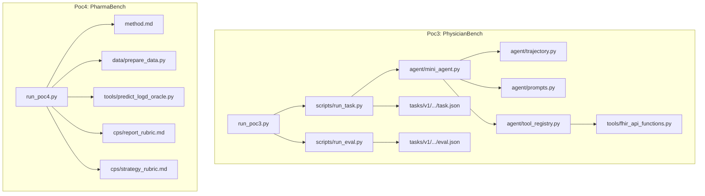
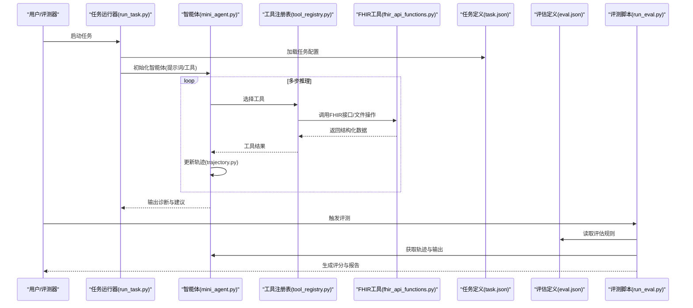
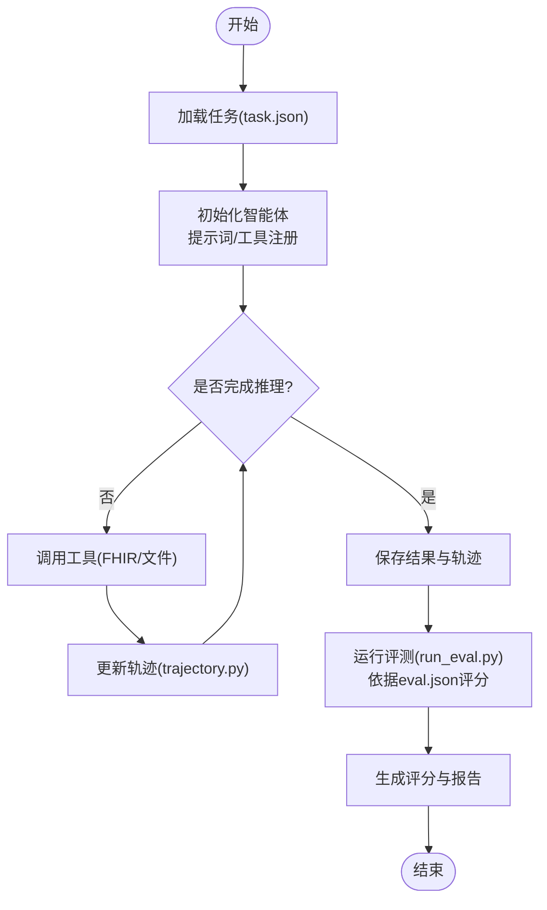
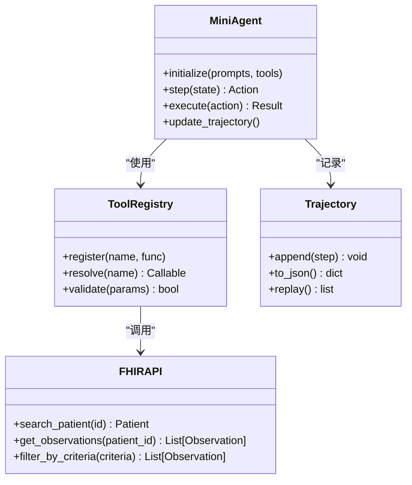
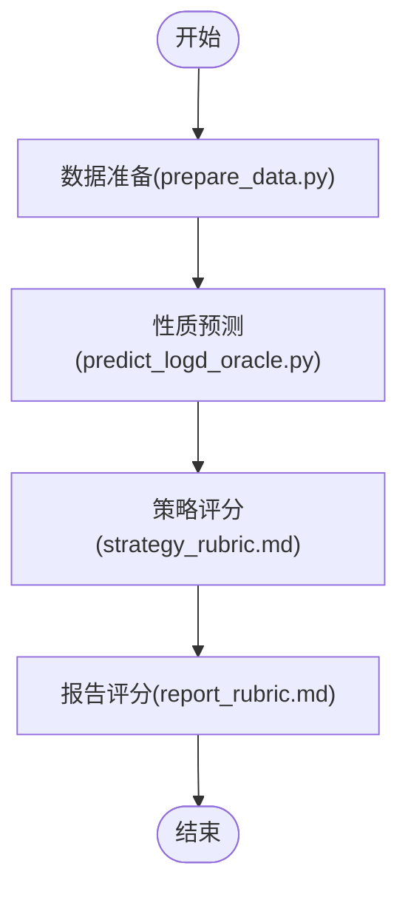
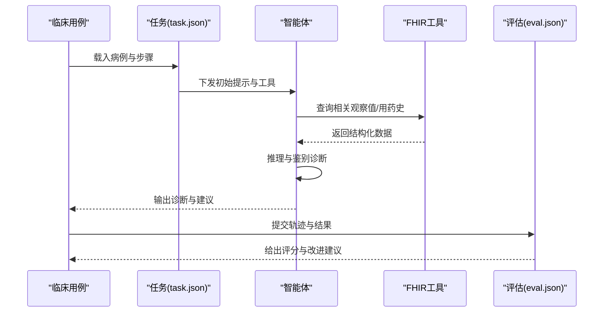
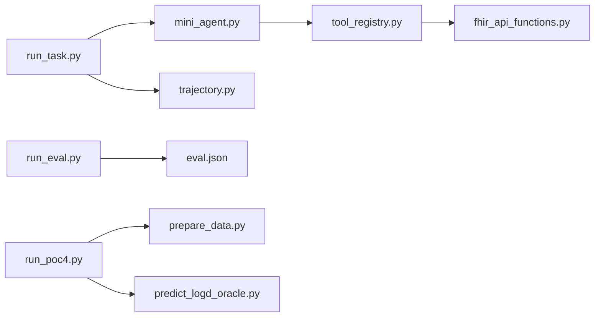

# 生物医学诊断案例

<cite>
**本文引用的文件**   
- [poc3_physicianbench/run_poc3.py](file://task7/poc3_physicianbench/run_poc3.py)
- [poc3_physicianbench/PhysicianBench/scripts/run_task.py](file://task7/poc3_physicianbench/PhysicianBench/scripts/run_task.py)
- [poc3_physicianbench/PhysicianBench/scripts/run_eval.py](file://task7/poc3_physicianbench/PhysicianBench/scripts/run_eval.py)
- [poc3_physicianbench/PhysicianBench/agent/mini_agent.py](file://task7/poc3_physicianbench/PhysicianBench/agent/mini_agent.py)
- [poc3_physicianbench/PhysicianBench/agent/tool_registry.py](file://task7/poc3_physicianbench/PhysicianBench/agent/tool_registry.py)
- [poc3_physicianbench/PhysicianBench/agent/prompts.py](file://task7/poc3_physicianbench/PhysicianBench/agent/prompts.py)
- [poc3_physicianbench/PhysicianBench/agent/trajectory.py](file://task7/poc3_physicianbench/PhysicianBench/agent/trajectory.py)
- [poc3_physicianbench/PhysicianBench/tools/fhir_api_functions.py](file://task7/poc3_physicianbench/PhysicianBench/tools/fhir_api_functions.py)
- [poc3_physicianbench/PhysicianBench/tasks/v1/abnormal_uterine_bleeding/task.json](file://task7/poc3_physicianbench/PhysicianBench/tasks/v1/abnormal_uterine_bleeding/task.json)
- [poc3_physicianbench/PhysicianBench/tasks/v1/abnormal_uterine_bleeding/eval.json](file://task7/poc3_physicianbench/PhysicianBench/tasks/v1/abnormal_uterine_bleeding/eval.json)
- [poc4_pharmabench/run_poc4.py](file://task7/poc4_pharmabench/run_poc4.py)
- [poc4_pharmabench/method.md](file://task7/poc4_pharmabench/method.md)
- [poc4_pharmabench/data/prepare_data.py](file://task7/poc4_pharmabench/data/prepare_data.py)
- [poc4_pharmabench/tools/predict_logd_oracle.py](file://task7/poc4_pharmabench/tools/predict_logd_oracle.py)
- [poc4_pharmabench/cps/report_rubric.md](file://task7/poc4_pharmabench/cps/report_rubric.md)
- [poc4_pharmabench/cps/strategy_rubric.md](file://task7/poc4_pharmabench/cps/strategy_rubric.md)
</cite>

## 目录
1. [引言](#引言)
2. [项目结构](#项目结构)
3. [核心组件](#核心组件)
4. [架构总览](#架构总览)
5. [详细组件分析](#详细组件分析)
6. [依赖关系分析](#依赖关系分析)
7. [性能与可扩展性](#性能与可扩展性)
8. [故障排查指南](#故障排查指南)
9. [结论](#结论)
10. [附录](#附录)

## 引言
本案例面向生物医学诊断与临床决策支持，围绕 PhysicianBench 与 PharmaBench 两大基准测试，构建端到端的 AI 代理工作流。目标包括：
- 临床数据处理与结构化：从 FHIR 数据源抽取、清洗与整合患者信息。
- 临床指南遵循：在任务定义与评估中嵌入指南约束与评分标准。
- 诊断推理过程：通过工具编排（检索、计算、可视化）实现可解释的诊断路径。
- 治疗方案推荐与效果预测：结合药物筛选与性质预测工具进行方案优化。
- 隐私保护与伦理合规：强调去标识化、最小必要原则与审计追踪。
- 临床验证：以基准评测指标与多轮轨迹回放支撑可重复性与可信度。

## 项目结构
仓库中与医疗诊断相关的核心位于 task7 下的 poc3（PhysicianBench）与 poc4（PharmaBench）。整体组织方式采用“基准包 + 运行脚本 + 工具集 + 任务/评估定义”的分层模式：
- poc3_physicianbench：封装 PhysicianBench 的 Agent、工具、任务与评测脚本，提供端到端运行入口。
- poc4_pharmabench：封装 PharmaBench 的药物筛选与性质预测流程，包含数据准备、工具调用与策略/报告评分细则。

图表来源
- [poc3_physicianbench/run_poc3.py](file://task7/poc3_physicianbench/run_poc3.py)
- [poc3_physicianbench/PhysicianBench/scripts/run_task.py](file://task7/poc3_physicianbench/PhysicianBench/scripts/run_task.py)
- [poc3_physicianbench/PhysicianBench/scripts/run_eval.py](file://task7/poc3_physicianbench/PhysicianBench/scripts/run_eval.py)
- [poc3_physicianbench/PhysicianBench/agent/mini_agent.py](file://task7/poc3_physicianbench/PhysicianBench/agent/mini_agent.py)
- [poc3_physicianbench/PhysicianBench/agent/trajectory.py](file://task7/poc3_physicianbench/PhysicianBench/agent/trajectory.py)
- [poc3_physicianbench/PhysicianBench/agent/prompts.py](file://task7/poc3_physicianbench/PhysicianBench/agent/prompts.py)
- [poc3_physicianbench/PhysicianBench/agent/tool_registry.py](file://task7/poc3_physicianbench/PhysicianBench/agent/tool_registry.py)
- [poc3_physicianbench/PhysicianBench/tools/fhir_api_functions.py](file://task7/poc3_physicianbench/PhysicianBench/tools/fhir_api_functions.py)
- [poc3_physicianbench/PhysicianBench/tasks/v1/abnormal_uterine_bleeding/task.json](file://task7/poc3_physicianbench/PhysicianBench/tasks/v1/abnormal_uterine_bleeding/task.json)
- [poc3_physicianbench/PhysicianBench/tasks/v1/abnormal_uterine_bleeding/eval.json](file://task7/poc3_physicianbench/PhysicianBench/tasks/v1/abnormal_uterine_bleeding/eval.json)
- [poc4_pharmabench/run_poc4.py](file://task7/poc4_pharmabench/run_poc4.py)
- [poc4_pharmabench/method.md](file://task7/poc4_pharmabench/method.md)
- [poc4_pharmabench/data/prepare_data.py](file://task7/poc4_pharmabench/data/prepare_data.py)
- [poc4_pharmabench/tools/predict_logd_oracle.py](file://task7/poc4_pharmabench/tools/predict_logd_oracle.py)
- [poc4_pharmabench/cps/report_rubric.md](file://task7/poc4_pharmabench/cps/report_rubric.md)
- [poc4_pharmabench/cps/strategy_rubric.md](file://task7/poc4_pharmabench/cps/strategy_rubric.md)

章节来源
- [poc3_physicianbench/run_poc3.py](file://task7/poc3_physicianbench/run_poc3.py)
- [poc4_pharmabench/run_poc4.py](file://task7/poc4_pharmabench/run_poc4.py)

## 核心组件
- 代理执行器（Agent Runner）
  - 负责加载任务与评估配置，驱动 Agent 执行并记录轨迹，最终输出结果与评分。
  - 关键入口：任务运行脚本与评测脚本。
- 智能体（Mini Agent）
  - 基于提示词与工具注册表进行推理与行动选择，维护交互轨迹。
  - 关键模块：提示词模板、轨迹记录、工具路由。
- 工具集（Tools）
  - 提供 FHIR API 访问、文件处理等能力，作为 Agent 的外部扩展。
- 任务与评估（Tasks & Eval）
  - 每个病种/场景对应 task.json 与 eval.json，定义输入、步骤、期望输出与评分规则。
- 药物筛选流水线（PharmaBench）
  - 数据准备、性质预测工具调用、策略与报告评分细则，形成闭环优化建议。

章节来源
- [poc3_physicianbench/PhysicianBench/scripts/run_task.py](file://task7/poc3_physicianbench/PhysicianBench/scripts/run_task.py)
- [poc3_physicianbench/PhysicianBench/scripts/run_eval.py](file://task7/poc3_physicianbench/PhysicianBench/scripts/run_eval.py)
- [poc3_physicianbench/PhysicianBench/agent/mini_agent.py](file://task7/poc3_physicianbench/PhysicianBench/agent/mini_agent.py)
- [poc3_physicianbench/PhysicianBench/agent/tool_registry.py](file://task7/poc3_physicianbench/PhysicianBench/agent/tool_registry.py)
- [poc3_physicianbench/PhysicianBench/agent/prompts.py](file://task7/poc3_physicianbench/PhysicianBench/agent/prompts.py)
- [poc3_physicianbench/PhysicianBench/agent/trajectory.py](file://task7/poc3_physicianbench/PhysicianBench/agent/trajectory.py)
- [poc3_physicianbench/PhysicianBench/tools/fhir_api_functions.py](file://task7/poc3_physicianbench/PhysicianBench/tools/fhir_api_functions.py)
- [poc3_physicianbench/PhysicianBench/tasks/v1/abnormal_uterine_bleeding/task.json](file://task7/poc3_physicianbench/PhysicianBench/tasks/v1/abnormal_uterine_bleeding/task.json)
- [poc3_physicianbench/PhysicianBench/tasks/v1/abnormal_uterine_bleeding/eval.json](file://task7/poc3_physicianbench/PhysicianBench/tasks/v1/abnormal_uterine_bleeding/eval.json)
- [poc4_pharmabench/run_poc4.py](file://task7/poc4_pharmabench/run_poc4.py)
- [poc4_pharmabench/data/prepare_data.py](file://task7/poc4_pharmabench/data/prepare_data.py)
- [poc4_pharmabench/tools/predict_logd_oracle.py](file://task7/poc4_pharmabench/tools/predict_logd_oracle.py)
- [poc4_pharmabench/cps/report_rubric.md](file://task7/poc4_pharmabench/cps/report_rubric.md)
- [poc4_pharmabench/cps/strategy_rubric.md](file://task7/poc4_pharmabench/cps/strategy_rubric.md)

## 架构总览
下图展示从任务加载到 Agent 推理、工具调用、轨迹记录与评测的全链路流程。

图表来源
- [poc3_physicianbench/PhysicianBench/scripts/run_task.py](file://task7/poc3_physicianbench/PhysicianBench/scripts/run_task.py)
- [poc3_physicianbench/PhysicianBench/agent/mini_agent.py](file://task7/poc3_physicianbench/PhysicianBench/agent/mini_agent.py)
- [poc3_physicianbench/PhysicianBench/agent/tool_registry.py](file://task7/poc3_physicianbench/PhysicianBench/agent/tool_registry.py)
- [poc3_physicianbench/PhysicianBench/tools/fhir_api_functions.py](file://task7/poc3_physicianbench/PhysicianBench/tools/fhir_api_functions.py)
- [poc3_physicianbench/PhysicianBench/agent/trajectory.py](file://task7/poc3_physicianbench/PhysicianBench/agent/trajectory.py)
- [poc3_physicianbench/PhysicianBench/tasks/v1/abnormal_uterine_bleeding/task.json](file://task7/poc3_physicianbench/PhysicianBench/tasks/v1/abnormal_uterine_bleeding/task.json)
- [poc3_physicianbench/PhysicianBench/tasks/v1/abnormal_uterine_bleeding/eval.json](file://task7/poc3_physicianbench/PhysicianBench/tasks/v1/abnormal_uterine_bleeding/eval.json)
- [poc3_physicianbench/PhysicianBench/scripts/run_eval.py](file://task7/poc3_physicianbench/PhysicianBench/scripts/run_eval.py)

## 详细组件分析

### 组件一：任务运行与评测管线（PhysicianBench）
- 任务运行器
  - 职责：解析任务清单、实例化 Agent、执行推理、保存轨迹与结果。
  - 关键点：任务参数注入、工具注册、错误重试与日志。
- 评测脚本
  - 职责：依据 eval.json 的规则对轨迹与输出进行打分，汇总报告。
  - 关键点：指标定义、阈值判定、可解释性证据提取。

图表来源
- [poc3_physicianbench/PhysicianBench/scripts/run_task.py](file://task7/poc3_physicianbench/PhysicianBench/scripts/run_task.py)
- [poc3_physicianbench/PhysicianBench/scripts/run_eval.py](file://task7/poc3_physicianbench/PhysicianBench/scripts/run_eval.py)
- [poc3_physicianbench/PhysicianBench/agent/trajectory.py](file://task7/poc3_physicianbench/PhysicianBench/agent/trajectory.py)
- [poc3_physicianbench/PhysicianBench/tasks/v1/abnormal_uterine_bleeding/task.json](file://task7/poc3_physicianbench/PhysicianBench/tasks/v1/abnormal_uterine_bleeding/task.json)
- [poc3_physicianbench/PhysicianBench/tasks/v1/abnormal_uterine_bleeding/eval.json](file://task7/poc3_physicianbench/PhysicianBench/tasks/v1/abnormal_uterine_bleeding/eval.json)

章节来源
- [poc3_physicianbench/PhysicianBench/scripts/run_task.py](file://task7/poc3_physicianbench/PhysicianBench/scripts/run_task.py)
- [poc3_physicianbench/PhysicianBench/scripts/run_eval.py](file://task7/poc3_physicianbench/PhysicianBench/scripts/run_eval.py)

### 组件二：智能体与工具编排（Agent & Tools）
- 智能体（Mini Agent）
  - 职责：根据当前状态与提示词决定下一步动作；管理工具调用与结果聚合。
  - 关键点：上下文窗口管理、工具选择策略、失败回退。
- 工具注册表（Tool Registry）
  - 职责：统一暴露工具接口，提供参数校验与错误包装。
  - 关键点：动态发现、版本兼容、权限控制。
- FHIR 工具
  - 职责：访问 FHIR 资源（患者、观察值、用药等），进行查询与过滤。
  - 关键点：认证、分页、字段映射、去标识化。

图表来源
- [poc3_physicianbench/PhysicianBench/agent/mini_agent.py](file://task7/poc3_physicianbench/PhysicianBench/agent/mini_agent.py)
- [poc3_physicianbench/PhysicianBench/agent/tool_registry.py](file://task7/poc3_physicianbench/PhysicianBench/agent/tool_registry.py)
- [poc3_physicianbench/PhysicianBench/tools/fhir_api_functions.py](file://task7/poc3_physicianbench/PhysicianBench/tools/fhir_api_functions.py)
- [poc3_physicianbench/PhysicianBench/agent/trajectory.py](file://task7/poc3_physicianbench/PhysicianBench/agent/trajectory.py)

章节来源
- [poc3_physicianbench/PhysicianBench/agent/mini_agent.py](file://task7/poc3_physicianbench/PhysicianBench/agent/mini_agent.py)
- [poc3_physicianbench/PhysicianBench/agent/tool_registry.py](file://task7/poc3_physicianbench/PhysicianBench/agent/tool_registry.py)
- [poc3_physicianbench/PhysicianBench/tools/fhir_api_functions.py](file://task7/poc3_physicianbench/PhysicianBench/tools/fhir_api_functions.py)
- [poc3_physicianbench/PhysicianBench/agent/trajectory.py](file://task7/poc3_physicianbench/PhysicianBench/agent/trajectory.py)

### 组件三：药物筛选与性质预测（PharmaBench）
- 数据准备
  - 职责：将原始化合物数据转换为模型可用的格式，进行特征工程与质量控制。
- 性质预测工具
  - 职责：调用 Oracle 或外部服务预测 LogD 等性质，返回结构化结果。
- 策略与报告评分
  - 职责：定义筛选策略与报告质量评价维度，确保可复现与可解释。

图表来源
- [poc4_pharmabench/data/prepare_data.py](file://task7/poc4_pharmabench/data/prepare_data.py)
- [poc4_pharmabench/tools/predict_logd_oracle.py](file://task7/poc4_pharmabench/tools/predict_logd_oracle.py)
- [poc4_pharmabench/cps/strategy_rubric.md](file://task7/poc4_pharmabench/cps/strategy_rubric.md)
- [poc4_pharmabench/cps/report_rubric.md](file://task7/poc4_pharmabench/cps/report_rubric.md)

章节来源
- [poc4_pharmabench/run_poc4.py](file://task7/poc4_pharmabench/run_poc4.py)
- [poc4_pharmabench/method.md](file://task7/poc4_pharmabench/method.md)
- [poc4_pharmabench/data/prepare_data.py](file://task7/poc4_pharmabench/data/prepare_data.py)
- [poc4_pharmabench/tools/predict_logd_oracle.py](file://task7/poc4_pharmabench/tools/predict_logd_oracle.py)
- [poc4_pharmabench/cps/report_rubric.md](file://task7/poc4_pharmabench/cps/report_rubric.md)
- [poc4_pharmabench/cps/strategy_rubric.md](file://task7/poc4_pharmabench/cps/strategy_rubric.md)

### 组件四：具体病例与诊断流程示例（异常子宫出血）
- 任务定义（task.json）
  - 内容要点：患者主诉、病史摘要、检查项、预期诊断步骤与输出格式。
- 评估定义（eval.json）
  - 内容要点：诊断准确性、指南遵循度、安全性考量、证据链完整性。

图表来源
- [poc3_physicianbench/PhysicianBench/tasks/v1/abnormal_uterine_bleeding/task.json](file://task7/poc3_physicianbench/PhysicianBench/tasks/v1/abnormal_uterine_bleeding/task.json)
- [poc3_physicianbench/PhysicianBench/tasks/v1/abnormal_uterine_bleeding/eval.json](file://task7/poc3_physicianbench/PhysicianBench/tasks/v1/abnormal_uterine_bleeding/eval.json)
- [poc3_physicianbench/PhysicianBench/agent/mini_agent.py](file://task7/poc3_physicianbench/PhysicianBench/agent/mini_agent.py)
- [poc3_physicianbench/PhysicianBench/tools/fhir_api_functions.py](file://task7/poc3_physicianbench/PhysicianBench/tools/fhir_api_functions.py)

章节来源
- [poc3_physicianbench/PhysicianBench/tasks/v1/abnormal_uterine_bleeding/task.json](file://task7/poc3_physicianbench/PhysicianBench/tasks/v1/abnormal_uterine_bleeding/task.json)
- [poc3_physicianbench/PhysicianBench/tasks/v1/abnormal_uterine_bleeding/eval.json](file://task7/poc3_physicianbench/PhysicianBench/tasks/v1/abnormal_uterine_bleeding/eval.json)

## 依赖关系分析
- 内部依赖
  - run_task.py 依赖 mini_agent.py、tool_registry.py、trajectory.py。
  - run_eval.py 依赖 eval.json 与轨迹/结果文件。
  - fhir_api_functions.py 为工具层，被 tool_registry.py 暴露给 Agent。
- 外部依赖
  - FHIR 服务端（认证、鉴权、速率限制）。
  - 药物性质预测服务（Oracle/第三方 API）。
- 潜在风险
  - 工具超时与网络抖动：需增加重试与熔断。
  - 数据一致性：FHIR 字段映射与版本差异需严格校验。
  - 评测偏差：评估规则需覆盖边界条件与反例。

图表来源
- [poc3_physicianbench/PhysicianBench/scripts/run_task.py](file://task7/poc3_physicianbench/PhysicianBench/scripts/run_task.py)
- [poc3_physicianbench/PhysicianBench/agent/mini_agent.py](file://task7/poc3_physicianbench/PhysicianBench/agent/mini_agent.py)
- [poc3_physicianbench/PhysicianBench/agent/trajectory.py](file://task7/poc3_physicianbench/PhysicianBench/agent/trajectory.py)
- [poc3_physicianbench/PhysicianBench/agent/tool_registry.py](file://task7/poc3_physicianbench/PhysicianBench/agent/tool_registry.py)
- [poc3_physicianbench/PhysicianBench/tools/fhir_api_functions.py](file://task7/poc3_physicianbench/PhysicianBench/tools/fhir_api_functions.py)
- [poc3_physicianbench/PhysicianBench/scripts/run_eval.py](file://task7/poc3_physicianbench/PhysicianBench/scripts/run_eval.py)
- [poc3_physicianbench/PhysicianBench/tasks/v1/abnormal_uterine_bleeding/eval.json](file://task7/poc3_physicianbench/PhysicianBench/tasks/v1/abnormal_uterine_bleeding/eval.json)
- [poc4_pharmabench/run_poc4.py](file://task7/poc4_pharmabench/run_poc4.py)
- [poc4_pharmabench/data/prepare_data.py](file://task7/poc4_pharmabench/data/prepare_data.py)
- [poc4_pharmabench/tools/predict_logd_oracle.py](file://task7/poc4_pharmabench/tools/predict_logd_oracle.py)

章节来源
- [poc3_physicianbench/PhysicianBench/scripts/run_task.py](file://task7/poc3_physicianbench/PhysicianBench/scripts/run_task.py)
- [poc3_physicianbench/PhysicianBench/scripts/run_eval.py](file://task7/poc3_physicianbench/PhysicianBench/scripts/run_eval.py)
- [poc4_pharmabench/run_poc4.py](file://task7/poc4_pharmabench/run_poc4.py)

## 性能与可扩展性
- 并行与批处理
  - 任务级并行：按病例并发执行，注意 FHIR 限流与幂等设计。
  - 工具级并行：独立工具调用可并发，但需保证结果合并正确性。
- 缓存与增量更新
  - 对频繁查询的观察值/药品信息进行本地缓存，减少重复请求。
- 资源隔离
  - 不同任务/环境使用独立虚拟环境与密钥存储，避免污染。
- 监控与告警
  - 记录工具调用耗时、错误率与轨迹长度，设置阈值告警。

## 故障排查指南
- 常见问题
  - FHIR 连接失败：检查认证、网络连通与服务端状态。
  - 工具参数不合法：核对 tool_registry 的参数校验逻辑与 schema。
  - 轨迹不完整：确认 trajectory.append 的时机与序列化格式。
  - 评测分数异常：对照 eval.json 的规则，定位缺失证据或格式不符。
- 调试建议
  - 启用详细日志，输出每一步的工具输入/输出。
  - 使用小样本回归测试，逐步扩大规模。
  - 对关键路径添加断点与快照，便于回溯。

章节来源
- [poc3_physicianbench/PhysicianBench/agent/tool_registry.py](file://task7/poc3_physicianbench/PhysicianBench/agent/tool_registry.py)
- [poc3_physicianbench/PhysicianBench/agent/trajectory.py](file://task7/poc3_physicianbench/PhysicianBench/agent/trajectory.py)
- [poc3_physicianbench/PhysicianBench/tools/fhir_api_functions.py](file://task7/poc3_physicianbench/PhysicianBench/tools/fhir_api_functions.py)
- [poc3_physicianbench/PhysicianBench/tasks/v1/abnormal_uterine_bleeding/eval.json](file://task7/poc3_physicianbench/PhysicianBench/tasks/v1/abnormal_uterine_bleeding/eval.json)

## 结论
本案例通过 PhysicianBench 与 PharmaBench 的协同，构建了从临床数据到诊断推理、再到药物筛选与效果预测的完整闭环。借助可执行的轨迹与标准化的评估规则，系统具备较强的可解释性与可复现性。未来可在以下方面持续增强：
- 引入更多真实世界数据与多中心验证。
- 强化隐私保护与合规审计机制。
- 完善工具生态与自动化评测体系。

## 附录
- 术语说明
  - FHIR：HL7 快速医疗互操作资源，用于标准化医疗数据交换。
  - LogD：分配系数的对数值，反映药物在脂相与水相中的分布特性。
- 最佳实践
  - 数据最小化与去标识化。
  - 明确工具契约与错误语义。
  - 以指南为依据的评估指标设计。