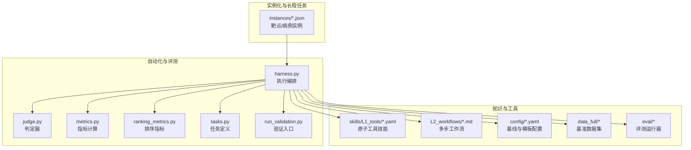
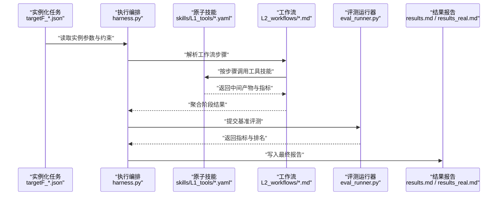
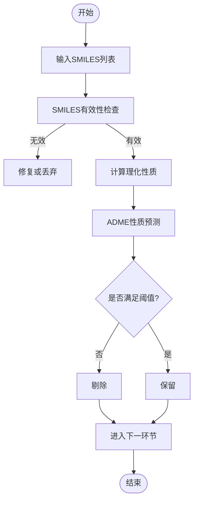
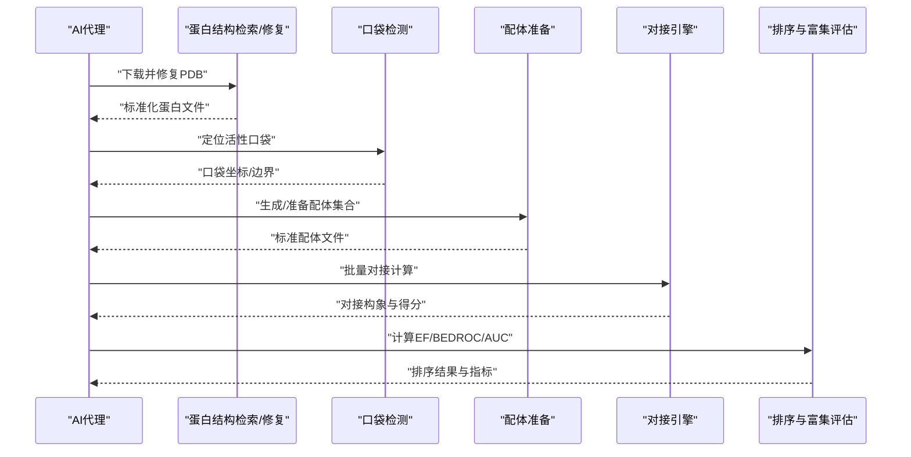
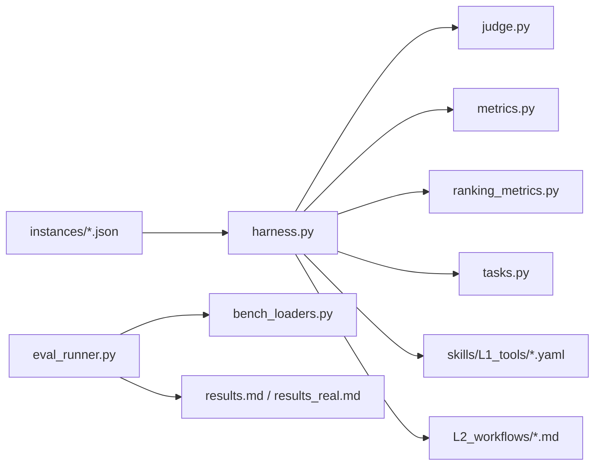

# 药物发现案例

<cite>
**本文引用的文件**   
- [autonomy_mvp/core/harness.py](file://autonomy_mvp/core/harness.py)
- [autonomy_mvp/core/judge.py](file://autonomy_mvp/core/judge.py)
- [autonomy_mvp/core/metrics.py](file://autonomy_mvp/core/metrics.py)
- [autonomy_mvp/core/ranking_metrics.py](file://autonomy_mvp/core/ranking_metrics.py)
- [autonomy_mvp/core/sim_agents.py](file://autonomy_mvp/core/sim_agents.py)
- [autonomy_mvp/core/tasks.py](file://autonomy_mvp/core/tasks.py)
- [autonomy_mvp/tasks/drug_admet.json](file://autonomy_mvp/tasks/drug_admet.json)
- [autonomy_mvp/tasks/drug_screen_ms3.json](file://autonomy_mvp/tasks/drug_screen_ms3.json)
- [autonomy_mvp/results.md](file://autonomy_mvp/results.md)
- [autonomy_mvp/results_real.md](file://autonomy_mvp/results_real.md)
- [autonomy_mvp/run_validation.py](file://autonomy_mvp/run_validation.py)
- [autonomy_mvp/ACCEPTANCE.md](file://autonomy_mvp/ACCEPTANCE.md)
- [autonomy_mvp/schema.md](file://autonomy_mvp/schema.md)
- [docs/molbench_repo/config/baseline_molbench-ms-1.yaml](file://docs/molbench_repo/config/baseline_molbench-ms-1.yaml)
- [docs/molbench_repo/config/baseline_molbench-ms-2.yaml](file://docs/molbench_repo/config/baseline_molbench-ms-2.yaml)
- [docs/molbench_repo/config/baseline_molbench-ms-3.yaml](file://docs/molbench_repo/config/baseline_molbench-ms-3.yaml)
- [docs/molbench_repo/config/chemcot_mo_edit.yaml](file://docs/molbench_repo/config/chemcot_mo_edit.yaml)
- [docs/molbench_repo/config/chemcot_mo_opt.yaml](file://docs/molbench_repo/config/chemcot_mo_opt.yaml)
- [docs/molbench_repo/config/claude_template.yaml](file://docs/molbench_repo/config/claude_template.yaml)
- [docs/molbench_repo/data_full/molbench-mo/manifest.json](file://docs/molbench_repo/data_full/molbench-mo/manifest.json)
- [docs/molbench_repo/data_full/molbench-ms-1/molbench-ms-1.csv](file://docs/molbench_repo/data_full/molbench-ms-1/molbench-ms-1.csv)
- [docs/molbench_repo/data_full/molbench-ms-2/molbench-ms-2.csv](file://docs/molbench_repo/data_full/molbench-ms-2/molbench-ms-2.csv)
- [docs/molbench_repo/data_full/molbench-ms-3/molbench-ms-3.csv](file://docs/molbench_repo/data_full/molbench-ms-3/molbench-ms-3.csv)
- [docs/molbench_repo/eval/eval_runner.py](file://docs/molbench_repo/eval/eval_runner.py)
- [docs/molbench_repo/eval/bench_loaders.py](file://docs/molbench_repo/eval/bench_loaders.py)
- [docs/molbench_repo/eval/run_eval_bench.py](file://docs/molbench_repo/eval/run_eval_bench.py)
- [docs/molbench_repo/skills/L1_tools/molclaw-admet/molclaw-admet.yaml](file://docs/molbench_repo/skills/L1_tools/molclaw-admet/molclaw-admet.yaml)
- [docs/molbench_repo/skills/L1_tools/molclaw-docking-screening/molclaw-docking-screening.yaml](file://docs/molbench_repo/skills/L1_tools/molclaw-docking-screening/molclaw-docking-screening.yaml)
- [docs/molbench_repo/skills/L1_tools/molclaw-mol-similarity/molclaw-mol-similarity.yaml](file://docs/molbench_repo/skills/L1_tools/molclaw-mol-similarity/molclaw-mol-similarity.yaml)
- [docs/molbench_repo/skills/L1_tools/molclaw-prolif-tool/molclaw-prolif-tool.yaml](file://docs/molbench_repo/skills/L1_tools/molclaw-prolif-tool/molclaw-prolif-tool.yaml)
- [docs/molbench_repo/skills/L1_tools/molclaw-equiscore-tool/molclaw-equiscore-tool.yaml](file://docs/molbench_repo/skills/L1_tools/molclaw-equiscore-tool/molclaw-equiscore-tool.yaml)
- [docs/molbench_repo/skills/L1_tools/molclaw-fpocket-toolkit-base/molclaw-fpocket-toolkit-base.yaml](file://docs/molbench_repo/skills/L1_tools/molclaw-fpocket-toolkit-base/molclaw-fpocket-toolkit-base.yaml)
- [docs/molbench_repo/skills/L1_tools/molclaw-protein-structure-retrieve/molclaw-protein-structure-retrieve.yaml](file://docs/molbench_repo/skills/L1_tools/molclaw-protein-structure-retrieve/molclaw-protein-structure-retrieve.yaml)
- [docs/molbench_repo/skills/L1_tools/molclaw-compound-retrieve/molclaw-compound-retrieve.yaml](file://docs/molbench_repo/skills/L1_tools/molclaw-compound-retrieve/molclaw-compound-retrieve.yaml)
- [docs/molbench_repo/skills/L1_tools/molclaw-smiles-valid-check/molclaw-smiles-valid-check.yaml](file://docs/molbench_repo/skills/L1_tools/molclaw-smiles-valid-check/molclaw-smiles-valid-check.yaml)
- [docs/molbench_repo/skills/L1_tools/molclaw-mol-basic-metrics/molclaw-mol-basic-metrics.yaml](file://docs/molbench_repo/skills/L1_tools/molclaw-mol-basic-metrics/molclaw-mol-basic-metrics.yaml)
- [docs/molbench_repo/skills/L1_tools/molclaw-mol-opt-physchem/molclaw-mol-opt-physchem.yaml](file://docs/molbench_repo/skills/L1_tools/molclaw-mol-opt-physchem/molclaw-mol-opt-physchem.yaml)
- [docs/molbench_repo/skills/L1_tools/molclaw-linker-sampling/molclaw-linker-sampling.yaml](file://docs/molbench_repo/skills/L1_tools/molclaw-linker-sampling/molclaw-linker-sampling.yaml)
- [docs/molbench_repo/skills/L1_tools/molclaw-rgroup-sampling/molclaw-rgroup-sampling.yaml](file://docs/molbench_repo/skills/L1_tools/molclaw-rgroup-sampling/molclaw-rgroup-sampling.yaml)
- [docs/molbench_repo/skills/L1_tools/molclaw-diffdock-auto/molclaw-diffdock-auto.yaml](file://docs/molbench_repo/skills/L1_tools/molclaw-diffdock-auto/molclaw-diffdock-auto.yaml)
- [docs/molbench_repo/skills/L1_tools/molclaw-quickvina-docking/molclaw-quickvina-docking.yaml](file://docs/molbench_repo/skills/L1_tools/molclaw-quickvina-docking/molclaw-quickvina-docking.yaml)
- [docs/molbench_repo/skills/L1_tools/molclaw-prolif-md/molclaw-prolif-md.yaml](file://docs/molbench_repo/skills/L1_tools/molclaw-prolif-md/molclaw-prolif-md.yaml)
- [docs/molbench_repo/skills/L1_tools/molclaw-prolif-pdb/molclaw-prolif-pdb.yaml](file://docs/molbench_repo/skills/L1_tools/molclaw-prolif-pdb/molclaw-prolif-pdb.yaml)
- [docs/molbench_repo/skills/L1_tools/molclaw-prolif-docking/molclaw-prolif-docking.yaml](file://docs/molbench_repo/skills/L1_tools/molclaw-prolif-docking/molclaw-prolif-docking.yaml)
- [docs/molbench_repo/skills/L1_tools/molclaw-protein-ligand-mmpbsa/molclaw-protein-ligand-mmpbsa.yaml](file://docs/molbench_repo/skills/L1_tools/molclaw-protein-ligand-mmpbsa/molclaw-protein-ligand-mmpbsa.yaml)
- [docs/molbench_repo/skills/L1_tools/molclaw-protein-openmm/molclaw-protein-openmm.yaml](file://docs/molbench_repo/skills/L1_tools/molclaw-protein-openmm/molclaw-protein-openmm.yaml)
- [docs/molbench_repo/skills/L1_tools/molclaw-protein-sequence-retrieve/molclaw-protein-sequence-retrieve.yaml](file://docs/molbench_repo/skills/L1_tools/molclaw-protein-sequence-retrieve/molclaw-protein-sequence-retrieve.yaml)
- [docs/molbench_repo/skills/L1_tools/molclaw-chai1-predict/molclaw-chai1-predict.yaml](file://docs/molbench_repo/skills/L1_tools/molclaw-chai1-predict/molclaw-chai1-predict.yaml)
- [docs/molbench_repo/skills/L1_tools/molclaw-esmfold/molclaw-esmfold.yaml](file://docs/molbench_repo/skills/L1_tools/molclaw-esmfold/molclaw-esmfold.yaml)
- [docs/molbench_repo/skills/L1_tools/molclaw-boltz2-affinity/molclaw-boltz2-affinity.yaml](file://docs/molbench_repo/skills/L1_tools/molclaw-boltz2-affinity/molclaw-boltz2-affinity.yaml)
- [docs/molbench_repo/skills/L1_tools/molclaw-evobind-tool/molclaw-evobind-tool.yaml](file://docs/molbench_repo/skills/L1_tools/molclaw-evobind-tool/molclaw-evobind-tool.yaml)
- [docs/molbench_repo/skills/L1_tools/molclaw-foldx-tool/molclaw-foldx-tool.yaml](file://docs/molbench_repo/skills/L1_tools/molclaw-foldx-tool/molclaw-foldx-tool.yaml)
- [docs/molbench_repo/skills/L1_tools/molclaw-goca-tool/molclaw-goca-tool.yaml](file://docs/molbench_repo/skills/L1_tools/molclaw-goca-tool/molclaw-goca-tool.yaml)
- [docs/molbench_repo/skills/L1_tools/molclaw-hdock-tool/molclaw-hdock-tool.yaml](file://docs/molbench_repo/skills/L1_tools/molclaw-hdock-tool/molclaw-hdock-tool.yaml)
- [docs/molbench_repo/skills/L1_tools/molclaw-karmadock-tool/molclaw-karmadock-tool.yaml](file://docs/molbench_repo/skills/L1_tools/molclaw-karmadock-tool/molclaw-karmadock-tool.yaml)
- [docs/molbench_repo/skills/L1_tools/molclaw-p2rank/molclaw-p2rank.yaml](file://docs/molbench_repo/skills/L1_tools/molclaw-p2rank/molclaw-p2rank.yaml)
- [docs/molbench_repo/skills/L1_tools/molclaw-prolif-tool/molclaw-prolif-tool.yaml](file://docs/molbench_repo/skills/L1_tools/molclaw-prolif-tool/molclaw-prolif-tool.yaml)
- [docs/molbench_repo/skills/L1_tools/molclaw-protein-protein-mmpbsa/molclaw-protein-protein-mmpbsa.yaml](file://docs/molbench_repo/skills/L1_tools/molclaw-protein-protein-mmpbsa/molclaw-protein-protein-mmpbsa.yaml)
- [docs/molbench_repo/skills/L1_tools/molclaw-pulchura-rebuild/molclaw-pulchura-rebuild.yaml](file://docs/molbench_repo/skills/L1_tools/molclaw-pulchura-rebuild/molclaw-pulchura-rebuild.yaml)
- [docs/molbench_repo/skills/L1_tools/molclaw-run-bioemu/molclaw-run-bioemu.yaml](file://docs/molbench_repo/skills/L1_tools/molclaw-run-bioemu/molclaw-run-bioemu.yaml)
- [docs/molbench_repo/skills/L1_tools/molclaw-scp-server/molclaw-scp-server.yaml](file://docs/molbench_repo/skills/L1_tools/molclaw-scp-server/molclaw-scp-server.yaml)
- [docs/molbench_repo/skills/L1_tools/molclaw-sequence-valid-check/molclaw-sequence-valid-check.yaml](file://docs/molbench_repo/skills/L1_tools/molclaw-sequence-valid-check/molclaw-sequence-valid-check.yaml)
- [docs/molbench_repo/skills/L1_tools/molclaw-smiles-fg-editor/molclaw-smiles-fg-editor.yaml](file://docs/molbench_repo/skills/L1_tools/molclaw-smiles-fg-editor/molclaw-smiles-fg-editor.yaml)
- [docs/molbench_repo/skills/L1_tools/molclaw-dleps/molclaw-dleps.yaml](file://docs/molbench_repo/skills/L1_tools/molclaw-dleps/molclaw-dleps.yaml)
- [docs/molbench_repo/skills/L1_tools/molclaw-extract-chains/molclaw-extract-chains.yaml](file://docs/molbench_repo/skills/L1_tools/molclaw-extract-chains/molclaw-extract-chains.yaml)
- [docs/molbench_repo/skills/L1_tools/molclaw-file-transfer/molclaw-file-transfer.yaml](file://docs/molbench_repo/skills/L1_tools/molclaw-file-transfer/molclaw-file-transfer.yaml)
- [docs/molbench_repo/skills/L1_tools/molclaw-fix-pdb/molclaw-fix-pdb.yaml](file://docs/molbench_repo/skills/L1_tools/molclaw-fix-pdb.yaml)
- [docs/molbench_repo/skills/L1_tools/molclaw-interaction-visualizer/molclaw-interaction-visualizer.yaml](file://docs/molbench_repo/skills/L1_tools/molclaw-interaction-visualizer/molclaw-interaction-visualizer.yaml)
- [docs/molbench_repo/skills/L1_tools/molclaw-mol-charge-metrics/molclaw-mol-charge-metrics.yaml](file://docs/molbench_repo/skills/L1_tools/molclaw-mol-charge-metrics/molclaw-mol-charge-metrics.yaml)
- [docs/molbench_repo/skills/L1_tools/molclaw-mol-complexity-metrics/molclaw-mol-complexity-metrics.yaml](file://docs/molbench_repo/skills/L1_tools/molclaw-mol-complexity-metrics/molclaw-mol-complexity-metrics.yaml)
- [docs/molbench_repo/skills/L1_tools/molclaw-mol-hbond-metrics/molclaw-mol-hbond-metrics.yaml](file://docs/molbench_repo/skills/L1_tools/molclaw-mol-hbond-metrics/molclaw-mol-hbond-metrics.yaml)
- [docs/molbench_repo/skills/L1_tools/molclaw-mol-hydrophobicity-metrics/molclaw-mol-hydrophobicity-metrics.yaml](file://docs/molbench_repo/skills/L1_tools/molclaw-mol-hydrophobicity-metrics/molclaw-mol-hydrophobicity-metrics.yaml)
- [docs/molbench_repo/skills/L1_tools/molclaw-mol-structure-metrics/molclaw-mol-structure-metrics.yaml](file://docs/molbench_repo/skills/L1_tools/molclaw-mol-structure-metrics/molclaw-mol-structure-metrics.yaml)
- [docs/molbench_repo/skills/L1_tools/molclaw-mol-topology-metrics/molclaw-mol-topology-metrics.yaml](file://docs/molbench_repo/skills/L1_tools/molclaw-mol-topology-metrics/molclaw-mol-topology-metrics.yaml)
- [docs/molbench_repo/skills/L1_tools/molclaw-mol2mol-sampling/molclaw-mol2mol-sampling.yaml](file://docs/molbench_repo/skills/L1_tools/molclaw-mol2mol-sampling/molclaw-mol2mol-sampling.yaml)
- [docs/molbench_repo/skills/L1_tools/molclaw-peptide-sampling/molclaw-peptide-sampling.yaml](file://docs/molbench_repo/skills/L1_tools/molclaw-peptide-sampling/molclaw-peptide-sampling.yaml)
- [docs/molbench_repo/skills/L1_tools/molclaw-prolif-tool/molclaw-prolif-tool.yaml](file://docs/molbench_repo/skills/L1_tools/molclaw-prolif-tool/molclaw-prolif-tool.yaml)
- [docs/molbench_repo/skills/L1_tools/molclaw-protein-protein-mmpbsa/molclaw-protein-protein-mmpbsa.yaml](file://docs/molbench_repo/skills/L1_tools/molclaw-protein-protein-mmpbsa/molclaw-protein-protein-mmpbsa.yaml)
- [docs/molbench_repo/skills/L1_tools/molclaw-protein-sequence-retrieve/molclaw-protein-sequence-retrieve.yaml](file://docs/molbench_repo/skills/L1_tools/molclaw-protein-sequence-retrieve/molclaw-protein-sequence-retrieve.yaml)
- [docs/molbench_repo/skills/L1_tools/molclaw-protein-structure-retrieve/molclaw-protein-structure-retrieve.yaml](file://docs/molbench_repo/skills/L1_tools/molclaw-protein-structure-retrieve/molclaw-protein-structure-retrieve.yaml)
- [docs/molbench_repo/skills/L1_tools/molclaw-proteinmpnn-tool/molclaw-proteinmpnn-tool.yaml](file://docs/molbench_repo/skills/L1_tools/molclaw-proteinmpnn-tool/molclaw-proteinmpnn-tool.yaml)
- [docs/molbench_repo/skills/L1_tools/molclaw-pulchura-rebuild/molclaw-pulchura-rebuild.yaml](file://docs/molbench_repo/skills/L1_tools/molclaw-pulchura-rebuild/molclaw-pulchura-rebuild.yaml)
- [docs/molbench_repo/skills/L1_tools/molclaw-quickvina-docking/molclaw-quickvina-docking.yaml](file://docs/molbench_repo/skills/L1_tools/molclaw-quickvina-docking/molclaw-quickvina-docking.yaml)
- [docs/molbench_repo/skills/L1_tools/molclaw-rgroup-sampling/molclaw-rgroup-sampling.yaml](file://docs/molbench_repo/skills/L1_tools/molclaw-rgroup-sampling/molclaw-rgroup-sampling.yaml)
- [docs/molbench_repo/skills/L1_tools/molclaw-run-bioemu/molclaw-run-bioemu.yaml](file://docs/molbench_repo/skills/L1_tools/molclaw-run-bioemu/molclaw-run-bioemu.yaml)
- [docs/molbench_repo/skills/L1_tools/molclaw-scp-server/molclaw-scp-server.yaml](file://docs/molbench_repo/skills/L1_tools/molclaw-scp-server/molclaw-scp-server.yaml)
- [docs/molbench_repo/skills/L1_tools/molclaw-sequence-valid-check/molclaw-sequence-valid-check.yaml](file://docs/molbench_repo/skills/L1_tools/molclaw-sequence-valid-check/molclaw-sequence-valid-check.yaml)
- [docs/molbench_repo/skills/L1_tools/molclaw-smiles-fg-editor/molclaw-smiles-fg-editor.yaml](file://docs/molbench_repo/skills/L1_tools/molclaw-smiles-fg-editor/molclaw-smiles-fg-editor.yaml)
- [docs/molbench_repo/skills/L1_tools/molclaw-smiles-valid-check/molclaw-smiles-valid-check.yaml](file://docs/molbench_repo/skills/L1_tools/molclaw-smiles-valid-check/molclaw-smiles-valid-check.yaml)
- [docs/molbench_repo/skills/L2_workflows/00-problem-discovery-and-feasibility-triage.md](file://docs/molbench_repo/skills/L2_workflows/00-problem-discovery-and-feasibility-triage.md)
- [docs/molbench_repo/skills/L2_workflows/01-target-protein-preparation.md](file://docs/molbench_repo/skills/L2_workflows/01-target-protein-preparation.md)
- [docs/molbench_repo/skills/L2_workflows/02-molecular-docking-screening.md](file://docs/molbench_repo/skills/L2_workflows/02-molecular-docking-screening.md)
- [docs/molbench_repo/skills/L2_workflows/03-molecular-property-analysis-filtering.md](file://docs/molbench_repo/skills/L2_workflows/03-molecular-property-analysis-filtering.md)
- [docs/molbench_repo/skills/L2_workflows/04-generative-molecular-design.md](file://docs/molbench_repo/skills/L2_workflows/04-generative-molecular-design.md)
- [docs/molbench_repo/skills/L2_workflows/05-iterative-molecular-optimization.md](file://docs/molbench_repo/skills/L2_workflows/05-iterative-molecular-optimization.md)
- [docs/molbench_repo/skills/L2_workflows/06-binding-free-energy-calculation.md](file://docs/molbench_repo/skills/L2_workflows/06-binding-free-energy-calculation.md)
- [docs/molbench_repo/skills/L2_workflows/07-conformational-sampling-analysis.md](file://docs/molbench_repo/skills/L2_workflows/07-conformational-sampling-analysis.md)
- [docs/molbench_repo/skills/L2_workflows/08-post-docking-evaluation.md](file://docs/molbench_repo/skills/L2_workflows/08-post-docking-evaluation.md)
- [docs/molbench_repo/templates/tool_routing.md](file://docs/molbench_repo/templates/tool_routing.md)
- [docs/molbench_repo/templates/variable_routing.md](file://docs/molbench_repo/templates/variable_routing.md)
- [longhorizon/instantiate/instances/targetF_EGFR-NSCLC.json](file://longhorizon/instantiate/instances/targetF_EGFR-NSCLC.json)
- [longhorizon/instantiate/instances/targetF_BRAF-Melanoma.json](file://longhorizon/instantiate/instances/targetF_BRAF-Melanoma.json)
- [longhorizon/instantiate/instances/targetF_ALK-NSCLC.json](file://longhorizon/instantiate/instances/targetF_ALK-NSCLC.json)
- [task3/B_ms3_screening_prototype/ms3_screening_eval.py](file://task3/B_ms3_screening_prototype/ms3_screening_eval.py)
- [task3/B_ms3_screening_prototype/results.md](file://task3/B_ms3_screening_prototype/results.md)
</cite>

## 目录
1. [引言](#引言)
2. [项目结构](#项目结构)
3. [核心组件](#核心组件)
4. [架构总览](#架构总览)
5. [详细组件分析](#详细组件分析)
6. [依赖关系分析](#依赖关系分析)
7. [性能考量](#性能考量)
8. [故障排查指南](#故障排查指南)
9. [结论](#结论)
10. [附录](#附录)

## 引言
本案例面向药物发现领域，展示AI代理在ADME性质预测、分子对接筛选、药物相似性分析等任务中的端到端应用。文档覆盖从靶点识别到候选化合物优化的完整流程，包括数据准备、工具选择、参数配置、结果验证与失败案例分析，并提供可复现实验脚本与分析报告的指引。通过“技能（Skills）+工作流（Workflows）+评测基准（Benchmarks）”的组合，构建一个可重复、可扩展、可评估的药物发现代理流水线。

## 项目结构
仓库围绕三大层次组织：
- 自动化与评测层（autonomy_mvp）：定义任务、评测指标、执行编排与验证脚本，提供ADME与MS3对接筛选任务的JSON描述与结果报告。
- 知识与工具层（docs/molbench_repo）：以YAML定义大量分子/蛋白计算工具技能，以CSV/JSON定义基准数据集，以模板与工作流串联多步流程。
- 实例化与长程任务（longhorizon/instantiate）：将具体疾病-靶点场景实例化为结构化任务输入，驱动端到端实验。

图表来源
- [autonomy_mvp/core/harness.py](file://autonomy_mvp/core/harness.py)
- [autonomy_mvp/core/judge.py](file://autonomy_mvp/core/judge.py)
- [autonomy_mvp/core/metrics.py](file://autonomy_mvp/core/metrics.py)
- [autonomy_mvp/core/ranking_metrics.py](file://autonomy_mvp/core/ranking_metrics.py)
- [autonomy_mvp/core/tasks.py](file://autonomy_mvp/core/tasks.py)
- [autonomy_mvp/run_validation.py](file://autonomy_mvp/run_validation.py)
- [docs/molbench_repo/skills/L1_tools/molclaw-admet/molclaw-admet.yaml](file://docs/molbench_repo/skills/L1_tools/molclaw-admet/molclaw-admet.yaml)
- [docs/molbench_repo/skills/L2_workflows/02-molecular-docking-screening.md](file://docs/molbench_repo/skills/L2_workflows/02-molecular-docking-screening.md)
- [docs/molbench_repo/config/baseline_molbench-ms-1.yaml](file://docs/molbench_repo/config/baseline_molbench-ms-1.yaml)
- [docs/molbench_repo/data_full/molbench-ms-1/molbench-ms-1.csv](file://docs/molbench_repo/data_full/molbench-ms-1/molbench-ms-1.csv)
- [docs/molbench_repo/eval/eval_runner.py](file://docs/molbench_repo/eval/eval_runner.py)
- [longhorizon/instantiate/instances/targetF_EGFR-NSCLC.json](file://longhorizon/instantiate/instances/targetF_EGFR-NSCLC.json)

章节来源
- [autonomy_mvp/core/harness.py](file://autonomy_mvp/core/harness.py)
- [autonomy_mvp/core/judge.py](file://autonomy_mvp/core/judge.py)
- [autonomy_mvp/core/metrics.py](file://autonomy_mvp/core/metrics.py)
- [autonomy_mvp/core/ranking_metrics.py](file://autonomy_mvp/core/ranking_metrics.py)
- [autonomy_mvp/core/tasks.py](file://autonomy_mvp/core/tasks.py)
- [autonomy_mvp/run_validation.py](file://autonomy_mvp/run_validation.py)
- [docs/molbench_repo/skills/L1_tools/molclaw-admet/molclaw-admet.yaml](file://docs/molbench_repo/skills/L1_tools/molclaw-admet/molclaw-admet.yaml)
- [docs/molbench_repo/skills/L2_workflows/02-molecular-docking-screening.md](file://docs/molbench_repo/skills/L2_workflows/02-molecular-docking-screening.md)
- [docs/molbench_repo/config/baseline_molbench-ms-1.yaml](file://docs/molbench_repo/config/baseline_molbench-ms-1.yaml)
- [docs/molbench_repo/data_full/molbench-ms-1/molbench-ms-1.csv](file://docs/molbench_repo/data_full/molbench-ms-1/molbench-ms-1.csv)
- [docs/molbench_repo/eval/eval_runner.py](file://docs/molbench_repo/eval/eval_runner.py)
- [longhorizon/instantiate/instances/targetF_EGFR-NSCLC.json](file://longhorizon/instantiate/instances/targetF_EGFR-NSCLC.json)

## 核心组件
- 任务与编排
  - 任务定义：通过JSON描述ADME与MS3对接筛选任务，包含输入输出规范与评测要点。
  - 执行编排：统一调度工具调用、工作流步骤与评测环节。
- 判定与指标
  - 判定器：对任务完成度与正确性进行规则或模型辅助判定。
  - 指标：数值型指标（如AUC、RMSE）、排序指标（如Enrichment Factor、BEDROC）。
- 工具技能与工作流
  - 原子技能：ADME预测、分子相似性、对接筛选、结合自由能估算、构象采样等。
  - 工作流：问题发现与可行性分诊、靶点蛋白准备、对接筛选、性质分析与过滤、生成式设计与迭代优化、结合自由能计算、构象分析、对接后评估等。
- 基准与评测
  - 数据集：MolBench MS系列CSV与MO清单；用于回归/分类/排序评测。
  - 评测运行器：加载基准、执行方法、汇总指标与报告。

章节来源
- [autonomy_mvp/tasks/drug_admet.json](file://autonomy_mvp/tasks/drug_admet.json)
- [autonomy_mvp/tasks/drug_screen_ms3.json](file://autonomy_mvp/tasks/drug_screen_ms3.json)
- [autonomy_mvp/core/judge.py](file://autonomy_mvp/core/judge.py)
- [autonomy_mvp/core/metrics.py](file://autonomy_mvp/core/metrics.py)
- [autonomy_mvp/core/ranking_metrics.py](file://autonomy_mvp/core/ranking_metrics.py)
- [docs/molbench_repo/skills/L1_tools/molclaw-admet/molclaw-admet.yaml](file://docs/molbench_repo/skills/L1_tools/molclaw-admet/molclaw-admet.yaml)
- [docs/molbench_repo/skills/L1_tools/molclaw-mol-similarity/molclaw-mol-similarity.yaml](file://docs/molbench_repo/skills/L1_tools/molclaw-mol-similarity/molclaw-mol-similarity.yaml)
- [docs/molbench_repo/skills/L1_tools/molclaw-docking-screening/molclaw-docking-screening.yaml](file://docs/molbench_repo/skills/L1_tools/molclaw-docking-screening/molclaw-docking-screening.yaml)
- [docs/molbench_repo/skills/L2_workflows/02-molecular-docking-screening.md](file://docs/molbench_repo/skills/L2_workflows/02-molecular-docking-screening.md)
- [docs/molbench_repo/data_full/molbench-ms-1/molbench-ms-1.csv](file://docs/molbench_repo/data_full/molbench-ms-1/molbench-ms-1.csv)
- [docs/molbench_repo/eval/eval_runner.py](file://docs/molbench_repo/eval/eval_runner.py)

## 架构总览
下图展示了从“实例化任务”到“工具技能”再到“评测与报告”的整体数据与控制流。

图表来源
- [longhorizon/instantiate/instances/targetF_EGFR-NSCLC.json](file://longhorizon/instantiate/instances/targetF_EGFR-NSCLC.json)
- [autonomy_mvp/core/harness.py](file://autonomy_mvp/core/harness.py)
- [docs/molbench_repo/skills/L1_tools/molclaw-admet/molclaw-admet.yaml](file://docs/molbench_repo/skills/L1_tools/molclaw-admet/molclaw-admet.yaml)
- [docs/molbench_repo/skills/L2_workflows/02-molecular-docking-screening.md](file://docs/molbench_repo/skills/L2_workflows/02-molecular-docking-screening.md)
- [docs/molbench_repo/eval/eval_runner.py](file://docs/molbench_repo/eval/eval_runner.py)
- [autonomy_mvp/results.md](file://autonomy_mvp/results.md)
- [autonomy_mvp/results_real.md](file://autonomy_mvp/results_real.md)

## 详细组件分析

### ADME性质预测
- 目标：基于SMILES或分子结构，预测吸收、分布、代谢、排泄相关性质，作为初筛与优化依据。
- 关键技能：
  - ADME预测工具：[molclaw-admet](file://docs/molbench_repo/skills/L1_tools/molclaw-admet/molclaw-admet.yaml)
  - 基础理化与结构度量：[molclaw-mol-basic-metrics](file://docs/molbench_repo/skills/L1_tools/molclaw-mol-basic-metrics/molclaw-mol-basic-metrics.yaml)、[molclaw-mol-opt-physchem](file://docs/molbench_repo/skills/L1_tools/molclaw-mol-opt-physchem/molclaw-mol-opt-physchem.yaml)
- 典型流程：
  - 输入SMILES → 有效性检查 → 理化性质计算 → ADME预测 → 阈值过滤 → 输出候选集
- 指标建议：
  - 回归类：RMSE、MAE、R²
  - 分类类：AUC、PR-AUC、准确率、召回率
- 参考实现路径：
  - 任务定义：[drug_admet.json](file://autonomy_mvp/tasks/drug_admet.json)
  - 指标计算：[metrics.py](file://autonomy_mvp/core/metrics.py)

图表来源
- [docs/molbench_repo/skills/L1_tools/molclaw-admet/molclaw-admet.yaml](file://docs/molbench_repo/skills/L1_tools/molclaw-admet/molclaw-admet.yaml)
- [docs/molbench_repo/skills/L1_tools/molclaw-mol-basic-metrics/molclaw-mol-basic-metrics.yaml](file://docs/molbench_repo/skills/L1_tools/molclaw-mol-basic-metrics/molclaw-mol-basic-metrics.yaml)
- [docs/molbench_repo/skills/L1_tools/molclaw-mol-opt-physchem/molclaw-mol-opt-physchem.yaml](file://docs/molbench_repo/skills/L1_tools/molclaw-mol-opt-physchem/molclaw-mol-opt-physchem.yaml)
- [autonomy_mvp/tasks/drug_admet.json](file://autonomy_mvp/tasks/drug_admet.json)
- [autonomy_mvp/core/metrics.py](file://autonomy_mvp/core/metrics.py)

章节来源
- [docs/molbench_repo/skills/L1_tools/molclaw-admet/molclaw-admet.yaml](file://docs/molbench_repo/skills/L1_tools/molclaw-admet/molclaw-admet.yaml)
- [docs/molbench_repo/skills/L1_tools/molclaw-mol-basic-metrics/molclaw-mol-basic-metrics.yaml](file://docs/molbench_repo/skills/L1_tools/molclaw-mol-basic-metrics/molclaw-mol-basic-metrics.yaml)
- [docs/molbench_repo/skills/L1_tools/molclaw-mol-opt-physchem/molclaw-mol-opt-physchem.yaml](file://docs/molbench_repo/skills/L1_tools/molclaw-mol-opt-physchem/molclaw-mol-opt-physchem.yaml)
- [autonomy_mvp/tasks/drug_admet.json](file://autonomy_mvp/tasks/drug_admet.json)
- [autonomy_mvp/core/metrics.py](file://autonomy_mvp/core/metrics.py)

### 分子对接筛选
- 目标：针对选定靶点蛋白口袋，对化合物库进行快速对接与打分，筛选潜在活性分子。
- 关键技能：
  - 对接筛选：[molclaw-docking-screening](file://docs/molbench_repo/skills/L1_tools/molclaw-docking-screening/molclaw-docking-screening.yaml)
  - 快速对接：[molclaw-quickvina-docking](file://docs/molbench_repo/skills/L1_tools/molclaw-quickvina-docking/molclaw-quickvina-docking.yaml)
  - 扩散对接：[molclaw-diffdock-auto](file://docs/molbench_repo/skills/L1_tools/molclaw-diffdock-auto/molclaw-diffdock-auto.yaml)
  - 蛋白结构获取与处理：[molclaw-protein-structure-retrieve](file://docs/molbench_repo/skills/L1_tools/molclaw-protein-structure-retrieve/molclaw-protein-structure-retrieve.yaml)、[molclaw-fix-pdb](file://docs/molbench_repo/skills/L1_tools/molclaw-fix-pdb/molclaw-fix-pdb.yaml)
  - 口袋检测：[molclaw-fpocket-toolkit-base](file://docs/molbench_repo/skills/L1_tools/molclaw-fpocket-toolkit-base/molclaw-fpocket-toolkit-base.yaml)
- 典型流程：
  - 获取PDB → 清理与加氢 → 口袋定位 → 配体准备 → 对接计算 → 打分排序 → 可视化与交互分析
- 指标建议：
  - 富集因子（EF）、BEDROC、AUC-ROC、Top-K命中率
- 参考实现路径：
  - 工作流：[02-molecular-docking-screening.md](file://docs/molbench_repo/skills/L2_workflows/02-molecular-docking-screening.md)
  - 排序指标：[ranking_metrics.py](file://autonomy_mvp/core/ranking_metrics.py)

图表来源
- [docs/molbench_repo/skills/L1_tools/molclaw-docking-screening/molclaw-docking-screening.yaml](file://docs/molbench_repo/skills/L1_tools/molclaw-docking-screening/molclaw-docking-screening.yaml)
- [docs/molbench_repo/skills/L1_tools/molclaw-quickvina-docking/molclaw-quickvina-docking.yaml](file://docs/molbench_repo/skills/L1_tools/molclaw-quickvina-docking/molclaw-quickvina-docking.yaml)
- [docs/molbench_repo/skills/L1_tools/molclaw-diffdock-auto/molclaw-diffdock-auto.yaml](file://docs/molbench_repo/skills/L1_tools/molclaw-diffdock-auto/molclaw-diffdock-auto.yaml)
- [docs/molbench_repo/skills/L1_tools/molclaw-protein-structure-retrieve/molclaw-protein-structure-retrieve.yaml](file://docs/molbench_repo/skills/L1_tools/molclaw-protein-structure-retrieve/molclaw-protein-structure-retrieve.yaml)
- [docs/molbench_repo/skills/L1_tools/molclaw-fix-pdb/molclaw-fix-pdb.yaml](file://docs/molbench_repo/skills/L1_tools/molclaw-fix-pdb/molclaw-fix-pdb.yaml)
- [docs/molbench_repo/skills/L1_tools/molclaw-fpocket-toolkit-base/molclaw-fpocket-toolkit-base.yaml](file://docs/molbench_repo/skills/L1_tools/molclaw-fpocket-toolkit-base/molclaw-fpocket-toolkit-base.yaml)
- [docs/molbench_repo/skills/L2_workflows/02-molecular-docking-screening.md](file://docs/molbench_repo/skills/L2_workflows/02-molecular-docking-screening.md)
- [autonomy_mvp/core/ranking_metrics.py](file://autonomy_mvp/core/ranking_metrics.py)

章节来源
- [docs/molbench_repo/skills/L1_tools/molclaw-docking-screening/molclaw-docking-screening.yaml](file://docs/molbench_repo/skills/L1_tools/molclaw-docking-screening/molclaw-docking-screening.yaml)
- [docs/molbench_repo/skills/L1_tools/molclaw-quickvina-docking/molclaw-quickvina-docking.yaml](file://docs/molbench_repo/skills/L1_tools/molclaw-quickvina-docking/molclaw-quickvina-docking.yaml)
- [docs/molbench_repo/skills/L1_tools/molclaw-diffdock-auto/molclaw-diffdock-auto.yaml](file://docs/molbench_repo/skills/L1_tools/molclaw-diffdock-auto/molclaw-diffdock-auto.yaml)
- [docs/molbench_repo/skills/L1_tools/molclaw-protein-structure-retrieve/molclaw-protein-structure-retrieve.yaml](file://docs/molbench_repo/skills/L1_tools/molclaw-protein-structure-retrieve/molclaw-protein-structure-retrieve.yaml)
- [docs/molbench_repo/skills/L1_tools/molclaw-fix-pdb/molclaw-fix-pdb.yaml](file://docs/molbench_repo/skills/L1_tools/molclaw-fix-pdb/molclaw-fix-pdb.yaml)
- [docs/molbench_repo/skills/L1_tools/molclaw-fpocket-toolkit-base/molclaw-fpocket-toolkit-base.yaml](file://docs/molbench_repo/skills/L1_tools/molclaw-fpocket-toolkit-base/molclaw-fpocket-toolkit-base.yaml)
- [docs/molbench_repo/skills/L2_workflows/02-molecular-docking-screening.md](file://docs/molbench_repo/skills/L2_workflows/02-molecular-docking-screening.md)
- [autonomy_mvp/core/ranking_metrics.py](file://autonomy_mvp/core/ranking_metrics.py)

### 药物相似性分析
- 目标：基于指纹或图核相似度，对候选分子进行聚类、去重与多样性控制。
- 关键技能：
  - 分子相似性：[molclaw-mol-similarity](file://docs/molbench_repo/skills/L1_tools/molclaw-mol-similarity/molclaw-mol-similarity.yaml)
  - 结构度量与拓扑：[molclaw-mol-structure-metrics](file://docs/molbench_repo/skills/L1_tools/molclaw-mol-structure-metrics/molclaw-mol-structure-metrics.yaml)、[molclaw-mol-topology-metrics](file://docs/molbench_repo/skills/L1_tools/molclaw-mol-topology-metrics/molclaw-mol-topology-metrics.yaml)
- 典型流程：
  - 输入分子集合 → 计算指纹/描述符 → 相似度矩阵 → 聚类/去重 → 输出代表性子集
- 指标建议：
  - 平均相似度、多样性指数、聚类纯度（若有标签）

章节来源
- [docs/molbench_repo/skills/L1_tools/molclaw-mol-similarity/molclaw-mol-similarity.yaml](file://docs/molbench_repo/skills/L1_tools/molclaw-mol-similarity/molclaw-mol-similarity.yaml)
- [docs/molbench_repo/skills/L1_tools/molclaw-mol-structure-metrics/molclaw-mol-structure-metrics.yaml](file://docs/molbench_repo/skills/L1_tools/molclaw-mol-structure-metrics/molclaw-mol-structure-metrics.yaml)
- [docs/molbench_repo/skills/L1_tools/molclaw-mol-topology-metrics/molclaw-mol-topology-metrics.yaml](file://docs/molbench_repo/skills/L1_tools/molclaw-mol-topology-metrics/molclaw-mol-topology-metrics.yaml)

### 结合自由能与动力学验证（可选）
- 目标：对高置信度复合物进行更精确的结合自由能估算与构象采样分析。
- 关键技能：
  - MM-PBSA（蛋白-配体）：[molclaw-protein-ligand-mmpbsa](file://docs/molbench_repo/skills/L1_tools/molclaw-protein-ligand-mmpbsa/molclaw-protein-ligand-mmpbsa.yaml)
  - OpenMM模拟：[molclaw-protein-openmm](file://docs/molbench_repo/skills/L1_tools/molclaw-protein-openmm/molclaw-protein-openmm.yaml)
  - 构象分析：[molclaw-prolif-md](file://docs/molbench_repo/skills/L1_tools/molclaw-prolif-md/molclaw-prolif-md.yaml)
- 指标建议：
  - ΔG估计、RMSD/RMSF、相互作用持久度

章节来源
- [docs/molbench_repo/skills/L1_tools/molclaw-protein-ligand-mmpbsa/molclaw-protein-ligand-mmpbsa.yaml](file://docs/molbench_repo/skills/L1_tools/molclaw-protein-ligand-mmpbsa/molclaw-protein-ligand-mmpbsa.yaml)
- [docs/molbench_repo/skills/L1_tools/molclaw-protein-openmm/molclaw-protein-openmm.yaml](file://docs/molbench_repo/skills/L1_tools/molclaw-protein-openmm/molclaw-protein-openmm.yaml)
- [docs/molbench_repo/skills/L1_tools/molclaw-prolif-md/molclaw-prolif-md.yaml](file://docs/molbench_repo/skills/L1_tools/molclaw-prolif-md/molclaw-prolif-md.yaml)

### 工作流串联与模板路由
- 工作流模板：
  - 问题发现与可行性分诊：[00-problem-discovery-and-feasibility-triage.md](file://docs/molbench_repo/skills/L2_workflows/00-problem-discovery-and-feasibility-triage.md)
  - 靶点蛋白准备：[01-target-protein-preparation.md](file://docs/molbench_repo/skills/L2_workflows/01-target-protein-preparation.md)
  - 对接筛选：[02-molecular-docking-screening.md](file://docs/molbench_repo/skills/L2_workflows/02-molecular-docking-screening.md)
  - 性质分析与过滤：[03-molecular-property-analysis-filtering.md](file://docs/molbench_repo/skills/L2_workflows/03-molecular-property-analysis-filtering.md)
  - 生成式设计：[04-generative-molecular-design.md](file://docs/molbench_repo/skills/L2_workflows/04-generative-molecular-design.md)
  - 迭代优化：[05-iterative-molecular-optimization.md](file://docs/molbench_repo/skills/L2_workflows/05-iterative-molecular-optimization.md)
  - 结合自由能计算：[06-binding-free-energy-calculation.md](file://docs/molbench_repo/skills/L2_workflows/06-binding-free-energy-calculation.md)
  - 构象采样分析：[07-conformational-sampling-analysis.md](file://docs/molbench_repo/skills/L2_workflows/07-conformational-sampling-analysis.md)
  - 对接后评估：[08-post-docking-evaluation.md](file://docs/molbench_repo/skills/L2_workflows/08-post-docking-evaluation.md)
- 模板路由：
  - 工具路由：[tool_routing.md](file://docs/molbench_repo/templates/tool_routing.md)
  - 变量路由：[variable_routing.md](file://docs/molbench_repo/templates/variable_routing.md)

章节来源
- [docs/molbench_repo/skills/L2_workflows/00-problem-discovery-and-feasibility-triage.md](file://docs/molbench_repo/skills/L2_workflows/00-problem-discovery-and-feasibility-triage.md)
- [docs/molbench_repo/skills/L2_workflows/01-target-protein-preparation.md](file://docs/molbench_repo/skills/L2_workflows/01-target-protein-preparation.md)
- [docs/molbench_repo/skills/L2_workflows/02-molecular-docking-screening.md](file://docs/molbench_repo/skills/L2_workflows/02-molecular-docking-screening.md)
- [docs/molbench_repo/skills/L2_workflows/03-molecular-property-analysis-filtering.md](file://docs/molbench_repo/skills/L2_workflows/03-molecular-property-analysis-filtering.md)
- [docs/molbench_repo/skills/L2_workflows/04-generative-molecular-design.md](file://docs/molbench_repo/skills/L2_workflows/04-generative-molecular-design.md)
- [docs/molbench_repo/skills/L2_workflows/05-iterative-molecular-optimization.md](file://docs/molbench_repo/skills/L2_workflows/05-iterative-molecular-optimization.md)
- [docs/molbench_repo/skills/L2_workflows/06-binding-free-energy-calculation.md](file://docs/molbench_repo/skills/L2_workflows/06-binding-free-energy-calculation.md)
- [docs/molbench_repo/skills/L2_workflows/07-conformational-sampling-analysis.md](file://docs/molbench_repo/skills/L2_workflows/07-conformational-sampling-analysis.md)
- [docs/molbench_repo/skills/L2_workflows/08-post-docking-evaluation.md](file://docs/molbench_repo/skills/L2_workflows/08-post-docking-evaluation.md)
- [docs/molbench_repo/templates/tool_routing.md](file://docs/molbench_repo/templates/tool_routing.md)
- [docs/molbench_repo/templates/variable_routing.md](file://docs/molbench_repo/templates/variable_routing.md)

### 基准评测与结果报告
- 基准数据集：
  - MolBench MS-1/2/3 CSV：[molbench-ms-1.csv](file://docs/molbench_repo/data_full/molbench-ms-1/molbench-ms-1.csv)、[molbench-ms-2.csv](file://docs/molbench_repo/data_full/molbench-ms-2/molbench-ms-2.csv)、[molbench-ms-3.csv](file://docs/molbench_repo/data_full/molbench-ms-3/molbench-ms-3.csv)
  - MolBench MO清单：[manifest.json](file://docs/molbench_repo/data_full/molbench-mo/manifest.json)
- 评测运行器：
  - 运行与汇总：[eval_runner.py](file://docs/molbench_repo/eval/eval_runner.py)、[run_eval_bench.py](file://docs/molbench_repo/eval/run_eval_bench.py)、[bench_loaders.py](file://docs/molbench_repo/eval/bench_loaders.py)
- 结果报告：
  - 通用结果：[results.md](file://autonomy_mvp/results.md)
  - 真实环境结果：[results_real.md](file://autonomy_mvp/results_real.md)

章节来源
- [docs/molbench_repo/data_full/molbench-ms-1/molbench-ms-1.csv](file://docs/molbench_repo/data_full/molbench-ms-1/molbench-ms-1.csv)
- [docs/molbench_repo/data_full/molbench-ms-2/molbench-ms-2.csv](file://docs/molbench_repo/data_full/molbench-ms-2/molbench-ms-2.csv)
- [docs/molbench_repo/data_full/molbench-ms-3/molbench-ms-3.csv](file://docs/molbench_repo/data_full/molbench-ms-3/molbench-ms-3.csv)
- [docs/molbench_repo/data_full/molbench-mo/manifest.json](file://docs/molbench_repo/data_full/molbench-mo/manifest.json)
- [docs/molbench_repo/eval/eval_runner.py](file://docs/molbench_repo/eval/eval_runner.py)
- [docs/molbench_repo/eval/run_eval_bench.py](file://docs/molbench_repo/eval/run_eval_bench.py)
- [docs/molbench_repo/eval/bench_loaders.py](file://docs/molbench_repo/eval/bench_loaders.py)
- [autonomy_mvp/results.md](file://autonomy_mvp/results.md)
- [autonomy_mvp/results_real.md](file://autonomy_mvp/results_real.md)

## 依赖关系分析
- 模块耦合
  - 编排层（harness）依赖判定器（judge）与指标（metrics/ranking_metrics），并通过任务定义（tasks）驱动工作流与工具技能。
  - 评测层（eval）依赖基准数据加载器（bench_loaders）与运行器（eval_runner），输出指标与排名。
- 外部集成点
  - 工具技能通过YAML声明式配置，便于替换与扩展（如不同对接引擎、不同ADME模型）。
  - 实例化任务（instances）为上层提供疾病-靶点上下文，驱动端到端流水线。

图表来源
- [autonomy_mvp/core/harness.py](file://autonomy_mvp/core/harness.py)
- [autonomy_mvp/core/judge.py](file://autonomy_mvp/core/judge.py)
- [autonomy_mvp/core/metrics.py](file://autonomy_mvp/core/metrics.py)
- [autonomy_mvp/core/ranking_metrics.py](file://autonomy_mvp/core/ranking_metrics.py)
- [autonomy_mvp/core/tasks.py](file://autonomy_mvp/core/tasks.py)
- [docs/molbench_repo/eval/eval_runner.py](file://docs/molbench_repo/eval/eval_runner.py)
- [docs/molbench_repo/eval/bench_loaders.py](file://docs/molbench_repo/eval/bench_loaders.py)
- [autonomy_mvp/results.md](file://autonomy_mvp/results.md)
- [autonomy_mvp/results_real.md](file://autonomy_mvp/results_real.md)
- [longhorizon/instantiate/instances/targetF_EGFR-NSCLC.json](file://longhorizon/instantiate/instances/targetF_EGFR-NSCLC.json)

章节来源
- [autonomy_mvp/core/harness.py](file://autonomy_mvp/core/harness.py)
- [autonomy_mvp/core/judge.py](file://autonomy_mvp/core/judge.py)
- [autonomy_mvp/core/metrics.py](file://autonomy_mvp/core/metrics.py)
- [autonomy_mvp/core/ranking_metrics.py](file://autonomy_mvp/core/ranking_metrics.py)
- [autonomy_mvp/core/tasks.py](file://autonomy_mvp/core/tasks.py)
- [docs/molbench_repo/eval/eval_runner.py](file://docs/molbench_repo/eval/eval_runner.py)
- [docs/molbench_repo/eval/bench_loaders.py](file://docs/molbench_repo/eval/bench_loaders.py)
- [autonomy_mvp/results.md](file://autonomy_mvp/results.md)
- [autonomy_mvp/results_real.md](file://autonomy_mvp/results_real.md)
- [longhorizon/instantiate/instances/targetF_EGFR-NSCLC.json](file://longhorizon/instantiate/instances/targetF_EGFR-NSCLC.json)

## 性能考量
- 并行与批处理
  - 对接与ADME预测适合大规模并行；建议按CPU/GPU资源划分批次，避免内存溢出。
- 缓存与复用
  - 对蛋白预处理、口袋检测、配体标准化等中间结果进行缓存，减少重复计算。
- 精度与速度权衡
  - 初筛使用快速对接（QuickVina）与轻量ADME模型；候选集缩小后再用高精度方法（DiffDock、MM-PBSA、OpenMM）。
- 指标稳定性
  - 多次随机种子取均值与方差；对排序指标采用稳健统计（如BEDROC对早期富集敏感）。

## 故障排查指南
- 常见问题
  - 工具不可用或版本不兼容：检查YAML中命令与依赖；确认环境变量与路径。
  - 输入格式错误：SMILES/PDB无效或缺失字段；先运行有效性检查与修复工具。
  - 资源不足：GPU显存不足导致对接崩溃；降低并发或切换至CPU模式。
  - 指标异常：缺失值或未对齐列；核对基准CSV列名与数据类型。
- 定位与复现
  - 使用验证入口：[run_validation.py](file://autonomy_mvp/run_validation.py)
  - 查看接受标准与Schema：[ACCEPTANCE.md](file://autonomy_mvp/ACCEPTANCE.md)、[schema.md](file://autonomy_mvp/schema.md)
  - 对比示例与原型：[ms3_screening_eval.py](file://task3/B_ms3_screening_prototype/ms3_screening_eval.py)、[results.md](file://task3/B_ms3_screening_prototype/results.md)

章节来源
- [autonomy_mvp/run_validation.py](file://autonomy_mvp/run_validation.py)
- [autonomy_mvp/ACCEPTANCE.md](file://autonomy_mvp/ACCEPTANCE.md)
- [autonomy_mvp/schema.md](file://autonomy_mvp/schema.md)
- [task3/B_ms3_screening_prototype/ms3_screening_eval.py](file://task3/B_ms3_screening_prototype/ms3_screening_eval.py)
- [task3/B_ms3_screening_prototype/results.md](file://task3/B_ms3_screening_prototype/results.md)

## 结论
本案例以“技能+工作流+基准”的方式，构建了从靶点到候选分子的完整AI代理管线。通过模块化工具与标准化评测，可在ADME预测、对接筛选与相似性分析等关键环节实现高效、可复现与可比较的实验。建议在工程实践中重视输入校验、中间结果缓存与分层精度策略，以获得稳定且具临床意义的筛选效果。

## 附录
- 可复现实验脚本与报告位置
  - 验证入口：[run_validation.py](file://autonomy_mvp/run_validation.py)
  - 基准评测：[eval_runner.py](file://docs/molbench_repo/eval/eval_runner.py)、[run_eval_bench.py](file://docs/molbench_repo/eval/run_eval_bench.py)
  - 结果报告：[results.md](file://autonomy_mvp/results.md)、[results_real.md](file://autonomy_mvp/results_real.md)
- 关键配置文件
  - 基线配置：[baseline_molbench-ms-1.yaml](file://docs/molbench_repo/config/baseline_molbench-ms-1.yaml)、[baseline_molbench-ms-2.yaml](file://docs/molbench_repo/config/baseline_molbench-ms-2.yaml)、[baseline_molbench-ms-3.yaml](file://docs/molbench_repo/config/baseline_molbench-ms-3.yaml)
  - 模板配置：[chemcot_mo_edit.yaml](file://docs/molbench_repo/config/chemcot_mo_edit.yaml)、[chemcot_mo_opt.yaml](file://docs/molbench_repo/config/chemcot_mo_opt.yaml)、[claude_template.yaml](file://docs/molbench_repo/config/claude_template.yaml)
- 实例化任务样例
  - EGFR-NSCLC：[targetF_EGFR-NSCLC.json](file://longhorizon/instantiate/instances/targetF_EGFR-NSCLC.json)
  - BRAF-Melanoma：[targetF_BRAF-Melanoma.json](file://longhorizon/instantiate/instances/targetF_BRAF-Melanoma.json)
  - ALK-NSCLC：[targetF_ALK-NSCLC.json](file://longhorizon/instantiate/instances/targetF_ALK-NSCLC.json)