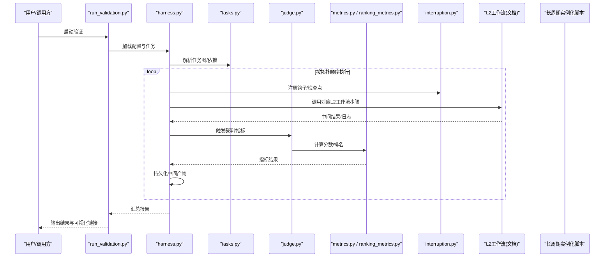
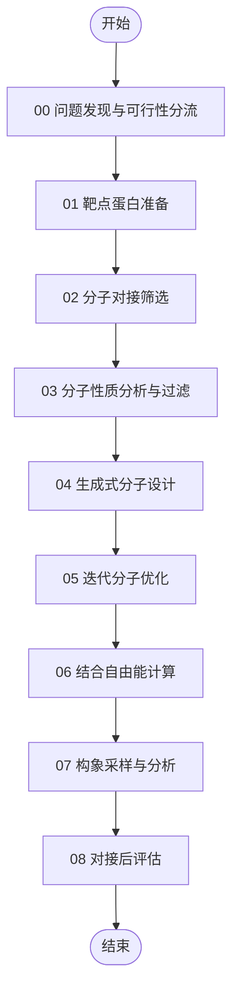
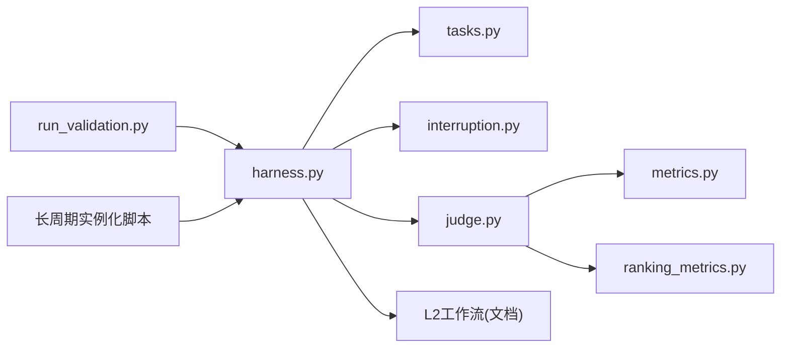
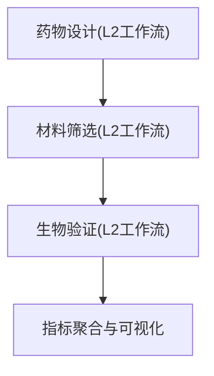

# 跨领域工作流

<cite>
**本文引用的文件**   
- [autonomy_mvp/core/harness.py](file://autonomy_mvp/core/harness.py)
- [autonomy_mvp/core/judge.py](file://autonomy_mvp/core/judge.py)
- [autonomy_mvp/core/metrics.py](file://autonomy_mvp/core/metrics.py)
- [autonomy_mvp/core/ranking_metrics.py](file://autonomy_mvp/core/ranking_metrics.py)
- [autonomy_mvp/core/tasks.py](file://autonomy_mvp/core/tasks.py)
- [autonomy_mvp/core/interruption.py](file://autonomy_mvp/core/interruption.py)
- [autonomy_mvp/run_validation.py](file://autonomy_mvp/run_validation.py)
- [autonomy_mvp/schema.md](file://autonomy_mvp/schema.md)
- [autonomy_mvp/ACCEPTANCE.md](file://autonomy_mvp/ACCEPTANCE.md)
- [longhorizon/instantiate/caseD_instantiate.py](file://longhorizon/instantiate/caseD_instantiate.py)
- [longhorizon/instantiate/batch_caseD.py](file://longhorizon/instantiate/batch_caseD.py)
- [longhorizon/instantiate/case3_instantiate.py](file://longhorizon/instantiate/case3_instantiate.py)
- [longhorizon/instantiate/case1_instantiate.py](file://longhorizon/instantiate/case1_instantiate.py)
- [longhorizon/instantiate/case2_instantiate.py](file://longhorizon/instantiate/case2_instantiate.py)
- [longhorizon/instantiate/caseE_instantiate.py](file://longhorizon/instantiate/caseE_instantiate.py)
- [longhorizon/instantiate/caseF_instantiate.py](file://longhorizon/instantiate/caseF_instantiate.py)
- [task4_papers/molbench_repo/skills/L2_workflows/02-molecular-docking-screening.md](file://docs/task4_papers/molbench_repo/skills/L2_workflows/02-molecular-docking-screening.md)
- [docs/task4_papers/molbench_repo/skills/L2_workflows/05-iterative-molecular-optimization.md](file://docs/task4_papers/molbench_repo/skills/L2_workflows/05-iterative-molecular-optimization.md)
- [docs/task4_papers/molbench_repo/skills/L2_workflows/06-binding-free-energy-calculation.md](file://docs/task4_papers/molbench_repo/skills/L2_workflows/06-binding-free-energy-calculation.md)
- [docs/task4_papers/molbench_repo/skills/L2_workflows/07-conformational-sampling-analysis.md](file://docs/task4_papers/molbench_repo/skills/L2_workflows/07-conformational-sampling-analysis.md)
- [docs/task4_papers/molbench_repo/skills/L2_workflows/08-post-docking-evaluation.md](file://docs/task4_papers/molbench_repo/skills/L2_workflows/08-post-docking-evaluation.md)
- [docs/task4_papers/molbench_repo/skills/L2_workflows/04-generative-molecular-design.md](file://docs/task4_papers/molbench_repo/skills/L2_workflows/04-generative-molecular-design.md)
- [docs/task4_papers/molbench_repo/skills/L2_workflows/03-molecular-property-analysis-filtering.md](file://docs/task4_papers/molbench_repo/skills/L2_workflows/03-molecular-property-analysis-filtering.md)
- [docs/task4_papers/molbench_repo/skills/L2_workflows/01-target-protein-preparation.md](file://docs/task4_papers/molbench_repo/skills/L2_workflows/01-target-protein-preparation.md)
- [docs/task4_papers/molbench_repo/skills/L2_workflows/00-problem-discovery-and-feasibility-triage.md](file://docs/task4_papers/molbench_repo/skills/L2_workflows/00-problem-discovery-and-feasibility-triage.md)
- [task5/runner.py](file://task5/runner.py)
- [task5/experiment/README.md](file://task5/experiment/README.md)
- [task5/experiment/0003-single-vs-parallel-12-runs.md](file://task5/experiment/0003-single-vs-parallel-12-runs.md)
- [task5/experiment/0004-parallel-hang-root-cause.md](file://task5/experiment/0004-parallel-hang-root-cause.md)
- [task5/experiment/0005-parallel-vs-single-and-block-investigation.md](file://task5/experiment/0005-parallel-vs-single-and-block-investigation.md)
</cite>

## 目录
1. [引言](#引言)
2. [项目结构](#项目结构)
3. [核心组件](#核心组件)
4. [架构总览](#架构总览)
5. [详细组件分析](#详细组件分析)
6. [依赖关系分析](#依赖关系分析)
7. [性能与资源调度](#性能与资源调度)
8. [故障排查指南](#故障排查指南)
9. [结论](#结论)
10. [附录：端到端案例与工作流模板](#附录端到端案例与工作流模板)

## 引言
本文件面向“药物设计-材料筛选-生物验证”的跨领域复杂工作流，提供从编排、中间结果管理、错误处理到并行执行的一体化方案。结合仓库中的自动化评测框架、长周期任务实例化脚本、分子对接与优化工作流文档以及并行实验记录，构建可复用的端到端示例与扩展方法，并给出资源调度、性能监控与结果可视化的实现建议。

## 项目结构
仓库围绕三大主题组织：
- 自动化评测与编排（autonomy_mvp）：定义任务、指标、裁判与运行器，支撑多步骤科学实验的统一编排与评估。
- 长周期任务实例化（longhorizon/instantiate）：将具体案例（如材料闭环优化、机理模拟、逆合成、靶点验证等）实例化为可运行的配置与批处理入口。
- 分子对接与优化工作流（docs/task4_papers/molbench_repo/skills/L2_workflows）：以Markdown形式沉淀L2级工作流，覆盖从问题发现、靶点准备、对接筛选、性质过滤、生成设计、自由能计算、构象采样到后处理的完整链路。
- 并行与稳定性实验（task5）：对比单线程与多线程/进程执行的差异，定位挂起根因，总结阻塞策略与并发边界条件。

```mermaid
graph TB
subgraph "自动化编排"
H["harness.py"]
J["judge.py"]
M["metrics.py"]
RM["ranking_metrics.py"]
T["tasks.py"]
I["interruption.py"]
RV["run_validation.py"]
end
subgraph "长周期实例化"
C1["case1_instantiate.py"]
C2["case2_instantiate.py"]
C3["case3_instantiate.py"]
CD["caseD_instantiate.py"]
CE["caseE_instantiate.py"]
CF["caseF_instantiate.py"]
BCD["batch_caseD.py"]
end
subgraph "分子工作流(L2)"
W0["00-problem-discovery...md"]
W1["01-target-protein-preparation.md"]
W2["02-molecular-docking-screening.md"]
W3["03-molecular-property-analysis-filtering.md"]
W4["04-generative-molecular-design.md"]
W5["05-iterative-molecular-optimization.md"]
W6["06-binding-free-energy-calculation.md"]
W7["07-conformational-sampling-analysis.md"]
W8["08-post-docking-evaluation.md"]
end
subgraph "并行与稳定性"
R5["task5/runner.py"]
E1["experiment/README.md"]
E3["0003-single-vs-parallel-12-runs.md"]
E4["0004-parallel-hang-root-cause.md"]
E5["0005-parallel-vs-single-and-block-investigation.md"]
end
H --> J
H --> M
H --> RM
H --> T
H --> I
RV --> H
CD --> BCD
C1 --> C2
C2 --> C3
C3 --> CD
W0 --> W1 --> W2 --> W3 --> W4 --> W5 --> W6 --> W7 --> W8
R5 --> E1
R5 --> E3
R5 --> E4
R5 --> E5
```

图表来源
- [autonomy_mvp/core/harness.py](file://autonomy_mvp/core/harness.py)
- [autonomy_mvp/core/judge.py](file://autonomy_mvp/core/judge.py)
- [autonomy_mvp/core/metrics.py](file://autonomy_mvp/core/metrics.py)
- [autonomy_mvp/core/ranking_metrics.py](file://autonomy_mvp/core/ranking_metrics.py)
- [autonomy_mvp/core/tasks.py](file://autonomy_mvp/core/tasks.py)
- [autonomy_mvp/core/interruption.py](file://autonomy_mvp/core/interruption.py)
- [autonomy_mvp/run_validation.py](file://autonomy_mvp/run_validation.py)
- [longhorizon/instantiate/caseD_instantiate.py](file://longhorizon/instantiate/caseD_instantiate.py)
- [longhorizon/instantiate/batch_caseD.py](file://longhorizon/instantiate/batch_caseD.py)
- [longhorizon/instantiate/case3_instantiate.py](file://longhorizon/instantiate/case3_instantiate.py)
- [longhorizon/instantiate/case1_instantiate.py](file://longhorizon/instantiate/case1_instantiate.py)
- [longhorizon/instantiate/case2_instantiate.py](file://longhorizon/instantiate/case2_instantiate.py)
- [longhorizon/instantiate/caseE_instantiate.py](file://longhorizon/instantiate/caseE_instantiate.py)
- [longhorizon/instantiate/caseF_instantiate.py](file://longhorizon/instantiate/caseF_instantiate.py)
- [docs/task4_papers/molbench_repo/skills/L2_workflows/00-problem-discovery-and-feasibility-triage.md](file://docs/task4_papers/molbench_repo/skills/L2_workflows/00-problem-discovery-and-feasibility-triage.md)
- [docs/task4_papers/molbench_repo/skills/L2_workflows/01-target-protein-preparation.md](file://docs/task4_papers/molbench_repo/skills/L2_workflows/01-target-protein-preparation.md)
- [docs/task4_papers/molbench_repo/skills/L2_workflows/02-molecular-docking-screening.md](file://docs/task4_papers/molbench_repo/skills/L2_workflows/02-molecular-docking-screening.md)
- [docs/task4_papers/molbench_repo/skills/L2_workflows/03-molecular-property-analysis-filtering.md](file://docs/task4_papers/molbench_repo/skills/L2_workflows/03-molecular-property-analysis-filtering.md)
- [docs/task4_papers/molbench_repo/skills/L2_workflows/04-generative-molecular-design.md](file://docs/task4_papers/molbench_repo/skills/L2_workflows/04-generative-molecular-design.md)
- [docs/task4_papers/molbench_repo/skills/L2_workflows/05-iterative-molecular-optimization.md](file://docs/task4_papers/molbench_repo/skills/L2_workflows/05-iterative-molecular-optimization.md)
- [docs/task4_papers/molbench_repo/skills/L2_workflows/06-binding-free-energy-calculation.md](file://docs/task4_papers/molbench_repo/skills/L2_workflows/06-binding-free-energy-calculation.md)
- [docs/task4_papers/molbench_repo/skills/L2_workflows/07-conformational-sampling-analysis.md](file://docs/task4_papers/molbench_repo/skills/L2_workflows/07-conformational-sampling-analysis.md)
- [docs/task4_papers/molbench_repo/skills/L2_workflows/08-post-docking-evaluation.md](file://docs/task4_papers/molbench_repo/skills/L2_workflows/08-post-docking-evaluation.md)
- [task5/runner.py](file://task5/runner.py)
- [task5/experiment/README.md](file://task5/experiment/README.md)
- [task5/experiment/0003-single-vs-parallel-12-runs.md](file://task5/experiment/0003-single-vs-parallel-12-runs.md)
- [task5/experiment/0004-parallel-hang-root-cause.md](file://task5/experiment/0004-parallel-hang-root-cause.md)
- [task5/experiment/0005-parallel-vs-single-and-block-investigation.md](file://task5/experiment/0005-parallel-vs-single-and-block-investigation.md)

章节来源
- [autonomy_mvp/schema.md](file://autonomy_mvp/schema.md)
- [autonomy_mvp/ACCEPTANCE.md](file://autonomy_mvp/ACCEPTANCE.md)

## 核心组件
- 编排与运行器（harness.py）：负责加载任务、驱动步骤执行、收集中间产物、触发评估与报告生成。
- 裁判与指标（judge.py, metrics.py, ranking_metrics.py）：定义评分函数、排序指标与判定逻辑，支持多维度质量度量。
- 任务模型（tasks.py）：抽象任务描述、输入输出契约、依赖关系与约束。
- 中断与恢复（interruption.py）：提供优雅中断、检查点与重试机制，保障长流程稳定。
- 验证入口（run_validation.py）：统一启动验证流程，串联编排、裁判与指标。

章节来源
- [autonomy_mvp/core/harness.py](file://autonomy_mvp/core/harness.py)
- [autonomy_mvp/core/judge.py](file://autonomy_mvp/core/judge.py)
- [autonomy_mvp/core/metrics.py](file://autonomy_mvp/core/metrics.py)
- [autonomy_mvp/core/ranking_metrics.py](file://autonomy_mvp/core/ranking_metrics.py)
- [autonomy_mvp/core/tasks.py](file://autonomy_mvp/core/tasks.py)
- [autonomy_mvp/core/interruption.py](file://autonomy_mvp/core/interruption.py)
- [autonomy_mvp/run_validation.py](file://autonomy_mvp/run_validation.py)

## 架构总览
下图展示“编排-执行-评估-可视化”的整体数据与控制流，贯穿药物设计、材料筛选与生物验证三类子域。

图表来源
- [autonomy_mvp/run_validation.py](file://autonomy_mvp/run_validation.py)
- [autonomy_mvp/core/harness.py](file://autonomy_mvp/core/harness.py)
- [autonomy_mvp/core/tasks.py](file://autonomy_mvp/core/tasks.py)
- [autonomy_mvp/core/judge.py](file://autonomy_mvp/core/judge.py)
- [autonomy_mvp/core/metrics.py](file://autonomy_mvp/core/metrics.py)
- [autonomy_mvp/core/ranking_metrics.py](file://autonomy_mvp/core/ranking_metrics.py)
- [autonomy_mvp/core/interruption.py](file://autonomy_mvp/core/interruption.py)
- [docs/task4_papers/molbench_repo/skills/L2_workflows/02-molecular-docking-screening.md](file://docs/task4_papers/molbench_repo/skills/L2_workflows/02-molecular-docking-screening.md)
- [docs/task4_papers/molbench_repo/skills/L2_workflows/05-iterative-molecular-optimization.md](file://docs/task4_papers/molbench_repo/skills/L2_workflows/05-iterative-molecular-optimization.md)
- [docs/task4_papers/molbench_repo/skills/L2_workflows/06-binding-free-energy-calculation.md](file://docs/task4_papers/molbench_repo/skills/L2_workflows/06-binding-free-energy-calculation.md)
- [docs/task4_papers/molbench_repo/skills/L2_workflows/07-conformational-sampling-analysis.md](file://docs/task4_papers/molbench_repo/skills/L2_workflows/07-conformational-sampling-analysis.md)
- [docs/task4_papers/molbench_repo/skills/L2_workflows/08-post-docking-evaluation.md](file://docs/task4_papers/molbench_repo/skills/L2_workflows/08-post-docking-evaluation.md)

## 详细组件分析

### 编排与运行器（harness.py）
- 职责：读取任务定义，构建有向无环图（DAG），按依赖顺序调度步骤；维护中间产物目录与版本；在每步前后注入监控与检查点。
- 关键模式：
  - 步骤注册与路由：根据任务类型选择L2工作流或外部工具。
  - 中间结果管理：标准化命名空间、元数据写入、失败回滚路径。
  - 错误传播：捕获异常并转换为可诊断的错误对象，附带上下文与堆栈摘要。
- 可扩展点：新增步骤时仅需注册新处理器与对应的指标/裁判。

章节来源
- [autonomy_mvp/core/harness.py](file://autonomy_mvp/core/harness.py)

### 裁判与指标（judge.py, metrics.py, ranking_metrics.py）
- 职责：对每个步骤的输出进行量化评估，包括数值型指标、排序与分类判定。
- 关键模式：
  - 指标组合：加权聚合、阈值门控、分位数归一化。
  - 排名策略：基于多目标权衡的排序算法，支持动态权重。
  - 裁判规则：将业务规则编码为可插拔的判定器，便于A/B测试。
- 可扩展点：新增指标只需实现接口并在注册表中声明。

章节来源
- [autonomy_mvp/core/judge.py](file://autonomy_mvp/core/judge.py)
- [autonomy_mvp/core/metrics.py](file://autonomy_mvp/core/metrics.py)
- [autonomy_mvp/core/ranking_metrics.py](file://autonomy_mvp/core/ranking_metrics.py)

### 任务模型（tasks.py）
- 职责：定义任务的输入契约、输出规范、依赖边与资源需求。
- 关键模式：
  - 任务图：节点表示步骤，边表示数据依赖。
  - 资源标注：CPU/GPU/内存/磁盘/外部服务配额。
  - 容错属性：重试次数、超时、幂等性标记。
- 可扩展点：通过JSON/YAML声明式任务，无需修改核心代码即可扩展新任务。

章节来源
- [autonomy_mvp/core/tasks.py](file://autonomy_mvp/core/tasks.py)

### 中断与恢复（interruption.py）
- 职责：提供优雅中断、检查点保存与断点续跑。
- 关键模式：
  - 信号处理：捕获系统信号，安全退出并落盘状态。
  - 检查点：每步完成后写入最小必要状态，支持快速恢复。
  - 重试策略：指数退避、最大重试上限、死信队列。
- 可扩展点：自定义检查点格式与恢复钩子。

章节来源
- [autonomy_mvp/core/interruption.py](file://autonomy_mvp/core/interruption.py)

### 验证入口（run_validation.py）
- 职责：统一入口，装配配置、初始化日志、启动编排与报告生成。
- 关键模式：
  - 配置合并：默认配置与环境变量/命令行参数叠加。
  - 并行控制：限制并发度、隔离资源池。
  - 结果归档：结构化输出与可视化链接生成。

章节来源
- [autonomy_mvp/run_validation.py](file://autonomy_mvp/run_validation.py)

### 长周期任务实例化（longhorizon/instantiate）
- 作用：将具体案例（材料闭环优化、机理模拟、逆合成、靶点验证等）实例化为可运行配置，供编排器消费。
- 典型流程：
  - caseD（材料闭环优化）：生成批次任务、设置收敛条件与反馈回路。
  - case3（机理模拟）：构造仿真参数集、划分并行子任务。
  - case1/case2（材料发现）：批量候选生成与筛选流水线。
  - caseE/caseF（逆合成/靶点验证）：生成路线与验证打分。
- 批处理：batch_caseD.py 提供批量提交与进度跟踪。

章节来源
- [longhorizon/instantiate/caseD_instantiate.py](file://longhorizon/instantiate/caseD_instantiate.py)
- [longhorizon/instantiate/batch_caseD.py](file://longhorizon/instantiate/batch_caseD.py)
- [longhorizon/instantiate/case3_instantiate.py](file://longhorizon/instantiate/case3_instantiate.py)
- [longhorizon/instantiate/case1_instantiate.py](file://longhorizon/instantiate/case1_instantiate.py)
- [longhorizon/instantiate/case2_instantiate.py](file://longhorizon/instantiate/case2_instantiate.py)
- [longhorizon/instantiate/caseE_instantiate.py](file://longhorizon/instantiate/caseE_instantiate.py)
- [longhorizon/instantiate/caseF_instantiate.py](file://longhorizon/instantiate/caseF_instantiate.py)

### 分子对接与优化工作流（L2 Workflows）
- 覆盖范围：从问题发现与可行性分流，到靶点准备、对接筛选、性质过滤、生成设计、迭代优化、自由能计算、构象采样与后评估。
- 编排方式：各步骤以Markdown文档定义输入/输出、前置条件与注意事项，可由编排器按依赖顺序调用。
- 关键步骤：
  - 00：问题发现与可行性分流
  - 01：靶点蛋白准备
  - 02：分子对接筛选
  - 03：分子性质分析与过滤
  - 04：生成式分子设计
  - 05：迭代分子优化
  - 06：结合自由能计算
  - 07：构象采样与分析
  - 08：对接后评估

图表来源
- [docs/task4_papers/molbench_repo/skills/L2_workflows/00-problem-discovery-and-feasibility-triage.md](file://docs/task4_papers/molbench_repo/skills/L2_workflows/00-problem-discovery-and-feasibility-triage.md)
- [docs/task4_papers/molbench_repo/skills/L2_workflows/01-target-protein-preparation.md](file://docs/task4_papers/molbench_repo/skills/L2_workflows/01-target-protein-preparation.md)
- [docs/task4_papers/molbench_repo/skills/L2_workflows/02-molecular-docking-screening.md](file://docs/task4_papers/molbench_repo/skills/L2_workflows/02-molecular-docking-screening.md)
- [docs/task4_papers/molbench_repo/skills/L2_workflows/03-molecular-property-analysis-filtering.md](file://docs/task4_papers/molbench_repo/skills/L2_workflows/03-molecular-property-analysis-filtering.md)
- [docs/task4_papers/molbench_repo/skills/L2_workflows/04-generative-molecular-design.md](file://docs/task4_papers/molbench_repo/skills/L2_workflows/04-generative-molecular-design.md)
- [docs/task4_papers/molbench_repo/skills/L2_workflows/05-iterative-molecular-optimization.md](file://docs/task4_papers/molbench_repo/skills/L2_workflows/05-iterative-molecular-optimization.md)
- [docs/task4_papers/molbench_repo/skills/L2_workflows/06-binding-free-energy-calculation.md](file://docs/task4_papers/molbench_repo/skills/L2_workflows/06-binding-free-energy-calculation.md)
- [docs/task4_papers/molbench_repo/skills/L2_workflows/07-conformational-sampling-analysis.md](file://docs/task4_papers/molbench_repo/skills/L2_workflows/07-conformational-sampling-analysis.md)
- [docs/task4_papers/molbench_repo/skills/L2_workflows/08-post-docking-evaluation.md](file://docs/task4_papers/molbench_repo/skills/L2_workflows/08-post-docking-evaluation.md)

## 依赖关系分析
- 模块耦合：
  - run_validation.py 依赖 harness.py 作为主控制器。
  - harness.py 依赖 tasks.py 获取任务图，依赖 interruption.py 做容错。
  - judge.py 与 metrics.py/ranking_metrics.py 被编排器在步骤完成后调用。
- 外部集成：
  - L2工作流文档作为“步骤说明书”，由编排器按名称路由到具体实现。
  - 长周期实例化脚本产出任务配置，供编排器消费。

图表来源
- [autonomy_mvp/run_validation.py](file://autonomy_mvp/run_validation.py)
- [autonomy_mvp/core/harness.py](file://autonomy_mvp/core/harness.py)
- [autonomy_mvp/core/tasks.py](file://autonomy_mvp/core/tasks.py)
- [autonomy_mvp/core/interruption.py](file://autonomy_mvp/core/interruption.py)
- [autonomy_mvp/core/judge.py](file://autonomy_mvp/core/judge.py)
- [autonomy_mvp/core/metrics.py](file://autonomy_mvp/core/metrics.py)
- [autonomy_mvp/core/ranking_metrics.py](file://autonomy_mvp/core/ranking_metrics.py)
- [docs/task4_papers/molbench_repo/skills/L2_workflows/02-molecular-docking-screening.md](file://docs/task4_papers/molbench_repo/skills/L2_workflows/02-molecular-docking-screening.md)
- [longhorizon/instantiate/caseD_instantiate.py](file://longhorizon/instantiate/caseD_instantiate.py)

## 性能与资源调度
- 并发与阻塞：
  - task5 的实验记录对比了单线程与多线程/进程的执行差异，并定位了并发挂起的根因与阻塞场景。
  - 建议：对I/O密集型步骤采用异步/进程隔离；对CPU密集步骤使用线程池+资源配额；对外部服务调用增加超时与熔断。
- 资源隔离：
  - 为不同步骤分配独立工作目录与临时空间，避免写冲突。
  - 对GPU/CPU/内存设置上限，防止资源争用导致抖动。
- 监控与可视化：
  - 在每个步骤埋点采集耗时、吞吐、错误率与资源占用。
  - 生成时序曲线与热力图，辅助定位瓶颈与异常。

章节来源
- [task5/runner.py](file://task5/runner.py)
- [task5/experiment/README.md](file://task5/experiment/README.md)
- [task5/experiment/0003-single-vs-parallel-12-runs.md](file://task5/experiment/0003-single-vs-parallel-12-runs.md)
- [task5/experiment/0004-parallel-hang-root-cause.md](file://task5/experiment/0004-parallel-hang-root-cause.md)
- [task5/experiment/0005-parallel-vs-single-and-block-investigation.md](file://task5/experiment/0005-parallel-vs-single-and-block-investigation.md)

## 故障排查指南
- 常见错误与对策：
  - 步骤超时：检查外部服务可用性、网络延迟与资源不足；启用重试与降级策略。
  - 并发挂起：参考task5的根因分析，识别锁竞争与死锁场景；引入互斥与超时。
  - 中间结果不一致：确保幂等性与原子写入；失败时回滚至最近检查点。
- 诊断信息：
  - 保留步骤级日志、输入快照与输出摘要。
  - 指标与裁判结果需与原始输出关联，便于回溯。
- 恢复流程：
  - 利用检查点快速恢复；仅重放失败分支，减少整体耗时。

章节来源
- [autonomy_mvp/core/interruption.py](file://autonomy_mvp/core/interruption.py)
- [autonomy_mvp/core/harness.py](file://autonomy_mvp/core/harness.py)
- [task5/experiment/0004-parallel-hang-root-cause.md](file://task5/experiment/0004-parallel-hang-root-cause.md)

## 结论
通过将编排器、裁判与指标体系、中断与恢复机制、长周期实例化脚本与L2工作流文档有机结合，可实现跨领域的复杂科学实验自动化。配合并发控制、资源隔离与监控可视化，能够显著提升端到端效率与可观测性。建议在工程实践中持续沉淀步骤模板与指标库，形成可复用的工作流资产。

## 附录：端到端案例与工作流模板

### 端到端案例：药物设计-材料筛选-生物验证
- 阶段一：药物设计
  - 步骤：问题发现与可行性分流 → 靶点准备 → 对接筛选 → 性质过滤 → 生成式设计 → 迭代优化 → 自由能计算 → 构象采样 → 后评估。
  - 编排：由编排器按L2工作流顺序执行，每步产出中间结果并触发指标计算。
- 阶段二：材料筛选
  - 步骤：候选材料生成 → 性质预测 → 筛选与排序 → 小样本验证。
  - 编排：复用同一编排器，替换为材料相关L2步骤与指标。
- 阶段三：生物验证
  - 步骤：体外/体内实验计划 → 数据采集 → 统计检验 → 回归建模 → 决策建议。
  - 编排：接入生物实验数据源，更新裁判与指标，完成闭环反馈。

[此图为概念性流程图，不直接映射具体源码文件]

### 工作流模板与自定义扩展
- 模板要素：
  - 步骤清单：名称、输入/输出、前置条件、资源需求、重试策略。
  - 指标定义：数值型指标、阈值、权重与排名规则。
  - 检查点：每步最小状态、恢复路径。
- 扩展方法：
  - 新增步骤：在编排器注册处理器，编写L2文档说明输入输出与注意事项。
  - 新增指标：实现指标接口，注册到裁判系统。
  - 新增任务：通过声明式任务文件描述DAG与资源约束。

章节来源
- [autonomy_mvp/schema.md](file://autonomy_mvp/schema.md)
- [autonomy_mvp/ACCEPTANCE.md](file://autonomy_mvp/ACCEPTANCE.md)
- [docs/task4_papers/molbench_repo/skills/L2_workflows/02-molecular-docking-screening.md](file://docs/task4_papers/molbench_repo/skills/L2_workflows/02-molecular-docking-screening.md)
- [docs/task4_papers/molbench_repo/skills/L2_workflows/05-iterative-molecular-optimization.md](file://docs/task4_papers/molbench_repo/skills/L2_workflows/05-iterative-molecular-optimization.md)
- [docs/task4_papers/molbench_repo/skills/L2_workflows/06-binding-free-energy-calculation.md](file://docs/task4_papers/molbench_repo/skills/L2_workflows/06-binding-free-energy-calculation.md)
- [docs/task4_papers/molbench_repo/skills/L2_workflows/07-conformational-sampling-analysis.md](file://docs/task4_papers/molbench_repo/skills/L2_workflows/07-conformational-sampling-analysis.md)
- [docs/task4_papers/molbench_repo/skills/L2_workflows/08-post-docking-evaluation.md](file://docs/task4_papers/molbench_repo/skills/L2_workflows/08-post-docking-evaluation.md)