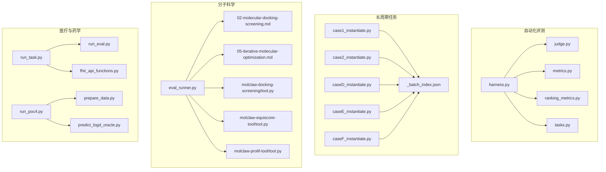
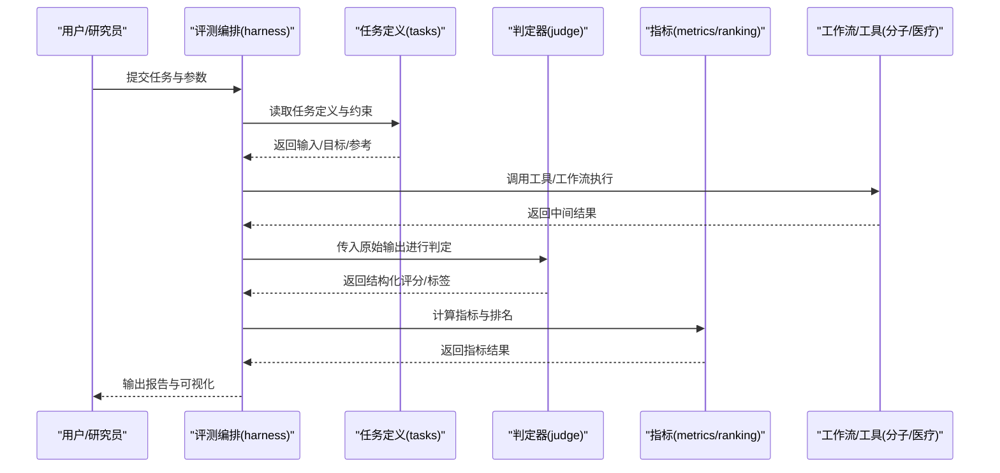
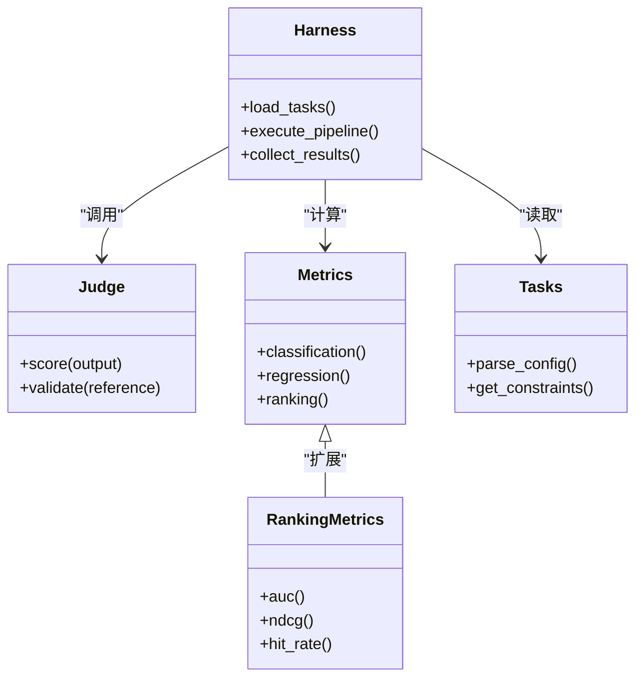
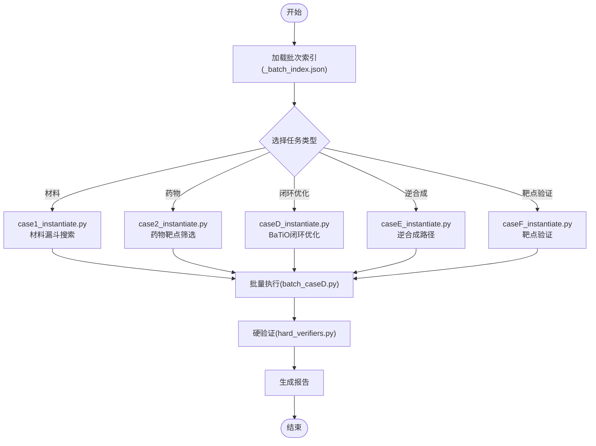
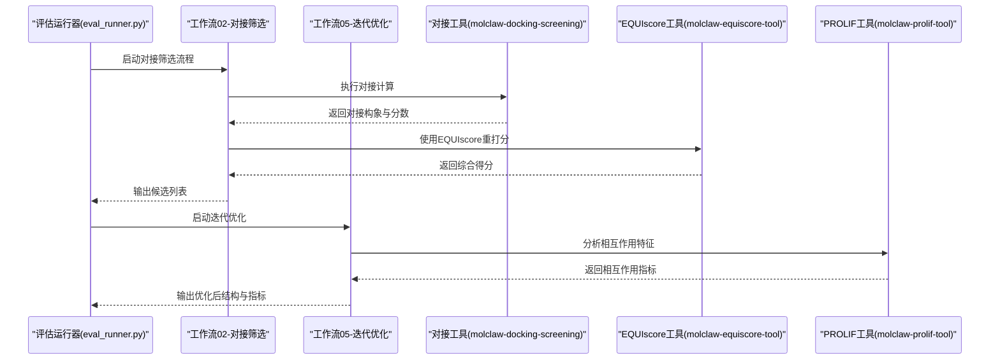
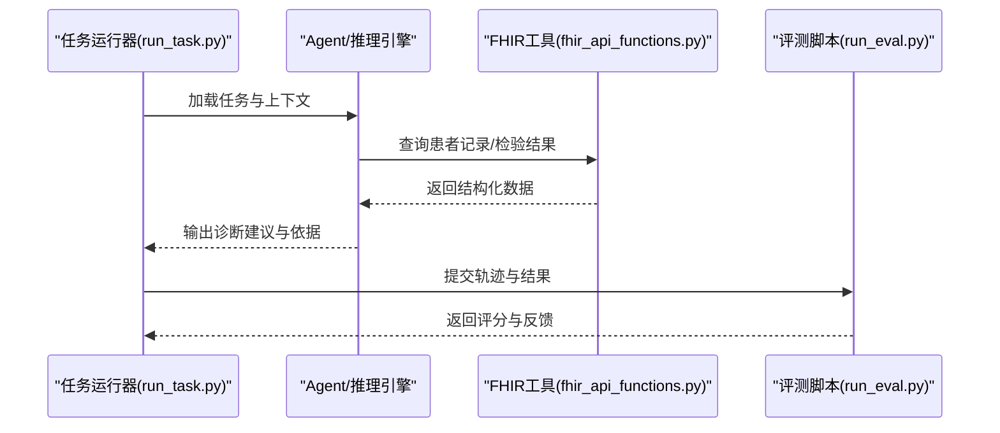
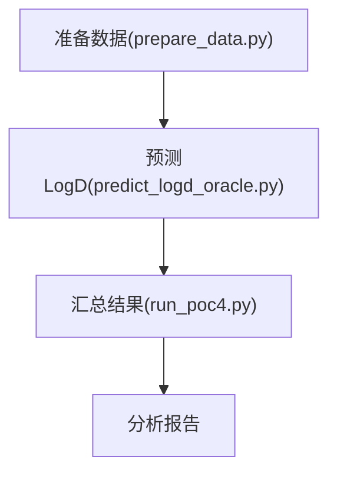
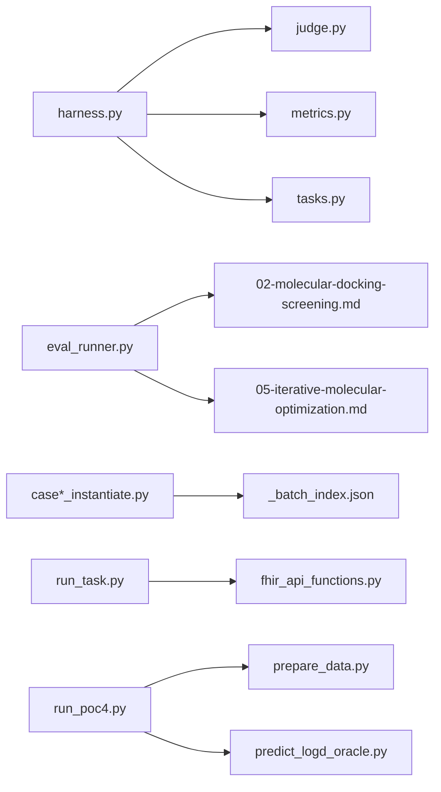

# 领域应用案例

<cite>
**本文引用的文件**   
- [autonomy_mvp/core/harness.py](file://autonomy_mvp/core/harness.py)
- [autonomy_mvp/core/judge.py](file://autonomy_mvp/core/judge.py)
- [autonomy_mvp/core/metrics.py](file://autonomy_mvp/core/metrics.py)
- [autonomy_mvp/core/ranking_metrics.py](file://autonomy_mvp/core/ranking_metrics.py)
- [autonomy_mvp/core/tasks.py](file://autonomy_mvp/core/tasks.py)
- [autonomy_mvp/tasks/drug_admet.json](file://autonomy_mvp/tasks/drug_admet.json)
- [autonomy_mvp/tasks/drug_screen_ms3.json](file://autonomy_mvp/tasks/drug_screen_ms3.json)
- [autonomy_mvp/tasks/materials_semiconductor_bandgap.json](file://autonomy_mvp/tasks/materials_semiconductor_bandgap.json)
- [autonomy_mvp/tests/fixtures/fixture_drugscreen.json](file://autonomy_mvp/tests/fixtures/fixture_drugscreen.json)
- [autonomy_mvp/tests/fixtures/fixture_materials.json](file://autonomy_mvp/tests/fixtures/fixture_materials.json)
- [autonomy_mvp/run_validation.py](file://autonomy_mvp/run_validation.py)
- [longhorizon/instantiate/case1_instantiate.py](file://longhorizon/instantiate/case1_instantiate.py)
- [longhorizon/instantiate/case2_instantiate.py](file://longhorizon/instantiate/case2_instantiate.py)
- [longhorizon/instantiate/caseD_instantiate.py](file://longhorizon/instantiate/caseD_instantiate.py)
- [longhorizon/instantiate/caseE_instantiate.py](file://longhorizon/instantiate/caseE_instantiate.py)
- [longhorizon/instantiate/caseF_instantiate.py](file://longhorizon/instantiate/caseF_instantiate.py)
- [longhorizon/instantiate/batch_caseD.py](file://longhorizon/instantiate/batch_caseD.py)
- [longhorizon/instantiate/instances/_batch_index.json](file://longhorizon/instantiate/instances/_batch_index.json)
- [longhorizon/instantiate/instances/drug2_BACE1.json](file://longhorizon/instantiate/instances/drug2_BACE1.json)
- [longhorizon/instantiate/instances/mat1_Ca-Si-O_funnel.json](file://longhorizon/instantiate/instances/mat1_Ca-Si-O_funnel.json)
- [longhorizon/instantiate/instances/mech3_Crizotinib-ALK+_NSCLC.json](file://longhorizon/instantiate/instances/mech3_Crizotinib-ALK+_NSCLC.json)
- [longhorizon/instantiate/instances/targetF_ABL1-CML.json](file://longhorizon/instantiate/instances/targetF_ABL1-CML.json)
- [longhorizon/verifiers/hard_verifiers.py](file://longhorizon/verifiers/hard_verifiers.py)
- [task3/B_ms3_screening_prototype/ms3_screening_eval.py](file://task3/B_ms3_screening_prototype/ms3_screening_eval.py)
- [task4_papers/README.md](file://docs/prd/molbench_repo/README.md)
- [docs/prd/molbench_repo/config/baseline_molbench-ms-1.yaml](file://docs/prd/molbench_repo/config/baseline_molbench-ms-1.yaml)
- [docs/prd/molbench_repo/eval/eval_runner.py](file://docs/prd/molbench_repo/eval/eval_runner.py)
- [docs/prd/molbench_repo/skills/L1_tools/molclaw-docking-screening/tool.py](file://docs/prd/molbench_repo/skills/L1_tools/molclaw-docking-screening/tool.py)
- [docs/prd/molbench_repo/skills/L1_tools/molclaw-equiscore-tool/tool.py](file://docs/prd/molbench_repo/skills/L1_tools/molclaw-equiscore-tool/tool.py)
- [docs/prd/molbench_repo/skills/L1_tools/molclaw-prolif-tool/tool.py](file://docs/prd/molbench_repo/skills/L1_tools/molclaw-prolif-tool/tool.py)
- [docs/prd/molbench_repo/skills/L2_workflows/02-molecular-docking-screening.md](file://docs/prd/molbench_repo/skills/L2_workflows/02-molecular-docking-screening.md)
- [docs/prd/molbench_repo/skills/L2_workflows/05-iterative-molecular-optimization.md](file://docs/prd/molbench_repo/skills/L2_workflows/05-iterative-molecular-optimization.md)
- [poc3_physicianbench/PhysicianBench/scripts/run_task.py](file://task7/poc3_physicianbench/PhysicianBench/scripts/run_task.py)
- [poc3_physicianbench/PhysicianBench/scripts/run_eval.py](file://task7/poc3_physicianbench/PhysicianBench/scripts/run_eval.py)
- [poc3_physicianbench/PhysicianBench/tasks/v1/aberrant_drug_screen/task.md](file://task7/poc3_physicianbench/PhysicianBench/tasks/v1/aberrant_drug_screen/task.md)
- [poc3_physicianbench/PhysicianBench/tools/fhir_api_functions.py](file://task7/poc3_physicianbench/PhysicianBench/tools/fhir_api_functions.py)
- [poc4_pharmabench/run_poc4.py](file://task7/poc4_pharmabench/run_poc4.py)
- [poc4_pharmabench/data/prepare_data.py](file://task7/poc4_pharmabench/data/prepare_data.py)
- [poc4_pharmabench/tools/predict_logd_oracle.py](file://task7/poc4_pharmabench/tools/predict_logd_oracle.py)
</cite>

## 目录
1. [引言](#引言)
2. [项目结构](#项目结构)
3. [核心组件](#核心组件)
4. [架构总览](#架构总览)
5. [详细组件分析](#详细组件分析)
6. [依赖关系分析](#依赖关系分析)
7. [性能与可扩展性](#性能与可扩展性)
8. [故障排查指南](#故障排查指南)
9. [结论](#结论)
10. [附录：端到端实验流程与报告模板](#附录端到端实验流程与报告模板)

## 引言
本文件聚焦于“领域应用案例”，围绕药物筛选、材料设计、生物医学诊断三大真实科研场景，提供从数据准备、模型选择、参数调优到结果验证的完整可复现方案。文档基于仓库中的自动化评测框架、长周期任务实例化脚本、分子技能与工作流、以及医疗与药学基准工具链，给出跨领域的统一方法论与最佳实践，帮助研究者快速落地端到端解决方案。

## 项目结构
仓库采用“多任务、多领域”的组织方式：
- 自动化评测与指标体系：autonomy_mvp 提供统一的评测编排、判定器与指标计算。
- 长周期任务实例化：longhorizon 提供面向材料发现、药物靶点、机理模拟等任务的实例化与批处理。
- 分子科学技能与工作流：docs/prd/molbench_repo 提供 L1 工具与 L2 工作流，覆盖对接、打分、性质评估与迭代优化。
- 医疗与药学基准：task7 下 PhysicianBench（临床推理）与 Pharmabench（药代性质预测）提供端到端任务与评测脚本。

图表来源
- [autonomy_mvp/core/harness.py](file://autonomy_mvp/core/harness.py)
- [autonomy_mvp/core/judge.py](file://autonomy_mvp/core/judge.py)
- [autonomy_mvp/core/metrics.py](file://autonomy_mvp/core/metrics.py)
- [autonomy_mvp/core/ranking_metrics.py](file://autonomy_mvp/core/ranking_metrics.py)
- [autonomy_mvp/core/tasks.py](file://autonomy_mvp/core/tasks.py)
- [longhorizon/instantiate/case1_instantiate.py](file://longhorizon/instantiate/case1_instantiate.py)
- [longhorizon/instantiate/case2_instantiate.py](file://longhorizon/instantiate/case2_instantiate.py)
- [longhorizon/instantiate/caseD_instantiate.py](file://longhorizon/instantiate/caseD_instantiate.py)
- [longhorizon/instantiate/caseE_instantiate.py](file://longhorizon/instantiate/caseE_instantiate.py)
- [longhorizon/instantiate/caseF_instantiate.py](file://longhorizon/instantiate/caseF_instantiate.py)
- [longhorizon/instantiate/instances/_batch_index.json](file://longhorizon/instantiate/instances/_batch_index.json)
- [docs/prd/molbench_repo/eval/eval_runner.py](file://docs/prd/molbench_repo/eval/eval_runner.py)
- [docs/prd/molbench_repo/skills/L2_workflows/02-molecular-docking-screening.md](file://docs/prd/molbench_repo/skills/L2_workflows/02-molecular-docking-screening.md)
- [docs/prd/molbench_repo/skills/L2_workflows/05-iterative-molecular-optimization.md](file://docs/prd/molbench_repo/skills/L2_workflows/05-iterative-molecular-optimization.md)
- [docs/prd/molbench_repo/skills/L1_tools/molclaw-docking-screening/tool.py](file://docs/prd/molbench_repo/skills/L1_tools/molclaw-docking-screening/tool.py)
- [docs/prd/molbench_repo/skills/L1_tools/molclaw-equiscore-tool/tool.py](file://docs/prd/molbench_repo/skills/L1_tools/molclaw-equiscore-tool/tool.py)
- [docs/prd/molbench_repo/skills/L1_tools/molclaw-prolif-tool/tool.py](file://docs/prd/molbench_repo/skills/L1_tools/molclaw-prolif-tool/tool.py)
- [task7/poc3_physicianbench/PhysicianBench/scripts/run_task.py](file://task7/poc3_physicianbench/PhysicianBench/scripts/run_task.py)
- [task7/poc3_physicianbench/PhysicianBench/scripts/run_eval.py](file://task7/poc3_physicianbench/PhysicianBench/scripts/run_eval.py)
- [task7/poc3_physicianbench/PhysicianBench/tools/fhir_api_functions.py](file://task7/poc3_physicianbench/PhysicianBench/tools/fhir_api_functions.py)
- [task7/poc4_pharmabench/run_poc4.py](file://task7/poc4_pharmabench/run_poc4.py)
- [task7/poc4_pharmabench/data/prepare_data.py](file://task7/poc4_pharmabench/data/prepare_data.py)
- [task7/poc4_pharmabench/tools/predict_logd_oracle.py](file://task7/poc4_pharmabench/tools/predict_logd_oracle.py)

章节来源
- [autonomy_mvp/core/harness.py](file://autonomy_mvp/core/harness.py)
- [autonomy_mvp/core/judge.py](file://autonomy_mvp/core/judge.py)
- [autonomy_mvp/core/metrics.py](file://autonomy_mvp/core/metrics.py)
- [autonomy_mvp/core/ranking_metrics.py](file://autonomy_mvp/core/ranking_metrics.py)
- [autonomy_mvp/core/tasks.py](file://autonomy_mvp/core/tasks.py)
- [longhorizon/instantiate/case1_instantiate.py](file://longhorizon/instantiate/case1_instantiate.py)
- [longhorizon/instantiate/case2_instantiate.py](file://longhorizon/instantiate/case2_instantiate.py)
- [longhorizon/instantiate/caseD_instantiate.py](file://longhorizon/instantiate/caseD_instantiate.py)
- [longhorizon/instantiate/caseE_instantiate.py](file://longhorizon/instantiate/caseE_instantiate.py)
- [longhorizon/instantiate/caseF_instantiate.py](file://longhorizon/instantiate/caseF_instantiate.py)
- [longhorizon/instantiate/instances/_batch_index.json](file://longhorizon/instantiate/instances/_batch_index.json)
- [docs/prd/molbench_repo/eval/eval_runner.py](file://docs/prd/molbench_repo/eval/eval_runner.py)
- [docs/prd/molbench_repo/skills/L2_workflows/02-molecular-docking-screening.md](file://docs/prd/molbench_repo/skills/L2_workflows/02-molecular-docking-screening.md)
- [docs/prd/molbench_repo/skills/L2_workflows/05-iterative-molecular-optimization.md](file://docs/prd/molbench_repo/skills/L2_workflows/05-iterative-molecular-optimization.md)
- [docs/prd/molbench_repo/skills/L1_tools/molclaw-docking-screening/tool.py](file://docs/prd/molbench_repo/skills/L1_tools/molclaw-docking-screening/tool.py)
- [docs/prd/molbench_repo/skills/L1_tools/molclaw-equiscore-tool/tool.py](file://docs/prd/molbench_repo/skills/L1_tools/molclaw-equiscore-tool/tool.py)
- [docs/prd/molbench_repo/skills/L1_tools/molclaw-prolif-tool/tool.py](file://docs/prd/molbench_repo/skills/L1_tools/molclaw-prolif-tool/tool.py)
- [task7/poc3_physicianbench/PhysicianBench/scripts/run_task.py](file://task7/poc3_physicianbench/PhysicianBench/scripts/run_task.py)
- [task7/poc3_physicianbench/PhysicianBench/scripts/run_eval.py](file://task7/poc3_physicianbench/PhysicianBench/scripts/run_eval.py)
- [task7/poc3_physicianbench/PhysicianBench/tools/fhir_api_functions.py](file://task7/poc3_physicianbench/PhysicianBench/tools/fhir_api_functions.py)
- [task7/poc4_pharmabench/run_poc4.py](file://task7/poc4_pharmabench/run_poc4.py)
- [task7/poc4_pharmabench/data/prepare_data.py](file://task7/poc4_pharmabench/data/prepare_data.py)
- [task7/poc4_pharmabench/tools/predict_logd_oracle.py](file://task7/poc4_pharmabench/tools/predict_logd_oracle.py)

## 核心组件
- 自动化评测编排（Harness）：负责加载任务定义、驱动执行、收集中间结果并调用判定器与指标模块进行评分与排名。
- 判定器（Judge）：将原始输出映射为结构化评分或二元判定，支持阈值、规则与外部验证接口。
- 指标与排名（Metrics/Ranking Metrics）：提供分类、回归、排序与AUC等常用指标，以及按任务定制的复合指标。
- 任务定义（Tasks）：以JSON/配置形式描述输入、约束、目标与参考答案，便于跨领域复用。
- 长周期任务实例化：针对材料、药物、机理等场景生成具体实验用例与批处理索引。
- 分子科学工具与工作流：封装对接、打分、相互作用分析与迭代优化的标准步骤。
- 医疗与药学基准：提供FHIR交互、任务运行与评测脚本，以及LogD预测等药代性质工具。

章节来源
- [autonomy_mvp/core/harness.py](file://autonomy_mvp/core/harness.py)
- [autonomy_mvp/core/judge.py](file://autonomy_mvp/core/judge.py)
- [autonomy_mvp/core/metrics.py](file://autonomy_mvp/core/metrics.py)
- [autonomy_mvp/core/ranking_metrics.py](file://autonomy_mvp/core/ranking_metrics.py)
- [autonomy_mvp/core/tasks.py](file://autonomy_mvp/core/tasks.py)
- [docs/prd/molbench_repo/eval/eval_runner.py](file://docs/prd/molbench_repo/eval/eval_runner.py)
- [task7/poc3_physicianbench/PhysicianBench/scripts/run_task.py](file://task7/poc3_physicianbench/PhysicianBench/scripts/run_task.py)
- [task7/poc3_physicianbench/PhysicianBench/scripts/run_eval.py](file://task7/poc3_physicianbench/PhysicianBench/scripts/run_eval.py)

## 架构总览
下图展示从任务定义到评测输出的端到端流程，涵盖自动化编排、工具调用、指标计算与结果汇总。

图表来源
- [autonomy_mvp/core/harness.py](file://autonomy_mvp/core/harness.py)
- [autonomy_mvp/core/judge.py](file://autonomy_mvp/core/judge.py)
- [autonomy_mvp/core/metrics.py](file://autonomy_mvp/core/metrics.py)
- [autonomy_mvp/core/ranking_metrics.py](file://autonomy_mvp/core/ranking_metrics.py)
- [docs/prd/molbench_repo/eval/eval_runner.py](file://docs/prd/molbench_repo/eval/eval_runner.py)

## 详细组件分析

### 自动化评测与指标体系
- 编排器负责串联任务、工具与指标，确保可重复性与可追踪性。
- 判定器支持多种评分策略，包括阈值判定、规则匹配与外部验证。
- 指标模块提供分类、回归、排序与AUC等通用能力，并按任务定制复合指标。

图表来源
- [autonomy_mvp/core/harness.py](file://autonomy_mvp/core/harness.py)
- [autonomy_mvp/core/judge.py](file://autonomy_mvp/core/judge.py)
- [autonomy_mvp/core/metrics.py](file://autonomy_mvp/core/metrics.py)
- [autonomy_mvp/core/ranking_metrics.py](file://autonomy_mvp/core/ranking_metrics.py)
- [autonomy_mvp/core/tasks.py](file://autonomy_mvp/core/tasks.py)

章节来源
- [autonomy_mvp/core/harness.py](file://autonomy_mvp/core/harness.py)
- [autonomy_mvp/core/judge.py](file://autonomy_mvp/core/judge.py)
- [autonomy_mvp/core/metrics.py](file://autonomy_mvp/core/metrics.py)
- [autonomy_mvp/core/ranking_metrics.py](file://autonomy_mvp/core/ranking_metrics.py)
- [autonomy_mvp/core/tasks.py](file://autonomy_mvp/core/tasks.py)

### 长周期任务实例化（材料/药物/机理）
- 通过实例化脚本生成具体任务用例，并以批处理索引统一管理。
- 典型用例包括材料漏斗搜索、药物靶点筛选、机理模拟与逆合成路径规划。

图表来源
- [longhorizon/instantiate/case1_instantiate.py](file://longhorizon/instantiate/case1_instantiate.py)
- [longhorizon/instantiate/case2_instantiate.py](file://longhorizon/instantiate/case2_instantiate.py)
- [longhorizon/instantiate/caseD_instantiate.py](file://longhorizon/instantiate/caseD_instantiate.py)
- [longhorizon/instantiate/caseE_instantiate.py](file://longhorizon/instantiate/caseE_instantiate.py)
- [longhorizon/instantiate/caseF_instantiate.py](file://longhorizon/instantiate/caseF_instantiate.py)
- [longhorizon/instantiate/batch_caseD.py](file://longhorizon/instantiate/batch_caseD.py)
- [longhorizon/instantiate/instances/_batch_index.json](file://longhorizon/instantiate/instances/_batch_index.json)
- [longhorizon/verifiers/hard_verifiers.py](file://longhorizon/verifiers/hard_verifiers.py)

章节来源
- [longhorizon/instantiate/case1_instantiate.py](file://longhorizon/instantiate/case1_instantiate.py)
- [longhorizon/instantiate/case2_instantiate.py](file://longhorizon/instantiate/case2_instantiate.py)
- [longhorizon/instantiate/caseD_instantiate.py](file://longhorizon/instantiate/caseD_instantiate.py)
- [longhorizon/instantiate/caseE_instantiate.py](file://longhorizon/instantiate/caseE_instantiate.py)
- [longhorizon/instantiate/caseF_instantiate.py](file://longhorizon/instantiate/caseF_instantiate.py)
- [longhorizon/instantiate/batch_caseD.py](file://longhorizon/instantiate/batch_caseD.py)
- [longhorizon/instantiate/instances/_batch_index.json](file://longhorizon/instantiate/instances/_batch_index.json)
- [longhorizon/verifiers/hard_verifiers.py](file://longhorizon/verifiers/hard_verifiers.py)

### 分子科学：对接筛选与迭代优化
- 工作流“分子对接筛选”提供标准化流程：蛋白配体准备、对接、打分与过滤。
- “迭代分子优化”结合性质评估与生成式采样，实现目标导向的结构优化。
- 工具层包含对接、EQUIscore打分、PROLIF相互作用分析等关键能力。

图表来源
- [docs/prd/molbench_repo/eval/eval_runner.py](file://docs/prd/molbench_repo/eval/eval_runner.py)
- [docs/prd/molbench_repo/skills/L2_workflows/02-molecular-docking-screening.md](file://docs/prd/molbench_repo/skills/L2_workflows/02-molecular-docking-screening.md)
- [docs/prd/molbench_repo/skills/L2_workflows/05-iterative-molecular-optimization.md](file://docs/prd/molbench_repo/skills/L2_workflows/05-iterative-molecular-optimization.md)
- [docs/prd/molbench_repo/skills/L1_tools/molclaw-docking-screening/tool.py](file://docs/prd/molbench_repo/skills/L1_tools/molclaw-docking-screening/tool.py)
- [docs/prd/molbench_repo/skills/L1_tools/molclaw-equiscore-tool/tool.py](file://docs/prd/molbench_repo/skills/L1_tools/molclaw-equiscore-tool/tool.py)
- [docs/prd/molbench_repo/skills/L1_tools/molclaw-prolif-tool/tool.py](file://docs/prd/molbench_repo/skills/L1_tools/molclaw-prolif-tool/tool.py)

章节来源
- [docs/prd/molbench_repo/eval/eval_runner.py](file://docs/prd/molbench_repo/eval/eval_runner.py)
- [docs/prd/molbench_repo/skills/L2_workflows/02-molecular-docking-screening.md](file://docs/prd/molbench_repo/skills/L2_workflows/02-molecular-docking-screening.md)
- [docs/prd/molbench_repo/skills/L2_workflows/05-iterative-molecular-optimization.md](file://docs/prd/molbench_repo/skills/L2_workflows/05-iterative-molecular-optimization.md)
- [docs/prd/molbench_repo/skills/L1_tools/molclaw-docking-screening/tool.py](file://docs/prd/molbench_repo/skills/L1_tools/molclaw-docking-screening/tool.py)
- [docs/prd/molbench_repo/skills/L1_tools/molclaw-equiscore-tool/tool.py](file://docs/prd/molbench_repo/skills/L1_tools/molclaw-equiscore-tool/tool.py)
- [docs/prd/molbench_repo/skills/L1_tools/molclaw-prolif-tool/tool.py](file://docs/prd/molbench_repo/skills/L1_tools/molclaw-prolif-tool/tool.py)

### 生物医学诊断：临床推理与FHIR集成
- 任务运行器负责加载病例与任务定义，驱动Agent完成诊断推理。
- 评测脚本对推理轨迹与决策进行评分，支持多维度评估。
- FHIR工具提供标准化医疗数据访问与操作接口。

图表来源
- [task7/poc3_physicianbench/PhysicianBench/scripts/run_task.py](file://task7/poc3_physicianbench/PhysicianBench/scripts/run_task.py)
- [task7/poc3_physicianbench/PhysicianBench/tools/fhir_api_functions.py](file://task7/poc3_physicianbench/PhysicianBench/tools/fhir_api_functions.py)
- [task7/poc3_physicianbench/PhysicianBench/scripts/run_eval.py](file://task7/poc3_physicianbench/PhysicianBench/scripts/run_eval.py)

章节来源
- [task7/poc3_physicianbench/PhysicianBench/scripts/run_task.py](file://task7/poc3_physicianbench/PhysicianBench/scripts/run_task.py)
- [task7/poc3_physicianbench/PhysicianBench/tools/fhir_api_functions.py](file://task7/poc3_physicianbench/PhysicianBench/tools/fhir_api_functions.py)
- [task7/poc3_physicianbench/PhysicianBench/scripts/run_eval.py](file://task7/poc3_physicianbench/PhysicianBench/scripts/run_eval.py)

### 药学性质预测：LogD筛选流水线
- 数据准备脚本清洗与格式化数据集，确保训练/测试一致性。
- 预测工具提供LogD值估计，用于高通量筛选与优先级排序。
- 运行脚本串联数据准备与预测，输出可复现实验结果。

图表来源
- [task7/poc4_pharmabench/data/prepare_data.py](file://task7/poc4_pharmabench/data/prepare_data.py)
- [task7/poc4_pharmabench/tools/predict_logd_oracle.py](file://task7/poc4_pharmabench/tools/predict_logd_oracle.py)
- [task7/poc4_pharmabench/run_poc4.py](file://task7/poc4_pharmabench/run_poc4.py)

章节来源
- [task7/poc4_pharmabench/data/prepare_data.py](file://task7/poc4_pharmabench/data/prepare_data.py)
- [task7/poc4_pharmabench/tools/predict_logd_oracle.py](file://task7/poc4_pharmabench/tools/predict_logd_oracle.py)
- [task7/poc4_pharmabench/run_poc4.py](file://task7/poc4_pharmabench/run_poc4.py)

## 依赖关系分析
- 模块化耦合：评测编排与判定器/指标解耦，便于替换不同评分策略。
- 工具与工作流：分子科学工具通过工作流组合，形成可插拔的管线。
- 任务实例化与批处理：通过索引文件管理大量用例，降低维护成本。
- 外部集成：FHIR与分子工具链作为外部依赖，需关注版本兼容与环境隔离。

图表来源
- [autonomy_mvp/core/harness.py](file://autonomy_mvp/core/harness.py)
- [autonomy_mvp/core/judge.py](file://autonomy_mvp/core/judge.py)
- [autonomy_mvp/core/metrics.py](file://autonomy_mvp/core/metrics.py)
- [autonomy_mvp/core/tasks.py](file://autonomy_mvp/core/tasks.py)
- [docs/prd/molbench_repo/eval/eval_runner.py](file://docs/prd/molbench_repo/eval/eval_runner.py)
- [docs/prd/molbench_repo/skills/L2_workflows/02-molecular-docking-screening.md](file://docs/prd/molbench_repo/skills/L2_workflows/02-molecular-docking-screening.md)
- [docs/prd/molbench_repo/skills/L2_workflows/05-iterative-molecular-optimization.md](file://docs/prd/molbench_repo/skills/L2_workflows/05-iterative-molecular-optimization.md)
- [longhorizon/instantiate/case1_instantiate.py](file://longhorizon/instantiate/case1_instantiate.py)
- [longhorizon/instantiate/case2_instantiate.py](file://longhorizon/instantiate/case2_instantiate.py)
- [longhorizon/instantiate/caseD_instantiate.py](file://longhorizon/instantiate/caseD_instantiate.py)
- [longhorizon/instantiate/caseE_instantiate.py](file://longhorizon/instantiate/caseE_instantiate.py)
- [longhorizon/instantiate/caseF_instantiate.py](file://longhorizon/instantiate/caseF_instantiate.py)
- [longhorizon/instantiate/instances/_batch_index.json](file://longhorizon/instantiate/instances/_batch_index.json)
- [task7/poc3_physicianbench/PhysicianBench/scripts/run_task.py](file://task7/poc3_physicianbench/PhysicianBench/scripts/run_task.py)
- [task7/poc3_physicianbench/PhysicianBench/tools/fhir_api_functions.py](file://task7/poc3_physicianbench/PhysicianBench/tools/fhir_api_functions.py)
- [task7/poc4_pharmabench/run_poc4.py](file://task7/poc4_pharmabench/run_poc4.py)
- [task7/poc4_pharmabench/data/prepare_data.py](file://task7/poc4_pharmabench/data/prepare_data.py)
- [task7/poc4_pharmabench/tools/predict_logd_oracle.py](file://task7/poc4_pharmabench/tools/predict_logd_oracle.py)

章节来源
- [autonomy_mvp/core/harness.py](file://autonomy_mvp/core/harness.py)
- [autonomy_mvp/core/judge.py](file://autonomy_mvp/core/judge.py)
- [autonomy_mvp/core/metrics.py](file://autonomy_mvp/core/metrics.py)
- [autonomy_mvp/core/tasks.py](file://autonomy_mvp/core/tasks.py)
- [docs/prd/molbench_repo/eval/eval_runner.py](file://docs/prd/molbench_repo/eval/eval_runner.py)
- [docs/prd/molbench_repo/skills/L2_workflows/02-molecular-docking-screening.md](file://docs/prd/molbench_repo/skills/L2_workflows/02-molecular-docking-screening.md)
- [docs/prd/molbench_repo/skills/L2_workflows/05-iterative-molecular-optimization.md](file://docs/prd/molbench_repo/skills/L2_workflows/05-iterative-molecular-optimization.md)
- [longhorizon/instantiate/case1_instantiate.py](file://longhorizon/instantiate/case1_instantiate.py)
- [longhorizon/instantiate/case2_instantiate.py](file://longhorizon/instantiate/case2_instantiate.py)
- [longhorizon/instantiate/caseD_instantiate.py](file://longhorizon/instantiate/caseD_instantiate.py)
- [longhorizon/instantiate/caseE_instantiate.py](file://longhorizon/instantiate/caseE_instantiate.py)
- [longhorizon/instantiate/caseF_instantiate.py](file://longhorizon/instantiate/caseF_instantiate.py)
- [longhorizon/instantiate/instances/_batch_index.json](file://longhorizon/instantiate/instances/_batch_index.json)
- [task7/poc3_physicianbench/PhysicianBench/scripts/run_task.py](file://task7/poc3_physicianbench/PhysicianBench/scripts/run_task.py)
- [task7/poc3_physicianbench/PhysicianBench/tools/fhir_api_functions.py](file://task7/poc3_physicianbench/PhysicianBench/tools/fhir_api_functions.py)
- [task7/poc4_pharmabench/run_poc4.py](file://task7/poc4_pharmabench/run_poc4.py)
- [task7/poc4_pharmabench/data/prepare_data.py](file://task7/poc4_pharmabench/data/prepare_data.py)
- [task7/poc4_pharmabench/tools/predict_logd_oracle.py](file://task7/poc4_pharmabench/tools/predict_logd_oracle.py)

## 性能与可扩展性
- 并行与批处理：通过批处理索引与并行执行提升吞吐，注意资源竞争与I/O瓶颈。
- 缓存与增量计算：对昂贵计算（如对接、自由能）引入缓存与增量更新策略。
- 指标稳定性：在排序与AUC类指标中，建议使用多次随机种子与置信区间评估。
- 环境隔离：外部工具（FHIR、分子软件）应容器化或虚拟环境隔离，避免版本冲突。

[本节为通用指导，不直接分析具体文件]

## 故障排查指南
- 任务定义错误：检查JSON/配置文件字段完整性与约束条件是否满足。
- 工具不可用：确认外部工具安装与路径配置，必要时回退到轻量替代。
- 指标异常：核对输入格式与缺失值处理，确保评分函数边界条件正确。
- 网络与权限：FHIR访问需校验认证与权限，设置重试与超时策略。

章节来源
- [autonomy_mvp/core/tasks.py](file://autonomy_mvp/core/tasks.py)
- [autonomy_mvp/core/judge.py](file://autonomy_mvp/core/judge.py)
- [autonomy_mvp/core/metrics.py](file://autonomy_mvp/core/metrics.py)
- [task7/poc3_physicianbench/PhysicianBench/tools/fhir_api_functions.py](file://task7/poc3_physicianbench/PhysicianBench/tools/fhir_api_functions.py)

## 结论
本文件提供了跨领域的端到端应用案例与方法论，涵盖药物筛选、材料设计与生物医学诊断。依托统一的评测编排、丰富的工具与工作流、以及完善的实例化与批处理能力，研究者可快速搭建可复现实验流程，并在真实科研场景中取得稳健结果。建议在实践中重视数据质量、参数调优与结果验证，同时遵循领域专家的最佳实践以避免常见陷阱。

[本节为总结性内容，不直接分析具体文件]

## 附录：端到端实验流程与报告模板
- 数据准备：清洗、去重、标准化；划分训练/验证/测试集；记录数据版本与来源。
- 模型选择：根据任务特性选择合适算法；对比基线与前沿方法；明确评估指标。
- 参数调优：网格/贝叶斯优化；早停与交叉验证；记录超参与随机种子。
- 结果验证：独立测试集评估；统计显著性检验；误差分析与失败案例复盘。
- 报告撰写：包含问题背景、方法、实验设置、结果、讨论与局限性；附可复现清单。

章节来源
- [docs/prd/molbench_repo/README.md](file://docs/prd/molbench_repo/README.md)
- [docs/prd/molbench_repo/config/baseline_molbench-ms-1.yaml](file://docs/prd/molbench_repo/config/baseline_molbench-ms-1.yaml)
- [autonomy_mvp/run_validation.py](file://autonomy_mvp/run_validation.py)
- [task3/B_ms3_screening_prototype/ms3_screening_eval.py](file://task3/B_ms3_screening_prototype/ms3_screening_eval.py)
- [autonomy_mvp/tasks/drug_admet.json](file://autonomy_mvp/tasks/drug_admet.json)
- [autonomy_mvp/tasks/drug_screen_ms3.json](file://autonomy_mvp/tasks/drug_screen_ms3.json)
- [autonomy_mvp/tasks/materials_semiconductor_bandgap.json](file://autonomy_mvp/tasks/materials_semiconductor_bandgap.json)
- [autonomy_mvp/tests/fixtures/fixture_drugscreen.json](file://autonomy_mvp/tests/fixtures/fixture_drugscreen.json)
- [autonomy_mvp/tests/fixtures/fixture_materials.json](file://autonomy_mvp/tests/fixtures/fixture_materials.json)
- [longhorizon/instantiate/instances/drug2_BACE1.json](file://longhorizon/instantiate/instances/drug2_BACE1.json)
- [longhorizon/instantiate/instances/mat1_Ca-Si-O_funnel.json](file://longhorizon/instantiate/instances/mat1_Ca-Si-O_funnel.json)
- [longhorizon/instantiate/instances/mech3_Crizotinib-ALK+_NSCLC.json](file://longhorizon/instantiate/instances/mech3_Crizotinib-ALK+_NSCLC.json)
- [longhorizon/instantiate/instances/targetF_ABL1-CML.json](file://longhorizon/instantiate/instances/targetF_ABL1-CML.json)
- [task7/poc3_physicianbench/PhysicianBench/tasks/v1/aberrant_drug_screen/task.md](file://task7/poc3_physicianbench/PhysicianBench/tasks/v1/aberrant_drug_screen/task.md)