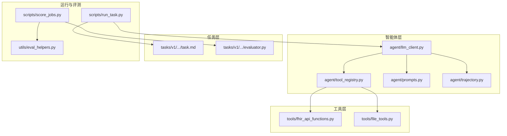
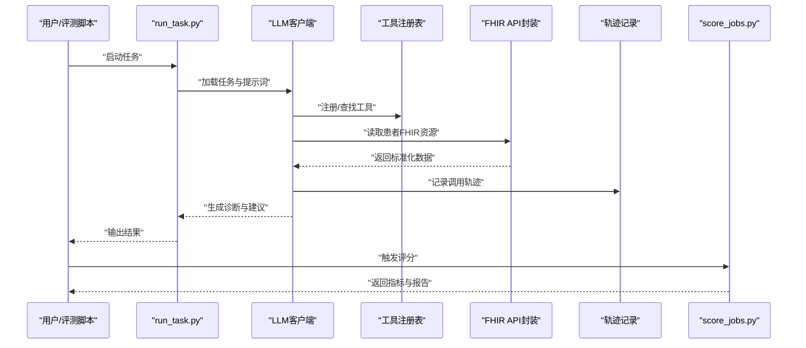
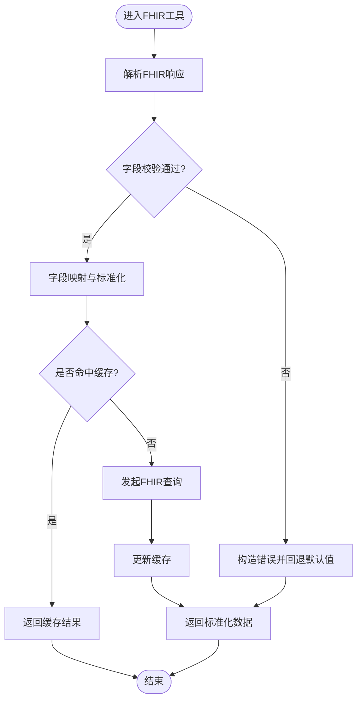
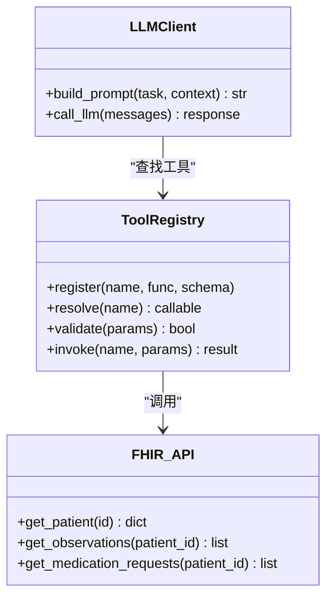
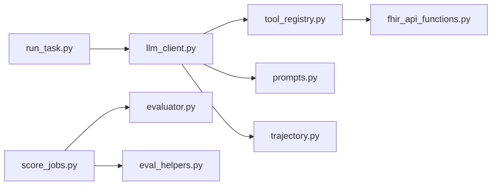

# 医疗诊断流程

<cite>
**本文引用的文件**   
- [task7/poc3_physicianbench/PhysicianBench/tools/fhir_api_functions.py](file://task7/poc3_physicianbench/PhysicianBench/tools/fhir_api_functions.py)
- [task7/poc3_physicianbench/PhysicianBench/agent/tool_registry.py](file://task7/poc3_physicianbench/PhysicianBench/agent/tool_registry.py)
- [task7/poc3_physicianbench/PhysicianBench/agent/llm_client.py](file://task7/poc3_physicianbench/PhysicianBench/agent/llm_client.py)
- [task7/poc3_physicianbench/PhysicianBench/agent/prompts.py](file://task7/poc3_physicianbench/PhysicianBench/agent/prompts.py)
- [task7/poc3_physicianbench/PhysicianBench/agent/trajectory.py](file://task7/poc3_physicianbench/PhysicianBench/agent/trajectory.py)
- [task7/poc3_physicianbench/PhysicianBench/scripts/run_task.py](file://task7/poc3_physicianbench/PhysicianBench/scripts/run_task.py)
- [task7/poc3_physicianbench/PhysicianBench/scripts/score_jobs.py](file://task7/poc3_physicianbench/PhysicianBench/scripts/score_jobs.py)
- [task7/poc3_physicianbench/PhysicianBench/tasks/v1/abnormal_uterine_bleeding/task.md](file://task7/poc3_physicianbench/PhysicianBench/tasks/v1/abnormal_uterine_bleeding/task.md)
- [task7/poc3_physicianbench/PhysicianBench/tasks/v1/abnormal_uterine_bleeding/evaluator.py](file://task7/poc3_physicianbench/PhysicianBench/tasks/v1/abnormal_uterine_bleeding/evaluator.py)
- [task7/poc3_physicianbench/PhysicianBench/utils/eval_helpers.py](file://task7/poc3_physicianbench/PhysicianBench/utils/eval_helpers.py)
</cite>

## 目录
1. [简介](#简介)
2. [项目结构](#项目结构)
3. [核心组件](#核心组件)
4. [架构总览](#架构总览)
5. [详细组件分析](#详细组件分析)
6. [依赖关系分析](#依赖关系分析)
7. [性能与可扩展性](#性能与可扩展性)
8. [故障排查指南](#故障排查指南)
9. [结论](#结论)
10. [附录：多疾病场景案例](#附录多疾病场景案例)

## 简介
本文件面向“医疗诊断辅助系统”的高级示例，聚焦于如何利用AI代理进行临床决策支持，覆盖症状分析、检查建议、诊断推理与治疗方案制定。文档重点说明FHIR数据格式的处理方式、医学知识库的集成路径以及诊断标准的遵循策略，并提供多种疾病场景的完整案例（含患者数据模拟、诊断轨迹记录与结果评估方法）。

该系统以任务驱动的方式组织，围绕 PhysicianBench 的 poc3 子项目展开，包含工具注册、LLM客户端、FHIR API封装、任务定义与评测脚本等关键模块，形成从“输入病例→工具调用→知识检索→推理输出→轨迹记录→评分评估”的闭环。

## 项目结构
本项目采用“按能力分层 + 按任务分域”的组织方式：
- agent：智能体核心（提示词、工具注册、LLM客户端、轨迹记录）
- tools：外部能力封装（如FHIR API函数、文件工具）
- tasks：具体疾病任务定义与评测器
- scripts：运行与批处理脚本（任务执行、评分汇总）
- utils：通用评测辅助函数

图表来源
- [task7/poc3_physicianbench/PhysicianBench/agent/llm_client.py](file://task7/poc3_physicianbench/PhysicianBench/agent/llm_client.py)
- [task7/poc3_physicianbench/PhysicianBench/agent/tool_registry.py](file://task7/poc3_physicianbench/PhysicianBench/agent/tool_registry.py)
- [task7/poc3_physicianbench/PhysicianBench/agent/prompts.py](file://task7/poc3_physicianbench/PhysicianBench/agent/prompts.py)
- [task7/poc3_physicianbench/PhysicianBench/agent/trajectory.py](file://task7/poc3_physicianbench/PhysicianBench/agent/trajectory.py)
- [task7/poc3_physicianbench/PhysicianBench/tools/fhir_api_functions.py](file://task7/poc3_physicianbench/PhysicianBench/tools/fhir_api_functions.py)
- [task7/poc3_physicianbench/PhysicianBench/tools/file_tools.py](file://task7/poc3_physicianbench/PhysicianBench/tools/file_tools.py)
- [task7/poc3_physicianbench/PhysicianBench/tasks/v1/abnormal_uterine_bleeding/task.md](file://task7/poc3_physicianbench/PhysicianBench/tasks/v1/abnormal_uterine_bleeding/task.md)
- [task7/poc3_physicianbench/PhysicianBench/tasks/v1/abnormal_uterine_bleeding/evaluator.py](file://task7/poc3_physicianbench/PhysicianBench/tasks/v1/abnormal_uterine_bleeding/evaluator.py)
- [task7/poc3_physicianbench/PhysicianBench/scripts/run_task.py](file://task7/poc3_physicianbench/PhysicianBench/scripts/run_task.py)
- [task7/poc3_physicianbench/PhysicianBench/scripts/score_jobs.py](file://task7/poc3_physicianbench/PhysicianBench/scripts/score_jobs.py)
- [task7/poc3_physicianbench/PhysicianBench/utils/eval_helpers.py](file://task7/poc3_physicianbench/PhysicianBench/utils/eval_helpers.py)

章节来源
- [task7/poc3_physicianbench/PhysicianBench/scripts/run_task.py](file://task7/poc3_physicianbench/PhysicianBench/scripts/run_task.py)
- [task7/poc3_physicianbench/PhysicianBench/agent/tool_registry.py](file://task7/poc3_physicianbench/PhysicianBench/agent/tool_registry.py)
- [task7/poc3_physicianbench/PhysicianBench/agent/llm_client.py](file://task7/poc3_physicianbench/PhysicianBench/agent/llm_client.py)
- [task7/poc3_physicianbench/PhysicianBench/agent/prompts.py](file://task7/poc3_physicianbench/PhysicianBench/agent/prompts.py)
- [task7/poc3_physicianbench/PhysicianBench/agent/trajectory.py](file://task7/poc3_physicianbench/PhysicianBench/agent/trajectory.py)
- [task7/poc3_physicianbench/PhysicianBench/tools/fhir_api_functions.py](file://task7/poc3_physicianbench/PhysicianBench/tools/fhir_api_functions.py)
- [task7/poc3_physicianbench/PhysicianBench/tasks/v1/abnormal_uterine_bleeding/task.md](file://task7/poc3_physicianbench/PhysicianBench/tasks/v1/abnormal_uterine_bleeding/task.md)
- [task7/poc3_physicianbench/PhysicianBench/tasks/v1/abnormal_uterine_bleeding/evaluator.py](file://task7/poc3_physicianbench/PhysicianBench/tasks/v1/abnormal_uterine_bleeding/evaluator.py)
- [task7/poc3_physicianbench/PhysicianBench/utils/eval_helpers.py](file://task7/poc3_physicianbench/PhysicianBench/utils/eval_helpers.py)

## 核心组件
- LLM客户端：负责与语言模型交互，提供消息构建、调用与返回解析能力。
- 工具注册表：集中管理可用工具（如FHIR查询、文件读写），供智能体按需调度。
- FHIR API封装：将FHIR资源访问抽象为统一接口，屏蔽底层协议差异。
- 提示词工程：结构化提示词模板，引导模型完成症状分析、检查建议、诊断推理与治疗规划。
- 轨迹记录：持久化每次调用的输入、输出、时间戳与上下文，便于审计与复盘。
- 任务与评测：每个疾病场景包含任务描述与评测器，用于自动化打分与指标统计。

章节来源
- [task7/poc3_physicianbench/PhysicianBench/agent/llm_client.py](file://task7/poc3_physicianbench/PhysicianBench/agent/llm_client.py)
- [task7/poc3_physicianbench/PhysicianBench/agent/tool_registry.py](file://task7/poc3_physicianbench/PhysicianBench/agent/tool_registry.py)
- [task7/poc3_physicianbench/PhysicianBench/tools/fhir_api_functions.py](file://task7/poc3_physicianbench/PhysicianBench/tools/fhir_api_functions.py)
- [task7/poc3_physicianbench/PhysicianBench/agent/prompts.py](file://task7/poc3_physicianbench/PhysicianBench/agent/prompts.py)
- [task7/poc3_physicianbench/PhysicianBench/agent/trajectory.py](file://task7/poc3_physicianbench/PhysicianBench/agent/trajectory.py)
- [task7/poc3_physicianbench/PhysicianBench/tasks/v1/abnormal_uterine_bleeding/task.md](file://task7/poc3_physicianbench/PhysicianBench/tasks/v1/abnormal_uterine_bleeding/task.md)
- [task7/poc3_physicianbench/PhysicianBench/tasks/v1/abnormal_uterine_bleeding/evaluator.py](file://task7/poc3_physicianbench/PhysicianBench/tasks/v1/abnormal_uterine_bleeding/evaluator.py)

## 架构总览
下图展示一次典型诊断任务的端到端流程：从任务入口到工具调用、FHIR数据获取、模型推理、轨迹记录与最终评分。

图表来源
- [task7/poc3_physicianbench/PhysicianBench/scripts/run_task.py](file://task7/poc3_physicianbench/PhysicianBench/scripts/run_task.py)
- [task7/poc3_physicianbench/PhysicianBench/agent/llm_client.py](file://task7/poc3_physicianbench/PhysicianBench/agent/llm_client.py)
- [task7/poc3_physicianbench/PhysicianBench/agent/tool_registry.py](file://task7/poc3_physicianbench/PhysicianBench/agent/tool_registry.py)
- [task7/poc3_physicianbench/PhysicianBench/tools/fhir_api_functions.py](file://task7/poc3_physicianbench/PhysicianBench/tools/fhir_api_functions.py)
- [task7/poc3_physicianbench/PhysicianBench/agent/trajectory.py](file://task7/poc3_physicianbench/PhysicianBench/agent/trajectory.py)
- [task7/poc3_physicianbench/PhysicianBench/scripts/score_jobs.py](file://task7/poc3_physicianbench/PhysicianBench/scripts/score_jobs.py)

## 详细组件分析

### 组件A：FHIR数据处理与工具封装
- 职责：将FHIR资源（如Patient、Observation、MedicationRequest等）转换为模型可理解的结构化信息；提供统一的查询与过滤接口。
- 关键点：
  - 字段映射：将FHIR编码映射到可读标签，便于提示词与评测对齐。
  - 错误处理：对缺失字段、非法值进行容错与告警。
  - 缓存策略：对高频资源进行本地缓存，减少重复请求。
- 复杂度：单次查询通常为O(n)遍历资源列表；批量聚合可能达到O(n log n)。

图表来源
- [task7/poc3_physicianbench/PhysicianBench/tools/fhir_api_functions.py](file://task7/poc3_physicianbench/PhysicianBench/tools/fhir_api_functions.py)

章节来源
- [task7/poc3_physicianbench/PhysicianBench/tools/fhir_api_functions.py](file://task7/poc3_physicianbench/PhysicianBench/tools/fhir_api_functions.py)

### 组件B：工具注册与调度
- 职责：维护工具清单、参数校验、路由分发与权限控制。
- 关键点：
  - 动态注册：新增工具无需修改核心逻辑。
  - 参数契约：严格校验输入类型与取值范围。
  - 失败重试：对网络或外部服务异常进行指数退避重试。
- 耦合度：与LLM客户端松耦合，通过接口契约交互。

图表来源
- [task7/poc3_physicianbench/PhysicianBench/agent/tool_registry.py](file://task7/poc3_physicianbench/PhysicianBench/agent/tool_registry.py)
- [task7/poc3_physicianbench/PhysicianBench/tools/fhir_api_functions.py](file://task7/poc3_physicianbench/PhysicianBench/tools/fhir_api_functions.py)
- [task7/poc3_physicianbench/PhysicianBench/agent/llm_client.py](file://task7/poc3_physicianbench/PhysicianBench/agent/llm_client.py)

章节来源
- [task7/poc3_physicianbench/PhysicianBench/agent/tool_registry.py](file://task7/poc3_physicianbench/PhysicianBench/agent/tool_registry.py)
- [task7/poc3_physicianbench/PhysicianBench/agent/llm_client.py](file://task7/poc3_physicianbench/PhysicianBench/agent/llm_client.py)

### 组件C：提示词工程与诊断标准遵循
- 职责：将任务目标、约束条件与诊断标准嵌入提示词，确保输出符合临床规范。
- 关键点：
  - 结构化模板：症状、体征、实验室、影像、既往史等分区。
  - 标准引用：在提示词中显式引用指南条目，提升一致性。
  - 安全护栏：禁止越权操作与不当建议。
- 评估对齐：提示词输出结构与评测器期望一致，便于自动打分。

章节来源
- [task7/poc3_physicianbench/PhysicianBench/agent/prompts.py](file://task7/poc3_physicianbench/PhysicianBench/agent/prompts.py)
- [task7/poc3_physicianbench/PhysicianBench/tasks/v1/abnormal_uterine_bleeding/task.md](file://task7/poc3_physicianbench/PhysicianBench/tasks/v1/abnormal_uterine_bleeding/task.md)

### 组件D：轨迹记录与审计
- 职责：记录每次工具调用、模型交互与中间结果，支持回溯与复现。
- 关键点：
  - 原子写入：每条轨迹独立落盘，避免部分写入导致不一致。
  - 元数据：包含时间戳、会话ID、工具名、参数摘要与状态码。
  - 隐私保护：敏感字段脱敏后再落盘。

章节来源
- [task7/poc3_physicianbench/PhysicianBench/agent/trajectory.py](file://task7/poc3_physicianbench/PhysicianBench/agent/trajectory.py)

### 组件E：任务执行与评分
- 任务执行：加载任务描述、初始化环境、驱动智能体完成工作流。
- 评分汇总：读取轨迹与输出，依据评测器规则计算指标并生成报告。

章节来源
- [task7/poc3_physicianbench/PhysicianBench/scripts/run_task.py](file://task7/poc3_physicianbench/PhysicianBench/scripts/run_task.py)
- [task7/poc3_physicianbench/PhysicianBench/scripts/score_jobs.py](file://task7/poc3_physicianbench/PhysicianBench/scripts/score_jobs.py)
- [task7/poc3_physicianbench/PhysicianBench/utils/eval_helpers.py](file://task7/poc3_physicianbench/PhysicianBench/utils/eval_helpers.py)
- [task7/poc3_physicianbench/PhysicianBench/tasks/v1/abnormal_uterine_bleeding/evaluator.py](file://task7/poc3_physicianbench/PhysicianBench/tasks/v1/abnormal_uterine_bleeding/evaluator.py)

## 依赖关系分析
- 低耦合高内聚：工具层与智能体层通过注册表解耦；任务与评测分离，便于扩展新病种。
- 外部依赖：FHIR服务器、LLM服务、文件系统。
- 潜在循环：应避免在工具中直接反向调用LLM主循环，防止递归依赖。

图表来源
- [task7/poc3_physicianbench/PhysicianBench/scripts/run_task.py](file://task7/poc3_physicianbench/PhysicianBench/scripts/run_task.py)
- [task7/poc3_physicianbench/PhysicianBench/agent/llm_client.py](file://task7/poc3_physicianbench/PhysicianBench/agent/llm_client.py)
- [task7/poc3_physicianbench/PhysicianBench/agent/tool_registry.py](file://task7/poc3_physicianbench/PhysicianBench/agent/tool_registry.py)
- [task7/poc3_physicianbench/PhysicianBench/tools/fhir_api_functions.py](file://task7/poc3_physicianbench/PhysicianBench/tools/fhir_api_functions.py)
- [task7/poc3_physicianbench/PhysicianBench/agent/prompts.py](file://task7/poc3_physicianbench/PhysicianBench/agent/prompts.py)
- [task7/poc3_physicianbench/PhysicianBench/agent/trajectory.py](file://task7/poc3_physicianbench/PhysicianBench/agent/trajectory.py)
- [task7/poc3_physicianbench/PhysicianBench/scripts/score_jobs.py](file://task7/poc3_physicianbench/PhysicianBench/scripts/score_jobs.py)
- [task7/poc3_physicianbench/PhysicianBench/tasks/v1/abnormal_uterine_bleeding/evaluator.py](file://task7/poc3_physicianbench/PhysicianBench/tasks/v1/abnormal_uterine_bleeding/evaluator.py)
- [task7/poc3_physicianbench/PhysicianBench/utils/eval_helpers.py](file://task7/poc3_physicianbench/PhysicianBench/utils/eval_helpers.py)

## 性能与可扩展性
- 并行化：对无副作用的工具调用（如只读FHIR查询）可并发执行，缩短整体时延。
- 缓存：对稳定资源（如术语表、指南片段）做内存/磁盘缓存。
- 增量更新：仅拉取变更的资源段，降低带宽与延迟。
- 可扩展性：新增病种只需添加任务与评测器，无需改动核心链路。

[本节为通用指导，不直接分析具体文件]

## 故障排查指南
- 常见问题
  - FHIR连接失败：检查网络、认证与资源ID有效性。
  - 工具参数错误：核对注册表的schema与调用方传参。
  - 轨迹丢失：确认落盘路径权限与原子写入成功。
  - 评分异常：检查评测器版本与输出结构对齐。
- 定位步骤
  - 查看轨迹文件中的错误码与堆栈摘要。
  - 使用评测辅助函数对比期望与真实输出。
  - 逐步禁用工具，缩小问题范围。

章节来源
- [task7/poc3_physicianbench/PhysicianBench/agent/trajectory.py](file://task7/poc3_physicianbench/PhysicianBench/agent/trajectory.py)
- [task7/poc3_physicianbench/PhysicianBench/utils/eval_helpers.py](file://task7/poc3_physicianbench/PhysicianBench/utils/eval_helpers.py)
- [task7/poc3_physicianbench/PhysicianBench/scripts/score_jobs.py](file://task7/poc3_physicianbench/PhysicianBench/scripts/score_jobs.py)

## 结论
该方案以任务为中心，结合FHIR数据标准化、工具注册与提示词工程，实现了从数据采集到诊断建议的闭环。通过轨迹记录与评测体系，可量化评估不同模型与策略的效果，并为后续扩展更多病种与工具奠定基础。

[本节为总结，不直接分析具体文件]

## 附录：多疾病场景案例
以下给出若干疾病场景的落地思路与评估要点，均基于现有任务框架与评测器模式进行扩展。

- 异常子宫出血（示例）
  - 输入：患者基本信息、月经史、超声与实验室结果（FHIR Observation/Patient）。
  - 工具：FHIR查询、文件读取（病历文本）、指南检索。
  - 输出：鉴别诊断、进一步检查建议、初步治疗计划。
  - 评估：诊断准确性、检查合理性、指南依从性。
  - 参考
    - [task7/poc3_physicianbench/PhysicianBench/tasks/v1/abnormal_uterine_bleeding/task.md](file://task7/poc3_physicianbench/PhysicianBench/tasks/v1/abnormal_uterine_bleeding/task.md)
    - [task7/poc3_physicianbench/PhysicianBench/tasks/v1/abnormal_uterine_bleeding/evaluator.py](file://task7/poc3_physicianbench/PhysicianBench/tasks/v1/abnormal_uterine_bleeding/evaluator.py)

- 慢性咳嗽（示例）
  - 输入：咳嗽持续时间、伴随症状、胸片/肺功能结果。
  - 工具：FHIR查询、影像学解读工具、药物相互作用检查。
  - 输出：病因分类、阶梯式检查建议、对症与对因治疗。
  - 评估：鉴别完整性、检查必要性、用药安全性。

- 高血压合并糖尿病（示例）
  - 输入：血压趋势、糖化血红蛋白、肾功能指标。
  - 工具：FHIR查询、风险分层模型、指南推荐检索。
  - 输出：目标值设定、首选药物与剂量调整、随访计划。
  - 评估：目标达成率、药物选择合理性、并发症预防建议。

- 急性腹痛（示例）
  - 输入：疼痛部位与性质、生命体征、腹部CT/化验。
  - 工具：FHIR查询、急诊分流规则、手术指征检查。
  - 输出：紧急程度分级、优先检查、处置与转诊建议。
  - 评估：分流正确性、检查优先级、处置及时性。

- 甲状腺功能异常（示例）
  - 输入：TSH、FT4/FT3、抗体检测、甲状腺超声。
  - 工具：FHIR查询、内分泌指南检索、药物剂量计算器。
  - 输出：亚临床/临床判断、复查间隔、替代治疗起始与滴定。
  - 评估：判读准确性、复查频率合理性、剂量调整规范性。

[本节为概念性案例说明，未直接分析具体文件]