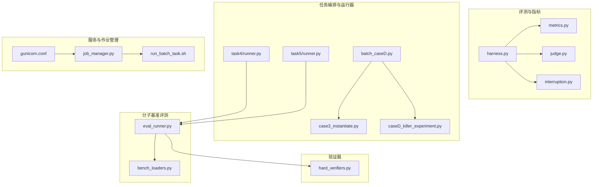
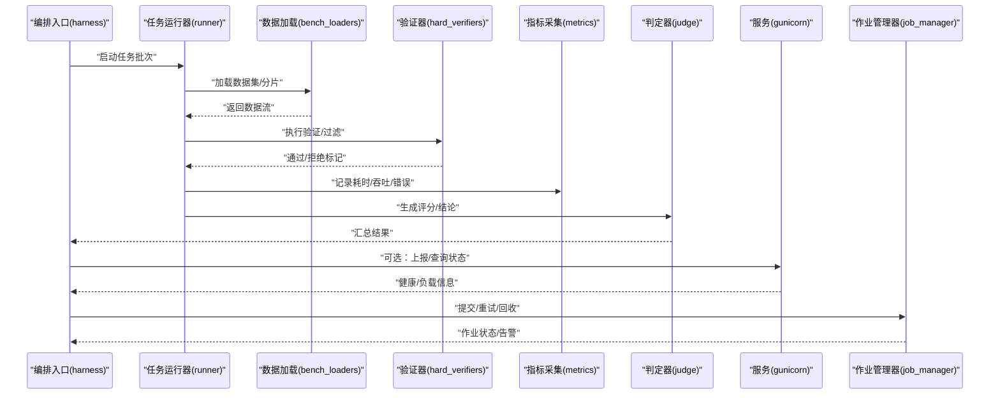
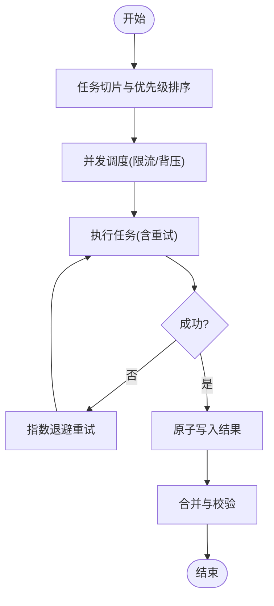
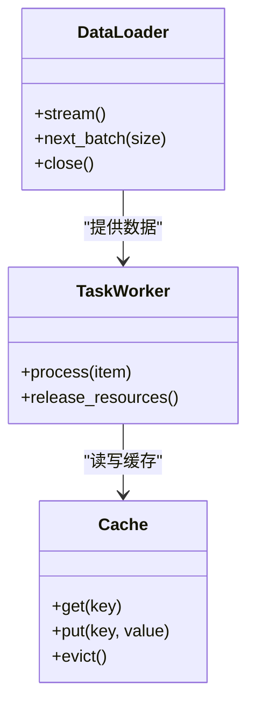
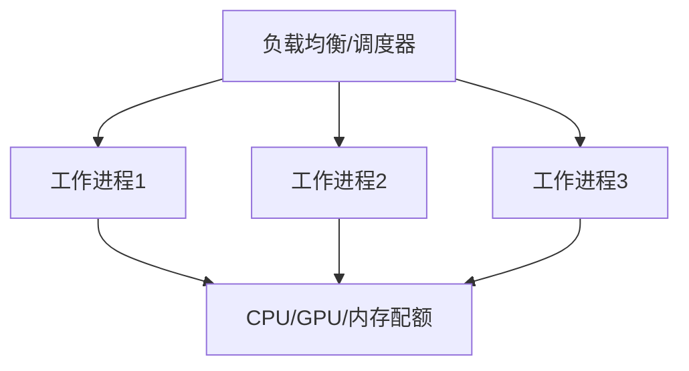
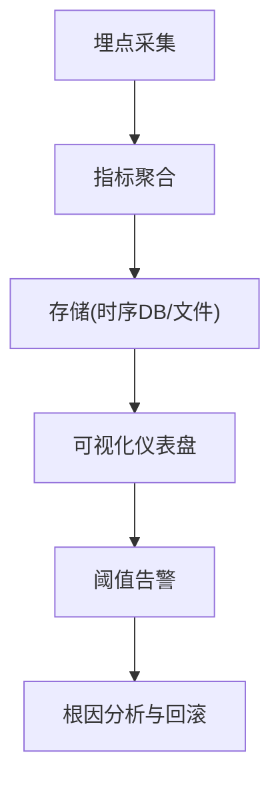
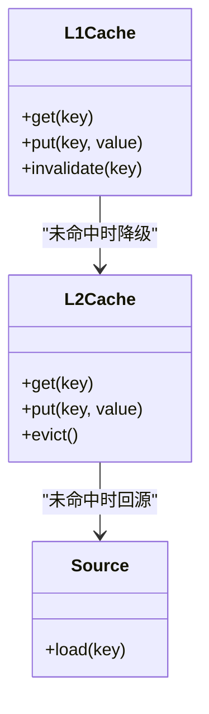
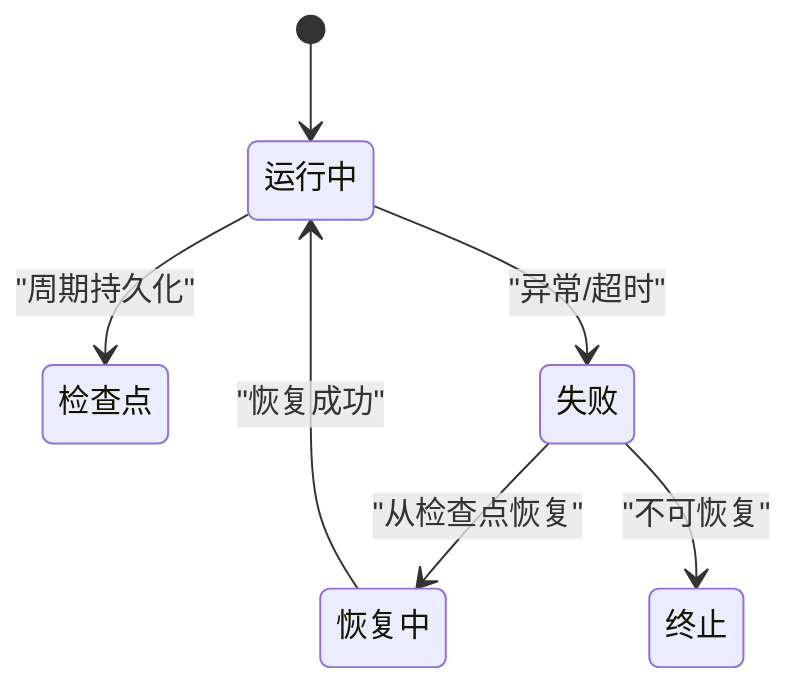
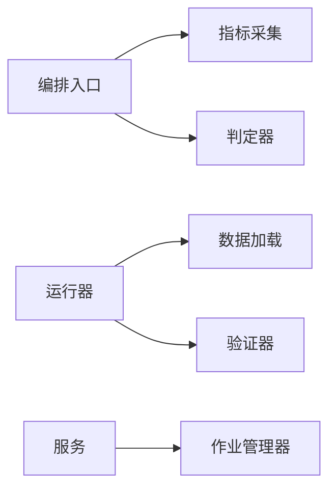

# 性能优化示例

<cite>
**本文引用的文件**   
- [autonomy_mvp/core/harness.py](file://autonomy_mvp/core/harness.py)
- [autonomy_mvp/core/metrics.py](file://autonomy_mvp/core/metrics.py)
- [autonomy_mvp/core/judge.py](file://autonomy_mvp/core/judge.py)
- [autonomy_mvp/core/interruption.py](file://autonomy_mvp/core/interruption.py)
- [autonomy_mvp/run_validation.py](file://autonomy_mvp/run_validation.py)
- [task4/runner.py](file://task4/runner.py)
- [task5/runner.py](file://task5/runner.py)
- [longhorizon/instantiate/batch_caseD.py](file://longhorizon/instantiate/batch_caseD.py)
- [longhorizon/instantiate/case3_instantiate.py](file://longhorizon/instantiate/case3_instantiate.py)
- [longhorizon/instantiate/caseD_killer_experiment.py](file://longhorizon/instantiate/caseD_killer_experiment.py)
- [longhorizon/verifiers/hard_verifiers.py](file://longhorizon/verifiers/hard_verifiers.py)
- [docs/prd/molbench_repo/eval/eval_runner.py](file://docs/prd/molbench_repo/eval/eval_runner.py)
- [docs/prd/molbench_repo/eval/bench_loaders.py](file://docs/prd/molbench_repo/eval/bench_loaders.py)
- [task7/poc1_do_challenge/server/gunicorn.conf](file://task7/poc1_do_challenge/server/gunicorn.conf)
- [task7/poc3_physicianbench/scripts/job_manager.py](file://task7/poc3_physicianbench/scripts/job_manager.py)
- [task7/poc3_physicianbench/scripts/run_batch_task.sh](file://task7/poc3_physicianbench/scripts/run_batch_task.sh)
</cite>

## 目录
1. [简介](#简介)
2. [项目结构](#项目结构)
3. [核心组件](#核心组件)
4. [架构总览](#架构总览)
5. [详细组件分析](#详细组件分析)
6. [依赖分析](#依赖分析)
7. [性能考量](#性能考量)
8. [故障排查指南](#故障排查指南)
9. [结论](#结论)
10. [附录](#附录)

## 简介
本文件聚焦于大规模并行计算、内存管理与计算资源优化的实际示例与最佳实践，覆盖并发执行策略、缓存机制设计、负载均衡配置、性能监控指标收集与分析、瓶颈识别与调优案例，以及分布式计算的部署模式与故障恢复策略。内容基于仓库中的基准测试与评估框架代码进行提炼，旨在为工程团队提供可落地的性能优化参考。

## 项目结构
该仓库包含多个任务与实验子项目，其中与性能优化密切相关的模块主要分布在以下位置：
- 自动化评测与指标采集：autonomy_mvp 核心模块
- 批量任务编排与运行器：task4、task5、longhorizon 的实例化与批处理脚本
- 分子基准评测流水线：docs/prd/molbench_repo/eval
- 服务化部署与进程管理：task7 下的 Gunicorn 配置与作业管理器

图表来源
- [autonomy_mvp/core/harness.py](file://autonomy_mvp/core/harness.py)
- [autonomy_mvp/core/metrics.py](file://autonomy_mvp/core/metrics.py)
- [autonomy_mvp/core/judge.py](file://autonomy_mvp/core/judge.py)
- [autonomy_mvp/core/interruption.py](file://autonomy_mvp/core/interruption.py)
- [task4/runner.py](file://task4/runner.py)
- [task5/runner.py](file://task5/runner.py)
- [longhorizon/instantiate/batch_caseD.py](file://longhorizon/instantiate/batch_caseD.py)
- [longhorizon/instantiate/case3_instantiate.py](file://longhorizon/instantiate/case3_instantiate.py)
- [longhorizon/instantiate/caseD_killer_experiment.py](file://longhorizon/instantiate/caseD_killer_experiment.py)
- [longhorizon/verifiers/hard_verifiers.py](file://longhorizon/verifiers/hard_verifiers.py)
- [docs/prd/molbench_repo/eval/eval_runner.py](file://docs/prd/molbench_repo/eval/eval_runner.py)
- [docs/prd/molbench_repo/eval/bench_loaders.py](file://docs/prd/molbench_repo/eval/bench_loaders.py)
- [task7/poc1_do_challenge/server/gunicorn.conf](file://task7/poc1_do_challenge/server/gunicorn.conf)
- [task7/poc3_physicianbench/scripts/job_manager.py](file://task7/poc3_physicianbench/scripts/job_manager.py)
- [task7/poc3_physicianbench/scripts/run_batch_task.sh](file://task7/poc3_physicianbench/scripts/run_batch_task.sh)

章节来源
- [autonomy_mvp/core/harness.py](file://autonomy_mvp/core/harness.py)
- [autonomy_mvp/core/metrics.py](file://autonomy_mvp/core/metrics.py)
- [autonomy_mvp/core/judge.py](file://autonomy_mvp/core/judge.py)
- [autonomy_mvp/core/interruption.py](file://autonomy_mvp/core/interruption.py)
- [task4/runner.py](file://task4/runner.py)
- [task5/runner.py](file://task5/runner.py)
- [longhorizon/instantiate/batch_caseD.py](file://longhorizon/instantiate/batch_caseD.py)
- [longhorizon/instantiate/case3_instantiate.py](file://longhorizon/instantiate/case3_instantiate.py)
- [longhorizon/instantiate/caseD_killer_experiment.py](file://longhorizon/instantiate/caseD_killer_experiment.py)
- [longhorizon/verifiers/hard_verifiers.py](file://longhorizon/verifiers/hard_verifiers.py)
- [docs/prd/molbench_repo/eval/eval_runner.py](file://docs/prd/molbench_repo/eval/eval_runner.py)
- [docs/prd/molbench_repo/eval/bench_loaders.py](file://docs/prd/molbench_repo/eval/bench_loaders.py)
- [task7/poc1_do_challenge/server/gunicorn.conf](file://task7/poc1_do_challenge/server/gunicorn.conf)
- [task7/poc3_physicianbench/scripts/job_manager.py](file://task7/poc3_physicianbench/scripts/job_manager.py)
- [task7/poc3_physicianbench/scripts/run_batch_task.sh](file://task7/poc3_physicianbench/scripts/run_batch_task.sh)

## 核心组件
- 评测编排与指标采集
  - 编排入口负责加载任务、调度执行、记录指标与结果，并支持中断与重试逻辑。
  - 指标模块提供计时、吞吐、错误率等关键指标的聚合与导出能力。
  - 判定器用于对输出进行质量校验与评分，支撑端到端性能评估。
  - 中断处理模块提供优雅退出、状态保存与恢复点写入，保障长时任务的稳定性。
- 任务运行器与批处理
  - 各任务运行器封装了数据加载、模型调用、结果汇总流程，便于横向对比单线程与多线程/多进程的性能差异。
  - 批处理脚本实现任务切片、并发控制、失败重试与结果合并，适合大规模离线评测。
- 验证器
  - 硬验证器提供严格的数据一致性与边界条件检查，有助于在性能调优过程中快速发现回归问题。
- 分子基准评测流水线
  - 评测运行器统一驱动数据集加载、工具链调用与结果统计；加载器负责高效读取与预处理数据。
- 服务与作业管理
  - Gunicorn 配置文件定义工作进程数、超时与日志策略，影响请求吞吐与资源占用。
  - 作业管理器与批处理 Shell 脚本协调任务提交、资源隔离与失败恢复。

章节来源
- [autonomy_mvp/core/harness.py](file://autonomy_mvp/core/harness.py)
- [autonomy_mvp/core/metrics.py](file://autonomy_mvp/core/metrics.py)
- [autonomy_mvp/core/judge.py](file://autonomy_mvp/core/judge.py)
- [autonomy_mvp/core/interruption.py](file://autonomy_mvp/core/interruption.py)
- [task4/runner.py](file://task4/runner.py)
- [task5/runner.py](file://task5/runner.py)
- [longhorizon/instantiate/batch_caseD.py](file://longhorizon/instantiate/batch_caseD.py)
- [longhorizon/instantiate/case3_instantiate.py](file://longhorizon/instantiate/case3_instantiate.py)
- [longhorizon/instantiate/caseD_killer_experiment.py](file://longhorizon/instantiate/caseD_killer_experiment.py)
- [longhorizon/verifiers/hard_verifiers.py](file://longhorizon/verifiers/hard_verifiers.py)
- [docs/prd/molbench_repo/eval/eval_runner.py](file://docs/prd/molbench_repo/eval/eval_runner.py)
- [docs/prd/molbench_repo/eval/bench_loaders.py](file://docs/prd/molbench_repo/eval/bench_loaders.py)
- [task7/poc1_do_challenge/server/gunicorn.conf](file://task7/poc1_do_challenge/server/gunicorn.conf)
- [task7/poc3_physicianbench/scripts/job_manager.py](file://task7/poc3_physicianbench/scripts/job_manager.py)
- [task7/poc3_physicianbench/scripts/run_batch_task.sh](file://task7/poc3_physicianbench/scripts/run_batch_task.sh)

## 架构总览
下图展示了从任务编排到指标采集、再到结果输出的整体流程，以及外部服务与作业管理的集成点。

图表来源
- [autonomy_mvp/core/harness.py](file://autonomy_mvp/core/harness.py)
- [task4/runner.py](file://task4/runner.py)
- [task5/runner.py](file://task5/runner.py)
- [docs/prd/molbench_repo/eval/bench_loaders.py](file://docs/prd/molbench_repo/eval/bench_loaders.py)
- [longhorizon/verifiers/hard_verifiers.py](file://longhorizon/verifiers/hard_verifiers.py)
- [autonomy_mvp/core/metrics.py](file://autonomy_mvp/core/metrics.py)
- [autonomy_mvp/core/judge.py](file://autonomy_mvp/core/judge.py)
- [task7/poc1_do_challenge/server/gunicorn.conf](file://task7/poc1_do_challenge/server/gunicorn.conf)
- [task7/poc3_physicianbench/scripts/job_manager.py](file://task7/poc3_physicianbench/scripts/job_manager.py)

## 详细组件分析

### 并发执行策略与批处理编排
- 任务切片与并发控制
  - 批处理脚本将大规模任务按批次切分，使用并发队列或进程池进行调度，避免一次性创建过多工作单元导致系统抖动。
  - 通过限制最大并发度与背压机制（如令牌桶或信号量）保护下游资源（I/O、GPU/CPU）。
- 失败重试与幂等性
  - 对易失败的外部调用（网络、第三方工具）增加指数退避重试；确保任务具备幂等性，以便安全重跑。
- 结果合并与一致性
  - 采用原子写入与临时文件命名空间，避免部分写入导致的脏读；最终合并阶段做去重与校验。

图表来源
- [longhorizon/instantiate/batch_caseD.py](file://longhorizon/instantiate/batch_caseD.py)
- [longhorizon/instantiate/case3_instantiate.py](file://longhorizon/instantiate/case3_instantiate.py)
- [longhorizon/instantiate/caseD_killer_experiment.py](file://longhorizon/instantiate/caseD_killer_experiment.py)
- [task7/poc3_physicianbench/scripts/run_batch_task.sh](file://task7/poc3_physicianbench/scripts/run_batch_task.sh)

章节来源
- [longhorizon/instantiate/batch_caseD.py](file://longhorizon/instantiate/batch_caseD.py)
- [longhorizon/instantiate/case3_instantiate.py](file://longhorizon/instantiate/case3_instantiate.py)
- [longhorizon/instantiate/caseD_killer_experiment.py](file://longhorizon/instantiate/caseD_killer_experiment.py)
- [task7/poc3_physicianbench/scripts/run_batch_task.sh](file://task7/poc3_physicianbench/scripts/run_batch_task.sh)

### 内存管理与对象生命周期
- 流式读取与分批处理
  - 数据加载器采用迭代器/生成器模式，避免一次性加载全部数据到内存；结合固定大小的缓冲区减少峰值内存。
- 显式释放与垃圾回收
  - 在任务完成后及时释放大对象引用，必要时触发垃圾回收；避免循环引用导致的内存泄漏。
- 序列化与持久化
  - 中间结果以紧凑格式存储，按需反序列化；对热点数据进行轻量级缓存，冷数据落盘。

图表来源
- [docs/prd/molbench_repo/eval/bench_loaders.py](file://docs/prd/molbench_repo/eval/bench_loaders.py)
- [autonomy_mvp/core/harness.py](file://autonomy_mvp/core/harness.py)
- [autonomy_mvp/core/metrics.py](file://autonomy_mvp/core/metrics.py)

章节来源
- [docs/prd/molbench_repo/eval/bench_loaders.py](file://docs/prd/molbench_repo/eval/bench_loaders.py)
- [autonomy_mvp/core/harness.py](file://autonomy_mvp/core/harness.py)
- [autonomy_mvp/core/metrics.py](file://autonomy_mvp/core/metrics.py)

### 计算资源优化与负载均衡
- 进程/线程模型选择
  - CPU密集型任务优先多进程；I/O密集型任务可使用多线程或异步协程；混合场景根据资源特征动态调整。
- 负载均衡配置
  - 服务层通过工作进程数与每进程线程数匹配硬件核数；设置合理的超时与心跳，避免僵尸进程。
- 资源隔离与配额
  - 使用容器或 cgroup 限制 CPU/内存上限，防止单个任务抢占系统资源。

图表来源
- [task7/poc1_do_challenge/server/gunicorn.conf](file://task7/poc1_do_challenge/server/gunicorn.conf)
- [task7/poc3_physicianbench/scripts/job_manager.py](file://task7/poc3_physicianbench/scripts/job_manager.py)

章节来源
- [task7/poc1_do_challenge/server/gunicorn.conf](file://task7/poc1_do_challenge/server/gunicorn.conf)
- [task7/poc3_physicianbench/scripts/job_manager.py](file://task7/poc3_physicianbench/scripts/job_manager.py)

### 性能监控指标收集与分析
- 关键指标
  - 延迟分布（P50/P95/P99）、吞吐（QPS/TPS）、错误率、资源利用率（CPU/内存/GPU）、队列长度与等待时间。
- 采集与聚合
  - 在关键路径埋点，使用指标库进行实时聚合；定期导出至时序数据库或本地文件，便于离线分析。
- 可视化与告警
  - 建立仪表盘展示趋势与阈值告警；结合日志关联定位异常根因。

图表来源
- [autonomy_mvp/core/metrics.py](file://autonomy_mvp/core/metrics.py)
- [autonomy_mvp/core/harness.py](file://autonomy_mvp/core/harness.py)

章节来源
- [autonomy_mvp/core/metrics.py](file://autonomy_mvp/core/metrics.py)
- [autonomy_mvp/core/harness.py](file://autonomy_mvp/core/harness.py)

### 缓存机制设计与失效策略
- 多级缓存
  - 热数据入内存缓存（LRU/TTL），次热数据入磁盘缓存（键值存储），冷数据直接访问源数据。
- 缓存键设计
  - 基于输入特征哈希生成稳定键；版本化以避免旧缓存污染新结果。
- 失效与更新
  - 主动失效（变更事件）与被动失效（TTL）结合；写穿透/写回策略保证一致性。

图表来源
- [autonomy_mvp/core/harness.py](file://autonomy_mvp/core/harness.py)
- [docs/prd/molbench_repo/eval/bench_loaders.py](file://docs/prd/molbench_repo/eval/bench_loaders.py)

章节来源
- [autonomy_mvp/core/harness.py](file://autonomy_mvp/core/harness.py)
- [docs/prd/molbench_repo/eval/bench_loaders.py](file://docs/prd/molbench_repo/eval/bench_loaders.py)

### 分布式计算部署模式与故障恢复
- 部署模式
  - 微服务+消息队列：解耦生产与消费，提升弹性伸缩能力；或使用批处理集群（Slurm/Kubernetes Jobs）进行离线任务调度。
- 故障恢复
  - 检查点与断点续跑：周期性持久化状态，崩溃后从最近检查点恢复。
  - 幂等与补偿：任务具备幂等性，失败后可安全重试；引入补偿事务修正不一致状态。
- 健康检查与自愈
  - 服务健康探针与自动重启；作业管理器监控失败率与资源水位，触发扩缩容。

图表来源
- [autonomy_mvp/core/interruption.py](file://autonomy_mvp/core/interruption.py)
- [task7/poc3_physicianbench/scripts/job_manager.py](file://task7/poc3_physicianbench/scripts/job_manager.py)

章节来源
- [autonomy_mvp/core/interruption.py](file://autonomy_mvp/core/interruption.py)
- [task7/poc3_physicianbench/scripts/job_manager.py](file://task7/poc3_physicianbench/scripts/job_manager.py)

## 依赖分析
- 组件耦合
  - 编排入口依赖指标与判定器，运行器依赖数据加载与验证器；服务与作业管理器作为外部依赖提供运行时支撑。
- 潜在循环依赖
  - 当前结构清晰分层，未见明显循环依赖；建议在新增模块时保持单向依赖原则。
- 外部依赖与集成点
  - 指标采集、日志、消息队列、时序数据库等外部系统通过接口抽象接入，降低替换成本。

图表来源
- [autonomy_mvp/core/harness.py](file://autonomy_mvp/core/harness.py)
- [autonomy_mvp/core/metrics.py](file://autonomy_mvp/core/metrics.py)
- [autonomy_mvp/core/judge.py](file://autonomy_mvp/core/judge.py)
- [task4/runner.py](file://task4/runner.py)
- [task5/runner.py](file://task5/runner.py)
- [docs/prd/molbench_repo/eval/bench_loaders.py](file://docs/prd/molbench_repo/eval/bench_loaders.py)
- [longhorizon/verifiers/hard_verifiers.py](file://longhorizon/verifiers/hard_verifiers.py)
- [task7/poc1_do_challenge/server/gunicorn.conf](file://task7/poc1_do_challenge/server/gunicorn.conf)
- [task7/poc3_physicianbench/scripts/job_manager.py](file://task7/poc3_physicianbench/scripts/job_manager.py)

章节来源
- [autonomy_mvp/core/harness.py](file://autonomy_mvp/core/harness.py)
- [autonomy_mvp/core/metrics.py](file://autonomy_mvp/core/metrics.py)
- [autonomy_mvp/core/judge.py](file://autonomy_mvp/core/judge.py)
- [task4/runner.py](file://task4/runner.py)
- [task5/runner.py](file://task5/runner.py)
- [docs/prd/molbench_repo/eval/bench_loaders.py](file://docs/prd/molbench_repo/eval/bench_loaders.py)
- [longhorizon/verifiers/hard_verifiers.py](file://longhorizon/verifiers/hard_verifiers.py)
- [task7/poc1_do_challenge/server/gunicorn.conf](file://task7/poc1_do_challenge/server/gunicorn.conf)
- [task7/poc3_physicianbench/scripts/job_manager.py](file://task7/poc3_physicianbench/scripts/job_manager.py)

## 性能考量
- 并发度调优
  - 依据 CPU/内存/GPU 利用率曲线确定最优并发度；在高延迟外部调用场景下适当提高并发以提升吞吐。
- I/O 优化
  - 使用零拷贝与缓冲读取；批量写入与压缩传输减少磁盘与网络开销。
- 算法与数据结构
  - 选择合适的数据结构与索引，降低时间复杂度；避免不必要的深拷贝与大对象传递。
- 缓存命中率
  - 监控缓存命中率与淘汰策略效果，动态调整 TTL 与容量。
- 资源配额与隔离
  - 合理设置容器/进程资源上限，避免争抢导致的抖动与退化。

[本节为通用指导，不直接分析具体文件]

## 故障排查指南
- 常见症状
  - 高延迟与低吞吐：检查并发度、锁竞争、外部依赖响应时间与队列积压。
  - 内存溢出：定位大对象与循环引用，启用流式处理与显式释放。
  - 频繁失败与重试风暴：检查幂等性与退避策略，完善健康检查与熔断。
- 定位方法
  - 结合指标与日志进行链路追踪；使用火焰图分析热点函数；对比单线程与多线程/多进程的差异。
- 恢复策略
  - 从检查点恢复；滚动升级与灰度发布；快速回滚与降级策略。

章节来源
- [autonomy_mvp/core/interruption.py](file://autonomy_mvp/core/interruption.py)
- [autonomy_mvp/core/metrics.py](file://autonomy_mvp/core/metrics.py)
- [task7/poc3_physicianbench/scripts/job_manager.py](file://task7/poc3_physicianbench/scripts/job_manager.py)

## 结论
通过对编排、运行器、验证器、指标采集与服务/作业管理的系统性分析，可以构建出兼顾吞吐、延迟与稳定性的性能优化方案。关键在于：合理的并发与资源模型、稳健的缓存与失效策略、完善的监控与告警体系，以及可靠的分布式部署与故障恢复机制。建议在实际工程中持续度量与迭代，逐步逼近最优性能。

[本节为总结性内容，不直接分析具体文件]

## 附录
- 术语表
  - 背压：当消费者处理能力不足时，生产者降低速率以避免过载。
  - 幂等：多次执行同一操作产生相同结果，无副作用。
  - 检查点：周期性持久化的状态快照，用于崩溃恢复。
- 参考实践
  - 使用批处理脚本进行任务切片与并发控制。
  - 在服务层通过进程/线程数匹配硬件资源，并设置超时与健康检查。
  - 在关键路径埋点，建立统一的指标与日志规范。

[本节为补充说明，不直接分析具体文件]