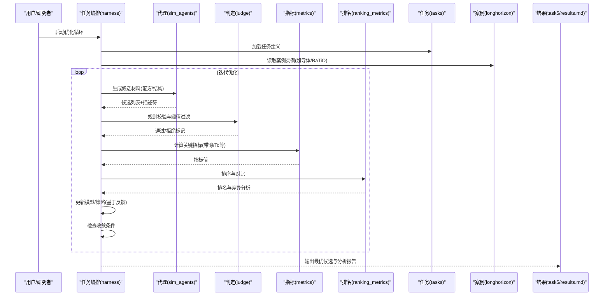
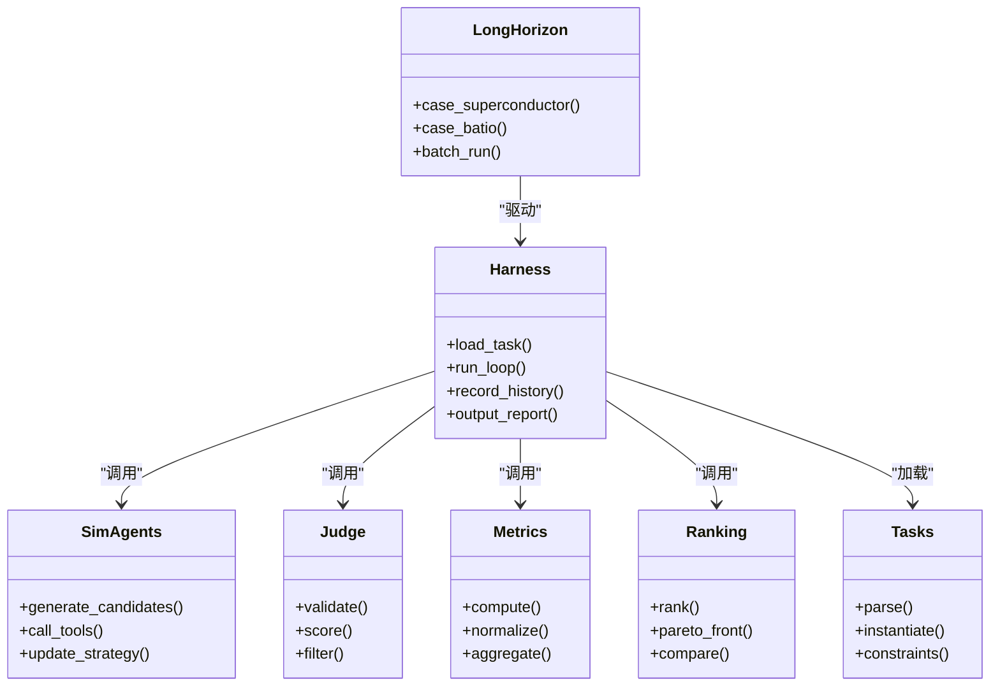

# 材料优化循环

<cite>
**本文引用的文件**   
- [autonomy_mvp/core/harness.py](file://autonomy_mvp/core/harness.py)
- [autonomy_mvp/core/judge.py](file://autonomy_mvp/core/judge.py)
- [autonomy_mvp/core/metrics.py](file://autonomy_mvp/core/metrics.py)
- [autonomy_mvp/core/ranking_metrics.py](file://autonomy_mvp/core/ranking_metrics.py)
- [autonomy_mvp/core/sim_agents.py](file://autonomy_mvp/core/sim_agents.py)
- [autonomy_mvp/core/tasks.py](file://autonomy_mvp/core/tasks.py)
- [autonomy_mvp/tasks/materials_semiconductor_bandgap.json](file://autonomy_mvp/tasks/materials_semiconductor_bandgap.json)
- [longhorizon/instantiate/instances/mat1_superconductor_premium.json](file://longhorizon/instantiate/instances/mat1_superconductor_premium.json)
- [longhorizon/case1_材料发现_超导体.md](file://longhorizon/case1_材料发现_超导体.md)
- [longhorizon/caseD_材料闭环优化_BaTiO.md](file://longhorizon/caseD_材料闭环优化_BaTiO.md)
- [longhorizon/instantiate/batch_caseD.py](file://longhorizon/instantiate/batch_caseD.py)
- [task4/goal.md](file://task4/goal.md)
- [task5/runner.py](file://task5/runner.py)
- [task5/results.md](file://task5/results.md)
- [docs/search/superconductor_gt_findings.md](file://docs/search/superconductor_gt_findings.md)
- [docs/search/semiconductor_gt_findings.md](file://docs/search/semiconductor_gt_findings.md)
</cite>

## 目录
1. [引言](#引言)
2. [项目结构](#项目结构)
3. [核心组件](#核心组件)
4. [架构总览](#架构总览)
5. [详细组件分析](#详细组件分析)
6. [依赖关系分析](#依赖关系分析)
7. [性能与收敛性考虑](#性能与收敛性考虑)
8. [故障排查指南](#故障排查指南)
9. [结论](#结论)
10. [附录](#附录)

## 引言
本文件面向材料科学中的“自动搜索与优化”场景，围绕高通量计算、机器学习预测与实验验证的闭环流程，给出一个可落地的实现范式。文档聚焦以下目标：
- 定义材料描述符与性能指标体系
- 设计并实现“生成候选—快速筛选—高精度评估—反馈更新”的迭代优化循环
- 选择并配置合适的优化算法与收敛条件
- 以超导体与半导体为例，展示端到端案例与结果分析方法

## 项目结构
仓库中与材料优化循环相关的代码与资料主要分布在如下位置：
- 自动化执行与评测框架：autonomy_mvp（任务编排、代理模拟、度量与排名）
- 长周期案例与实例化脚本：longhorizon（超导体与BaTiO闭环案例、批量运行）
- 任务目标与结果汇总：task4、task5（目标说明、运行器与结果报告）
- 领域知识检索与基准发现：docs/search（超导体与半导体的基准发现摘要）

```mermaid
graph TB
subgraph "自动化与评测"
A["harness.py<br/>任务编排与执行"]
B["sim_agents.py<br/>代理模拟"]
C["judge.py<br/>判定与评分"]
D["metrics.py<br/>指标计算"]
E["ranking_metrics.py<br/>排序与对比"]
F["tasks.py<br/>任务定义"]
end
subgraph "案例与数据"
G["materials_semiconductor_bandgap.json<br/>半导体带隙任务"]
H["mat1_superconductor_premium.json<br/>超导体实例"]
I["case1_材料发现_超导体.md<br/>超导体案例说明"]
J["caseD_材料闭环优化_BaTiO.md<br/>BaTiO闭环案例"]
K["batch_caseD.py<br/>批量执行脚本"]
end
subgraph "任务与结果"
L["task4/goal.md<br/>任务目标"]
M["task5/runner.py<br/>运行器"]
N["task5/results.md<br/>结果汇总"]
end
subgraph "领域知识"
O["superconductor_gt_findings.md<br/>超导体基准发现"]
P["semiconductor_gt_findings.md<br/>半导体基准发现"]
end
A --> B
A --> C
A --> D
A --> E
A --> F
A --> G
A --> H
A --> I
A --> J
A --> K
A --> L
A --> M
A --> N
A --> O
A --> P
```

图表来源
- [autonomy_mvp/core/harness.py](file://autonomy_mvp/core/harness.py)
- [autonomy_mvp/core/sim_agents.py](file://autonomy_mvp/core/sim_agents.py)
- [autonomy_mvp/core/judge.py](file://autonomy_mvp/core/judge.py)
- [autonomy_mvp/core/metrics.py](file://autonomy_mvp/core/metrics.py)
- [autonomy_mvp/core/ranking_metrics.py](file://autonomy_mvp/core/ranking_metrics.py)
- [autonomy_mvp/core/tasks.py](file://autonomy_mvp/core/tasks.py)
- [autonomy_mvp/tasks/materials_semiconductor_bandgap.json](file://autonomy_mvp/tasks/materials_semiconductor_bandgap.json)
- [longhorizon/instantiate/instances/mat1_superconductor_premium.json](file://longhorizon/instantiate/instances/mat1_superconductor_premium.json)
- [longhorizon/case1_材料发现_超导体.md](file://longhorizon/case1_材料发现_超导体.md)
- [longhorizon/caseD_材料闭环优化_BaTiO.md](file://longhorizon/caseD_材料闭环优化_BaTiO.md)
- [longhorizon/instantiate/batch_caseD.py](file://longhorizon/instantiate/batch_caseD.py)
- [task4/goal.md](file://task4/goal.md)
- [task5/runner.py](file://task5/runner.py)
- [task5/results.md](file://task5/results.md)
- [docs/search/superconductor_gt_findings.md](file://docs/search/superconductor_gt_findings.md)
- [docs/search/semiconductor_gt_findings.md](file://docs/search/semiconductor_gt_findings.md)

章节来源
- [autonomy_mvp/core/harness.py](file://autonomy_mvp/core/harness.py)
- [autonomy_mvp/core/sim_agents.py](file://autonomy_mvp/core/sim_agents.py)
- [autonomy_mvp/core/judge.py](file://autonomy_mvp/core/judge.py)
- [autonomy_mvp/core/metrics.py](file://autonomy_mvp/core/metrics.py)
- [autonomy_mvp/core/ranking_metrics.py](file://autonomy_mvp/core/ranking_metrics.py)
- [autonomy_mvp/core/tasks.py](file://autonomy_mvp/core/tasks.py)
- [autonomy_mvp/tasks/materials_semiconductor_bandgap.json](file://autonomy_mvp/tasks/materials_semiconductor_bandgap.json)
- [longhorizon/instantiate/instances/mat1_superconductor_premium.json](file://longhorizon/instantiate/instances/mat1_superconductor_premium.json)
- [longhorizon/case1_材料发现_超导体.md](file://longhorizon/case1_材料发现_超导体.md)
- [longhorizon/caseD_材料闭环优化_BaTiO.md](file://longhorizon/caseD_材料闭环优化_BaTiO.md)
- [longhorizon/instantiate/batch_caseD.py](file://longhorizon/instantiate/batch_caseD.py)
- [task4/goal.md](file://task4/goal.md)
- [task5/runner.py](file://task5/runner.py)
- [task5/results.md](file://task5/results.md)
- [docs/search/superconductor_gt_findings.md](file://docs/search/superconductor_gt_findings.md)
- [docs/search/semiconductor_gt_findings.md](file://docs/search/semiconductor_gt_findings.md)

## 核心组件
- 任务编排与执行（harness）：负责加载任务、驱动代理、组织多步工作流、记录中间状态与最终结果。
- 代理模拟（sim_agents）：提供可插拔的“智能体”行为，用于生成候选材料配方或结构、调用工具进行计算与查询。
- 判定与评分（judge）：对候选方案进行规则校验、阈值判断与质量打分，支持多指标聚合。
- 指标与排名（metrics、ranking_metrics）：定义材料性能指标（如带隙、临界温度等），并提供排序、对比与可视化辅助。
- 任务定义（tasks）：将具体材料问题抽象为可执行的子任务序列，包括输入输出契约与约束。
- 案例与实例（longhorizon）：提供超导体与BaTiO等具体案例的任务实例与批处理脚本，便于复现实验。

章节来源
- [autonomy_mvp/core/harness.py](file://autonomy_mvp/core/harness.py)
- [autonomy_mvp/core/sim_agents.py](file://autonomy_mvp/core/sim_agents.py)
- [autonomy_mvp/core/judge.py](file://autonomy_mvp/core/judge.py)
- [autonomy_mvp/core/metrics.py](file://autonomy_mvp/core/metrics.py)
- [autonomy_mvp/core/ranking_metrics.py](file://autonomy_mvp/core/ranking_metrics.py)
- [autonomy_mvp/core/tasks.py](file://autonomy_mvp/core/tasks.py)

## 架构总览
下图展示了“材料优化循环”的整体架构与数据流：从任务定义到候选生成、快速筛选、高精度评估、反馈更新，再到收敛判定与结果归档。

图表来源
- [autonomy_mvp/core/harness.py](file://autonomy_mvp/core/harness.py)
- [autonomy_mvp/core/sim_agents.py](file://autonomy_mvp/core/sim_agents.py)
- [autonomy_mvp/core/judge.py](file://autonomy_mvp/core/judge.py)
- [autonomy_mvp/core/metrics.py](file://autonomy_mvp/core/metrics.py)
- [autonomy_mvp/core/ranking_metrics.py](file://autonomy_mvp/core/ranking_metrics.py)
- [autonomy_mvp/core/tasks.py](file://autonomy_mvp/core/tasks.py)
- [longhorizon/case1_材料发现_超导体.md](file://longhorizon/case1_材料发现_超导体.md)
- [longhorizon/caseD_材料闭环优化_BaTiO.md](file://longhorizon/caseD_材料闭环优化_BaTiO.md)
- [task5/results.md](file://task5/results.md)

## 详细组件分析

### 组件A：任务编排与执行（harness）
- 职责
  - 解析任务定义与案例实例，初始化环境
  - 驱动代理生成候选，协调判定与指标计算
  - 维护迭代历史、保存中间结果与最终报告
- 关键流程
  - 加载任务与实例 → 初始化代理与工具 → 进入优化循环 → 收敛判定 → 输出结果
- 扩展点
  - 可替换代理策略（启发式、贝叶斯优化、强化学习等）
  - 可插入新的指标与排名方法
  - 可对接外部计算平台（DFT、MD、实验设备API）

章节来源
- [autonomy_mvp/core/harness.py](file://autonomy_mvp/core/harness.py)

### 组件B：代理模拟（sim_agents）
- 职责
  - 根据任务上下文生成候选材料（成分、结构、工艺参数）
  - 调用工具完成描述符计算、性质预测与初步筛选
- 关键能力
  - 组合式生成（元素替换、空位/掺杂、晶格畸变）
  - 基于规则的探索（化学价态平衡、空间群限制）
  - 基于模型的探索（主动学习、不确定性采样）
- 与外部集成
  - 可接入数据库检索、在线知识库、计算服务

章节来源
- [autonomy_mvp/core/sim_agents.py](file://autonomy_mvp/core/sim_agents.py)

### 组件C：判定与评分（judge）
- 职责
  - 对候选进行可行性校验（稳定性、合成可达性）
  - 应用阈值与约束（带隙范围、Tc下限、密度上限等）
  - 生成综合评分（加权多指标或分层决策）
- 关键逻辑
  - 规则引擎 + 阈值门控 + 评分函数
  - 支持失败回退与重试策略

章节来源
- [autonomy_mvp/core/judge.py](file://autonomy_mvp/core/judge.py)

### 组件D：指标与排名（metrics、ranking_metrics）
- 职责
  - 定义材料性能指标（如半导体带隙、超导体临界温度、载流子迁移率等）
  - 计算指标值并进行归一化、加权与对比
  - 提供排序、帕累托前沿分析与可视化辅助
- 关键能力
  - 多目标优化支持（权衡不同指标）
  - 统计检验与显著性分析（可选）

章节来源
- [autonomy_mvp/core/metrics.py](file://autonomy_mvp/core/metrics.py)
- [autonomy_mvp/core/ranking_metrics.py](file://autonomy_mvp/core/ranking_metrics.py)

### 组件E：任务定义（tasks）
- 职责
  - 将材料问题形式化为可执行任务（输入、步骤、输出、约束）
  - 提供任务模板与参数化配置
- 示例
  - 半导体带隙优化任务（含数据集与基线）
  - 超导体高Tc搜索任务（含实例与案例说明）

章节来源
- [autonomy_mvp/core/tasks.py](file://autonomy_mvp/core/tasks.py)
- [autonomy_mvp/tasks/materials_semiconductor_bandgap.json](file://autonomy_mvp/tasks/materials_semiconductor_bandgap.json)

### 组件F：案例与实例（longhorizon）
- 超导体案例
  - 实例定义与任务说明
  - 结果与分析要点
- BaTiO闭环优化案例
  - 闭环流程设计与批处理脚本
  - 迭代过程与收敛表现

章节来源
- [longhorizon/instantiate/instances/mat1_superconductor_premium.json](file://longhorizon/instantiate/instances/mat1_superconductor_premium.json)
- [longhorizon/case1_材料发现_超导体.md](file://longhorizon/case1_材料发现_超导体.md)
- [longhorizon/caseD_材料闭环优化_BaTiO.md](file://longhorizon/caseD_材料闭环优化_BaTiO.md)
- [longhorizon/instantiate/batch_caseD.py](file://longhorizon/instantiate/batch_caseD.py)

### 组件G：任务目标与结果（task4、task5）
- 任务目标
  - 明确优化方向、评价指标与验收标准
- 运行器与结果
  - 统一运行入口与日志
  - 结果汇总与对比分析

章节来源
- [task4/goal.md](file://task4/goal.md)
- [task5/runner.py](file://task5/runner.py)
- [task5/results.md](file://task5/results.md)

### 组件H：领域知识与基准（docs/search）
- 超导体基准发现
  - 关键文献与数据集线索
  - 性能指标与参考值
- 半导体基准发现
  - 带隙分布与典型材料族
  - 评价方法与基线模型

章节来源
- [docs/search/superconductor_gt_findings.md](file://docs/search/superconductor_gt_findings.md)
- [docs/search/semiconductor_gt_findings.md](file://docs/search/semiconductor_gt_findings.md)

## 依赖关系分析
- 模块耦合
  - harness 作为中枢，依赖 tasks、sim_agents、judge、metrics、ranking_metrics
  - longhorizon 案例通过 harness 驱动，产出结果至 task5/results.md
- 外部依赖
  - 计算与实验接口（DFT、MD、仪器API）可通过 sim_agents 与 judge 扩展
  - 数据源（数据库、知识库）通过 tasks 与 sim_agents 注入

图表来源
- [autonomy_mvp/core/harness.py](file://autonomy_mvp/core/harness.py)
- [autonomy_mvp/core/sim_agents.py](file://autonomy_mvp/core/sim_agents.py)
- [autonomy_mvp/core/judge.py](file://autonomy_mvp/core/judge.py)
- [autonomy_mvp/core/metrics.py](file://autonomy_mvp/core/metrics.py)
- [autonomy_mvp/core/ranking_metrics.py](file://autonomy_mvp/core/ranking_metrics.py)
- [autonomy_mvp/core/tasks.py](file://autonomy_mvp/core/tasks.py)
- [longhorizon/case1_材料发现_超导体.md](file://longhorizon/case1_材料发现_超导体.md)
- [longhorizon/caseD_材料闭环优化_BaTiO.md](file://longhorizon/caseD_材料闭环优化_BaTiO.md)
- [longhorizon/instantiate/batch_caseD.py](file://longhorizon/instantiate/batch_caseD.py)

章节来源
- [autonomy_mvp/core/harness.py](file://autonomy_mvp/core/harness.py)
- [autonomy_mvp/core/sim_agents.py](file://autonomy_mvp/core/sim_agents.py)
- [autonomy_mvp/core/judge.py](file://autonomy_mvp/core/judge.py)
- [autonomy_mvp/core/metrics.py](file://autonomy_mvp/core/metrics.py)
- [autonomy_mvp/core/ranking_metrics.py](file://autonomy_mvp/core/ranking_metrics.py)
- [autonomy_mvp/core/tasks.py](file://autonomy_mvp/core/tasks.py)
- [longhorizon/case1_材料发现_超导体.md](file://longhorizon/case1_材料发现_超导体.md)
- [longhorizon/caseD_材料闭环优化_BaTiO.md](file://longhorizon/caseD_材料闭环优化_BaTiO.md)
- [longhorizon/instantiate/batch_caseD.py](file://longhorizon/instantiate/batch_caseD.py)

## 性能与收敛性考虑
- 描述符计算
  - 结构类：空间群、配位数、键长/角分布、缺陷浓度
  - 电子类：能带拓扑特征、态密度积分、有效质量近似
  - 热力学类：形成能、相稳定性、声子谱稳定性
  - 经验类：电负性差、原子半径比、混合熵
- 优化算法选择
  - 单目标：贝叶斯优化、遗传算法、粒子群优化
  - 多目标：NSGA-II、MOEA/D、帕累托前沿追踪
  - 主动学习：不确定性采样、期望改进（EI）、最大方差
- 收敛条件设置
  - 指标改善阈值（连续N代无提升则停止）
  - 计算预算上限（迭代次数、并行度、时间窗口）
  - 多样性阈值（避免早熟收敛）
- 高通量与并行
  - 任务分片与队列管理
  - 缓存与去重（相似结构/配方跳过重复计算）
  - 失败重试与容错（超时、资源不足）

[本节为通用指导，不直接分析具体文件]

## 故障排查指南
- 常见问题
  - 代理生成失败：检查任务约束与生成规则；增加回退策略
  - 指标计算异常：确认输入格式与单位；添加断言与边界检查
  - 收敛过早：调整探索-利用比例；引入多样性惩罚
  - 资源耗尽：降低并行度；启用任务优先级与抢占
- 定位方法
  - 查看中间日志与历史记录
  - 使用最小可复现用例隔离问题
  - 逐步关闭外部依赖（先离线后在线）

章节来源
- [autonomy_mvp/core/harness.py](file://autonomy_mvp/core/harness.py)
- [autonomy_mvp/core/judge.py](file://autonomy_mvp/core/judge.py)
- [autonomy_mvp/core/metrics.py](file://autonomy_mvp/core/metrics.py)
- [task5/results.md](file://task5/results.md)

## 结论
本文件给出了材料科学中“自动搜索与优化”的完整闭环范式，涵盖任务编排、代理生成、判定评分、指标排名与收敛控制，并以超导体与半导体为例提供了可复用的案例与结果分析方法。通过模块化设计与可扩展接口，该框架能够灵活对接不同的计算与实验平台，支撑从高通量筛选到精准优化的全流程。

[本节为总结性内容，不直接分析具体文件]

## 附录
- 半导体带隙优化任务
  - 任务定义与数据集路径
  - 基线与对比方法
- 超导体高Tc搜索
  - 实例配置与关键约束
  - 结果解读与下一步计划
- BaTiO闭环优化
  - 闭环流程与批处理脚本
  - 迭代轨迹与收敛曲线

章节来源
- [autonomy_mvp/tasks/materials_semiconductor_bandgap.json](file://autonomy_mvp/tasks/materials_semiconductor_bandgap.json)
- [longhorizon/instantiate/instances/mat1_superconductor_premium.json](file://longhorizon/instantiate/instances/mat1_superconductor_premium.json)
- [longhorizon/case1_材料发现_超导体.md](file://longhorizon/case1_材料发现_超导体.md)
- [longhorizon/caseD_材料闭环优化_BaTiO.md](file://longhorizon/caseD_材料闭环优化_BaTiO.md)
- [longhorizon/instantiate/batch_caseD.py](file://longhorizon/instantiate/batch_caseD.py)
- [task5/results.md](file://task5/results.md)