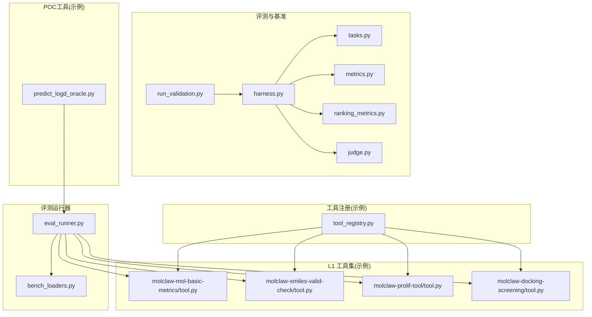
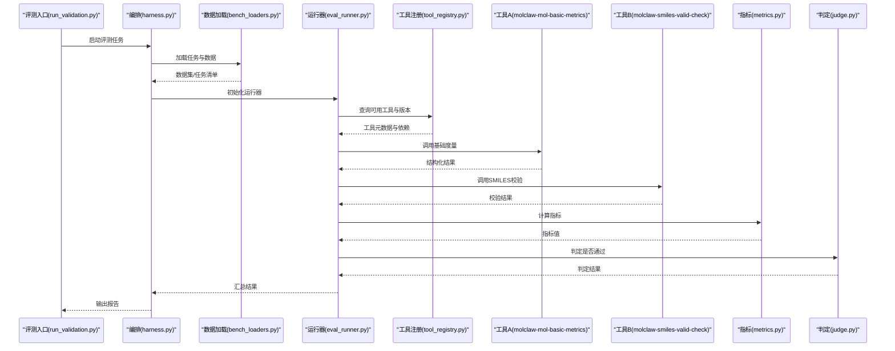
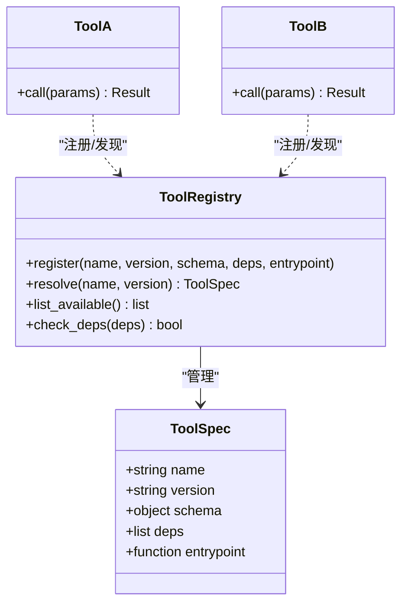
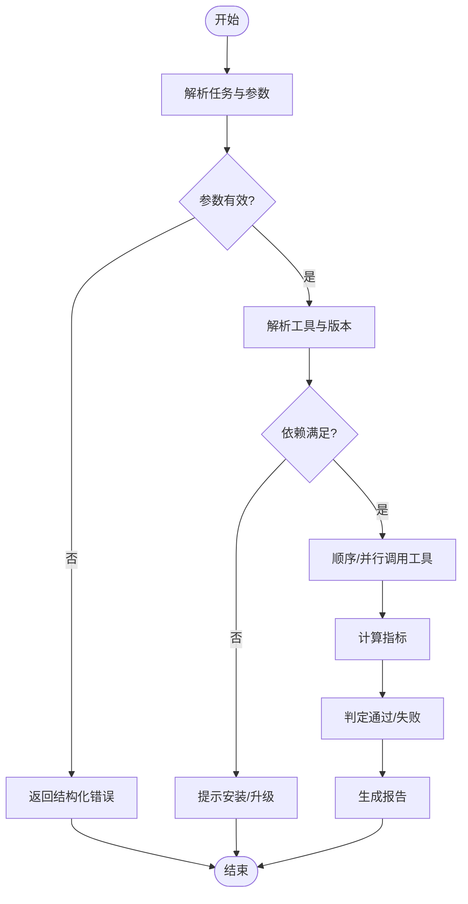
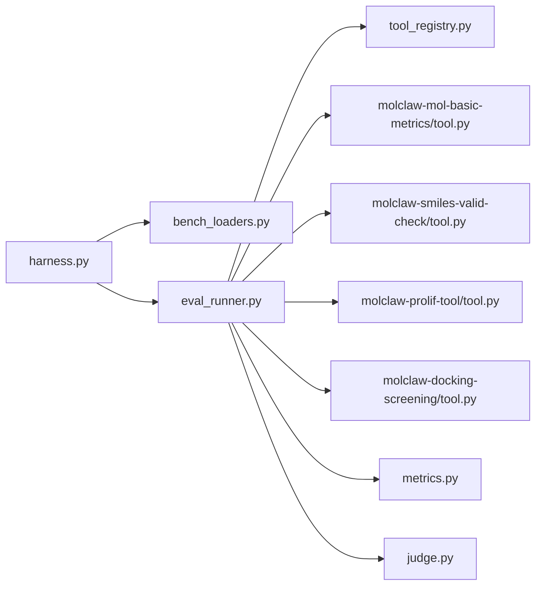

# 自定义工具集成

<cite>
**本文引用的文件**   
- [autonomy_mvp/core/harness.py](file://autonomy_mvp/core/harness.py)
- [autonomy_mvp/core/judge.py](file://autonomy_mvp/core/judge.py)
- [autonomy_mvp/core/metrics.py](file://autonomy_mvp/core/metrics.py)
- [autonomy_mvp/core/ranking_metrics.py](file://autonomy_mvp/core/ranking_metrics.py)
- [autonomy_mvp/core/tasks.py](file://autonomy_mvp/core/tasks.py)
- [autonomy_mvp/run_validation.py](file://autonomy_mvp/run_validation.py)
- [autonomy_mvp/schema.md](file://autonomy_mvp/schema.md)
- [docs/molbench_repo/skills/L1_tools/molclaw-mol-basic-metrics/tool.py](file://docs/molbench_repo/skills/L1_tools/molclaw-mol-basic-metrics/tool.py)
- [docs/molbench_repo/skills/L1_tools/molclaw-smiles-valid-check/tool.py](file://docs/molbench_repo/skills/L1_tools/molclaw-smiles-valid-check/tool.py)
- [docs/molbench_repo/skills/L1_tools/molclaw-prolif-tool/tool.py](file://docs/molbench_repo/skills/L1_tools/molclaw-prolif-tool/tool.py)
- [docs/molbench_repo/skills/L1_tools/molclaw-docking-screening/tool.py](file://docs/molbench_repo/skills/L1_tools/molclaw-docking-screening/tool.py)
- [docs/molbench_repo/eval/bench_loaders.py](file://docs/molbench_repo/eval/bench_loaders.py)
- [docs/molbench_repo/eval/eval_runner.py](file://docs/molbench_repo/eval/eval_runner.py)
- [task7/poc3_physicianbench/agent/tool_registry.py](file://task7/poc3_physicianbench/agent/tool_registry.py)
- [task7/poc4_pharmabench/tools/predict_logd_oracle.py](file://task7/poc4_pharmabench/tools/predict_logd_oracle.py)
</cite>

## 目录
1. [简介](#简介)
2. [项目结构](#项目结构)
3. [核心组件](#核心组件)
4. [架构总览](#架构总览)
5. [详细组件分析](#详细组件分析)
6. [依赖分析](#依赖分析)
7. [性能考虑](#性能考虑)
8. [故障排查指南](#故障排查指南)
9. [结论](#结论)
10. [附录](#附录)

## 简介
本文件面向科学计算与药物/材料研究场景，系统化演示如何开发、封装与集成“自定义工具”。内容覆盖：
- 工具接口规范（输入/输出契约、参数校验、错误处理）
- 外部软件包、API服务、数据库连接的标准化封装
- 工具注册、版本管理与依赖处理流程
- 从简单函数到复杂工作流的多种集成示例（Python脚本、命令行工具、Web服务）

## 项目结构
仓库包含多个子项目与示例，其中与本主题最相关的部分包括：
- 评估与基准框架：用于定义任务、加载数据、执行评测与指标计算
- L1 工具集：大量以统一模式实现的分子/材料科学工具（含参数校验、错误处理、结果序列化）
- 工具注册中心：在Agent系统中集中管理工具元数据与调用路由
- 端到端评测运行器：串联数据加载、工具执行、结果汇总与报告生成

图表来源
- [autonomy_mvp/core/harness.py](file://autonomy_mvp/core/harness.py)
- [autonomy_mvp/core/tasks.py](file://autonomy_mvp/core/tasks.py)
- [autonomy_mvp/core/metrics.py](file://autonomy_mvp/core/metrics.py)
- [autonomy_mvp/core/ranking_metrics.py](file://autonomy_mvp/core/ranking_metrics.py)
- [autonomy_mvp/core/judge.py](file://autonomy_mvp/core/judge.py)
- [autonomy_mvp/run_validation.py](file://autonomy_mvp/run_validation.py)
- [docs/molbench_repo/skills/L1_tools/molclaw-mol-basic-metrics/tool.py](file://docs/molbench_repo/skills/L1_tools/molclaw-mol-basic-metrics/tool.py)
- [docs/molbench_repo/skills/L1_tools/molclaw-smiles-valid-check/tool.py](file://docs/molbench_repo/skills/L1_tools/molclaw-smiles-valid-check/tool.py)
- [docs/molbench_repo/skills/L1_tools/molclaw-prolif-tool/tool.py](file://docs/molbench_repo/skills/L1_tools/molclaw-prolif-tool/tool.py)
- [docs/molbench_repo/skills/L1_tools/molclaw-docking-screening/tool.py](file://docs/molbench_repo/skills/L1_tools/molclaw-docking-screening/tool.py)
- [docs/molbench_repo/eval/eval_runner.py](file://docs/molbench_repo/eval/eval_runner.py)
- [docs/molbench_repo/eval/bench_loaders.py](file://docs/molbench_repo/eval/bench_loaders.py)
- [task7/poc3_physicianbench/agent/tool_registry.py](file://task7/poc3_physicianbench/agent/tool_registry.py)
- [task7/poc4_pharmabench/tools/predict_logd_oracle.py](file://task7/poc4_pharmabench/tools/predict_logd_oracle.py)

章节来源
- [autonomy_mvp/core/harness.py](file://autonomy_mvp/core/harness.py)
- [autonomy_mvp/core/tasks.py](file://autonomy_mvp/core/tasks.py)
- [autonomy_mvp/core/metrics.py](file://autonomy_mvp/core/metrics.py)
- [autonomy_mvp/core/ranking_metrics.py](file://autonomy_mvp/core/ranking_metrics.py)
- [autonomy_mvp/core/judge.py](file://autonomy_mvp/core/judge.py)
- [autonomy_mvp/run_validation.py](file://autonomy_mvp/run_validation.py)
- [docs/molbench_repo/eval/bench_loaders.py](file://docs/molbench_repo/eval/bench_loaders.py)
- [docs/molbench_repo/eval/eval_runner.py](file://docs/molbench_repo/eval/eval_runner.py)
- [task7/poc3_physicianbench/agent/tool_registry.py](file://task7/poc3_physicianbench/agent/tool_registry.py)
- [task7/poc4_pharmabench/tools/predict_logd_oracle.py](file://task7/poc4_pharmabench/tools/predict_logd_oracle.py)

## 核心组件
- 评测编排与任务定义
  - 通过统一的入口编排任务生命周期，负责加载数据集、实例化评测器、执行工具链并汇总结果。
  - 关键职责：任务解析、上下文装配、指标计算、判定逻辑、结果持久化。
- 指标与排名
  - 提供通用指标计算与排序能力，支持多目标优化与对比分析。
- 工具实现范式（L1 工具集）
  - 每个工具遵循一致的接口契约：输入参数校验、异常捕获与结构化错误返回、可序列化的结果对象。
  - 典型工具类型：基础度量、SMILES有效性检查、相互作用分析、对接筛选等。
- 评测运行器与数据加载器
  - 将任务清单、工具配置与数据源解耦，支持批量执行与并行调度。
- 工具注册中心（Agent侧）
  - 集中维护工具元信息（名称、版本、参数Schema、依赖），并提供运行时发现与路由。
- POC工具示例
  - 展示如何将第三方预测模型或外部服务封装为可被评测系统调用的标准化工具。

章节来源
- [autonomy_mvp/core/harness.py](file://autonomy_mvp/core/harness.py)
- [autonomy_mvp/core/metrics.py](file://autonomy_mvp/core/metrics.py)
- [autonomy_mvp/core/ranking_metrics.py](file://autonomy_mvp/core/ranking_metrics.py)
- [autonomy_mvp/core/judge.py](file://autonomy_mvp/core/judge.py)
- [docs/molbench_repo/skills/L1_tools/molclaw-mol-basic-metrics/tool.py](file://docs/molbench_repo/skills/L1_tools/molclaw-mol-basic-metrics/tool.py)
- [docs/molbench_repo/skills/L1_tools/molclaw-smiles-valid-check/tool.py](file://docs/molbench_repo/skills/L1_tools/molclaw-smiles-valid-check/tool.py)
- [docs/molbench_repo/skills/L1_tools/molclaw-prolif-tool/tool.py](file://docs/molbench_repo/skills/L1_tools/molclaw-prolif-tool/tool.py)
- [docs/molbench_repo/skills/L1_tools/molclaw-docking-screening/tool.py](file://docs/molbench_repo/skills/L1_tools/molclaw-docking-screening/tool.py)
- [docs/molbench_repo/eval/bench_loaders.py](file://docs/molbench_repo/eval/bench_loaders.py)
- [docs/molbench_repo/eval/eval_runner.py](file://docs/molbench_repo/eval/eval_runner.py)
- [task7/poc3_physicianbench/agent/tool_registry.py](file://task7/poc3_physicianbench/agent/tool_registry.py)
- [task7/poc4_pharmabench/tools/predict_logd_oracle.py](file://task7/poc4_pharmabench/tools/predict_logd_oracle.py)

## 架构总览
下图展示了从评测入口到工具执行、再到结果汇总的端到端流程，以及工具注册与依赖管理的参与点。

图表来源
- [autonomy_mvp/run_validation.py](file://autonomy_mvp/run_validation.py)
- [autonomy_mvp/core/harness.py](file://autonomy_mvp/core/harness.py)
- [docs/molbench_repo/eval/bench_loaders.py](file://docs/molbench_repo/eval/bench_loaders.py)
- [docs/molbench_repo/eval/eval_runner.py](file://docs/molbench_repo/eval/eval_runner.py)
- [task7/poc3_physicianbench/agent/tool_registry.py](file://task7/poc3_physicianbench/agent/tool_registry.py)
- [docs/molbench_repo/skills/L1_tools/molclaw-mol-basic-metrics/tool.py](file://docs/molbench_repo/skills/L1_tools/molclaw-mol-basic-metrics/tool.py)
- [docs/molbench_repo/skills/L1_tools/molclaw-smiles-valid-check/tool.py](file://docs/molbench_repo/skills/L1_tools/molclaw-smiles-valid-check/tool.py)
- [autonomy_mvp/core/metrics.py](file://autonomy_mvp/core/metrics.py)
- [autonomy_mvp/core/judge.py](file://autonomy_mvp/core/judge.py)

## 详细组件分析

### 工具接口规范与参数验证机制
- 输入契约
  - 所有工具应暴露统一的调用签名，明确输入参数的类型、取值范围与必填项。
  - 推荐采用强类型约束与可选默认值，便于上游编排与下游消费。
- 参数校验
  - 在工具入口处进行前置校验，失败时立即返回结构化错误（包含错误码、消息与上下文）。
  - 对路径、URL、ID等外部资源标识进行存在性与可达性检查。
- 错误处理模式
  - 使用明确的异常分类（如参数错误、资源不可用、计算超时、权限不足）。
  - 对外暴露一致的错误响应格式，便于日志聚合与告警。
- 结果序列化
  - 输出应为可序列化的数据结构（字典/JSON兼容），包含必要字段与可选扩展字段。
  - 对数值型结果提供单位与精度说明，避免歧义。

章节来源
- [docs/molbench_repo/skills/L1_tools/molclaw-mol-basic-metrics/tool.py](file://docs/molbench_repo/skills/L1_tools/molclaw-mol-basic-metrics/tool.py)
- [docs/molbench_repo/skills/L1_tools/molclaw-smiles-valid-check/tool.py](file://docs/molbench_repo/skills/L1_tools/molclaw-smiles-valid-check/tool.py)
- [docs/molbench_repo/skills/L1_tools/molclaw-prolif-tool/tool.py](file://docs/molbench_repo/skills/L1_tools/molclaw-prolif-tool/tool.py)
- [docs/molbench_repo/skills/L1_tools/molclaw-docking-screening/tool.py](file://docs/molbench_repo/skills/L1_tools/molclaw-docking-screening/tool.py)

### 工具注册、版本管理与依赖处理
- 工具注册
  - 集中式注册表维护工具名称、描述、版本、参数Schema、依赖列表与调用入口。
  - 支持动态发现与按需加载，减少冷启动开销。
- 版本管理
  - 工具与依赖均声明版本号；运行期根据任务要求选择兼容版本。
  - 提供向后兼容策略与弃用提示。
- 依赖处理
  - 显式声明外部库、二进制工具或服务端点；在工具初始化阶段完成环境探测与可用性检查。
  - 对缺失依赖给出清晰的安装指引与降级方案。

图表来源
- [task7/poc3_physicianbench/agent/tool_registry.py](file://task7/poc3_physicianbench/agent/tool_registry.py)
- [docs/molbench_repo/skills/L1_tools/molclaw-mol-basic-metrics/tool.py](file://docs/molbench_repo/skills/L1_tools/molclaw-mol-basic-metrics/tool.py)
- [docs/molbench_repo/skills/L1_tools/molclaw-smiles-valid-check/tool.py](file://docs/molbench_repo/skills/L1_tools/molclaw-smiles-valid-check/tool.py)

章节来源
- [task7/poc3_physicianbench/agent/tool_registry.py](file://task7/poc3_physicianbench/agent/tool_registry.py)

### 外部软件包、API服务与数据库连接的标准化工具封装
- 外部软件包
  - 封装为本地函数或类方法，统一处理导入失败、版本不兼容与资源占用问题。
  - 提供缓存与批处理接口以提升吞吐。
- API服务
  - 封装HTTP客户端，统一重试、退避、鉴权与限流策略。
  - 对网络异常进行分类与上报，保证幂等与可观测性。
- 数据库连接
  - 使用连接池与事务边界控制，确保并发安全与资源释放。
  - 对慢查询与锁等待进行监控与告警。

章节来源
- [docs/molbench_repo/skills/L1_tools/molclaw-docking-screening/tool.py](file://docs/molbench_repo/skills/L1_tools/molclaw-docking-screening/tool.py)
- [task7/poc4_pharmabench/tools/predict_logd_oracle.py](file://task7/poc4_pharmabench/tools/predict_logd_oracle.py)

### 从简单函数到复杂工作流的集成示例
- 简单函数
  - 直接暴露为工具入口，适合无状态、纯计算的原子操作。
- 命令行工具
  - 通过子进程调用外部CLI，封装参数映射、环境变量与退出码解析。
- Web服务
  - 作为HTTP服务暴露REST/gRPC接口，由运行器异步调用并聚合结果。
- 复杂工作流
  - 组合多个工具形成流水线，支持分支、重试与补偿。
  - 通过注册表进行编排，保证可观测与可回滚。

图表来源
- [autonomy_mvp/run_validation.py](file://autonomy_mvp/run_validation.py)
- [docs/molbench_repo/eval/eval_runner.py](file://docs/molbench_repo/eval/eval_runner.py)
- [docs/molbench_repo/eval/bench_loaders.py](file://docs/molbench_repo/eval/bench_loaders.py)
- [task7/poc3_physicianbench/agent/tool_registry.py](file://task7/poc3_physicianbench/agent/tool_registry.py)

章节来源
- [autonomy_mvp/run_validation.py](file://autonomy_mvp/run_validation.py)
- [docs/molbench_repo/eval/eval_runner.py](file://docs/molbench_repo/eval/eval_runner.py)
- [docs/molbench_repo/eval/bench_loaders.py](file://docs/molbench_repo/eval/bench_loaders.py)
- [task7/poc3_physicianbench/agent/tool_registry.py](file://task7/poc3_physicianbench/agent/tool_registry.py)

### 评测与指标体系
- 指标计算
  - 提供通用指标（准确率、召回率、AUC、RMSE等）与领域定制指标。
  - 支持分组统计与置信区间估计。
- 排名与比较
  - 基于多指标加权或Pareto前沿进行排序与可视化。
- 判定逻辑
  - 结合阈值、规则与业务语义进行通过/失败判定，并输出诊断信息。

章节来源
- [autonomy_mvp/core/metrics.py](file://autonomy_mvp/core/metrics.py)
- [autonomy_mvp/core/ranking_metrics.py](file://autonomy_mvp/core/ranking_metrics.py)
- [autonomy_mvp/core/judge.py](file://autonomy_mvp/core/judge.py)

## 依赖分析
- 组件耦合
  - 评测入口与编排层松耦合，通过数据加载器与运行器间接交互。
  - 工具注册表独立于具体工具实现，降低耦合度。
- 外部依赖
  - 科学计算库、化学信息学工具、机器学习框架与服务端点。
  - 建议在工具内做最小化依赖声明，并通过注册表集中管理。
- 潜在循环依赖
  - 应避免工具与运行器之间的双向引用，必要时引入事件总线或回调接口。

图表来源
- [autonomy_mvp/core/harness.py](file://autonomy_mvp/core/harness.py)
- [docs/molbench_repo/eval/bench_loaders.py](file://docs/molbench_repo/eval/bench_loaders.py)
- [docs/molbench_repo/eval/eval_runner.py](file://docs/molbench_repo/eval/eval_runner.py)
- [task7/poc3_physicianbench/agent/tool_registry.py](file://task7/poc3_physicianbench/agent/tool_registry.py)
- [docs/molbench_repo/skills/L1_tools/molclaw-mol-basic-metrics/tool.py](file://docs/molbench_repo/skills/L1_tools/molclaw-mol-basic-metrics/tool.py)
- [docs/molbench_repo/skills/L1_tools/molclaw-smiles-valid-check/tool.py](file://docs/molbench_repo/skills/L1_tools/molclaw-smiles-valid-check/tool.py)
- [docs/molbench_repo/skills/L1_tools/molclaw-prolif-tool/tool.py](file://docs/molbench_repo/skills/L1_tools/molclaw-prolif-tool/tool.py)
- [docs/molbench_repo/skills/L1_tools/molclaw-docking-screening/tool.py](file://docs/molbench_repo/skills/L1_tools/molclaw-docking-screening/tool.py)
- [autonomy_mvp/core/metrics.py](file://autonomy_mvp/core/metrics.py)
- [autonomy_mvp/core/judge.py](file://autonomy_mvp/core/judge.py)

章节来源
- [autonomy_mvp/core/harness.py](file://autonomy_mvp/core/harness.py)
- [docs/molbench_repo/eval/bench_loaders.py](file://docs/molbench_repo/eval/bench_loaders.py)
- [docs/molbench_repo/eval/eval_runner.py](file://docs/molbench_repo/eval/eval_runner.py)
- [task7/poc3_physicianbench/agent/tool_registry.py](file://task7/poc3_physicianbench/agent/tool_registry.py)
- [autonomy_mvp/core/metrics.py](file://autonomy_mvp/core/metrics.py)
- [autonomy_mvp/core/judge.py](file://autonomy_mvp/core/judge.py)

## 性能考虑
- 并行与批处理
  - 对无副作用的工具采用并发执行；对共享资源访问加锁或队列化。
  - 对大批量输入进行分片与批处理，提升吞吐。
- 缓存与复用
  - 对昂贵计算结果进行缓存（键由输入指纹生成），避免重复计算。
- I/O与网络
  - 使用连接池与请求合并；设置合理的超时与重试策略。
- 资源隔离
  - 对重型工具使用进程级隔离或容器化，防止相互干扰。

[本节为通用指导，无需特定文件来源]

## 故障排查指南
- 常见问题定位
  - 参数校验失败：检查Schema与默认值，确认上游传入的数据类型与取值范围。
  - 依赖缺失：查看注册表的依赖声明，按提示安装或升级。
  - 外部服务不可用：检查网络连通性、鉴权令牌与配额限制。
- 日志与可观测性
  - 记录关键步骤的时间戳、输入摘要与错误堆栈。
  - 对耗时热点进行采样与追踪，识别瓶颈。
- 恢复与降级
  - 对非关键步骤提供降级路径（如跳过可视化、使用近似算法）。
  - 支持断点续跑与增量更新。

章节来源
- [docs/molbench_repo/skills/L1_tools/molclaw-mol-basic-metrics/tool.py](file://docs/molbench_repo/skills/L1_tools/molclaw-mol-basic-metrics/tool.py)
- [docs/molbench_repo/skills/L1_tools/molclaw-smiles-valid-check/tool.py](file://docs/molbench_repo/skills/L1_tools/molclaw-smiles-valid-check/tool.py)
- [docs/molbench_repo/skills/L1_tools/molclaw-docking-screening/tool.py](file://docs/molbench_repo/skills/L1_tools/molclaw-docking-screening/tool.py)
- [task7/poc3_physicianbench/agent/tool_registry.py](file://task7/poc3_physicianbench/agent/tool_registry.py)

## 结论
通过统一的工具接口规范、严格的参数校验与一致的错误处理模式，配合工具注册与版本管理，可将多样化的科学计算能力标准化地集成到评测与工作流中。在此基础上，借助并行、缓存与资源隔离等手段，可在保证稳定性的同时显著提升整体性能。

[本节为总结性内容，无需特定文件来源]

## 附录
- 参考文档
  - 任务与数据Schema说明：[schema.md](file://autonomy_mvp/schema.md)
- 快速上手建议
  - 为新工具编写最小可用实现，先通过参数校验与错误处理测试，再逐步增加功能与性能优化。
  - 在注册表中登记元数据，并在运行器中接入端到端评测。

章节来源
- [autonomy_mvp/schema.md](file://autonomy_mvp/schema.md)