# 药物发现工作流

<cite>
**本文引用的文件**   
- [docs/molbench_repo/skills/L2_workflows/01-target-protein-preparation.md](file://docs/molbench_repo/skills/L2_workflows/01-target-protein-preparation.md)
- [docs/molbench_repo/skills/L2_workflows/02-molecular-docking-screening.md](file://docs/molbench_repo/skills/L2_workflows/02-molecular-docking-screening.md)
- [docs/molbench_repo/skills/L2_workflows/03-molecular-property-analysis-filtering.md](file://docs/molbench_repo/skills/L2_workflows/03-molecular-property-analysis-filtering.md)
- [docs/molbench_repo/skills/L2_workflows/04-generative-molecular-design.md](file://docs/molbench_repo/skills/L2_workflows/04-generative-molecular-design.md)
- [docs/molbench_repo/skills/L2_workflows/05-iterative-molecular-optimization.md](file://docs/molbench_repo/skills/L2_workflows/05-iterative-molecular-optimization.md)
- [docs/molbench_repo/skills/L2_workflows/06-binding-free-energy-calculation.md](file://docs/molbench_repo/skills/L2_workflows/06-binding-free-energy-calculation.md)
- [docs/molbench_repo/skills/L2_workflows/07-conformational-sampling-analysis.md](file://docs/molbench_repo/skills/L2_workflows/07-conformational-sampling-analysis.md)
- [docs/molbench_repo/skills/L2_workflows/08-post-docking-evaluation.md](file://docs/molbench_repo/skills/L2_workflows/08-post-docking-evaluation.md)
- [docs/molbench_repo/skills/L1_tools/molclaw-docking-screening/tool.yaml](file://docs/molbench_repo/skills/L1_tools/molclaw-docking-screening/tool.yaml)
- [docs/molbench_repo/skills/L1_tools/molclaw-quickvina-docking/tool.yaml](file://docs/molbench_repo/skills/L1_tools/molclaw-quickvina-docking/tool.yaml)
- [docs/molbench_repo/skills/L1_tools/molclaw-prolif-docking/tool.yaml](file://docs/molbench_repo/skills/L1_tools/molclaw-prolif-docking/tool.yaml)
- [docs/molbench_repo/skills/L1_tools/molclaw-prolif-md/tool.yaml](file://docs/molbench_repo/skills/L1_tools/molclaw-prolif-md/tool.yaml)
- [docs/molbench_repo/skills/L1_tools/molclaw-prolif-pdb/tool.yaml](file://docs/molbench_repo/skills/L1_tools/molclaw-prolif-pdb/tool.yaml)
- [docs/molbench_repo/skills/L1_tools/molclaw-protein-openmm/tool.yaml](file://docs/molbench_repo/skills/L1_tools/molclaw-protein-openmm/tool.yaml)
- [docs/molbench_repo/skills/L1_tools/molclaw-protein-ligand-mmpbsa/tool.yaml](file://docs/molbench_repo/skills/L1_tools/molclaw-protein-ligand-mmpbsa/tool.yaml)
- [docs/molbench_repo/skills/L1_tools/molclaw-fpocket-toolkit-base/tool.yaml](file://docs/molbench_repo/skills/L1_tools/molclaw-fpocket-toolkit-base/tool.yaml)
- [docs/molbench_repo/skills/L1_tools/molclaw-interaction-visualizer/tool.yaml](file://docs/molbench_repo/skills/L1_tools/molclaw-interaction-visualizer/tool.yaml)
- [docs/molbench_repo/skills/L1_tools/molclaw-smiles-valid-check/tool.yaml](file://docs/molbench_repo/skills/L1_tools/molclaw-smiles-valid-check/tool.yaml)
- [docs/molbench_repo/skills/L1_tools/molclaw-mol-basic-metrics/tool.yaml](file://docs/molbench_repo/skills/L1_tools/molclaw-mol-basic-metrics/tool.yaml)
- [docs/molbench_repo/skills/L1_tools/molclaw-drug-likeness/tool.yaml](file://docs/molbench_repo/skills/L1_tools/molclaw-drug-likeness/tool.yaml)
- [docs/molbench_repo/skills/L1_tools/molclaw-mol-complexity-metrics/tool.yaml](file://docs/molbench_repo/skills/L1_tools/molclaw-mol-complexity-metrics/tool.yaml)
- [docs/molbench_repo/skills/L1_tools/molclaw-mol-hbond-metrics/tool.yaml](file://docs/molbench_repo/skills/L1_tools/molclaw-mol-hbond-metrics/tool.yaml)
- [docs/molbench_repo/skills/L1_tools/molclaw-mol-hydrophobicity-metrics/tool.yaml](file://docs/molbench_repo/skills/L1_tools/molclaw-mol-hydrophobicity-metrics/tool.yaml)
- [docs/molbench_repo/skills/L1_tools/molclaw-mol-structure-metrics/tool.yaml](file://docs/molbench_repo/skills/L1_tools/molclaw-mol-structure-metrics/tool.yaml)
- [docs/molbench_repo/skills/L1_tools/molclaw-mol-topology-metrics/tool.yaml](file://docs/molbench_repo/skills/L1_tools/molclaw-mol-topology-metrics/tool.yaml)
- [docs/molbench_repo/skills/L1_tools/molclaw-mol-similarity/tool.yaml](file://docs/molbench_repo/skills/L1_tools/molclaw-mol-similarity/tool.yaml)
- [docs/molbench_repo/skills/L1_tools/molclaw-mol2mol-sampling/tool.yaml](file://docs/molbench_repo/skills/L1_tools/molclaw-mol2mol-sampling/tool.yaml)
- [docs/molbench_repo/skills/L1_tools/molclaw-linker-sampling/tool.yaml](file://docs/molbench_repo/skills/L1_tools/molclaw-linker-sampling/tool.yaml)
- [docs/molbench_repo/skills/L1_tools/molclaw-rgroup-sampling/tool.yaml](file://docs/molbench_repo/skills/L1_tools/molclaw-rgroup-sampling/tool.yaml)
- [docs/molbench_repo/skills/L1_tools/molclaw-diffdock-auto/tool.yaml](file://docs/molbench_repo/skills/L1_tools/molclaw-diffdock-auto/tool.yaml)
- [docs/molbench_repo/skills/L1_tools/molclaw-chai1-predict/tool.yaml](file://docs/molbench_repo/skills/L1_tools/molclaw-chai1-predict/tool.yaml)
- [docs/molbench_repo/skills/L1_tools/molclaw-esmfold/tool.yaml](file://docs/molbench_repo/skills/L1_tools/molclaw-esmfold/tool.yaml)
- [docs/molbench_repo/skills/L1_tools/molclaw-protein-sequence-retrieve/tool.yaml](file://docs/molbench_repo/skills/L1_tools/molclaw-protein-sequence-retrieve/tool.yaml)
- [docs/molbench_repo/skills/L1_tools/molclaw-protein-structure-retrieve/tool.yaml](file://docs/molbench_repo/skills/L1_tools/molclaw-protein-structure-retrieve/tool.yaml)
- [docs/molbench_repo/skills/L1_tools/molclaw-extract-chains/tool.yaml](file://docs/molbench_repo/skills/L1_tools/molclaw-extract-chains/tool.yaml)
- [docs/molbench_repo/skills/L1_tools/molclaw-fix-pdb/tool.yaml](file://docs/molbench_repo/skills/L1_tools/molclaw-fix-pdb/tool.yaml)
- [docs/molbench_repo/skills/L1_tools/molclaw-pack-sidechains/tool.yaml](file://docs/molbench_repo/skills/L1_tools/molclaw-pack-sidechains/tool.yaml)
- [docs/molbench_repo/skills/L1_tools/molclaw-pdbfixer/tool.yaml](file://docs/molbench_repo/skills/L1_tools/molclaw-pdbfixer/tool.yaml)
- [docs/molbench_repo/skills/L1_tools/molclaw-p2rank/tool.yaml](file://docs/molbench_repo/skills/L1_tools/molclaw-p2rank/tool.yaml)
- [docs/molbench_repo/skills/L1_tools/molclaw-compound-retrieve/tool.yaml](file://docs/molbench_repo/skills/L1_tools/molclaw-compound-retrieve/tool.yaml)
- [docs/molbench_repo/skills/L1_tools/molclaw-denovo-sampling/tool.yaml](file://docs/molbench_repo/skills/L1_tools/molclaw-denovo-sampling/tool.yaml)
- [docs/molbench_repo/skills/L1_tools/molclaw-equiscore-tool/tool.yaml](file://docs/molbench_repo/skills/L1_tools/molclaw-equiscore-tool/tool.yaml)
- [docs/molbench_repo/skills/L1_tools/molclaw-equiscore-docking/tool.yaml](file://docs/molbench_repo/skills/L1_tools/molclaw-equiscore-docking/tool.yaml)
- [docs/molbench_repo/skills/L1_tools/molclaw-evobind-tool/tool.yaml](file://docs/molbench_repo/skills/L1_tools/molclaw-evobind-tool/tool.yaml)
- [docs/molbench_repo/skills/L1_tools/molclaw-foldx-tool/tool.yaml](file://docs/molbench_repo/skills/L1_tools/molclaw-foldx-tool/tool.yaml)
- [docs/molbench_repo/skills/L1_tools/molclaw-goca-tool/tool.yaml](file://docs/molbench_repo/skills/L1_tools/molclaw-goca-tool/tool.yaml)
- [docs/molbench_repo/skills/L1_tools/molclaw-hdock-tool/tool.yaml](file://docs/molbench_repo/skills/L1_tools/molclaw-hdock-tool/tool.yaml)
- [docs/molbench_repo/skills/L1_tools/molclaw-karmadock-tool/tool.yaml](file://docs/molbench_repo/skills/L1_tools/molclaw-karmadock-tool/tool.yaml)
- [docs/molbench_repo/skills/L1_tools/molclaw-openawsem-tool/tool.yaml](file://docs/molbench_repo/skills/L1_tools/molclaw-openawsem-tool/tool.yaml)
- [docs/molbench_repo/skills/L1_tools/molclaw-prolif-tool/tool.yaml](file://docs/molbench_repo/skills/L1_tools/molclaw-prolif-tool/tool.yaml)
- [docs/molbench_repo/skills/L1_tools/molclaw-protein-protein-mmpbsa/tool.yaml](file://docs/molbench_repo/skills/L1_tools/molclaw-protein-protein-mmpbsa/tool.yaml)
- [docs/molbench_repo/skills/L1_tools/molclaw-proteinmpnn-tool/tool.yaml](file://docs/molbench_repo/skills/L1_tools/molclaw-proteinmpnn-tool/tool.yaml)
- [docs/molbench_repo/skills/L1_tools/molclaw-pulchura-rebuild/tool.yaml](file://docs/molbench_repo/skills/L1_tools/molclaw-pulchura-rebuild/tool.yaml)
- [docs/molbench_repo/skills/L1_tools/molclaw-run-bioemu/tool.yaml](file://docs/molbench_repo/skills/L1_tools/molclaw-run-bioemu/tool.yaml)
- [docs/molbench_repo/skills/L1_tools/molclaw-scp-server/tool.yaml](file://docs/molbench_repo/skills/L1_tools/molclaw-scp-server/tool.yaml)
- [docs/molbench_repo/skills/L1_tools/molclaw-sequence-valid-check/tool.yaml](file://docs/molbench_repo/skills/L1_tools/molclaw-sequence-valid-check/tool.yaml)
- [docs/molbench_repo/skills/L1_tools/molclaw-skill-template-writer/tool.yaml](file://docs/molbench_repo/skills/L1_tools/molclaw-skill-template-writer/tool.yaml)
- [docs/molbench_repo/skills/L1_tools/molclaw-smiles-fg-editor/tool.yaml](file://docs/molbench_repo/skills/L1_tools/molclaw-smiles-fg编辑器/tool.yaml)
- [docs/molbench_repo/skills/L1_tools/molclaw-file-transfer/tool.yaml](file://docs/molbench_repo/skills/L1_tools/molclaw-file-transfer/tool.yaml)
- [docs/molbench_repo/config/baseline_molbench-ms-1.yaml](file://docs/molbench_repo/config/baseline_molbench-ms-1.yaml)
- [docs/molbench_repo/config/baseline_molbench-ms-2.yaml](file://docs/molbench_repo/config/baseline_molbench-ms-2.yaml)
- [docs/molbench_repo/config/baseline_molbench-ms-3.yaml](file://docs/molbench_repo/config/baseline_molbench-ms-3.yaml)
- [docs/molbench_repo/config/chemcot_mo_edit.yaml](file://docs/molbench_repo/config/chemcot_mo_edit.yaml)
- [docs/molbench_repo/config/chemcot_mo_opt.yaml](file://docs/molbench_repo/config/chemcot_mo_opt.yaml)
- [docs/molbench_repo/config/claude_template.yaml](file://docs/molbench_repo/config/claude_template.yaml)
- [docs/molbench_repo/data_full/molbench-mo/manifest.json](file://docs/molbench_repo/data_full/molbench-mo/manifest.json)
- [docs/molbench_repo/data_full/molbench-ms-1/molbench-ms-1.csv](file://docs/molbench_repo/data_full/molbench-ms-1/molbench-ms-1.csv)
- [docs/molbench_repo/data_full/molbench-ms-2/molbench-ms-2.csv](file://docs/molbench_repo/data_full/molbench-ms-2/molbench-ms-2.csv)
- [docs/molbench_repo/data_full/molbench-ms-3/molbench-ms-3.csv](file://docs/molbench_repo/data_full/molbench-ms-3/molbench-ms-3.csv)
- [docs/molbench_repo/eval/eval_runner.py](file://docs/molbench_repo/eval/eval_runner.py)
- [docs/molbench_repo/eval/run_eval_bench.py](file://docs/molbench_repo/eval/run_eval_bench.py)
- [docs/molbench_repo/README.md](file://docs/molbench_repo/README.md)
- [docs/molbench_repo/env.template](file://docs/molbench_repo/env.template)
- [docs/molbench_repo/environment.yaml](file://docs/molbench_repo/environment.yaml)
</cite>

## 目录
1. [简介](#简介)
2. [项目结构](#项目结构)
3. [核心组件](#核心组件)
4. [架构总览](#架构总览)
5. [详细组件分析](#详细组件分析)
6. [依赖关系分析](#依赖关系分析)
7. [性能与可扩展性](#性能与可扩展性)
8. [故障排查指南](#故障排查指南)
9. [结论](#结论)
10. [附录：配置模板与示例](#附录：配置模板与示例)

## 简介
本文件面向药物发现工程师与计算化学研究者，提供一套端到端的“分子对接筛选 + 迭代优化”工作流示例。内容覆盖靶点准备、分子库筛选、结合能计算、构象采样与分析、性质评估与过滤、生成式设计与闭环优化等关键步骤，并给出工具链组合方法、参数配置要点、结果分析与可视化建议，以及可直接复用的配置文件模板路径，帮助用户快速搭建自己的药物发现项目。

## 项目结构
仓库围绕“技能（Skills）+ 工具（Tools）+ 数据（Data）+ 评测（Eval）+ 配置（Config）”组织，形成可编排的模块化工作流：
- L2 工作流：以文档形式定义标准流程（如靶点准备、对接筛选、自由能计算等），便于跨团队复用与对齐。
- L1 工具：每个工具以 tool.yaml 描述能力、输入输出、运行方式与依赖，支持自动化编排。
- 数据：基准数据集与清单，支撑筛选与评测。
- 评测：统一评测入口与脚本，用于批量执行与汇总指标。
- 配置：不同任务场景的基线与模板配置，便于一键切换。

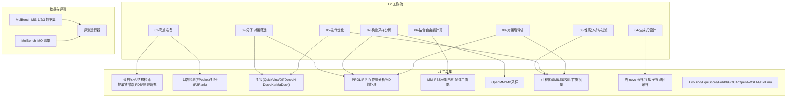

图表来源
- [docs/molbench_repo/skills/L2_workflows/01-target-protein-preparation.md](file://docs/molbench_repo/skills/L2_workflows/01-target-protein-preparation.md)
- [docs/molbench_repo/skills/L2_workflows/02-molecular-docking-screening.md](file://docs/molbench_repo/skills/L2_workflows/02-molecular-docking-screening.md)
- [docs/molbench_repo/skills/L2_workflows/03-molecular-property-analysis-filtering.md](file://docs/molbench_repo/skills/L2_workflows/03-molecular-property-analysis-filtering.md)
- [docs/molbench_repo/skills/L2_workflows/04-generative-molecular-design.md](file://docs/molbench_repo/skills/L2_workflows/04-generative-molecular-design.md)
- [docs/molbench_repo/skills/L2_workflows/05-iterative-molecular-optimization.md](file://docs/molbench_repo/skills/L2_workflows/05-iterative-molecular-optimization.md)
- [docs/molbench_repo/skills/L2_workflows/06-binding-free-energy-calculation.md](file://docs/molbench_repo/skills/L2_workflows/06-binding-free-energy-calculation.md)
- [docs/molbench_repo/skills/L2_workflows/07-conformational-sampling-analysis.md](file://docs/molbench_repo/skills/L2_workflows/07-conformational-sampling-analysis.md)
- [docs/molbench_repo/skills/L2_workflows/08-post-docking-evaluation.md](file://docs/molbench_repo/skills/L2_workflows/08-post-docking-evaluation.md)
- [docs/molbench_repo/skills/L1_tools/molclaw-docking-screening/tool.yaml](file://docs/molbench_repo/skills/L1_tools/molclaw-docking-screening/tool.yaml)
- [docs/molbench_repo/skills/L1_tools/molclaw-quickvina-docking/tool.yaml](file://docs/molbench_repo/skills/L1_tools/molclaw-quickvina-docking/tool.yaml)
- [docs/molbench_repo/skills/L1_tools/molclaw-prolif-docking/tool.yaml](file://docs/molbench_repo/skills/L1_tools/molclaw-prolif-docking/tool.yaml)
- [docs/molbench_repo/skills/L1_tools/molclaw-prolif-md/tool.yaml](file://docs/molbench_repo/skills/L1_tools/molclaw-prolif-md/tool.yaml)
- [docs/molbench_repo/skills/L1_tools/molclaw-prolif-pdb/tool.yaml](file://docs/molbench_repo/skills/L1_tools/molclaw-prolif-pdb/tool.yaml)
- [docs/molbench_repo/skills/L1_tools/molclaw-protein-openmm/tool.yaml](file://docs/molbench_repo/skills/L1_tools/molclaw-protein-openmm/tool.yaml)
- [docs/molbench_repo/skills/L1_tools/molclaw-protein-ligand-mmpbsa/tool.yaml](file://docs/molbench_repo/skills/L1_tools/molclaw-protein-ligand-mmpbsa/tool.yaml)
- [docs/molbench_repo/skills/L1_tools/molclaw-fpocket-toolkit-base/tool.yaml](file://docs/molbench_repo/skills/L1_tools/molclaw-fpocket-toolkit-base/tool.yaml)
- [docs/molbench_repo/skills/L1_tools/molclaw-interaction-visualizer/tool.yaml](file://docs/molbench_repo/skills/L1_tools/molclaw-interaction-visualizer/tool.yaml)
- [docs/molbench_repo/skills/L1_tools/molclaw-smiles-valid-check/tool.yaml](file://docs/molbench_repo/skills/L1_tools/molclaw-smiles-valid-check/tool.yaml)
- [docs/molbench_repo/skills/L1_tools/molclaw-mol-basic-metrics/tool.yaml](file://docs/molbench_repo/skills/L1_tools/molclaw-mol-basic-metrics/tool.yaml)
- [docs/molbench_repo/skills/L1_tools/molclaw-drug-likeness/tool.yaml](file://docs/molbench_repo/skills/L1_tools/molclaw-drug-likeness/tool.yaml)
- [docs/molbench_repo/skills/L1_tools/molclaw-mol-complexity-metrics/tool.yaml](file://docs/molbench_repo/skills/L1_tools/molclaw-mol-complexity-metrics/tool.yaml)
- [docs/molbench_repo/skills/L1_tools/molclaw-mol-hbond-metrics/tool.yaml](file://docs/molbench_repo/skills/L1_tools/molclaw-mol-hbond-metrics/tool.yaml)
- [docs/molbench_repo/skills/L1_tools/molclaw-mol-hydrophobicity-metrics/tool.yaml](file://docs/molbench_repo/skills/L1_tools/molclaw-mol-hydrophobicity-metrics/tool.yaml)
- [docs/molbench_repo/skills/L1_tools/molclaw-mol-structure-metrics/tool.yaml](file://docs/molbench_repo/skills/L1_tools/molclaw-mol-structure-metrics/tool.yaml)
- [docs/molbench_repo/skills/L1_tools/molclaw-mol-topology-metrics/tool.yaml](file://docs/molbench_repo/skills/L1_tools/molclaw-mol-topology-metrics/tool.yaml)
- [docs/molbench_repo/skills/L1_tools/molclaw-mol-similarity/tool.yaml](file://docs/molbench_repo/skills/L1_tools/molclaw-mol-similarity/tool.yaml)
- [docs/molbench_repo/skills/L1_tools/molclaw-mol2mol-sampling/tool.yaml](file://docs/molbench_repo/skills/L1_tools/molclaw-mol2mol-sampling/tool.yaml)
- [docs/molbench_repo/skills/L1_tools/molclaw-linker-sampling/tool.yaml](file://docs/molbench_repo/skills/L1_tools/molclaw-linker-sampling/tool.yaml)
- [docs/molbench_repo/skills/L1_tools/molclaw-rgroup-sampling/tool.yaml](file://docs/molbench_repo/skills/L1_tools/molclaw-rgroup-sampling/tool.yaml)
- [docs/molbench_repo/skills/L1_tools/molclaw-diffdock-auto/tool.yaml](file://docs/molbench_repo/skills/L1_tools/molclaw-diffdock-auto/tool.yaml)
- [docs/molbench_repo/skills/L1_tools/molclaw-chai1-predict/tool.yaml](file://docs/molbench_repo/skills/L1_tools/molclaw-chai1-predict/tool.yaml)
- [docs/molbench_repo/skills/L1_tools/molclaw-esmfold/tool.yaml](file://docs/molbench_repo/skills/L1_tools/molclaw-esmfold/tool.yaml)
- [docs/molbench_repo/skills/L1_tools/molclaw-protein-sequence-retrieve/tool.yaml](file://docs/molbench_repo/skills/L1_tools/molclaw-protein-sequence-retrieve/tool.yaml)
- [docs/molbench_repo/skills/L1_tools/molclaw-protein-structure-retrieve/tool.yaml](file://docs/molbench_repo/skills/L1_tools/molclaw-protein-structure-retrieve/tool.yaml)
- [docs/molbench_repo/skills/L1_tools/molclaw-extract-chains/tool.yaml](file://docs/molbench_repo/skills/L1_tools/molclaw-extract-chains/tool.yaml)
- [docs/molbench_repo/skills/L1_tools/molclaw-fix-pdb/tool.yaml](file://docs/molbench_repo/skills/L1_tools/molclaw-fix-pdb/tool.yaml)
- [docs/molbench_repo/skills/L1_tools/molclaw-pack-sidechains/tool.yaml](file://docs/molbench_repo/skills/L1_tools/molclaw-pack-sidechains/tool.yaml)
- [docs/molbench_repo/skills/L1_tools/molclaw-pdbfixer/tool.yaml](file://docs/molbench_repo/skills/L1_tools/molclaw-pdbfixer/tool.yaml]
- [docs/molbench_repo/skills/L1_tools/molclaw-p2rank/tool.yaml](file://docs/molbench_repo/skills/L1_tools/molclaw-p2rank/tool.yaml)
- [docs/molbench_repo/skills/L1_tools/molclaw-compound-retrieve/tool.yaml](file://docs/molbench_repo/skills/L1_tools/molclaw-compound-retrieve/tool.yaml)
- [docs/molbench_repo/skills/L1_tools/molclaw-denovo-sampling/tool.yaml](file://docs/molbench_repo/skills/L1_tools/molclaw-denovo-sampling/tool.yaml)
- [docs/molbench_repo/skills/L1_tools/molclaw-equiscore-tool/tool.yaml](file://docs/molbench_repo/skills/L1_tools/molclaw-equiscore-tool/tool.yaml)
- [docs/molbench_repo/skills/L1_tools/molclaw-equiscore-docking/tool.yaml](file://docs/molbench_repo/skills/L1_tools/molclaw-equiscore-docking/tool.yaml)
- [docs/molbench_repo/skills/L1_tools/molclaw-evobind-tool/tool.yaml](file://docs/molbench_repo/skills/L1_tools/molclaw-evobind-tool/tool.yaml)
- [docs/molbench_repo/skills/L1_tools/molclaw-foldx-tool/tool.yaml](file://docs/molbench_repo/skills/L1_tools/molclaw-foldx-tool/tool.yaml)
- [docs/molbench_repo/skills/L1_tools/molclaw-goca-tool/tool.yaml](file://docs/molbench_repo/skills/L1_tools/molclaw-goca-tool/tool.yaml)
- [docs/molbench_repo/skills/L1_tools/molclaw-hdock-tool/tool.yaml](file://docs/molbench_repo/skills/L1_tools/molclaw-hdock-tool/tool.yaml)
- [docs/molbench_repo/skills/L1_tools/molclaw-karmadock-tool/tool.yaml](file://docs/molbench_repo/skills/L1_tools/molclaw-karmadock-tool/tool.yaml)
- [docs/molbench_repo/skills/L1_tools/molclaw-openawsem-tool/tool.yaml](file://docs/molbench_repo/skills/L1_tools/molclaw-openawsem-tool/tool.yaml)
- [docs/molbench_repo/skills/L1_tools/molclaw-prolif-tool/tool.yaml](file://docs/molbench_repo/skills/L1_tools/molclaw-prolif-tool/tool.yaml)
- [docs/molbench_repo/skills/L1_tools/molclaw-protein-protein-mmpbsa/tool.yaml](file://docs/molbench_repo/skills/L1_tools/molclaw-protein-protein-mmpbsa/tool.yaml)
- [docs/molbench_repo/skills/L1_tools/molclaw-proteinmpnn-tool/tool.yaml](file://docs/molbench_repo/skills/L1_tools/molclaw-proteinmpnn-tool/tool.yaml)
- [docs/molbench_repo/skills/L1_tools/molclaw-pulchura-rebuild/tool.yaml](file://docs/molbench_repo/skills/L1_tools/molclaw-pulchura-rebuild/tool.yaml)
- [docs/molbench_repo/skills/L1_tools/molclaw-run-bioemu/tool.yaml](file://docs/molbench_repo/skills/L1_tools/molclaw-run-bioemu/tool.yaml)
- [docs/molbench_repo/skills/L1_tools/molclaw-scp-server/tool.yaml](file://docs/molbench_repo/skills/L1_tools/molclaw-scp-server/tool.yaml)
- [docs/molbench_repo/skills/L1_tools/molclaw-sequence-valid-check/tool.yaml](file://docs/molbench_repo/skills/L1_tools/molclaw-sequence-valid-check/tool.yaml)
- [docs/molbench_repo/skills/L1_tools/molclaw-skill-template-writer/tool.yaml](file://docs/molbench_repo/skills/L1_tools/molclaw-skill-template-writer/tool.yaml)
- [docs/molbench_repo/skills/L1_tools/molclaw-smiles-fg-editor/tool.yaml](file://docs/molbench_repo/skills/L1_tools/molclaw-smiles-fg-editor/tool.yaml)
- [docs/molbench_repo/skills/L1_tools/molclaw-file-transfer/tool.yaml](file://docs/molbench_repo/skills/L1_tools/molclaw-file-transfer/tool.yaml)
- [docs/molbench_repo/data_full/molbench-ms-1/molbench-ms-1.csv](file://docs/molbench_repo/data_full/molbench-ms-1/molbench-ms-1.csv)
- [docs/molbench_repo/data_full/molbench-ms-2/molbench-ms-2.csv](file://docs/molbench_repo/data_full/molbench-ms-2/molbench-ms-2.csv)
- [docs/molbench_repo/data_full/molbench-ms-3/molbench-ms-3.csv](file://docs/molbench_repo/data_full/molbench-ms-3/molbench-ms-3.csv)
- [docs/molbench_repo/data_full/molbench-mo/manifest.json](file://docs/molbench_repo/data_full/molbench-mo/manifest.json)
- [docs/molbench_repo/eval/eval_runner.py](file://docs/molbench_repo/eval/eval_runner.py)
- [docs/molbench_repo/eval/run_eval_bench.py](file://docs/molbench_repo/eval/run_eval_bench.py)

章节来源
- [docs/molbench_repo/README.md](file://docs/molbench_repo/README.md)

## 核心组件
- 工作流编排（L2）
  - 将多步任务标准化为可重复执行的流程文档，明确输入/输出、前置条件、失败回退策略与质量门禁。
  - 典型流程：靶点准备 → 对接筛选 → 性质过滤 → 生成设计 → 迭代优化 → 自由能计算 → 构象分析 → 对接后评估。
- 工具注册（L1）
  - 每个工具通过 tool.yaml 声明能力边界、参数契约、依赖环境与资源需求，便于自动调度与并行化。
- 数据与评测
  - 使用 MolBench 系列数据集与清单进行基准测试；评测运行器负责批处理、日志聚合与指标汇总。

章节来源
- [docs/molbench_repo/skills/L2_workflows/01-target-protein-preparation.md](file://docs/molbench_repo/skills/L2_workflows/01-target-protein-preparation.md)
- [docs/molbench_repo/skills/L2_workflows/02-molecular-docking-screening.md](file://docs/molbench_repo/skills/L2_workflows/02-molecular-docking-screening.md)
- [docs/molbench_repo/skills/L2_workflows/03-molecular-property-analysis-filtering.md](file://docs/molbench_repo/skills/L2_workflows/03-molecular-property-analysis-filtering.md)
- [docs/molbench_repo/skills/L2_workflows/04-generative-molecular-design.md](file://docs/molbench_repo/skills/L2_workflows/04-generative-molecular-design.md)
- [docs/molbench_repo/skills/L2_workflows/05-iterative-molecular-optimization.md](file://docs/molbench_repo/skills/L2_workflows/05-iterative-molecular-optimization.md)
- [docs/molbench_repo/skills/L2_workflows/06-binding-free-energy-calculation.md](file://docs/molbench_repo/skills/L2_workflows/06-binding-free-energy-calculation.md)
- [docs/molbench_repo/skills/L2_workflows/07-conformational-sampling-analysis.md](file://docs/molbench_repo/skills/L2_workflows/07-conformational-sampling-analysis.md)
- [docs/molbench_repo/skills/L2_workflows/08-post-docking-evaluation.md](file://docs/molbench_repo/skills/L2_workflows/08-post-docking-evaluation.md)
- [docs/molbench_repo/eval/eval_runner.py](file://docs/molbench_repo/eval/eval_runner.py)
- [docs/molbench_repo/eval/run_eval_bench.py](file://docs/molbench_repo/eval/run_eval_bench.py)

## 架构总览
下图展示从“靶点与分子库”到“候选化合物”的端到端数据与控制流，以及各阶段对应的工具与产出物。

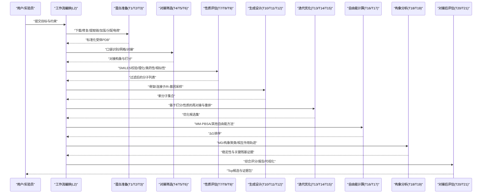

图表来源
- [docs/molbench_repo/skills/L2_workflows/01-target-protein-preparation.md](file://docs/molbench_repo/skills/L2_workflows/01-target-protein-preparation.md)
- [docs/molbench_repo/skills/L2_workflows/02-molecular-docking-screening.md](file://docs/molbench_repo/skills/L2_workflows/02-molecular-docking-screening.md)
- [docs/molbench_repo/skills/L2_workflows/03-molecular-property-analysis-filtering.md](file://docs/molbench_repo/skills/L2_workflows/03-molecular-property-analysis-filtering.md)
- [docs/molbench_repo/skills/L2_workflows/04-generative-molecular-design.md](file://docs/molbench_repo/skills/L2_workflows/04-generative-molecular-design.md)
- [docs/molbench_repo/skills/L2_workflows/05-iterative-molecular-optimization.md](file://docs/molbench_repo/skills/L2_workflows/05-iterative-molecular-optimization.md)
- [docs/molbench_repo/skills/L2_workflows/06-binding-free-energy-calculation.md](file://docs/molbench_repo/skills/L2_workflows/06-binding-free-energy-calculation.md)
- [docs/molbench_repo/skills/L2_workflows/07-conformational-sampling-analysis.md](file://docs/molbench_repo/skills/L2_workflows/07-conformational-sampling-analysis.md)
- [docs/molbench_repo/skills/L2_workflows/08-post-docking-evaluation.md](file://docs/molbench_repo/skills/L2_workflows/08-post-docking-evaluation.md)

## 详细组件分析

### 组件一：靶点准备（Target Preparation）
- 目标
  - 从序列或结构数据库获取目标蛋白，完成缺失原子/环区建模、质子化态选择、二硫键修复、水分子与辅因子处理、可选口袋预测与打分。
- 关键工具
  - 序列/结构检索、链提取、PDB修复、侧链填充、口袋检测与打分。
- 输入/输出
  - 输入：UniProt ID/PDB ID/FASTA；输出：标准化受体PDB、口袋中心/半径、可选口袋得分。
- 质量控制
  - 结构完整性检查、缺失重原子比例、异常价键、非标准残基替换策略。
- 常见陷阱
  - 金属离子配位几何不合理、辅因子未正确加氢、pH相关质子化态错误。

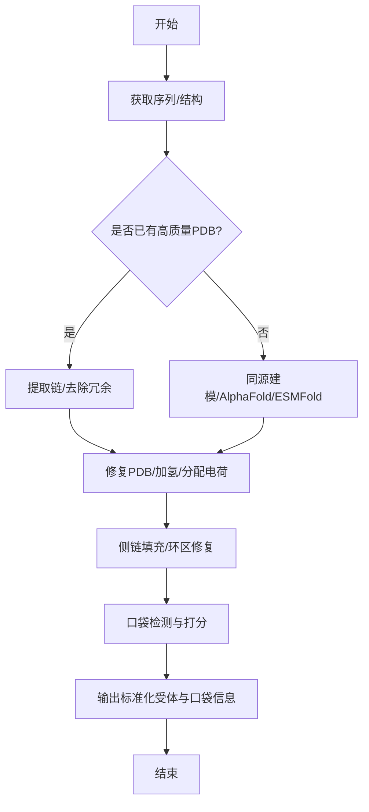

图表来源
- [docs/molbench_repo/skills/L1_tools/molclaw-protein-sequence-retrieve/tool.yaml](file://docs/molbench_repo/skills/L1_tools/molclaw-protein-sequence-retrieve/tool.yaml)
- [docs/molbench_repo/skills/L1_tools/molclaw-protein-structure-retrieve/tool.yaml](file://docs/molbench_repo/skills/L1_tools/molclaw-protein-structure-retrieve/tool.yaml)
- [docs/molbench_repo/skills/L1_tools/molclaw-extract-chains/tool.yaml](file://docs/molbench_repo/skills/L1_tools/molclaw-extract-chains/tool.yaml)
- [docs/molbench_repo/skills/L1_tools/molclaw-fix-pdb/tool.yaml](file://docs/molbench_repo/skills/L1_tools/molclaw-fix-pdb/tool.yaml)
- [docs/molbench_repo/skills/L1_tools/molclaw-pdbfixer/tool.yaml](file://docs/molbench_repo/skills/L1_tools/molclaw-pdbfixer/tool.yaml)
- [docs/molbench_repo/skills/L1_tools/molclaw-pack-sidechains/tool.yaml](file://docs/molbench_repo/skills/L1_tools/molclaw-pack-sidechains/tool.yaml)
- [docs/molbench_repo/skills/L1_tools/molclaw-fpocket-toolkit-base/tool.yaml](file://docs/molbench_repo/skills/L1_tools/molclaw-fpocket-toolkit-base/tool.yaml)
- [docs/molbench_repo/skills/L1_tools/molclaw-p2rank/tool.yaml](file://docs/molbench_repo/skills/L1_tools/molclaw-p2rank/tool.yaml)
- [docs/molbench_repo/skills/L1_tools/molclaw-esmfold/tool.yaml](file://docs/molbench_repo/skills/L1_tools/molclaw-esmfold/tool.yaml)

章节来源
- [docs/molbench_repo/skills/L2_workflows/01-target-protein-preparation.md](file://docs/molbench_repo/skills/L2_workflows/01-target-protein-preparation.md)

### 组件二：分子对接筛选（Docking Screening）
- 目标
  - 对大规模小分子库进行快速对接，得到初始结合构象与打分，作为后续精筛与优化的基础。
- 关键工具
  - 对接引擎（QuickVina/DiffDock/H-Dock/KarMaDock）、对接后相互作用分析（PROLIF）。
- 输入/输出
  - 输入：标准化受体、分子库（SMILES/SDF）、对接参数；输出：对接构象、打分、相互作用指纹。
- 质量控制
  - 对接收敛性、构象多样性、关键相互作用保留率、假阳性控制。
- 并行与加速
  - 按分子分片并行、GPU/CPU混合调度、结果去重与早停策略。

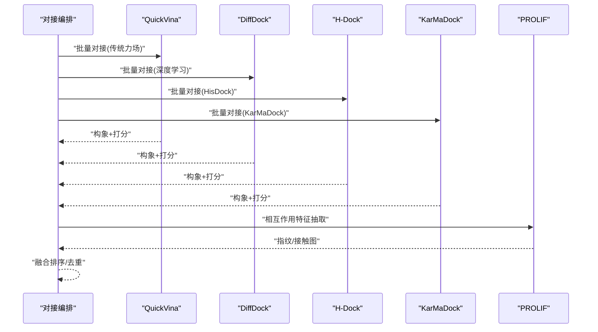

图表来源
- [docs/molbench_repo/skills/L1_tools/molclaw-quickvina-docking/tool.yaml](file://docs/molbench_repo/skills/L1_tools/molclaw-quickvina-docking/tool.yaml)
- [docs/molbench_repo/skills/L1_tools/molclaw-diffdock-auto/tool.yaml](file://docs/molbench_repo/skills/L1_tools/molclaw-diffdock-auto/tool.yaml)
- [docs/molbench_repo/skills/L1_tools/molclaw-hdock-tool/tool.yaml](file://docs/molbench_repo/skills/L1_tools/molclaw-hdock-tool/tool.yaml)
- [docs/molbench_repo/skills/L1_tools/molclaw-karmadock-tool/tool.yaml](file://docs/molbench_repo/skills/L1_tools/molclaw-karmadock-tool/tool.yaml)
- [docs/molbench_repo/skills/L1_tools/molclaw-prolif-docking/tool.yaml](file://docs/molbench_repo/skills/L1_tools/molclaw-prolif-docking/tool.yaml)
- [docs/molbench_repo/skills/L1_tools/molclaw-docking-screening/tool.yaml](file://docs/molbench_repo/skills/L1_tools/molclaw-docking-screening/tool.yaml)

章节来源
- [docs/molbench_repo/skills/L2_workflows/02-molecular-docking-screening.md](file://docs/molbench_repo/skills/L2_workflows/02-molecular-docking-screening.md)

### 组件三：性质分析与过滤（Property Analysis & Filtering）
- 目标
  - 在对接前/后进行多维性质评估，剔除不合规分子，提升后续计算性价比。
- 关键工具
  - SMILES有效性检查、基本理化指标、类药性、复杂度、氢键/疏水性、拓扑/结构度量、相似性。
- 输入/输出
  - 输入：SMILES/结构；输出：指标表、过滤标记、可视化摘要。
- 阈值策略
  - 根据目标适应症与给药途径设定动态阈值，支持规则引擎与权重打分。

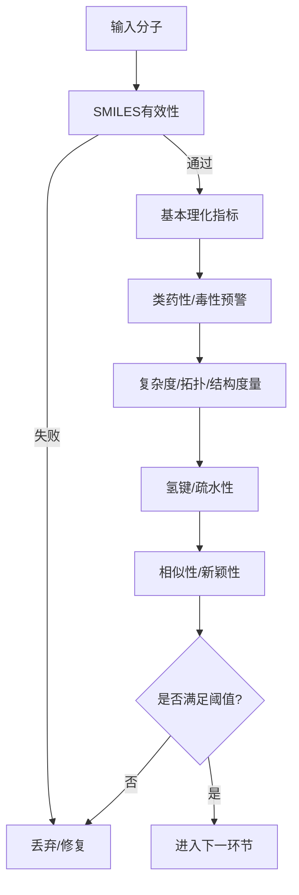

图表来源
- [docs/molbench_repo/skills/L1_tools/molclaw-smiles-valid-check/tool.yaml](file://docs/molbench_repo/skills/L1_tools/molclaw-smiles-valid-check/tool.yaml)
- [docs/molbench_repo/skills/L1_tools/molclaw-mol-basic-metrics/tool.yaml](file://docs/molbench_repo/skills/L1_tools/molclaw-mol-basic-metrics/tool.yaml)
- [docs/molbench_repo/skills/L1_tools/molclaw-drug-likeness/tool.yaml](file://docs/molbench_repo/skills/L1_tools/molclaw-drug-likeness/tool.yaml)
- [docs/molbench_repo/skills/L1_tools/molclaw-mol-complexity-metrics/tool.yaml](file://docs/molbench_repo/skills/L1_tools/molclaw-mol-complexity-metrics/tool.yaml)
- [docs/molbench_repo/skills/L1_tools/molclaw-mol-hbond-metrics/tool.yaml](file://docs/molbench_repo/skills/L1_tools/molclaw-mol-hbond-metrics/tool.yaml)
- [docs/molbench_repo/skills/L1_tools/molclaw-mol-hydrophobicity-metrics/tool.yaml](file://docs/molbench_repo/skills/L1_tools/molclaw-mol-hydrophobicity-metrics/tool.yaml)
- [docs/molbench_repo/skills/L1_tools/molclaw-mol-structure-metrics/tool.yaml](file://docs/molbench_repo/skills/L1_tools/molclaw-mol-structure-metrics/tool.yaml)
- [docs/molbench_repo/skills/L1_tools/molclaw-mol-topology-metrics/tool.yaml](file://docs/molbench_repo/skills/L1_tools/molclaw-mol-topology-metrics/tool.yaml)
- [docs/molbench_repo/skills/L1_tools/molclaw-mol-similarity/tool.yaml](file://docs/molbench_repo/skills/L1_tools/molclaw-mol-similarity/tool.yaml)

章节来源
- [docs/molbench_repo/skills/L2_workflows/03-molecular-property-analysis-filtering.md](file://docs/molbench_repo/skills/L2_workflows/03-molecular-property-analysis-filtering.md)

### 组件四：生成式设计（Generative Design）
- 目标
  - 基于骨架/连接子/R-基团空间进行定向采样，生成具有潜力的新分子。
- 关键工具
  - 去 novo 采样、连接子扩展、R-基团替换、分子间转换。
- 输入/输出
  - 输入：种子分子/片段/约束；输出：候选分子集合及生成理由。
- 质量门控
  - 生成后立即进行性质与结构合理性检查，避免无效结构进入下游。

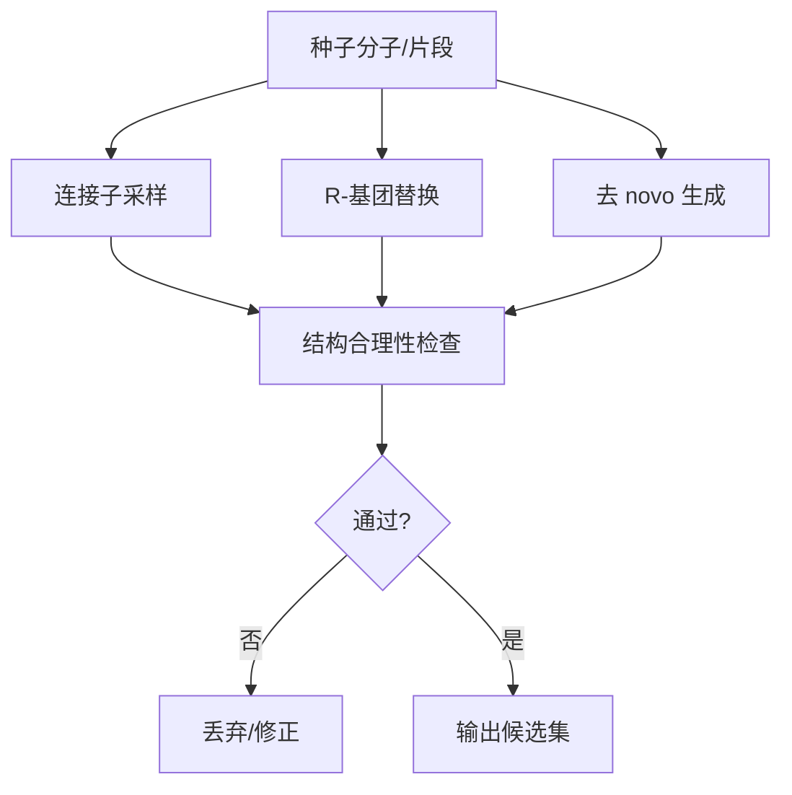

图表来源
- [docs/molbench_repo/skills/L1_tools/molclaw-linker-sampling/tool.yaml](file://docs/molbench_repo/skills/L1_tools/molclaw-linker-sampling/tool.yaml)
- [docs/molbench_repo/skills/L1_tools/molclaw-rgroup-sampling/tool.yaml](file://docs/molbench_repo/skills/L1_tools/molclaw-rgroup-sampling/tool.yaml)
- [docs/molbench_repo/skills/L1_tools/molclaw-denovo-sampling/tool.yaml](file://docs/molbench_repo/skills/L1_tools/molclaw-denovo-sampling/tool.yaml)
- [docs/molbench_repo/skills/L1_tools/molclaw-mol2mol-sampling/tool.yaml](file://docs/molbench_repo/skills/L1_tools/molclaw-mol2mol-sampling/tool.yaml)

章节来源
- [docs/molbench_repo/skills/L2_workflows/04-generative-molecular-design.md](file://docs/molbench_repo/skills/L2_workflows/04-generative-molecular-design.md)

### 组件五：迭代优化（Iterative Optimization）
- 目标
  - 以对接打分、性质指标与相互作用特征为反馈，驱动多轮优化，逐步逼近最优解。
- 关键工具
  - 对接重跑、性质再评估、相似性与多样性约束、主动学习/贝叶斯优化（可选）。
- 输入/输出
  - 输入：上一轮候选与指标；输出：本轮优化分子与改进说明。
- 终止条件
  - 达到目标分数、预算耗尽、收敛判据触发。

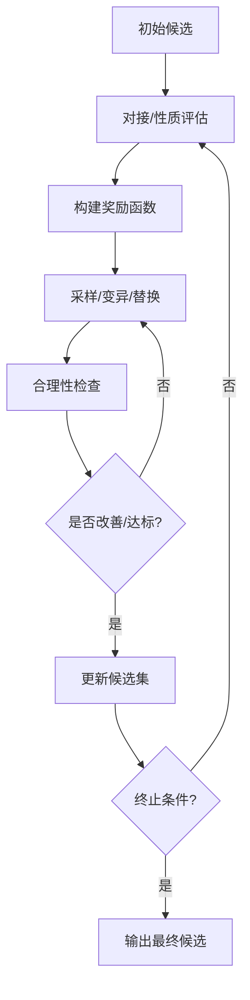

图表来源
- [docs/molbench_repo/skills/L1_tools/molclaw-quickvina-docking/tool.yaml](file://docs/molbench_repo/skills/L1_tools/molclaw-quickvina-docking/tool.yaml)
- [docs/molbench_repo/skills/L1_tools/molclaw-mol-similarity/tool.yaml](file://docs/molbench_repo/skills/L1_tools/molclaw-mol-similarity/tool.yaml)
- [docs/molbench_repo/skills/L1_tools/molclaw-mol-basic-metrics/tool.yaml](file://docs/molbench_repo/skills/L1_tools/molclaw-mol-basic-metrics/tool.yaml)
- [docs/molbench_repo/skills/L1_tools/molclaw-smiles-valid-check/tool.yaml](file://docs/molbench_repo/skills/L1_tools/molclaw-smiles-valid-check/tool.yaml)

章节来源
- [docs/molbench_repo/skills/L2_workflows/05-iterative-molecular-optimization.md](file://docs/molbench_repo/skills/L2_workflows/05-iterative-molecular-optimization.md)

### 组件六：结合自由能计算（Binding Free Energy）
- 目标
  - 对短名单分子进行更精确的结合自由能估算，辅助最终决策。
- 关键工具
  - MM-PBSA（蛋白-配体）、蛋白质-蛋白质MM-PBSA（可选）、FoldX（稳定性/突变）、GOCA/OpenAWSEM（高级采样/能量）。
- 输入/输出
  - 输入：复合物结构/轨迹；输出：ΔG估计、误差范围、贡献分解。
- 注意事项
  - 采样充分性、熵项估计、溶剂模型选择、体系大小与时长权衡。

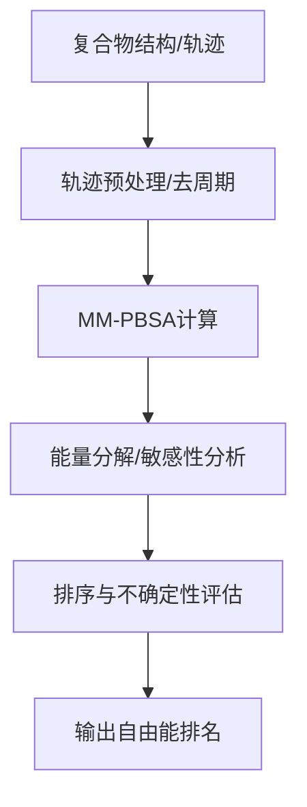

图表来源
- [docs/molbench_repo/skills/L1_tools/molclaw-protein-ligand-mmpbsa/tool.yaml](file://docs/molbench_repo/skills/L1_tools/molclaw-protein-ligand-mmpbsa/tool.yaml)
- [docs/molbench_repo/skills/L1_tools/molclaw-protein-protein-mmpbsa/tool.yaml](file://docs/molbench_repo/skills/L1_tools/molclaw-protein-protein-mmpbsa/tool.yaml)
- [docs/molbench_repo/skills/L1_tools/molclaw-foldx-tool/tool.yaml](file://docs/molbench_repo/skills/L1_tools/molclaw-foldx-tool/tool.yaml)
- [docs/molbench_repo/skills/L1_tools/molclaw-goca-tool/tool.yaml](file://docs/molbench_repo/skills/L1_tools/molclaw-goca-tool/tool.yaml)
- [docs/molbench_repo/skills/L1_tools/molclaw-openawsem-tool/tool.yaml](file://docs/molbench_repo/skills/L1_tools/molclaw-openawsem-tool/tool.yaml)

章节来源
- [docs/molbench_repo/skills/L2_workflows/06-binding-free-energy-calculation.md](file://docs/molbench_repo/skills/L2_workflows/06-binding-free-energy-calculation.md)

### 组件七：构象采样与分析（Conformational Sampling & Analysis）
- 目标
  - 通过MD或增强采样探索结合态构象空间，验证稳定性与关键相互作用。
- 关键工具
  - OpenMM（MD）、PROLIF（轨迹相互作用分析）、可视化。
- 输入/输出
  - 输入：复合物初始结构；输出：轨迹、聚类结果、关键残基/相互作用热图。
- 质量控制
  - RMSD/RMSF稳定、氢键占有率、盐桥/π-堆积持久性。

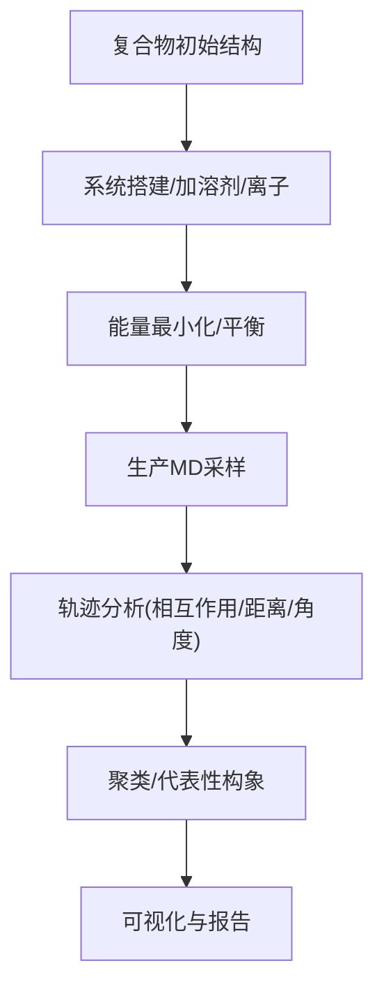

图表来源
- [docs/molbench_repo/skills/L1_tools/molclaw-protein-openmm/tool.yaml](file://docs/molbench_repo/skills/L1_tools/molclaw-protein-openmm/tool.yaml)
- [docs/molbench_repo/skills/L1_tools/molclaw-prolif-md/tool.yaml](file://docs/molbench_repo/skills/L1_tools/molclaw-prolif-md/tool.yaml)
- [docs/molbench_repo/skills/L1_tools/molclaw-prolif-pdb/tool.yaml](file://docs/molbench_repo/skills/L1_tools/molclaw-prolif-pdb/tool.yaml)
- [docs/molbench_repo/skills/L1_tools/molclaw-interaction-visualizer/tool.yaml](file://docs/molbench_repo/skills/L1_tools/molclaw-interaction-visualizer/tool.yaml)

章节来源
- [docs/molbench_repo/skills/L2_workflows/07-conformational-sampling-analysis.md](file://docs/molbench_repo/skills/L2_workflows/07-conformational-sampling-analysis.md)

### 组件八：对接后评估（Post-Docking Evaluation）
- 目标
  - 综合多维度指标对候选进行最终排序与解释，输出可追溯的证据包。
- 关键工具
  - PROLIF、可视化、性质度量、相似性与新颖性、EvoBind/EquiScore（可选）。
- 输入/输出
  - 输入：对接结果/轨迹/性质表；输出：综合评分、可视化图、Top N 候选。
- 报告规范
  - 包含数据来源、参数版本、随机种子、失败重试记录与不确定性估计。

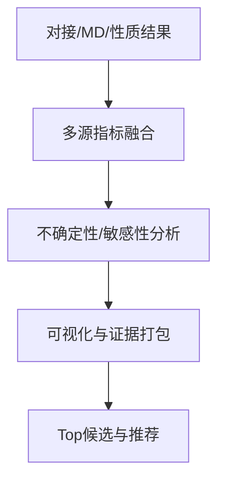

图表来源
- [docs/molbench_repo/skills/L1_tools/molclaw-prolif-docking/tool.yaml](file://docs/molbench_repo/skills/L1_tools/molclaw-prolif-docking/tool.yaml)
- [docs/molbench_repo/skills/L1_tools/molclaw-interaction-visualizer/tool.yaml](file://docs/molbench_repo/skills/L1_tools/molclaw-interaction-visualizer/tool.yaml)
- [docs/molbench_repo/skills/L1_tools/molclaw-mol-similarity/tool.yaml](file://docs/molbench_repo/skills/L1_tools/molclaw-mol-similarity/tool.yaml)
- [docs/molbench_repo/skills/L1_tools/molclaw-equiscore-tool/tool.yaml](file://docs/molbench_repo/skills/L1_tools/molclaw-equiscore-tool/tool.yaml)
- [docs/molbench_repo/skills/L1_tools/molclaw-evobind-tool/tool.yaml](file://docs/molbench_repo/skills/L1_tools/molclaw-evobind-tool/tool.yaml)

章节来源
- [docs/molbench_repo/skills/L2_workflows/08-post-docking-evaluation.md](file://docs/molbench_repo/skills/L2_workflows/08-post-docking-evaluation.md)

## 依赖关系分析
- 模块耦合
  - L2 工作流通过 L1 工具实现具体能力，工具之间以文件与结构化数据为接口，松耦合、可替换。
- 外部依赖
  - 生物信息学数据库（序列/结构）、开源计算化学工具、可视化库、评测框架。
- 循环依赖
  - 工作流为有向无环图，避免循环调用；工具内部可能递归但对外暴露幂等接口。

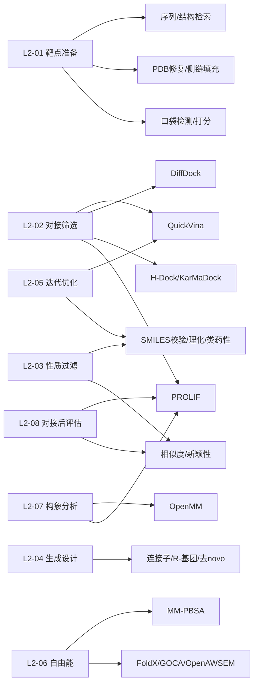

图表来源
- [docs/molbench_repo/skills/L2_workflows/01-target-protein-preparation.md](file://docs/molbench_repo/skills/L2_workflows/01-target-protein-preparation.md)
- [docs/molbench_repo/skills/L2_workflows/02-molecular-docking-screening.md](file://docs/molbench_repo/skills/L2_workflows/02-molecular-docking-screening.md)
- [docs/molbench_repo/skills/L2_workflows/03-molecular-property-analysis-filtering.md](file://docs/molbench_repo/skills/L2_workflows/03-molecular-property-analysis-filtering.md)
- [docs/molbench_repo/skills/L2_workflows/04-generative-molecular-design.md](file://docs/molbench_repo/skills/L2_workflows/04-generative-molecular-design.md)
- [docs/molbench_repo/skills/L2_workflows/05-iterative-molecular-optimization.md](file://docs/molbench_repo/skills/L2_workflows/05-iterative-molecular-optimization.md)
- [docs/molbench_repo/skills/L2_workflows/06-binding-free-energy-calculation.md](file://docs/molbench_repo/skills/L2_workflows/06-binding-free-energy-calculation.md)
- [docs/molbench_repo/skills/L2_workflows/07-conformational-sampling-analysis.md](file://docs/molbench_repo/skills/L2_workflows/07-conformational-sampling-analysis.md)
- [docs/molbench_repo/skills/L2_workflows/08-post-docking-evaluation.md](file://docs/molbench_repo/skills/L2_workflows/08-post-docking-evaluation.md)

章节来源
- [docs/molbench_repo/skills/L1_tools/molclaw-docking-screening/tool.yaml](file://docs/molbench_repo/skills/L1_tools/molclaw-docking-screening/tool.yaml)
- [docs/molbench_repo/skills/L1_tools/molclaw-quickvina-docking/tool.yaml](file://docs/molbench_repo/skills/L1_tools/molclaw-quickvina-docking/tool.yaml)
- [docs/molbench_repo/skills/L1_tools/molclaw-prolif-docking/tool.yaml](file://docs/molbench_repo/skills/L1_tools/molclaw-prolif-docking/tool.yaml)
- [docs/molbench_repo/skills/L1_tools/molclaw-prolif-md/tool.yaml](file://docs/molbench_repo/skills/L1_tools/molclaw-prolif-md/tool.yaml)
- [docs/molbench_repo/skills/L1_tools/molclaw-prolif-pdb/tool.yaml](file://docs/molbench_repo/skills/L1_tools/molclaw-prolif-pdb/tool.yaml)
- [docs/molbench_repo/skills/L1_tools/molclaw-protein-openmm/tool.yaml](file://docs/molbench_repo/skills/L1_tools/molclaw-protein-openmm/tool.yaml)
- [docs/molbench_repo/skills/L1_tools/molclaw-protein-ligand-mmpbsa/tool.yaml](file://docs/molbench_repo/skills/L1_tools/molclaw-protein-ligand-mmpbsa/tool.yaml)
- [docs/molbench_repo/skills/L1_tools/molclaw-fpocket-toolkit-base/tool.yaml](file://docs/molbench_repo/skills/L1_tools/molclaw-fpocket-toolkit-base/tool.yaml)
- [docs/molbench_repo/skills/L1_tools/molclaw-interaction-visualizer/tool.yaml](file://docs/molbench_repo/skills/L1_tools/molclaw-interaction-visualizer/tool.yaml)
- [docs/molbench_repo/skills/L1_tools/molclaw-smiles-valid-check/tool.yaml](file://docs/molbench_repo/skills/L1_tools/molclaw-smiles-valid-check/tool.yaml)
- [docs/molbench_repo/skills/L1_tools/molclaw-mol-basic-metrics/tool.yaml](file://docs/molbench_repo/skills/L1_tools/molclaw-mol-basic-metrics/tool.yaml)
- [docs/molbench_repo/skills/L1_tools/molclaw-drug-likeness/tool.yaml](file://docs/molbench_repo/skills/L1_tools/molclaw-drug-likeness/tool.yaml)
- [docs/molbench_repo/skills/L1_tools/molclaw-mol-complexity-metrics/tool.yaml](file://docs/molbench_repo/skills/L1_tools/molclaw-mol-complexity-metrics/tool.yaml)
- [docs/molbench_repo/skills/L1_tools/molclaw-mol-hbond-metrics/tool.yaml](file://docs/molbench_repo/skills/L1_tools/molclaw-mol-hbond-metrics/tool.yaml)
- [docs/molbench_repo/skills/L1_tools/molclaw-mol-hydrophobicity-metrics/tool.yaml](file://docs/molbench_repo/skills/L1_tools/molclaw-mol-hydrophobicity-metrics/tool.yaml)
- [docs/molbench_repo/skills/L1_tools/molclaw-mol-structure-metrics/tool.yaml](file://docs/molbench_repo/skills/L1_tools/molclaw-mol-structure-metrics/tool.yaml)
- [docs/molbench_repo/skills/L1_tools/molclaw-mol-topology-metrics/tool.yaml](file://docs/molbench_repo/skills/L1_tools/molclaw-mol-topology-metrics/tool.yaml)
- [docs/molbench_repo/skills/L1_tools/molclaw-mol-similarity/tool.yaml](file://docs/molbench_repo/skills/L1_tools/molclaw-mol-similarity/tool.yaml)
- [docs/molbench_repo/skills/L1_tools/molclaw-mol2mol-sampling/tool.yaml](file://docs/molbench_repo/skills/L1_tools/molclaw-mol2mol-sampling/tool.yaml)
- [docs/molbench_repo/skills/L1_tools/molclaw-linker-sampling/tool.yaml](file://docs/molbench_repo/skills/L1_tools/molclaw-linker-sampling/tool.yaml)
- [docs/molbench_repo/skills/L1_tools/molclaw-rgroup-sampling/tool.yaml](file://docs/molbench_repo/skills/L1_tools/molclaw-rgroup-sampling/tool.yaml)
- [docs/molbench_repo/skills/L1_tools/molclaw-diffdock-auto/tool.yaml](file://docs/molbench_repo/skills/L1_tools/molclaw-diffdock-auto/tool.yaml)
- [docs/molbench_repo/skills/L1_tools/molclaw-chai1-predict/tool.yaml](file://docs/molbench_repo/skills/L1_tools/molclaw-chai1-predict/tool.yaml)
- [docs/molbench_repo/skills/L1_tools/molclaw-esmfold/tool.yaml](file://docs/molbench_repo/skills/L1_tools/molclaw-esmfold/tool.yaml)
- [docs/molbench_repo/skills/L1_tools/molclaw-protein-sequence-retrieve/tool.yaml](file://docs/molbench_repo/skills/L1_tools/molclaw-protein-sequence-retrieve/tool.yaml)
- [docs/molbench_repo/skills/L1_tools/molclaw-protein-structure-retrieve/tool.yaml](file://docs/molbench_repo/skills/L1_tools/molclaw-protein-structure-retrieve/tool.yaml)
- [docs/molbench_repo/skills/L1_tools/molclaw-extract-chains/tool.yaml](file://docs/molbench_repo/skills/L1_tools/molclaw-extract-chains/tool.yaml)
- [docs/molbench_repo/skills/L1_tools/molclaw-fix-pdb/tool.yaml](file://docs/molbench_repo/skills/L1_tools/molclaw-fix-pdb/tool.yaml)
- [docs/molbench_repo/skills/L1_tools/molclaw-pack-sidechains/tool.yaml](file://docs/molbench_repo/skills/L1_tools/molclaw-pack-sidechains/tool.yaml)
- [docs/molbench_repo/skills/L1_tools/molclaw-pdbfixer/tool.yaml](file://docs/molbench_repo/skills/L1_tools/molclaw-pdbfixer/tool.yaml)
- [docs/molbench_repo/skills/L1_tools/molclaw-p2rank/tool.yaml](file://docs/molbench_repo/skills/L1_tools/molclaw-p2rank/tool.yaml)
- [docs/molbench_repo/skills/L1_tools/molclaw-compound-retrieve/tool.yaml](file://docs/molbench_repo/skills/L1_tools/molclaw-compound-retrieve/tool.yaml)
- [docs/molbench_repo/skills/L1_tools/molclaw-denovo-sampling/tool.yaml](file://docs/molbench_repo/skills/L1_tools/molclaw-denovo-sampling/tool.yaml)
- [docs/molbench_repo/skills/L1_tools/molclaw-equiscore-tool/tool.yaml](file://docs/molbench_repo/skills/L1_tools/molclaw-equiscore-tool/tool.yaml)
- [docs/molbench_repo/skills/L1_tools/molclaw-equiscore-docking/tool.yaml](file://docs/molbench_repo/skills/L1_tools/molclaw-equiscore-docking/tool.yaml)
- [docs/molbench_repo/skills/L1_tools/molclaw-evobind-tool/tool.yaml](file://docs/molbench_repo/skills/L1_tools/molclaw-evobind-tool/tool.yaml)
- [docs/molbench_repo/skills/L1_tools/molclaw-foldx-tool/tool.yaml](file://docs/molbench_repo/skills/L1_tools/molclaw-foldx-tool/tool.yaml)
- [docs/molbench_repo/skills/L1_tools/molclaw-goca-tool/tool.yaml](file://docs/molbench_repo/skills/L1_tools/molclaw-goca-tool/tool.yaml)
- [docs/molbench_repo/skills/L1_tools/molclaw-hdock-tool/tool.yaml](file://docs/molbench_repo/skills/L1_tools/molclaw-hdock-tool/tool.yaml)
- [docs/molbench_repo/skills/L1_tools/molclaw-karmadock-tool/tool.yaml](file://docs/molbench_repo/skills/L1_tools/molclaw-karmadock-tool/tool.yaml)
- [docs/molbench_repo/skills/L1_tools/molclaw-openawsem-tool/tool.yaml](file://docs/molbench_repo/skills/L1_tools/molclaw-openawsem-tool/tool.yaml)
- [docs/molbench_repo/skills/L1_tools/molclaw-prolif-tool/tool.yaml](file://docs/molbench_repo/skills/L1_tools/molclaw-prolif-tool/tool.yaml)
- [docs/molbench_repo/skills/L1_tools/molclaw-protein-protein-mmpbsa/tool.yaml](file://docs/molbench_repo/skills/L1_tools/molclaw-protein-protein-mmpbsa/tool.yaml)
- [docs/molbench_repo/skills/L1_tools/molclaw-proteinmpnn-tool/tool.yaml](file://docs/molbench_repo/skills/L1_tools/molclaw-proteinmpnn-tool/tool.yaml)
- [docs/molbench_repo/skills/L1_tools/molclaw-pulchura-rebuild/tool.yaml](file://docs/molbench_repo/skills/L1_tools/molclaw-pulchura-rebuild/tool.yaml)
- [docs/molbench_repo/skills/L1_tools/molclaw-run-bioemu/tool.yaml](file://docs/molbench_repo/skills/L1_tools/molclaw-run-bioemu/tool.yaml)
- [docs/molbench_repo/skills/L1_tools/molclaw-scp-server/tool.yaml](file://docs/molbench_repo/skills/L1_tools/molclaw-scp-server/tool.yaml)
- [docs/molbench_repo/skills/L1_tools/molclaw-sequence-valid-check/tool.yaml](file://docs/molbench_repo/skills/L1_tools/molclaw-sequence-valid-check/tool.yaml)
- [docs/molbench_repo/skills/L1_tools/molclaw-skill-template-writer/tool.yaml](file://docs/molbench_repo/skills/L1_tools/molclaw-skill-template-writer/tool.yaml)
- [docs/molbench_repo/skills/L1_tools/molclaw-smiles-fg-editor/tool.yaml](file://docs/molbench_repo/skills/L1_tools/molclaw-smiles-fg-editor/tool.yaml)
- [docs/molbench_repo/skills/L1_tools/molclaw-file-transfer/tool.yaml](file://docs/molbench_repo/skills/L1_tools/molclaw-file-transfer/tool.yaml)

## 性能与可扩展性
- 并行策略
  - 对接与性质评估天然可并行；建议按分子分片、按工具实例池化，结合队列与重试机制。
- 资源规划
  - CPU密集型（对接/MD）与GPU密集型（深度学习对接/预测）分离部署；设置超时与断点续跑。
- 缓存与去重
  - 对相同输入的结构/性质/对接结果进行哈希缓存，减少重复计算。
- 监控与可观测性
  - 记录每步耗时、资源占用、失败原因与重试次数，便于定位瓶颈。

[本节为通用指导，无需列出具体文件来源]

## 故障排查指南
- 常见问题
  - 蛋白结构不完整：检查缺失原子/环区、辅因子加氢与配位几何。
  - 对接失败或发散：核对网格/中心坐标、配体质子化态与电荷、力场参数。
  - MD不稳定：先做充分能量最小化与平衡，检查温度/压力耦合与时间步长。
  - 自由能波动大：增加采样长度、检查轨迹收敛与熵项估计方法。
- 诊断手段
  - 查看工具日志与中间产物；对比不同工具的打分一致性；对关键残基进行敏感性分析。
- 回退策略
  - 当某工具不可用时，切换到备选工具（如 QuickVina ↔ DiffDock），保持工作流连续性。

章节来源
- [docs/molbench_repo/skills/L1_tools/molclaw-fix-pdb/tool.yaml](file://docs/molbench_repo/skills/L1_tools/molclaw-fix-pdb/tool.yaml)
- [docs/molbench_repo/skills/L1_tools/molclaw-pdbfixer/tool.yaml](file://docs/molbench_repo/skills/L1_tools/molclaw-pdbfixer/tool.yaml)
- [docs/molbench_repo/skills/L1_tools/molclaw-quickvina-docking/tool.yaml](file://docs/molbench_repo/skills/L1_tools/molclaw-quickvina-docking/tool.yaml)
- [docs/molbench_repo/skills/L1_tools/molclaw-diffdock-auto/tool.yaml](file://docs/molbench_repo/skills/L1_tools/molclaw-diffdock-auto/tool.yaml)
- [docs/molbench_repo/skills/L1_tools/molclaw-protein-openmm/tool.yaml](file://docs/molbench_repo/skills/L1_tools/molclaw-protein-openmm/tool.yaml)
- [docs/molbench_repo/skills/L1_tools/molclaw-protein-ligand-mmpbsa/tool.yaml](file://docs/molbench_repo/skills/L1_tools/molclaw-protein-ligand-mmpbsa/tool.yaml)

## 结论
本工作流以“标准化流程 + 可插拔工具 + 统一评测”为核心，覆盖从靶点到候选分子的完整链路。通过合理的参数配置、质量控制与可视化呈现，可在保证科学严谨性的同时显著提升研发效率。建议在实际项目中优先落地“靶点准备 + 对接筛选 + 性质过滤 + 迭代优化”的最小可行闭环，再逐步引入自由能与构象分析以提升置信度。

[本节为总结性内容，无需列出具体文件来源]

## 附录：配置模板与示例
- 环境与环境变量
  - 参考 env.template 与 environment.yaml 准备运行环境。
- 基线配置
  - baseline_molbench-ms-1/2/3.yaml：适用于不同规模与难度的筛选基准。
  - chemcot_mo_edit.yaml / chemcot_mo_opt.yaml：针对编辑与优化的任务模板。
  - claude_template.yaml：提示词/模板类配置。
- 数据清单
  - data_full/molbench-mo/manifest.json：MO 任务清单。
  - data_full/molbench-ms-1/2/3/*.csv：MS 任务数据集。
- 评测入口
  - eval/eval_runner.py 与 eval/run_eval_bench.py：统一评测与批量执行。

章节来源
- [docs/molbench_repo/env.template](file://docs/molbench_repo/env.template)
- [docs/molbench_repo/environment.yaml](file://docs/molbench_repo/environment.yaml)
- [docs/molbench_repo/config/baseline_molbench-ms-1.yaml](file://docs/molbench_repo/config/baseline_molbench-ms-1.yaml)
- [docs/molbench_repo/config/baseline_molbench-ms-2.yaml](file://docs/molbench_repo/config/baseline_molbench-ms-2.yaml)
- [docs/molbench_repo/config/baseline_molbench-ms-3.yaml](file://docs/molbench_repo/config/baseline_molbench-ms-3.yaml)
- [docs/molbench_repo/config/chemcot_mo_edit.yaml](file://docs/molbench_repo/config/chemcot_mo_edit.yaml)
- [docs/molbench_repo/config/chemcot_mo_opt.yaml](file://docs/molbench_repo/config/chemcot_mo_opt.yaml)
- [docs/molbench_repo/config/claude_template.yaml](file://docs/molbench_repo/config/claude_template.yaml)
- [docs/molbench_repo/data_full/molbench-mo/manifest.json](file://docs/molbench_repo/data_full/molbench-mo/manifest.json)
- [docs/molbench_repo/data_full/molbench-ms-1/molbench-ms-1.csv](file://docs/molbench_repo/data_full/molbench-ms-1/molbench-ms-1.csv)
- [docs/molbench_repo/data_full/molbench-ms-2/molbench-ms-2.csv](file://docs/molbench_repo/data_full/molbench-ms-2/molbench-ms-2.csv)
- [docs/molbench_repo/data_full/molbench-ms-3/molbench-ms-3.csv](file://docs/molbench_repo/data_full/molbench-ms-3/molbench-ms-3.csv)
- [docs/molbench_repo/eval/eval_runner.py](file://docs/molbench_repo/eval/eval_runner.py)
- [docs/molbench_repo/eval/run_eval_bench.py](file://docs/molbench_repo/eval/run_eval_bench.py)