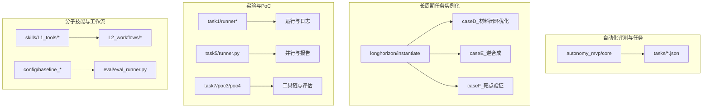
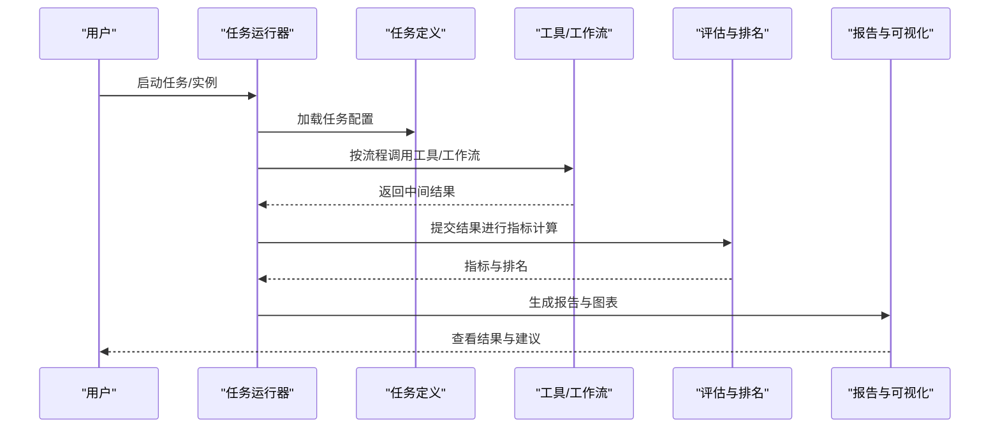
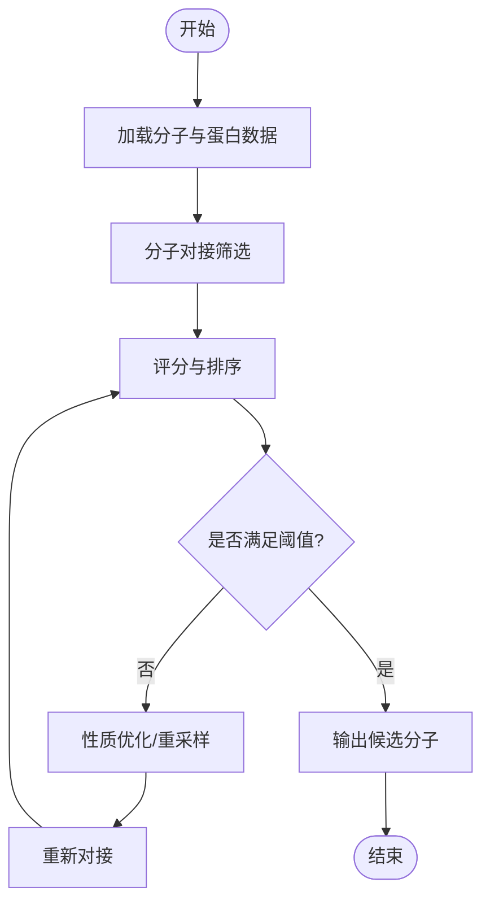
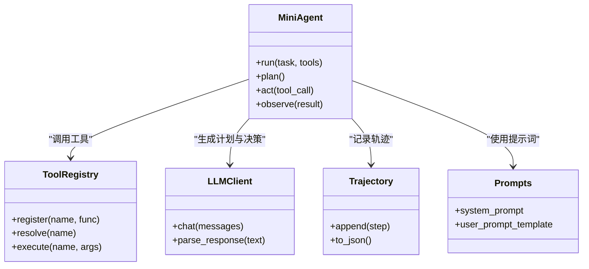
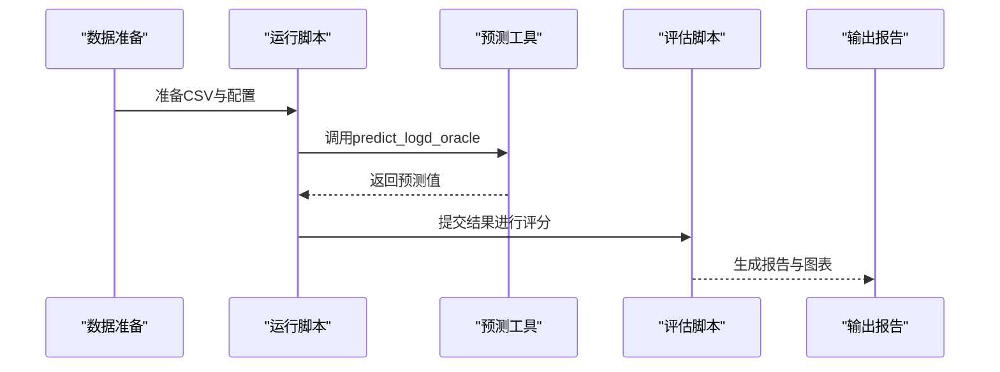
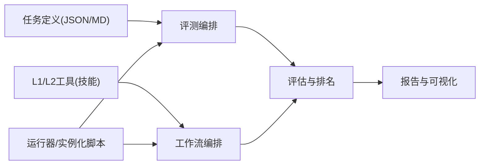

# 高级示例

<cite>
**本文档引用的文件**   
- [autonomy_mvp/core/harness.py](file://autonomy_mvp/core/harness.py)
- [autonomy_mvp/core/judge.py](file://autonomy_mvp/core/judge.py)
- [autonomy_mvp/core/metrics.py](file://autonomy_mvp/core/metrics.py)
- [autonomy_mvp/core/ranking_metrics.py](file://autonomy_mvp/core/ranking_metrics.py)
- [autonomy_mvp/core/sim_agents.py](file://autonomy_mvp/core/sim_agents.py)
- [autonomy_mvp/core/tasks.py](file://autonomy_mvp/core/tasks.py)
- [autonomy_mvp/tasks/drug_admet.json](file://autonomy_mvp/tasks/drug_admet.json)
- [autonomy_mvp/tasks/drug_screen_ms3.json](file://autonomy_mvp/tasks/drug_screen_ms3.json)
- [autonomy_mvp/tasks/materials_semiconductor_bandgap.json](file://autonomy_mvp/tasks/materials_semiconductor_bandgap.json)
- [longhorizon/instantiate/caseD_instantiate.py](file://longhorizon/instantiate/caseD_instantiate.py)
- [longhorizon/instantiate/caseE_instantiate.py](file://longhorizon/instantiate/caseE_instantiate.py)
- [longhorizon/instantiate/caseF_instantiate.py](file://longhorizon/instantiate/caseF_instantiate.py)
- [task1/runner.py](file://task1/runner.py)
- [task1/runner2.py](file://task1/runner2.py)
- [task5/runner.py](file://task5/runner.py)
- [task7/poc4_pharmabench/run_poc4.py](file://task7/poc4_pharmabench/run_poc4.py)
- [task7/poc4_pharmabench/tools/predict_logd_oracle.py](file://task7/poc4_pharmabench/tools/predict_logd_oracle.py)
- [task7/poc4_pharmabench/data/prepare_data.py](file://task7/poc4_pharmabench/data/prepare_data.py)
- [task7/poc3_physicianbench/scripts/run_task.py](file://task7/poc3_physicianbench/scripts/run_task.py)
- [task7/poc3_physicianbench/agent/tool_registry.py](file://task7/poc3_physicianbench/agent/tool_registry.py)
- [task7/poc3_physicianbench/agent/llm_client.py](file://task7/poc3_physicianbench/agent/llm_client.py)
- [task7/poc3_physicianbench/agent/prompts.py](file://task7/poc3_physicianbench/agent/prompts.py)
- [task7/poc3_physicianbench/agent/mini_agent.py](file://task7/poc3_physicianbench/agent/mini_agent.py)
- [task7/poc3_physicianbench/agent/trajectory.py](file://task7/poc3_physicianbench/agent/trajectory.py)
- [task7/poc3_physicianbench/utils/eval_helpers.py](file://task7/poc3_physicianbench/utils/eval_helpers.py)
- [task7/poc3_physicianbench/pyproject.toml](file://task7/poc3_physicianbench/pyproject.toml)
- [task7/poc3_physicianbench/tasks/v1/aberrant_drug_screen/task.md](file://task7/poc3_physicianbench/tasks/v1/aberrant_drug_screen/task.md)
- [task7/poc3_physicianbench/tasks/v1/aberrant_drug_screen/evaluator.py](file://task7/poc3_physicianbench/tasks/v1/aberrant_drug_screen/evaluator.py)
- [docs/prd/molbench_repo/skills/L1_tools/molclaw-docking-screening/skill.yaml](file://docs/prd/molbench_repo/skills/L1_tools/molclaw-docking-screening/skill.yaml)
- [docs/prd/molbench_repo/skills/L1_tools/molclaw-equiscore-tool/skill.yaml](file://docs/prd/molbench_repo/skills/L1_tools/molclaw-equiscore-tool/skill.yaml)
- [docs/prd/molbench_repo/skills/L1_tools/molclaw-mol-opt-physchem/skill.yaml](file://docs/prd/molbench_repo/skills/L1_tools/molclaw-mol-opt-physchem/skill.yaml)
- [docs/prd/molbench_repo/skills/L2_workflows/02-molecular-docking-screening.md](file://docs/prd/molbench_repo/skills/L2_workflows/02-molecular-docking-screening.md)
- [docs/prd/molbench_repo/skills/L2_workflows/05-iterative-molecular-optimization.md](file://docs/prd/molbench_repo/skills/L2_workflows/05-iterative-molecular-optimization.md)
- [docs/prd/molbench_repo/config/baseline_molbench-ms-1.yaml](file://docs/prd/molbench_repo/config/baseline_molbench-ms-1.yaml)
- [docs/prd/molbench_repo/config/baseline_molbench-ms-2.yaml](file://docs/prd/molbench_repo/config/baseline_molbench-ms-2.yaml)
- [docs/prd/molbench_repo/config/baseline_molbench-ms-3.yaml](file://docs/prd/molbench_repo/config/baseline_molbench-ms-3.yaml)
- [docs/prd/molbench_repo/eval/eval_runner.py](file://docs/prd/molbench_repo/eval/eval_runner.py)
</cite>

## 目录
1. [简介](#简介)
2. [项目结构](#项目结构)
3. [核心组件](#核心组件)
4. [架构总览](#架构总览)
5. [详细组件分析](#详细组件分析)
6. [依赖关系分析](#依赖关系分析)
7. [性能考虑](#性能考虑)
8. [故障排查指南](#故障排查指南)
9. [结论](#结论)
10. [附录](#附录)

## 简介
本“高级示例”文档聚焦于复杂科学计算场景的可组合工作流实现，覆盖药物发现、材料优化与医疗诊断三大领域。通过仓库中的自动化评测框架、长周期任务实例化脚本、工具注册与执行管线、以及分子技能与工作流模板，我们展示如何以“工具+流程+评估”的方式拼装出端到端的高价值应用。文档同时给出性能优化策略、错误处理与调试方法，并提供可扩展的模板代码路径，便于快速构建自定义应用。

## 项目结构
仓库采用多任务、多子项目的组织方式：
- autonomy_mvp：提供统一的评测编排、指标与模拟代理能力，并内置药物ADMET、药物筛选（MS3）与半导体能带隙等任务定义。
- longhorizon：面向长周期任务的实例化与批处理，包含材料闭环优化、逆合成、靶点验证等案例。
- task1/task5/task7：分别对应不同阶段的实验与PoC，涵盖并行执行、结果报告、工具链集成与评估。
- docs/prd/molbench_repo：分子技能与工作流模板库，包含L1工具与L2工作流描述及基准配置。



**图示来源** 
- [autonomy_mvp/core/harness.py](file://autonomy_mvp/core/harness.py)
- [autonomy_mvp/core/tasks.py](file://autonomy_mvp/core/tasks.py)
- [longhorizon/instantiate/caseD_instantiate.py](file://longhorizon/instantiate/caseD_instantiate.py)
- [longhorizon/instantiate/caseE_instantiate.py](file://longhorizon/instantiate/caseE_instantiate.py)
- [longhorizon/instantiate/caseF_instantiate.py](file://longhorizon/instantiate/caseF_instantiate.py)
- [task1/runner.py](file://task1/runner.py)
- [task1/runner2.py](file://task1/runner2.py)
- [task5/runner.py](file://task5/runner.py)
- [task7/poc4_pharmabench/run_poc4.py](file://task7/poc4_pharmabench/run_poc4.py)
- [docs/prd/molbench_repo/skills/L2_workflows/02-molecular-docking-screening.md](file://docs/prd/molbench_repo/skills/L2_workflows/02-molecular-docking-screening.md)
- [docs/prd/molbench_repo/eval/eval_runner.py](file://docs/prd/molbench_repo/eval/eval_runner.py)

**章节来源**
- [autonomy_mvp/core/harness.py](file://autonomy_mvp/core/harness.py)
- [autonomy_mvp/core/tasks.py](file://autonomy_mvp/core/tasks.py)
- [longhorizon/instantiate/caseD_instantiate.py](file://longhorizon/instantiate/caseD_instantiate.py)
- [longhorizon/instantiate/caseE_instantiate.py](file://longhorizon/instantiate/caseE_instantiate.py)
- [longhorizon/instantiate/caseF_instantiate.py](file://longhorizon/instantiate/caseF_instantiate.py)
- [task1/runner.py](file://task1/runner.py)
- [task1/runner2.py](file://task1/runner2.py)
- [task5/runner.py](file://task5/runner.py)
- [task7/poc4_pharmabench/run_poc4.py](file://task7/poc4_pharmabench/run_poc4.py)
- [docs/prd/molbench_repo/skills/L2_workflows/02-molecular-docking-screening.md](file://docs/prd/molbench_repo/skills/L2_workflows/02-molecular-docking-screening.md)
- [docs/prd/molbench_repo/eval/eval_runner.py](file://docs/prd/molbench_repo/eval/eval_runner.py)

## 核心组件
- 自动化评测编排：统一的任务加载、执行、指标计算与排名，支持多任务与多代理对比。
- 长周期任务实例化：将具体科学问题（如材料闭环优化、逆合成、靶点验证）转化为可执行的实例集，驱动长期迭代。
- 工具注册与调用：在医疗诊断PoC中，通过工具注册表集中管理外部API与本地函数，供Agent按需调用。
- 分子技能与工作流：以L1工具（如对接筛选、性质预测）和L2工作流（如对接筛选、迭代优化）组合成端到端流程。

**章节来源**
- [autonomy_mvp/core/harness.py](file://autonomy_mvp/core/harness.py)
- [autonomy_mvp/core/judge.py](file://autonomy_mvp/core/judge.py)
- [autonomy_mvp/core/metrics.py](file://autonomy_mvp/core/metrics.py)
- [autonomy_mvp/core/ranking_metrics.py](file://autonomy_mvp/core/ranking_metrics.py)
- [autonomy_mvp/core/sim_agents.py](file://autonomy_mvp/core/sim_agents.py)
- [autonomy_mvp/core/tasks.py](file://autonomy_mvp/core/tasks.py)
- [task7/poc3_physicianbench/agent/tool_registry.py](file://task7/poc3_physicianbench/agent/tool_registry.py)
- [docs/prd/molbench_repo/skills/L1_tools/molclaw-docking-screening/skill.yaml](file://docs/prd/molbench_repo/skills/L1_tools/molclaw-docking-screening/skill.yaml)
- [docs/prd/molbench_repo/skills/L2_workflows/02-molecular-docking-screening.md](file://docs/prd/molbench_repo/skills/L2_workflows/02-molecular-docking-screening.md)

## 架构总览
整体架构围绕“任务定义—工具编排—执行与评估—结果分析”展开：
- 任务层：JSON或Markdown描述任务目标、输入输出与约束。
- 工具层：L1工具封装具体算法或服务；L2工作流串联多个工具形成流程。
- 执行层：Runner/实例化脚本负责调度、并发控制、日志与失败重试。
- 评估层：指标与排名模块对结果进行量化比较，生成报告。



**图示来源** 
- [autonomy_mvp/core/harness.py](file://autonomy_mvp/core/harness.py)
- [autonomy_mvp/core/judge.py](file://autonomy_mvp/core/judge.py)
- [autonomy_mvp/core/metrics.py](file://autonomy_mvp/core/metrics.py)
- [autonomy_mvp/core/ranking_metrics.py](file://autonomy_mvp/core/ranking_metrics.py)
- [docs/prd/molbench_repo/eval/eval_runner.py](file://docs/prd/molbench_repo/eval/eval_runner.py)

## 详细组件分析

### 药物发现工作流（对接筛选与性质优化）
该工作流以“分子对接筛选→性质评估→迭代优化”为主线，结合L1工具与L2工作流完成端到端任务。



**图示来源** 
- [docs/prd/molbench_repo/skills/L1_tools/molclaw-docking-screening/skill.yaml](file://docs/prd/molbench_repo/skills/L1_tools/molclaw-docking-screening/skill.yaml)
- [docs/prd/molbench_repo/skills/L1_tools/molclaw-equiscore-tool/skill.yaml](file://docs/prd/molbench_repo/skills/L1_tools/molclaw-equiscore-tool/skill.yaml)
- [docs/prd/molbench_repo/skills/L1_tools/molclaw-mol-opt-physchem/skill.yaml](file://docs/prd/molbench_repo/skills/L1_tools/molclaw-mol-opt-physchem/skill.yaml)
- [docs/prd/molbench_repo/skills/L2_workflows/02-molecular-docking-screening.md](file://docs/prd/molbench_repo/skills/L2_workflows/02-molecular-docking-screening.md)
- [docs/prd/molbench_repo/skills/L2_workflows/05-iterative-molecular-optimization.md](file://docs/prd/molbench_repo/skills/L2_workflows/05-iterative-molecular-optimization.md)

**章节来源**
- [docs/prd/molbench_repo/skills/L1_tools/molclaw-docking-screening/skill.yaml](file://docs/prd/molbench_repo/skills/L1_tools/molclaw-docking-screening/skill.yaml)
- [docs/prd/molbench_repo/skills/L1_tools/molclaw-equiscore-tool/skill.yaml](file://docs/prd/molbench_repo/skills/L1_tools/molclaw-equiscore-tool/skill.yaml)
- [docs/prd/molbench_repo/skills/L1_tools/molclaw-mol-opt-physchem/skill.yaml](file://docs/prd/molbench_repo/skills/L1_tools/molclaw-mol-opt-physchem/skill.yaml)
- [docs/prd/molbench_repo/skills/L2_workflows/02-molecular-docking-screening.md](file://docs/prd/molbench_repo/skills/L2_workflows/02-molecular-docking-screening.md)
- [docs/prd/molbench_repo/skills/L2_workflows/05-iterative-molecular-optimization.md](file://docs/prd/molbench_repo/skills/L2_workflows/05-iterative-molecular-optimization.md)

### 材料优化循环（BaTiO3为例）
材料闭环优化强调“设计—计算—评估—再设计”的迭代，通过实例化脚本驱动批次任务，持续改进材料属性。

```mermaid
sequenceDiagram
participant Inst as "实例化脚本"
participant Loop as "优化循环"
participant Calc as "计算工具"
participant Eval as "评估模块"
participant Store as "结果存储"
Inst->>Loop : 初始化参数与基线
Loop->>Calc : 生成候选结构并计算性质
Calc-->>Loop : 返回性质值
Loop->>Eval : 评估并更新最优解
Eval-->>Loop : 判定收敛条件
Loop->>Store : 保存中间结果
Loop-->>Inst : 输出最终材料与报告
```

**图示来源** 
- [longhorizon/instantiate/caseD_instantiate.py](file://longhorizon/instantiate/caseD_instantiate.py)
- [docs/prd/molbench_repo/config/baseline_molbench-ms-1.yaml](file://docs/prd/molbench_repo/config/baseline_molbench-ms-1.yaml)
- [docs/prd/molbench_repo/config/baseline_molbench-ms-2.yaml](file://docs/prd/molbench_repo/config/baseline_molbench-ms-2.yaml)
- [docs/prd/molbench_repo/config/baseline_molbench-ms-3.yaml](file://docs/prd/molbench_repo/config/baseline_molbench-ms-3.yaml)

**章节来源**
- [longhorizon/instantiate/caseD_instantiate.py](file://longhorizon/instantiate/caseD_instantiate.py)
- [docs/prd/molbench_repo/config/baseline_molbench-ms-1.yaml](file://docs/prd/molbench_repo/config/baseline_molbench-ms-1.yaml)
- [docs/prd/molbench_repo/config/baseline_molbench-ms-2.yaml](file://docs/prd/molbench_repo/config/baseline_molbench-ms-2.yaml)
- [docs/prd/molbench_repo/config/baseline_molbench-ms-3.yaml](file://docs/prd/molbench_repo/config/baseline_molbench-ms-3.yaml)

### 医疗诊断流程（PhysicianBench PoC）
医疗诊断流程通过Agent与工具注册表协作，调用FHIR API与本地工具完成病例分析与建议生成。



**图示来源** 
- [task7/poc3_physicianbench/agent/mini_agent.py](file://task7/poc3_physicianbench/agent/mini_agent.py)
- [task7/poc3_physicianbench/agent/tool_registry.py](file://task7/poc3_physicianbench/agent/tool_registry.py)
- [task7/poc3_physicianbench/agent/llm_client.py](file://task7/poc3_physicianbench/agent/llm_client.py)
- [task7/poc3_physicianbench/agent/trajectory.py](file://task7/poc3_physicianbench/agent/trajectory.py)
- [task7/poc3_physicianbench/agent/prompts.py](file://task7/poc3_physicianbench/agent/prompts.py)

**章节来源**
- [task7/poc3_physicianbench/agent/mini_agent.py](file://task7/poc3_physicianbench/agent/mini_agent.py)
- [task7/poc3_physicianbench/agent/tool_registry.py](file://task7/poc3_physicianbench/agent/tool_registry.py)
- [task7/poc3_physicianbench/agent/llm_client.py](file://task7/poc3_physicianbench/agent/llm_client.py)
- [task7/poc3_physicianbench/agent/trajectory.py](file://task7/poc3_physicianbench/agent/trajectory.py)
- [task7/poc3_physicianbench/agent/prompts.py](file://task7/poc3_physicianbench/agent/prompts.py)

### 药物筛选与评估（PharmaBench PoC）
该PoC展示了从数据准备到预测工具调用的完整链路，并通过评估脚本生成结果报告。



**图示来源** 
- [task7/poc4_pharmabench/data/prepare_data.py](file://task7/poc4_pharmabench/data/prepare_data.py)
- [task7/poc4_pharmabench/run_poc4.py](file://task7/poc4_pharmabench/run_poc4.py)
- [task7/poc4_pharmabench/tools/predict_logd_oracle.py](file://task7/poc4_pharmabench/tools/predict_logd_oracle.py)

**章节来源**
- [task7/poc4_pharmabench/data/prepare_data.py](file://task7/poc4_pharmabench/data/prepare_data.py)
- [task7/poc4_pharmabench/run_poc4.py](file://task7/poc4_pharmabench/run_poc4.py)
- [task7/poc4_pharmabench/tools/predict_logd_oracle.py](file://task7/poc4_pharmabench/tools/predict_logd_oracle.py)

## 依赖关系分析
- 任务与工具耦合度低：通过JSON/YAML描述任务与工具接口，降低硬编码依赖。
- 执行层与评估层解耦：Runner负责调度，评估模块专注指标计算，便于替换与扩展。
- Agent与工具注册表松耦合：工具以名称注册，Agent动态解析与调用，提升灵活性。



**图示来源** 
- [autonomy_mvp/core/harness.py](file://autonomy_mvp/core/harness.py)
- [autonomy_mvp/core/metrics.py](file://autonomy_mvp/core/metrics.py)
- [autonomy_mvp/core/ranking_metrics.py](file://autonomy_mvp/core/ranking_metrics.py)
- [docs/prd/molbench_repo/eval/eval_runner.py](file://docs/prd/molbench_repo/eval/eval_runner.py)

**章节来源**
- [autonomy_mvp/core/harness.py](file://autonomy_mvp/core/harness.py)
- [autonomy_mvp/core/metrics.py](file://autonomy_mvp/core/metrics.py)
- [autonomy_mvp/core/ranking_metrics.py](file://autonomy_mvp/core/ranking_metrics.py)
- [docs/prd/molbench_repo/eval/eval_runner.py](file://docs/prd/molbench_repo/eval/eval_runner.py)

## 性能考虑
- 并行执行与限流：在Runner中合理设置并发度，避免资源争用；对外部API调用增加重试与退避策略。
- 缓存与增量计算：对重复计算步骤引入缓存（如分子性质预测），减少冗余开销。
- 批处理与内存管理：大样本任务分批处理，及时释放中间对象，防止内存泄漏。
- 指标计算优化：向量化计算与惰性求值，避免不必要的I/O与序列化。

[本节为通用指导，不直接分析具体文件]

## 故障排查指南
- 工具调用失败：检查工具注册表是否正确注册，确认参数格式与类型；查看LLM客户端响应解析逻辑。
- 任务执行中断：定位Runner日志，确认超时与异常捕获；必要时启用断点续跑与状态恢复。
- 评估结果异常：核对指标定义与输入数据一致性；检查排名算法的边界条件与缺失值处理。
- 工作流卡住：逐段打印中间结果，确认上游工具输出是否符合下游期望；必要时回滚到上一稳定版本。

**章节来源**
- [task7/poc3_physicianbench/agent/tool_registry.py](file://task7/poc3_physicianbench/agent/tool_registry.py)
- [task7/poc3_physicianbench/agent/llm_client.py](file://task7/poc3_physicianbench/agent/llm_client.py)
- [task7/poc3_physicianbench/utils/eval_helpers.py](file://task7/poc3_physicianbench/utils/eval_helpers.py)
- [task7/poc3_physicianbench/pyproject.toml](file://task7/poc3_physicianbench/pyproject.toml)

## 结论
通过模块化任务定义、工具与工作流编排、以及统一的执行与评估框架，本仓库提供了从药物发现、材料优化到医疗诊断的完整高级示例集合。借助这些示例与模板，用户可以快速搭建可扩展的科学计算应用，并在性能与可靠性方面获得最佳实践指导。

## 附录
- 模板与参考：
  - 分子技能与工作流模板：见skills目录下的L1工具与L2工作流描述。
  - 基准配置：见baseline_molbench-*.yaml，用于统一评测环境。
  - 评估运行器：eval_runner.py提供标准化评估入口。
- 快速上手：
  - 选择合适的工作流模板，替换输入数据与参数。
  - 通过Runner或实例化脚本启动任务，观察日志与中间结果。
  - 使用评估模块生成报告，迭代优化流程与参数。

**章节来源**
- [docs/prd/molbench_repo/skills/L1_tools/molclaw-docking-screening/skill.yaml](file://docs/prd/molbench_repo/skills/L1_tools/molclaw-docking-screening/skill.yaml)
- [docs/prd/molbench_repo/skills/L2_workflows/02-molecular-docking-screening.md](file://docs/prd/molbench_repo/skills/L2_workflows/02-molecular-docking-screening.md)
- [docs/prd/molbench_repo/config/baseline_molbench-ms-1.yaml](file://docs/prd/molbench_repo/config/baseline_molbench-ms-1.yaml)
- [docs/prd/molbench_repo/eval/eval_runner.py](file://docs/prd/molbench_repo/eval/eval_runner.py)