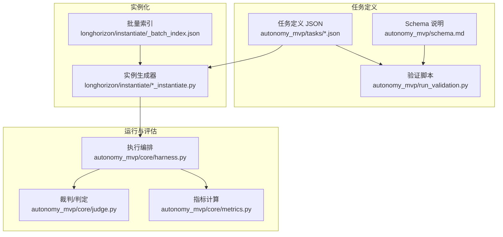
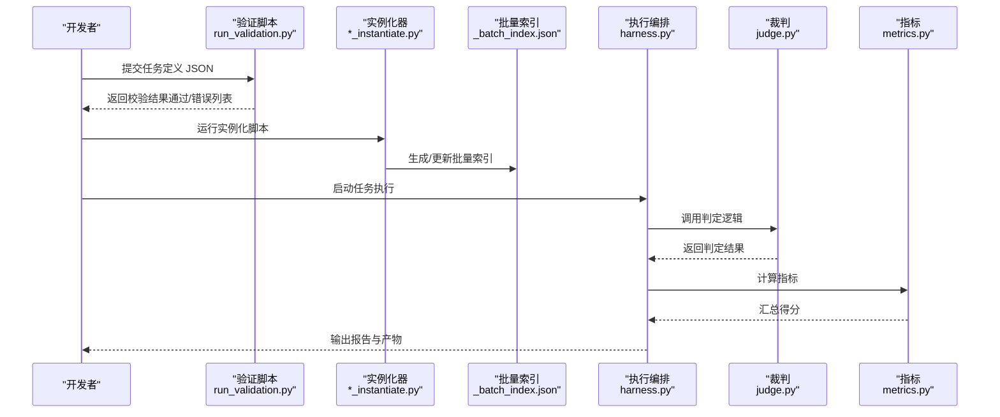
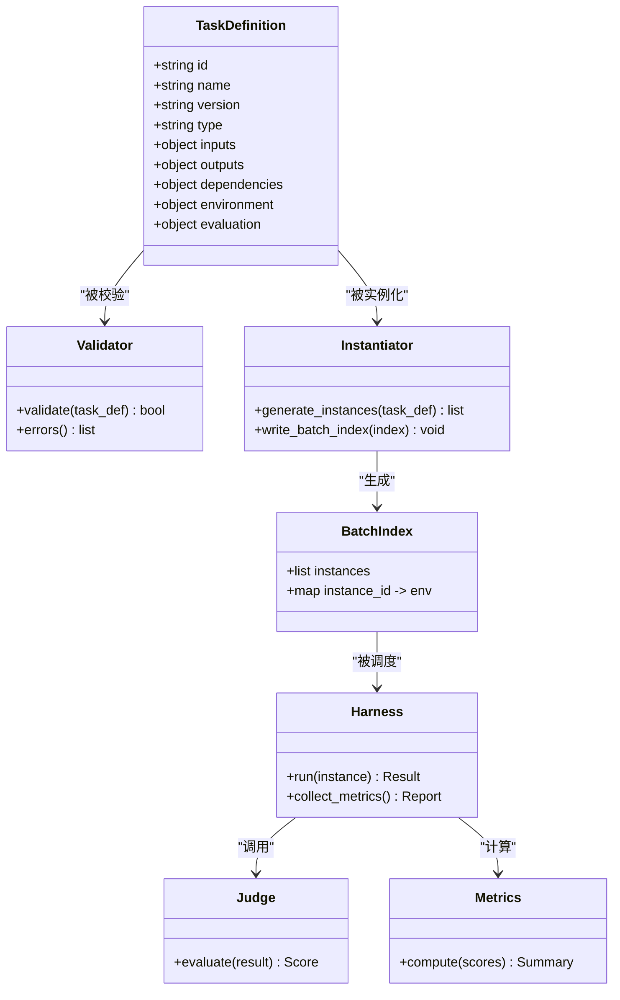

# 任务定义规范

<cite>
**本文引用的文件**   
- [autonomy_mvp/schema.md](file://autonomy_mvp/schema.md)
- [autonomy_mvp/run_validation.py](file://autonomy_mvp/run_validation.py)
- [autonomy_mvp/core/tasks.py](file://autonomy_mvp/core/tasks.py)
- [autonomy_mvp/core/harness.py](file://autonomy_mvp/core/harness.py)
- [autonomy_mvp/core/judge.py](file://autonomy_mvp/core/judge.py)
- [autonomy_mvp/core/metrics.py](file://autonomy_mvp/core/metrics.py)
- [autonomy_mvp/tasks/drug_admet.json](file://autonomy_mvp/tasks/drug_admet.json)
- [autonomy_mvp/tasks/drug_screen_ms3.json](file://autonomy_mvp/tasks/drug_screen_ms3.json)
- [autonomy_mvp/tasks/materials_semiconductor_bandgap.json](file://autonomy_mvp/tasks/materials_semiconductor_bandgap.json)
- [autonomy_mvp/tests/fixtures/fixture_drugscreen.json](file://autonomy_mvp/tests/fixtures/fixture_drugscreen.json)
- [autonomy_mvp/tests/fixtures/fixture_materials.json](file://autonomy_mvp/tests/fixtures/fixture_materials.json)
- [longhorizon/instantiate/_batch_index.json](file://longhorizon/instantiate/_batch_index.json)
- [longhorizon/instantiate/case1_instantiate.py](file://longhorizon/instantiate/case1_instantiate.py)
- [longhorizon/instantiate/case2_instantiate.py](file://longhorizon/instantiate/case2_instantiate.py)
- [longhorizon/instantiate/case3_instantiate.py](file://longhorizon/instantiate/case3_instantiate.py)
- [longhorizon/instantiate/caseD_instantiate.py](file://longhorizon/instantiate/caseD_instantiate.py)
- [longhorizon/instantiate/caseE_instantiate.py](file://longhorizon/instantiate/caseE_instantiate.py)
- [longhorizon/instantiate/caseF_instantiate.py](file://longhorizon/instantiate/caseF_instantiate.py)
- [docs/templates/task_template/README.md](file://docs/templates/task_template/README.md)
- [docs/templates/task_template/experiment/TEMPLATE.md](file://docs/templates/task_template/experiment/TEMPLATE.md)
- [docs/templates/task_template/goal.md](file://docs/templates/task_template/goal.md)
</cite>

## 目录
1. [引言](#引言)
2. [项目结构](#项目结构)
3. [核心组件](#核心组件)
4. [架构总览](#架构总览)
5. [详细组件分析](#详细组件分析)
6. [依赖关系分析](#依赖关系分析)
7. [性能与可扩展性](#性能与可扩展性)
8. [故障排查指南](#故障排查指南)
9. [结论](#结论)
10. [附录](#附录)

## 引言
本规范面向“任务定义文件”的创建与维护，目标是统一任务描述文件的JSON Schema、字段语义与校验规则，明确任务类型分类、依赖声明方式以及执行环境配置。同时提供任务模板使用方法、版本管理策略与兼容性要求，并给出开发最佳实践与质量检查清单，帮助团队高效产出高质量、可复现、可维护的任务集。

## 项目结构
仓库围绕“任务定义—实例化—运行—评估”的主线组织：
- 任务定义层：以JSON为主的任务描述文件（如 autonomy_mvp/tasks/*.json），配合 schema 文档与验证脚本进行约束与校验。
- 实例化层：将抽象任务转换为具体可执行的实例集合（如 longhorizon/instantiate/*_instantiate.py 与 _batch_index.json）。
- 运行与评估层：通过 harness、judge、metrics 等模块驱动任务执行与结果度量。
- 模板与示例：docs/templates/task_template 提供标准任务模板；autonomy_mvp/tests/fixtures 提供最小可用样例。

图表来源
- [autonomy_mvp/schema.md](file://autonomy_mvp/schema.md)
- [autonomy_mvp/run_validation.py](file://autonomy_mvp/run_validation.py)
- [autonomy_mvp/core/harness.py](file://autonomy_mvp/core/harness.py)
- [autonomy_mvp/core/judge.py](file://autonomy_mvp/core/judge.py)
- [autonomy_mvp/core/metrics.py](file://autonomy_mvp/core/metrics.py)
- [longhorizon/instantiate/_batch_index.json](file://longhorizon/instantiate/_batch_index.json)
- [longhorizon/instantiate/case1_instantiate.py](file://longhorizon/instantiate/case1_instantiate.py)
- [longhorizon/instantiate/case2_instantiate.py](file://longhorizon/instantiate/case2_instantiate.py)
- [longhorizon/instantiate/case3_instantiate.py](file://longhorizon/instantiate/case3_instantiate.py)
- [longhorizon/instantiate/caseD_instantiate.py](file://longhorizon/instantiate/caseD_instantiate.py)
- [longhorizon/instantiate/caseE_instantiate.py](file://longhorizon/instantiate/caseE_instantiate.py)
- [longhorizon/instantiate/caseF_instantiate.py](file://longhorizon/instantiate/caseF_instantiate.py)

章节来源
- [autonomy_mvp/schema.md](file://autonomy_mvp/schema.md)
- [autonomy_mvp/run_validation.py](file://autonomy_mvp/run_validation.py)
- [autonomy_mvp/core/harness.py](file://autonomy_mvp/core/harness.py)
- [autonomy_mvp/core/judge.py](file://autonomy_mvp/core/judge.py)
- [autonomy_mvp/core/metrics.py](file://autonomy_mvp/core/metrics.py)
- [longhorizon/instantiate/_batch_index.json](file://longhorizon/instantiate/_batch_index.json)
- [longhorizon/instantiate/case1_instantiate.py](file://longhorizon/instantiate/case1_instantiate.py)
- [longhorizon/instantiate/case2_instantiate.py](file://longhorizon/instantiate/case2_instantiate.py)
- [longhorizon/instantiate/case3_instantiate.py](file://longhorizon/instantiate/case3_instantiate.py)
- [longhorizon/instantiate/caseD_instantiate.py](file://longhorizon/instantiate/caseD_instantiate.py)
- [longhorizon/instantiate/caseE_instantiate.py](file://longhorizon/instantiate/caseE_instantiate.py)
- [longhorizon/instantiate/caseF_instantiate.py](file://longhorizon/instantiate/caseF_instantiate.py)

## 核心组件
- 任务定义文件（JSON）：描述任务元数据、输入输出、依赖、环境与评估方式。
- Schema 与验证：schema.md 定义字段与约束；run_validation.py 负责加载与校验。
- 实例化器：按批次或类别将任务模板实例化为具体用例，输出 _batch_index.json 等索引。
- 执行与评估：harness 编排流程，judge 判定结果，metrics 计算指标。

章节来源
- [autonomy_mvp/schema.md](file://autonomy_mvp/schema.md)
- [autonomy_mvp/run_validation.py](file://autonomy_mvp/run_validation.py)
- [autonomy_mvp/core/harness.py](file://autonomy_mvp/core/harness.py)
- [autonomy_mvp/core/judge.py](file://autonomy_mvp/core/judge.py)
- [autonomy_mvp/core/metrics.py](file://autonomy_mvp/core/metrics.py)

## 架构总览
下图展示从任务定义到最终评估的关键路径，包括校验、实例化、执行与评分环节。

图表来源
- [autonomy_mvp/run_validation.py](file://autonomy_mvp/run_validation.py)
- [longhorizon/instantiate/_batch_index.json](file://longhorizon/instantiate/_batch_index.json)
- [longhorizon/instantiate/case1_instantiate.py](file://longhorizon/instantiate/case1_instantiate.py)
- [longhorizon/instantiate/case2_instantiate.py](file://longhorizon/instantiate/case2_instantiate.py)
- [longhorizon/instantiate/case3_instantiate.py](file://longhorizon/instantiate/case3_instantiate.py)
- [longhorizon/instantiate/caseD_instantiate.py](file://longhorizon/instantiate/caseD_instantiate.py)
- [longhorizon/instantiate/caseE_instantiate.py](file://longhorizon/instantiate/caseE_instantiate.py)
- [longhorizon/instantiate/caseF_instantiate.py](file://longhorizon/instantiate/caseF_instantiate.py)
- [autonomy_mvp/core/harness.py](file://autonomy_mvp/core/harness.py)
- [autonomy_mvp/core/judge.py](file://autonomy_mvp/core/judge.py)
- [autonomy_mvp/core/metrics.py](file://autonomy_mvp/core/metrics.py)

## 详细组件分析

### 任务定义 JSON Schema 与字段规范
- 设计目标
  - 结构化表达任务元信息、输入输出契约、依赖与环境、评估方法与阈值。
  - 支持多领域任务（药物筛选、材料属性预测等）的统一描述。
- 关键字段建议（结合现有任务与模板）
  - 标识与版本：id、name、version、description、tags、license。
  - 任务类型：type（如 drug_screening、materials_property、multi_step_workflow 等）。
  - 输入输出：inputs（字段名、类型、约束）、outputs（字段名、类型、单位/范围）。
  - 依赖：external_tools、datasets、models、env_requirements（Python/系统依赖）。
  - 执行环境：runtime（容器/沙箱/本地）、resources（CPU/GPU/内存/磁盘）、timeout。
  - 评估：evaluator（judge 入口）、metrics（指标列表与权重）、thresholds（合格线）。
  - 可复现性：seed、data_checksum、artifact_urls。
- 约束与校验
  - 必填字段、枚举值、正则表达式、数值范围、嵌套对象完整性。
  - 跨字段一致性（如 inputs 与 outputs 的命名约定、依赖与资源匹配）。
- 参考实现
  - 字段定义与说明见 schema.md。
  - 校验逻辑由 run_validation.py 实现，覆盖必填、类型、范围与引用完整性。

章节来源
- [autonomy_mvp/schema.md](file://autonomy_mvp/schema.md)
- [autonomy_mvp/run_validation.py](file://autonomy_mvp/run_validation.py)
- [autonomy_mvp/tasks/drug_admet.json](file://autonomy_mvp/tasks/drug_admet.json)
- [autonomy_mvp/tasks/drug_screen_ms3.json](file://autonomy_mvp/tasks/drug_screen_ms3.json)
- [autonomy_mvp/tasks/materials_semiconductor_bandgap.json](file://autonomy_mvp/tasks/materials_semiconductor_bandgap.json)
- [autonomy_mvp/tests/fixtures/fixture_drugscreen.json](file://autonomy_mvp/tests/fixtures/fixture_drugscreen.json)
- [autonomy_mvp/tests/fixtures/fixture_materials.json](file://autonomy_mvp/tests/fixtures/fixture_materials.json)

### 任务类型分类与示例
- 典型类型
  - 单步预测型：给定输入直接计算输出（如 ADME 性质预测）。
  - 筛选/排序型：对候选集合打分并排序（如 MS3 筛选）。
  - 多步工作流型：包含多个阶段与中间产物（如材料闭环优化）。
- 示例任务
  - 药物ADME：drug_admet.json
  - 药物MS3筛选：drug_screen_ms3.json
  - 半导体带隙预测：materials_semiconductor_bandgap.json
- 类型选择原则
  - 根据输入规模、是否需外部工具、是否含迭代优化来选择类型。
  - 在 type 字段中明确标注，便于后续路由与资源分配。

章节来源
- [autonomy_mvp/tasks/drug_admet.json](file://autonomy_mvp/tasks/drug_admet.json)
- [autonomy_mvp/tasks/drug_screen_ms3.json](file://autonomy_mvp/tasks/drug_screen_ms3.json)
- [autonomy_mvp/tasks/materials_semiconductor_bandgap.json](file://autonomy_mvp/tasks/materials_semiconductor_bandgap.json)

### 依赖关系声明与解析
- 依赖维度
  - 外部工具：命令行工具、API服务、第三方库。
  - 数据集与模型：数据源URL、哈希校验、模型权重与格式。
  - 运行环境：Python版本、CUDA/驱动、系统包。
- 解析与校验
  - 实例化阶段读取任务定义，解析依赖并准备环境。
  - 通过 _batch_index.json 汇总实例级依赖，供调度器使用。
- 最佳实践
  - 为所有外部资源提供 checksum 与镜像/缓存地址。
  - 将强依赖与可选依赖区分，提升鲁棒性与可移植性。

章节来源
- [longhorizon/instantiate/_batch_index.json](file://longhorizon/instantiate/_batch_index.json)
- [longhorizon/instantiate/case1_instantiate.py](file://longhorizon/instantiate/case1_instantiate.py)
- [longhorizon/instantiate/case2_instantiate.py](file://longhorizon/instantiate/case2_instantiate.py)
- [longhorizon/instantiate/case3_instantiate.py](file://longhorizon/instantiate/case3_instantiate.py)
- [longhorizon/instantiate/caseD_instantiate.py](file://longhorizon/instantiate/caseD_instantiate.py)
- [longhorizon/instantiate/caseE_instantiate.py](file://longhorizon/instantiate/caseE_instantiate.py)
- [longhorizon/instantiate/caseF_instantiate.py](file://longhorizon/instantiate/caseF_instantiate.py)

### 执行环境配置与隔离
- 环境要素
  - 运行时：容器镜像、沙箱策略、网络访问控制。
  - 资源配额：CPU/GPU/内存/磁盘上限与预留。
  - 超时与重试：任务最大运行时间、失败重试次数与退避策略。
- 配置落地
  - 在任务定义中声明 runtime 与 resources。
  - 实例化时生成 _batch_index.json，记录每个实例的环境需求。
- 安全与可审计
  - 限制文件系统与网络访问范围。
  - 记录环境变量、命令与输出日志，便于回溯。

章节来源
- [autonomy_mvp/core/harness.py](file://autonomy_mvp/core/harness.py)
- [longhorizon/instantiate/_batch_index.json](file://longhorizon/instantiate/_batch_index.json)

### 评估与指标体系
- 评估流程
  - harness 调用 judge 完成结果判定。
  - metrics 计算各项指标并汇总。
- 指标设计
  - 准确性：准确率、AUC、RMSE、MAE 等。
  - 效率：耗时、吞吐、资源占用。
  - 稳定性：方差、置信区间、鲁棒性测试。
- 阈值与通过条件
  - 在任务定义中声明 thresholds，用于自动化通过判断。

章节来源
- [autonomy_mvp/core/judge.py](file://autonomy_mvp/core/judge.py)
- [autonomy_mvp/core/metrics.py](file://autonomy_mvp/core/metrics.py)

### 任务模板使用方法
- 模板位置
  - docs/templates/task_template：包含 README、goal 与实验模板。
- 使用步骤
  - 复制模板目录，填写任务基本信息与目标。
  - 依据 schema.md 完善 JSON 定义，确保字段完整与一致。
  - 编写 evaluator 与评测脚本，并在 judge/metrics 中集成。
- 模板要点
  - goal.md 明确问题背景、输入输出与成功标准。
  - experiment/TEMPLATE.md 记录实验设置、参数与复现实验步骤。

章节来源
- [docs/templates/task_template/README.md](file://docs/templates/task_template/README.md)
- [docs/templates/task_template/experiment/TEMPLATE.md](file://docs/templates/task_template/experiment/TEMPLATE.md)
- [docs/templates/task_template/goal.md](file://docs/templates/task_template/goal.md)

### 版本管理与兼容性要求
- 版本策略
  - 采用语义化版本（主版本.次版本.修订号），主版本变更表示不兼容。
  - 在任务定义中声明 version，并在变更日志中记录破坏性更新。
- 兼容性矩阵
  - 明确支持的 Python/系统版本、关键依赖版本范围。
  - 对旧版任务定义提供迁移脚本或兼容层。
- 发布与回滚
  - 使用标签与制品归档（checksum、镜像哈希）。
  - 保留历史版本快照，支持快速回滚。

章节来源
- [autonomy_mvp/schema.md](file://autonomy_mvp/schema.md)
- [autonomy_mvp/run_validation.py](file://autonomy_mvp/run_validation.py)

## 依赖关系分析
任务定义与实例化、执行、评估之间的依赖如下：

图表来源
- [autonomy_mvp/schema.md](file://autonomy_mvp/schema.md)
- [autonomy_mvp/run_validation.py](file://autonomy_mvp/run_validation.py)
- [longhorizon/instantiate/_batch_index.json](file://longhorizon/instantiate/_batch_index.json)
- [longhorizon/instantiate/case1_instantiate.py](file://longhorizon/instantiate/case1_instantiate.py)
- [longhorizon/instantiate/case2_instantiate.py](file://longhorizon/instantiate/case2_instantiate.py)
- [longhorizon/instantiate/case3_instantiate.py](file://longhorizon/instantiate/case3_instantiate.py)
- [longhorizon/instantiate/caseD_instantiate.py](file://longhorizon/instantiate/caseD_instantiate.py)
- [longhorizon/instantiate/caseE_instantiate.py](file://longhorizon/instantiate/caseE_instantiate.py)
- [longhorizon/instantiate/caseF_instantiate.py](file://longhorizon/instantiate/caseF_instantiate.py)
- [autonomy_mvp/core/harness.py](file://autonomy_mvp/core/harness.py)
- [autonomy_mvp/core/judge.py](file://autonomy_mvp/core/judge.py)
- [autonomy_mvp/core/metrics.py](file://autonomy_mvp/core/metrics.py)

章节来源
- [autonomy_mvp/schema.md](file://autonomy_mvp/schema.md)
- [autonomy_mvp/run_validation.py](file://autonomy_mvp/run_validation.py)
- [longhorizon/instantiate/_batch_index.json](file://longhorizon/instantiate/_batch_index.json)
- [autonomy_mvp/core/harness.py](file://autonomy_mvp/core/harness.py)
- [autonomy_mvp/core/judge.py](file://autonomy_mvp/core/judge.py)
- [autonomy_mvp/core/metrics.py](file://autonomy_mvp/core/metrics.py)

## 性能与可扩展性
- 并行与批处理
  - 基于 _batch_index.json 进行实例级并行，避免共享状态冲突。
  - 合理设置并发度与资源上限，防止过载。
- 缓存与复用
  - 对稳定中间产物与外部依赖进行缓存，减少重复下载与计算。
- 增量评估
  - 仅对变更实例重新评估，缩短反馈周期。
- 监控与告警
  - 记录资源使用与耗时分布，识别瓶颈与异常。

[本节为通用指导，无需特定文件来源]

## 故障排查指南
- 常见校验错误
  - 必填字段缺失、类型不符、枚举值非法、范围越界。
  - 跨字段不一致（如 inputs/outputs 命名冲突、依赖未声明）。
- 定位方法
  - 使用 run_validation.py 获取详细错误列表。
  - 对照 schema.md 逐项核对字段与约束。
- 实例化与执行问题
  - 检查 _batch_index.json 中的实例与环境配置。
  - 确认外部工具与数据集可达且版本正确。
- 评估失败
  - 核查 judge 与 metrics 的输入输出契约。
  - 查看日志与中间产物，定位断点。

章节来源
- [autonomy_mvp/run_validation.py](file://autonomy_mvp/run_validation.py)
- [autonomy_mvp/schema.md](file://autonomy_mvp/schema.md)
- [longhorizon/instantiate/_batch_index.json](file://longhorizon/instantiate/_batch_index.json)
- [autonomy_mvp/core/judge.py](file://autonomy_mvp/core/judge.py)
- [autonomy_mvp/core/metrics.py](file://autonomy_mvp/core/metrics.py)

## 结论
通过统一的 JSON Schema、严格的校验流程、清晰的实例化与执行编排，以及完善的评估与指标体系，本规范能够支撑多领域任务的标准化开发与规模化运行。遵循版本管理与兼容性策略，并结合最佳实践与质量检查清单，可显著提升任务的可复现性与可维护性。

[本节为总结性内容，无需特定文件来源]

## 附录

### 任务开发最佳实践
- 明确输入输出契约，避免隐式依赖。
- 为所有外部资源提供校验与缓存策略。
- 在任务定义中声明资源与超时，保障稳定性。
- 使用模板与最小样例先行，逐步完善。
- 保持向后兼容，重大变更升级主版本。

[本节为通用指导，无需特定文件来源]

### 质量检查清单
- 字段完整性：必填项齐全、类型与范围正确。
- 依赖完备性：工具、数据、模型与环境均已声明。
- 可复现性：seed、checksum、镜像/缓存地址齐全。
- 评估合理性：指标与阈值符合业务目标。
- 可维护性：文档齐全、变更可追踪、回滚可行。

[本节为通用指导，无需特定文件来源]