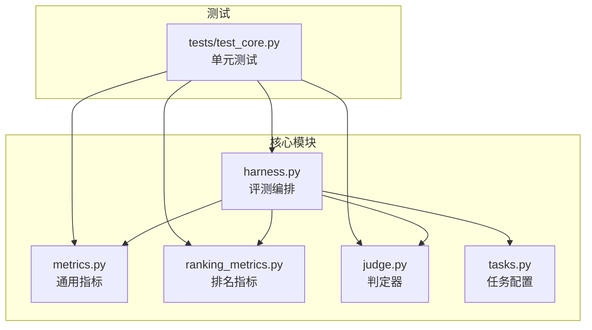
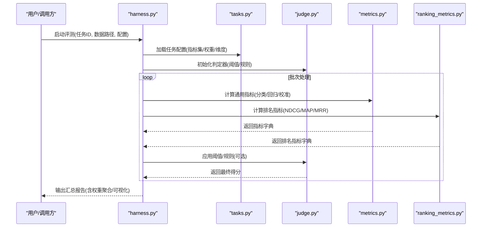
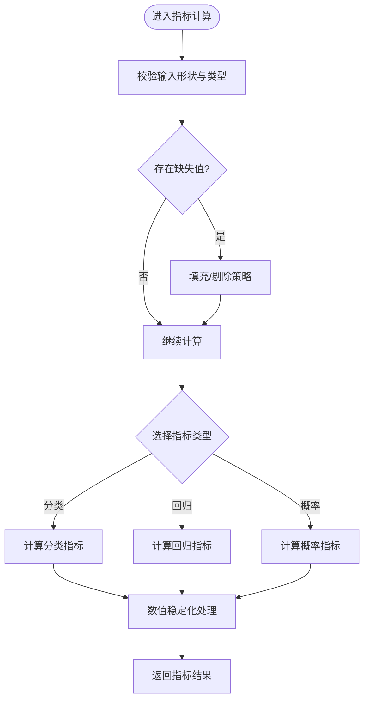
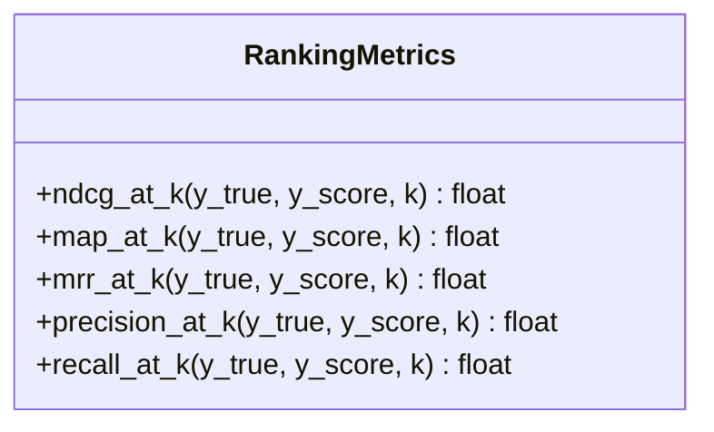
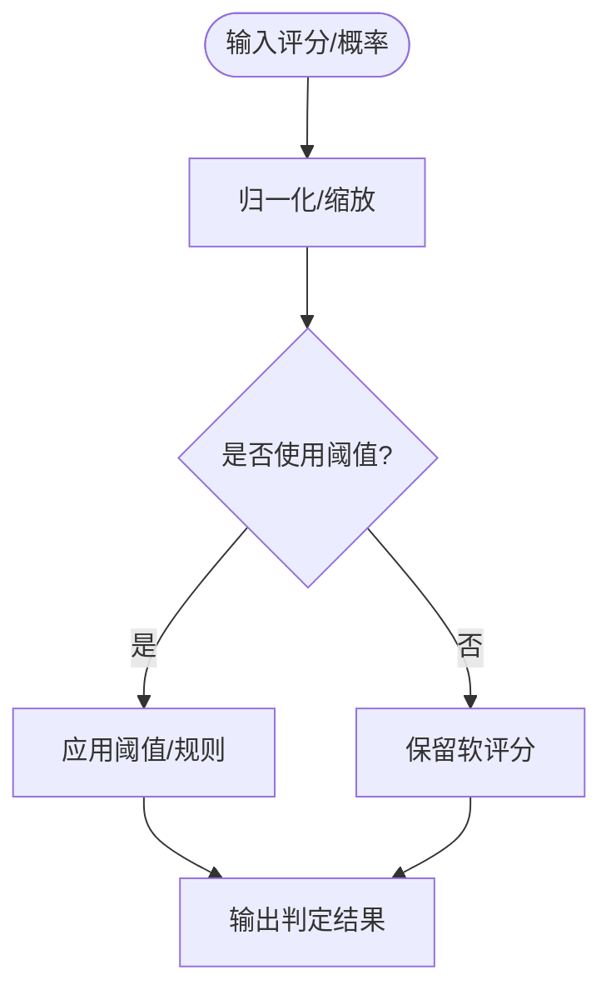
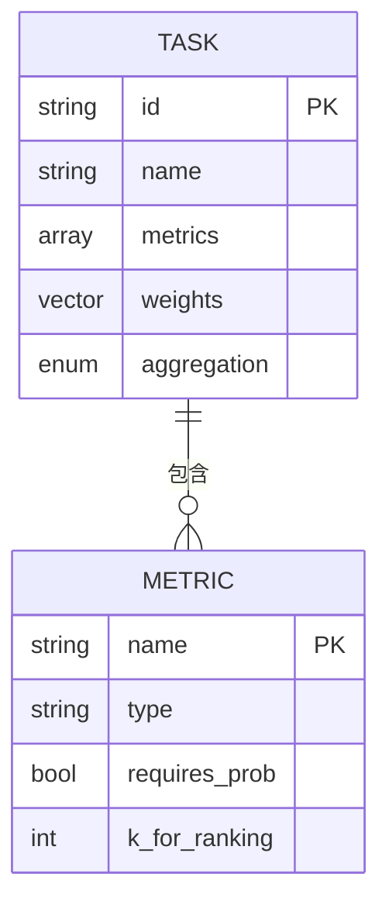
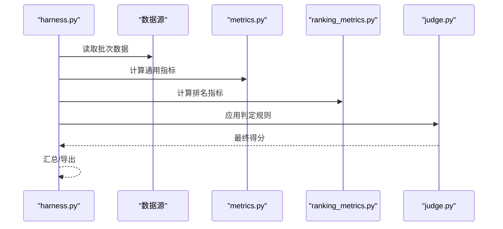
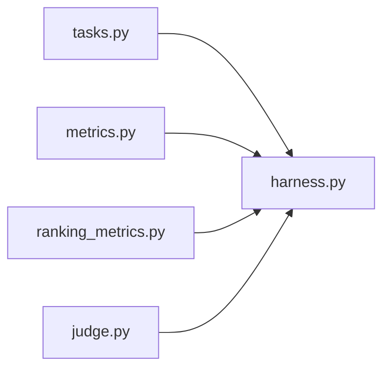

# 指标计算引擎

<cite>
**本文引用的文件**   
- [autonomy_mvp/core/metrics.py](file://autonomy_mvp/core/metrics.py)
- [autonomy_mvp/core/ranking_metrics.py](file://autonomy_mvp/core/ranking_metrics.py)
- [autonomy_mvp/core/harness.py](file://autonomy_mvp/core/harness.py)
- [autonomy_mvp/core/judge.py](file://autonomy_mvp/core/judge.py)
- [autonomy_mvp/core/tasks.py](file://autonomy_mvp/core/tasks.py)
- [autonomy_mvp/tests/test_core.py](file://autonomy_mvp/tests/test_core.py)
</cite>

## 目录
1. [简介](#简介)
2. [项目结构](#项目结构)
3. [核心组件](#核心组件)
4. [架构总览](#架构总览)
5. [详细组件分析](#详细组件分析)
6. [依赖关系分析](#依赖关系分析)
7. [性能考量](#性能考量)
8. [故障排查指南](#故障排查指南)
9. [结论](#结论)
10. [附录](#附录)

## 简介
本技术文档围绕“指标计算引擎”展开，聚焦于评估指标的计算公式、统计方法与适用场景；深入说明排名算法原理、权重分配机制与多维度评分体系；并提供自定义指标开发指南、性能优化策略与批量计算方法。同时给出指标选择的最佳实践与结果可视化方案，帮助读者在复杂评测任务中构建稳定、可解释、可扩展的评估体系。

## 项目结构
该仓库包含多个子任务与数据集，但指标计算的核心实现集中在 autonomy_mvp/core 目录下：
- metrics.py：通用指标定义与计算逻辑（如准确率、召回率、F1、AUC等）
- ranking_metrics.py：排名类指标（如NDCG、MAP、MRR等）
- harness.py：评测编排与批处理入口，负责加载数据、执行评测、汇总输出
- judge.py：判定器/裁判模块，封装评分规则与阈值判断
- tasks.py：任务元数据与配置，描述指标集、权重、维度等
- tests/test_core.py：单元测试，覆盖关键指标与边界条件

图表来源
- [autonomy_mvp/core/metrics.py](file://autonomy_mvp/core/metrics.py)
- [autonomy_mvp/core/ranking_metrics.py](file://autonomy_mvp/core/ranking_metrics.py)
- [autonomy_mvp/core/judge.py](file://autonomy_mvp/core/judge.py)
- [autonomy_mvp/core/tasks.py](file://autonomy_mvp/core/tasks.py)
- [autonomy_mvp/core/harness.py](file://autonomy_mvp/core/harness.py)
- [autonomy_mvp/tests/test_core.py](file://autonomy_mvp/tests/test_core.py)

章节来源
- [autonomy_mvp/core/metrics.py](file://autonomy_mvp/core/metrics.py)
- [autonomy_mvp/core/ranking_metrics.py](file://autonomy_mvp/core/ranking_metrics.py)
- [autonomy_mvp/core/harness.py](file://autonomy_mvp/core/harness.py)
- [autonomy_mvp/core/judge.py](file://autonomy_mvp/core/judge.py)
- [autonomy_mvp/core/tasks.py](file://autonomy_mvp/core/tasks.py)
- [autonomy_mvp/tests/test_core.py](file://autonomy_mvp/tests/test_core.py)

## 核心组件
- 通用指标（metrics.py）
  - 分类指标：准确率、精确率、召回率、F1、ROC-AUC、PR-AUC、混淆矩阵统计
  - 回归指标：MAE、RMSE、R²、Spearman/Pearson相关系数
  - 概率校准：Brier分数、ECE（期望校准误差）
  - 鲁棒性：对缺失值、类别不平衡的处理策略
- 排名指标（ranking_metrics.py）
  - NDCG@K、MAP@K、MRR@K、Precision@K、Recall@K
  - 支持多标签排序与部分可见列表
- 判定器（judge.py）
  - 阈值化决策、软评分到硬判定的映射
  - 多规则组合（AND/OR/加权投票）
- 任务配置（tasks.py）
  - 指标清单、权重向量、维度分组、聚合策略
- 评测编排（harness.py）
  - 数据加载、批处理调度、指标计算流水线、结果汇总与导出

章节来源
- [autonomy_mvp/core/metrics.py](file://autonomy_mvp/core/metrics.py)
- [autonomy_mvp/core/ranking_metrics.py](file://autonomy_mvp/core/ranking_metrics.py)
- [autonomy_mvp/core/judge.py](file://autonomy_mvp/core/judge.py)
- [autonomy_mvp/core/tasks.py](file://autonomy_mvp/core/tasks.py)
- [autonomy_mvp/core/harness.py](file://autonomy_mvp/core/harness.py)

## 架构总览
评测流程从任务配置出发，由编排器驱动数据读取、模型预测、指标计算与结果聚合。判定器提供统一的评分接口，指标模块按类型组织，排名指标与通用指标并行扩展。

图表来源
- [autonomy_mvp/core/harness.py](file://autonomy_mvp/core/harness.py)
- [autonomy_mvp/core/tasks.py](file://autonomy_mvp/core/tasks.py)
- [autonomy_mvp/core/judge.py](file://autonomy_mvp/core/judge.py)
- [autonomy_mvp/core/metrics.py](file://autonomy_mvp/core/metrics.py)
- [autonomy_mvp/core/ranking_metrics.py](file://autonomy_mvp/core/ranking_metrics.py)

## 详细组件分析

### 通用指标（metrics.py）
- 设计要点
  - 以函数式API暴露指标计算，输入为真实标签与预测值（或概率），输出标量或向量
  - 支持类别不平衡下的加权计算与缺失值容错
  - 提供统一的数据校验与数值稳定性处理（如对数域保护、除零保护）
- 典型指标与适用场景
  - 分类：Accuracy、Precision、Recall、F1、ROC-AUC、PR-AUC
  - 回归：MAE、RMSE、R²、Spearman/Pearson
  - 概率：Brier、ECE
- 复杂度与内存
  - 多数指标O(n)，AUC采用排序O(n log n)
  - 大样本下建议分块计算与流式聚合

图表来源
- [autonomy_mvp/core/metrics.py](file://autonomy_mvp/core/metrics.py)

章节来源
- [autonomy_mvp/core/metrics.py](file://autonomy_mvp/core/metrics.py)

### 排名指标（ranking_metrics.py）
- 设计要点
  - 针对Top-K场景，支持部分可见列表与多标签排序
  - 标准化折扣累积增益（NDCG）、平均精度均值（MAP）、首命平均（MRR）
- 适用场景
  - 检索、推荐、排序任务，关注头部命中质量与整体排序一致性
- 复杂度与优化
  - O(n log n)排序主导，K较小可使用堆优化至O(n log K)
  - 批量计算时预排序与缓存中间状态

图表来源
- [autonomy_mvp/core/ranking_metrics.py](file://autonomy_mvp/core/ranking_metrics.py)

章节来源
- [autonomy_mvp/core/ranking_metrics.py](file://autonomy_mvp/core/ranking_metrics.py)

### 判定器（judge.py）
- 设计要点
  - 将连续评分映射为二元或多类判定，支持阈值自适应与规则组合
  - 提供置信度区间与不确定性传播（可选）
- 适用场景
  - 需要严格通过/失败判定的评测，或业务规则驱动的评分

图表来源
- [autonomy_mvp/core/judge.py](file://autonomy_mvp/core/judge.py)

章节来源
- [autonomy_mvp/core/judge.py](file://autonomy_mvp/core/judge.py)

### 任务配置（tasks.py）
- 设计要点
  - 声明式配置：指标集合、权重向量、维度分组、聚合策略（加权/几何平均/最大值）
  - 支持跨任务复用与参数化模板
- 适用场景
  - 多任务统一评测框架，便于横向对比与自动化实验

图表来源
- [autonomy_mvp/core/tasks.py](file://autonomy_mvp/core/tasks.py)

章节来源
- [autonomy_mvp/core/tasks.py](file://autonomy_mvp/core/tasks.py)

### 评测编排（harness.py）
- 设计要点
  - 批处理调度：按批次读取数据、并行计算指标、合并结果
  - 结果导出：JSON/CSV/表格，支持可视化数据导出
  - 错误恢复：异常捕获、重试、断点续跑
- 适用场景
  - 大规模评测、多模型对比、持续集成

图表来源
- [autonomy_mvp/core/harness.py](file://autonomy_mvp/core/harness.py)
- [autonomy_mvp/core/metrics.py](file://autonomy_mvp/core/metrics.py)
- [autonomy_mvp/core/ranking_metrics.py](file://autonomy_mvp/core/ranking_metrics.py)
- [autonomy_mvp/core/judge.py](file://autonomy_mvp/core/judge.py)

章节来源
- [autonomy_mvp/core/harness.py](file://autonomy_mvp/core/harness.py)

### 单元测试（test_core.py）
- 覆盖范围
  - 指标正确性验证（已知样例）
  - 边界条件（空输入、全负样本、极端分布）
  - 排名指标K值敏感性
- 作用
  - 保障指标实现的稳定性与可重复性

章节来源
- [autonomy_mvp/tests/test_core.py](file://autonomy_mvp/tests/test_core.py)

## 依赖关系分析
- 模块耦合
  - harness.py 作为编排中心，依赖 tasks.py 的配置、metrics.py 与 ranking_metrics.py 的计算能力、judge.py 的判定逻辑
  - 指标模块之间低耦合，便于独立扩展
- 外部依赖
  - 数值计算库（如NumPy/SciPy）用于高效运算
  - 序列化与可视化库（如Pandas/Matplotlib/Plotly）用于结果导出与展示

图表来源
- [autonomy_mvp/core/harness.py](file://autonomy_mvp/core/harness.py)
- [autonomy_mvp/core/tasks.py](file://autonomy_mvp/core/tasks.py)
- [autonomy_mvp/core/metrics.py](file://autonomy_mvp/core/metrics.py)
- [autonomy_mvp/core/ranking_metrics.py](file://autonomy_mvp/core/ranking_metrics.py)
- [autonomy_mvp/core/judge.py](file://autonomy_mvp/core/judge.py)

章节来源
- [autonomy_mvp/core/harness.py](file://autonomy_mvp/core/harness.py)
- [autonomy_mvp/core/tasks.py](file://autonomy_mvp/core/tasks.py)
- [autonomy_mvp/core/metrics.py](file://autonomy_mvp/core/metrics.py)
- [autonomy_mvp/core/ranking_metrics.py](file://autonomy_mvp/core/ranking_metrics.py)
- [autonomy_mvp/core/judge.py](file://autonomy_mvp/core/judge.py)

## 性能考量
- 计算复杂度
  - 通用指标多为O(n)，AUC为O(n log n)
  - 排名指标受K影响，合理设置K或使用堆优化
- 内存与I/O
  - 大样本分块计算，避免一次性加载全部数据
  - 使用流式聚合减少峰值内存占用
- 并行与批处理
  - 指标计算可并行化（线程/进程池）
  - 批大小调优平衡吞吐与延迟
- 数值稳定性
  - 对数域保护、平滑项防止除零与NaN
  - 概率裁剪到有效区间

[本节为通用指导，不直接分析具体文件]

## 故障排查指南
- 常见问题
  - 输入形状不一致：检查标签与预测的对齐方式
  - 类别不平衡导致指标失真：启用加权或分层采样
  - AUC/PR曲线不稳定：增加平滑或调整阈值网格
  - 排名指标对K敏感：进行K敏感性分析与稳健性检验
- 定位方法
  - 启用日志与断点，逐步验证每个指标的输出
  - 使用最小复现样例隔离问题
  - 对比不同实现版本的一致性

章节来源
- [autonomy_mvp/tests/test_core.py](file://autonomy_mvp/tests/test_core.py)

## 结论
本指标计算引擎以模块化设计实现通用与排名指标的灵活组合，配合任务配置与编排器形成端到端评测流水线。通过合理的权重分配与多维度聚合，能够支撑复杂任务的综合评估。建议在工程实践中重视数值稳定性、性能优化与可解释性，并建立完善的测试与监控体系。

[本节为总结性内容，不直接分析具体文件]

## 附录

### 指标选择最佳实践
- 分类任务
  - 类别均衡：Accuracy/F1
  - 类别不平衡：PR-AUC、F1-beta（侧重召回或精确）
- 回归任务
  - 异常值敏感：MAE
  - 异常值不敏感：RMSE/R²
- 排序任务
  - 头部质量：NDCG@K、MRR@K
  - 整体排序：MAP@K
- 概率输出
  - 校准质量：Brier、ECE

[本节为概念性指导，不直接分析具体文件]

### 权重分配与多维度评分
- 权重确定
  - 专家打分法、层次分析法（AHP）、熵权法
- 聚合策略
  - 加权算术平均、几何平均、最大最小公平性约束
- 多维可视化
  - 雷达图、热力图、箱线图展示各维度表现

[本节为概念性指导，不直接分析具体文件]

### 自定义指标开发指南
- 步骤
  - 定义输入输出契约（形状、类型、缺失值处理）
  - 实现数值稳定与边界保护
  - 编写单元测试覆盖正常与异常路径
  - 注册到任务配置与编排器
- 注意事项
  - 保持与其他指标一致的API风格
  - 记录时间复杂度与内存占用
  - 提供可解释性与可视化辅助

[本节为概念性指导，不直接分析具体文件]

### 批量计算方法
- 分块策略
  - 固定块大小或动态自适应
- 并行化
  - 进程池/线程池结合IO密集型与CPU密集型任务
- 结果合并
  - 增量聚合与最终汇总

[本节为概念性指导，不直接分析具体文件]

### 结果可视化方案
- 常用图表
  - ROC/PR曲线、混淆矩阵、散点图（预测vs真实）
  - 雷达图（多维度）、柱状图（指标对比）
- 工具建议
  - Matplotlib/Seaborn（静态）、Plotly（交互）
  - Pandas/Excel导出便于二次分析

[本节为概念性指导，不直接分析具体文件]